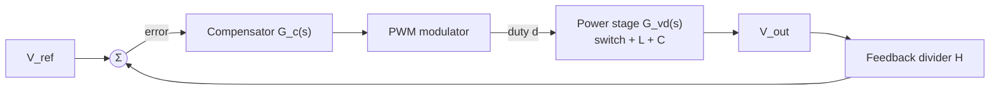

::: testing
Whether you can define stability precisely and connect it to what you see on a bench. The interviewer is listening for:

1. A definition: bounded disturbances give bounded, decaying responses. A linear loop is stable if all closed-loop poles are in the left half plane.
2. The Bode/loop-gain version: loop gain $T(s)$, crossover frequency, **phase margin** and **gain margin**.
3. The physical reason a buck needs care: the LC output filter adds up to $-180^\circ$ of phase, so a loop with too much gain at the wrong frequency turns negative feedback into positive feedback.
4. Awareness that there are other kinds of instability (subharmonic, input-filter interaction, large-signal limit cycles).
:::

::: why
A buck that regulates on the bench with a light load and rings or squeals at full load, with a different capacitor or at a different temperature, is a stability problem. Every regulator datasheet has a compensation or "stability" section for this reason. Interviewers ask the basic question to see whether you can move between the three views of stability (poles, Bode margins, time response) and say what it implies for the hardware.
:::

::: concepts
- **Negative feedback**: the regulator subtracts a fraction of $V_{out}$ from the reference and corrects the error ([[q0178]]).
- **Loop gain $T(s)$**: product of the gains around the loop: modulator, power stage, feedback divider, compensator.
- **Poles and the s-plane**: a pole in the right half plane gives a response that grows with time.
- **Crossover frequency $f_c$**: where $|T|=1$ (0 dB).
- **Phase margin (PM)**: $180^\circ+\angle T(f_c)$. Gain margin (GM): how far $|T|$ is below 1 where $\angle T=-180^\circ$.
- **Output LC filter**: a second-order resonance that adds phase lag ([[q0246]], [[q0186]]).
:::

::: answer
"Stability means the output regulates to a steady value and any disturbance, like a load step or noise, dies out instead of growing or ringing forever. Mathematically, for the small-signal model, the closed-loop poles are all in the left half-plane.

A buck is a feedback system: I divide down the output, compare it to a reference, run it through a compensator and use that to set the duty cycle. At low frequency the feedback is negative, which is what regulates. The problem is that the power stage has an LC filter, which adds up to 180 degrees of phase lag around its resonance, and the compensator, delay and sampling add more. If the loop still has gain above one when the total lag reaches 180 degrees, the feedback becomes positive and the loop oscillates.

So I look at the loop gain on a Bode plot. Where the gain crosses 0 dB, the phase margin tells me how far I am from minus 180, and I want about 45 to 60 degrees. The gain margin tells me how much the gain could rise before it breaks, and I want 6 to 10 dB or more. A good phase margin gives a well damped step response, while a low margin gives ringing and overshoot, and zero margin gives sustained oscillation.

There are other instabilities too, like subharmonic oscillation in peak current mode, but the loop-gain picture is what people usually mean."
:::

::: technical
**Definition.** For the linearized closed loop with loop gain $T(s)=G_c(s)\,G_{vd}(s)\,H(s)$ (compensator, power stage and modulator, feedback divider), the closed-loop transfer function is $\dfrac{T}{1+T}$ and its poles are the roots of $1+T(s)=0$. The system is stable if all roots have negative real part.

**Bode criteria.** For a loop with one crossover:

- $\text{PM}=180^\circ+\angle T(j\omega_c)$ where $|T(j\omega_c)|=1$.
- $\text{GM}=-20\log_{10}|T(j\omega_{180})|$ where $\angle T=-180^\circ$.
- Stable if PM > 0 and GM > 0 (for loops with $|T|$ falling through unity once).

**Targets.** PM of 45° to 60° and GM of at least 6 to 10 dB are common design targets, so that component tolerance, temperature and load keep the loop stable. For a canonical second-order loop, $\zeta\approx\text{PM}/100$ (for PM below 60°), so 60° gives about 10% overshoot and 30° gives about 35%.

**Why a buck is awkward.** In voltage mode the power stage has the LC double pole at $f_0=1/(2\pi\sqrt{LC})$ with a $-180^\circ$ phase drop, a Q set by load and losses, and a possible ESR zero ($f_{esr}=1/(2\pi\,ESR\,C)$) that gives back up to $90^\circ$. With a pure integrator as the compensator the phase at crossover would be near $-270^\circ$.

**Example.** $V_{in}=12$ V, $V_{out}=3.3$ V, $L=4.7$ µH, $C=47$ µF, ESR 10 mΩ, 1 A load: $f_0=10.7$ kHz, $Q\approx5$, ESR zero 339 kHz. A type III compensator with two zeros at $f_0$ and poles near 250 to 340 kHz that crosses over at 40 kHz gives PM = 53° (computed from the model). An integrator-only compensator with the same 40 kHz crossover gives PM = −97°, which is unstable. The same integrator-only loop with a crossover at 500 Hz is stable (PM about 90°, GM about 9 dB), though slow.

**Other instabilities.** Subharmonic oscillation in peak-current mode ([[q0253]]), negative input impedance interacting with the input filter, and large-signal limit cycles (current limit, duty saturation).
:::

::: short
"Stability means disturbances like load steps and noise die out instead of growing. In the small-signal model, that means all closed-loop poles are in the left half-plane. In practice I check the loop gain on a Bode plot: at the crossover frequency where gain is 0 dB, the phase margin should be about 45 to 60 degrees, and the gain margin 6 to 10 dB or more. The buck is tricky because its LC output filter adds up to 180 degrees of phase lag, so the compensator has to add phase lead around crossover or the feedback turns positive and the output oscillates."
:::

::: long
"Stability means the converter settles to its regulated output and any disturbance, a load step, a line step, noise, decays. It doesn't grow and it doesn't ring forever. For the linearized system that's equivalent to all closed-loop poles being in the left half plane.

A buck is a feedback system: the output goes through a resistor divider to an error amplifier, the compensator shapes the response, and the modulator turns that into duty cycle. The power stage in the middle is an LC low-pass filter, which is a second-order system. Around its resonant frequency it adds a sharp phase drop of up to 180 degrees, and its gain peaks by the quality factor Q. The sensing delay, the PWM sampling and the amplifier's own poles add more phase lag.

Feedback is negative at low frequency, but at the frequency where the total phase reaches minus 180, the sign flips, and if the loop gain there is above one, any small signal gets bigger each time around the loop and the converter oscillates.

So I plot the loop gain. The crossover frequency is where the magnitude equals one. The phase margin is how far the phase is from minus 180 at that frequency, and I aim for 45 to 60 degrees. The gain margin is how much the gain could increase before the loop would go unstable, and I want at least 6 to 10 dB. A good rule is a crossover of maybe a tenth to a fifth of the switching frequency, and the compensator places zeros near the LC resonance to cancel the phase drop.

The time-domain picture follows: high phase margin gives a nicely damped load-step recovery, low margin gives overshoot and ringing, zero margin gives a constant-amplitude oscillation, and negative margin a growing one that ends at a limit like the duty-cycle clamp or current limit.

And there are other kinds, like subharmonic oscillation in peak current mode, or interaction with the input filter, so loop gain is necessary but not the whole story."
:::

::: terms
- **Closed-loop poles**: roots of $1+T(s)=0$. They must be in the left half-plane for stability.
- **Loop gain $T(s)$**: gain around the whole feedback loop. Break the loop, inject, measure.
- **Crossover frequency**: where $|T|=1$.
- **Phase margin**: $180^\circ+\angle T(f_c)$.
- **Gain margin**: how much gain can rise at $\angle T=-180^\circ$ before instability.
- **Compensator**: network (type I, II, III) that shapes the loop gain.
- **Conditionally stable**: stable only for a range of gains, not for any gain below some limit.
- **Large-signal stability**: stability of nonlinear behavior, like limit cycles and saturation.
:::

::: exceptional
**An average answer** says "stable means it doesn't oscillate".

**An exceptional answer**:
- Gives the pole definition and the Bode (PM/GM) version, with target values.
- Explains *why* a buck's LC filter threatens stability (phase lag near $-180^\circ$, resonant gain peak).
- Ties PM to the time response: overshoot and ringing numbers.
- Mentions the compensator's job (phase boost with zeros, crossover choice vs $f_{sw}$) and a measured example with numbers.
- Mentions other mechanisms: subharmonic, input-filter, current limit and large-signal behaviour.
- Mentions how you'd measure it: injection into the feedback path and a frequency-response analyzer.
:::

::: mistakes
- **Equating stability with low ripple.** Ripple is the switching component and is independent of loop stability. A loop can be unstable with small ripple.
- **Only checking phase margin.** You also need gain margin, and you need to check across line, load, temperature and capacitor derating.
- **Measuring the closed-loop response only.** Peaking in closed-loop response hints at low margin, but only the loop gain tells you the margins.
- **Assuming a stable loop at light load is stable at full load.** The plant's Q and the DCM/CCM transition change with load.
- **Forgetting ceramic capacitor derating.** DC bias can cut MLCC capacitance by half or more and shifts $f_0$ and the ESR-zero frequency.
- **Ignoring sampling.** Averaged models stop being accurate near $f_{sw}/2$, so crossover must stay well below.
:::

::: deep
## The loop in blocks


Figure: Loop gain $T=G_c\cdot G_{mod}\cdot G_{vd}\cdot H$. Break the loop anywhere, drive it with a small AC signal and measure the ratio of returned to injected signal to get $T(s)$.

The sign convention: the summing junction subtracts feedback, so if the signal comes around with a $-180^\circ$ phase shift it adds, and with gain above one it grows. Stability is about what happens near the frequency where the phase is $-180^\circ$ (relative to the already negative sign).

## The power stage in voltage mode

In voltage mode, the duty-to-output transfer function (CCM, ideal) is

$$G_{vd}(s)=V_{in}\,\frac{1+sC\,r}{1+s\left(Cr+\frac{L}{R}\right)+s^2LC\left(1+\frac rR\right)}$$

with $r$ the capacitor ESR. It has a double pole at $f_0\approx1/(2\pi\sqrt{LC})$ and a zero at $f_{esr}=1/(2\pi rC)$. For the example, $f_0=10.7$ kHz, $Z_0=\sqrt{L/C}=0.316$ Ω, and the loaded Q is about 5 once ESR and inductor DCR are included. The phase drops by 180° through $f_0$.

## Loop gain with and without compensation

```bode
{"systems":[{"label":"Type III, crossover 40 kHz (PM 53°)","num":[2.2983218042889875e-11,0.00005199079122450441,6.679045955676376,221024.42601077983],"den":[6.622322493467497e-23,2.456448116107823e-16,2.2396350443558928e-10,0.0000030003458045506998,1,0]},{"label":"Integrator only, crossover forced to 40 kHz","num":[1.5556272078878004,3309845.1231655334],"den":[6.622322493467497e-23,2.456448116107823e-16,2.2396350443558928e-10,0.0000030003458045506998,1,0]},{"label":"Integrator only, crossover 500 Hz (slow but stable)","num":[0.0014733487727037662,3134.7846227739715],"den":[6.622322493467497e-23,2.456448116107823e-16,2.2396350443558928e-10,0.0000030003458045506998,1,0]}],"vars":{},"f":{"min":100,"max":2000000},"marks":[{"f":40000,"label":"40 kHz"}],"show":"both","magRange":[-80,80]}
```
Figure: Magnitude and phase of three loops built on the same power stage. The type III compensator (zeros at the LC resonance, poles near the ESR zero and half the switching frequency) crosses 0 dB at 40 kHz with 53° phase margin. The integrator-only loop forced to the same crossover has phase near −270° there (PM −97°, unstable). Dropping that same integrator crossover to 500 Hz makes it stable and slow.

Reading the picture: the compensator's two zeros add back about 180° of phase around the LC resonance, which is the central job of voltage-mode compensation. Without them, the only stable choice is to cross over below the LC resonance, which wastes bandwidth. Crossing near the resonance with Q about 5 puts a +14 dB peak under the 0 dB line, which is a gain-margin problem on its own.

## From margin to time response

Phase margin controls how damped the response is. For a second-order loop PM maps approximately to damping ratio $\zeta\approx\text{PM}/100$ and to overshoot $e^{-\pi\zeta/\sqrt{1-\zeta^2}}$:

| PM | $\zeta$ (approx.) | Step overshoot | Closed-loop Q ≈ $1/2\zeta$ |
|---|---|---|---|
| 10° | 0.1 | 73% | 5.0 |
| 30° | 0.3 | 37% | 1.7 |
| 45° | 0.45 | 21% | 1.1 |
| 60° | 0.6 | 9.5% | 0.83 |
| 75° | 0.75 | 2.8% | 0.67 |

(The shortcut is only good up to about $\zeta=0.6$; for $\zeta=0.6$ the exact PM is 59°. Beyond that the exact PM is *lower* than PM/100 suggests, so the 75° row understates the damping: in the canonical second-order loop 75° actually corresponds to $\zeta\approx0.95$ and essentially no overshoot. See the derivation below.)

```plot
{"title":"Closed-loop step response vs damping (canonical second-order loop)","x":{"label":"time","unit":"s","min":0,"max":"300e-6"},"y":{"label":"normalised output","min":-0.2,"max":2.1},"vars":{"wn":"2*pi*10e3"},"series":[{"label":"ζ = 0.6 (PM ≈ 59°)","fn":"1-exp(-(0.6)*wn*x)*(cos(wn*sqrt(1-(0.6)*(0.6))*x)+(0.6)/sqrt(1-(0.6)*(0.6))*sin(wn*sqrt(1-(0.6)*(0.6))*x))","color":"green"},{"label":"ζ = 0.3 (PM ≈ 33°)","fn":"1-exp(-(0.3)*wn*x)*(cos(wn*sqrt(1-(0.3)*(0.3))*x)+(0.3)/sqrt(1-(0.3)*(0.3))*sin(wn*sqrt(1-(0.3)*(0.3))*x))","color":"blue"},{"label":"ζ = 0.1 (PM ≈ 11°)","fn":"1-exp(-(0.1)*wn*x)*(cos(wn*sqrt(1-(0.1)*(0.1))*x)+(0.1)/sqrt(1-(0.1)*(0.1))*sin(wn*sqrt(1-(0.1)*(0.1))*x))","color":"orange"},{"label":"ζ = 0 (PM = 0°, marginal)","fn":"1-exp(-(0)*wn*x)*(cos(wn*sqrt(1-(0)*(0))*x)+(0)/sqrt(1-(0)*(0))*sin(wn*sqrt(1-(0)*(0))*x))","color":"muted","dashed":true},{"label":"ζ = −0.03 (unstable)","fn":"1-exp(-(-0.03)*wn*x)*(cos(wn*sqrt(1-(-0.03)*(-0.03))*x)+(-0.03)/sqrt(1-(-0.03)*(-0.03))*sin(wn*sqrt(1-(-0.03)*(-0.03))*x))","color":"red"}],"hlines":[{"at":1,"label":"final value","color":"muted"}]}
```
Figure: Step response of the closed loop for several damping ratios. The marginal case rings forever at constant amplitude, the unstable case grows (in a real converter it ends against the duty-cycle clamp or current limit).

## Margins and design targets

Margins are there for variation: capacitor tolerance and DC-bias derating, inductor tolerance and saturation, temperature, load and line. Check the loop at the corners: highest and lowest $V_{in}$, light and full load, minimum and maximum capacitance. A design with 45° at nominal can go below 20° at a corner.

## Measuring it

Insert a small series resistor (10 to 50 Ω) between the output divider and the output, inject a swept sine across it, and measure the signals on either side with a frequency-response analyzer or a scope with Bode function. The ratio gives $T(f)$. Keep the injection small so the converter stays linear.

## Try it

```sim
{"id":"buck-control","l":4.7e-6,"c":4.7e-5,"esr":0.01,"fc":40000,"pm":55,"istep":2}
```
Figure: Slide the target phase margin from 55° down to 10° and then below 0°: the Bode plot's margins update and the load-step response goes from damped to ringing to a sustained oscillation clipped by the duty limits.

## Deriving the phase-margin to damping link

The table above uses the $\zeta\approx\text{PM}/100$ shortcut. The exact relation for the canonical loop $T(s)=\omega_n^2/[s(s+2\zeta\omega_n)]$ comes from finding where $|T|=1$ and reading the phase there. Setting $|T(j\omega_c)|=1$ gives $\omega_c^4+4\zeta^2\omega_n^2\omega_c^2-\omega_n^4=0$, so

$$\frac{\omega_c}{\omega_n}=\sqrt{\sqrt{1+4\zeta^4}-2\zeta^2},\qquad \text{PM}=\arctan\!\left(\frac{2\zeta\,\omega_n}{\omega_c}\right).$$

Evaluating this exactly:

| $\zeta$ | $\omega_c/\omega_n$ | PM (exact) | PM/100 shortcut |
|---|---|---|---|
| 0.1 | 0.990 | 11.4° | 10° |
| 0.3 | 0.914 | 33.3° | 30° |
| 0.45 | 0.821 | 47.6° | 45° |
| 0.6 | 0.716 | 59.2° | 60° |
| 0.75 | 0.617 | 67.7° | 75° |
| 1.0 | 0.486 | 76.3° | 100° (nonsense) |

The shortcut works between about 0.2 and 0.6 and fails beyond, since PM cannot exceed 90° for this loop. It also shows that the closed-loop ringing frequency is slightly below $\omega_n$, and that for well-damped loops the crossover sits at roughly half to three-quarters of the natural frequency. For a real buck, whose loop is not a pure second-order, treat it only as a guide and judge the margins from the measured Bode plot.

## What eats phase margin at high crossover

A switching converter is a sampled system. The modulator samples the error once per cycle and the new duty takes effect after about half a period on average, which behaves like a pure delay $T_d\approx T_{sw}/2$. A delay costs phase proportional to frequency without changing the gain:

$$\Delta\varphi=-360^\circ f\,T_d\quad\Rightarrow\quad\text{loss at crossover}=180^\circ\,\frac{f_c}{f_{sw}}\ \ (\text{for }T_d=T_{sw}/2).$$

With $f_{sw}=500$ kHz and a 40 kHz crossover the loss is $180\times0.08=14.4^\circ$. Push the crossover to $f_{sw}/10=50$ kHz and it is 18°; at $f_{sw}/5$ it is 36°, which is why crossover above a fifth of the switching frequency is hard. Every additional source of delay adds more: a digital controller's computation time (0.5 µs of extra delay at 40 kHz costs $360\times40\text{ kHz}\times0.5\text{ µs}=7.2^\circ$), the sense filter, and the gate driver. This is the quantitative reason for the "crossover below $f_{sw}/10$" rule of thumb. The phase margin reported by an averaged model that ignores delay is therefore optimistic by this amount, and you should budget for it in the design.

## What changes when the capacitor changes

The ceramic derating warning in the mistakes section can be put into numbers. With $L=4.7$ µH and 47 µF the corner is 10.7 kHz and the characteristic impedance is $Z_0=\sqrt{L/C}=0.316$ Ω. If DC bias cuts the effective capacitance in half to 23.5 µF:

- the corner rises to $f_0=15.1$ kHz (a factor of $\sqrt2$);
- $Z_0$ rises to 0.447 Ω, so the same load resistor and ESR give a different Q;
- the ESR zero at $1/(2\pi\,r\,C)$ moves from 339 kHz to 677 kHz, further above the crossover and so less useful for phase lead.

Since the compensator zeros were placed for 10.7 kHz, the loop gain at 40 kHz also shifts, changing the crossover and margin. This is why the loop has to be checked at the minimum capacitance and not just the nominal.

## Stability beyond the loop gain: input-filter interaction

A tightly regulated converter draws constant power, so when its input voltage rises its input current falls. Its small-signal input resistance is negative:

$$R_{in}=-\frac{V_{in}^2}{P_{in}}$$

For the 12 V to 3.3 V, 1 A buck at 90% efficiency, $P_{in}=3.67$ W and $R_{in}=-39$ Ω. An LC input filter has an output impedance with a peak of roughly $Q\,Z_0$ at its resonance. Middlebrook's criterion says the filter's output impedance must stay well below $|R_{in}|$ at all frequencies to avoid interaction; a $Z_0$ of 0.32 Ω with $Q=5$ gives a peak near 1.6 Ω, comfortably below 39 Ω. Scale the same converter to 100 W and $R_{in}=-1.44$ Ω: now that same filter's peak is above the converter's input resistance, and the combination can oscillate even though the converter's own loop has margin. Fixes include damping the filter (a series RC branch across the input capacitor, with the damping capacitor much larger than the filter capacitor), lowering the filter impedance, or using a lower-Q filter.

## A bench check that does not need a network analyzer

A load-step response gives a quick estimate of damping. Apply a step from 10% to 90% of full load and look at the output voltage ring. The overshoot ratio of the first two peaks gives the logarithmic decrement and hence $\zeta$; the ring frequency gives the crossover region. For the example loop a ring near 11 kHz with an overshoot of about 37% on the recovery implies $\zeta\approx0.3$ and a phase margin of about 33°, which is below the usual 45° target. This estimate assumes the loop behaves like a second-order system, so treat it as a screening test. Confirm it with a gain-phase measurement across the corners: high and low line, light and full load, and minimum capacitance. If the ring changes noticeably between corners, the margin is changing with them.

> [!UNCERTAIN]
> The delay model ($T_d\approx T_{sw}/2$) is the common first-order approximation for a trailing-edge modulator; the actual delay depends on the modulator type, sensing filter and controller architecture. Use the controller datasheet or a measured loop gain to determine the real number.
:::

::: applications
- **Regulator datasheets**: "stability" and "compensation" sections list the allowed output capacitance and ESR range.
- **Loop-gain measurements on bench**: every power-supply validation includes a Bode plot at several load and line conditions.
- **Internal compensation (fixed)**: IC designers select the compensation for a window of $L$ and $C$ and specify it.
- **POL converters for processors**: digital controllers optimize compensation per load.
- **Automotive and industrial supplies**: margins verified across temperature and aging of capacitors.
:::

::: assumptions
- **Small-signal, averaged model** in CCM, valid up to a fraction of $f_{sw}$.
- **A single crossover** with monotonic gain, so PM and GM are meaningful (for conditionally stable loops, check the Nyquist plot).
- **Example numbers** from an averaged voltage-mode model with Type III compensation, 1 A load, 47 µF with 10 mΩ ESR.
- **Rule $\zeta\approx\text{PM}/100$** is an approximation that holds best for 20° to 60°.
- **Peak current mode** changes the plant to a first-order one with a sampling double pole at $f_{sw}/2$, so the stability conditions differ ([[q0252]], [[q0253]]).
:::

::: followups
### What's the difference between phase margin and gain margin?
Phase margin is measured at the crossover frequency (gain 1): how many degrees more lag the loop can take. Gain margin is measured where the phase hits −180°: how many dB more gain the loop could have. They catch different failures: PM covers extra delay or phase lag, GM covers gain variations. A loop needs both.

### Why can't you just choose a very low crossover frequency to be safe?
You can, and it is stable, but it is slow: the load-step droop and recovery scale as $1/f_c$ ([[q0249]]), so you need much more output capacitance. The bandwidth is a design trade-off between response and robustness, with an upper bound set by the sampling at $f_{sw}$.

### What if the loop is unstable only at light load?
Light load changes the plant: Q is higher with less damping from the load, and in DCM or PFM the plant is a different first-order system. The compensator tuned for CCM full load may leave little margin. Check the loop at the minimum load and in the mode used there.

### Does a stable loop guarantee the converter is stable?
No. Subharmonic oscillation can occur in peak current mode even if the averaged loop has margin ([[q0253]]). Input-filter interaction (the converter's negative input resistance $-V_{in}^2/P$ against the filter's output impedance) and large-signal effects like current limit cycling are also possible.

### Scenario: your buck oscillates at about 12 kHz at full load with a new capacitor. What do you do?
The oscillation near the LC corner suggests low phase margin at a crossover near $f_0$ or a high Q peak crossing 0 dB. Check what changed: the capacitor's ESR may be much lower (a ceramic instead of an electrolytic), so the ESR zero moved from 30 kHz to several MHz, and the phase boost is gone. Measure the loop with injection, then add a feedforward capacitor ([[q0250]]) or adjust the compensator zeros, or lower the crossover.
:::

::: references
- Erickson & Maksimović, *Fundamentals of Power Electronics*: converter transfer functions, feedback and controller design chapters.
- Franklin, Powell & Emami-Naeini, *Feedback Control of Dynamic Systems*: Bode and Nyquist stability criteria, gain and phase margins.
- Texas Instruments application notes on buck converter compensation and loop measurement (search "Bode plot" and "loop stability"). Use the exact part's datasheet for its limits.
:::

::: rubric
- Defines stability: bounded, decaying response; poles in the left half-plane :: Precise definition is the foundation.
- Explains the loop-gain Bode view: crossover, phase margin, gain margin :: How engineers actually assess it.
- Explains why the LC filter causes lag and what the compensator does :: Shows physical insight.
- Quotes typical targets (PM 45 to 60°, GM 6 to 10 dB or more) :: Practical rule.
- Connects margins to time-domain behavior (damping, ringing) :: Links theory to what you see on the scope.
- Mentions other instabilities and how loop gain is measured :: Shows breadth.
:::

::: quiz
```json
[
 {"type":"mcq","level":"fundamental","q":"A linear closed-loop system is stable when...","options":["all closed-loop poles are in the right half-plane","all closed-loop poles are in the left half-plane","the loop gain is always above 0 dB","the phase margin is exactly 0°"],"answer":1,"explain":"Poles in the left half-plane give responses that decay. Right-half-plane poles give growing responses."},
 {"type":"numeric","level":"fundamental","q":"The loop gain has a phase of −125° at the crossover frequency. What is the phase margin?","answer":55,"tolerance":0.01,"unit":"°","explain":"$\\text{PM}=180^\\circ+(-125^\\circ)=55^\\circ$."},
 {"type":"numeric","level":"intermediate","q":"Compute the LC corner frequency for $L=4.7$ µH and $C=47$ µF, in kHz.","answer":10.7,"tolerance":0.02,"unit":"kHz","explain":"$f_0=1/(2\\pi\\sqrt{LC})=1/(2\\pi\\sqrt{4.7\\text{ µH}\\cdot47\\text{ µF}})=10.7$ kHz."},
 {"type":"mcq","level":"intermediate","q":"Which phase margin gives roughly 10% step overshoot for a second-order loop?","options":["15°","30°","60°","90°"],"answer":2,"explain":"With $\\zeta\\approx\\text{PM}/100=0.6$, overshoot is $e^{-\\pi\\zeta/\\sqrt{1-\\zeta^2}}\\approx9.5\\%$."},
 {"type":"truefalse","level":"advanced","q":"If the averaged small-signal loop has 60° of phase margin, a peak-current-mode buck at 60% duty cannot oscillate.","answer":false,"explain":"Subharmonic oscillation arises from the sampled-data inner current loop when $D>0.5$ without slope compensation. The averaged model with margin does not predict it."},
 {"type":"multi","level":"advanced","q":"Select all that can reduce the phase margin of a buck loop.","options":["Larger sampling or modulator delay","A zero placed near the crossover by the compensator","A higher-Q LC filter peaking near crossover","Losing the ESR zero by changing to ceramic capacitors"],"answer":[0,2,3],"explain":"Delay adds lag, a high-Q resonance near crossover adds a steep phase drop, and losing the ESR zero removes up to 90° of lead. A compensator zero near crossover adds phase lead."}
]
```
:::
