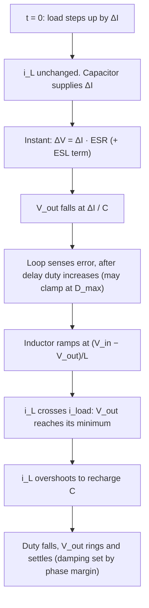

::: testing
Whether you can narrate a load step **in order**, with the physics at each stage, instead of saying "the output droops and recovers". The interviewer wants to hear:

1. The inductor current cannot change instantly, so the **output capacitor supplies the step** (ESR/ESL step first, then $dv/dt=-\Delta I/C$).
2. The feedback loop detects the droop after a delay, the duty cycle rises (possibly to its limit), and the inductor current ramps at $(V_{in}-V_{out})/L$.
3. When the inductor current crosses the load current the droop bottoms out; then the inductor overshoots to recharge the capacitor and the loop settles.
4. The **release** (load decreasing) is the mirror image and is usually slower because the down-slope is $V_{out}/L$.
:::

::: why
A processor wake-up, a motor start, a radio transmit burst: all are load steps, and the regulator's job is to keep the rail inside its tolerance. The whole point of the capacitor bank, the loop bandwidth and the inductor choice is the load transient. Interviewers often ask for this walk-through because it ties together inductor current, capacitor charge and control-loop timing in one story ([[q0243]] for multiphase, [[q0249]] for how to characterize it).
:::

::: concepts
- **Inductor current continuity**: $v_L=L\,di/dt$; the current can only ramp at $(V_{in}-V_{out})/L$ or $-V_{out}/L$ ([[q0188]]).
- **Capacitor charge supply**: $C\,dv/dt=i_C=i_L-i_{load}$ ([[q0186]]).
- **ESR and ESL steps**: $\Delta V=\Delta I\cdot ESR$ immediately, plus $L_{esl}\,di/dt$.
- **Feedback loop delay and bandwidth**: the converter reacts only after the error is sensed and amplified ([[q0244]]).
- **Duty-cycle saturation**: the modulator limit ($D_{max}$, $D_{min}$) sets the maximum slew.
- **Damping and phase margin** set how much the output rings afterwards ([[q0245]]).
:::

::: answer
"Say the load current steps up by two amps. At that instant the inductor current hasn't changed, because an inductor resists current changes: it can only ramp at V in minus V out over L. So the extra two amps have to come from the output capacitor. First there's an immediate step from the capacitor's ESR, I times ESR, and a bit from its ESL, and then the capacitor voltage starts to droop at delta I over C.

The feedback loop sees the output drop. After some delay from the sensing and the error amplifier, it increases the duty cycle, perhaps all the way to its maximum. The inductor sees a larger voltage across it and ramps up, in my example at 1.85 amps per microsecond, so it takes a little over a microsecond to get from one amp to three.

The droop bottoms out when the inductor current crosses the new load current, because then the capacitor stops discharging. But the inductor current has to overshoot the load current for a while to put back the charge the capacitor lost. Then the loop pulls the duty cycle back down and the output settles. How much it rings depends on the phase margin.

The release is the reverse: the inductor has excess current, which dumps into the capacitor, and the output overshoots. It's usually the harder case at low output voltages, because the inductor current only falls at V out over L, which is slow."
:::

::: technical
**Setup.** Buck with $V_{in}=12$ V, $V_{out}=3.3$ V, $L=4.7$ µH, $C=47$ µF, ESR 10 mΩ, load step from 1 A to 3 A ($\Delta I=2$ A).

**Phase 1: instantaneous.** $i_L$ unchanged, so the capacitor supplies $\Delta I$: $\Delta V_{ESR}=\Delta I\,ESR=20$ mV immediately, plus an ESL term $L_{esl}\,di/dt$ for a fast edge.

**Phase 2: capacitor discharge.** $dv/dt=-\Delta I/C=-2\text{ A}/47\text{ µF}=-0.043$ V/µs initially.

**Phase 3: inductor catch-up.** After the loop delay the duty cycle rises. If it saturates, slew is $s_\uparrow=(V_{in}-V_{out})/L=(12-3.3)/4.7\text{ µH}=1.85$ A/µs, so reaching $\Delta I$ takes $t=\Delta I/s_\uparrow=1.08$ µs. The charge removed in the ideal slew-limited case is $Q=\Delta I^2/(2s_\uparrow)=1.08$ µC, so $\Delta V\approx Q/C=23$ mV (plus the 20 mV ESR step).

**Phase 4: recovery.** The capacitor must be recharged, so the inductor current overshoots the load current, then the loop settles. For a loop with crossover $f_c$ and damping about 0.7 the peak droop is about $0.46\,\Delta I/(2\pi f_cC)$; with $f_c=40$ kHz that is 78 mV, which is larger than the slew-limited 43 mV because the loop reacts with delay and finite gain.

**Simulation of this converter** (averaged switch model, PID-type compensator, duty limited to 0.9, sensing pole at 1 MHz): the output steps down 20 mV at once, reaches a minimum droop of 71 mV about 3.6 µs after the step, the inductor current peaks at 3.54 A (0.54 A above the new load) and the output is within 5 mV of 3.3 V after about 32 µs. On release the overshoot is 76 mV at about 3.6 µs and the output settles in about 33 µs.

**Release.** The inductor falls at $-V_{out}/L=-0.70$ A/µs, 2.6 times slower than it rose. The stored energy $\tfrac12L\Delta I^2$ goes to the capacitor: ideal overshoot $\sqrt{V_{out}^2+L\Delta I^2/C}-V_{out}=60$ mV.

> [!UNCERTAIN]
> The simulation numbers depend on the assumed compensator tuning and sensing delay. Different but stable tunings will give different droop and settling time. The ideal slew-limited numbers (23 mV, 60 mV) are lower bounds for sag and a starting estimate for overshoot.
:::

::: short
"When the load steps up, the inductor current can't jump, since it only ramps at V in minus V out over L, so the output capacitor supplies the extra current. You see an immediate ESR step, then the capacitor droops at delta I over C. The loop senses the droop, raises the duty cycle, and the inductor ramps up until its current matches the new load, at which point the droop bottoms out. The inductor then overshoots slightly to recharge the capacitor and the output settles, ringing according to the phase margin. A load release is the mirror image, and it overshoots more because the inductor only falls at V out over L."
:::

::: long
"I'll walk through it in the order things happen. Start in steady state: the inductor current equals the load current, say 1 amp, with the ripple on top, and the output is at 3.3 V. Now the load jumps to 3 amps.

First instant: nothing in the converter has changed. The inductor current is still 1 amp, because an inductor only changes current at V over L. So the extra 2 amps come out of the output capacitor. That gives me a step from the ESR, 2 amps times 10 milliohms is 20 millivolts, plus a bit from ESL if the edge is fast. Then the capacitor discharges at delta I over C, about 0.043 volts per microsecond with 47 microfarads.

Second stage: the feedback loop notices the dip. There's a delay from the divider, the error amplifier and the modulator, then the duty cycle goes up, probably clamping at its maximum. With 12 V in and 3.3 V out and a 4.7 microhenry inductor, the current ramps at 1.85 amps per microsecond, so about a microsecond to reach the new load.

Third stage: the output voltage bottoms out when the inductor current equals the load current, because after that the capacitor stops discharging. But the capacitor is now low on charge, so the inductor current has to exceed the load for a while to refill it. The duty cycle then comes back down, and the output rings and settles. In a simulation of this converter I get about a 70 millivolt droop and a few tens of microseconds to settle, with the ring set by the phase margin.

The release is the same story reversed. The inductor current is too high, it only falls at V out over L, which is 0.7 amps per microsecond here, so it dumps the excess energy into the capacitor and the output overshoots, about 60 to 80 millivolts here.

What helps: more capacitance and lower ESR for the first stage, higher loop bandwidth and a smaller inductor for the second and third, and enough phase margin so the ring dies out quickly."
:::

::: terms
- **Load step (transient)**: sudden change in load current.
- **Droop / undershoot**: the dip in $V_{out}$ after a load increase.
- **Overshoot**: the rise in $V_{out}$ after a load decrease.
- **Slew rate (di/dt)**: how fast the inductor current can ramp.
- **ESR / ESL step**: instantaneous voltage from the capacitor's series resistance and inductance.
- **Recovery (settling) time**: time to return within a tolerance band.
- **Duty-cycle saturation**: the modulator reaching $D_{max}$ or $D_{min}$.
- **Ring-back**: oscillation after the main deviation, set by damping.
:::

::: exceptional
**An average answer** says "the output dips, then the loop corrects it".

**An exceptional answer**:
- Orders events: inductor can't respond, capacitor supplies, ESR step, $dv/dt$, loop delay, duty saturation, inductor ramp, crossing, overshoot, settling.
- Gives numbers: ESR step, slew, catch-up time and ideal charge deficit.
- Distinguishes slew-limited (large-signal) from loop-limited (small-signal) behaviour.
- Explains the release case and why it is typically worse ($V_{out}/L$ slope).
- Mentions what to change (C, ESR, $f_c$, $L$, phase margin) and which stage each fixes.
- Mentions DCM/diode behaviour: with no reverse current path the output decays only through the load.
:::

::: mistakes
- **"The inductor supplies the extra current immediately."** It can't; the capacitor does until the inductor ramps.
- **Putting the minimum at the time the duty cycle changes.** The minimum occurs when the inductor current crosses the load current.
- **Ignoring ESR/ESL.** With fast edges they set the first tens of millivolts and no controller can fix them.
- **Only analyzing the step-up case.** Release overshoot is usually larger at low $V_{out}$.
- **Equating droop with loop bandwidth alone.** Slew limits, ESR and delays all contribute.
- **Forgetting asynchronous/DCM behaviour.** A diode buck cannot sink current, so after a release the output only falls through the load.
:::

::: deep
## The sequence of events


Figure: The order matters. The minimum voltage is at stage G, not when the duty cycle first moves. The shape after G is set by the loop.

## Currents and voltage together

```plot
{"title":"Load current and inductor current through a 2 A step and release (simulation)","x":{"label":"time (µs)","min":0,"max":220},"y":{"label":"current (A)","min":0,"max":4},"series":[{"label":"I_load","points":[[0,1],[0.5,1],[1,1],[1.5,1],[2,1],[2.5,1],[3,1],[3.5,1],[4,1],[4.5,1],[5,1],[5.5,1],[6,1],[6.5,1],[7,1],[7.5,1],[8,1],[8.5,1],[9,1],[9.5,1],[10,1],[10.5,1],[11,1],[11.5,1],[12,1],[12.5,1],[13,1],[13.5,1],[14,1],[14.5,1],[15,1],[15.5,1],[16,1],[16.5,1],[17,1],[17.5,1],[18,1],[18.5,1],[19,1],[19.5,1],[20,3],[20.5,3],[21,3],[21.5,3],[22,3],[22.5,3],[23,3],[23.5,3],[24,3],[24.5,3],[25,3],[25.5,3],[26,3],[26.5,3],[27,3],[27.5,3],[28,3],[28.5,3],[29,3],[29.5,3],[30,3],[30.5,3],[31,3],[31.5,3],[32,3],[32.5,3],[33,3],[33.5,3],[34,3],[34.5,3],[35,3],[35.5,3],[36,3],[36.5,3],[37,3],[37.5,3],[38,3],[38.5,3],[39,3],[39.5,3],[40,3],[40.5,3],[41,3],[41.5,3],[42,3],[42.5,3],[43,3],[43.5,3],[44,3],[44.5,3],[45,3],[45.5,3],[46,3],[46.5,3],[47,3],[47.5,3],[48,3],[48.5,3],[49,3],[49.5,3],[50,3],[50.5,3],[51,3],[51.5,3],[52,3],[52.5,3],[53,3],[53.5,3],[54,3],[54.5,3],[55,3],[55.5,3],[56,3],[56.5,3],[57,3],[57.5,3],[58,3],[58.5,3],[59,3],[59.5,3],[60,3],[60.5,3],[61,3],[61.5,3],[62,3],[62.5,3],[63,3],[63.5,3],[64,3],[64.5,3],[65,3],[65.5,3],[66,3],[66.5,3],[67,3],[67.5,3],[68,3],[68.5,3],[69,3],[69.5,3],[70,3],[70.5,3],[71,3],[71.5,3],[72,3],[72.5,3],[73,3],[73.5,3],[74,3],[74.5,3],[75,3],[75.5,3],[76,3],[76.5,3],[77,3],[77.5,3],[78,3],[78.5,3],[79,3],[79.5,3],[80,3],[80.5,3],[81,3],[81.5,3],[82,3],[82.5,3],[83,3],[83.5,3],[84,3],[84.5,3],[85,3],[85.5,3],[86,3],[86.5,3],[87,3],[87.5,3],[88,3],[88.5,3],[89,3],[89.5,3],[90,3],[90.5,3],[91,3],[91.5,3],[92,3],[92.5,3],[93,3],[93.5,3],[94,3],[94.5,3],[95,3],[95.5,3],[96,3],[96.5,3],[97,3],[97.5,3],[98,3],[98.5,3],[99,3],[99.5,3],[100,3],[100.5,3],[101,3],[101.5,3],[102,3],[102.5,3],[103,3],[103.5,3],[104,3],[104.5,3],[105,3],[105.5,3],[106,3],[106.5,3],[107,3],[107.5,3],[108,3],[108.5,3],[109,3],[109.5,3],[110,3],[110.5,3],[111,3],[111.5,3],[112,3],[112.5,3],[113,3],[113.5,3],[114,3],[114.5,3],[115,3],[115.5,3],[116,3],[116.5,3],[117,3],[117.5,3],[118,3],[118.5,3],[119,3],[119.5,3],[120,3],[120.5,1],[121,1],[121.5,1],[122,1],[122.5,1],[123,1],[123.5,1],[124,1],[124.5,1],[125,1],[125.5,1],[126,1],[126.5,1],[127,1],[127.5,1],[128,1],[128.5,1],[129,1],[129.5,1],[130,1],[130.5,1],[131,1],[131.5,1],[132,1],[132.5,1],[133,1],[133.5,1],[134,1],[134.5,1],[135,1],[135.5,1],[136,1],[136.5,1],[137,1],[137.5,1],[138,1],[138.5,1],[139,1],[139.5,1],[140,1],[140.5,1],[141,1],[141.5,1],[142,1],[142.5,1],[143,1],[143.5,1],[144,1],[144.5,1],[145,1],[145.5,1],[146,1],[146.5,1],[147,1],[147.5,1],[148,1],[148.5,1],[149,1],[149.5,1],[150,1],[150.5,1],[151,1],[151.5,1],[152,1],[152.5,1],[153,1],[153.5,1],[154,1],[154.5,1],[155,1],[155.5,1],[156,1],[156.5,1],[157,1],[157.5,1],[158,1],[158.5,1],[159,1],[159.5,1],[160,1],[160.5,1],[161,1],[161.5,1],[162,1],[162.5,1],[163,1],[163.5,1],[164,1],[164.5,1],[165,1],[165.5,1],[166,1],[166.5,1],[167,1],[167.5,1],[168,1],[168.5,1],[169,1],[169.5,1],[170,1],[170.5,1],[171,1],[171.5,1],[172,1],[172.5,1],[173,1],[173.5,1],[174,1],[174.5,1],[175,1],[175.5,1],[176,1],[176.5,1],[177,1],[177.5,1],[178,1],[178.5,1],[179,1],[179.5,1],[180,1],[180.5,1],[181,1],[181.5,1],[182,1],[182.5,1],[183,1],[183.5,1],[184,1],[184.5,1],[185,1],[185.5,1],[186,1],[186.5,1],[187,1],[187.5,1],[188,1],[188.5,1],[189,1],[189.5,1],[190,1],[190.5,1],[191,1],[191.5,1],[192,1],[192.5,1],[193,1],[193.5,1],[194,1],[194.5,1],[195,1],[195.5,1],[196,1],[196.5,1],[197,1],[197.5,1],[198,1],[198.5,1],[199,1],[199.5,1],[200,1],[200.5,1],[201,1],[201.5,1],[202,1],[202.5,1],[203,1],[203.5,1],[204,1],[204.5,1],[205,1],[205.5,1],[206,1],[206.5,1],[207,1],[207.5,1],[208,1],[208.5,1],[209,1],[209.5,1],[210,1],[210.5,1],[211,1],[211.5,1],[212,1],[212.5,1],[213,1],[213.5,1],[214,1],[214.5,1],[215,1],[215.5,1],[216,1],[216.5,1],[217,1],[217.5,1],[218,1],[218.5,1],[219,1],[219.5,1],[220,1]],"step":true,"color":"orange"},{"label":"I_L (inductor)","points":[[0,1],[0.5,1],[1,1],[1.5,1],[2,1],[2.5,1],[3,1],[3.5,1],[4,1],[4.5,1],[5,1],[5.5,1],[6,1],[6.5,1],[7,1],[7.5,1],[8,1],[8.5,1],[9,1],[9.5,1],[10,1],[10.5,1],[11,1],[11.5,1],[12,1],[12.5,1],[13,1],[13.5,1],[14,1],[14.5,1],[15,1],[15.5,1],[16,1],[16.5,1],[17,1],[17.5,1],[18,1],[18.5,1],[19,1],[19.5,1],[20,1.016],[20.5,1.4733],[21,1.7487],[21.5,2.0023],[22,2.2369],[22.5,2.4516],[23,2.6456],[23.5,2.8186],[24,2.9708],[24.5,3.1025],[25,3.2143],[25.5,3.3073],[26,3.3825],[26.5,3.4411],[27,3.4844],[27.5,3.5138],[28,3.5307],[28.5,3.5365],[29,3.5327],[29.5,3.5206],[30,3.5015],[30.5,3.4767],[31,3.4473],[31.5,3.4145],[32,3.3792],[32.5,3.3423],[33,3.3047],[33.5,3.267],[34,3.2298],[34.5,3.1937],[35,3.1592],[35.5,3.1264],[36,3.0958],[36.5,3.0676],[37,3.0418],[37.5,3.0185],[38,2.9979],[38.5,2.9798],[39,2.9642],[39.5,2.9511],[40,2.9402],[40.5,2.9316],[41,2.9249],[41.5,2.9201],[42,2.917],[42.5,2.9155],[43,2.9152],[43.5,2.9162],[44,2.9181],[44.5,2.9209],[45,2.9243],[45.5,2.9283],[46,2.9327],[46.5,2.9374],[47,2.9422],[47.5,2.9472],[48,2.9521],[48.5,2.9569],[49,2.9617],[49.5,2.9662],[50,2.9704],[50.5,2.9744],[51,2.9781],[51.5,2.9815],[52,2.9846],[52.5,2.9874],[53,2.9898],[53.5,2.9919],[54,2.9937],[54.5,2.9953],[55,2.9965],[55.5,2.9975],[56,2.9983],[56.5,2.9989],[57,2.9992],[57.5,2.9995],[58,2.9995],[58.5,2.9995],[59,2.9993],[59.5,2.9991],[60,2.9987],[60.5,2.9984],[61,2.998],[61.5,2.9975],[62,2.9971],[62.5,2.9967],[63,2.9962],[63.5,2.9958],[64,2.9954],[64.5,2.995],[65,2.9947],[65.5,2.9944],[66,2.9941],[66.5,2.9939],[67,2.9937],[67.5,2.9936],[68,2.9934],[68.5,2.9934],[69,2.9933],[69.5,2.9933],[70,2.9933],[70.5,2.9933],[71,2.9934],[71.5,2.9934],[72,2.9935],[72.5,2.9937],[73,2.9938],[73.5,2.9939],[74,2.9941],[74.5,2.9942],[75,2.9944],[75.5,2.9945],[76,2.9947],[76.5,2.9948],[77,2.995],[77.5,2.9951],[78,2.9953],[78.5,2.9954],[79,2.9955],[79.5,2.9957],[80,2.9958],[80.5,2.9959],[81,2.996],[81.5,2.9961],[82,2.9962],[82.5,2.9963],[83,2.9964],[83.5,2.9965],[84,2.9966],[84.5,2.9967],[85,2.9967],[85.5,2.9968],[86,2.9969],[86.5,2.9969],[87,2.997],[87.5,2.997],[88,2.9971],[88.5,2.9971],[89,2.9972],[89.5,2.9972],[90,2.9973],[90.5,2.9973],[91,2.9973],[91.5,2.9974],[92,2.9974],[92.5,2.9975],[93,2.9975],[93.5,2.9975],[94,2.9976],[94.5,2.9976],[95,2.9977],[95.5,2.9977],[96,2.9977],[96.5,2.9978],[97,2.9978],[97.5,2.9978],[98,2.9979],[98.5,2.9979],[99,2.9979],[99.5,2.998],[100,2.998],[100.5,2.998],[101,2.9981],[101.5,2.9981],[102,2.9982],[102.5,2.9982],[103,2.9982],[103.5,2.9982],[104,2.9983],[104.5,2.9983],[105,2.9983],[105.5,2.9984],[106,2.9984],[106.5,2.9984],[107,2.9985],[107.5,2.9985],[108,2.9985],[108.5,2.9985],[109,2.9986],[109.5,2.9986],[110,2.9986],[110.5,2.9986],[111,2.9987],[111.5,2.9987],[112,2.9987],[112.5,2.9987],[113,2.9988],[113.5,2.9988],[114,2.9988],[114.5,2.9988],[115,2.9989],[115.5,2.9989],[116,2.9989],[116.5,2.9989],[117,2.9989],[117.5,2.999],[118,2.999],[118.5,2.999],[119,2.999],[119.5,2.999],[120,2.999],[120.5,2.6447],[121,2.3483],[121.5,2.0762],[122,1.8243],[122.5,1.5937],[123,1.3853],[123.5,1.1993],[124,1.0357],[124.5,0.894],[125,0.7735],[125.5,0.6733],[126,0.5922],[126.5,0.529],[127,0.4821],[127.5,0.4501],[128,0.4316],[128.5,0.425],[129,0.4288],[129.5,0.4415],[130,0.4617],[130.5,0.488],[131,0.5193],[131.5,0.5544],[132,0.5921],[132.5,0.6315],[133,0.6718],[133.5,0.7122],[134,0.752],[134.5,0.7907],[135,0.8278],[135.5,0.8629],[136,0.8957],[136.5,0.9261],[137,0.9538],[137.5,0.9788],[138,1.001],[138.5,1.0205],[139,1.0372],[139.5,1.0514],[140,1.0631],[140.5,1.0725],[141,1.0797],[141.5,1.0849],[142,1.0882],[142.5,1.09],[143,1.0903],[143.5,1.0894],[144,1.0873],[144.5,1.0844],[145,1.0808],[145.5,1.0765],[146,1.0718],[146.5,1.0668],[147,1.0616],[147.5,1.0564],[148,1.0511],[148.5,1.0459],[149,1.0409],[149.5,1.036],[150,1.0315],[150.5,1.0272],[151,1.0232],[151.5,1.0195],[152,1.0163],[152.5,1.0133],[153,1.0107],[153.5,1.0084],[154,1.0065],[154.5,1.0048],[155,1.0035],[155.5,1.0024],[156,1.0016],[156.5,1.0009],[157,1.0005],[157.5,1.0003],[158,1.0002],[158.5,1.0003],[159,1.0005],[159.5,1.0008],[160,1.0011],[160.5,1.0015],[161,1.0019],[161.5,1.0024],[162,1.0029],[162.5,1.0033],[163,1.0038],[163.5,1.0043],[164,1.0047],[164.5,1.0051],[165,1.0055],[165.5,1.0058],[166,1.0061],[166.5,1.0063],[167,1.0065],[167.5,1.0067],[168,1.0068],[168.5,1.0069],[169,1.007],[169.5,1.007],[170,1.007],[170.5,1.007],[171,1.0069],[171.5,1.0069],[172,1.0068],[172.5,1.0066],[173,1.0065],[173.5,1.0064],[174,1.0062],[174.5,1.0061],[175,1.0059],[175.5,1.0057],[176,1.0056],[176.5,1.0054],[177,1.0053],[177.5,1.0051],[178,1.0049],[178.5,1.0048],[179,1.0046],[179.5,1.0045],[180,1.0044],[180.5,1.0043],[181,1.0041],[181.5,1.004],[182,1.0039],[182.5,1.0038],[183,1.0037],[183.5,1.0036],[184,1.0035],[184.5,1.0035],[185,1.0034],[185.5,1.0033],[186,1.0033],[186.5,1.0032],[187,1.0031],[187.5,1.0031],[188,1.003],[188.5,1.003],[189,1.0029],[189.5,1.0029],[190,1.0028],[190.5,1.0028],[191,1.0028],[191.5,1.0027],[192,1.0027],[192.5,1.0026],[193,1.0026],[193.5,1.0026],[194,1.0025],[194.5,1.0025],[195,1.0024],[195.5,1.0024],[196,1.0024],[196.5,1.0023],[197,1.0023],[197.5,1.0023],[198,1.0022],[198.5,1.0022],[199,1.0021],[199.5,1.0021],[200,1.0021],[200.5,1.002],[201,1.002],[201.5,1.002],[202,1.0019],[202.5,1.0019],[203,1.0019],[203.5,1.0018],[204,1.0018],[204.5,1.0018],[205,1.0017],[205.5,1.0017],[206,1.0017],[206.5,1.0016],[207,1.0016],[207.5,1.0016],[208,1.0015],[208.5,1.0015],[209,1.0015],[209.5,1.0015],[210,1.0014],[210.5,1.0014],[211,1.0014],[211.5,1.0014],[212,1.0013],[212.5,1.0013],[213,1.0013],[213.5,1.0013],[214,1.0012],[214.5,1.0012],[215,1.0012],[215.5,1.0012],[216,1.0012],[216.5,1.0011],[217,1.0011],[217.5,1.0011],[218,1.0011],[218.5,1.0011],[219,1.001],[219.5,1.001],[220,1.001]],"color":"blue"}],"vlines":[{"at":20,"label":"step up","color":"muted"},{"at":120,"label":"release","color":"muted"}]}
```
Figure: Simulation of the example converter (12 V to 3.3 V, 4.7 µH, 47 µF, 10 mΩ ESR). At 20 µs the load rises from 1 A to 3 A. The inductor current (blue) reaches the new load in about 5 µs, overshoots to 3.54 A while recharging the capacitor, then settles. In this tuning the loop never drives the duty to its 0.9 clamp, so the rise peaks near 0.9 A/µs rather than the 1.85 A/µs the inductor could do. At 120 µs the load releases: the duty drops to zero at once and the current falls at the hard limit $V_{out}/L=0.70$ A/µs, because only $V_{out}$ is across the inductor; no amount of loop gain can make it faster.

```plot
{"title":"Output voltage through the same step and release (simulation)","x":{"label":"time (µs)","min":0,"max":220},"y":{"label":"V_out (V)","min":3.2,"max":3.4},"series":[{"label":"V_out","points":[[0,3.3],[0.5,3.3],[1,3.3],[1.5,3.3],[2,3.3],[2.5,3.3],[3,3.3],[3.5,3.3],[4,3.3],[4.5,3.3],[5,3.3],[5.5,3.3],[6,3.3],[6.5,3.3],[7,3.3],[7.5,3.3],[8,3.3],[8.5,3.3],[9,3.3],[9.5,3.3],[10,3.3],[10.5,3.3],[11,3.3],[11.5,3.3],[12,3.3],[12.5,3.3],[13,3.3],[13.5,3.3],[14,3.3],[14.5,3.3],[15,3.3],[15.5,3.3],[16,3.3],[16.5,3.3],[17,3.3],[17.5,3.3],[18,3.3],[18.5,3.3],[19,3.3],[19.5,3.3],[20,3.28],[20.5,3.2664],[21,3.2544],[21.5,3.245],[22,3.2379],[22.5,3.2331],[23,3.2302],[23.5,3.2291],[24,3.2295],[24.5,3.2313],[25,3.2341],[25.5,3.2378],[26,3.2422],[26.5,3.2472],[27,3.2526],[27.5,3.2582],[28,3.2639],[28.5,3.2696],[29,3.2753],[29.5,3.2808],[30,3.2861],[30.5,3.291],[31,3.2956],[31.5,3.2999],[32,3.3038],[32.5,3.3073],[33,3.3103],[33.5,3.313],[34,3.3153],[34.5,3.3172],[35,3.3187],[35.5,3.3199],[36,3.3208],[36.5,3.3214],[37,3.3217],[37.5,3.3218],[38,3.3216],[38.5,3.3213],[39,3.3209],[39.5,3.3203],[40,3.3196],[40.5,3.3188],[41,3.318],[41.5,3.3171],[42,3.3162],[42.5,3.3153],[43,3.3144],[43.5,3.3135],[44,3.3127],[44.5,3.3119],[45,3.3111],[45.5,3.3103],[46,3.3096],[46.5,3.309],[47,3.3084],[47.5,3.3078],[48,3.3074],[48.5,3.3069],[49,3.3065],[49.5,3.3062],[50,3.3059],[50.5,3.3056],[51,3.3054],[51.5,3.3052],[52,3.3051],[52.5,3.305],[53,3.3049],[53.5,3.3048],[54,3.3047],[54.5,3.3047],[55,3.3047],[55.5,3.3047],[56,3.3046],[56.5,3.3046],[57,3.3046],[57.5,3.3046],[58,3.3046],[58.5,3.3046],[59,3.3046],[59.5,3.3046],[60,3.3046],[60.5,3.3046],[61,3.3045],[61.5,3.3045],[62,3.3045],[62.5,3.3044],[63,3.3044],[63.5,3.3043],[64,3.3043],[64.5,3.3042],[65,3.3042],[65.5,3.3041],[66,3.3041],[66.5,3.304],[67,3.3039],[67.5,3.3039],[68,3.3038],[68.5,3.3037],[69,3.3036],[69.5,3.3036],[70,3.3035],[70.5,3.3034],[71,3.3034],[71.5,3.3033],[72,3.3032],[72.5,3.3032],[73,3.3031],[73.5,3.303],[74,3.303],[74.5,3.3029],[75,3.3028],[75.5,3.3028],[76,3.3027],[76.5,3.3027],[77,3.3026],[77.5,3.3026],[78,3.3025],[78.5,3.3025],[79,3.3024],[79.5,3.3024],[80,3.3023],[80.5,3.3023],[81,3.3022],[81.5,3.3022],[82,3.3022],[82.5,3.3021],[83,3.3021],[83.5,3.3021],[84,3.302],[84.5,3.302],[85,3.302],[85.5,3.3019],[86,3.3019],[86.5,3.3019],[87,3.3018],[87.5,3.3018],[88,3.3018],[88.5,3.3017],[89,3.3017],[89.5,3.3017],[90,3.3016],[90.5,3.3016],[91,3.3016],[91.5,3.3016],[92,3.3015],[92.5,3.3015],[93,3.3015],[93.5,3.3014],[94,3.3014],[94.5,3.3014],[95,3.3014],[95.5,3.3013],[96,3.3013],[96.5,3.3013],[97,3.3013],[97.5,3.3013],[98,3.3012],[98.5,3.3012],[99,3.3012],[99.5,3.3012],[100,3.3011],[100.5,3.3011],[101,3.3011],[101.5,3.3011],[102,3.3011],[102.5,3.301],[103,3.301],[103.5,3.301],[104,3.301],[104.5,3.301],[105,3.301],[105.5,3.3009],[106,3.3009],[106.5,3.3009],[107,3.3009],[107.5,3.3009],[108,3.3009],[108.5,3.3008],[109,3.3008],[109.5,3.3008],[110,3.3008],[110.5,3.3008],[111,3.3008],[111.5,3.3008],[112,3.3007],[112.5,3.3007],[113,3.3007],[113.5,3.3007],[114,3.3007],[114.5,3.3007],[115,3.3007],[115.5,3.3007],[116,3.3006],[116.5,3.3006],[117,3.3006],[117.5,3.3006],[118,3.3006],[118.5,3.3006],[119,3.3006],[119.5,3.3006],[120,3.3006],[120.5,3.336],[121,3.349],[121.5,3.3592],[122,3.3668],[122.5,3.372],[123,3.3751],[123.5,3.3764],[124,3.376],[124.5,3.3742],[125,3.3712],[125.5,3.3672],[126,3.3625],[126.5,3.3572],[127,3.3515],[127.5,3.3454],[128,3.3393],[128.5,3.3331],[129,3.3271],[129.5,3.3212],[130,3.3155],[130.5,3.3102],[131,3.3052],[131.5,3.3006],[132,3.2965],[132.5,3.2927],[133,3.2894],[133.5,3.2866],[134,3.2841],[134.5,3.282],[135,3.2804],[135.5,3.2791],[136,3.2781],[136.5,3.2775],[137,3.2771],[137.5,3.277],[138,3.2771],[138.5,3.2774],[139,3.2779],[139.5,3.2785],[140,3.2793],[140.5,3.2801],[141,3.281],[141.5,3.2819],[142,3.2828],[142.5,3.2838],[143,3.2848],[143.5,3.2857],[144,3.2866],[144.5,3.2875],[145,3.2884],[145.5,3.2892],[146,3.2899],[146.5,3.2906],[147,3.2912],[147.5,3.2918],[148,3.2923],[148.5,3.2928],[149,3.2932],[149.5,3.2936],[150,3.2939],[150.5,3.2941],[151,3.2944],[151.5,3.2946],[152,3.2947],[152.5,3.2949],[153,3.295],[153.5,3.295],[154,3.2951],[154.5,3.2951],[155,3.2952],[155.5,3.2952],[156,3.2952],[156.5,3.2952],[157,3.2952],[157.5,3.2952],[158,3.2952],[158.5,3.2952],[159,3.2952],[159.5,3.2952],[160,3.2952],[160.5,3.2953],[161,3.2953],[161.5,3.2953],[162,3.2953],[162.5,3.2954],[163,3.2954],[163.5,3.2955],[164,3.2955],[164.5,3.2956],[165,3.2956],[165.5,3.2957],[166,3.2958],[166.5,3.2958],[167,3.2959],[167.5,3.296],[168,3.2961],[168.5,3.2961],[169,3.2962],[169.5,3.2963],[170,3.2964],[170.5,3.2964],[171,3.2965],[171.5,3.2966],[172,3.2966],[172.5,3.2967],[173,3.2968],[173.5,3.2968],[174,3.2969],[174.5,3.297],[175,3.297],[175.5,3.2971],[176,3.2972],[176.5,3.2972],[177,3.2973],[177.5,3.2973],[178,3.2974],[178.5,3.2974],[179,3.2975],[179.5,3.2975],[180,3.2976],[180.5,3.2976],[181,3.2977],[181.5,3.2977],[182,3.2977],[182.5,3.2978],[183,3.2978],[183.5,3.2979],[184,3.2979],[184.5,3.2979],[185,3.298],[185.5,3.298],[186,3.298],[186.5,3.2981],[187,3.2981],[187.5,3.2981],[188,3.2982],[188.5,3.2982],[189,3.2982],[189.5,3.2983],[190,3.2983],[190.5,3.2983],[191,3.2984],[191.5,3.2984],[192,3.2984],[192.5,3.2984],[193,3.2985],[193.5,3.2985],[194,3.2985],[194.5,3.2985],[195,3.2986],[195.5,3.2986],[196,3.2986],[196.5,3.2986],[197,3.2987],[197.5,3.2987],[198,3.2987],[198.5,3.2987],[199,3.2988],[199.5,3.2988],[200,3.2988],[200.5,3.2988],[201,3.2988],[201.5,3.2989],[202,3.2989],[202.5,3.2989],[203,3.2989],[203.5,3.2989],[204,3.299],[204.5,3.299],[205,3.299],[205.5,3.299],[206,3.299],[206.5,3.2991],[207,3.2991],[207.5,3.2991],[208,3.2991],[208.5,3.2991],[209,3.2991],[209.5,3.2992],[210,3.2992],[210.5,3.2992],[211,3.2992],[211.5,3.2992],[212,3.2992],[212.5,3.2992],[213,3.2993],[213.5,3.2993],[214,3.2993],[214.5,3.2993],[215,3.2993],[215.5,3.2993],[216,3.2993],[216.5,3.2993],[217,3.2994],[217.5,3.2994],[218,3.2994],[218.5,3.2994],[219,3.2994],[219.5,3.2994],[220,3.2994]],"color":"red"}],"hlines":[{"at":3.3,"label":"3.3 V target","color":"muted"}],"vlines":[{"at":20,"color":"muted"},{"at":120,"color":"muted"}],"points":[{"x":23.6,"y":3.229,"label":"droop 71 mV"},{"x":123.6,"y":3.376,"label":"overshoot 76 mV"}]}
```
Figure: The output voltage for the same events. Note the instant 20 mV ESR step at the moment of the load step, then the droop to a minimum of about 71 mV below target about 3.6 µs later, then a recovery. The release overshoot is about 76 mV. Both settle in roughly 30 µs, with a small ring.

## The numbers behind the shape

1. **ESR step** $\Delta I\,ESR=2\cdot0.01=20$ mV (instant).
2. **Capacitor discharge rate** $\Delta I/C=0.043$ V/µs.
3. **Slew-limited catch-up** time $\Delta I/s_\uparrow=1.08$ µs and ideal charge deficit $Q=\Delta I^2/(2s_\uparrow)=1.08$ µC, so about 23 mV from the capacitor on top of the ESR step.
4. **Loop-limited**: the real droop is about 71 mV because the loop needs time to detect and respond; it is bounded by about $0.46\Delta I/(2\pi f_cC)=78$ mV for $f_c=40$ kHz.

Where the droop falls between the ideal (about 43 mV) and the loop-limited number tells you which stage dominates. A droop near the slew-limited value means the loop is fast and the inductor is the bottleneck: lower $L$ or add phases ([[q0243]]). A droop much higher means the loop is slow: raise the crossover (with margin), or add capacitance.

## The release

At release the inductor carries $\Delta I$ too much, and the only voltage across it is $-V_{out}$ (plus a diode or body-diode drop in non-synchronous operation). The current falls at $0.70$ A/µs, 2.6 times slower than the rise, and the excess energy $\tfrac12L\Delta I^2=9.4$ µJ goes into $C$:

$$\Delta V=\sqrt{V_{out}^2+\frac{L\Delta I^2}{C}}-V_{out}=\sqrt{10.89+0.4}-3.3=60\text{ mV}$$

In a **non-synchronous (diode) buck**, the current cannot reverse, so if the inductor current falls to zero while the output is high the converter enters DCM and the output only decays through the load. In a **synchronous buck** in forced-PWM mode, the inductor current can go negative and pull energy from the output back to the input, giving a faster recovery.

## What each design lever does

| Lever | Stage it improves | Cost |
|---|---|---|
| More output capacitance | capacitor droop ($\Delta I/C$) | size, start-up, detuned loop |
| Lower ESR/ESL | immediate step | cost, ceramics lose ESR zero |
| Higher crossover $f_c$ | loop reaction time | margin, sampling limit |
| Smaller $L$ (or more phases) | catch-up time | more ripple, loss |
| Higher phase margin | ring-back | possibly lower bandwidth |
| Feedforward cap ([[q0250]]) | detection delay | noise sensitivity |

## Try it

```sim
{"id":"buck-control","l":4.7e-6,"c":4.7e-5,"esr":0.01,"fc":40000,"pm":55,"istep":2}
```
Figure: Apply the 2 A step and compare the undershoot and overshoot. Raise $f_c$ and watch the droop fall roughly as $1/f_c$, then lower the phase margin to 20° to see the ring-back grow. Increase ESR to 100 mΩ to see the instant step get larger.
:::

::: applications
- **Processor core rails** with hundreds of A/µs load steps, specified by a load line and a droop budget ([[q0184]]).
- **Motor and actuator supplies** with inrush-like current steps.
- **RF transmit bursts** (GSM-style pulsed loads) on a power amplifier supply.
- **Load-transient test** on the bench: electronic load step at a defined slew rate, scope on the output.
- **Hot-plug and wake-from-sleep** events in data-center boards.
:::

::: assumptions
- **Step in resistive-equivalent load current** with an ideal current step (infinite slew). Real loads have a finite slew rate, which reduces droop.
- **CCM, synchronous buck** and averaged control. In DCM the inductor current is discontinuous and the response differs.
- **Duty-cycle limit** of 0.9 in the simulation and a 1 MHz sensing pole; other designs differ.
- **Linear capacitor** (no DC-bias loss or ESL beyond a simple ESR).
- If the loop is current-mode, the inductor current ramp is controlled by the inner loop and the shape differs slightly, but the order of events is the same.
:::

::: followups
### Where exactly does the output voltage bottom out, and why?
At the time the inductor current equals the new load current. Before that, $i_C=i_L-i_{load}<0$ and the capacitor is discharging; after that $i_C>0$ and it recharges. (With ESR, the terminal voltage also has the $i_C\cdot ESR$ term, so the minimum shifts a little.)

### Why does a load release often produce more overshoot than a load step-up produces droop?
At low output voltage the down-slope $V_{out}/L$ is much smaller than the up-slope $(V_{in}-V_{out})/L$. In the example 0.70 versus 1.85 A/µs. The inductor takes longer to shed the excess current, and more energy is pushed into the capacitor.

### What does the ESL do?
The capacitor's equivalent series inductance gives a voltage $L_{esl}\,di/dt$ during the fast edge. With 1 nH and a 1 A/ns edge that is 1 V, far more than the ESR step, so in practice the PCB loop inductance and the capacitor placement (many ceramics close to the load) set the first nanoseconds, well before the converter reacts.

### How would you reduce the droop without adding capacitors?
Raise the crossover (more bandwidth with margin), reduce $L$ or add phases for faster slew, use a feedforward capacitor for faster detection, apply load-line (adaptive voltage positioning) so the nominal voltage sits higher at light load, or use current-mode control with its inherent speed.

### Scenario: a 2 A load step on a 3.3 V buck shows 150 mV droop and a second dip 30 µs later. What do you suspect?
The 150 mV is larger than the bandwidth-based estimate, so check the capacitor's effective value at bias and its ESR. The second dip at 30 µs (about 33 kHz) suggests a low-phase-margin loop ringing at the crossover. Measure the loop gain and check margin at that load; increase margin or reduce crossover if needed ([[q0245]]).
:::

::: references
- Erickson & Maksimović, *Fundamentals of Power Electronics*: dynamic response, converter transfer functions and controller design.
- Texas Instruments application notes on load-transient response and output-capacitor selection for buck converters (search "load transient response" for the specific device family).
- Kazimierczuk, *Pulse-Width Modulated DC-DC Power Converters*: buck converter transient behaviour.
:::

::: rubric
- States that the inductor can't change current instantly and the capacitor supplies the step :: This is the physical core.
- Includes the ESR/ESL immediate step and the $\Delta I/C$ droop :: Shows the first two stages.
- Describes loop delay, duty-cycle saturation and the $(V_{in}-V_{out})/L$ ramp :: Control and large-signal behaviour.
- Says the minimum occurs when $i_L$ equals the new load, followed by overshoot of $i_L$ to recharge $C$ :: Correct sequence.
- Covers load release and why it is slower ($V_{out}/L$) :: The other half of a complete answer.
- Mentions levers: $C$, ESR, $f_c$, $L$, phase margin :: Connects analysis to design.
:::

::: quiz
```json
[
 {"type":"numeric","level":"fundamental","q":"A 3 A load step hits a capacitor with 5 mΩ ESR. What is the instantaneous voltage step from ESR, in mV?","answer":15,"tolerance":0.02,"unit":"mV","explain":"$\\Delta V=\\Delta I\\cdot ESR=3\\cdot0.005=15$ mV."},
 {"type":"numeric","level":"fundamental","q":"With 47 µF and a 2 A step, at what rate (V/µs) does the capacitor voltage fall while the inductor current has not yet changed?","answer":0.0426,"tolerance":0.02,"unit":"V/µs","explain":"$dv/dt=\\Delta I/C=2/47\\text{ µF}=42.6\\text{ kV/s}=0.0426$ V/µs."},
 {"type":"numeric","level":"intermediate","q":"12 V to 3.3 V buck with 4.7 µH. How long does the inductor current take to ramp by 2 A at maximum slew, in µs?","answer":1.08,"tolerance":0.02,"unit":"µs","explain":"$s=(12-3.3)/4.7\\text{ µH}=1.85$ A/µs, so $t=2/1.85=1.08$ µs."},
 {"type":"mcq","level":"intermediate","q":"When does the output voltage reach its minimum after a load step-up (ignoring ESR)?","options":["When the load first steps","When the duty cycle first increases","When the inductor current equals the new load current","When the inductor current reaches its peak"],"answer":2,"explain":"The capacitor discharges while $i_L<i_{load}$ and recharges when $i_L>i_{load}$, so the minimum is at the crossing."},
 {"type":"mcq","level":"advanced","q":"For a 12 V to 3.3 V buck, why is the output overshoot after a load release typically worse than the droop after a load increase?","options":["Ripple is larger on release","The inductor current falls at $V_{out}/L$, much slower than it rises at $(V_{in}-V_{out})/L$","The capacitor ESR changes","Switching frequency increases"],"answer":1,"explain":"The down-slope is 0.70 A/µs versus 1.85 A/µs up for 4.7 µH, so more energy $\\tfrac12L\\Delta I^2$ is dumped into the capacitor."}
]
```
:::
