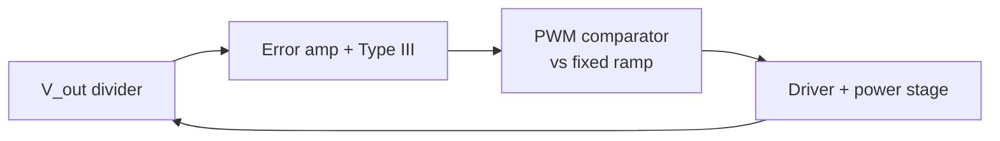
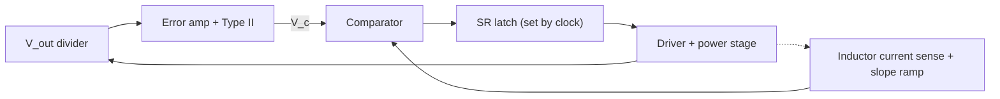
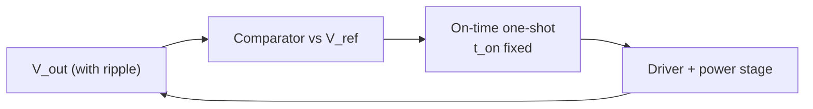

::: basics
### In plain words
A buck controller decides when to switch in one of a few ways. Voltage mode watches only the output voltage. Current mode also watches the inductor current. Ripple-based schemes, such as hysteretic and constant on-time, just fire a pulse whenever the output drops below a reference. Each has its own trade-off in simplicity, noise and speed.

### Picture it
Think of three ways to keep a room warm. The first checks only the room thermometer and nudges the heater up or down. The second also senses how hard the heater is running, so it reacts earlier and can protect itself. The third is a simple on-off thermostat that switches the heater on whenever the room drops below a set point. They all heat the room, but they respond and behave differently.

### Words you need
- **Duty cycle**: the fraction of each cycle the top switch is on ([[q0179]]).
- **Error amplifier**: compares the output to the reference.
- **Compensation**: the network that keeps the loop stable ([[q0244]]).
- **Inner current loop**: a fast loop around the inductor current in current mode ([[q0252]]).
- **Constant on-time (COT)**: a ripple-based scheme that fires a fixed-length pulse when the output is low.

### The simplest example
A 3.3 V output sags a little. In voltage mode, the error amplifier output rises and a wider pulse comes at the next tick of the controller's clock. In peak current mode, the error amplifier raises the current threshold, so the next pulse runs longer before the switch turns off. In a constant-on-time controller, a fixed-length pulse fires as soon as the output crosses below the reference, with no waiting for a clock. That is the whole idea. The rest of this page compares noise, compensation effort, speed and frequency behavior, and suggests when to pick each type.
:::

::: testing
Whether you can **organize** the zoo of buck control schemes and say what each is good for. A strong answer:

1. Splits them into fixed-frequency (voltage mode, peak/valley/average current mode) and ripple-based variable-frequency (hysteretic, constant on-time), plus digital and PFM/burst variants.
2. Says how each closes the loop, what it senses, and what the plant looks like to the compensator.
3. Gives the trade-offs: transient speed, compensation effort, noise sensitivity, frequency behavior, ceramic-capacitor compatibility, and current limit.
4. Gives a use case for each.
:::

::: why
The control scheme shapes everything: loop compensation, transient response, EMI, light-load behavior and which output capacitors you may use. Picking a part from a catalog means picking a topology, and a design review will ask "why this one?". Interviewers like the question because a clear taxonomy shows you understand the underlying ideas, not just one chip.
:::

::: concepts
- **PWM and duty cycle**: the controller sets the on-time fraction ([[q0174]], [[q0179]]).
- **Feedback loop and compensation** ([[q0244]]).
- **Inductor current sensing**: needed for current-mode schemes ([[q0225]]).
- **Ripple-based control**: the output ripple (or inductor ripple) itself triggers each cycle.
- **Fixed vs variable frequency**: affects EMI filtering and synchronization.
- **PFM / burst mode** for light load ([[q0231]]).
:::

::: answer
"I'd group them by how the controller decides when to switch. The classic one is voltage-mode control: an error amplifier compares the output to a reference and the result is compared with a fixed ramp to set the duty cycle at a fixed frequency. It's simple and low noise, but the LC filter gives a second-order plant, so it needs type III compensation, and it responds slowly to line changes.

Current-mode control adds an inner loop on the inductor current. In peak current mode, the error amplifier output sets a current threshold, and the high-side switch turns off when the inductor current reaches it. That turns the inductor into a controlled current source, so the plant is first-order, compensation is easier, line changes are rejected, and you get cycle-by-cycle current limit. The costs are noise sensitivity and the need for slope compensation above 50 percent duty. Valley and average current mode are variations.

Then there are ripple-based, variable-frequency schemes: hysteretic control and constant on-time. They compare the output to a reference directly and fire the switch whenever the output drops below it, with a fixed on-time. They have no compensation loop, respond to a load step almost immediately, and work with small output capacitors, but the frequency varies with input voltage and load, and they usually need ripple injection when using ceramic capacitors.

Finally digital control, where an ADC and a microcontroller or state machine run the loop, allowing nonlinear and adaptive schemes, and PFM or burst modes for light load.

I'd pick voltage mode for simple, low-noise and wide-range designs, peak current mode as a general-purpose workhorse, and constant on-time for fast transients with small capacitors, like point-of-load rails for processors."
:::

::: technical
**Fixed-frequency PWM**

- **Voltage mode (VM)**: $V_c$ from error amp compared to ramp $V_{ramp}$; $d=V_c/V_{ramp}$. Plant: $G_{vd}=V_{in}/V_{ramp}\times$ LC second-order ([[q0246]]). Needs type III compensation. Line changes enter through $V_{in}$ unless feed-forward ramp is used.
- **Peak current mode (PCM)**: switch on at clock, off when $i_L(+\text{slope comp})$ reaches $V_c/R_i$. Plant becomes first-order: $G_{vc}\approx \dfrac{R_{load}}{R_i}\cdot\dfrac{1+sCr}{1+sRC}$ at low frequency, plus a sampled double pole at $f_{sw}/2$. Needs slope compensation for $D>0.5$ ([[q0253]], [[q0255]]).
- **Valley current mode**: switch off at clock; on until the valley reaches $V_c$. Attractive for very low duty cycles (high step-down) because the current is sensed late in the long off-time rather than during a short, noisy on-time. It is the mirror image of peak mode: it needs slope compensation for $D<0.5$ rather than $D>0.5$.
- **Average current mode**: an inner integrating current loop makes the average inductor current follow $V_c$, with no slope compensation and high accuracy, at the cost of another compensator.
- **Emulated current mode**: current inferred from a ramp or from a switch voltage.

**Ripple-based, variable frequency**

- **Hysteretic**: switch on below $V_{ref}-\Delta/2$, off above $V_{ref}+\Delta/2$. No compensation. Frequency set by hysteresis and $L$, $C$, ESR.
- **Constant on-time (COT)**: fixed (or input-adaptive) $t_{on}$; the converter turns on when $V_{out}$ falls below the reference. Frequency $f=V_{out}/(V_{in}t_{on})$ for fixed $t_{on}$. Adaptive on-time ($t_{on}\propto V_{out}/V_{in}$) gives near-constant frequency. Needs enough ripple at the comparator (ESR or injected ripple).
- **Fixed off-time**: dual of COT.

**Digital**: sampled PID/PI with ADC and DPWM; allows adaptive and nonlinear control (for example tuning the compensator, phase shedding).

**Light-load modes**: PFM/burst, diode emulation, pulse skipping ([[q0231]], [[q0232]]).

| Topology | Compensation | Line rejection | Transient | Ceramic caps | Key weakness |
|---|---|---|---|---|---|
| Voltage mode | Type III | poor (needs feed-forward) | moderate | OK with type III | complex compensation |
| Peak current | Type II | good | good | OK | slope comp, noise, min on-time |
| Valley current | Type II | good | good | OK | max on-time, noise |
| Average current | two loops | very good | moderate | OK | complexity |
| Hysteretic / COT | none | good | very fast | needs ripple injection | variable $f_{sw}$, jitter |
| Digital | firmware | design-dependent | design-dependent | OK | latency, resolution |

> [!UNCERTAIN]
> Vendors use trade names (for example D-CAP, adaptive on-time, V² control) for ripple-based variations with different details. The categories here are generic; check the datasheet's block diagram for the actual implementation.
:::

::: short
"I group buck control by when the controller decides to switch. Voltage mode compares an error amplifier output to a fixed ramp: simple and quiet, but a second-order plant needs type III compensation. Current mode adds an inner inductor-current loop, which makes the plant first-order, rejects line changes and gives cycle-by-cycle current limit, but needs slope compensation and is noise-sensitive. Ripple-based schemes like hysteretic and constant on-time have no compensation and respond very fast, but the frequency varies. Digital control adds flexibility. I'd choose by transient needs, noise, capacitor type and simplicity."
:::

::: long
"I'll organize them by how they decide when to turn the switch on and off.

The first family is fixed-frequency PWM. The simplest is voltage-mode control: the output goes through a divider into an error amplifier, whose output is compared to a fixed sawtooth to set the duty cycle. It's simple and has clean, predictable switching, but the power stage is a second-order LC filter, so the loop needs a type III compensator with two zeros, and it reacts to input-voltage changes only after the output moves, unless you add feedforward from the input.

Current-mode control adds a second loop: the error amplifier now commands an inductor-current level, and the switch turns off when the inductor current reaches that level. In peak current mode the high side turns on at the clock and off at the peak threshold. The inner loop makes the inductor look like a current source, so the plant is essentially first-order, a type II compensator is enough, line variations are rejected immediately, and you get cycle-by-cycle current limiting. The costs are that the current-sense signal is noisy, so you need leading-edge blanking, and that you need slope compensation for duty cycles above 50 percent. Valley current mode is the mirror image, good for large step-down ratios. Average current mode uses an integrating inner loop and is more accurate but more complex.

The second family is ripple-based, variable-frequency control. Hysteretic control simply keeps the output between two thresholds. Constant on-time fires a fixed on-pulse whenever the output drops below the reference. They have no error amplifier and no compensation, the response to a load step is almost immediate, and they work with small output capacitors, so they're popular for processor rails. The downsides are that the switching frequency varies with input voltage, output voltage and load, so EMI filtering is harder, and with ceramic capacitors you must inject ripple into the comparator.

The third is digital control, where an ADC and a processor run the loop. That allows nonlinear control, auto-tuning and phase shedding.

For light loads, most families add pulse-frequency modulation or burst mode.

So: voltage mode for simple and quiet, peak current mode as the general-purpose choice, COT for the fastest transient with minimal capacitance, and digital when flexibility is worth the complexity."
:::

::: terms
- **Voltage-mode control**: duty set by comparing the error signal to a fixed ramp.
- **Current-mode control**: inner inductor-current loop with outer voltage loop ([[q0252]]).
- **Peak / valley / average current mode**: which part of the inductor current waveform is controlled.
- **Hysteretic control**: output kept between two thresholds by on/off switching.
- **Constant on-time (COT)**: fixed on-pulse triggered by the output falling below the reference.
- **Slope compensation**: ramp added to prevent subharmonic oscillation ([[q0255]]).
- **Ripple injection**: coupling ripple to the comparator when the output ripple is too small.
- **PFM / burst mode**: light-load mode with pulse skipping.
:::

::: exceptional
**An average answer** lists "voltage mode, current mode and hysteretic".

**An exceptional answer**:
- Organizes by fixed-frequency versus ripple-based and by whether inductor current is sensed.
- Describes how each closes the loop and what plant results (second-order versus first-order).
- Gives a trade-off table (compensation, line rejection, transient, ceramic compatibility, EMI).
- Mentions limitations: slope compensation, blanking and minimum on-time, variable frequency and jitter, ripple injection.
- Includes digital, light-load PFM and phase shedding.
- Ends with a choice rationale tied to application.
:::

::: mistakes
- **Saying current mode has no voltage loop.** There is still an outer voltage loop; it commands the current.
- **Claiming hysteretic/COT has "no stability issues".** It can still have jitter or subharmonic-like behavior, and needs enough ripple at the comparator.
- **Thinking COT frequency is constant.** It varies with $V_{in}$, $V_{out}$ and load unless the on-time adapts.
- **Forgetting slope compensation** in peak current mode at $D>0.5$.
- **Mixing up peak and valley.** Peak: turn off at peak current; valley: turn on at valley current.
- **Treating the classification as exact.** Real parts are hybrids (for example emulated current mode with ripple injection).
:::

::: deep
## Block diagrams of the main families


Figure: Voltage mode. One loop. The error amplifier output is compared with a fixed sawtooth: duty $d=V_c/V_{ramp}$. The compensator must handle the LC double pole.


Figure: Peak current mode. Outer voltage loop sets $V_c$; inner current loop turns the switch off when the sensed current (plus slope compensation) hits $V_c$. The clock sets the latch each cycle.


Figure: Constant on-time. No error amplifier or clock. When $V_{out}$ (with its ripple) drops below $V_{ref}$, a one-shot gives an on-pulse of fixed width, then the converter waits for the next trigger.

## Voltage mode in detail

The duty cycle is $d=V_c/V_{ramp}$. The small-signal gain $V_{in}/V_{ramp}$ includes the input voltage, so a change in $V_{in}$ changes the loop gain and moves the output until the loop corrects it. Adding input-voltage feedforward (ramp amplitude proportional to $V_{in}$) cancels that dependence. The plant is the second-order LC of [[q0246]], so the compensator needs two zeros and an integrator, as in the type III of [[q0244]].

## Current mode in detail

In peak current mode, ideally $i_L$ follows $V_c/R_i$ at low frequency, so the inductor is a current source driving $C\parallel R$, giving a single pole at $1/(2\pi RC)$ (1 kHz for 3.3 Ω and 47 µF). The compensator can be type II. There is also a sampling effect: a double pole at $f_{sw}/2$ with a Q that goes to infinity at $D=0.5$ without slope compensation ([[q0253]]). Line rejection is intrinsic: the on-time ends when the current reaches the threshold, regardless of $V_{in}$ (to first order). Cycle-by-cycle current limit comes for free by clamping $V_c$. A side benefit is that multiphase current sharing comes more naturally ([[q0238]]). Drawbacks: noise at turn-on (leading-edge blanking sets a minimum on-time), sensing losses and the need for slope compensation.

## Ripple-based control in detail

A COT converter turns on when the comparator sees $V_{out}<V_{ref}$. For a fixed on-time, steady-state frequency is

$$f_{sw}=\frac{V_{out}}{V_{in}\,t_{on}}$$

```plot
{"title":"Switching frequency vs input voltage for a 3.3 V output","x":{"label":"input voltage V_in","unit":"V","min":4.5,"max":24},"y":{"label":"f_sw","unit":"Hz","min":0,"max":3000000},"series":[{"label":"fixed on-time (275 ns): f = V_out/(V_in·t_on)","fn":"3.3/(x*275e-9)","color":"red"},{"label":"input-adaptive on-time: constant 1 MHz","fn":"1e6","color":"green"}],"points":[{"x":12,"y":1000000,"label":"12 V: 1 MHz"},{"x":24,"y":500000,"label":"fixed t_on at 24 V: 500 kHz"}]}
```
Figure: With a fixed 275 ns on-time and a 3.3 V output, the frequency falls from 2.4 MHz at 5 V in to 0.5 MHz at 24 V. An input-adaptive on-time ($t_{on}\propto V_{out}/V_{in}$) keeps it near constant. Notice the frequency spread is an EMI-filter design problem, and inputs near the output voltage push the frequency up toward the minimum off-time.

The load-step response is fast because the comparator reacts immediately: after a step the output drops, the next pulse fires without waiting for the clock or an amplifier, and the converter can fire pulses back-to-back until the output recovers. The stability depends on ripple: with low-ESR ceramic output capacitors the output ripple is in quadrature with the inductor current (capacitive), so the comparator sees a ripple that isn't in phase with the switching and jitter or subharmonic-like oscillation appears. The fix is ripple injection (an RC network from the switch node or inductor current to FB) or emulated ESR ([[q0250]]).

## Choosing

| Priority | Likely choice |
|---|---|
| Low noise, fixed frequency, simple analog | voltage mode |
| General purpose, easy compensation, current limit | peak current mode |
| Very high step-down ratio (e.g. 48 V to 1 V) | valley current mode or COT |
| Fastest transient with minimal capacitance | COT / hysteretic |
| Very accurate current regulation (LED drivers, PFC) | average current mode |
| Programmable, adaptive, telemetry | digital |

## See it

```sim
{"id":"subharmonic","d":0.4,"ma":0}
```
Figure: The inner current loop of peak current mode viewed as a map. At $D=0.4$ the perturbation decays; raise $D$ above 0.5 to see it grow (more in [[q0253]] and [[q0254]]).

## Line rejection, with numbers

"Poor" and "good" line rejection in the table become concrete with one example. Take the 12 V to 3.3 V buck at $D=0.275$ and let the input step from 12 V to 15 V. In plain voltage mode the duty cycle is set by $V_c/V_{ramp}$, which does not know the input changed, so with the loop held still the output would move by $D\,\Delta V_{in}=0.275\times3=0.825$ V. The feedback loop then pulls it back, but only by the factor $1/(1+T)$ at the disturbance frequency. With a loop gain of 20 dB ($T=10$) at that frequency the residual excursion is $0.825/11=75$ mV. With input-voltage feedforward (ramp amplitude proportional to $V_{in}$, so $d=V_c/(kV_{in})$) the duty cycle drops by exactly the right amount at once and the first-order shift is zero. In peak current mode the same effect arrives for free from the inner loop, because the on-time ends at a current threshold, and the inductor current slope $(V_{in}-V_{out})/L$ rises with $V_{in}$ so the on-time shortens by itself. (Ideal-model statement: the slope compensation ramp and real sensing delays leave a small residual.)

## Minimum on-time: the limit that decides the topology

Every topology that gates the high-side switch for a short time has a minimum on-time $t_{on,min}$: the gate-drive and switch-node edge times, and the current-sense blanking for current modes, set a floor on how short the pulse can be. The duty cycle required is $V_{out}/V_{in}$, so at a fixed frequency the constraint is $f_{sw}\le V_{out}/(V_{in}\,t_{on,min})$. For a 1 V output and an illustrative 80 ns minimum on-time:

| $V_{in}$ | Max $f_{sw}$ |
|---|---|
| 5 V | 2.5 MHz |
| 12 V | 1.04 MHz |
| 24 V | 521 kHz |
| 48 V | 260 kHz |

```plot
{"title":"Maximum fixed switching frequency vs input voltage (1 V output, 80 ns minimum on-time, illustrative)","x":{"label":"input voltage V_in","unit":"V","min":3,"max":60},"y":{"label":"max f_sw","unit":"Hz","min":0,"max":4000000},"vars":{"vo":1,"ton":80e-9},"series":[{"label":"f_max = V_out / (V_in · t_on,min)","fn":"vo/(x*ton)","color":"red"}],"points":[{"x":12,"y":1041667,"label":"12 V: 1.04 MHz"},{"x":48,"y":260417,"label":"48 V: 260 kHz"}]}
```
Figure: The region under the curve is where a fixed-frequency controller can hold the output. Above the curve it must skip pulses, which shows up as low-frequency subharmonic-like ripple. This is why a high step-down ratio at high frequency pushes designs toward valley current mode (sensing in the long off-time) or COT with a very short, accurately controlled on-pulse, and why the frequency has to come down at high $V_{in}$.

> [!UNCERTAIN]
> Minimum on-time depends on the part, the process and the blanking setting, and typically runs from tens of nanoseconds to a couple of hundred. The 80 ns here is a placeholder for the arithmetic; use the figure in the datasheet.

## Designing a COT converter: a worked example

Pick $V_{in}=12$ V, $V_{out}=1.0$ V and a target $f_{sw}=500$ kHz. Ignoring drops, $t_{on}=V_{out}/(V_{in}f_{sw})=167$ ns, an 8.3% duty cycle. The inductor ripple for $L=1$ µH is $\Delta I=(V_{in}-V_{out})t_{on}/L=11\times167\text{ ns}/1\ \mu\text{H}=1.83$ A. What the comparator needs is a ripple *in phase* with the inductor current. With 10 mΩ of ESR the ESR ripple is $1.83\times0.01=18$ mV, which gives a usable ramp. With a ceramic bank at 1 mΩ it is under 2 mV, comparable to noise and well below what a comparator wants, and the capacitive ripple that dominates is shifted by 90°. That is the whole reason for ripple injection: a small RC across the inductor (or from the switch node) synthesizes a current-proportional ramp directly at the FB input. How much ripple a given controller needs at its comparator is part-specific.

> [!UNCERTAIN]
> The minimum comparator ripple, and whether a given part has internal ripple compensation, differ by vendor and generation. Treat the 2 mV versus 18 mV contrast as an illustration of the mechanism.

## Digital control: why resolution matters

In a digital loop the output voltage is quantized by the ADC and the duty cycle by the digital PWM. If one DPWM step moves the output by more than one ADC bin, the loop cannot find a duty cycle that lands in the zero-error bin, and it dithers between two codes forever (a limit cycle). Example: a 12 V input and a 10-bit DPWM move the output by $12/1024=11.7$ mV per step; a 10-bit ADC spanning 3.3 V has a 3.2 mV bin. The DPWM is about 3.6 times too coarse, so the output toggles by roughly 12 mV. A 12-bit DPWM ($12/4096=2.9$ mV) is finer than the ADC bin and the limit cycle disappears. This is a design rule specific to digital control and is independent of the loop compensation. Sampling delay is the other cost: a computational latency of one switching period at 500 kHz (2 µs) costs $360\times f_c\times2\ \mu s$ of phase, 28.8° at a 40 kHz crossover (see [[q0245]] for the delay arithmetic).

## How to tell which one you are looking at on the bench

- Sweep $V_{in}$ and watch the switch-node frequency. Constant means fixed-frequency PWM. Inversely proportional to $V_{in}$ means fixed on-time.
- Measure the pulse width at three input voltages: constant width means COT; width falling as $1/V_{in}$ with constant frequency means PWM. Caveat: most commercial COT parts are *adaptive* on-time, which scales $t_{on}$ with $V_{out}/V_{in}$ to hold a pseudo-constant frequency, so in steady state they look like PWM on both tests. The load-step test below separates them.
- Look at the FB or COMP pin. A clean error-amplifier voltage with a ramp on the comparator means a PWM scheme. A ripple on FB that tracks inductor current means a ripple-based scheme.
- Step the load and compare the first response: ripple-based converters fire immediately with pulses back-to-back; fixed-frequency schemes show a delay of up to one clock period.
- Repeat at light load to find where each scheme enters pulse skipping or burst mode. Jitter in a peak-current-mode converter near 50% duty or in a COT with too little ripple is a signature of the failure modes in [[q0253]] and the ripple injection above.
:::

::: applications
- **Voltage mode**: older and noise-sensitive designs, some multiphase controllers, wide-range power IC with feed-forward.
- **Peak current mode**: the typical general-purpose buck IC (for example converters from 3 V to 60 V input).
- **Valley current mode / COT**: very high step-down, low duty (for example 12 V to 1 V) controllers.
- **COT / adaptive on-time**: notebook and server point-of-load rails with all-ceramic output capacitors.
- **Average current mode**: LED drivers, battery chargers and PFC front ends.
- **Digital**: processor VRMs, telecom bricks with PMBus.
:::

::: assumptions
- **Generic classification**: real controllers mix techniques (for example emulated current mode with COT, or a COT with a fixed-frequency lock).
- **CCM** unless stated. In DCM and PFM, plants and stability conditions change.
- **Small-signal statements** (first-order plant for CM) are approximate and valid below about $f_{sw}/5$.
- **Numeric examples** use 3.3 V output and 275 ns on-time for illustration, not a specific part.
- Trade names differ among manufacturers for ripple-based schemes.
:::

::: followups
### Why do people choose current mode over voltage mode?
The inner loop reduces the plant to first-order, so the compensator is simpler and less sensitive to $L$ and $C$ choices, line variations are rejected immediately, there is inherent cycle-by-cycle current limit, and sharing among phases or modules is easy. The costs are noise sensitivity, minimum on-time due to blanking and slope compensation.

### Why does constant on-time respond so fast to a load step?
There is no error amplifier or clock: when the output falls below the reference the comparator immediately triggers a new on-pulse. After a heavy step it can fire on-pulses back-to-back at the minimum off-time, so the inductor current slews at the maximum rate with essentially zero loop delay. The limits are the minimum off-time and the inductor slew.

### What's the difference between peak and valley current mode?
Peak: the clock turns the high side on and it turns off when the peak inductor current reaches the command. Valley: the clock turns the high side off and it turns on again when the inductor current falls to the valley command. Peak needs slope compensation for $D>0.5$; valley for $D<0.5$ (by the mirror argument). Valley is attractive for very low duty cycles because the on-time can be shorter than the blanking time.

### Why is slope compensation not needed in voltage mode or COT?
It exists to damp the discrete inductor-current inner loop in fixed-frequency current mode. Voltage mode has no inner current loop. COT has no clock, so the subharmonic mechanism (fixed switching instants) doesn't exist, though COT can have its own jitter problems with insufficient ripple.

### Scenario: you need a 12 V to 1 V, 20 A rail with 1 mF total output capacitance and 50 mV droop for a 15 A step. Which topology?
Fast transient with limited capacitance and a very low duty cycle (8%) suggests a COT (adaptive on-time) multiphase or a valley current-mode controller with fast response. The 8% duty at several hundred kHz means short on-times (about 170 ns at 500 kHz), which makes fixed-frequency peak current mode with blanking difficult. I'd verify with a droop calculation ($\Delta V\approx\Delta I/(2\pi f_cC)$) to see if the achievable crossover meets 50 mV.
:::

::: references
- Erickson & Maksimović, *Fundamentals of Power Electronics*: voltage-mode controller design and the chapter on current-programmed control.
- Ridley, R. B., "A New Continuous-Time Model for Current-Mode Control", IEEE Transactions on Power Electronics, 1991.
- Manufacturer datasheets and application notes on constant-on-time and current-mode controllers (Texas Instruments, Analog Devices, Renesas, Monolithic Power Systems); use them for the exact implementation and ripple-injection requirements.
:::

::: rubric
- Splits into fixed-frequency (VM, current modes) and ripple-based (hysteretic, COT) :: A taxonomy shows structure.
- Explains voltage mode: ramp comparison, second-order plant, type III compensation :: Baseline scheme.
- Explains current mode: inner current loop, first-order plant, line rejection, current limit, slope compensation :: Most common scheme.
- Explains COT/hysteretic: no compensator, fast transient, variable frequency, ripple injection :: Third family.
- Mentions digital, average and valley, light-load modes :: Breadth.
- Gives a trade-off rationale for choosing among them :: Engineering judgment.
:::

::: quiz
```json
[
 {"type":"mcq","level":"fundamental","q":"Which control scheme has an inner loop that senses inductor current?","options":["Voltage-mode control","Peak current-mode control","Open-loop duty control","None; all use only output voltage"],"answer":1,"explain":"Current-mode control adds an inner inductor-current loop under the outer voltage loop."},
 {"type":"numeric","level":"intermediate","q":"A fixed-on-time buck has $t_{on}=275$ ns, $V_{out}=3.3$ V and $V_{in}=12$ V. What is the switching frequency, in kHz?","answer":1000,"tolerance":0.02,"unit":"kHz","explain":"$f=V_{out}/(V_{in}t_{on})=3.3/(12\\cdot275\\text{ ns})=1.0$ MHz."},
 {"type":"numeric","level":"intermediate","q":"The same converter runs from $V_{in}=24$ V with the on-time unchanged. What is the new frequency, in kHz?","answer":500,"tolerance":0.02,"unit":"kHz","explain":"$f=3.3/(24\\cdot275\\text{ ns})=500$ kHz. Fixed on-time means frequency is inversely proportional to $V_{in}$."},
 {"type":"mcq","level":"intermediate","q":"Why does constant on-time control typically need ripple injection with all-ceramic output capacitors?","options":["Ceramics have too much ESR","With very low ESR the output ripple is in quadrature with the switching, so the comparator sees an unsuitable ripple","The on-time becomes zero","The inductor saturates"],"answer":1,"explain":"ESR normally provides a ripple component in phase with the inductor current. Ceramics have almost none, so ripple is injected from the switch node or inductor current to give the comparator a clean ramp."},
 {"type":"truefalse","level":"advanced","q":"Slope compensation is required in all buck control topologies for stability at duty cycles above 50%.","answer":false,"explain":"It is required for fixed-frequency peak current mode. Voltage mode has no inner current loop, and COT/hysteretic have no clock, so the subharmonic mechanism does not apply."}
]
```
:::
