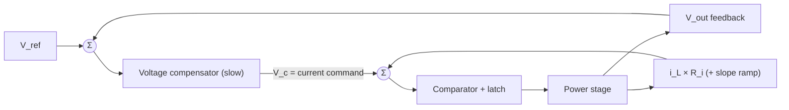

::: testing
Whether you understand the **structural** difference and the reason for the "both at once" part. A strong answer:

1. Voltage mode: one loop, output voltage to duty cycle through a ramp; the plant is the second-order LC.
2. Current mode: an inner loop forces the inductor current; the outer voltage loop just sets the current command; the plant is effectively first-order.
3. "Both simultaneously": current-mode control *is* a cascade of an outer voltage loop and an inner current loop, and the two do different jobs (regulation versus fast inner control and protection).
4. Trade-offs: noise sensitivity, slope compensation, blanking, line rejection, current limiting, current sharing.
:::

::: why
This is one of the standard power-electronics control questions because the answer reveals whether you grasp why a single IC "mode" changes the compensation, the stability margin, the protection and the behaviour at light load. It also tests whether you can untangle a slightly ambiguous question ("why both?") and answer the intended meaning.
:::

::: concepts
- **Voltage-mode control**: $d=V_c/V_{ramp}$; plant $G_{vd}$ is a second-order LC ([[q0246]]).
- **Current-mode control**: inductor current compared to $V_c/R_i$; the switch turns off at the peak (or valley) ([[q0251]]).
- **Cascade control**: an outer slow loop sets the reference for a fast inner loop.
- **First-order plant**: with the inner loop closed, $L$ acts like a current source into $C\parallel R$.
- **Slope compensation** for $D>0.5$ ([[q0255]]).
- **Cycle-by-cycle current limit and sharing** ([[q0238]]).
:::

::: answer
"In voltage-mode control there's a single feedback loop: the output voltage is compared to a reference, the error amplifier output is compared to a fixed ramp, and that sets the duty cycle. The plant the compensator sees is the whole LC filter, a second-order system with a resonant double pole and 180 degrees of phase lag, so I need a type III compensator, and the loop responds to input voltage changes only after the output has already moved.

In current-mode control, I add a second, inner loop around the inductor current. The error amplifier no longer sets a duty cycle: it sets a current command, and the switch turns off when the inductor current, usually the peak, reaches that command. With the inner loop closed, the inductor behaves like a current source, so the voltage loop only sees the output capacitor and load, a single pole. That makes compensation easier, rejects input-voltage changes quickly, gives you cycle-by-cycle current limiting for free, and makes it easy to share current between phases or modules. The costs are noise sensitivity in the current sense, a minimum on-time from blanking, and the need for slope compensation above 50 percent duty.

So to the 'both at once': current mode already is both. There's an outer voltage loop for regulation accuracy and an inner current loop for fast, local control and protection. You need the voltage loop because you want a regulated voltage, and the current loop because it makes the plant simple and protects the switch. Some controllers also include a voltage-mode fallback, or add current limiting to a voltage-mode design, but the main idea is the cascade."
:::

::: technical
**Voltage mode (VM).** $d=V_c/V_{ramp}$. Control-to-output:

$$G_{vd}(s)=\frac{V_{in}}{V_{ramp}}\cdot\frac{1+sCr}{1+s\left(\frac LR+Cr\right)+s^2LC}$$

Second-order, $Q$ set by load and ESR, phase falling to $-180^\circ$. Needs type III (two zeros near $f_0$). Input-voltage changes act through the $V_{in}/V_{ramp}$ gain unless the ramp is made proportional to $V_{in}$ (feed-forward).

**Current mode (CM).** Inner loop: $i_L\approx V_c/R_i$ at frequencies well below $f_{sw}$. Then

$$G_{vc}(s)\approx\frac{1}{R_i}\cdot\frac{R(1+sCr)}{1+sC(R+r)}$$

with a single pole at $f_p=1/(2\pi C(R+r))\approx1/(2\pi RC)$ and an ESR zero. At high frequency the sampling effect adds a double pole at $f_{sw}/2$ with $Q_p=1/[\pi(m_cD'-0.5)]$ (Ridley), where $m_c=1+S_e/S_n$ includes slope compensation.

**Example.** $L=4.7$ µH, $C=47$ µF, ESR 10 mΩ, $R=3.3$ Ω, $V_{in}=12$ V, $R_i=0.1$ V/A:

- VM: DC gain $V_{in}/V_{ramp}=12$ (21.6 dB) with resonance at 10.7 kHz, $Q\approx5$, $-180^\circ$.
- CM: DC gain $R/R_i=33$ (30.4 dB), single pole at 1.02 kHz, phase only to about $-90^\circ$ until the sampling pole.

**Comparison.**

| | Voltage mode | Current mode |
|---|---|---|
| Loops | 1 | 2 (outer voltage, inner current) |
| Plant order | 2 (LC double pole) | 1 (RC pole) plus sampling pole |
| Compensator | type III | type II |
| Line rejection | needs feed-forward | good |
| Current limit | separate circuit, not cycle-by-cycle | cycle-by-cycle via $V_c$ clamp |
| Noise sensitivity | low | higher (current-sense noise, blanking) |
| Slope compensation | no | yes for $D>0.5$ |
| Phase/module sharing | needs extra loop | natural |
| Min on-time | PWM limit | blanking-limited |

> [!UNCERTAIN]
> The first-order model is valid well below $f_{sw}/2$ and assumes ideal slope compensation. Real converters show the sampling double pole at high frequency, and the exact CM transfer function depends on the compensation ramp.
:::

::: short
"Voltage mode has one loop: the error amplifier output is compared to a fixed ramp to set duty, and the plant is the full second-order LC, so it needs type III compensation. Current mode adds an inner loop on the inductor current: the outer loop sets a current command and the switch turns off when the inductor current reaches it. The inductor then looks like a current source, so the plant is first-order, compensation is easier, line changes are rejected and you get cycle-by-cycle current limit. Current mode is both at once: an outer voltage loop for regulation and an inner current loop for fast control and protection."
:::

::: long
"The structural difference is how many loops there are and what they control.

In voltage-mode control there's a single loop. The output goes through a divider into an error amplifier, and the amplifier's output is compared with a fixed sawtooth to produce the PWM duty cycle. The plant from duty cycle to output is the whole LC filter: a second-order system with a resonant peak and up to 180 degrees of phase lag, so the compensator needs two zeros and an integrator, a type III. And because duty cycle is proportional to the control voltage, a change in input voltage shows up at the output immediately and only gets corrected afterwards by the loop, unless I add input feedforward.

Current-mode control adds a second loop inside the first. The error amplifier's output is now a current command. A comparator watches the inductor current, and when it reaches the command, the switch turns off, in peak current mode, at the end of each cycle. So the inner loop makes the inductor current follow the command. At frequencies below the switching frequency, the inductor behaves like a controlled current source feeding the output capacitor and the load. The plant the voltage loop sees is then roughly first-order, a single pole at 1 over two pi R C, plus the ESR zero. A type II compensator is enough, the converter is much less sensitive to L and C, input voltage changes are largely rejected because the switch turns off at a fixed current, and I get cycle-by-cycle current limiting by clamping the command. In a multiphase or parallel system, forcing the same command into each phase gives natural current sharing.

The price: the current-sense signal is noisy at the turn-on edge, so I need blanking, which limits minimum on-time, there's the sampling effect that causes subharmonic oscillation above 50 percent duty unless I add slope compensation, and the sensing costs a little efficiency.

So why 'both'? Current mode is both: the voltage loop is still essential, because I want a regulated output voltage with high DC gain and accuracy, and the current loop makes the plant simple and protects the switch. They do different jobs on different timescales: inner loop fast, outer loop slow. Some controllers also keep a voltage-mode path, for example for light-load or for a sleep mode, or add a current limit to a voltage-mode design."
:::

::: terms
- **Cascade (nested) loops**: an inner fast loop within an outer slow loop.
- **Control voltage $V_c$**: error amplifier output; in CM it commands current, in VM it sets duty via the ramp.
- **Current-sense gain $R_i$**: V/A scaling of the sensed inductor current.
- **Cycle-by-cycle current limit**: clamping $V_c$ so the peak current never exceeds a limit.
- **Slope compensation**: ramp added to stop subharmonic oscillation ([[q0255]]).
- **Leading-edge blanking**: ignoring the turn-on spike in the sensed current.
- **Input feed-forward**: scaling the ramp with $V_{in}$ in voltage mode.
- **Audio susceptibility**: line-to-output transfer function.
:::

::: exceptional
**An average answer** says "current mode senses current; voltage mode senses voltage; both makes it better".

**An exceptional answer**:
- Draws the loop structures: single loop versus cascade, and says the outer loop sets the current command.
- Gives the plant orders and the compensator types they imply, with a numeric example.
- Lists trade-offs: line rejection, current limit, noise and blanking, slope compensation, sharing.
- Interprets "both simultaneously" properly: CM is a nested pair, each with a distinct job and bandwidth.
- Adds the other reading (current limit in voltage mode, hybrid or mode-switching controllers).
- Mentions the sampling double pole at $f_{sw}/2$ and its damping.
:::

::: mistakes
- **Saying current mode removes the voltage loop.** The outer voltage loop remains.
- **Saying current mode removes all stability issues.** It trades the LC double pole for subharmonic oscillation and noise sensitivity.
- **Claiming CM plant is first-order at all frequencies.** The sampling double pole at $f_{sw}/2$ is real.
- **Thinking CM regulates current.** The output is voltage; the inner loop just shapes the dynamics.
- **Forgetting slope compensation** for $D>0.5$.
- **Believing voltage mode can't current-limit.** It can, but a cycle-by-cycle limit needs separate sensing.
:::

::: deep
## The two plants side by side

```bode
{"systems":[{"label":"Voltage mode: V_out/d (V_in = 12 V)","num":["12*47e-6*0.01",12],"den":["4.7e-6*47e-6*(1+0.01/3.3)","47e-6*0.01+4.7e-6/3.3",1]},{"label":"Peak current mode: V_out/V_c (R_i = 0.1 V/A, low-frequency model)","num":["3.3*47e-6*0.01/0.1","3.3/0.1"],"den":["47e-6*(3.3+0.01)",1]}],"vars":{},"f":{"min":100,"max":1000000},"show":"both","magRange":[-50,45]}
```
Figure: Control-to-output frequency response for the same $L$, $C$, ESR and load. The voltage-mode plant (steeper) has the resonance at 10.7 kHz and falls to $-180^\circ$. The current-mode plant has a single pole near 1 kHz and its phase stays near $-90^\circ$ until the ESR zero. Notice the much easier phase situation for a crossover at, say, 40 kHz in CM: about $-90^\circ$ of lag instead of $-180^\circ$. The sampling double pole at $f_{sw}/2$ is not shown.

## Why the inner loop simplifies the plant

Without the inner loop, the control variable is duty cycle and the inductor current is a *state* of the plant: its dynamics (together with $C$) generate the second-order resonance. With the inner loop closed, the inductor current is *forced* to follow $V_c/R_i$, so the inductor no longer has independent dynamics. One state variable is eliminated from the outer loop's view, and the plant drops from order two to order one. That is the same idea as any cascade control.

The outer loop sees:

$$\frac{v_o}{v_c}\approx\frac{1}{R_i}\,Z_o(s)=\frac{R}{R_i}\cdot\frac{1+sCr}{1+sC(R+r)}$$

and the pole moves with the load: $f_p=1/(2\pi RC)$ is about 1 kHz at 1 A ($R=3.3$ Ω) and about 100 Hz at 100 mA ($R=33$ Ω). The DC gain $R/R_i$ rises by the same factor, so well above the pole the gain $\approx1/(2\pi fCR_i)$ does not depend on the load at all. In VM, by contrast, the resonance $Q$ varies strongly with load.

## Cascade structure


Figure: The inner loop (right side) is fast and has no compensator: the comparator and switch are the controller. The outer loop (left) is a type II compensator that sets the command. Bandwidth of the inner loop is about $f_{sw}$; the outer loop crosses over around $f_{sw}/10$.

## What each loop does

- **Inner current loop**: linearizes the plant, rejects $V_{in}$ ripple, limits peak current cycle by cycle, and equalizes phases.
- **Outer voltage loop**: provides high DC gain via an integrator, sets accuracy and load regulation, determines the transient response.

You can't drop the voltage loop because current alone doesn't regulate voltage, and you can't count on the voltage loop alone to protect the switch from a cycle-by-cycle overcurrent: it is too slow. So the two are used *together*.

## The costs of current mode

1. **Noise**: the sensed current has a turn-on spike from $C_{oss}$ and diode recovery; leading-edge blanking (tens to a hundred ns) sets a minimum on-time ([[q0251]]).
2. **Subharmonic oscillation**: above 50% duty the inner loop needs slope compensation ([[q0253]], [[q0254]], [[q0255]]).
3. **Sampling double pole**: damped by compensation ramp; Ridley's $Q_p=1/[\pi(m_cD'-0.5)]$.
4. **Sense loss and layout**: sense resistor or DCR network, matched routing.
5. **Light load**: at low current, the comparator threshold and DCM change the plant again.

## Line rejection

In VM, a step in $V_{in}$ changes the switch-node average immediately by $D\,\Delta V_{in}$, which propagates through the LC to the output until the feedback corrects it. With input feed-forward the ramp amplitude scales with $V_{in}$, so $d\propto1/V_{in}$ and the product $V_{in}d$ is constant: the line step is cancelled at the source. In peak current mode, the current is controlled directly so the same line step mostly changes the inductor slope rather than its peak, giving greatly reduced audio susceptibility (it depends on slope-compensation ratio).

## Try it

```sim
{"id":"subharmonic","d":0.6,"ma":0.3}
```
Figure: A glimpse at the cost side of current mode: with $D=0.6$ the inner loop's perturbation grows unless slope compensation is increased. Increase $m_a$ until the error decays. See [[q0253]] for the derivation.

## Same gain at crossover, 90° apart in phase

The cleanest numerical way to see what the inner loop buys is to evaluate both plants at the same frequency. Take $L=4.7$ µH, $C=47$ µF, ESR 10 mΩ, $R=3.3$ Ω, $V_{in}=12$ V, $V_{ramp}=1$ V, $R_i=0.1$ V/A, and a target crossover of 40 kHz.

| Plant at 40 kHz | Magnitude | Phase |
|---|---|---|
| Voltage mode, $G_{vd}$ | 0.93 (−0.6 dB) | −171° |
| Peak current mode, $G_{vc}$ (low-frequency model) | 0.85 (−1.4 dB) | −82° |

The two plants have almost the same gain there, so the crossover frequency is not what separates them. The phase is. To land at a 55° phase margin the compensator must put the loop phase at −125°. In current mode it needs a phase of $-125^\circ-(-82^\circ)=-43^\circ$: a type II (integrator plus one zero) delivers that easily. In voltage mode it needs $-125^\circ-(-171^\circ)=+46^\circ$, which is *net phase lead*, even after paying for the integrator's −90°. That is the real reason voltage mode needs the type III. The 89° difference is the inductor's contribution being removed.

## The sampling correction: how far the "first-order" model can be trusted

The first-order current-mode model hides a second-order term near $f_{sw}/2$ that comes from the fact that the comparator only samples the current once per cycle. Ridley's correction multiplies the plant by $1+s/(\omega_nQ_p)+s^2/\omega_n^2$ in the denominator, with $\omega_n=\pi f_{sw}$ and

$$Q_p=\frac{1}{\pi\,(m_cD'-0.5)},\qquad m_c=1+\frac{S_e}{S_n},\quad D'=1-D.$$

$S_n=(V_{in}-V_{out})/L$ is the on-slope of the inductor current and $S_e$ is the compensation ramp slope. For $V_{in}=12$ V, $V_{out}=3.3$ V and $L=4.7$ µH, $S_n=1.85$ A/µs and the off-slope is $S_f=0.70$ A/µs:

| Duty | Ramp $S_e$ | $m_c$ | $Q_p$ | Meaning |
|---|---|---|---|---|
| 0.275 | 0 | 1.00 | 1.41 | lightly damped peak near $f_{sw}/2$ |
| 0.275 | $0.5S_f$ | 1.19 | 0.88 | well damped |
| 0.275 | $S_f$ | 1.38 | 0.64 | strongly damped |
| 0.6 | 0 | 1.00 | −3.2 | negative: unstable ($D>0.5$) |
| 0.6 | $0.5S_f$ | 1.75 | 1.59 | stable but peaky |
| 0.6 | $S_f$ | 2.50 | 0.64 | strongly damped |

Notice the pattern in the last row. With $S_e=S_f$ the algebra collapses to $m_cD'=1$, so $Q_p=1/(0.5\pi)=0.64$ at *any* duty cycle. That is a handy design rule of thumb: a ramp equal to the inductor's off-slope gives a damped sampling pole everywhere, at the cost of making the current loop look more like voltage mode (the more ramp you add, the less the inner loop behaves like a current source, and the low-frequency model above becomes a worse approximation). The derivation behind the stability boundary is in [[q0253]].

## When the first-order picture breaks

- **Slope compensation pushes the converter back toward voltage mode.** As $S_e\to\infty$ the comparator sees a pure ramp and the loop is plain voltage mode with the LC double pole returning. The first-order model assumes $S_e$ is comparable to $S_f$, not much larger.
- **Crossover too high.** If the voltage-loop crossover creeps above about $f_{sw}/5$, the sampling pole's gain peak and phase drop sit inside the loop bandwidth and the margin collapses regardless of how clean the low-frequency model looked.
- **Light load and DCM.** When the inductor current reaches zero each cycle, the inductor is no longer a stiff state variable and the load-pole location and gain change (the exact result depends on the mode of operation and is derived in textbooks; I have not reproduced it here). The compensator tuned at full load may behave differently at 5% load, which is a classic cause of light-load jitter.
- **Noise coupling.** The comparator threshold is a few tens of millivolts of sensed signal. A 50 mV noise spike at turn-on equals 0.5 A of apparent current at $R_i=0.1$ V/A, which is why blanking exists.

## Real hardware: sensing the current

Two practical sense methods show where the nominal $R_i$ comes from. With a sense resistor, $R_i$ is simply the resistance (scaled by any amplifier gain): a 10 mΩ resistor and a 10x gain stage gives 0.1 V/A, and dissipates $I^2R_{sense}$: at 5 A, 250 mW. With inductor DCR sensing, a parallel RC across the inductor reproduces the current as a voltage if its time constant equals the inductor's: $RC=L/DCR=4.7\ \mu H/20\ \text{m}\Omega=235$ µs, which could be 10 kΩ and 23.5 nF. Then the capacitor voltage equals $i_L\cdot DCR$, 0.1 V at 5 A. That is lossless but the DCR of copper rises about 0.39% per °C: at 100 °C, 20 mΩ becomes 25.9 mΩ, so an uncompensated limit set for 5 A would trip near 3.9 A when hot unless a temperature-compensating network is used. Any DCR network also depends on the tolerance of $L$.

## Verifying on the bench

Measure the control-to-output response with a network analyzer at light and full load. In current mode the low-frequency pole should move by roughly the load ratio (100 mA to 1 A moves it from about 100 Hz to about 1 kHz) and the gain well above the pole should not change with load. In voltage mode the resonance should stay at the LC frequency while its peak height changes. If your current-mode measurement shows a resonance at $f_0$, the inner loop is not doing its job: check the sense path, the blanking time, and the slope compensation. Then check the sampling peak near $f_{sw}/2$: a peak above about 0 dB there means the slope compensation is too low for the duty cycle at that input voltage. Run the check at the maximum and minimum $V_{in}$, since duty cycle moves it.
:::

::: applications
- **Peak current-mode ICs** for general-purpose bucks (low-cost compensation, cycle-by-cycle limit).
- **Voltage-mode controllers** with feed-forward for noisy environments or very low duty cycles where blanking is a problem.
- **Multiphase controllers** that use current-mode so that each phase gets the same command.
- **LED drivers and chargers** using average current mode with an inner current loop and an outer voltage limit.
- **Digital controllers** that implement a nested voltage/current loop in firmware.
:::

::: assumptions
- **CCM** and small-signal averaged models below $f_{sw}/5$.
- **Ideal inner loop**: the first-order plant is exact only at low frequency. The sampling effect and compensation ramp modify it near $f_{sw}/2$.
- **Resistive load**; the plant pole moves with $R$.
- **"Both simultaneously"** is interpreted as the nested cascade. An alternative reading is a controller that supports both modes or adds a current limit to voltage mode.
- Example values from the 12 V to 3.3 V, 4.7 µH, 47 µF design.
:::

::: followups
### Why does the CM plant pole move with load?
The output capacitor discharges through the load, so the pole is at $1/(2\pi RC)$. At 1 A (3.3 Ω) with 47 µF that is about 1 kHz; at 100 mA (33 Ω) it is about 100 Hz. The DC gain $R/R_i$ rises by the same factor, so the product (gain × pole) stays constant: the gain at crossover, well above the pole, is almost independent of load. That is a robust feature.

### Can you get current-mode behaviour without sensing the inductor current directly?
Yes: emulated current mode reconstructs the ramp from the switch-node voltage or input voltage, or uses a voltage-mode ramp with $V_{in}$ feed-forward. Some controllers sense current through the low-side FET's $R_{DS(on)}$ at a single sample time. The performance depends on how well the emulation tracks real current, and these approaches are sensitive to inductor tolerance.

### How does current mode make current sharing between phases easy?
All phases get the same $V_c$ and each compares its own sensed current with it, so the peak (or valley) currents are forced to be nearly equal. Voltage mode doesn't do this: phases must be balanced by an extra loop. ([[q0238]])

### What goes wrong in current mode at very small duty cycles?
The on-time may be shorter than the blanking time plus comparator delay, so the controller can't regulate the peak: it skips pulses or jitters. This is why very high step-down controllers use valley current mode, COT or voltage mode.

### Scenario: your peak current-mode buck oscillates at exactly $f_{sw}/2$ when $V_{in}$ drops from 12 V to 5 V (3.3 V out). Why?
At 12 V in, $D=0.275$; at 5 V, $D=0.66$. Above 50% duty without enough slope compensation the inner loop is subharmonically unstable: error is multiplied by $-D/(1-D)=-1.94$ each cycle. Check the slope compensation against $m_2=V_{out}/L$ and add ramp (or enlarge $L$) ([[q0253]]).
:::

::: references
- Erickson & Maksimović, *Fundamentals of Power Electronics*: chapter on current-programmed control, including slope compensation and the transfer functions.
- Ridley, R. B., "A New Continuous-Time Model for Current-Mode Control", IEEE Transactions on Power Electronics, 1991.
- Application notes from controller vendors comparing voltage-mode and current-mode control (Texas Instruments, Analog Devices): use the specific document for the part in question.
:::

::: rubric
- Describes VM as a single loop with a ramp and a second-order plant needing type III :: Baseline.
- Describes CM as outer voltage loop plus inner current loop, with a first-order plant :: The core structural difference.
- Lists benefits: simpler compensation, line rejection, current limit, sharing :: Why people choose it.
- Lists costs: noise/blanking, slope compensation, sampling pole :: Balanced view.
- Explains "both at once" as nested loops with distinct jobs and bandwidths :: The question's second half.
- Mentions alternative interpretations or hybrids :: Handles ambiguity.
:::

::: quiz
```json
[
 {"type":"mcq","level":"fundamental","q":"In peak current-mode control, what does the error amplifier output command?","options":["The duty cycle directly","A peak inductor current threshold","The switching frequency","The output capacitor voltage"],"answer":1,"explain":"The error amplifier sets $V_c$, which is converted into an inductor-current threshold. The switch turns off when the sensed current reaches it."},
 {"type":"numeric","level":"intermediate","q":"For a current-mode buck with $R=3.3$ Ω and $C=47$ µF, what is the load-pole frequency in Hz (neglect ESR)?","answer":1026,"tolerance":0.02,"unit":"Hz","explain":"$f_p=1/(2\\pi RC)=1/(2\\pi\\cdot3.3\\cdot47\\text{ µF})=1026$ Hz."},
 {"type":"numeric","level":"intermediate","q":"The same converter at 100 mA load ($R=33$ Ω, 47 µF). What is the load-pole frequency in Hz?","answer":102.6,"tolerance":0.02,"unit":"Hz","explain":"$f_p=1/(2\\pi\\cdot33\\cdot47\\text{ µF})=102.6$ Hz, ten times lower than at 1 A."},
 {"type":"truefalse","level":"intermediate","q":"Current-mode control eliminates the need for an outer voltage feedback loop.","answer":false,"explain":"The inner loop controls inductor current, not output voltage. A voltage loop is still needed to regulate $V_{out}$ and provide DC accuracy."},
 {"type":"mcq","level":"advanced","q":"Why does the inner current loop simplify the plant seen by the voltage loop?","options":["It removes the output capacitor","It forces the inductor current, eliminating the inductor as an independent state, so the LC double pole becomes a single RC pole","It raises the switching frequency","It makes the duty cycle constant"],"answer":1,"explain":"With the inductor current set by the inner loop, the plant reduces to the capacitor and load: one pole plus the ESR zero."}
]
```
:::
