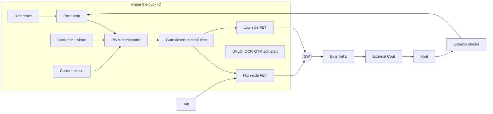

::: testing
Whether you can open up a buck converter and say what is a silicon problem and what is a physics problem. The interviewer wants to hear you split the system by one rule: **anything that can be built from transistors on one die is usually inside; anything that stores a lot of energy or needs a lot of area, voltage rating or tolerance is outside.** They are also checking that you know the grey areas (integrated vs external FETs, internal vs external compensation, fixed vs adjustable output) and can say *why* a designer would pick each. Strong candidates connect the answer to a real board: "what do I actually have to place and size?"
:::

::: why
When you pick a buck IC you are really picking a division of labour. An integrated-FET regulator gives you a three-part design (inductor, caps, divider) but caps your current and thermal headroom. A controller with external FETs gives you amps and flexibility but makes you responsible for gate drive, dead time and layout. Knowing the split tells you what to size ([[q0258]]), what to lay out carefully, and what can silently go wrong on a bring-up. It is also the first question in a "design a buck" conversation ([[q0263]]).
:::

::: concepts
- **Control and analog blocks** are cheap in silicon: reference, error amplifier, oscillator, PWM comparator, soft-start, protection. Always inside.
- **Power switches and gate drive**: the high-side and low-side FETs plus drivers. Inside for small currents (up to a few amps to ~10+ A depending on vendor), outside for large ones. See [[q0201]] and [[q0203]].
- **Energy storage**: inductor and capacitors cannot be integrated at useful values (µH and tens of µF need volume), so they are external. Exceptions are power *modules* that package the inductor.
- **Bootstrap**: a high-side NFET needs a gate supply above $V_{IN}$, made by a boost capacitor (external) and a diode (often internal). See [[q0206]].
- **Feedback network**: the divider sets the output voltage and is external on adjustable parts; fixed-output parts trim it internally.
- **Compensation**: internal on "easy-to-use" parts, external on parts you must tune for your L and C.
:::

::: answer
"I think of it as silicon versus physics. Everything that is control and logic goes on the die: the voltage reference, error amplifier, oscillator, PWM comparator, soft start, current limit, thermal shutdown, UVLO and the gate drivers. For low to mid current parts the two power FETs are integrated too, so the sync buck is one chip.

What stays outside is anything that stores real energy or needs tolerance. That is the inductor, the input and output capacitors, and the bootstrap capacitor between BST and the switch node. Adjustable parts also have an external feedback divider, so I pick the output voltage with two resistors. Depending on the part, the compensation network is either inside, or I get a COMP pin and have to build a Type II or Type III network myself, and I might have a resistor on a pin to set frequency or a cap to set soft-start time.

Then the trade-off is current. Integrated FETs make for a tiny solution but the die is also the heat source, so thermal limits cap the current. Past that I'd move to a controller with external FETs, where I own the gate drive, dead time and layout."
:::

::: technical
A monolithic synchronous buck IC typically contains:

- **Reference and error amplifier**: bandgap (about 0.6 to 0.8 V is common, vendor-dependent) compared to the feedback pin $V_{FB}$. $V_{OUT} = V_{REF}(1 + R_1/R_2)$.
- **Modulator**: oscillator or on-time generator, PWM comparator, slope compensation for peak current mode ([[q0255]]), PFM/skip logic.
- **Power stage**: high-side FET $Q_1$ and low-side FET $Q_2$ (or a diode if asynchronous), with drivers, dead-time control and a bootstrap diode/charging path.
- **Sensing**: a current-sense element (FET sense mirror or $R_{DS(on)}$ sensing) for peak/valley current limit and the current-mode loop.
- **Housekeeping**: internal LDO for logic/driver supply, UVLO, enable threshold, soft-start ramp, power-good comparator, thermal shutdown, overvoltage detection.

External, because of physics or tolerance:

- **Inductor $L$**: energy storage $\tfrac12 L I^2$ and flux handling need magnetic material. Chosen from ripple and saturation ([[q0259]]).
- **Output capacitor $C_{OUT}$** and **input capacitor $C_{IN}$**: tens to hundreds of µF, and $C_{IN}$ must supply pulsed current at $I_{OUT}\sqrt{D(1-D)}$.
- **Bootstrap capacitor** $C_{BST}$, typically 100 nF, from BST to SW.
- **Feedback divider** (adjustable parts), optionally a feed-forward capacitor across $R_1$.
- **Optional**: frequency-set resistor, soft-start capacitor, EN/UVLO divider, compensation network, Schottky across the low-side FET on some parts.

A **controller** (driver-only) IC puts the power FETs outside as well, adding gate resistors, snubbers and sense resistors to the BOM. A **power module** goes the other way and includes the inductor, leaving $C_{IN}$, $C_{OUT}$ and the divider.
:::

::: short
"The control brain is inside the IC: reference, error amp, oscillator, PWM comparator, protection, soft start and gate drivers. For small and medium currents the two power FETs are inside too. What stays external is energy storage and anything that needs tolerance: the inductor, input and output capacitors, the bootstrap cap, and the feedback divider on adjustable parts. Compensation is internal on easy-to-use parts and external on flexible ones. For high current I'd switch to a controller with external FETs."
:::

::: long
"Start with what the buck does: it chops the input with a high-side and a low-side switch and filters the result with an LC. Everything that decides when to switch is control, and control is cheap in silicon, so the reference, error amplifier, oscillator, PWM comparator, slope compensation, soft start, UVLO, current limit and thermal shutdown are always inside the IC.

The power switches are the interesting boundary. For roughly a few amps, up to maybe ten or so on the big parts, the vendor integrates both FETs and the gate drivers, so I get a sync buck in one package with the dead-time logic already done. Beyond that the die gets too hot and too big, so I'd use a controller and external FETs, and then I own the gate drive and layout of the power loop.

Now what is always external. The inductor, because storing energy takes magnetic volume. The input and output capacitors, because I need tens of microfarads and they decide ripple, transient response and loop stability. The bootstrap capacitor between BST and SW, usually 100 nF, which gives the high-side gate its supply. And on adjustable parts the feedback divider, because the output voltage is whatever my two resistors say.

The last grey area is compensation. Current-mode parts with internal compensation are happy with a range of L and C, which makes them easy to use. Parts with a COMP pin let me tune for exotic output caps but I have to design the Type II or III network.

Net effect: a typical integrated design is IC plus inductor, two or three capacitors and two resistors. I still have to think about layout, because the hot loop is the input cap and the two FETs."
:::

::: terms
- **Monolithic (integrated-FET) regulator**: control, drivers and both power FETs on one die; external L, C and divider only.
- **Controller**: IC with gate drivers but external power FETs, used for high current.
- **Power module**: package that also contains the inductor, sometimes the caps.
- **Bootstrap capacitor ($C_{BST}$)**: floating capacitor from BST to SW that powers the high-side gate drive.
- **Feedback divider**: $R_1/R_2$ network that scales $V_{OUT}$ down to $V_{REF}$ at the FB pin.
- **Internal/external compensation**: whether the error-amp loop network is on-die or built on a COMP pin.
- **UVLO**: under-voltage lockout that holds the part off below a minimum input.
- **Soft start**: controlled ramp of the reference to limit inrush at startup.
:::

::: exceptional
**An average answer** lists "inductor and capacitors outside, switches inside" and stops.

**An exceptional answer**:
- Gives the rule behind the split (silicon cheap for control, expensive for energy storage and high-current power) rather than just a list.
- Names the boundary cases: integrated vs external FETs, fixed vs adjustable output, internal vs external compensation, power modules.
- Mentions the bootstrap capacitor and divider, which people forget are *external* parts.
- Ties integration to thermal limits: integrated FETs concentrate losses in one package, so the current rating is a thermal rating.
- Points out the layout consequence: $C_{IN}$ plus both FETs form the hot loop, which is why integration also helps EMI.
- Can say what they would size or check first on the board.
:::

::: mistakes
- **Saying the inductor is inside the IC.** Only true for modules or tiny low-current converters with on-chip or in-package inductors; the general answer is external.
- **Forgetting the bootstrap capacitor and feedback divider** because they are "just passives". They set the high-side gate drive and the output voltage.
- **Assuming integrated FETs are always better.** They limit current through thermal resistance and cannot be tuned for efficiency vs $f_{SW}$.
- **Assuming compensation is always internal.** Many parts expose COMP, and a wrong network on that pin is a common cause of ringing ([[q0261]]).
- **Treating "asynchronous" as a different IC family.** It just replaces the low-side FET with an external Schottky ([[q0202]]).
:::

::: deep
## The organizing idea: what silicon is good at

A chip is great at transistors, matched resistors and small capacitors, and it is awful at storing energy. A 1 µF capacitor on die would be about the size of the whole chip, and an on-chip spiral inductor gives tens of nH, not µH. A buck needs, for a few amps, an inductance of several µH and an output capacitance of tens of µF. That physical limit alone decides the first half of the answer: **L, $C_{IN}$ and $C_{OUT}$ are external**.

On the other side, all the decision-making is analog and logic: a reference, an amplifier, a comparator, a ramp. They scale well and are essentially free per area. Those are always integrated.


Figure: The IC (box) holds everything that decides *when* to switch and the switches themselves; the loop is closed through external passives. The divider feeds back into the error amplifier, so its tolerance becomes your output accuracy.

## A typical application circuit

```circuit
{"caption":"Typical integrated-FET sync buck: the IC plus five or six passives","elements":[
 {"t":"V","a":[0,4],"b":[0,12],"label":"V_{IN}"},
 {"t":"wire","pts":[[0,4],[8,4]]},
 {"t":"C","a":[4,4],"b":[4,12],"label":"C_{IN}"},
 {"t":"dot","at":[4,4]},{"t":"dot","at":[4,12]},
 {"t":"wire","pts":[[8,8],[6,8],[6,4]]},{"t":"dot","at":[6,4]},
 {"t":"box","at":[8,2],"w":8,"h":8,"label":"Buck IC","pins":[
  {"side":"left","pos":2,"name":"VIN"},{"side":"left","pos":6,"name":"EN"},
  {"side":"right","pos":1,"name":"BST"},{"side":"right","pos":3,"name":"SW"},{"side":"right","pos":6,"name":"FB"},
  {"side":"bottom","pos":4,"name":"GND"}]},
 {"t":"wire","pts":[[12,10],[12,12]]},{"t":"dot","at":[12,12]},
 {"t":"wire","pts":[[0,12],[34,12]]},
 {"t":"wire","pts":[[16,3],[18,3]]},
 {"t":"C","a":[18,3],"b":[18,5],"label":"C_{BST}"},
 {"t":"wire","pts":[[16,5],[19,5]]},{"t":"dot","at":[18,5]},
 {"t":"L","a":[19,5],"b":[24,5],"label":"L","labelSide":"other"},
 {"t":"wire","pts":[[24,5],[34,5]]},
 {"t":"R","a":[26,5],"b":[26,8],"label":"R_1"},
 {"t":"R","a":[26,8],"b":[26,12],"label":"R_2"},
 {"t":"dot","at":[26,5]},{"t":"dot","at":[26,12]},{"t":"dot","at":[26,8]},
 {"t":"wire","pts":[[26,8],[16,8]]},
 {"t":"C","a":[30,5],"b":[30,12],"label":"C_{OUT}"},
 {"t":"dot","at":[30,5]},{"t":"dot","at":[30,12]},
 {"t":"R","a":[34,5],"b":[34,12],"label":"Load"},
 {"t":"text","at":[17.2,6.6],"text":"SW","anchor":"middle","color":"accent"},
 {"t":"text","at":[32,3.6],"text":"V_{OUT}","anchor":"middle","color":"accent"},
 {"t":"gnd","at":[17,12]}
]}
```
Figure: Everything outside the box is what you must choose and place: $C_{IN}$, $C_{BST}$, L, $C_{OUT}$ and the divider $R_1/R_2$ (EN is tied to $V_{IN}$ here). The FETs, driver, error amplifier, reference and protection are all inside. FB senses $V_{OUT}$ through the divider.

## What goes where, and why

| Block | Where | Reason |
|---|---|---|
| Bandgap reference, error amp, comparator | Inside | Small, precise, transistor circuits |
| Oscillator / on-time, slope comp | Inside (R or C sometimes external to set $f_{SW}$) | Cheap; external RT for flexibility |
| Gate drivers, dead time, level shift | Inside (controllers: still inside, driving external FETs) | Needs tight timing, matched to FET |
| Power FETs | Inside up to a vendor-dependent current, else outside | Limited by die area and heat |
| Bootstrap diode | Usually inside; may be external on some | Small signal-level diode |
| Bootstrap capacitor | Outside | 100 nF is too big for a die |
| Inductor | Outside (inside in modules) | Magnetic volume |
| $C_{IN}$, $C_{OUT}$ | Outside | Tens of µF, ripple current rating |
| Feedback divider | Outside (adjustable parts) | Sets $V_{OUT}$, precision resistors |
| Compensation | Inside or outside | Easy-to-use vs flexible |
| Protection (OCP, OTP, UVLO, OVP) | Inside | Needs to sit next to the power stage |

## Worked example: what the BOM looks like

Say you choose an integrated 12 V to 3.3 V, 3 A regulator with $V_{REF} = 0.8$ V. The things you must pick:

- $R_2 = 10$ kΩ and $R_1 = R_2(V_{OUT}/V_{REF} - 1) = 31.25$ kΩ, so the nearest 1% value is 31.6 kΩ, which gives $V_{OUT} = 0.8(1 + 31.6/10) = 3.33$ V.
- $L \approx 6.8$ µH from a 25 to 35% ripple target (see [[q0258]] and [[q0263]]).
- $C_{OUT}$ of several 22 µF ceramics; $C_{IN}$ of a couple of 10 µF ceramics plus a 100 nF at the pins.
- $C_{BST} = 100$ nF.

That is about six components for a 3 A rail, which is why integrated parts dominate point-of-load supplies.

## Real hardware behaviour of the boundary

- **Thermal.** With integrated FETs, conduction loss $I_{RMS}^2 R_{DS(on)}$ is dissipated *in the package*. For example, 3 A with an effective 70 mΩ combined path is about 0.6 W, a few tens of °C rise on a small QFN. External FETs spread heat out and let you pick lower $R_{DS(on)}$.
- **Layout.** The hot loop is $C_{IN}$, Q1 and Q2. Integration shrinks this loop to a few mm, cutting ringing and EMI. With external FETs you must do that yourself.
- **Compensation.** If the IC is internally compensated, the vendor restricts you to a window of $L \times C$; leave the window and stability degrades ([[q0261]]).
- **Frequency.** Some parts fix $f_{SW}$; others let a resistor set it, trading efficiency against size ([[q0221]]).

> [!UNCERTAIN]
> The current at which vendors stop integrating FETs moves every few years as processes improve. Treat "a few amps to low tens of amps" as a rough guide rather than a rule; check current product families.

## Experiment with it

```sim
{"id":"buck-lab","vin":12,"vout":3.3,"l":6.8e-6,"c":66e-6,"esr":0.005,"fsw":500000,"iout":3,"view":"waveforms"}
```
Figure: This is the externally-set part of the story: L, C, ESR and $f_{SW}$. Change L and C and see how ripple and the waveform change, then remember that on a real part these are the only knobs you actually own.
:::

::: applications
- **Point-of-load rails on FPGA/SoC boards** (1.0 V, 1.8 V, 3.3 V from a 5 or 12 V bus): integrated sync buck, three-part design.
- **Battery-powered devices**: tiny buck ICs with PFM and nano-amp quiescent current, inductor in a 2 mm package.
- **Automotive and industrial 24 to 48 V rails**: wide-$V_{IN}$ buck with integrated high-side FET and external diode or sync FET.
- **Server and CPU core power**: multiphase controller with external power stages (smart power stages), not monolithic ([[q0236]]).
- **Module-based designs**: small modules that include the inductor when time-to-market or EMI matters more than BOM cost.
:::

::: assumptions
- Description is for a typical **synchronous, voltage- or current-mode** buck. Asynchronous parts replace the low-side FET with an external Schottky.
- "Typically integrated" depends on current: below roughly 10 A, integrated FETs are the norm. Above that, controller plus external FETs or smart power stages.
- Some tiny low-power converters use bond-wire or on-package inductors; a few switched-capacitor/charge-pump parts need no inductor at all, but those are not bucks.
- Fixed-output versions integrate the divider (trimmed on die), and some integrate compensation components too.
- In a *power module*, the inductor, sometimes input/output caps and the divider are in the package.
:::

::: followups
### Why isn't the inductor integrated?
Energy storage scales with volume. A buck delivering 3 A at 500 kHz needs several µH; storing $\tfrac12 L I^2 = \tfrac12 (6.8\,\mu H)(3.4\,A)^2 \approx 39\,\mu J$ per cycle takes magnetic material the size of a few mm. On-chip spiral inductors reach tens of nH with low Q. You can only integrate the inductor if you raise $f_{SW}$ to tens or hundreds of MHz (as some integrated voltage regulators do) at the cost of efficiency, or put it in the package (modules).

### What is the bootstrap capacitor for, and why is it external?
The high-side NFET's source is the switch node, which swings between 0 and $V_{IN}$. To keep it on, its gate must sit about 5 V above that. $C_{BST}$ (about 100 nF) is charged to roughly the internal supply while the low-side is on, then rides on top of SW. It stores a few nC of gate charge per cycle with little droop, which needs a capacitor too large for a die. See [[q0206]].

### When would you use a controller with external FETs instead of an integrated regulator?
When the current or power density exceeds what the package can dissipate (rule of thumb: above roughly 10 to 20 A, vendor-dependent), when I need a specific $R_{DS(on)}$ or $Q_G$ trade-off for efficiency, or for multiphase high-current rails. The cost is board area, gate-drive and dead-time design, and a bigger layout risk.

### An internally compensated part is oscillating with your LC. What do you do?
First check I'm inside the datasheet's allowed $L$ and $C_{OUT}$ window, including the capacitance derating of ceramics at DC bias. If the effective $C_{OUT}$ is too low, loop crossover moves up and phase margin collapses. Fix by increasing $C_{OUT}$ or adding a feed-forward capacitor across $R_1$ if the part allows, then measure the loop with a network analyzer ([[q0267]]).

### Scenario: the datasheet says 5 A max but the board gets very hot at 3 A. What is wrong?
Likely the thermal path, not the electrical design. Integrated FETs mean all the loss is in the package; with poor copper area and few thermal vias the junction runs hot and the part may thermal-fold-back. Check efficiency (loss budget), $\theta_{JA}$ vs real board, and the exposed pad solder. Also check ripple: very small $L$ raises RMS current and loss.
:::

::: interpretations
"Integrated in the IC" might mean *in the controller IC* or *in the whole regulator device*. I answered for a monolithic converter (FETs inside), and noted what changes for a controller and for a module. If the interviewer is thinking of a specific part, ask which one.
:::

::: references
- Texas Instruments, "Basic Calculation of a Buck Converter's Power Stage" (SLVA477): which parts are chosen by the designer.
- R. W. Erickson and D. Maksimović, *Fundamentals of Power Electronics*: buck converter fundamentals, Chapters 2 and 5.
- Manufacturer buck regulator datasheets (typical application circuit and block diagram sections): the standard way to see the integrated-vs-external split for a real part.
- Mohan, Undeland and Robbins, *Power Electronics*: DC-DC converter chapters.
:::

::: rubric
- Control blocks inside: reference, error amplifier, oscillator, PWM comparator, protection :: These are the "brain" and are always on die; naming them shows you know the loop.
- Power FETs and drivers integrated for modest current, external for high current :: Shows you understand the thermal/area limit that sets the boundary.
- Inductor and input/output capacitors external (energy storage) :: The core physical reason for the split; missing it is a red flag.
- Bootstrap capacitor and feedback divider external :: Easy to forget and both cause real bring-up errors.
- Compensation either internal or external depending on part :: Shows awareness of design flexibility vs ease of use.
- Mentions modules/controllers as variations :: Demonstrates breadth beyond one part family.
- Ties the split to a design consequence (thermal, layout, stability window) :: Moves from a list to engineering judgment.
:::

::: quiz
```json
[
 {"type":"mcq","level":"fundamental","q":"Which component of a synchronous buck regulator is almost never integrated on the die?","options":["Error amplifier","Power inductor","Gate driver","Soft-start ramp"],"answer":1,"explain":"Storing energy takes magnetic volume. A few-µH inductor can't fit on a die (on-chip spirals reach tens of nH), whereas the amplifier, driver and soft-start are small transistor circuits."},
 {"type":"mcq","level":"fundamental","q":"What does the external bootstrap capacitor (BST to SW) do?","options":["Filters the output ripple","Provides the high-side gate drive supply that rides on the switch node","Sets the switching frequency","Compensates the loop"],"answer":1,"explain":"The high-side NFET gate must be about 5 V above SW. The bootstrap cap is charged while the low-side is on and then floats up with SW to supply the driver."},
 {"type":"numeric","level":"intermediate","q":"An adjustable buck has $V_{REF}=0.8$ V and $R_2=10$ kΩ. What $R_1$ gives $V_{OUT}=3.3$ V? Answer in kΩ.","answer":31.25,"tolerance":0.01,"unit":"kΩ","explain":"$R_1 = R_2(V_{OUT}/V_{REF}-1) = 10\\text{k}\\cdot(4.125-1) = 31.25$ kΩ. Nearest 1% value is 31.6 kΩ."},
 {"type":"truefalse","level":"intermediate","q":"Using a buck with integrated FETs removes the need to think about thermal design because the datasheet current is guaranteed.","answer":false,"explain":"The current rating assumes a particular PCB and ambient. All conduction and switching loss is dissipated in the package, so copper area, vias and ambient set the real current limit."},
 {"type":"multi","level":"intermediate","q":"Select all parts that are normally external to a monolithic adjustable buck IC.","options":["Output capacitor","Feedback divider","Bandgap reference","Bootstrap capacitor"],"answer":[0,1,3],"explain":"Output cap, divider and bootstrap cap are all external. The bandgap reference is part of the control circuitry on die."},
 {"type":"mcq","level":"advanced","q":"Your 3 A buck is internally compensated and the datasheet allows $C_{OUT}$ from 40 to 150 µF. You place 3 × 22 µF 6.3 V X5R on a 3.3 V rail and it rings on load steps. Most likely cause?","options":["The inductor is too large","DC-bias derating reduces effective capacitance below the allowed window","The bootstrap capacitor is too small","The switching frequency is too high"],"answer":1,"explain":"Ceramic capacitance falls substantially with DC bias (often 40 to 60% at a large fraction of rated voltage; part dependent). 66 µF nominal can be below 40 µF effective, so the internal compensation no longer matches and phase margin drops."}
]
```
:::
