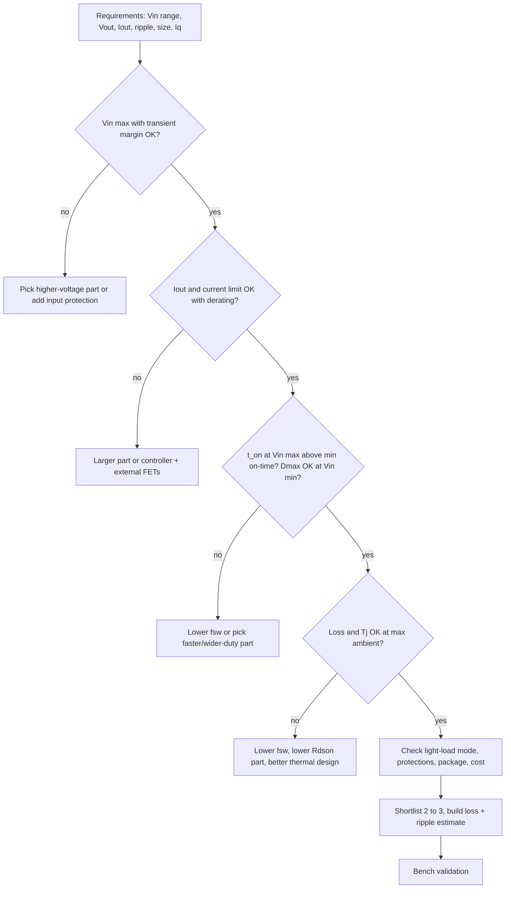

::: testing
Whether you can turn a vague "I need 3.3 V" into a numbered requirements list and then map each requirement onto a specific datasheet parameter. The hidden sub-skills: asking the right clarifying questions (input range, load current, ripple, noise, quiescent current, size), knowing which numbers are *absolute-maximum* versus *operating*, derating (voltage, current, temperature), checking the corner cases that kill designs (minimum on-time, dropout, thermal), and weighing trade-offs instead of picking a part by habit. Interviewers love a candidate who finishes with "and then I'd validate it on the bench".
:::

::: why
Most real hardware jobs begin with a part choice, not a derivation. A wrong buck IC costs a board spin: the Vin rating was too tight and a hot-plug spike killed it, the minimum on-time forbade the frequency you wanted, or the thermal resistance meant it throttled at 70% of the rated current. A repeatable selection process is how junior engineers earn trust. It also shows you can read datasheets for the parameters that matter rather than the headline "3 A, 2 MHz".
:::

::: concepts
- **Requirements first**: $V_{IN}$ range (including transients), $V_{OUT}$, $I_{OUT}$ (continuous and peak), ripple/noise, efficiency, size and cost. See [[q0263]].
- **Integrated vs external FETs** ([[q0256]]): sets current ceiling and BOM.
- **Duty-cycle limits**: $D = V_{OUT}/V_{IN}$ must fit within the IC's minimum on-time and maximum duty cycle ([[q0222]]).
- **Frequency trade-off**: higher $f_{SW}$ shrinks L and C but raises switching loss ([[q0221]]).
- **Thermal**: losses and $\theta_{JA}$ set junction temperature.
- **Control mode and light-load behaviour**: PWM vs PFM/skip, current-mode vs voltage-mode, quiescent current ([[q0230]]).
- **Protection and features**: current limit type, soft-start, power-good, enable, sync, spread spectrum.
:::

::: answer
"I start from the requirements, because the datasheet is only useful once I know what I'm comparing against. I'd ask: what is the input range, including transients and hot-plug? What output voltage and how much current, continuous and peak? What are ripple, noise and transient limits? Is it battery powered, so quiescent current matters? How much board area, what ambient temperature, any EMI limits?

Then I filter. Voltage rating: I want $V_{IN(max)}$ with margin, because ringing can double the input. Current: the IC's continuous rating should be well above my load, and I check the current limit. Duty cycle: I compute $V_{OUT}/V_{IN}$ at both ends and make sure the on-time at my chosen frequency is longer than the part's minimum on-time. Then efficiency and thermals: I estimate losses at full load, multiply by $\theta_{JA}$ and check junction temperature at max ambient.

After that come the softer things: control mode and light-load efficiency, switching frequency versus passive size and EMI, integrated or external compensation, protections, package and cost. I'd shortlist two or three parts, build a quick loss and ripple estimate in a spreadsheet, and validate the pick on a real board."
:::

::: technical
A systematic selection checklist:

1. **Input voltage.** Rated operating range must cover $V_{IN(min)}$ to $V_{IN(max)}$ with margin. The abs-max rating should exceed worst-case transients; on a 12 V supply with a hot-plug through long leads, ringing can reach about twice the supply, so a 24 V+ (preferably 28 to 36 V) rated part is prudent. Check UVLO thresholds against the minimum input.
2. **Output.** $V_{REF}$ accuracy (e.g. ±1%), adjustable vs fixed, and total accuracy including divider tolerance: $\Delta V_{OUT}/V_{OUT} \approx \Delta V_{REF}/V_{REF} + \frac{R_1}{R_1+R_2}(\Delta R_1/R_1 - \Delta R_2/R_2)$.
3. **Current.** Continuous rating $\geq I_{OUT(max)}$ with derating (about 20 to 30% margin), **peak/limit** above load transients, and low-side/valley limit behaviour.
4. **Duty cycle.** $D_{min} = V_{OUT}/V_{IN(max)}$ and $D_{max} = V_{OUT}/V_{IN(min)}$. Require $t_{on} = D/f_{SW} > t_{on(min)}$ (typically tens to ~100+ ns, datasheet) and $D_{max}$ below the part's maximum duty (or dropout behaviour).
5. **Frequency.** Trade passive size against switching loss and EMI; consider avoiding AM radio / sensitive bands; check whether it can be synchronized or has spread spectrum.
6. **Efficiency and thermals.** $P_{loss} \approx I_{RMS}^2 R_{DS(on)} + P_{sw} + P_{gate} + P_Q$. Then $T_J = T_A + P_{loss}\,\theta_{JA}$ must be under the maximum with margin.
7. **Light-load and quiescent current.** PFM/skip modes for battery life vs forced PWM for low noise.
8. **Control and compensation.** Current-mode with internal comp for ease; external comp for unusual output caps; any allowed $L$ and $C$ range.
9. **Protection and sequencing.** Current limit type, hiccup, OVP, OTP, soft-start time, pre-bias start-up, PG, tracking.
10. **Package, cost, supply and second source.** Wettable flanks, exposed pad, availability, certifications (AEC-Q100 if automotive).
:::

::: short
"I start with requirements: input range including transients, output voltage and current, ripple, efficiency, size, quiescent current. Then I filter by input voltage with margin, current rating and current limit, and check the duty cycle against the IC's minimum on-time at my chosen frequency. I estimate losses and junction temperature, then look at control mode, light-load behaviour, protections, package and cost. I'd shortlist two or three parts, compare on a spreadsheet, and validate on the bench."
:::

::: long
"Selection is requirements first, datasheet second. I'd ask what the input range really is, including hot-plug and transients, what output voltage and current I need, continuous and peak, how tight ripple and transient response are, whether it's battery powered so quiescent current matters, and what the temperature and size limits are.

With that, I walk the datasheet in the order things can kill the design. First voltage: the rating should sit well above the highest input, because ringing on a hot-plugged supply can double it. Second current: continuous rating with margin, and the current limit has to sit above my peak but below what my inductor can take. Third duty cycle and frequency: at maximum input the duty cycle is smallest, so I check that on-time, which is D divided by switching frequency, is longer than the minimum on-time; otherwise the part skips pulses and the ripple gets ugly. At minimum input I check maximum duty cycle and dropout.

Then efficiency and thermals: estimate conduction loss from RDS(on), switching loss from frequency, add the quiescent power, then multiply by theta JA and make sure junction temperature at maximum ambient is comfortably below the limit.

Last come the softer features: PWM versus PFM at light load, current-mode versus voltage-mode, external or internal compensation, soft-start, power-good, protections, package, price and availability. I'd put two or three candidates in a spreadsheet with a quick loss and ripple model, pick one, and then validate it on the bench: efficiency, ripple, transient, thermal."
:::

::: terms
- **Absolute maximum vs recommended operating range**: abs-max is a damage limit, not a design target; design to the operating range with margin.
- **Minimum on-time ($t_{on(min)}$)**: the shortest high-side pulse the controller can generate reliably, limited by blanking and driver delays.
- **Dropout / maximum duty cycle**: how close $V_{OUT}$ can get to $V_{IN}$ ([[q0222]]).
- **Current limit (peak/valley)**: threshold at which the controller truncates the on-time; sets the inductor saturation requirement.
- **$\theta_{JA}$**: junction-to-ambient thermal resistance in °C/W; board-dependent.
- **Quiescent current ($I_Q$)**: current the IC draws with no load; matters for battery life.
- **PFM / skip mode**: light-load operation that skips cycles to cut switching losses.
- **Hiccup**: a protection mode that retries periodically after a fault.
:::

::: exceptional
**An average answer** says "pick the right voltage and current rating".

**An exceptional answer**:
- Starts with clarifying questions and writes down numbers before looking at parts.
- Treats $V_{IN}$ **transients** and hot-plug ringing as part of the voltage requirement.
- Checks **minimum on-time and maximum duty** at both input extremes, with an actual computation.
- Does a back-of-envelope loss and $T_J$ estimate, not just the datasheet's headline current.
- Distinguishes light-load behaviour (PFM vs forced PWM) and quiescent current from full-load efficiency.
- Notes datasheet traps: typical vs max numbers, current rating tied to a specific board, ceramic derating of the recommended $C_{OUT}$.
- Ends with a validation plan ([[q0267]]).
:::

::: mistakes
- **Choosing by headline current.** A "3 A" part may only deliver 3 A in a thermally generous board at 25 °C. Always compute $T_J$.
- **Ignoring $t_{on(min)}$.** With 18 V in and 3.3 V out, $D = 0.18$, so at 2 MHz the on-time is only 92 ns. Many parts can't do that and will skip pulses, creating sub-harmonic ripple.
- **Picking a part rated exactly for $V_{IN(max)}$.** Supply transients and ringing will exceed it.
- **Forgetting accuracy stack-up.** $\pm 1\%$ reference plus $\pm 1\%$ resistors is not $\pm 1\%$ output; see the worked example.
- **Optimizing only full-load efficiency** when the product spends 90% of its time near idle.
- **Ignoring supply availability and second sources** for a production design.
:::

::: deep
## Step 0: write the requirements down

An interview answer is stronger if you state the numbers you assumed. For a running example, take a board that receives a nominal 12 V bus (9 to 18 V, hot-pluggable) and needs a 3.3 V rail at 3 A continuous with a 2.5 A load step, ripple below 1% (33 mV), and an ambient up to 85 °C. Power out is $3.3\times3 = 9.9$ W.

## Step 1: voltage rating and range

The highest steady input is 18 V. Hot-plugging a 12 V supply through a cable produces a resonant spike from cable inductance and the input capacitor, which can approach twice the DC value; for the 18 V maximum that is 36 V, so an ordinary 17 V part is out and even a 28 V part is uncomfortable. In practice you'd either add input protection (TVS, damping capacitor) or choose a 36 V-class part. Verify UVLO: the turn-on threshold must be below 9 V with hysteresis so the converter doesn't chatter.

## Step 2: duty-cycle feasibility

$D = V_{OUT}/V_{IN}$ gives $D_{min} = 3.3/18 = 0.183$ and $D_{max} = 3.3/9 = 0.367$. The high-side on-time is $t_{on} = D/f_{SW}$.

```plot
{"title":"High-side on-time vs switching frequency (3.3 V output)","x":{"label":"f_sw","unit":"Hz","min":2e5,"max":3e6},"y":{"label":"t_on","unit":"s","min":0,"max":1.2e-6},
 "vars":{"vo":3.3},
 "series":[{"label":"Vin = 18 V (shortest)","fn":"vo/18/x","color":"accent"},{"label":"Vin = 12 V","fn":"vo/12/x","color":"blue"}],
 "hlines":[{"at":1e-7,"label":"example t_on(min) = 100 ns (assumed)","color":"red"}],
 "points":[{"x":5e5,"y":3.667e-7,"label":"500 kHz: 367 ns"},{"x":2e6,"y":9.17e-8}],
 "vlines":[{"at":2e6,"label":"2 MHz: 92 ns at 18 V","color":"muted"}]}
```
Figure: On-time shrinks as $1/f_{SW}$ and is shortest at maximum input. At 2 MHz and 18 V it drops below an assumed 100 ns minimum on-time, so the part would skip pulses. At 500 kHz there is plenty of room. The 100 ns line is illustrative; real minimum on-times vary by part.

> [!UNCERTAIN]
> Minimum on-time values from tens of ns to a few hundred ns exist depending on the process and control scheme. I used 100 ns as an example only; read the datasheet number (and whether it is typ or max) for the real part.

## Step 3: current rating and limit

Continuous 3 A plus 25% margin means choosing a part rated for roughly 4 to 5 A, not exactly 3 A. Then look at the current limit: peak limit sets the maximum inductor current the IC allows. The inductor's saturation current must exceed the **maximum** specified limit with margin, not the nominal ([[q0259]]). If the limit is wide (say 4.5 to 7 A), the inductor must handle the top of the range.

## Step 4: efficiency and thermal estimate

Assume combined high/low-side FET resistances of about 40 mΩ and 30 mΩ and an inductor DCR of 15 mΩ. At $f_{SW}$ = 500 kHz with L = 6.8 µH, ripple at 18 V is 0.79 A, and
$$I_{RMS}^2 = I_{OUT}^2 + \frac{\Delta I^2}{12} = 9 + 0.052 = 9.05\ \text{A}^2$$
Conduction loss in the FETs is $9.05\,(0.275\times0.04 + 0.725\times0.03) = 0.30$ W (at $D = 0.275$ for 12 V) and in the inductor $9.05\times0.015 = 0.14$ W. Add roughly 0.2 W for switching and gate drive and 0.05 W for quiescent and sensing: about 0.69 W total, so $\eta \approx 9.9/(9.9+0.69) = 93.5\%$. With $\theta_{JA} = 40$ °C/W on a decent 4-layer board, only the IC's share (about 0.5 W, FETs plus switching) heats the junction, giving $T_J \approx 85 + 0.5\times40 = 105$ °C, comfortably under 125 °C. If the datasheet's $\theta_{JA}$ is quoted on a JEDEC board with a different copper area, discount it.

## Step 5: frequency, size and noise

Higher $f_{SW}$ shrinks L and C but raises switching loss, as in [[q0221]]. If the circuit is near sensitive RF or an ADC, avoid beating the harmonics against their bands, and consider a part with sync or spread-spectrum. A 500 kHz choice is a good middle: 6.8 µH L and a few 22 µF capacitors, and $t_{on}$ well above the minimum.

## Step 6: accuracy

Output voltage is set by $V_{OUT} = V_{REF}(1 + R_1/R_2)$. With a ±1% reference and ±1% resistors, the worst case is $\pm\left[1\% + \frac{R_1}{R_1+R_2}(1\% + 1\%)\right] = \pm\left[1 + 0.76\times2\right]\% = \pm 2.5\%$. Note that the weight of $R_1$ and $R_2$ in the output error is not 1 each; the factor is $R_1/(R_1+R_2)$ which is $\approx 0.76$ here. If the load needs 3.3 V $\pm$ 3%, this is tight with reference drift over temperature, so choose 0.5% (or 0.1%) resistors or a part with a tighter (e.g. ±0.5%) reference.

## Step 7: light-load behaviour and quiescent current

For a battery product, idle behaviour dominates. PFM/skip modes drop $I_Q$ to tens of µA and keep efficiency high at mA loads ([[q0230]]); the price is higher and variable output ripple and slower first response to a load step. Forced-PWM (FPWM) keeps a constant frequency for noise-sensitive loads but wastes power at low load and allows negative inductor current.

## Step 8: features and protections

Soft-start time (set to keep inrush below the current limit with $C_{OUT}$), pre-bias start-up, hiccup vs latch-off short-circuit behaviour, power-good for sequencing ([[q0263]]), thermal shutdown, and output overvoltage. Also check whether the compensation is internal and what $L$ and $C_{OUT}$ range it supports ([[q0261]]).


Figure: The order matters. Voltage, current, duty cycle and thermals are the "pass/fail" filters; the softer features rank what survives. Any "no" sends you back to a different frequency, part or architecture.

## Experiment with it

```sim
{"id":"buck-lab","vin":18,"vout":3.3,"l":6.8e-6,"c":66e-6,"esr":0.005,"fsw":500000,"iout":3,"view":"efficiency"}
```
Figure: Look at the efficiency view at 18 V in (the worst case for switching loss) and then raise $f_{SW}$ to 2 MHz. The efficiency drop shows why frequency is part of selection, not an afterthought. Compare with `vin` = 9.

## Datasheet traps worth mentioning

- **Typical vs max.** Reference accuracy, current limit and minimum on-time all have typical and guaranteed limits. Design to the worst case.
- **Thermal rating.** $\theta_{JA}$ is measured on a specific board. Your board may be better or much worse.
- **Recommended $C_{OUT}$.** Often given as effective capacitance; ceramic derating can halve the value at the operating voltage.
- **Efficiency curves** are for a specific $V_{IN}$, $V_{OUT}$, L and $f_{SW}$. Do not read them as universal.
:::

::: applications
- **FPGA/SoC point-of-load rails**: 9 to 18 V bus to 0.9 V to 3.3 V at 1 to 6 A, chosen by $t_{on(min)}$ and transient response.
- **Wide-input industrial rails (24 V)**: 36 or 60 V rated parts with margin for surges.
- **Battery wearables**: nano-amp class $I_Q$ and PFM matter more than full-load efficiency.
- **Automotive**: AEC-Q100 parts with 40 V load-dump tolerance, spread spectrum and EMI-friendly packages.
- **Low-noise analogue supplies**: forced-PWM or synchronizable parts with fixed, out-of-band frequency.
:::

::: assumptions
- Example numbers assume a 12 V nominal bus, 3.3 V/3 A load and a synchronous current-mode part; the *process* is what generalizes.
- Transient margin of 2× on $V_{IN}$ is a rule of thumb for hot-plug; the real peak depends on cable inductance, capacitor ESR and damping.
- Loss estimates use plausible FET and inductor resistances, not a specific datasheet. Use real values when selecting.
- For very high current (tens of amps) or multiple rails, a controller with external FETs, multiphase, or a module may be a better category than a monolithic buck.
- If the input is always close to the output, an LDO ([[q0158]]) or a buck-boost may be the correct choice; see [[q0157]].
:::

::: followups
### Your input is 5 V and your output is 3.3 V at 1 A. Buck or LDO?
LDO power loss is $(5-3.3)\times1 = 1.7$ W at 66% efficiency. A buck might lose 0.15 W at about 95% efficiency. If noise, cost and area dominate and the load is small, the LDO wins; at 1 A the thermal cost of the LDO usually tips toward a buck. See [[q0157]] and [[q0158]].

### How does the minimum on-time limit your frequency?
$t_{on} = V_{OUT}/(V_{IN} f_{SW})$. For 18 V to 3.3 V, 1 MHz gives 183 ns and 2 MHz gives 92 ns. If $t_{on(min)} = 100$ ns, 2 MHz fails. When the controller can't meet $t_{on(min)}$ it skips cycles, creating subharmonic ripple and unpredictable $V_{OUT}$ ripple. Fix by lowering $f_{SW}$, using a part with a shorter minimum on-time, or a two-stage conversion.

### The datasheet says 3 A but the part overheats at 2.5 A on your board. Why?
$\theta_{JA}$ and the rated current assume a particular board and ambient. Check copper area and thermal vias under the exposed pad, the ambient inside the enclosure, and whether the ripple is large (increasing RMS current). Re-compute $T_J = T_A + P\theta_{JA}$ with the real loss from your efficiency measurement.

### Scenario: the board hot-plugs onto a 12 V rail and sometimes the buck dies. How do you diagnose and fix it?
Probe $V_{IN}$ at the IC pins with a short-ground scope probe while plugging in. Ceramic input caps with cable inductance form an LC resonator that can ring to twice the supply. Fixes: add a bulk electrolytic or polymer cap in parallel with the ceramics to damp, add a TVS or series resistor, or choose a higher-voltage part. See [[q0265]].

### What would change in your selection for a battery-powered device?
Quiescent current and light-load efficiency become the primary metrics. Choose a part with PFM/ultra-low-power mode, accurate low-current efficiency curves, small $I_Q$ in shutdown, and an enable function; accept somewhat higher ripple in PFM and check that the load tolerates it.
:::

::: interpretations
"Select a buck converter IC" can mean choosing a specific part from a catalogue (what I answered) or choosing the architecture (integrated vs external FETs, controller vs module). I covered the architecture choice briefly and the part choice in detail; if the interviewer has a specific application in mind, ask for its numbers first.
:::

::: references
- Texas Instruments, "Basic Calculation of a Buck Converter's Power Stage" (SLVA477).
- Erickson and Maksimović, *Fundamentals of Power Electronics*: buck analysis and loss mechanisms.
- Manufacturer buck datasheets: "Absolute Maximum Ratings", "Recommended Operating Conditions", "Thermal Information" and "Application and Implementation" sections.
- Horowitz and Hill, *The Art of Electronics*, 3rd ed.: switching regulators chapter.
:::

::: rubric
- Starts with requirements ($V_{IN}$ range and transients, $V_{OUT}$, $I_{OUT}$, ripple, size, $I_Q$) :: Selection without numbers is guessing; interviewers want to see problem framing.
- Checks input voltage rating with margin for transients/hot-plug :: Overvoltage is a leading cause of dead boards.
- Checks continuous current rating, current limit and inductor interplay :: Shows you know current rating is tied to thermal and saturation.
- Verifies minimum on-time and maximum duty at both input extremes :: A classic hidden constraint that bounds frequency.
- Estimates loss and junction temperature :: Turns "3 A part" into a real feasibility check.
- Considers light-load mode, quiescent current, control mode and compensation :: Product-level performance beyond full-load numbers.
- Considers protections, features, package, cost and availability :: Practical production concerns.
- Plans bench validation :: Closes the loop between selection and reality.
:::

::: quiz
```json
[
 {"type":"mcq","level":"fundamental","q":"Which datasheet parameter limits how high you can set the switching frequency when stepping down from a high input voltage to a low output?","options":["Maximum duty cycle","Minimum on-time","Quiescent current","Thermal shutdown threshold"],"answer":1,"explain":"At high $V_{IN}$ and low $V_{OUT}$ the duty cycle is tiny, so the on-time $D/f_{SW}$ shrinks with frequency. Below the part's minimum on-time it can't regulate."},
 {"type":"numeric","level":"intermediate","q":"A 3.3 V output is made from a maximum input of 18 V at 1 MHz. What is the high-side on-time (ignoring losses)? Answer in ns.","answer":183.3,"tolerance":0.02,"unit":"ns","explain":"$t_{on} = V_{OUT}/(V_{IN}f_{SW}) = 3.3/(18\\times10^6) = 183$ ns."},
 {"type":"mcq","level":"intermediate","q":"A 12 V supply is hot-plugged onto a board through a long cable with 10 µF ceramic input capacitors. What does the lack of damping do?","options":["Lowers the input to below UVLO","Makes the input ring to around twice the supply, which can exceed the IC's abs-max","Reduces inrush current","Has no effect because ceramics are low ESR"],"answer":1,"explain":"Cable inductance and low-ESR ceramics form a high-Q LC. Step excitation overshoots by up to about 2× the step. The low ESR is exactly why it rings, so add damping (electrolytic/polymer) or protection."},
 {"type":"numeric","level":"intermediate","q":"The reference is ±1%, resistors are ±1%, $R_1=31.6$ kΩ and $R_2=10$ kΩ. What is the worst-case output error in percent?","answer":2.52,"tolerance":0.03,"unit":"%","explain":"Error $\\approx 1\\% + \\frac{R_1}{R_1+R_2}(1\\%+1\\%) = 1 + 0.76\\times 2 = 2.52\\%$."},
 {"type":"truefalse","level":"advanced","q":"If an IC's headline rating is 3 A and your load is 3 A, you are done with the thermal check.","answer":false,"explain":"The rating assumes a specific board and ambient. Compute $T_J = T_A + P_{loss}\\theta_{JA}$ using your real loss and a realistic $\\theta_{JA}$ for your copper."},
 {"type":"mcq","level":"advanced","q":"A battery product spends 95% of its time at 5 mA load and 5% at 2 A. Which spec is MOST important for the buck IC?","options":["Peak full-load efficiency","Light-load efficiency and quiescent current","Maximum switching frequency","Output ripple at full load"],"answer":1,"explain":"Average energy is dominated by the idle state, so $I_Q$ and PFM efficiency at mA loads determine battery life. Full-load efficiency matters only 5% of the time."}
]
```
:::
