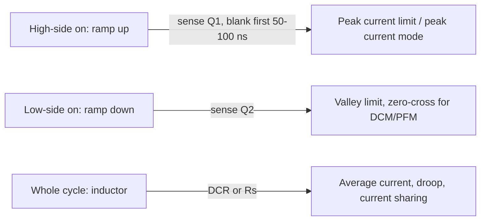

::: basics
### In plain words
A buck converter has to measure its own output to hold it steady. For voltage, two resistors scale the output down to a small voltage that the chip compares with its reference. For current, the chip needs a small signal proportional to the inductor current. Common ways are a sense resistor, the switch's own resistance, the inductor's wire resistance, or a mirror of the switch.

### Picture it
The voltage divider is like a map: a scaled-down copy of the real thing. The chip reads the small map and adjusts the real world until the map shows the right value. Current sensing is like counting cars at a narrow gate: you need something in the road to measure the flow. A resistor in the road is accurate but slows traffic (wastes power), while the other methods borrow resistance that is already there.

### Words you need
- **Feedback pin (FB)**: the chip input that receives the scaled-down output voltage.
- **Reference ($V_{REF}$)**: the fixed internal voltage the feedback is compared against.
- **Voltage divider**: two resistors that output a fixed fraction of the input ([[q0008]]).
- **Sense resistor**: a small resistor in the current path, where $V=I\times R$ gives the current.
- **DCR sensing**: using the inductor's own wire resistance as the sense element.

### The simplest example
Say the reference is 0.8 V and you want 3.3 V out. With $R_2=10$ kΩ, you need $R_1=10\text{ k}\Omega\times(3.3/0.8-1)\approx31$ kΩ. The pin then sees $3.3\times10/41\approx0.8$ V, so the chip is happy. For current, a 10 mΩ sense resistor at 3 A gives 30 mV and wastes $3^2\times0.01=0.09$ W.

That is the whole idea. The rest of this page compares the current-sensing methods in detail, and covers accuracy, layout, and where to tap the voltage.
:::

::: testing
Whether you know the three or four standard ways to turn "how much voltage and current do I have" into a signal a controller can use, and the trade-offs of each: **resistor divider** to the feedback pin for voltage; **sense resistor, FET $R_{DS(on)}$, inductor DCR, or a sense-FET mirror** for current. The interviewer is listening for accuracy, power loss, temperature dependence, noise/blanking, and where in the cycle the measurement is valid. The question points at the Voltage/Current Sensing section, so a concise but complete overview is the target.
:::

::: why
Regulation accuracy is set by the sensing path, not by the controller's fancy loop. A 1% tolerance resistor divider limits your output to about 1% plus the reference tolerance; a poor current sense leads to an inaccurate current limit, bad current sharing in multiphase designs, and noisy or jittery peak-current-mode loops. Sensing is also where layout bites: a noisy feedback trace or a badly connected sense resistor will make a good design misbehave.
:::

::: concepts
- **Feedback divider**: scales $V_{OUT}$ to $V_{REF}$: $V_{FB} = V_{OUT}R_2/(R_1+R_2)$ ([[q0008]], [[q0223]]).
- **Reference and error amplifier**: closed-loop regulation forces $V_{FB} = V_{REF}$.
- **Current sensing methods**: resistor, $R_{DS(on)}$, DCR, mirror sense FET ([[q0225]], [[q0226]]).
- **Switching noise and blanking**: leading-edge spikes at turn-on corrupt the sense signal.
- **Temperature coefficient**: copper (+0.393%/°C) and silicon FET $R_{DS(on)}$ (rising with temperature) shift the sensed value.
- **Kelvin (4-wire) connection**: separate sense traces to avoid IR drops.
- **Peak vs valley vs average current sensing** ([[q0252]]).
:::

::: answer
"Voltage is sensed with a resistor divider from the output to the feedback pin. The error amplifier compares that pin to an internal reference, say 0.8 V, and adjusts duty until they match, so $V_{OUT} = V_{REF}(1 + R_1/R_2)$. The divider is external on adjustable parts, and it's what sets the output accuracy together with the reference. I'd take the sense point right at the load with a clean trace, add a small feed-forward cap if the loop needs phase, and pick resistor values that balance divider current against noise and bias-current error.

For current there are four common methods. A sense resistor in series is accurate but wastes power and needs an amplifier. Sensing the voltage across the power FET's $R_{DS(on)}$ is lossless and cheap but varies with temperature and process, and needs blanking. Inductor DCR sensing puts an RC across the inductor with a time constant matched to $L/DCR$, so the capacitor voltage is $I_L\cdot DCR$; it's lossless but the copper's temperature coefficient needs compensation. And many ICs use a sense-FET that mirrors a small fraction of the switch current. Which one I use depends on accuracy, loss and cost, and where the current needs to be seen: peak, valley or average."
:::

::: technical
**Voltage sensing.** $V_{FB} = V_{OUT}\dfrac{R_2}{R_1+R_2}$, regulated to $V_{REF}$ (e.g. 0.6 to 0.8 V; vendor-dependent). Thus $R_1 = R_2\left(\dfrac{V_{OUT}}{V_{REF}} - 1\right)$. Total accuracy $\approx \Delta V_{REF}/V_{REF}$ + divider tolerance $\times \dfrac{R_1}{R_1+R_2}$ + FB bias current $\times (R_1\parallel R_2)$. Dividers in the tens of kΩ are common; values too high make the FB node noise-sensitive and add bias-current error, values too low waste quiescent current ([[q0224]]). A feed-forward capacitor across $R_1$ adds a zero/pole pair for phase lead ([[q0250]]). Remote (Kelvin) sensing or a differential sense amplifier takes the sample at the load to cancel IR drops.

**Current sensing methods.**

| Method | Signal | Pros | Cons |
|---|---|---|---|
| Series sense resistor ($R_S$, high or low side) | $I\,R_S$ (e.g. 10 mΩ at 3 A = 30 mV) | Accurate, flat over temperature with a good resistor | Power $I^2R_S$ (90 mW at 3 A), needs amplifier, extra loss |
| FET $R_{DS(on)}$ | $I\,R_{DS(on)}$ | No extra part, lossless | Large tempco and process spread, needs blanking, noisy |
| Inductor DCR (RC across L) | $V_C = I_L\,DCR$ when $R_sC_s = L/DCR$ | Lossless, senses true inductor current, no blanking issue | DCR tempco +0.39%/°C, needs tuning of RC, tolerance of L |
| Sense-FET mirror | $I_{sw}/N$ | Compact, integrated | Mirror mismatch, accuracy limited at low current |

Where in the cycle: high-side peak sensing (used for peak-current-mode and cycle-by-cycle limit) is valid only after a blanking time; low-side valley sensing is used for valley current limit and for zero-cross detection; inductor DCR or a series resistor gives the full waveform.
:::

::: short
"Output voltage is sensed with a resistor divider into the feedback pin, which the error amp compares with an internal reference: $V_{OUT} = V_{REF}(1+R_1/R_2)$. Current is sensed in one of four ways: a series sense resistor, the voltage across the FET's $R_{DS(on)}$, an RC across the inductor that reproduces $I_L\cdot DCR$, or a sense-FET that mirrors the switch current. They trade accuracy against loss, temperature drift and noise, and which I use depends on whether I need peak, valley or average current."
:::

::: long
"For voltage it's a divider. The output goes through $R_1$ and $R_2$ to the FB pin, the error amp compares it to a reference around 0.6 to 0.8 V, and the loop regulates until they match. That gives $V_{OUT} = V_{REF}(1 + R_1/R_2)$. Accuracy is the reference tolerance plus the divider's, weighted by $R_1/(R_1+R_2)$. I'd pick values in the tens of kΩ: low enough that FB leakage and noise pickup don't matter, high enough not to burn standing current. And I'd route the sense trace to the load, away from the switch node, with a feed-forward cap across $R_1$ if I need phase lead.

For current there are four options. First, a small series sense resistor, say 10 mΩ, measured with an amplifier. It's accurate and stable over temperature, but it costs $I^2R$ and board area. Second, $R_{DS(on)}$ sensing: I look at the voltage across the conducting FET. It's free and fast, but $R_{DS(on)}$ varies with temperature and from part to part, and I have to blank the switching spike. Third, DCR sensing: an RC network across the inductor where $R C = L/DCR$ makes the capacitor voltage equal to $I_L \times DCR$. It's lossless and gives the true inductor current, but copper's tempco is 0.39%/°C so the signal drifts about 30% over an 80 °C rise unless I add an NTC correction. Fourth, a sense-FET that mirrors a fraction of the switch current, which is what most integrated parts use.

Which one depends on what I'm doing: peak-current control senses the high-side current after blanking, valley control senses the low side, and an accurate current limit or current-sharing multiphase design leans on resistor or DCR sensing."
:::

::: terms
- **Feedback divider ($R_1/R_2$)**: attenuator from $V_{OUT}$ to $V_{FB}$.
- **$V_{REF}$ / $V_{FB}$**: internal reference and feedback pin voltage that the loop regulates equal.
- **Kelvin sensing**: separate sense and force connections so sense traces carry no load current.
- **DCR sensing**: RC across the inductor reproducing the DCR voltage drop.
- **$R_{DS(on)}$ sensing**: using the FET's on-resistance as a sense resistor.
- **Sense-FET (mirror)**: small parallel FET carrying a fixed fraction of the main current.
- **Leading-edge blanking**: ignoring the sensed signal for tens to ~100 ns after turn-on to avoid spikes.
- **Peak / valley current limit**: threshold at the top or bottom of the inductor ripple.
:::

::: exceptional
**An average answer** says "a resistor divider for voltage, a sense resistor for current".

**An exceptional answer**:
- Writes the divider relation and the **accuracy stack** (reference + resistors + bias current), picking values with reasons.
- Names at least **four** current-sense methods and the trade-off for each: power loss, tempco, noise/blanking, accuracy.
- For DCR sensing, gives the matching condition $R_sC_s = L/DCR$ and the copper tempco problem with numbers.
- Explains where in the cycle each method is valid (peak/valley/average) and ties to control mode.
- Mentions Kelvin connections and layout (FB trace away from SW, sense at the load).
- Notes the difference between sensing for **control** and for **protection**.
:::

::: mistakes
- **Putting the FB divider far from the IC with a long trace.** The high-impedance node picks up switching noise and causes jitter.
- **Choosing divider values purely for low power.** MΩ dividers are sensitive to FB bias current, leakage and parasitic capacitance (which forms a pole).
- **Assuming $R_{DS(on)}$ is a precision sense element.** It varies strongly with temperature and between parts: fine for protection, poor for accurate limits.
- **Forgetting temperature compensation in DCR sensing.** A 30% rise in DCR at 105 °C shifts the current limit 30% lower unless compensated.
- **Mismatching the RC time constant.** If $R_sC_s \ne L/DCR$ the sensed waveform distorts, creating false transient response or loop errors.
- **Sensing with a long, shared ground trace.** The IR drop and noise in the return path look like current error.
:::

::: deep
## Voltage sensing: the divider

The error amplifier drives its input to equality, so in steady state $V_{FB} = V_{REF}$. The divider then sets
$$V_{OUT} = V_{REF}\left(1 + \frac{R_1}{R_2}\right)$$

```circuit
{"caption":"Output voltage sensing: divider, feed-forward capacitor and error amplifier","elements":[
 {"t":"term","at":[0,2],"label":"V_{OUT}","side":"left"},
 {"t":"wire","pts":[[0,2],[10,2]]},
 {"t":"R","a":[6,2],"b":[6,6],"label":"R_1"},
 {"t":"R","a":[6,6],"b":[6,10],"label":"R_2"},
 {"t":"dot","at":[6,2]},{"t":"dot","at":[6,6]},
 {"t":"C","a":[10,2],"b":[10,6],"label":"C_{ff}"},
 {"t":"wire","pts":[[10,6],[6,6]]},
 {"t":"wire","pts":[[6,6],[14,6]]},
 {"t":"opamp","at":[14,7],"label":"EA"},
 {"t":"V","a":[12,8],"b":[12,12],"label":"V_{REF}"},
 {"t":"wire","pts":[[12,8],[14,8]]},
 {"t":"wire","pts":[[6,10],[6,12],[12,12]]},{"t":"gnd","at":[9,12]},
 {"t":"dot","at":[9,12]},{"t":"dot","at":[10,6]},
 {"t":"term","at":[18,7],"label":"to PWM","side":"right"},
 {"t":"text","at":[12,6.9],"text":"V_{FB}","anchor":"middle","color":"accent"}
]}
```
Figure: $V_{OUT}$ is scaled by $R_2/(R_1+R_2)$ to the error amplifier's inverting input and compared with $V_{REF}$. The optional $C_{ff}$ across $R_1$ passes high-frequency output movement straight to FB, adding phase lead. In real ICs the amplifier, reference and PWM are inside; only $R_1$, $R_2$ and $C_{ff}$ are external ([[q0256]]).

**Worked values.** For $V_{REF} = 0.8$ V, $V_{OUT} = 3.3$ V, $R_2 = 10$ kΩ: $R_1 = 31.25$ kΩ; the nearest 1% value is 31.6 kΩ giving 3.328 V. Divider current $= 3.3/41.6\text{ k} = 79$ µA. The source impedance seen by the FB pin is $R_1\parallel R_2 = 7.6$ kΩ. A 50 nA bias current then causes $50\text{ nA}\times7.6\text{ k} = 0.38$ mV, which is 0.05% of 0.8 V: negligible. With a 1 MΩ-class divider the same bias would cost 5% or more, and a few pF of stray capacitance would form a pole near 35 kHz, right at the loop crossover.

**What goes wrong with the divider ([[q0224]]).** Too high: bias-current error, noise pickup, a pole formed with parasitic capacitance. Too low: wasted current (a 1 kΩ-class divider burns 2.5 mA), load on the output at light load.

**Where to sense.** At the load, with a Kelvin trace: with 3 A through 20 mΩ of trace/plane resistance in each leg, a remote sense avoids a 120 mV regulation error (3.6% of 3.3 V). Differential sense amplifiers (VOS+/VOS− pins) sense both rails. Keep the FB trace short and away from the switch node and inductor.

> [!UNCERTAIN]
> Reference voltages, FB bias currents and recommended divider values differ by product (0.6 V, 0.8 V, 1.0 V, 1.2 V are all common). The numbers above are illustrative; read the datasheet's "feedback" section.

## Current sensing: four ways

**1. Series sense resistor.** Place $R_S$ (e.g. 10 mΩ) in the inductor path or the ground return and amplify $V = I\,R_S$ with a current-sense amplifier. At 3 A the signal is 30 mV; power loss is $I^2R_S = 90$ mW, about 1% of 9.9 W output. Accuracy depends on the resistor (1% parts, low tempco) and amplifier offset (an offset of 100 µV is 0.3% of 30 mV, so choose a good amp). Common-mode: in-line with the inductor (at the output) it sees $V_{OUT}$; at the switch it sees pulsed voltage and needs a high-bandwidth amp. Used when accurate limits or averaged current feed a controller ([[q0225]]).

**2. FET $R_{DS(on)}$ sensing.** Sense $V_{DS}$ while the FET is on. At 5 A and 40 mΩ cold, 200 mV; hot, $R_{DS(on)}$ can be 1.5× higher (silicon MOSFETs rise about 0.4 to 0.7%/°C; check datasheet), so the signal reads 300 mV. Zero extra loss, but the limit drifts with temperature and part-to-part variation (often 2×+), and the first 50 to 100 ns after turn-on contain ringing from switch-node dv/dt and Coss, so a **leading-edge blank** is required.

**3. Inductor DCR sensing.** A series $R_sC_s$ placed across the inductor develops
$$V_C(s) = I_L(s)\cdot DCR\cdot\frac{1 + sL/DCR}{1 + sR_sC_s}$$
Choosing $R_sC_s = L/DCR$ cancels the dynamics so $V_C = I_L\,DCR$ at all frequencies.

For $L = 6.8$ µH and $DCR = 15$ mΩ: $\tau = L/DCR = 453$ µs. With $C_s = 100$ nF, $R_s = 4.53$ kΩ (use 4.53 kΩ, E96). At 3 A, $V_C = 45$ mV.

```plot
{"title":"DCR sense: response of Vc to a step in inductor current (normalized to I x DCR)","x":{"label":"t","unit":"s","min":0,"max":2e-3},"y":{"label":"Vc / (I x DCR)","min":0,"max":1.6},
 "vars":{"tl":4.53e-4},
 "series":[{"label":"matched RC (RC = L/DCR)","fn":"1","color":"green"},{"label":"RC 2x too slow","fn":"1+(0.5-1)*exp(-x/(2*tl))","color":"red"},{"label":"RC 2x too fast","fn":"1+(2-1)*exp(-x/(0.5*tl))","color":"blue"}]}
```
Figure: With the time constant matched, the capacitor voltage follows the inductor current perfectly. If RC is off by 2×, the sensed signal starts at the wrong value (50% or 200% of the right one) after a current step and slowly corrects: it misleads fast loops (current mode, droop control) for several hundred µs. L tolerance (±20%) and its change with current mean perfect matching is impossible, so designers check the worst case.

Copper tempco of +0.393%/°C means DCR is 15 mΩ at 25 °C but 19.7 mΩ at 105 °C (31% more). That shifts the sensed current by +31% unless corrected, typically with an NTC thermistor in the $R_s$ network or by firmware/IC temperature compensation. No extra loss and no blanking, which is why it's popular in multiphase CPU converters ([[q0243]]).

**4. Sense-FET mirror.** The power FET is built from many cells; a small fraction (say 1/5000) is split off and its current is held at the same $V_{DS}$ by an amplifier. The sense current $I_{sw}/N$ is converted to a voltage on a resistor. Integrated, no loss, but mirror accuracy suffers at low current (offset), and again blanking is needed.

## Where and when the current is measured


Figure: Current is only present in the high-side FET while it is on, and in the low-side FET while it is on, so FET-based sensing gives only part of the waveform. Inductor DCR or a series resistor sees the entire waveform, which is why averaging and current sharing prefer them.

## Sensing for control vs protection

For **protection** (overcurrent limit) a ±20 to 30% tolerance is usually acceptable, so $R_{DS(on)}$ or mirror is fine. For **control**, current-mode loops need a clean, noise-free ramp, so blanking and filtering are tuned; for **accurate limits, droop regulation (adaptive voltage positioning) and multiphase sharing**, 3 to 5% accuracy implies a resistor or temperature-compensated DCR. ([[q0227]] covers which signals the loop uses.)

## Real hardware behaviour

- **Noise.** Switch-node edges couple capacitively into high-impedance FB or sense traces. Use short traces, ground guards, small RC filters (e.g. 100 Ω and 100 pF on a sense signal), and never route sense lines under the inductor.
- **Kelvin connections.** For $R_S$, bring sense traces from the resistor pads, not from the power trace, so solder and copper resistance don't add error.
- **Layout of DCR network.** Place $R_sC_s$ close to the inductor pads with symmetrical short connections to the sense pins.
- **Thermal coupling.** Put the NTC next to the inductor so it tracks the copper temperature.

## Experiment

```sim
{"id":"buck-lab","vin":12,"vout":3.3,"l":6.8e-6,"c":55e-6,"esr":0.005,"fsw":500000,"iout":3,"view":"waveforms"}
```
Figure: The inductor current waveform here is what DCR sensing reproduces and what high-side or low-side FET sensing sees only in parts: the up-slope during the on-time and the down-slope during the off-time. Scaled by a 15 mΩ DCR, the 0.7 A ripple becomes only about 10 mV and the 3 A average about 45 mV, which is why sense noise is a concern.
:::

::: applications
- **Peak-current-mode regulators**: sense-FET mirror on the high side with leading-edge blank.
- **Multiphase CPU converters**: lossless DCR sensing with NTC compensation for current sharing and droop.
- **Battery chargers and motor drivers**: precision sense resistors with high-side current-sense amplifiers.
- **Automotive buck**: $R_{DS(on)}$ or mirror sensing with wide tolerance but robust over-current protection.
- **Remote-sense power supplies for FPGAs/CPUs**: differential sense lines to compensate for board drops.
:::

::: assumptions
- Standard adjustable buck with an internal error amplifier and a reference of 0.6 to 0.8 V; fixed-output parts embed the divider.
- Numbers (DCR 15 mΩ, $R_S$ = 10 mΩ, 40 mΩ FET) are illustrative.
- DCR sensing assumes inductor L and DCR behave linearly; real L drops near saturation, so the RC match varies with current.
- $R_{DS(on)}$ temperature coefficient is for generic silicon power MOSFETs and varies by device.
- Digital controllers can do the same sensing with ADCs and digital compensation; the analogue front-end ideas are the same.
:::

::: followups
### How do you choose the divider resistor values?
Pick $R_2$ so divider current is a few tens to ~100 µA (for $V_{FB}$ = 0.8 V, 8 to 10 kΩ gives about 80 to 100 µA) and compute $R_1 = R_2(V_{OUT}/V_{REF}-1)$. Check that FB bias current times $R_1\parallel R_2$ is a small fraction of $V_{REF}$, that standard 1% values land within spec, and that parasitic capacitance doesn't create a pole near crossover. See [[q0224]].

### Why does DCR sensing need temperature compensation?
Copper resistance rises 0.393%/°C. A winding at 105 °C has 31% more DCR than at 25 °C, so for the same current $V_C$ is 31% higher and the controller thinks the current is higher, lowering the current limit and misreporting load current. An NTC in the RC network (or digital correction) lowers $R_s$ with temperature to compensate.

### Why must $R_{DS(on)}$ and mirror current sensing be blanked?
When the high-side FET turns on, the switch node rises quickly and the parasitic capacitance and ringing create a current spike and voltage glitch that look like a huge current. A leading-edge blanking time (typically tens to ~100 ns) ignores the sense signal until it settles, which limits the minimum on-time ([[q0257]]).

### Scenario: the load sees 3.20 V instead of 3.30 V, but only at heavy load. What do you check?
A load-dependent error points to the sense point: IR drop between the sense node and the load (the converter regulates its own sense point correctly, but the load sees less). Check the FB trace's connection point and ground return. Also check bias-current effects (not load dependent) and the current-limit foldback or droop feature (some controllers intentionally droop). Measure at the IC and at the load.

### How would you sense average current with high accuracy, and what do you give up?
Use a low-side or in-line sense resistor with an amplifier and filter, or a calibrated DCR network with temperature compensation. The cost is power loss ($I^2R_S$, e.g. 90 mW for 10 mΩ at 3 A), extra components and layout complexity, and for in-line resistors a common-mode range issue. A calibrated digital correction can save loss but needs temperature and tolerance modelling.
:::

::: interpretations
The question says "more in Voltage/Current Sensing section", which points to Q223 to Q227. This page is the overview of how the sensing is done; the details of divider values ([[q0224]]), when/where to sense current ([[q0226]]) and which signals matter for the loop ([[q0227]]) are covered there.
:::

::: references
- Texas Instruments, "Basic Calculation of a Buck Converter's Power Stage" (SLVA477) and datasheet "feedback divider" and "current limit" sections for typical parts.
- Erickson and Maksimović, *Fundamentals of Power Electronics*: current-mode control (Chapter 12) and feedback networks (Chapter 9).
- Texas Instruments and Analog Devices application material on inductor DCR current sensing with temperature compensation (look for manufacturer app notes; exact titles vary).
- Horowitz and Hill, *The Art of Electronics*, 3rd ed.: current-sense and Kelvin connection discussions.
:::

::: rubric
- Voltage sense by divider into FB with $V_{OUT} = V_{REF}(1+R_1/R_2)$ :: Core of the answer.
- Mentions accuracy factors (reference, resistor tolerance, bias current) and value trade-off :: Shows engineering judgment.
- Names four current-sense methods :: Completeness.
- Gives pros/cons: loss, tempco, blanking, accuracy for each :: Trade-offs are what the interviewer wants.
- DCR sensing condition $R_sC_s = L/DCR$ and tempco compensation :: A detail that marks real familiarity.
- Where in the cycle (peak/valley/average) and blanking :: Connects sensing to control.
- Kelvin/remote sensing and layout away from the switch node :: Practical reliability.
:::

::: quiz
```json
[
 {"type":"numeric","level":"fundamental","q":"A buck uses $V_{REF}=0.8$ V with $R_2=10$ kΩ. What $R_1$ (kΩ) gives 5 V output?","answer":52.5,"tolerance":0.01,"unit":"kΩ","explain":"$R_1 = R_2(V_{OUT}/V_{REF}-1) = 10\\text{k}\\times(6.25-1) = 52.5$ kΩ."},
 {"type":"mcq","level":"fundamental","q":"Which current-sense method wastes no extra power and senses the full inductor current waveform?","options":["Series sense resistor","Inductor DCR sensing with matched RC","Sense-FET mirror","None of these"],"answer":1,"explain":"DCR sensing uses the winding's own resistance, so no additional loss, and with $R_sC_s=L/DCR$ the capacitor voltage reproduces $I_L\\,DCR$. FET methods see only the part of the cycle that FET conducts."},
 {"type":"numeric","level":"intermediate","q":"L = 6.8 µH, DCR = 15 mΩ, $C_s$ = 100 nF. What $R_s$ (kΩ) matches the time constant?","answer":4.53,"tolerance":0.02,"unit":"kΩ","explain":"$R_sC_s = L/DCR = 453\\ \\mu$s, so $R_s = 453\\mu/100\\text{n} = 4.53$ kΩ."},
 {"type":"numeric","level":"intermediate","q":"A 10 mΩ sense resistor carries 3 A. What power does it dissipate (mW)?","answer":90,"tolerance":0.01,"unit":"mW","explain":"$P = I^2R = 9\\times0.01 = 0.09$ W = 90 mW."},
 {"type":"truefalse","level":"intermediate","q":"Copper winding resistance is constant over temperature, so DCR sensing needs no temperature compensation.","answer":false,"explain":"Copper's tempco is about +0.393%/°C: DCR rises roughly 31% from 25 to 105 °C, so the sensed current signal drifts by the same amount."},
 {"type":"mcq","level":"advanced","q":"Why do $R_{DS(on)}$ and sense-FET methods need leading-edge blanking?","options":["The FET resistance is zero at turn-on","Switch-node ringing and Coss charging create a large false current spike right after turn-on","Blanking increases accuracy at light load","It reduces $R_{DS(on)}$ with temperature"],"answer":1,"explain":"At turn-on the fast dv/dt and parasitic charging produce spikes in the sensed signal; the controller ignores it for tens of ns to avoid false current-limit trips."}
]
```
:::
