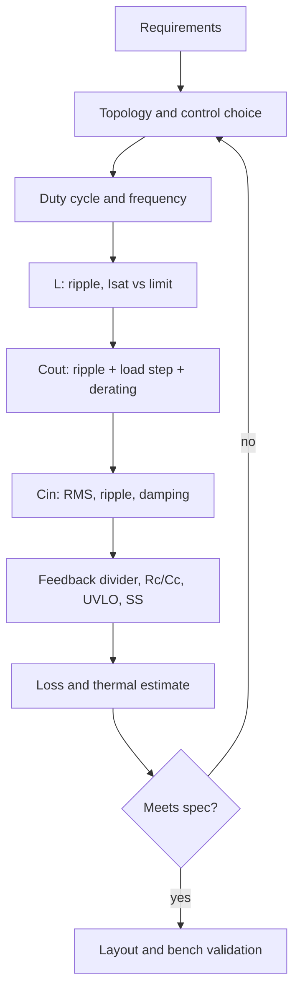

::: basics
### In plain words
Designing a buck converter is a chain of choices. You start from the requirements, such as input range, output voltage and current. Then you pick the duty cycle range, switching frequency, inductor, capacitors, and feedback divider in turn. Last, you estimate the losses and check everything with measurements.

### Picture it
It is like planning a road trip. First you decide where you are going and how much time you have. Those fix the route, which fixes the fuel stops, which fixes the budget. In the same way, the voltages fix the duty cycle, the duty cycle and frequency fix the inductor, and the inductor and load step fix the capacitors. Unlike a trip, each step also has to be checked against the one before it.

### Words you need
- **Duty cycle (D)**: the fraction of each period the switch is on, about $V_{out}/V_{in}$.
- **Ripple ratio**: the inductor's current swing as a fraction of the load current.
- **Saturation current**: the current where the inductor stops working properly ([[q0259]]).
- **Effective capacitance**: what a capacitor really provides after derating ([[q0258]]).
- **Efficiency**: output power divided by input power.

### The simplest example
Say 9 to 18 V in, 3.3 V out at 3 A, switching at 500 kHz. The output power is $3.3\times3=9.9$ W. At 18 V in, $D=3.3/18\approx0.18$. With 30% ripple, $\Delta I=0.9$ A, so $L=3.3\times0.82/(500{,}000\times0.9)\approx6$ µH. You pick 6.8 µH. If the losses are about 0.6 W, the efficiency is $9.9/10.5\approx94\%$.

That is the whole idea. The rest of this page works through each step, including the capacitors, the feedback divider, thermal checks, and bench validation.
:::

::: testing
Not whether you can recite a schematic, but whether you can run a **design process out loud**: ask clarifying questions to get requirements, pick an architecture, calculate duty cycle, inductor, capacitors and feedback network with real numbers, estimate loss and temperature, and say how you would verify it. The interviewer is also checking judgment: where you accept a trade-off (frequency vs efficiency, ripple ratio, ceramic vs polymer), what you check at the corners (min/max $V_{IN}$, light load, hot), and whether you remember the unglamorous parts (soft-start, UVLO, layout, input damping, protection).
:::

::: why
"Design a buck converter" is the canonical open-ended power question because it exercises everything: switching fundamentals, magnetics, capacitors, control, thermal and test. Real engineers rarely design from scratch; they choose an IC and design the power stage around it, which is exactly the process interviewers want to hear. A clear structure (requirements, topology, calculations, selection, loss, loop, layout, validation) also keeps you from rambling when the interview is going fast.
:::

::: concepts
- **Requirements**: $V_{IN}$ range, $V_{OUT}$, $I_{OUT}$, ripple, transient, efficiency, size, cost, EMI ([[q0257]]).
- **Duty cycle and volt-second balance**: $D = V_{OUT}/V_{IN}$ (ideal CCM) ([[q0211]]).
- **Inductor design**: ripple ratio, $I_{sat}$, DCR ([[q0258]], [[q0259]]).
- **Capacitor design**: ripple, load step, effective capacitance, input RMS ([[q0258]]).
- **Window of L and C**: min and max ([[q0260]]).
- **Loop and stability**: compensation, crossover, phase margin ([[q0261]]).
- **Sensing and feedback network**: divider, current limit ([[q0262]]).
- **Losses and thermals**: conduction, switching, inductor, gate drive, quiescent.
:::

::: answer
"I'd start by asking what the converter has to do: input range including transients, output voltage and current, ripple and transient limits, efficiency target, size, and whether noise or battery life matters. Let me assume 9 to 18 V in, 3.3 V at 3 A out, 1% ripple, 5% droop on a 2.5 A load step, and 85 °C ambient.

Then the architecture: a synchronous buck, because the step-down ratio is large and I want efficiency, around 500 kHz as a compromise between size and loss, and an integrated-FET current-mode IC since 3 A is well inside what one package can do. Duty cycle is 18% to 37%.

The inductor: 30% ripple at maximum input gives about 6 µH, so I'd use 6.8 µH, peak about 3.4 A, with a saturation rating above the IC's current limit. Output capacitance: ripple needs only a few µF, but a 2.5 A step with a 50 kHz crossover needs about 50 µF effective, so five 22 µF ceramics after derating. Input: about 15 µF effective ceramics rated 25 V, with a bulk capacitor for hot-plug damping. The feedback divider: with a 0.8 V reference, 10 kΩ and 31.6 kΩ.

I'd estimate losses at about 0.6 W, 94% efficiency, 105 °C junction at 85 °C ambient, add soft-start and UVLO, keep the hot loop tight in layout, and then validate ripple, transient, loop gain, efficiency and thermal on the bench."
:::

::: technical
**Requirements (assumed).** $V_{IN} = 9$ to 18 V (12 V nominal, transients to 24 V), $V_{OUT} = 3.3$ V $\pm 2$%, $I_{OUT} = 3$ A continuous, load step 0.5 to 3 A, ripple $\leq 33$ mV pp, deviation $\leq 5$%, $T_A \leq 85$ °C, $\eta \geq 90$% at full load.

**Design chain.**

1. Duty cycle: $D = V_{OUT}/V_{IN}$: 0.18 to 0.37.
2. Frequency $f_{SW} = 500$ kHz; check $t_{on} = D/f \geq 367$ ns > $t_{on(min)}$.
3. Inductor: $L = V_{OUT}(1-D_{min})/(f\,r\,I_{OUT})$ with $r = 0.3$: 6.0 µH, use 6.8 µH: $\Delta I = 0.79$ A, $I_{pk} = 3.4$ A, $I_{RMS} = 3.01$ A. Choose $I_{sat} >$ IC max limit (about 6.5 A), DCR about 15 mΩ.
4. Output capacitor: $C_{eff} \geq \Delta I_{step}/(2\pi f_c \Delta V) = 48$ µF at $f_c = 50$ kHz; $5\times22$ µF X5R (about 55 µF effective after bias). Ripple $\approx 5$ mV.
5. Input capacitor: $I_{CIN,RMS} = I_{OUT}\sqrt{D(1-D)} \leq 1.45$ A; $\Delta V_{IN} = I_{OUT}D(1-D)/(fC) \leq 100$ mV needs about 14 µF effective, so $3\times10$ µF 25 V X7R + 100 nF at the pins + a damping bulk capacitor.
6. Feedback: $V_{REF} = 0.8$ V, $R_2 = 10$ kΩ, $R_1 = 31.6$ kΩ ($V_{OUT} = 3.33$ V).
7. Loss estimate $\approx 0.60$ W; $\eta \approx 94.3$%.
8. Loop: current mode, crossover about $f_{SW}/10$, PM $\geq 60^\circ$.
9. Protection and start-up: UVLO, soft-start, current limit, thermal shutdown.
:::

::: short
"I'd start with requirements: input range, output voltage and current, ripple, transient and efficiency. For 12 V to 3.3 V at 3 A I'd choose a synchronous current-mode buck around 500 kHz, with 6.8 µH for about 30% ripple and saturation above the IC's current limit, five 22 µF ceramics for output, ceramics plus a damping bulk cap at the input, and a divider with a 0.8 V reference. Then estimate loss, junction temperature and loop stability, and validate on the bench."
:::

::: long
"First I'd clarify. What's the input range and does it see transients? Output voltage, load current, ripple limit and load step? Efficiency, size, cost, noise sensitivity, ambient temperature? Let me assume 9 to 18 V in, 3.3 V at 3 A, under 1% ripple, a 2.5 A step with at most 5% droop, and 85 °C ambient.

Architecture: step-down with a ratio of three or four means a buck. I'd make it synchronous for efficiency and use an integrated-FET, current-mode controller IC, because 3 A is comfortably in that range and it's smaller and easier to lay out. I'd pick about 500 kHz as a balance between passives and switching loss.

Power stage: duty cycle is 3.3 over $V_{IN}$, so 18% at 18 V and 37% at 9 V. Inductor ripple is worst at maximum input. For 30% of 3 A, about 0.9 A, I get roughly 6 µH, so 6.8 µH, ripple 0.79 A, peak 3.4 A. The saturation rating has to exceed the IC's maximum current limit, not just 3.4 A, so about 6 to 7 A, with DCR around 15 mΩ.

Output capacitor: ripple only needs a few µF, but the 2.5 A step at a 50 kHz crossover needs about 50 µF, and ceramic derating can halve the capacitance, so five 22 µF. Input: RMS current is about 1.4 A, so I want ceramic capacitors with enough ripple rating, placed right at the pins, plus a bulk electrolytic or polymer to damp the hot-plug resonance. Feedback: 10 kΩ on the bottom and 31.6 kΩ on top gives 3.33 V from a 0.8 V reference.

Loss: about 0.3 W in the FETs, 0.14 W in the inductor, and 0.15 W switching and gate, plus a few tens of mW of dead-time, gate and quiescent loss, so about 0.6 W, 94% efficiency, around 104 °C junction at 85 °C ambient.

Finally add soft start, a UVLO divider and think about layout with a tight input-capacitor loop, and validate: ripple, load step, loop gain, efficiency and thermal."
:::

::: terms
- **Synchronous buck**: buck with a low-side FET replacing the diode ([[q0203]]).
- **Ripple ratio ($r$)**: $\Delta I_L/I_{OUT}$.
- **Effective capacitance**: capacitance after DC-bias and temperature derating.
- **Crossover frequency**: frequency where loop gain is 0 dB, typically $f_{SW}/10$.
- **Phase margin**: stability margin of the loop (target $\geq 45^\circ$ to $60^\circ$).
- **Soft-start**: controlled ramp of the reference at startup.
- **UVLO**: under-voltage lockout.
- **Hot loop**: $C_{IN}$, high-side and low-side FET loop that carries pulsed current.
:::

::: exceptional
**An average answer** draws a buck, writes $D = V_{OUT}/V_{IN}$, and picks L and C from formulas.

**An exceptional answer**:
- Begins by **asking** for requirements and **stating assumptions**, with numbers.
- Uses a **structured flow** and calls out the corner (max $V_{IN}$ for ripple, min $V_{IN}$ for max duty, light load for DCM/Q).
- Sizes C from the **load step**, not just ripple, and uses **effective** capacitance.
- Selects $I_{sat}$ against the IC's **current limit**.
- Gives a **loss budget** and junction temperature, not just "efficient".
- Mentions soft-start, UVLO, input damping, layout and **validation** plan.
- Names alternatives and trade-offs (frequency, controller vs integrated, ceramic vs polymer).
:::

::: mistakes
- **Starting with the schematic and never stating requirements.** Without numbers, "design" has no pass/fail.
- **Sizing L or C at nominal $V_{IN}$.** Ripple, current-limit margin, minimum on-time and slew limits are set at corners.
- **Choosing $C_{OUT}$ from ripple alone.** The load step needs about ten times more.
- **Ignoring ceramic derating** and the datasheet's capacitance window.
- **Forgetting the input side:** RMS current, hot-plug ringing, UVLO.
- **No loss or thermal estimate.** "3 A part" tells you nothing about junction temperature.
- **Skipping layout and validation.** A perfect schematic fails with a bad hot loop or a noisy feedback trace.
:::

::: deep
## Step 1: requirements and clarifying questions

Interview shortcut: say your assumptions and let the interviewer adjust.

| Item | Assumed value | Why it matters |
|---|---|---|
| $V_{IN}$ | 9 to 18 V (12 V nominal), transients to 24 V | Rating, duty range, ripple corner |
| $V_{OUT}$ | 3.3 V, ±2% | Reference and divider accuracy |
| $I_{OUT}$ | 3 A max, 0.5 A min; step 0.5 to 3 A | Inductor/FET sizing, DCM, transient |
| Ripple | ≤ 33 mV pp (1%) | Cout, ESR |
| Load step | 2.5 A, ≤ 165 mV (5%) | Cout, crossover |
| Efficiency | ≥ 90% at full load | Frequency, FETs, inductor |
| Ambient | 85 °C | Thermal |
| Size/cost | small, low cost | Integrated FETs, ceramic caps |
| Noise | moderate (digital loads) | Frequency choice, EMI filter |

## Step 2: architecture

- **Topology:** buck (step-down), since $V_{OUT} < V_{IN}$ over the whole range; LDO is out because 18 V to 3.3 V at 3 A would dissipate $14.7\times3 = 44$ W ([[q0211]]).
- **Synchronous or diode?** Sync, because a Schottky at 3 A and 0.5 V drop would lose $\approx 1.1$ W (about 1.2 W at 18 V) ([[q0203]]).
- **Integrated or controller?** Integrated FETs at 3 A, simplest design ([[q0256]]).
- **Control:** peak-current-mode with internal or simple Type II compensation; PFM/skip optional at light load ([[q0252]]).
- **Frequency:** 500 kHz. Check minimum on-time: $t_{on} = 0.183/500\text{k} = 367$ ns at 18 V, far above $t_{on(min)}$ of ~100 ns ([[q0257]]).


Figure: Design is iterative. If the loss or thermal estimate fails, loop back to frequency or part choice rather than forcing the numbers.

## Step 3: duty cycle and frequency

$D = V_{OUT}/V_{IN}$ (ideal CCM; real converters need slightly higher $D$ to cover drops). At 9, 12, 18 V: $D = 0.367, 0.275, 0.183$.

## Step 4: inductor

With $r = 0.3$ at $V_{IN(max)}$:
$$L = \frac{3.3\,(1-0.183)}{500\text{k}\times0.9} = 6.0\ \mu\text{H} \to 6.8\ \mu\text{H}$$
Ripple: 0.79 A (18 V), 0.70 A (12 V), 0.61 A (9 V). $I_{pk} = 3.4$ A. $I_{RMS} = 3.01$ A. Specification: 6.8 µH, ±20%, $I_{sat} \geq 6.5$ A at 100 °C (since the IC's maximum current limit is assumed 6 A; check yours), $I_{rms}$ (40 °C rise) ≥ 4 A, DCR ≈ 15 mΩ, shielded, SRF ≫ 500 kHz ([[q0259]]). With the −20% tolerance, L can be 5.4 µH: ripple 1.0 A at 18 V (still OK).

## Step 5: output capacitor

Three constraints ([[q0258]], [[q0260]]):

- Ripple: $0.79/(8\cdot500\text{k}\cdot55\mu) + 0.79\cdot0.003 \approx 5$ mV: easily within 33 mV.
- Load step: $C_{eff} \approx 2.5/(2\pi\cdot50\text{k}\cdot0.165) = 48$ µF; energy checks: 15 µF (step up), 38 µF (step down).
- Capacitance window of the IC (assume 40 to 200 µF effective).

Choose $5\times22$ µF, X5R, 6.3 V, 0805: 110 µF nominal, about 55 µF effective at 3.3 V (assumed 50% derating; read DC-bias curves). Immediate ESR step: $2.5\text{ A}\times3\text{ m}\Omega = 7.5$ mV.

## Step 6: input capacitor

$I_{CIN,RMS}$ is at most $3\sqrt{0.367\cdot0.633} = 1.45$ A (9 V). For $\Delta V_{IN} \leq 100$ mV: $C_{eff} \geq 14$ µF. Choose $3\times10$ µF 25 V X7R (effective capacitance falls with bias, so check the DC-bias curve at 18 V and size to the worst case), 100 nF at the VIN pin, and a 100 µF polymer or electrolytic for damping (ESR near $\sqrt{L_{cable}/C}$) ([[q0258]]).

## Step 7: feedback network and housekeeping

- **Divider:** $R_2 = 10$ kΩ, $R_1 = 31.6$ kΩ, $V_{OUT} = 3.33$ V, 79 µA divider current, 1% resistors, worst-case accuracy $\pm2.5$% ([[q0257]], [[q0262]]).
- **UVLO/EN divider:** for a 1.2 V enable threshold (typical; verify), 56.2 kΩ and 10 kΩ give turn-on at $1.2\times(1+5.62) = 7.9$ V, so the converter starts below the 9 V minimum and does not chatter.
- **Soft-start:** 2 ms, inrush to charge 55 µF to 3.3 V is $55\mu\times3.3/2\text{ ms} = 91$ mA, negligible against the current limit.
- **Bootstrap capacitor:** 100 nF.

```circuit
{"caption":"Result: the designed power stage with component values","elements":[
 {"t":"V","a":[0,4],"b":[0,12],"label":"V_{IN}","value":"9-18 V","labelSide":"other"},
 {"t":"wire","pts":[[0,4],[8,4]]},
 {"t":"C","a":[4,4],"b":[4,12],"label":"C_{IN}","value":"30 µF","labelSide":"other"},
 {"t":"dot","at":[4,4]},{"t":"dot","at":[4,12]},
 {"t":"wire","pts":[[8,8],[6,8],[6,4]]},{"t":"dot","at":[6,4]},
 {"t":"box","at":[8,2],"w":8,"h":8,"label":"Buck IC","pins":[
  {"side":"left","pos":2,"name":"VIN"},{"side":"left","pos":6,"name":"EN"},
  {"side":"right","pos":1,"name":"BST"},{"side":"right","pos":3,"name":"SW"},{"side":"right","pos":6,"name":"FB"},
  {"side":"bottom","pos":4,"name":"GND"}]},
 {"t":"wire","pts":[[12,10],[12,12]]},{"t":"dot","at":[12,12]},
 {"t":"wire","pts":[[0,12],[36,12]]},
 {"t":"wire","pts":[[16,3],[18,3]]},
 {"t":"C","a":[18,3],"b":[18,5],"label":"C_{BST}","value":"100 nF"},
 {"t":"wire","pts":[[16,5],[19,5]]},{"t":"dot","at":[18,5]},
 {"t":"L","a":[19,5],"b":[25,5],"label":"L","value":"6.8 µH","labelSide":"other"},
 {"t":"wire","pts":[[25,5],[36,5]]},
 {"t":"R","a":[27,5],"b":[27,8],"label":"R_1","value":"31.6 kΩ"},
 {"t":"R","a":[27,8],"b":[27,12],"label":"R_2","value":"10 kΩ"},
 {"t":"dot","at":[27,5]},{"t":"dot","at":[27,12]},{"t":"dot","at":[27,8]},
 {"t":"wire","pts":[[27,8],[16,8]]},
 {"t":"C","a":[32,5],"b":[32,12],"label":"C_{OUT}","value":"5x22 µF"},
 {"t":"dot","at":[32,5]},{"t":"dot","at":[32,12]},
 {"t":"R","a":[36,5],"b":[36,12],"label":"Load","value":"3 A"},
 {"t":"text","at":[33.6,3.6],"text":"3.3 V","anchor":"middle","color":"accent"},
 {"t":"gnd","at":[17,12]}
]}
```
Figure: The finished power stage, using the same 6-passive pattern as [[q0256]]. EN is tied to $V_{IN}$ here (or through the UVLO divider of the text). $C_{IN}$ is three 10 µF in parallel. Values chosen for 9 to 18 V in, 3.3 V/3 A out at 500 kHz.

## Step 8: loss budget and thermals

At 12 V in, 3 A out, with assumed FET resistances (40 mΩ high-side, 30 mΩ low-side), DCR 15 mΩ, ~10 ns total switching transition time, 20 ns dead time, 300 pF output capacitance, 5 nC gate charge at 5 V drive:

| Loss | Formula | Value |
|---|---|---|
| FET conduction | $I_{RMS}^2[D\,R_H + (1-D)R_L]$ | 0.30 W |
| Inductor DCR | $I_{RMS}^2\,DCR$ | 0.14 W |
| Voltage-current overlap | $\tfrac12 V_{IN} I\,t_{sw} f$ | 0.09 W |
| Dead-time body diode (two dead times per cycle) | $2V_F I\,t_{dead} f$ | 0.04 W |
| $C_{OSS}$ and gate drive | $\tfrac12 C_{OSS}V^2f + Q_gV_{dr}f$ | 0.02 W |
| Quiescent | | 0.015 W |
| **Total** | | **0.60 W** |

$\eta = 9.9/(9.9 + 0.60) = 94.3\%$.

```plot
{"title":"Modeled efficiency vs load (12 V to 3.3 V, 500 kHz, loss budget above)","x":{"label":"I_out","unit":"A","min":0.1,"max":3},"y":{"label":"Efficiency","unit":"%","min":80,"max":100},
 "vars":{"vo":3.3,"vin":12,"f":5e5,"di":0.704,"rt":0.04775,"tsw":1e-8,"td":2e-8,"pfix":0.038},
 "series":[{"label":"modeled efficiency (CCM everywhere)","fn":"100*vo*x/(vo*x+(x*x+di*di/12)*rt+0.5*vin*x*tsw*f+2*0.7*x*td*f+pfix)","color":"accent"}],
 "points":[{"x":3,"y":94.3},{"x":1,"y":96.2,"label":"1 A: 96.2%"},{"x":0.3,"y":94.5,"label":"0.3 A: 94.5%"}],
 "vlines":[{"at":2.97,"label":"3 A: 94.3%","color":"muted"}],
 "hlines":[{"at":90,"label":"90% requirement","color":"orange"}]}
```
Figure: The model peaks near 1 A where fixed and conduction losses balance. It assumes CCM at every load; a real converter below $\Delta I/2 = 0.35$ A enters DCM or PFM, so the light-load end is a rough estimate. All input values are assumptions.

Junction temperature: the IC dissipates about 0.46 W (everything but the inductor), so with $\theta_{JA} = 40$ °C/W, $T_J = 85 + 0.46\times40 \approx 104$ °C: acceptable under 125 °C but the margin is only about 20 °C; I'd improve copper if $\theta_{JA}$ is worse.

## Step 9: loop

For a peak-current-mode controller with an exposed COMP pin: assume current-sense transconductance $g_{cs} = 5$ A/V and error-amp $g_m = 500$ µS (both assumed). At crossover $f_c = 50$ kHz,
$$R_c = \frac{2\pi f_c C\,V_{OUT}}{g_m\,g_{cs}\,V_{REF}} = \frac{2\pi (50\text{k})(55\mu)(3.3)}{(500\mu)(5)(0.8)} = 28.5\ \text{k}\Omega$$
Cancel the load pole $R_LC = 60.5$ µs with $R_cC_c$: $C_c = R_LC/R_c = 2.1$ nF; the high-frequency pole $C_p = r_CC/R_c \approx 6$ pF (can be omitted). Check PM with a loop measurement. If the IC is internally compensated, the task reduces to staying in its L/C window ([[q0261]]).

## Step 10: layout

- $C_{IN}$ ceramics immediately across VIN and PGND pins, minimizing the hot-loop area.
- Switch node copper small (EMI) but wide enough for current.
- FB trace short and away from SW and L; connect the divider's $R_2$ to the IC's analog ground.
- Thermal vias under the exposed pad.
- $C_{OUT}$ close to the inductor, sense point at the load.

## Step 11: validation plan

Efficiency curve, ripple at several loads and inputs, load step and line step, loop gain at light and full load and min/max $V_{IN}$, start-up and shutdown with pre-bias, current limit and short-circuit, thermal imaging, and EMI ([[q0267]]).

## Experiment

```sim
{"id":"buck-lab","vin":12,"vout":3.3,"l":6.8e-6,"c":55e-6,"esr":0.003,"fsw":500000,"iout":3,"view":"waveforms"}
```
Figure: The design in simulation. Change `vin` to 18 and to 9 and watch ripple and duty. Change `iout` to 0.2 A: with the synchronous rectifier on, the inductor current goes negative for part of each cycle (forced CCM). Turn the synchronous rectifier off to see the DCM that a diode or skip-mode converter shows at the same load.

## Alternatives to discuss

- **Higher frequency (1 to 2 MHz):** smaller L and C but efficiency falls and $t_{on(min)}$ at 18 V gets close ([[q0221]]).
- **Controller with external FETs:** needed above about 10 A.
- **Polymer output cap** adds ESR for damping and reduces ceramic derating issues but more ripple.
- **PFM/skip:** better light-load efficiency, more ripple.
- **Two-phase:** lower ripple and faster transient for >10 A ([[q0236]]).
:::

::: applications
- **FPGA/SoC I/O and core rails**: 3.3 V, 1.8 V and 1.0 V point-of-load converters from a 5 or 12 V bus.
- **Industrial sensors and PLC modules**: 24 V to 5 or 3.3 V with wider-voltage ICs.
- **Automotive infotainment and ADAS modules**: 12 V battery to 3.3 V/5 V with EMI-friendly parts.
- **Battery-powered products**: single-cell to 1.8 V with PFM and nA quiescent current.
- **Evaluation boards and reference designs**: vendors publish designs like this with worked equations.
:::

::: assumptions
- Assumed requirements and a hypothetical IC (0.8 V reference, 500 kHz, 6 A maximum current limit, 40/30 mΩ FETs, $g_m$ and $g_{cs}$ values): the process, not the part, is the point.
- Efficiency estimate depends on assumed switching times, capacitances and resistances; real datasheet values will differ ([[q0217]]).
- Ceramic derating of 50% is an illustration; use DC-bias curves.
- A purely resistive load; real loads (processors) have faster steps and constant-power behaviour.
- If the specification were different (24 V in, 5 V out, 1 A, battery, isolation) the same process applies but the choices (part, frequency, mode) change.
:::

::: followups
### Why did you choose 500 kHz?
It balances passive size and loss. The ripple current of 6.8 µH is already around 26% and 55 µF is enough for the load step. At 1 MHz I could halve L and C but switching loss doubles (about 0.09 W overlap becomes 0.18 W), and $t_{on}$ at 18 V falls to 183 ns, closer to the part's minimum on-time. At 250 kHz the passives double in size and the on-time is easy, but efficiency gains are small; 500 kHz is a good starting point to be refined from a loss and size estimate.

### How would the design change for 24 V input?
Duty falls to 14%; $t_{on}$ at 500 kHz is 275 ns, so fine, but at higher frequency it becomes limiting. Need a 36 V or 40 V part, with higher voltage-rated input capacitors and maybe an input TVS. Ripple at 24 V for the same L: $3.3\times0.8625/(500\text{k}\times6.8\mu) = 0.84$ A, slightly larger, so maybe 8.2 µH. Efficiency drops a little because switching loss scales with $V_{IN}$.

### What if the output needs a 5 A load step instead of 2.5 A?
$C$ doubles (about 97 µF effective for the same droop and crossover), or I raise the crossover/ lower L. I'd check the current limit and transient with a larger step, the inductor slew (1.28 A/µs at 12 V gives 3.9 µs for 5 A), and possibly increase the capacitor count or use polymer bulk. Alternatively relax droop or use a higher-bandwidth architecture.

### Scenario: the design works on the bench but oscillates at light load. What's your approach?
Check the mode: at light load the converter enters DCM or PFM so the plant and loop gain change; check loop gain at 0.3 A and 3 A with the network analyzer. Check slope compensation, minimum on-time and any ringing from the inductor. Look at the FB node noise with a short probe ground. Fixes: add a small preload, adjust compensation, enable forced-PWM mode, or fix layout of the FB trace ([[q0266]]).

### How do you decide between ceramic and polymer output capacitors in this design?
Ceramic: lowest ESR/ESL and best high-frequency decoupling, but heavy DC-bias derating and no ESR zero, so loop compensation matters. Polymer: higher ESR gives phase lead and damping, bulk capacitance with no derating, but more ripple and a higher immediate step ($2.5\text{ A}\times20\text{ m}\Omega = 50$ mV). Many designs mix both.
:::

::: interpretations
"Design a buck converter" is open-ended: it might mean a discrete controller-and-FET design, an IC-based design, or a conceptual drawing of the switching circuit ([[q0264]] covers the latter). I gave a complete IC-based design with assumed requirements and showed where to adapt if the interviewer changes them. If they ask for a discrete implementation, the same calculations apply plus gate drive, dead time and a compensator you build yourself.
:::

::: references
- Texas Instruments, "Basic Calculation of a Buck Converter's Power Stage" (SLVA477): inductor and capacitor equations.
- Erickson and Maksimović, *Fundamentals of Power Electronics*: Chapters 2, 4, 9 and 12.
- Manufacturer buck IC datasheets and evaluation-module user guides: example calculations in the "Detailed Design Procedure" sections.
- Mohan, Undeland and Robbins, *Power Electronics*: DC-DC converter design.
:::

::: rubric
- Starts with clarifying questions and states assumed requirements :: Open-ended design needs numbers to be meaningful.
- Chooses topology and justifies sync vs diode, integrated vs controller, frequency :: Shows engineering reasoning.
- Computes $D$, $L$ (at max $V_{IN}$), and checks peak current and $I_{sat}$ vs current limit :: Core power-stage design.
- Sizes $C_{OUT}$ from ripple and load step with effective capacitance :: Shows depth beyond ripple.
- Sizes $C_{IN}$ for RMS current and mentions damping :: The input side often forgotten.
- Gives feedback divider values and notes accuracy :: Closes the loop on $V_{OUT}$.
- Estimates loss, efficiency, junction temperature :: Feasibility check.
- Mentions loop compensation, soft start, UVLO, layout and a validation plan :: Complete, shippable design thinking.
:::

::: quiz
```json
[
 {"type":"numeric","level":"fundamental","q":"For a 12 V to 3.3 V buck, what is the ideal duty cycle (as a fraction)?","answer":0.275,"tolerance":0.01,"unit":"","explain":"$D = V_{OUT}/V_{IN} = 3.3/12 = 0.275$."},
 {"type":"numeric","level":"intermediate","q":"Inductor ripple at 18 V in, 3.3 V out, 500 kHz, L = 6.8 µH (A pp)?","answer":0.793,"tolerance":0.02,"unit":"A","explain":"$\\Delta I = V_{OUT}(1-D)/(Lf) = 3.3\\times(1-0.1833)/(6.8\\mu\\times500\\text{k}) = 0.793$ A."},
 {"type":"numeric","level":"intermediate","q":"Feedback divider: $V_{REF}=0.8$ V, $R_2=10$ kΩ. What $R_1$ (kΩ) gives exactly 3.3 V?","answer":31.25,"tolerance":0.01,"unit":"kΩ","explain":"$R_1 = R_2(3.3/0.8 - 1) = 31.25$ kΩ; the nearest E96 1% value is 31.6 kΩ."},
 {"type":"mcq","level":"intermediate","q":"Which requirement usually sets the output capacitor size in this design?","options":["Output ripple voltage","The load-step transient","Inductor saturation","Minimum on-time"],"answer":1,"explain":"Ripple needs only a few µF (about 5 mV with 55 µF), while a 2.5 A step with 165 mV allowed droop at a 50 kHz crossover needs about 48 µF."},
 {"type":"numeric","level":"advanced","q":"Estimated total loss 0.60 W at 9.9 W output. What is the efficiency (%)?","answer":94.3,"tolerance":0.01,"unit":"%","explain":"$\\eta = 9.9/(9.9+0.60) = 94.3\\%$."},
 {"type":"mcq","level":"advanced","q":"The IC's maximum peak current limit is 6 A. Which inductor best fits the 3 A design?","options":["$I_{sat}$ = 3.5 A, $I_{rms}$ = 4 A","$I_{sat}$ = 4.5 A, $I_{rms}$ = 5 A","$I_{sat}$ = 6.5 A at 100 °C, $I_{rms}$ = 4 A","$I_{sat}$ = 10 A, $I_{rms}$ = 1 A"],"answer":2,"explain":"$I_{sat}$ must exceed the maximum current limit (with temperature margin), and $I_{rms}$ must exceed the 3 A load. The last option fails the thermal rating; the first two saturate in a fault."}
]
```
:::
