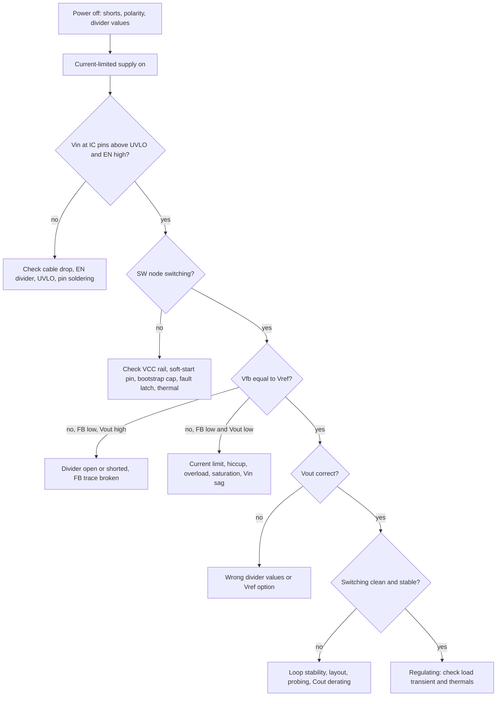

::: testing
Whether you debug **systematically**, not by poking: you start with safety and the cheapest checks, split the problem in half ("is it switching? is the feedback right?"), use the symptom (Vout = 0, Vout = Vin, Vout stable but wrong, Vout noisy) to narrow the cause, and know the buck-specific failure signatures: enable/UVLO, bootstrap, feedback divider faults, current limit and hiccup, inductor saturation, instability and bad probing. The interviewer wants a decision tree and a few concrete "if I see X, it means Y" examples.
:::

::: why
Bring-up of a new power board is where junior engineers spend a surprising share of their time, and a methodical approach saves boards (and fingers). Most "not regulating" problems come from a short list of causes: the IC never starts, the feedback network is wrong, the converter is in protection, or the loop oscillates. Being able to say which is which from two or three scope shots is a strong signal in an interview.
:::

::: concepts
- **Start-up conditions**: $V_{IN}$ above UVLO, EN above threshold, internal rails and soft-start complete ([[q0257]]).
- **Feedback node**: $V_{FB}$ should equal $V_{REF}$ in regulation ([[q0262]]).
- **Switch node (SW)**: the best single probe point: shows whether the converter is switching and at what duty.
- **Protection states**: current limit, hiccup, thermal shutdown, OVP ([[q0265]]).
- **Loop stability** and layout/noise ([[q0261]]).
- **Probing technique**: short ground spring, bandwidth, current probe ([[q0267]]).
- **Divide and conquer**: power off checks, then power on with current limit.
:::

::: answer
"First I'd make it safe: power the board from a current-limited bench supply, with the limit set just above what I expect, so a short doesn't burn anything. Before power, I'd check resistance from output to ground and input to ground, and inspect the inductor, diode or FET orientation.

Then I'd walk the signal chain. Is $V_{IN}$ at the IC pins correct, above UVLO? Is EN high? Are the internal supplies and power-good coming up? Then I look at the switch node: if it's not switching, the IC isn't starting, so it's enable, UVLO, a stuck soft-start or a fault latch. If it's switching, the question is whether the duty cycle makes sense. I measure the FB pin: it should be equal to the reference, about 0.8 V, if the converter is regulating. If FB is low and the output is high, the divider is wrong, for example the bottom resistor is shorted or the wrong value, and the loop keeps pushing duty. If FB equals the reference but the output is wrong, the divider values are wrong.

If the output droops and I see current-limit or hiccup behaviour, the load is too heavy, shorted, or the inductor is saturating. If the output has a noisy, jittering switch node, I suspect instability, bad layout or a noisy feedback trace. And if the output is $V_{IN}$, the high-side FET or the feedback path is the suspect. I'd confirm each hypothesis with a measurement before changing anything."
:::

::: technical
**Procedure.**

1. **Power off:** visual (polarity of inductor/diode/caps, solder bridges, missing bootstrap cap), resistance Vout-GND (should not be near 0 Ω unless the load is), Vin-GND, FB divider resistor values with DMM, inductor DCR.
2. **Power on with a current-limited supply:** set limit to about 1.5× expected input current at idle. Observe supply current: 0 mA (not starting), a few mA (starts, no switching), or limit (short/shoot-through).
3. **Rails and enables:** $V_{IN}$ at the IC pins, EN voltage vs threshold ($V_{EN} = V_{IN}R_b/(R_a+R_b)$), VCC/BIAS, PG, soft-start pin.
4. **Switch node:** switching or not, frequency, duty $D \approx V_{OUT}/V_{IN}$, jitter, bursts (hiccup), ringing amplitude.
5. **FB pin:** $V_{FB}$ vs $V_{REF}$. In regulation, $V_{FB} = V_{REF}$ within tolerance.
6. **Interpret:**

| Observation | Likely cause |
|---|---|
| No switching, EN or UVLO low | Enable divider wrong, $V_{IN}$ sag, UVLO threshold |
| No switching, EN OK, VCC low | Internal LDO fault, bad $C_{VCC}$, shorted pin |
| Switching bursts every 100s of ms | Hiccup: short or overload, or thermal cycling |
| $V_{OUT} = V_{IN}$ or near, $V_{FB}$ low | FB open/short to GND, wrong $R_1$, FB trace broken |
| $V_{OUT}$ very low (0.8 V), $V_{FB} = V_{OUT}$ | $R_2$ open or $R_1$ shorted: FB tied to output |
| $V_{OUT}$ stable but off by a ratio | Wrong divider value, wrong reference option |
| Switching but $V_{OUT}$ collapses under load | Current limit, saturated inductor, weak input source |
| Irregular pulses, audible whine | Loop instability, bad layout, FB noise, too little $C_{OUT}$ |

7. **Confirm** by changing one thing (e.g., lift the load, bypass the divider with a lab voltage) and re-measuring.
:::

::: short
"I'd power it from a current-limited supply after checking for shorts, then work down the chain: $V_{IN}$ at the pins, EN and UVLO, internal rails, then the switch node to see whether it's switching. If it isn't, it's enable, UVLO or a fault latch. If it is, I check the FB pin against the reference: that tells me whether the divider is wrong or the converter is limited by current limit, saturation or the load. Noisy switching suggests instability or layout. I confirm each guess with a measurement before changing parts."
:::

::: long
"I start with safety and the cheap checks. Power off: I look for reversed parts and solder bridges, then measure resistance from the output to ground and from the input to ground to catch a dead short, and I check the divider resistors with a meter. Then I power it from a bench supply with the current limit set low, so a fault doesn't turn into smoke, and I watch the supply current. Zero current means it isn't starting; current at the limit means a short or shoot-through.

Next I walk the start-up chain. Is the input actually at the pins, or is the cable dropping it below UVLO? Is EN above its threshold? If there's an enable divider, I check the voltage at the pin, not at the source. Are the internal rails and soft-start coming up? Power-good will tell me too.

Then the switch node, which is the most informative probe. If it's flat there's no switching: enable, UVLO, a fault latched, a missing bootstrap cap, or a stuck soft-start. If it's switching, I look at the duty cycle: it should be about $V_{OUT}/V_{IN}$. A maximum duty cycle with output at $V_{IN}$ means the loop thinks the output is too low, so I probe FB. With a 0.8 V reference, FB should sit at 0.8 V. If FB is at zero the divider is open or shorted; if FB follows the output the bottom resistor is open. If the switch node shows bursts with long gaps, the part is in hiccup: overload or a short, or the inductor saturating. If the pulses jitter and there's whine, it's the loop, layout or too little capacitance.

I never change two things at once, and I write down each measurement. At the end I'd note the root cause and how to prevent it in the next spin: a test point, a bigger margin or a layout fix."
:::

::: terms
- **UVLO / EN**: under-voltage lockout and enable thresholds that gate start-up.
- **Soft-start (SS)**: reference ramp; a wrong capacitor makes start-up very slow or stuck.
- **Power-good (PG)**: output-status flag from the IC.
- **Hiccup**: shutdown-and-retry protection; shows as periodic bursts.
- **Feedback (FB) pin**: should equal $V_{REF}$ in regulation.
- **Switch node (SW)**: junction of the FETs and inductor; shows duty and ringing.
- **Bootstrap**: $C_{BST}$ that powers the high-side gate drive; if missing the high side won't turn on.
- **Current-limited bench supply**: first line of defence on bring-up.
:::

::: exceptional
**An average answer** says "check the input, the output, the load and the components".

**An exceptional answer**:
- Starts with **safety**: power-off resistance checks and a **current-limited supply**.
- Uses the **switch node** and **FB pin** as the two key measurements and explains what each means.
- Lists **concrete signatures**: $V_{OUT} = V_{REF}$ means $R_2$ open or $R_1$ short, $V_{OUT} = V_{IN}$ with FB low, hiccup bursts, missing bootstrap.
- Discusses protection states and why they can masquerade as "not regulating".
- Mentions **probing technique** (short ground spring) and bandwidth.
- Changes **one variable** at a time and closes with a prevention note (test points, margins).
:::

::: mistakes
- **Powering the board from a stiff supply with no current limit.** A short at power-up destroys parts.
- **Probing the output only.** The output tells you something is wrong but not what; the switch node and FB tell you why.
- **Measuring EN at the supply rather than at the pin.** The divider and wiring drops matter.
- **Blaming the IC first.** Most failures are the divider, enable, a missing capacitor or a layout error.
- **Using a long ground lead.** It rings, shows fake spikes and can couple noise that causes real misbehaviour.
- **Changing several things at once.** You learn nothing and may mask the root cause.
- **Ignoring load.** A converter that is regulating into a light load may fail into the real load because of current limit or thermal.
:::

::: deep
## The method: four binary questions

A buck that isn't regulating can be diagnosed by answering four questions in order:

1. **Is the IC powered and enabled?** ($V_{IN}$ at pins above UVLO; EN above threshold; internal rail up.)
2. **Is it switching?** (SW node toggling.)
3. **Is the duty cycle appropriate and is the loop in control?** ($V_{FB} \approx V_{REF}$.)
4. **Is anything limiting it?** (Current limit, thermal, OVP, input sag.)


Figure: Each branch is a measurement, not a guess. The two decisive probes are the switch node (is it switching, and at what duty) and the FB pin (does the loop think it's in regulation).

## Safety and cheap checks first

With the board unpowered:

- **Short checks.** Output to ground: a regulator output that reads 0.2 Ω is shorted by a bad capacitor, a solder bridge or a flipped part. A reading of a few hundred Ω to kΩ is the load plus divider. Input to ground similarly.
- **Orientation.** Electrolytics/tantalums, diodes (asynchronous), and the IC pin-1 mark. A reversed Schottky freewheel diode makes the output collapse and the diode hot.
- **Missing parts.** The bootstrap capacitor between BST and SW (without it the high-side FET never turns on, so there is no switching output), the soft-start capacitor, input and output caps.
- **Divider resistor values.** A mis-stuffed 316 kΩ instead of 31.6 kΩ at $R_1$ is a classic: $V_{OUT} = 0.8(1+316/10) = 26$ V (clamped by $V_{IN}$).

Powered: use a **bench supply with current limit** (for a design that draws about 1 A from the input at full load, start with a 0.2 to 0.5 A limit and no load attached). Watch the supply current and voltage during ramp-up; a supply that goes into current limit and drops its voltage tells you an input short or shoot-through before anything burns. Beware of bench-lead drops: 0.5 Ω of lead resistance at 5 A drops 2.5 V, which can push $V_{IN}$ below UVLO at the board.

## If it's not switching

- **EN/UVLO.** If $V_{EN} = V_{IN}R_b/(R_a+R_b)$, a 56.2 kΩ / 10 kΩ divider with a 1.2 V threshold enables at $1.2\times(1+5.62) = 7.9$ V. With a 6 V bench supply it never starts. Measure the pin.
- **Internal supply.** VCC/BIAS decoupling missing or shorted; a pin shorted to ground keeps the internal LDO in current limit.
- **Soft-start stuck or slow.** Time $t_{ss} = C_{ss}V_{REF}/I_{ss}$: with 10 nF and a 5 µA source into 0.8 V, 1.6 ms; with a 220 nF mistaken for 10 nF, 35 ms, so $V_{OUT}$ looks dead for a while. Wait the right time before diagnosing.
- **Fault latched.** After OVP/OTP some ICs latch; toggle EN/V_IN to clear. A power-good pull-up or other logic wired to EN can hold it low.
- **Bootstrap missing or leaky:** the high side never turns on, so SW sits near ground (pulled down by the low-side FET or inductor) and the output stays at 0.
- **Thermal shutdown** from a previous short or poor thermal path: let the part cool.

## If it's switching but wrong: read the FB pin

In regulation the error amp forces $V_{FB} = V_{REF}$ (0.8 V in my example). That makes FB a "truth meter" for the loop, and the output can be predicted from the divider you actually built. For $V_{REF} = 0.8$ V, $R_1 = 31.6$ kΩ and $R_2 = 10$ kΩ nominal:

| Divider fault | FB voltage | Resulting $V_{OUT}$ | Why |
|---|---|---|---|
| None | 0.8 V | 3.33 V | Normal |
| $R_2$ (bottom) open | follows $V_{OUT}$ | **0.8 V** | FB tied to output through $R_1$ with no current |
| $R_1$ (top) open | 0 V | $V_{IN}$ (or OVP trip) | FB pulled low, loop drives max duty |
| $R_1$ shorted | follows $V_{OUT}$ | 0.8 V | FB tied directly to output |
| $R_2$ shorted / FB pin to GND | 0 V | $V_{IN}$ (or OVP) | Loop sees zero output |
| $R_1$, $R_2$ swapped | 0.8 V | 1.05 V | $0.8(1+10/31.6)$ |
| $R_1$ = 316 kΩ typo | 0.8 V | 26 V → clamped to $V_{IN}$ | Wrong ratio |

So "$V_{OUT}$ is exactly the reference voltage" is a signature of the FB being tied to the output; "$V_{OUT} = V_{IN}$" is a signature of FB being tied low or the high-side FET shorted (check by confirming FB is at 0 V, rather than 0.8 V, and look at SW: a shorted high-side FET gives SW = $V_{IN}$ constantly).

## If $V_{FB}$ is below reference and the output is low: the converter is limited

The loop wants more output but something prevents it:

- **Current limit/hiccup.** SW shows pulses that terminate early, or bursts with long off-periods (e.g. 1 ms on, 100 ms off: a 1% duty of attempts). Cause: a shorted load, a load much larger than expected, or large $C_{OUT}$ with too short a soft-start ([[q0260]]). Check the load by disconnecting it.
- **Inductor saturation.** SW pulses are fine but inductor current (probe it) shows a knee and the converter hits current limit at lower load than expected: wrong inductor part, or $I_{sat}$ too low ([[q0259]]).
- **Weak input.** The input sags under load (long wires, a small supply, or a hot-plug cable). Measure $V_{IN}$ at the IC pins under load. If $V_{IN} - V_{OUT}$ is below dropout, the high side is stuck at maximum duty ([[q0222]]).
- **Thermal foldback.** Compare IC temperature (IR camera) with its limit.
- **Output stage damage.** After a short or shoot-through event a FET may be partially damaged: efficiency falls, the part runs hot.

## If it's regulating on average but noisy or unstable

Signs: pulse-width jitter (SW edges smear on the scope), subharmonic patterns, audible whine, ringing on a load step ([[q0261]]). Causes and checks:

- **Effective $C_{OUT}$ too small** (DC-bias derating, missing capacitors) so crossover and phase margin shift.
- **Wrong inductor** (smaller or saturating) shifts the current-mode slope-compensation ratio ([[q0260]]).
- **Noisy FB:** a trace near the SW node or inductor, a high-value divider picking up noise, a missing feed-forward cap placed wrong, a floating FB net.
- **Layout:** a big hot-loop area, a shared ground return, long sense traces.
- **Probe artefacts:** a 10 cm ground lead creates apparent spikes and ringing. Use a ground spring on the output capacitor and on the switch node.

Test: add a known-good big capacitor on the output, or apply a load step and measure the loop response; compare with the datasheet's recommended $L$ and $C$ ([[q0267]]).

## An example diagnosis

*Symptom:* a 12 V to 3.3 V board outputs 0.8 V and the IC is warm.
*Measure:* FB = 0.8 V and equal to $V_{OUT}$, SW switching at about 7% duty (0.8/12), supply current normal.
*Reason:* the loop is regulating, and the divider ratio is wrong: FB is tied to the output. $V_{OUT} = V_{REF}$ means either the bottom resistor is open (cold joint) or the top resistor is shorted (solder bridge).
*Confirm:* power off, DMM across $R_1$ and $R_2$: $R_2$ reads open. Reflow or replace it. Back on: FB = 0.8 V, $V_{OUT} = 3.33$ V.

## Experiment

```sim
{"id":"buck-lab","vin":12,"vout":3.3,"l":6.8e-6,"c":55e-6,"esr":0.005,"fsw":500000,"iout":3,"view":"waveforms"}
```
Figure: Know what *healthy* looks like: SW pulses at duty 0.275, a triangle inductor current with 0.7 A ripple around 3 A and tiny output ripple. Every symptom above is a deviation from this baseline, which is why you scope the healthy reference board first when you have one.

## Closing the loop on the design

After fixing, add what you learned to the design: test points on SW, FB, EN and VCC; a 0 Ω link or connector to disconnect the load; an input header for a bench supply with sense; a place for a snubber; correct bootstrap cap footprint. These make the next bring-up faster ([[q0267]]).
:::

::: applications
- **New board bring-up** on any digital or analog product with local buck rails.
- **Field returns** where a regulator "died": same chain, with the added "what did the system do to it?" ([[q0265]]).
- **Production test fixtures** that check EN, PG, $V_{OUT}$ and $V_{FB}$ test points.
- **Evaluation of eval boards:** verifying the vendor board works before integrating.
- **Design reviews** to add test points and protection for faster debug.
:::

::: assumptions
- A standard integrated sync or async buck with EN, PG, FB and BST pins; fixed-output parts have no external divider.
- A bench supply with adjustable current limit and a scope with a short-ground probe are available.
- Example numbers (0.8 V reference, 31.6 kΩ/10 kΩ) are illustrative; use the real datasheet.
- Digital controllers add firmware faults and PMBus status registers to the checklist.
- Safety: lethal voltages, hot parts and energy in capacitors apply to high-voltage supplies; this assumes a low-voltage board.
:::

::: followups
### The output reads exactly 0.8 V. What does that tell you?
That equals the reference, which is the FB regulation point, so FB is probably connected directly to the output: either $R_2$ (bottom) is open or $R_1$ (top) is shorted. The loop is working perfectly, regulating the wrong node. Check with a DMM across each resistor with the power off.

### The converter works with no load but collapses when you load it to 1 A. What do you check?
Input voltage at the IC pins under load (a bench supply with a limit or drop), the current limit threshold (a mis-set limit resistor), inductor saturation (current probe), and thermal shutdown. Compare the failure current with the inductor's $I_{sat}$ and the IC's limit. If $V_{IN}$ sags below UVLO the converter resets and restarts: a hiccup-like pattern.

### You see the switch node bursting a few pulses every 100 ms. What is happening?
Hiccup mode. The converter repeatedly hits a protection (short, overload, current limit at startup because $C_{OUT}$ is too large for the soft-start time, thermal). Measure the output with the load removed. If it then starts, the load or the capacitance is the issue; if not, check the output for a short and the soft-start timing ([[q0260]]).

### Scenario: it regulates perfectly on the bench but fails in the product's enclosure at 50 °C. Where do you look?
Thermal: efficiency drops and junction temperature rises; measure IC temperature and compare with thermal-shutdown or current-limit foldback. Also check the inductor $I_{sat}$ at temperature (ferrite saturates earlier hot), capacitor ESR/capacitance changes (loop), and the feedback divider's temperature drift. Log which protection triggers, and compare efficiency at both temperatures ([[q0269]]).

### How would you debug a buck that works but has 200 mV of switching noise at the output?
First check the measurement: with a short ground spring, is the noise real? Then look at its frequency: at $f_{SW}$ (ripple: capacitance/ESR), at ringing frequency of 50 to 200 MHz (hot-loop ringing, ESL, snubber), or a low-frequency subharmonic (loop). Add output capacitance close to the load, check the inductor saturation, and check for noise coupled into FB. See [[q0258]] and [[q0265]].
:::

::: interpretations
"Isn't regulating" can mean the output is absent, wrong, or unstable. I treated all three and gave a flow that splits them by two measurements (SW and FB). If the interviewer has a specific symptom in mind, the table of FB-divider faults and the protection-state discussion are the most reusable parts.
:::

::: references
- Texas Instruments and other vendors' application notes on buck bring-up, layout and debugging (look for the vendor's "troubleshooting" or "layout guidelines" documents; titles vary).
- Horowitz and Hill, *The Art of Electronics*, 3rd ed.: power-supply chapters and practical measurement advice.
- Erickson and Maksimović, *Fundamentals of Power Electronics*: converter operation and start-up behaviour.
- Oscilloscope vendor guides on probing switching power supplies (ground spring, bandwidth).
:::

::: rubric
- Starts with safety: power-off checks and a current-limited supply :: Prevents damage and shows professional habits.
- Checks $V_{IN}$ at the pins, EN/UVLO, internal rails :: Most no-start problems are here.
- Uses the switch node to decide "is it switching and at what duty?" :: The most informative single probe.
- Uses the FB pin vs $V_{REF}$ to separate divider faults from limited operation :: Turns symptoms into causes.
- Knows divider-fault signatures (0.8 V output, $V_{OUT} = V_{IN}$) :: Concrete examples that impress.
- Considers protection states: current limit, hiccup, thermal, saturation :: Explains converters that start then collapse.
- Considers instability/layout and probing artefacts :: Covers the "works but noisy" class.
- Changes one thing at a time and documents; proposes test points for next spin :: Process maturity.
:::

::: quiz
```json
[
 {"type":"mcq","level":"fundamental","q":"A buck's output sits at exactly its reference voltage (e.g. 0.8 V). What is the most likely fault?","options":["Inductor saturated","FB tied to the output (bottom resistor open or top resistor shorted)","Input below UVLO","Bootstrap capacitor missing"],"answer":1,"explain":"If FB is connected directly to the output the loop regulates the output to $V_{REF}$, because $V_{FB} = V_{OUT}$. The converter is working, just regulating the wrong ratio."},
 {"type":"mcq","level":"fundamental","q":"What is the best single probe point to decide whether a buck is switching?","options":["The output capacitor","The switch node (SW)","The ground pin","The input capacitor"],"answer":1,"explain":"SW shows toggling, duty cycle, bursts (hiccup) and ringing, so it tells you whether the converter is running and what it's doing."},
 {"type":"numeric","level":"intermediate","q":"$V_{REF}=0.8$ V. $R_1$ (top) is mistakenly 316 kΩ and $R_2$ is 10 kΩ. What output would the loop try to produce (V)?","answer":26.08,"tolerance":0.01,"unit":"V","explain":"$V_{OUT} = 0.8\\times(1+316/10) = 26.08$ V, which is clamped by $V_{IN}$ or the OVP; the symptom is $V_{OUT}\\approx V_{IN}$."},
 {"type":"numeric","level":"intermediate","q":"An EN divider of 56.2 kΩ (top) and 10 kΩ (bottom) with a 1.2 V EN threshold turns on at what input voltage (V)?","answer":7.94,"tolerance":0.01,"unit":"V","explain":"$V_{IN} = 1.2\\times(1+56.2/10) = 7.94$ V. A 6 V supply will never enable it."},
 {"type":"mcq","level":"intermediate","q":"You see the switch node produce a few pulses, then nothing for ~100 ms, repeatedly. What mode is this?","options":["PFM at light load","Hiccup (fault-and-retry) mode","Forced PWM","Dead-time insertion"],"answer":1,"explain":"Hiccup mode shuts down after repeated current-limit events and retries after a long pause: a signature of a short, overload or too-large output capacitance for the soft-start."},
 {"type":"truefalse","level":"advanced","q":"If the switch node is stuck at $V_{IN}$ with no switching and the output equals $V_{IN}$, the feedback loop is definitely at fault.","answer":false,"explain":"A shorted high-side FET also gives SW = $V_{IN}$ and $V_{OUT} = V_{IN}$ regardless of the loop. Check FB: if FB is at its reference or above, the loop is commanding the output off, pointing to a failed FET."}
]
```
:::
