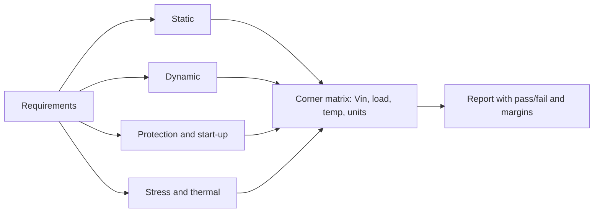

::: basics
### In plain words
Validating a buck converter means proving it works across everything it will meet in real use. You test its steady behavior, how it reacts to sudden changes, its start-up, and its protections. Then you repeat at the extremes of input, load, and temperature. You compare each result to a pass criterion that you set in advance.

### Picture it
It is like crash-testing a car. You test normal driving, then sudden braking, then heat and cold, then a deliberate collision. A single test at room temperature tells you very little. A good test plan covers each kind of situation and records a number for each. Unlike a car, a converter can also be tested for how close its feedback loop is to oscillating.

### Words you need
- **Load step**: a sudden jump in load current, used to test the transient response.
- **Phase margin**: a measure of how far the loop is from oscillating. A common target is 45° or more ([[q0261]]).
- **Corner**: an extreme combination, such as minimum input, full load, and hot.
- **Soft-start**: a controlled ramp of the output at power-up.
- **Efficiency**: output power divided by input power.

### The simplest example
Measure the converter at 12 V in, 3.3 V out, and 2 A. The output power is $3.3\times2=6.6$ W. Say the input power measures 7.0 W. Efficiency is $6.6/7.0\approx94\%$. You repeat at other loads, other inputs, and other temperatures, and plot the curves.

That is the whole idea. The rest of this page lists the static, dynamic, protection, and stress tests, and how to measure them without fooling yourself.
:::

::: testing
Whether you can plan a **test campaign** for a power converter, not just "measure the output". The interviewer expects you to separate static behaviour (regulation, efficiency, ripple), dynamic behaviour (load and line transients, loop gain and phase margin, start-up), protection thresholds and behaviour (current limit, short circuit, UVLO, OVP, thermal), stress (switch-node overshoot, inductor current, component temperature) and corners (input, load, temperature, tolerance). Ideally you also say how you measure each accurately (probing, 4-wire efficiency, loop injection) and what pass criteria look like.
:::

::: why
A regulator that works at nominal conditions on one bench unit is not a product. Validation finds the corner where the loop rings, the inductor saturates, the output overshoots on start-up or a protection chatters. Characterization produces the numbers (efficiency curves, margins, thresholds) that system designers and customers use. In an interview, a structured validation plan signals real power-electronics experience.
:::

::: concepts
- **Regulation**: line and load regulation, accuracy over temperature ([[q0262]]).
- **Efficiency**: $\eta = P_{out}/P_{in}$ vs load, input voltage and temperature ([[q0217]]).
- **Ripple and noise**: at $f_{SW}$ and at high-frequency spikes; measurement bandwidth and probing.
- **Transient response**: load step, line step, settling time, droop and overshoot ([[q0248]], [[q0249]]).
- **Loop gain**: crossover, phase margin, gain margin ([[q0261]]).
- **Start-up/shutdown**: soft-start, monotonicity, pre-bias, inrush.
- **Protection**: current limit, short circuit, UVLO, OVP, thermal ([[q0265]]).
- **Corners**: min/max $V_{IN}$, load, temperature, component tolerance, process ([[q0269]]).
:::

::: answer
"I'd split validation into static, dynamic, protection, stress and corner testing. Static: line and load regulation, output accuracy, efficiency curves versus load and input voltage, switching frequency, ripple, and light-load mode behaviour including the DCM or PFM transition. Dynamic: load-step and line-step response, so droop, overshoot and settling, and the loop itself using an injection resistor in the feedback path and a network analyzer to get crossover, phase margin and gain margin at light and full load and at both input extremes. Start-up and shut-down: soft-start time, monotonic rise, overshoot, pre-bias and inrush.

Then protections: the current limit threshold and what happens in a hard short, UVLO and enable thresholds and hysteresis, over-voltage, thermal shutdown, and recovery from each. Stress: the switch-node overshoot against FET ratings, the inductor current peak, input hot-plug behaviour, and temperature of the IC, inductor and capacitors with a thermal camera.

I'd repeat across corners: minimum and maximum input, no load and full load, cold, room and hot, and multiple units or capacitor tolerances. For measurement quality: a short ground spring for ripple and switch node, 4-wire power measurement for efficiency, and logging against pass criteria like 45° phase margin, 10 dB gain margin and a defined droop."
:::

::: technical
**1. Static characterization**

- $V_{OUT}$ accuracy, line regulation $\Delta V_{OUT}/\Delta V_{IN}$, load regulation $\Delta V_{OUT}/\Delta I_{OUT}$ (output resistance).
- Efficiency vs $I_{OUT}$ at several $V_{IN}$ and temperatures, $\eta = V_{OUT}I_{OUT}/(V_{IN}I_{IN})$ using 4-wire Kelvin voltage measurements at the board terminals.
- Quiescent and shutdown currents. $f_{SW}$ vs load/$V_{IN}$. Mode transitions (CCM/DCM/PFM) and their ripple.
- Ripple (peak-to-peak and spectral) at several loads, with a short ground spring and a 20 MHz bandwidth limit stated explicitly.

**2. Dynamic**

- Load step (e.g. 10% to 90% at 1 A/µs): droop, overshoot, recovery time to within ±1%. Line step ($V_{IN}$ 9 to 18 V in 100 µs): $V_{OUT}$ deviation.
- **Loop gain:** inject through a 10 to 50 Ω resistor in series with the feedback divider's top leg; measure $T(f) = -V_A/V_B$ with a network analyzer; extract $f_c$, PM (target 45 to 60°), GM (target > 10 dB) at light and heavy load and $V_{IN}$ extremes.
- **Output impedance** (frequency response of $Z_{out}$) and conducted/PSRR if relevant.

**3. Start-up and protection:** soft-start time, monotonicity and overshoot, inrush $I = CV/t_{ss}$, pre-bias, UVLO rising/falling thresholds, EN threshold, overcurrent threshold (cycle-by-cycle and hiccup), short-circuit entry/exit, OVP and OTP trip and recovery.

**4. Stress:** $V_{SW}$ peak and ringing vs $V_{DS(max)}$, gate waveforms and dead time, $i_L$ peak vs $I_{sat}$, input ripple current and hot-plug, capacitor ripple current and temperature rise, IC temperature.

**5. Corners and statistics:** $V_{IN(min,max)}$, $I_{OUT}$ 0 to max, $-40$/25/85/125 °C, L and C tolerance and derating, multiple units. Plus **EMI pre-compliance** and **reliability** (burn-in, thermal cycling).
:::

::: short
"I'd test static, dynamic, protection, stress and corners. Static: accuracy, line and load regulation, efficiency and ripple across load and input voltage. Dynamic: load and line steps, and loop gain with an injection resistor and network analyzer to get crossover and phase margin at light and heavy load. Then start-up, soft-start and pre-bias, protections like current limit, short circuit, UVLO and thermal, stress on the switch node and inductor current, and thermals. All repeated at input, load and temperature corners with good probing technique."
:::

::: long
"I'd treat validation as a matrix: what to measure, and under which conditions. 

First static characterization. Output voltage accuracy, line and load regulation, switching frequency, ripple, and an efficiency curve across load and across input voltage, measured with a four-wire setup so lead drops aren't counted as loss. At light load I look at the mode transitions between CCM, DCM and PFM, because ripple and noise change there.

Second dynamic behaviour. A load step at a realistic slew rate, say 1 A per microsecond, so I see droop, overshoot and settling, and a line step. And the loop itself: I put a small resistor, 10 to 50 ohms, in the feedback path, inject a small sinusoid with a network analyzer and read crossover, phase margin and gain margin. I do that at light load and full load, at minimum and maximum input, because phase margin moves with load and with the capacitor's effective value. My targets would be at least 45 degrees and 10 dB.

Third, start-up and protections: soft-start time and overshoot, pre-bias start, inrush, UVLO and enable thresholds with hysteresis, current limit, a hard short and the recovery, overvoltage and thermal shutdown.

Fourth, stress: switch-node overshoot compared to the FET rating, inductor current peaks relative to saturation, hot-plug at the input, capacitor ripple current, and thermal imaging of the IC and inductor at the worst case.

Finally I repeat across corners: input range, load range, temperature from cold to hot, and several units or capacitor tolerances, and do EMI pre-compliance. I'd log each result against a pass criterion so the report is objective."
:::

::: terms
- **Line / load regulation**: output change per input / load change.
- **Loop gain ($T$), phase margin (PM), gain margin (GM)**: frequency-domain stability metrics.
- **Injection resistor**: small resistor in the feedback path where the analyzer's signal is injected.
- **Load step / slew rate**: rapid change in load current (e.g. 1 A/µs) to test transient response.
- **Soft-start / monotonicity / pre-bias**: controlled, steadily rising output, even if the output is already charged.
- **Four-wire (Kelvin) measurement**: separate sense and force leads to avoid lead-resistance error.
- **Corner**: extreme condition (min/max $V_{IN}$, load, temperature).
- **Pre-compliance**: quick EMI check before formal testing.
:::

::: exceptional
**An average answer** says "measure efficiency, ripple and load transient".

**An exceptional answer**:
- Organizes by **category** (static, dynamic, protection, stress, corners) and names pass criteria.
- Describes **loop measurement** with an injection resistor and states PM/GM targets and that light load and $V_{IN}$ extremes are worst-case.
- Explains **measurement technique**: ground spring, 4-wire efficiency, bandwidth limits, current probe.
- Includes **start-up, pre-bias, short-circuit recovery, UVLO hysteresis** and what failure looks like.
- Notes **statistics**: multiple units, tolerance and derating, temperature.
- Links tests back to design margins (e.g. $I_{sat}$ vs peak current, $V_{SW}$ vs rating).
:::

::: mistakes
- **Measuring at nominal only.** Margins show at corners; most field failures are corner cases.
- **Loop measurement at full load only.** Light load usually has the least phase margin in voltage mode ([[q0261]]).
- **Using a long ground lead.** Ripple and switch-node results become artefacts.
- **Computing efficiency with voltmeter readings at the supply.** Lead drops can be percent of $V_{IN}$ and appear as fake loss.
- **Treating one sample as proof.** Test multiple units, tolerances and capacitor derating.
- **Skipping fault testing.** Short circuit, hot-plug and pre-bias are exactly where converters die ([[q0265]]).
- **Not specifying the conditions** (bandwidth limit, slew rate, temperature) with each result.
:::

::: deep
## Think in terms of "what would a customer care about?"

A buck is specified by its **performance** (accuracy, efficiency, ripple, transient), its **robustness** (protection, stress, abuse) and its **margins** (stability, thermal, saturation). Validation measures each against a requirement, and characterization maps how each varies with conditions. Start from the requirements document and make each line a test with an acceptance criterion.


Figure: Each requirement maps to a test category, and each test is repeated across the corner matrix. The output is a table of measured values against limits, plus plots (efficiency, Bode, load step) that show margin.

## Static tests

**Regulation.** Example (illustrative) data for a 3.3 V converter: 3.330 V at 0.1 A and 3.318 V at 3 A gives load regulation of $-12\text{ mV}/3.33\text{ V} = -0.36$% (equivalent output resistance 4.1 mΩ); at 9 V vs 18 V input with 3.3305 V and 3.3275 V, line regulation is 0.09%. In peak-current mode, the loop's finite DC gain and the divider tolerance set these; a precise integrator makes it small. Measure the output at the converter's output capacitor (Kelvin) for the loop's own regulation, and again at the load to include distribution drops.

**Efficiency.** Measure input voltage at the converter's input pins, input current with a shunt or a calibrated source meter, output voltage at the output pins, and output current. $P_{loss} = P_{in} - P_{out}$. Pitfalls: lead drops (0.1 Ω of lead at 0.87 A input is 87 mV, 0.7% of 12 V), meter accuracy (1% on each of the four readings gives about ±2% uncertainty on $\eta$ by root-sum-square, which is a third of the whole loss budget at $\eta \approx 94$%, so use 0.1%-class meters), temperature warm-up. Settle thermally before recording, and also report ambient and airflow.

```plot
{"title":"Typical shape of an efficiency characterization (modeled, 12 V to 3.3 V, 500 kHz)","x":{"label":"I_out","unit":"A","min":0.05,"max":3,"log":true},"y":{"label":"Efficiency","unit":"%","min":70,"max":100},
 "vars":{"vo":3.3,"vin":12,"f":5e5,"di":0.704,"rt":0.04775,"tsw":1e-8,"td":2e-8,"pfix":0.038,"pfix18":0.052},
 "series":[{"label":"CCM model, Vin = 12 V","fn":"100*vo*x/(vo*x+(x*x+di*di/12)*rt+0.5*vin*x*tsw*f+2*0.7*x*td*f+pfix)","color":"accent"},{"label":"Vin = 18 V (more switching loss)","fn":"100*vo*x/(vo*x+(x*x+0.79*0.79/12)*rt+0.5*18*x*tsw*f+2*0.7*x*td*f+pfix18)","color":"red"}],
 "hlines":[{"at":90,"label":"90% target","color":"orange"}]}
```
Figure: What you expect to see: efficiency rises with load as the fixed loss is amortized, peaks near 1 A and falls at high load as $I^2R$ grows; higher $V_{IN}$ lowers it through switching loss. Real measurements add the DCM/PFM region below about 0.35 A where a skip mode changes the curve. Characterize at least three $V_{IN}$ values and two temperatures.

**Ripple and noise.** Use a 20 MHz bandwidth limit for "output ripple" (state it), a short ground spring across the output capacitor, and AC coupling. Separately capture the wideband switching spikes (full bandwidth) because they matter for sensitive loads. Compare with the calculated 5 mV: if you measure 80 mV, check the probe first, then ESL and layout ([[q0258]]).

## Dynamic tests

**Load step.** Use an electronic load with programmable slew (1 A/µs or the real system's). Step 0.5 to 3 A and capture droop, overshoot and settling to ±1%. Expected from design ([[q0258]]): $\Delta V \approx 2.5/(2\pi\cdot50\text{k}\cdot55\mu) = 145$ mV plus a small ESR step. Repeat the release step: overshoot from the inductor energy $\Delta V \approx \sqrt{V^2 + L I^2/C} - V$.

**Line step and PSRR.** A step in $V_{IN}$ (e.g. 9 to 18 V via a fast supply or switch) shows feed-forward and loop rejection.

**Loop gain measurement.**

```circuit
{"caption":"Loop-gain measurement: inject through R_inj in series with the feedback divider's top","elements":[
 {"t":"term","at":[0,2],"label":"V_{OUT}","side":"left"},
 {"t":"wire","pts":[[0,2],[6,2]]},
 {"t":"dot","at":[3,2]},{"t":"wire","pts":[[3,2],[3,0]]},{"t":"term","at":[3,0],"label":"A","side":"top"},
 {"t":"R","a":[6,2],"b":[11,2],"label":"R_{inj}","value":"10 Ω"},
 {"t":"Vac","a":[11,2],"b":[16,2],"label":"v_i"},
 {"t":"wire","pts":[[16,2],[20,2]]},
 {"t":"dot","at":[18,2]},{"t":"wire","pts":[[18,2],[18,0]]},{"t":"term","at":[18,0],"label":"B","side":"top"},
 {"t":"R","a":[20,2],"b":[20,6],"label":"R_1"},
 {"t":"R","a":[20,6],"b":[20,10],"label":"R_2"},
 {"t":"dot","at":[20,6]},
 {"t":"wire","pts":[[20,6],[26,6]]},{"t":"term","at":[26,6],"label":"FB","side":"right"},
 {"t":"gnd","at":[20,10]}
]}
```
Figure: A small series resistor $R_{inj}$ (10 to 50 Ω) breaks the loop for AC only. The network analyzer's source (through an isolation transformer, shown as $v_i$) drives a small signal across it, and two probes measure the signals on the output side (A) and the FB side (B). The loop gain is $T(s) = -V_A/V_B$. $R_{inj}$ must be small versus $R_1 + R_2$ (41.6 kΩ here) so it does not shift the DC operating point. The point works for injection because the impedance looking back into the output (milliohms) is far smaller than the impedance looking into the divider (tens of kΩ), so the measured ratio is the true loop gain.

Pass criteria: crossover $f_c$ about $f_{SW}/10$, PM 45° (minimum) to 60° (preferred), GM $\geq$ 10 dB. Repeat at light and full load, at $V_{IN}$ min and max, with capacitor and inductor tolerance extremes and with the worst-case derated $C_{OUT}$ ([[q0261]]).

```bode
{"systems":[{"label":"Loop gain T(s): 60 degree phase margin example","num":["wc"],"den":["1/wp",1,0]}],
 "vars":{"wx":"2*pi*5e4","wp":"sqrt(3)*wx","wc":"wx*sqrt(4/3)"},
 "f":{"min":1000,"max":1e6},"marks":[{"f":"5e4","label":"fc = 50 kHz"}],"show":"both","magRange":[-40,60]}
```
Figure: What a good loop measurement looks like: gain falling at $-20$ dB/dec through 0 dB at 50 kHz, and phase about $-120^\circ$ there, i.e. a 60° phase margin (phase margin = 180° + phase at crossover). In real hardware the phase falls faster at higher frequency because of modulator delay and sampling, so you read PM and GM from the measured curve.

> [!UNCERTAIN]
> Required margins vary: 45° PM and 10 dB GM are common minimums, but some customers require 60° or more across all corners; datasheets of POL regulators sometimes quote 60° typical. Use the requirement of the system.

## Start-up, shut-down and protection tests

- **Soft-start:** capture $V_{OUT}$ and $I_{IN}$ at enable. Rise time $t_{ss}$, overshoot at the end, monotonic. Inrush into $C_{OUT}$ = 55 µF in 2 ms is $55\mu\cdot3.3/2\text{ ms} = 91$ mA; compare measured.
- **Pre-bias:** pre-charge the output to 50% and enable: the converter should not sink current (no output dip).
- **UVLO/EN:** ramp $V_{IN}$ slowly up and down and record start/stop thresholds and hysteresis; check no chatter on a sagging supply.
- **Current limit:** ramp the load and find where $V_{OUT}$ collapses; record the limit versus temperature and $V_{IN}$. Hard-short the output with a low-impedance switch: see the current (inductor and input), hiccup period, and recovery on removal.
- **OVP/OTP:** inject a voltage at FB (or force a fault in a test setup); heat the IC and record the shutdown and restart temperature.

## Stress tests

- **Switch node:** short ground spring, ≥ 500 MHz probe/scope bandwidth: overshoot vs FET rating, ringing frequency, dead time (the flat portion before the rising edge).
- **Inductor current:** current probe or sense resistor: peak vs $I_{sat}$ and limit, CCM/DCM waveform, saturation knee at hot.
- **Input:** hot-plug and load-step at the input, input ripple current and voltage; check against the damped design ([[q0258]]).
- **Thermal:** IR camera or thermocouples on IC, inductor, diode, capacitors at worst case (max $V_{IN}$ or max load, high ambient). Compare with ratings and the computed $T_J \approx 104$ °C ([[q0263]]).

## Corner matrix and statistics

Test each at: $V_{IN}$ = min, nominal, max; load = 0, light, mid, full; temperature = cold (−40 °C), room, hot (85 °C or higher); with multiple units (3 to 10 from different lots) and with tolerance variants (L at −20%, capacitors derated). A short table of results with margins (spec limit minus worst measured) is more useful than plots alone.

## EMI and reliability

Do conducted emission pre-compliance using a LISN and spectrum analyzer or near-field probes, with attention to $f_{SW}$ harmonics and switch-node edge rates ([[q0221]]). Reliability: burn-in, power cycling, thermal cycling, and a margin check of capacitor ripple current rating at temperature ([[q0268]]).

## Experiment: what is the load-step test showing?

```sim
{"id":"buck-control","l":6.8e-6,"c":55e-6,"esr":0.003,"fc":50000,"pm":60,"istep":2.5}
```
Figure: Change `pm` from 60° to 30° and `fc` from 50 kHz to 100 kHz: see the ringing in the load-step response and what a poor phase margin looks like in the time domain. A measured load-step ring-down, together with a Bode plot, tells you whether the converter is robust.
:::

::: applications
- **Design validation** before releasing a board: the test report that gates production.
- **Datasheet characterization** of a regulator IC: efficiency, load transient and Bode curves published for customers.
- **Qualification** for automotive/industrial products across corners, with stress and life tests.
- **Failure analysis:** repeating the validation tests on a returned unit to find what changed ([[q0268]]).
- **Supplier comparisons:** using a standardized test matrix to compare candidate ICs ([[q0257]]).
:::

::: assumptions
- A 12 V to 3.3 V, 3 A example converter with a current-mode IC; numbers (3.330 V etc.) are illustrative.
- Bench tools are available: electronic load with programmable slew, network analyzer or frequency-response analyzer, scope with proper probes, thermal camera.
- Pass criteria (45° PM, 10 dB GM, 5% droop) are typical, not universal.
- For digital controllers, add telemetry accuracy, firmware-loop timing, and calibration tests.
- Safety and formal EMC certification are outside this scope; pre-compliance is for design risk reduction only.
:::

::: followups
### How do you measure phase margin on a real buck?
Insert a small resistor (10 to 50 Ω) in series with the top of the feedback divider, inject a small AC signal across it through an isolation transformer from a network analyzer, and measure the ratio of the signals on both sides: $T = -V_A/V_B$. Find the frequency where $|T| = 0$ dB (crossover) and read the phase there: PM = 180° + phase. Do it at light and full load and at both input extremes.

### What is a good load-step test, and what do you look for?
A programmable electronic load stepping between, say, 10% and 90% of full load at a defined slew (e.g. 1 A/µs), with the scope on $V_{OUT}$ (AC-coupled), $I_{OUT}$ and optionally the inductor current. Look at droop and overshoot against the spec, recovery time, and ringing: more than one or two visible overshoot cycles indicates low phase margin. Repeat at several $V_{IN}$ and with worst-case capacitors.

### Why measure efficiency with four-wire connections?
Lead resistance causes voltage drop between the supply and the board; with 0.87 A in and 0.1 Ω of leads the board sees 87 mV less than the meter reads. Because converter efficiency is often 90 to 95%, a 0.7% error in $V_{IN}$ is a large fraction of the 5 to 10% loss budget. Measuring voltage at the converter's terminals with separate sense leads removes this.

### Scenario: the converter passes everything at room temperature but fails the load step at −40 °C. What changed?
Ceramic capacitance can change with temperature (X5R/X7R vary; class II parts lose some capacitance at extremes), electrolytic ESR rises sharply when cold, which can move the ESR zero and damp or destabilize; the inductor $L$ and $I_{sat}$ shift; FET $R_{DS(on)}$ falls (helpful) and the IC's reference and oscillator drift ([[q0269]]). Re-measure the loop gain at −40 °C to see which pole or zero moved.

### How many units should you test, and why?
Enough to see unit-to-unit variation in the IC (reference, oscillator frequency, current limit) and in passives (L and C tolerance, derating). Three to ten units from different lots is typical for validation; production test then verifies the key parameters on every unit. The point is to estimate statistical margin, not prove a single sample works.
:::

::: interpretations
"Validate/characterize" can mean verifying that requirements are met (validation) and measuring how performance varies with conditions (characterization). I covered both, because a complete plan includes pass/fail tests and curves. "Properties/behaviors" I read as static, dynamic, protection and stress behaviours.
:::

::: references
- Erickson and Maksimović, *Fundamentals of Power Electronics*: measurement of AC transfer functions and of loop gains (chapters on converter transfer functions and controller design).
- R. D. Middlebrook, "Measurement of loop gain in feedback systems", International Journal of Electronics, 1975: the injection method.
- Texas Instruments, Analog Devices and other vendors' application notes on measuring power supply control loops and on efficiency measurement (look for "loop gain measurement" and "power supply measurements" notes).
- CISPR 32 and related EMC standards (by name) for conducted/radiated emission limits; consult the standard for test setups.
:::

::: rubric
- Organizes tests into static, dynamic, protection, stress, and corners :: Shows a coherent validation plan, not a list of random measurements.
- Includes efficiency (four-wire), regulation, ripple and mode transitions :: The basic characterization of any converter.
- Includes load-step, line-step and loop gain (injection resistor, PM, GM) with targets :: Stability and transient are the key dynamic checks.
- Includes soft-start, pre-bias, UVLO, current limit/short circuit, OVP and thermal :: Where most abuse failures occur.
- Includes stress: switch-node overshoot, inductor current vs $I_{sat}$, thermal imaging :: Ties to component ratings.
- Repeats across $V_{IN}$, load, temperature, and units; mentions tolerance and derating :: Margins show at corners.
- Mentions measurement technique (ground spring, bandwidth, Kelvin) :: Bad measurement creates bad conclusions.
- Mentions EMI pre-compliance and reliability/aging :: Completes the plan beyond electrical performance.
:::

::: quiz
```json
[
 {"type":"numeric","level":"fundamental","q":"A converter outputs 3.330 V at 0.1 A and 3.318 V at 3 A. What is the load regulation in percent (relative to 3.330 V)?","answer":-0.36,"tolerance":0.03,"unit":"%","explain":"$(3.318-3.330)/3.330 = -0.36\\%$. Equivalent output resistance is $12\\text{ mV}/2.9\\text{ A} = 4.1$ mΩ."},
 {"type":"mcq","level":"fundamental","q":"Why is an injection resistor placed in series with the top of the feedback divider for loop-gain measurement?","options":["To reduce DC accuracy","To break the loop for AC so a network analyzer can inject a small signal without disturbing the DC operating point","To increase ripple","To filter switching noise"],"answer":1,"explain":"A small resistor lets you inject a small AC signal through a transformer across it while the DC loop stays closed; measuring the signals on both sides gives $T(s)$."},
 {"type":"numeric","level":"intermediate","q":"A loop gain measurement shows the phase at the 0 dB crossover is −125°. What is the phase margin (degrees)?","answer":55,"tolerance":0.01,"unit":"°","explain":"$PM = 180° + (-125°) = 55°$."},
 {"type":"mcq","level":"intermediate","q":"Why is a short ground spring used when measuring the switch node or output ripple?","options":["To increase probe bandwidth limit","A long ground lead adds inductance that rings with the probe capacitance, creating false spikes and hiding real ones","To lower probe input capacitance to zero","It is required by safety standards"],"answer":1,"explain":"The ground lead's inductance and probe capacitance form a resonant circuit that adds spurious ringing to fast edges, so short, low-inductance grounding gives a faithful measurement."},
 {"type":"multi","level":"intermediate","q":"Which belong in the corner matrix for validating a buck?","options":["Minimum and maximum input voltage","No-load and full-load conditions","Cold and hot temperature","Only nominal conditions on one sample"],"answer":[0,1,2],"explain":"Corners include input, load and temperature extremes, with multiple units. Testing only nominal on one sample doesn't reveal margins."},
 {"type":"truefalse","level":"advanced","q":"Measuring loop gain at full load only is sufficient, because full load is always the worst case for phase margin.","answer":false,"explain":"In voltage mode, light load has the highest $Q$ and the least phase margin; in current mode the load-dependent pole moves. Measure light and full load, and at both input extremes."}
]
```
:::
