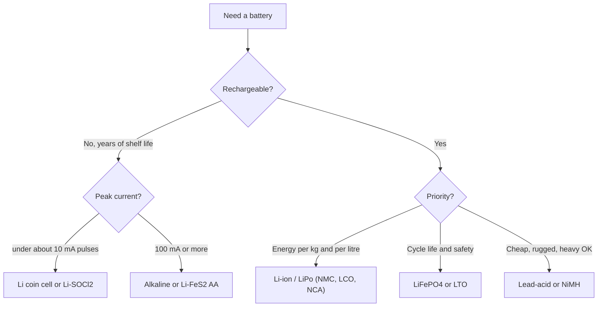

::: basics
### In plain words
Batteries come in two broad kinds. Primary batteries are single-use, such as alkaline AA cells and lithium coin cells. Rechargeable batteries include lead-acid, nickel types, and the lithium family. To choose, start from what the product needs: how much energy over its life, how much peak current, whether it must recharge, and the size, temperature range, cost, and safety limits.

### Picture it
Think of different containers for carrying water. A thimble is tiny but never leaks, so it suits a drip that must last for years. A big steel drum holds a lot but is heavy. A sports bottle is light and refillable, but costs more. No container wins at everything, so you pick by what you must carry, how fast it must pour, and how often you can refill. Batteries work the same way.

### Words you need
- **Primary cell**: a battery that is used once and thrown away.
- **Rechargeable (secondary) cell**: a battery you can recharge many times.
- **Nominal voltage**: the typical voltage of a cell, such as 1.5 V for alkaline or 3.7 V for lithium-ion.
- **Energy (Wh)**: the total work a battery can deliver, equal to volts times amp-hours (Ah, the amount of charge it holds).
- **Peak current**: the largest current the load asks for, which some cells cannot supply.

### The simplest example
Take a rechargeable cell rated 3.7 V and 2 Ah. Its energy is $3.7\times2=7.4$ Wh. A device that uses 0.74 W would run about $7.4/0.74=10$ hours. A wireless tag that sips microamps for ten years suits a coin cell instead, while a phone suits lithium polymer, because nothing else packs that much energy into so little space.

That is the whole idea. The rest of this page goes through the chemistry families in tables, with their strengths, weaknesses, and typical uses.
:::

::: testing
Whether you can organise a messy topic into a clean map and then *use* it. The question has three layers: (1) name the common chemistries, (2) split them into primary (single use) and secondary (rechargeable), and (3) the one that matters most, explain **how you would choose** for a real product. A strong candidate does not recite a list; they start from the requirements (energy, peak current, size, temperature, lifetime, cost, safety, shipping) and let those pick the chemistry. The hidden sub-skills are knowing nominal voltages, knowing the shape of the discharge curve, and knowing that "best chemistry" is always a trade-off.
:::

::: why
Every portable or remote product starts with the battery decision, and it is hard to undo. The chemistry sets the supply voltage range your regulators must handle, the peak current you can pull, whether the product can sit in a drawer for five years, how it is certified and shipped, and what happens if someone leaves it in a hot car. Interns get asked this because it is a quick test of whether you think about power as a system problem rather than "I will just use a 3.3 V supply". It also leads straight into the other battery questions ([[q0291]] to [[q0296]]) and into LiPo specifics ([[q0297]]).
:::

::: concepts
- **Primary vs secondary cell**: primary cells are built once and discarded; secondary cells reverse their chemistry when you push current backwards through them. See [[q0292]] for what you want from either.
- **Nominal voltage**: set by the electrode chemistry, not by size. Alkaline 1.5 V, NiMH 1.2 V, Li-ion about 3.6-3.7 V, LiFePO4 about 3.2 V.
- **Energy vs power**: energy (Wh) is how long it lasts, power (W) is how hard you can pull. They are different axes and chemistries trade one for the other.
- **Discharge curve shape**: flat (LiFePO4, coin cells) vs sloping (alkaline, Li-ion) changes your regulator and your ability to infer charge level from voltage ([[q0308]]).
- **Self-discharge and shelf life**: how much capacity a cell loses sitting unused. Critical for a sensor that must last 10 years.
- **Internal resistance**: sets how much the voltage sags under a pulse ([[q0303]]).
:::

::: answer
"I'd split them into primary and rechargeable. Primary, so single-use: alkaline, which is your normal 1.5 V AA, zinc-carbon, which is the cheap old version, lithium coin cells like the CR2032, which are 3 V and last for years, and lithium thionyl chloride cells for really long-life industrial stuff. Rechargeable: lead-acid, which is cheap and heavy and used in cars and backup power, nickel-cadmium and nickel-metal-hydride, which are 1.2 V per cell, and then the lithium family, lithium-ion and lithium polymer, around 3.7 V, plus LiFePO4 which is a bit safer and longer-lived.

To choose, I'd start with the requirements. How much energy do I need over the product's life, so Wh, not just mAh? What's the peak current, because a coin cell can't run a radio burst without help? Does it need to be recharged, or will it sit for ten years? What temperature range and what size and weight limit? And then cost and safety, including shipping rules.

So a wireless tag that sips microamps for a decade is a coin cell. A TV remote is alkaline. A phone, a drone or a wearable is lithium polymer, because nothing else has that energy density. A solar-powered backup with a big enclosure might be LiFePO4 or lead-acid. It's always a trade-off, and I'd write the requirements down first and then let them pick."
:::

::: technical
**Primary (non-rechargeable) families** and typical nominal voltage:

| Chemistry | Nominal V | Typical strength | Typical weakness |
|---|---|---|---|
| Zinc-carbon | 1.5 | cheapest | low capacity, leaks, poor at high current |
| Alkaline (Zn/MnO2) | 1.5 | cheap, everywhere, 5-10 yr shelf | high Rint at pulse, sloping curve |
| Lithium MnO2 coin (CR2032) | 3.0 | flat, 10 yr shelf, wide temperature | very low pulse current |
| Lithium iron disulfide (AA) | 1.5 | high current, cold, light | cost |
| Lithium thionyl chloride | 3.6 | very low self-discharge, 10-20 yr | passivation layer gives voltage delay; toxic/hazardous |
| Silver oxide / zinc-air | 1.55 / 1.4 | very flat curve; hearing aids | specialised, zinc-air dies once opened to air |

**Secondary (rechargeable) families:**

| Chemistry | Nominal V | Energy density (typical) | Notes |
|---|---|---|---|
| Lead-acid | 2.0 per cell (12 V = 6 cells) | 30-50 Wh/kg | cheap, heavy, tolerant of abuse, high surge |
| NiCd | 1.2 | 40-60 Wh/kg | memory effect, cadmium, robust |
| NiMH | 1.2 | 60-120 Wh/kg | drop-in AA, high self-discharge unless "low self-discharge" type |
| Li-ion / LiPo (LCO, NMC, NCA) | 3.6-3.7 | 150-270 Wh/kg | highest energy, needs protection |
| LiFePO4 | 3.2 | 90-160 Wh/kg | very long life, safer, flat curve |
| LTO | 2.3-2.4 | 60-110 Wh/kg | extreme cycle life and fast charge, low energy |

> [!UNCERTAIN]
> Energy-density, cycle-life and shelf-life numbers vary widely by manufacturer, cell format and test conditions. Treat the ranges above as order-of-magnitude typicals and check the datasheet of the actual part.

**Selection method.** Convert requirements to numbers: required energy $E = P_{avg}\,t$ (add converter efficiency), peak current $I_{pk}$, allowed voltage window of the load, temperature range, and calendar life. Check each candidate against: (1) capacity at *your* discharge rate and temperature, not the 25 °C slow-discharge number; (2) voltage sag $I_{pk}R_{int}$ staying above the load's minimum; (3) self-discharge over the lifetime; (4) cost, size, shipping and certification. Discard what fails, then pick the cheapest survivor.
:::

::: short
"Primary, single-use: alkaline, zinc-carbon, lithium coin cells like a CR2032, lithium thionyl chloride. Rechargeable: lead-acid, NiCd, NiMH, and the lithium family: Li-ion, LiPo, LiFePO4. To choose I start from requirements: total energy in Wh, peak current, size and weight, temperature range, recharge or not, shelf life, cost and safety. Microamp sensor for ten years is a coin cell, a remote is alkaline, a phone or drone is LiPo because of energy density, and a big stationary backup might be LiFePO4 or lead-acid."
:::

::: long
"I'd organise it first by whether you can recharge it. Primary cells are single use. Zinc-carbon is the cheapest and weakest. Alkaline is the everyday 1.5 V AA or AAA. Lithium primary cells include the 3 V coin cells like CR2032, which have a very flat curve and last for years but can only give a few milliamps of pulse current, and lithium thionyl chloride, which is for ten-plus-year industrial devices.

Rechargeable, or secondary, cells: lead-acid is old, cheap and heavy, about 2 V per cell, with six in a car battery. NiCd and NiMH are 1.2 V per cell and are the drop-in rechargeable AA. Then the lithium family, around 3.6 to 3.7 V per cell. That includes the 18650 cylindrical cell, lithium polymer pouch cells, and LiFePO4, which is 3.2 V, safer and gets thousands of cycles but has lower energy density.

Now, how do I choose? I turn the requirements into numbers. First energy: average power times runtime, with some margin for converter efficiency and aging, so I get Wh. Then peak current: can the cell supply it without sagging below my regulator's minimum? That's internal resistance. Then temperature, because capacity and resistance both get much worse in the cold. Then lifetime, meaning shelf life for a primary or cycle life for a rechargeable. Then size and weight, cost, and finally safety and shipping, because lithium cells have transport rules.

Examples: a tag that draws two microamps average for ten years is a CR2032 or a thionyl chloride cell. A TV remote is alkaline because it's cheap and replaceable. A phone, wearable or drone uses LiPo because nothing beats the energy per gram and you can shape the pouch. A solar lamp might use LiFePO4 for the cycle life. There's no best chemistry, only the best fit for the requirements."
:::

::: terms
- **Primary cell**: single-use; the reaction is not designed to be reversed.
- **Secondary cell**: rechargeable; current in the opposite direction restores the reactants.
- **Nominal voltage**: the typical voltage over most of the discharge; set by chemistry.
- **Gravimetric / volumetric energy density**: Wh per kg / Wh per litre.
- **Specific power**: W per kg; how hard it can be pulled.
- **Self-discharge**: capacity lost per month with no load.
- **Cycle life**: number of charge-discharge cycles before capacity falls to a stated fraction (often 80%) of the original.
- **Shelf life**: how long a primary cell keeps most of its capacity in storage.
- **Memory effect**: apparent capacity loss in NiCd after repeated partial discharge.
:::

::: exceptional
**An average answer** lists AA, coin cell, LiPo and lead-acid and says "it depends on the application".

**An exceptional answer**:
- Splits primary vs secondary cleanly and gives nominal voltages for each, so the interviewer sees that you know the supply range.
- Gives a **selection procedure** (energy in Wh, peak current vs Rint, temperature, life, size, cost, shipping) instead of a vague "it depends".
- Brings up the flat vs sloping curve and what it does to the regulator choice.
- Does a one-line sizing: "2 µA for 10 years is about 175 mAh before derating, so a CR2032 only just fits."
- Names the non-obvious traps: coin cells cannot supply radio pulses; NiMH self-discharges; lithium needs a protection circuit; shipping and certification.
:::

::: mistakes
- **Comparing cells by mAh alone.** mAh at different voltages are different energies. A 1000 mAh 3.7 V cell holds 3.7 Wh, a 1000 mAh 1.2 V NiMH holds 1.2 Wh. Compare Wh.
- **Using the datasheet capacity at the wrong rate.** CR2032 capacity quoted at 0.2 mA collapses at 20 mA pulses. Always read the capacity vs load curve.
- **Calling alkaline "rechargeable".** Some products exist but typical alkaline cells are not designed for it and can leak or vent.
- **Assuming "lithium" is one thing.** A lithium primary coin cell (3 V, non-rechargeable) is a completely different animal from a Li-ion cell (3.7 V, rechargeable, needs charger).
- **Forgetting temperature.** Many chemistries lose a large part of capacity and gain a lot of resistance below 0 °C.
- **Ignoring the voltage window.** A single Li-ion cell runs 4.2 V down to about 3.0 V, which straddles 3.3 V and needs a buck-boost or the right load.
:::

::: deep
## What is actually different between chemistries

A cell is two electrodes separated by an electrolyte. When you discharge, a reaction at the negative electrode releases electrons into your circuit while ions move through the electrolyte to the positive electrode, where the electrons come back and complete the reaction. The **voltage** is set by the difference in electrochemical potential between the two electrode materials, so it is a property of the *chemistry*. Size, shape and mass change the *capacity* (how much charge) and the *resistance* (how easily current flows), but not the open-circuit voltage.

That is why you can lump almost everything by nominal voltage: zinc and manganese dioxide gives about 1.5 V; nickel hydroxide and a hydrogen-absorbing alloy gives about 1.2 V; lithium cobalt oxide against graphite gives about 3.7 V. Higher voltage per cell also tends to mean higher energy per cell, because energy is $V\times Q$.


Figure: A first-pass decision tree. The branches are driven by requirements (shelf life, peak current, energy density, safety), not by brand or habit. Real designs add temperature, cost and shipping checks at each leaf.

## The discharge curve changes your electronics

How the terminal voltage moves as you use the cell decides what the rest of the circuit looks like. A flat curve (LiFePO4, silver oxide, CR2032 for most of its life) gives a nearly constant supply. A sloping curve (alkaline, Li-ion) means your electronics must tolerate a wide input window, and it also means voltage is a usable, if crude, fuel gauge. A flat curve is great for the load and terrible for state-of-charge estimation ([[q0308]]).

```plot
{"title":"Illustrative discharge curve shapes (not datasheet data)","x":{"label":"fraction of capacity used","min":0,"max":1},"y":{"label":"cell voltage","unit":"V","min":0,"max":4.5},
 "series":[
  {"label":"Alkaline AA","fn":"1.58-0.55*x-0.35*pow(x,6)","color":"orange"},
  {"label":"CR2032 coin","fn":"3.0-0.1*x-0.9*pow(x,14)","color":"blue"},
  {"label":"Li-ion NMC","fn":"4.1-0.7*x-0.45*pow(x,20)","color":"accent"},
  {"label":"LiFePO4","fn":"3.3-0.05*x-0.7*pow(x,30)","color":"green"}
 ]}
```
Figure: Shapes only, hand-built to show the typical behaviour. Alkaline falls steadily, so the load must work from about 1.6 V down to about 0.9 V. LiFePO4 and the coin cell stay nearly flat until they fall off a cliff at the end. Li-ion slopes gently and then drops, which is why voltage-based fuel gauges work reasonably for it but not for LiFePO4.

## Sizing: turning requirements into a chemistry

Take two real cases.

**Case 1, the ten-year sensor tag.** Ten years is $10\times 8760 = 87{,}600$ hours. A CR2032 is about 220 mAh nominal at light load. Derating to 70% for self-discharge, temperature and end-of-life voltage gives 154 mAh, so the allowed average current is

$$I_{avg} = \frac{154\ \text{mAh}}{87{,}600\ \text{h}} \approx 1.76\ \mu A$$

That is a *very* tight budget. A BLE tag that wakes once a second burns far more. And a radio burst of 10 mA at the internal resistance (often tens of ohms) of a coin cell sags the voltage badly. So you either duty-cycle aggressively with a bulk capacitor to supply the pulse, or move to a bigger cell (AA lithium thionyl chloride: low self-discharge, higher capacity).

**Case 2, a handheld device.** Suppose it needs 1.2 W average for 8 hours from a 3.7 V cell through a boost converter at 90% efficiency. Energy from the cell is $1.2\times 8/0.9 = 10.7$ Wh, which is 2.9 Ah at 3.7 V. With 20% margin for aging, about 3.5 Ah. Alkaline AAs hold only about 2 to 3 Wh each at light drain and much less at this power, so you would need a large, heavy pack that sags under load; a Li-ion/LiPo pack in a pouch is the sensible choice. See [[q0293]] for the full spec checklist.

## Peak current: the number people forget

Capacity says how long, internal resistance says how hard. The terminal voltage under load is $V = V_{oc} - I R_{int}$. A fresh alkaline AA is a few hundred milliohms; a CR2032 can be 10-30 Ω (rising as it discharges); a good Li-ion pouch cell is tens of milliohms. If your load needs 500 mA pulses and the minimum supply is 2.0 V, you can solve for the maximum allowable resistance: for a 3 V coin cell that means $R \le (3.0-2.0)/0.5 = 2\ \Omega$, which a coin cell cannot meet. The cure is a capacitor in parallel to supply the pulse, or a different chemistry. Real numbers differ cell to cell, so read the pulse-capability curves ([[q0291]]).

## Experiment with it

```sim
{"id":"lipo-lab","view":"discharge","capacity":2,"crate":1,"temp":25,"rint":0.05}
```
Figure: Try 0.2C, 1C and 3C at 25 °C, then drop the temperature. Watch the terminal voltage sag grow and the delivered energy fall. That is the "sloping, resistance-limited" behaviour that makes lithium cells need careful choice of rate.

## Safety, transport and regulation

Lithium cells of both kinds have shipping rules (UN 38.3 testing is required for lithium cells and batteries in transport) and safety standards (IEC 62133 covers safety of portable sealed secondary cells). These are real constraints on product design, not paperwork: they can decide how large a cell you are allowed to ship in a given way. Primary lithium cells also have rules on cell size and lithium content in air transport. Check the current rules with your compliance team rather than quoting numbers from memory.
:::

::: applications
- **TV remote, wall clock**: alkaline AA/AAA. Cheap, swappable, 5-year shelf life, low continuous drain.
- **Key fob, watch, BLE beacon**: CR2032 or CR2025 lithium coin cell. 3 V, flat, years of shelf life, pulse limited.
- **Smart utility meter, remote data logger**: lithium thionyl chloride cell (e.g. a C or D size) with a hybrid capacitor, 10-20 years.
- **Phone, laptop, wearable, drone**: Li-ion/LiPo pouch or 18650/21700 cell packs.
- **Power tool, e-bike**: NMC or NCA cylindrical packs, high-current rated. LiFePO4 for long-life stationary storage.
- **Car starter, UPS, alarm backup**: sealed lead-acid for cheap high surge current.
:::

::: assumptions
The answer assumes consumer/embedded-scale batteries (milliwatt to tens of watts). At grid or EV scale other chemistries and constraints enter (e.g. sodium-ion, flow batteries, thermal management and cost per kWh dominate).

"Rechargeable vs single-use" is not completely binary: lithium-ion cells are rechargeable but must be recharged with the right profile ([[q0296]]), and some alkaline cells are marketed as rechargeable but with limited cycles. The "right" chemistry changes when constraints change: if the product is a cheap toy sold with batteries, cost beats everything; if it flies or is worn on the body, safety and energy density dominate.

All numbers are typical ranges and vary with manufacturer, discharge rate and temperature.
:::

::: followups
### Which of those chemistries would you use for a sensor that must last 10 years, and why?
A lithium primary cell. A CR2032 has low self-discharge (about 1% per year order of magnitude) but only ~220 mAh and poor pulse capability. For more energy and an extremely low self-discharge I would use lithium thionyl chloride (nominal 3.6 V), often with a pulse-supporting capacitor because its passivation layer gives a voltage delay and high pulse resistance. A rechargeable cell would lose too much to self-discharge and aging unless there is energy harvesting.

### Why not just use alkaline for everything?
Energy density and shape. Alkaline holds roughly 100-150 Wh/kg at light load but it has high internal resistance, sags badly under heavy pulses, and a single-use design is wasteful for a device used daily. A Li-ion cell holds 2-3 times the energy per kg and is rechargeable.

### Why does a LiFePO4 cell have lower voltage but sometimes make a better choice?
At 3.2 V nominal versus 3.6-3.7 V it holds less energy per kg, but the iron-phosphate cathode is thermally and structurally more stable, so it tolerates abuse better and lasts thousands of cycles. For a stationary or heavy-use product, cycle life and safety can outweigh size.

### Which would you pick for a 4 A motor pulse in a small device?
I'd look at specific power, not capacity. A high-drain Li-ion cell (low Rint, rated at tens of amps) or LiPo with a high C rating. A coin cell or alkaline would collapse. For the same current, a 100 mΩ cell drops 0.4 V; a 1 Ω cell drops 4 V and simply cannot deliver it.

### What if the product has to run at -20 °C?
Capacity and power fall sharply for most chemistries because ion transport slows and Rint rises. Lithium primary (e.g. Li-FeS2 AA) and some lithium thionyl chloride cells are used for cold, and standard Li-ion must not be charged below about 0 °C because of lithium plating ([[q0295]]). I'd verify with datasheet discharge curves at the target temperature, and possibly add a heater or insulation.
:::

::: interpretations
"Which are rechargeable and which are single use?" wants the primary/secondary split. "How do you determine which to use?" is the real question: expect the interviewer to give you a product ("a wearable heart monitor", "a data logger in the field") and ask you to choose. Practise doing that out loud with numbers.

Terminology: engineers and datasheets say "primary" and "secondary" for single-use and rechargeable. In casual speech "lithium battery" often means the non-rechargeable coin or AA type, and "Li-ion" means rechargeable. Be explicit about which you mean.
:::

::: references
- Linden & Reddy (eds.), *Linden's Handbook of Batteries*: chapters on primary batteries (alkaline, lithium) and secondary batteries (lead-acid, nickel, lithium-ion).
- Horowitz & Hill, *The Art of Electronics*, 3rd ed.: the power-supply and battery discussion in the chapter on power regulation.
- Manufacturer datasheets for specific cells (e.g. CR2032, 18650) for capacity vs load curves, which are the authoritative source for any real design.
- IEC 62133 (safety of portable sealed secondary cells) and UN Manual of Tests and Criteria, Section 38.3, for safety and transport testing of lithium batteries.
:::

::: rubric
- Names several chemistries and correctly labels each primary or secondary :: This is the literal first half of the question.
- Gives nominal voltages (1.5 V, 1.2 V, 3 V, 3.6/3.7 V, 3.2 V, 2 V per lead-acid cell) :: Voltage window drives regulator choice, and shows you know the chemistry, not just the brand.
- Starts the choice from requirements (energy in Wh, peak current, temperature, life) :: Shows a method rather than a memorised list.
- Compares energy density and recognises Li-ion as the high-energy choice :: Explains why consumer electronics converged on lithium.
- Mentions internal resistance/pulse capability for coin cells vs lithium-ion :: The classic practical trap in battery selection.
- Mentions self-discharge/shelf life for long-life designs :: Decides primary vs rechargeable in a ten-year product.
- Mentions safety, protection circuitry and shipping rules for lithium :: Shows awareness of constraints beyond electrical specs.
:::

::: quiz
```json
[
 {"type":"mcq","level":"fundamental","q":"Which of these is a single-use (primary) chemistry?","options":["NiMH","Lithium manganese dioxide coin cell (CR2032)","LiFePO4","Lead-acid"],"answer":1,"explain":"CR2032 is a lithium primary coin cell at 3 V. The others are rechargeable (secondary) chemistries."},
 {"type":"mcq","level":"fundamental","q":"Which is the correct nominal cell voltage for a NiMH AA cell?","options":["1.5 V","3.7 V","1.2 V","2.0 V"],"answer":2,"explain":"NiMH and NiCd are about 1.2 V per cell. 1.5 V is alkaline, 3.7 V is Li-ion, and 2.0 V is a lead-acid cell."},
 {"type":"numeric","level":"intermediate","q":"A 2000 mAh Li-ion cell at 3.7 V nominal is used in a product drawing 1.0 W average through a converter at 90% efficiency. Ignoring derating, how many hours does it run?","answer":6.66,"tolerance":0.03,"unit":"h","explain":"Energy is $2\\,\\text{Ah}\\times 3.7\\,\\text{V}=7.4$ Wh. The cell must supply $1.0/0.9=1.11$ W, so the time is $7.4/1.11 = 6.66$ h. Forgetting the converter loss gives the tempting but wrong 7.4 h."},
 {"type":"truefalse","level":"intermediate","q":"A 3 V coin cell with a 20 Ω internal resistance can supply a 100 mA radio pulse to a load that needs at least 2.2 V.","answer":false,"explain":"$100\\,\\text{mA}\\times 20\\,\\Omega = 2$ V drops across the cell, leaving only about 1 V. A bulk capacitor or lower-resistance chemistry is needed."},
 {"type":"multi","level":"advanced","q":"Select all that are good reasons to choose a LiFePO4 cell over an NMC Li-ion cell.","options":["Higher energy per kg","Very long cycle life","Flatter discharge curve and good thermal stability","Higher nominal voltage per cell"],"answer":[1,2],"explain":"LiFePO4 trades energy density (3.2 V vs 3.6-3.7 V, lower Wh/kg) for cycle life, thermal stability and a very flat curve. The flat curve is also why SoC estimation by voltage is hard."}
]
```
:::
