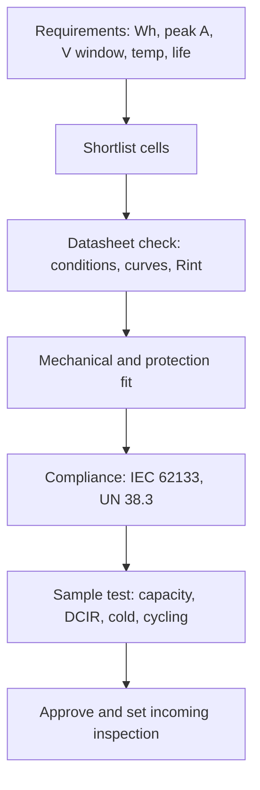

::: basics
### In plain words
When buying a battery, start from your own needs, then check the datasheet against them. Work out the energy you need, with margin for converter losses and aging, and the peak current. Then check the voltage window, the capacity (and at what rate it was measured), the discharge limits, the internal resistance, the lifetime figures, and the charging rules. Last, check size, protection, and shipping certifications.

### Picture it
It is like picking a car for a trip you have already planned. You know the distance, the load, and the road, so you read the spec sheet for range, towing, and size. You also ask how the maker measured the range, because a number tested on a flat road may not fit your hills. A battery's capacity rating has the same catch: it depends on the discharge rate and temperature.

### Words you need
- **Nominal, full, and cutoff voltage**: the typical, fully charged, and empty voltages, such as 3.7, 4.2, and 3.0 V.
- **Rated capacity**: the capacity quoted by the maker, valid only at the stated rate and temperature.
- **Continuous and pulse discharge**: the largest current for long use, and for short bursts.
- **Cycle-life definition**: the number of cycles until capacity falls to a stated level, at a stated depth of discharge (how far you drain it each time) and rate.
- **Certifications**: safety approvals, such as IEC 62133 and UN 38.3, that decide if you can ship the battery.

### The simplest example
Say a device uses 0.5 W on average for 20 hours, which is 10 Wh. With a 90% efficient converter and 80% of the capacity usable, the battery needs $10/(0.9\times0.8)\approx14$ Wh. At 3.7 V, that is about 3.75 Ah. A 5 W peak at a 3.0 V battery needs about $5/(0.9\times3.0)\approx1.85$ A.

That is the whole idea. The rest of this page gives the full datasheet checklist and the practical checks, such as protection circuits, sample testing, and suspicious claims.
:::

::: testing
Whether you can read a battery datasheet like an engineer and turn a product requirement into a purchase specification. The interviewer wants to hear the electrical specs (voltage window, capacity *and the conditions it was measured at*, continuous and pulse current, internal resistance), the lifetime specs (cycle life definition, self-discharge, temperature), and the practical specs that bite later (protection circuit, connector, dimensions and swelling allowance, certifications, shipping). Strong candidates also know where datasheets can be misleading, and describe how to size capacity from a power budget rather than shopping for "the biggest mAh".
:::

::: why
A bad battery choice shows up late: the product browns out at 0 °C, the pack swells in the field, the cell is not allowed on a plane, or it is simply 30% bigger than the enclosure. Buying a battery is part electrical design, part procurement, and part compliance. Understanding the specs also protects you from marketing: hobby LiPo packs advertise inflated mAh and "C" ratings that real cells do not meet. This question is the buyer's version of [[q0292]] (what is desirable) and the specification companion of [[q0291]] (how to measure).
:::

::: concepts
- **Nominal and limit voltages**: nominal 3.7 V, full-charge 4.2 V (or 4.35/4.4 V for high-voltage chemistries), discharge cutoff typically 2.5-3.0 V. See [[q0305]].
- **Rated capacity and its test condition**: Ah or mAh at a stated rate, temperature and cutoff ([[q0311]]).
- **C-rate and continuous/peak current**: how hard you can pull ([[q0315]]).
- **Internal resistance**: AC at 1 kHz versus DC, with SoC and temperature ([[q0303]]).
- **Cycle life definition**: cycles to what capacity, at what rate and depth.
- **Protection and safety features**: built-in PCM/BMS, fuses, PTC, vent ([[q0304]]).
- **Compliance**: IEC 62133 and UN 38.3 certification.
:::

::: answer
"I'd start from my own requirements and then check the datasheet against them. From the power budget I work out the energy I need, in watt-hours, with margin for converter losses and aging, and the peak current. Then the specs I look at: voltage, so nominal, full-charge and cutoff voltage, and does that window fit my regulator; capacity, and importantly at what discharge rate and temperature it was measured; maximum continuous and pulse discharge current; and internal resistance, because that determines the sag under my peak load.

Then lifetime: cycle life, but what's the definition, like 500 cycles to 80 percent at what depth and rate, plus self-discharge and the operating and storage temperature range. Then charging: recommended charge current and voltage and any fast-charge limits.

On the practical side: dimensions including a swelling allowance for a pouch cell, mass, whether there is a protection circuit and what its trip points are, the connector and polarity, and the certifications, so IEC 62133 and UN 38.3, because that decides whether I can ship it. I'd also be suspicious of anything with suspiciously high capacity for its size or high C ratings without test data, and I'd order samples and verify capacity and resistance myself before committing."
:::

::: technical
**Step 1. Derive requirements.**

- Energy: $E_{batt}=\dfrac{P_{avg}\,t}{\eta_{conv}\,k_{usable}}$ where $k_{usable}$ is the usable fraction after end-of-life aging, cutoff and temperature margin (e.g. 0.8).
- Peak current at the battery: $I_{pk}=\dfrac{P_{pk}}{\eta_{conv}V_{batt,min}}$, using the *lowest* battery voltage the load must still work at.
- Voltage window: the load must work from $V_{full}$ down to $V_{cut}$ minus sag $I_{pk}R_{int}$.

**Step 2. Datasheet checklist.**

| Spec | What to check |
|---|---|
| Nominal / full / cutoff voltage | e.g. 3.7 / 4.2 / 3.0 V; fits regulator input range |
| Rated capacity | at which C-rate, temperature and cutoff? Typical vs minimum? |
| Max continuous discharge | A or C-rate, and the temperature for that rating |
| Pulse discharge | amps and duration (e.g. 10 s) |
| Internal resistance | AC 1 kHz and/or DC; at what SoC and temperature |
| Charge | standard current, max current, charge voltage, termination |
| Cycle life | to 80%? at what rate, DoD, temperature |
| Temperature | separate charge and discharge ranges, and storage range |
| Self-discharge | per month at 25 °C |
| Mechanical | dimensions with swelling tolerance, mass, tabs, connector |
| Protection | built-in PCM? OV/UV/OC/short trip points and delays |
| Compliance | IEC 62133, UN 38.3 report, UL listing where relevant |

**Step 3. Sanity-check the claims.** Energy density above the best commercial cells (roughly 270-300 Wh/kg at cell level at the time of writing, an approximate figure) is a red flag; so is capacity identical at all discharge rates. Compare mass: a 3.7 V 10 Ah cell is 37 Wh and should weigh roughly 140-250 g.

> [!UNCERTAIN]
> Maximum energy density of commercial cells changes with time and format; treat the 270-300 Wh/kg ceiling as an approximate screening rule, not a standard.
:::

::: short
"I'd start from my power budget to get required watt-hours with margin and the peak current. Then check the datasheet: nominal, full and cutoff voltage against my regulator; capacity and the rate and temperature it was measured at; continuous and pulse current; internal resistance; cycle life definition; self-discharge; temperature range; charge limits. Then practicals: dimensions with swelling margin, built-in protection, connector, and certifications like IEC 62133 and UN 38.3. And I'd verify samples myself, because specs on cheap packs are often inflated."
:::

::: long
"I'd begin with my own requirements instead of the catalog. From the product's power budget I calculate the energy needed, in watt-hours, including converter efficiency and some margin for aging, because by end of life a cell holds maybe eighty percent of its initial capacity. I also find the peak current and the minimum voltage my electronics can accept.

Then I walk through the datasheet. Voltage: nominal, full-charge and cutoff, and does that window fit my converter. Capacity: not just the number, but at what discharge rate and temperature it was measured, and whether it's typical or minimum. Current: the maximum continuous discharge and the pulse rating. Internal resistance: AC and DC, because that tells me how far the voltage sags at my peak, and how much heat there is. Cycle life: to what percent of capacity, at what rate and depth of discharge. Self-discharge, and the operating temperature range, with charge and discharge ranges listed separately because you can't charge lithium cells when they're cold. Charging requirements: voltage, standard and maximum current.

Then the practical side. Physical size, with space for swelling if it's a pouch. Whether there's a built-in protection circuit and what its trip points are. The connector, because mismatched connectors and polarity are a classic way to destroy things. And certification: IEC 62133 for safety and UN 38.3 for transport, because without those you may not be able to ship or sell the product.

Finally, I'd be skeptical of big claims. If a small pack advertises capacity that implies an energy density beyond what the best cells deliver, I'd be suspicious. I'd order samples and measure capacity and resistance myself before committing."
:::

::: terms
- **Rated (nominal) capacity**: capacity under the manufacturer's stated test conditions.
- **Typical vs minimum capacity**: average over production vs guaranteed lower bound.
- **Continuous / pulse discharge current**: sustained vs short-duration current ratings.
- **Cutoff voltage**: lowest allowed discharge voltage.
- **PCM / PCB**: protection circuit module/board; overvoltage, undervoltage, overcurrent and short-circuit protection.
- **IEC 62133**: safety standard for portable sealed secondary cells and batteries.
- **UN 38.3**: transport tests required to ship lithium cells and batteries.
- **Swelling allowance**: extra enclosure space for a pouch cell to expand with age.
:::

::: exceptional
**An average answer** says "voltage, capacity, size, and maybe the C rating".

**An exceptional answer**:
- Starts from the product's energy and peak-current budget and shows a quick sizing calculation.
- Asks *under what conditions* each number was measured (rate, temperature, cutoff, typical vs minimum).
- Checks the **voltage window against the regulator**, including sag at peak current and cold.
- Mentions protection circuitry details (trip points and delays), certification (IEC 62133, UN 38.3), and shipping.
- Describes verification: incoming inspection, sample measurement, and being sceptical of inflated hobby-grade claims.
- Mentions mechanical details: swelling margin, tab and connector, polarity.
:::

::: mistakes
- **Buying on mAh alone.** Capacity at 0.2C is not capacity at your load and temperature. Check the discharge curves.
- **Trusting the "C" rating on a hobby pack.** Burst vs continuous, at what temperature and what voltage cutoff? Verify with measured resistance.
- **Forgetting the voltage window.** A cell going down to 3.0 V with sag may drop below a 3.3 V rail's dropout; check regulator and low-voltage cutoff.
- **Ignoring protection.** A bare cell has no safeguards. Either buy a pack with a PCM or add a protection IC ([[q0304]]).
- **Skipping the mechanical margin.** Pouch cells swell with age; a tight enclosure turns that into a hazard.
- **Neglecting certification and shipping.** Without UN 38.3 documentation the product may not be shippable, regardless of its electrical merit.
:::

::: deep
## Work backwards from the product

The most common mistake is shopping for a battery before knowing what you need. Do the sizing first. Suppose a handheld device averages 1.2 W for 8 hours, with 4 W peaks (radio, backlight), powered from a single Li-ion cell through a 90%-efficient converter.

**Energy.** The converter draws $1.2/0.9=1.33$ W from the cell, so 8 h needs 10.7 Wh, i.e. 2.88 Ah at 3.7 V. Divide by a usable fraction of 0.8 (for aging to 80% capacity, cutoff voltage and cold) and the required nominal capacity is 3.6 Ah.

```plot
{"title":"Required nominal cell capacity for 8 h of runtime (3.7 V cell, 90% converter, 80% usable)","x":{"label":"average load power","unit":"W","min":0,"max":5},"y":{"label":"required capacity","unit":"Ah","min":0,"max":16},
 "vars":{"t":8,"eta":0.9,"v":3.7,"k":0.8},
 "series":[{"label":"Ah = P·t / (η·V·k)","fn":"x*t/(eta*v*k)"}],
 "points":[{"x":1.2,"y":3.6,"label":"1.2 W → 3.6 Ah"}]}
```
Figure: Required nominal capacity is linear in load power. At 1.2 W for 8 h you need roughly a 3.6 Ah cell (13.3 Wh nominal). Each extra watt of average load costs about 3 Ah more. Redo the sum with a different efficiency, usable fraction or runtime to see how sensitive the answer is: the capacity scales inversely with each of $\eta$ and $k$.

**Peak current.** At the end of discharge the battery may be near 3.3 V. A 4 W load through the converter needs $4/(0.9\times3.3)=1.35$ A at the cell, which is 0.375C for a 3.6 Ah cell. That is modest, so a standard "energy" cell is fine, no need to pay for a high-power cell.

**Voltage sag check.** Suppose the cell resistance at 0 °C and end of life is 0.3 Ω (a conservative cold/aged value; real values vary). The sag is $1.35\times0.3=0.40$ V. If the cell is at 3.5 V open-circuit when it is nearly empty, the terminal voltage under load is $3.5-0.40=3.1$ V. The converter must run at 3.1 V and the BMS undervoltage threshold (maybe 2.8-3.0 V) must not trip. This is exactly the check that a bare capacity number does not give you.

## The datasheet fields that deserve suspicion

**Capacity.** Find the test conditions, often "0.2C discharge to 3.0 V at 25 °C". Ask for the discharge curve at your current and at your lowest temperature. A cell with rated 3.6 Ah might deliver 3.2 Ah at 1C and 2.4 Ah at 1C at 0 °C. If the sheet only gives one number, request the full curves.

**Max discharge.** Look at continuous (thermally limited, with a stated maximum cell temperature) and pulse (e.g. 10 s) ratings. They may not apply at low temperature. Compare the claim to measured resistance: continuous current $I$ gives heat $I^2R$, so a 20 A claim through 50 mΩ is 20 W inside the cell, which a small pouch cell cannot dissipate for long.

**Internal resistance.** The 1 kHz AC value in a datasheet is easy to measure but understates the DC resistance the load will see on a 100 ms pulse ([[q0303]]). Ask for DC resistance at a stated pulse length.

**Cycle life.** "500 cycles" is meaningless without: capacity threshold (80%?), charge rate, discharge rate, depth of discharge and temperature. Compare claims on the same footing.

**Voltage.** High-voltage chemistries (4.35 V or 4.4 V full-charge) give 5-10% more capacity but need a charger set for that voltage and age faster at a given state of charge. Never charge a 4.2 V cell to 4.35 V.

## Protection and safety features

Decide whether you buy a bare cell or a pack with a protection circuit module. A typical single-cell PCM includes undervoltage, overvoltage, overcurrent and short-circuit protection with two back-to-back MOSFETs. Check: overcharge trip (about 4.25-4.30 V is typical), overdischarge trip (about 2.4-3.0 V), overcurrent trip current and delay, and quiescent current (a PCM drawing a few µA matters for storage). Does it include an NTC for the charger? See [[q0304]] and [[q0295]].


Figure: Purchase specification flow. Each box is a gate where a candidate can fail; skipping the last two (compliance and sample testing) is the usual cause of late surprises.

## Mechanical and supply-chain details

Pouch cells are specified with nominal thickness plus a swelling tolerance; many designers leave 10% or more of the thickness as free space (this is a rule of thumb, check the vendor's guidance). Tab material and welding method matter for assembly. For connectors, polarity and keying are your protection against a reversed pack. Also check lead time, minimum order, whether the manufacturer provides cell lot traceability, and the reputation of the vendor: counterfeit and relabelled cells with inflated capacity exist.

## Compliance and shipping

IEC 62133 is the safety standard for portable sealed secondary cells and batteries and is often a product-approval requirement. UN 38.3 testing (altitude, thermal, vibration, shock, external short circuit, impact/crush, overcharge, forced discharge) is required for transporting lithium cells and batteries. Ask the vendor for the test summary. Air-shipping rules limit the Wh rating per battery and per package; the thresholds are regulated and change, so confirm the current rules rather than quote them from memory. 

## Experiment with it

```sim
{"id":"lipo-lab","view":"discharge","capacity":3.6,"crate":0.4,"temp":0,"rint":0.15}
```
Figure: Set the temperature to 0 °C and the C-rate near 0.4C to approximate the example above, then raise Rint to 0.3 Ω. Watch the terminal voltage near the end of discharge: this is the "does my regulator still work in the cold at end of life" check.
:::

::: applications
- **Selecting a pouch cell for a wearable**: size, swelling margin, built-in protection, UN 38.3 report, low self-discharge.
- **Choosing a pack for a drone**: continuous and burst current, measured resistance, weight, balance connector.
- **Specifying a cell for an IoT tracker**: temperature range, self-discharge, protection quiescent current.
- **Sourcing 18650/21700 cells for a power tool pack**: authentic-cell verification, current rating at the pack's temperature, matched cells.
- **Incoming-inspection plans**: sample capacity and ACIR checks against the purchase spec.
:::

::: assumptions
The answer assumes a rechargeable lithium-type cell or pack for a consumer or embedded product. For primary cells the key specs are capacity vs load, pulse capability, shelf life and operating temperature; for lead-acid add float voltage and standby life.

Sizing numbers use a simple converter-efficiency model and a conservative 80% usable fraction; real products may use a different aging margin. The cold resistance of 0.3 Ω is an illustrative conservative value, not a datasheet figure. Regulations (transport, certification) are jurisdiction- and time-dependent, so consult current documents.
:::

::: followups
### How would you size the battery for a device that averages 500 mW for 24 hours?
Cell energy with a 90% converter: $0.5\times24/0.9=13.3$ Wh. With 80% usable, 16.7 Wh nominal, which is 4.5 Ah at 3.7 V. I'd then check peak current and cold behaviour. If that cell is too big, reduce the average power (duty cycling), not the margin.

### The datasheet says 3000 mAh but your measurement says 2600 mAh at 1C. Who is right?
Possibly both. The datasheet number is often at 0.2C and 25 °C, and may be typical rather than minimum. At 1C the resistive loss and early cutoff reduce delivered capacity. If it's far below the discharge curves in the datasheet at your rate, or fails across samples, suspect the vendor or a measurement problem (current-sense error, cutoff voltage).

### How much do you trust the "30C" rating on a hobby LiPo?
Not much until I've verified it. Look at measured DC resistance and compute the heat: 30C on a 2 Ah pack is 60 A, and at 10 mΩ the pack dissipates $60^2\times0.01=36$ W internally, with a sag of 0.6 V. Ask whether the rating is continuous or burst, and the pack's temperature at the end. Many such ratings are optimistic.

### Why separate charge and discharge temperature ranges?
Charging cold lithium cells causes lithium plating on the graphite, which permanently damages capacity and can create dendrites and short circuits, so the charge range is narrower (typically 0-45 °C) than the discharge range (about -20 to 60 °C). These ranges are typical and vendor-specific.

### What if the supplier will not give you cycle life test conditions?
Treat the number as marketing and either find another source or run your own accelerated cycling at the real use profile on a few samples. Cycle-life is the hardest spec to verify quickly, so supplier credibility matters.
:::

::: interpretations
"When buying a battery" could mean buying a cell for a design (what this page focuses on), or buying a consumer battery pack (power bank, replacement phone battery). The consumer version stresses authenticity, certifications and not trusting inflated capacity; the engineering version stresses the datasheet conditions and sizing. I cover both. Compare with [[q0292]] (desirable characteristics) and [[q0291]] (how to measure them).
:::

::: references
- Linden & Reddy (eds.), *Linden's Handbook of Batteries*: chapters on lithium-ion batteries and battery selection.
- IEC 62133 (safety requirements for portable sealed secondary cells and batteries) and IEC 61960 (secondary lithium cells and batteries for portable applications).
- UN Manual of Tests and Criteria, Section 38.3 (transport of lithium batteries).
- Manufacturer cell datasheets and specification sheets, for rated test conditions and discharge curves.
:::

::: rubric
- Starts from requirements and computes needed Wh and peak current :: Specs only mean something relative to a budget.
- Checks voltage window (nominal, full, cutoff) against the load/regulator :: A wrong window breaks the design regardless of capacity.
- Asks for the conditions of the capacity number (rate, temperature, cutoff) :: Capacity is conditional, and datasheet headline numbers flatter.
- Looks at continuous and pulse current and internal resistance :: Determines sag and heating at your load.
- Checks cycle life definition, self-discharge and temperature range :: Lifetime specs are easy to misread.
- Considers protection circuitry, mechanical fit and connector :: Practical issues cause field failures.
- Mentions certification (IEC 62133, UN 38.3) and sample verification :: Compliance and verification close the loop.
:::

::: quiz
```json
[
 {"type":"mcq","level":"fundamental","q":"A datasheet lists capacity as 3000 mAh. What is the most important follow-up question?","options":["What colour is the label?","At what discharge rate, temperature and cutoff voltage was it measured?","What is the logo?","How many tabs does it have?"],"answer":1,"explain":"Capacity depends strongly on rate, temperature and cutoff. A number measured at 0.2C and 25 °C may be much higher than what you get in your product."},
 {"type":"numeric","level":"intermediate","q":"A device averages 1.2 W for 8 h through a 90%-efficient converter from a 3.7 V cell. Using 80% usable capacity, what nominal cell capacity in Ah do you need?","answer":3.6,"tolerance":0.02,"unit":"Ah","explain":"$E=1.2\\times8/0.9=10.67$ Wh; $Q=10.67/3.7=2.88$ Ah; divide by 0.8 to get 3.6 Ah."},
 {"type":"numeric","level":"intermediate","q":"A 4 W load runs through a 90%-efficient converter from a cell at 3.3 V. What current does the cell supply?","answer":1.35,"tolerance":0.02,"unit":"A","explain":"$I=P/(\\eta V)=4/(0.9\\times3.3)=1.347$ A."},
 {"type":"truefalse","level":"intermediate","q":"A 1 kHz AC internal-resistance figure in a datasheet fully predicts the voltage sag your load will see on a 100 ms current pulse.","answer":false,"explain":"The 1 kHz value mostly captures the ohmic part. Over 100 ms charge-transfer and diffusion add further resistance, so the DC pulse resistance is usually higher."},
 {"type":"mcq","level":"advanced","q":"A hobby supplier sells a 2 Ah pouch pack with a '100C' rating. What is the sensible engineering response?","options":["Accept it, 100C means 200 A is fine","Measure DC resistance and compute I²R heating and sag at your real current; ask whether the rating is burst or continuous","Assume it must be a power cell with 1 mΩ resistance","Ignore the rating and only use capacity"],"answer":1,"explain":"At 200 A even 5 mΩ dissipates 200 W and sags 1 V; such ratings are often burst-only or unrealistic. Verify with measured resistance and thermal behaviour at your real load."}
]
```
:::
