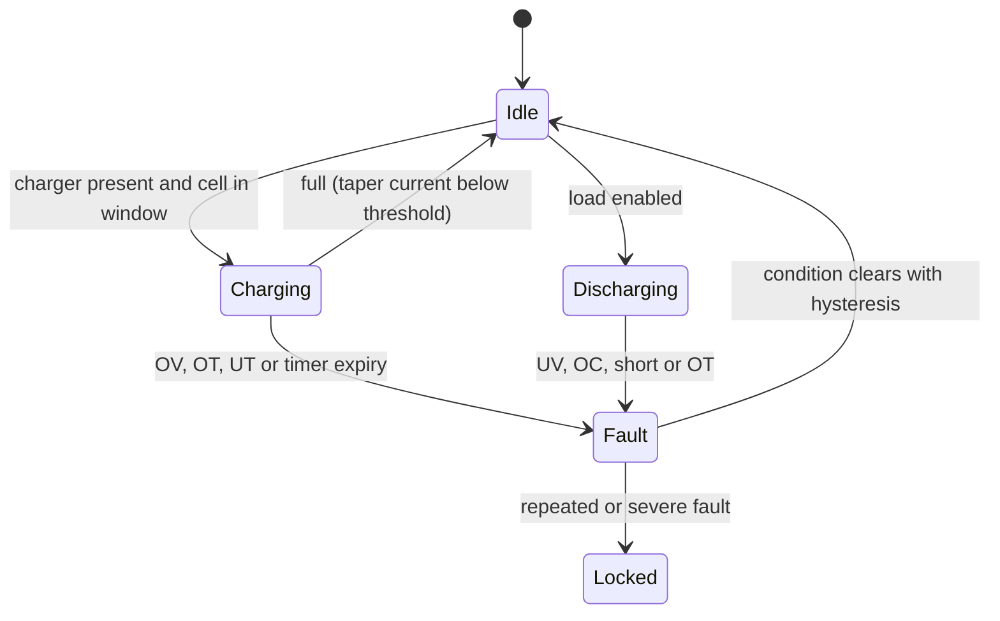

::: testing
Whether you understand *why* batteries become dangerous and can map each hazard to something you can measure and act on. The core answer is the "big three" for lithium cells: **voltage** (per cell, high and low), **current** (charge, discharge, short circuit) and **temperature** (cell and charger). Strong candidates add the quieter signals (cell-to-cell imbalance, rising internal resistance, swelling, state of charge, charge time) and explain the response: stop charging, open a switch, derate, or alert the host. The hidden skill is thinking in terms of a safe operating area and a layered defence.
:::

::: why
Lithium-ion and LiPo cells store a lot of energy in a flammable package. Outside their safe window they can plate lithium, vent gas, or enter thermal runaway. Real products therefore rely on monitoring electronics (a protection IC, a fuel gauge, a full BMS) to enforce limits the cell cannot enforce itself. In an interview this question tests whether you can design that protection rationally, and it connects directly to [[q0296]] (how to charge and discharge safely), [[q0304]] (BMS features) and [[q0327]] (dangers of lithium chemistries).
:::

::: concepts
- **Safe operating area (SOA)**: the voltage, current and temperature window the cell datasheet guarantees. See [[q0305]] for voltage ranges.
- **Overvoltage and undervoltage**: charging above about 4.2 V per cell or discharging below about 2.5-3.0 V damages and endangers the cell ([[q0330]]).
- **Overcurrent and short circuit**: $I^2R$ heating in the cell and wiring ([[q0331]]).
- **Temperature**: no charging when cold (plating), derate/stop when hot; thermal runaway ([[q0332]]).
- **Cell balance**: series cells drift apart, so each must be watched ([[q0314]]).
- **Aging indicators**: rising resistance, falling capacity, swelling ([[q0312]]).
- **Layered protection**: monitor, act in electronics, and back up with hardware (fuse, PTC, vent).
:::

::: answer
"I'd monitor three things continuously: voltage, current and temperature, and a few slower things on top.

Voltage: every cell individually, not just the pack. Overvoltage above about 4.2 volts per cell during charge, because overcharging causes lithium plating and heating and can lead to fire. Undervoltage below roughly 3 volts, because over-discharge dissolves the copper current collector and makes the cell unsafe to recharge.

Current: charge and discharge current, with a fast short-circuit trip. A short means tens of amps through milliohms of resistance, so it needs a response in microseconds to milliseconds, usually done in hardware with a comparator across a sense resistor or the MOSFET.

Temperature: at least one NTC on the cell, because you shouldn't charge below about zero degrees Celsius, and you need to stop charging or discharging when it's too hot, say above 45 to 60, depending on the cell. Heat is also the early warning for a failing cell.

Slower things: cell imbalance in a series pack, internal resistance rising with age, state of charge, and physical swelling of a pouch. And when a limit is hit, the response is to open a series MOSFET or contactor, stop the charger, or derate and tell the host. I'd back it up with a fuse or PTC in case the electronics fail."
:::

::: technical
**Typical limits for a single Li-ion/LiPo cell (graphite anode, LCO/NMC cathode).** Always use the cell datasheet; these are indicative.

| Quantity | Typical limit | Hazard if exceeded |
|---|---|---|
| Charge voltage per cell | ≤ 4.20 V (±1%); OV protection trip about 4.25-4.35 V | lithium plating, electrolyte oxidation, gas, heating |
| Discharge cutoff | about 2.5-3.0 V; UV trip about 2.3-2.9 V | copper dissolution, internal shorts on recharge |
| Charge current | ≤ datasheet rate (e.g. 0.5-1C standard) | plating, heating |
| Discharge current | ≤ datasheet continuous rating; short-circuit trip at a few × rating | $I^2R$ heating, cell damage |
| Charge temperature | about 0-45 °C | plating (cold), accelerated aging (hot) |
| Discharge temperature | about -20 to 60 °C | capacity loss (cold), degradation (hot) |

**Dynamics matter.** Short circuit current is $I_{sc}=V/(R_{int}+R_{wire})$. For a cell at 4.2 V with 50 mΩ internal resistance and 20 mΩ of wiring, $I_{sc}=60$ A and the cell dissipates $60^2\times0.05=180$ W internally. With a cell mass of about 45 g and specific heat of about 1 J/(g·K) (a typical approximation), adiabatic heating is about $180/45=4$ K/s, so protection must act in milliseconds to seconds.

**What to measure and how.** Cell voltage: per-cell ADC (monitor IC) with ~1-5 mV accuracy. Current: shunt or MOSFET $R_{DS(on)}$ with comparator (fast) plus an ADC (accurate) ([[q0294]]). Temperature: NTC thermistor on the cell body with ADC. Plus: state of charge, charge-time timer, and cell imbalance as secondary indicators.

> [!UNCERTAIN]
> Exact protection thresholds, delay times and temperature windows are chemistry- and vendor-specific (and differ for high-voltage 4.35/4.4 V cells, LiFePO4 at 3.65 V max, etc). Use the datasheet's limits.
:::

::: short
"Voltage, current and temperature, continuously, per cell. Overvoltage around 4.2 volts a cell and undervoltage around 3 volts. Overcurrent with a fast short-circuit trip. Temperature with an NTC: no charging when it's near freezing, and cut off when it's hot. On top of that, cell imbalance, resistance growth and swelling. If a limit is hit, open a MOSFET or contactor and stop the charger, and have a fuse as the backup."
:::

::: long
"The way I think about it is a safe operating area in three dimensions: voltage, current and temperature, with a defence at each edge.

Voltage first, and per cell. A lithium cell charged above about 4.2 volts starts plating lithium and oxidising the electrolyte, which makes heat and gas. Discharged below about 2.5 to 3 volts, the copper current collector can dissolve and later short out the cell when you recharge it. In a series pack you have to watch every cell, because the pack total can look fine while one cell is out of range, which is the reason for balancing.

Current: I watch charge and discharge current against the rated limits, and I need a fast path for short circuits. A short on a cell with fifty milliohms of internal resistance is more than fifty amps, so the response has to be in hardware, a comparator across a sense resistor or across the protection MOSFETs, tripping in microseconds to milliseconds, with an ADC on the side for accurate current and coulomb counting.

Temperature: an NTC on the cell. Charging below about zero degrees causes plating, and charging or discharging above about forty-five to sixty is damaging and risky. A cell heating faster than expected is also the early sign of a fault.

Then the slower indicators: cell-to-cell imbalance, internal resistance rising, capacity fading, and swelling, plus a charge timer in the charger as a safety net. When any limit trips, the BMS opens a series MOSFET or contactor, the charger stops, and the host is told. And the last layer is a fuse or PTC so that if my electronics fail, the pack still fails safe."
:::

::: terms
- **OVP / UVP**: overvoltage / undervoltage protection thresholds.
- **OCP / SCP**: overcurrent / short-circuit protection.
- **OTP / UTP**: over- / under-temperature protection.
- **NTC thermistor**: temperature sensor whose resistance falls as temperature rises.
- **Thermal runaway**: self-accelerating heating from exothermic decomposition reactions.
- **Lithium plating**: metallic lithium deposition on the anode, caused by cold or high-rate charging.
- **Hysteresis**: recovery thresholds set apart from trip thresholds so protection does not chatter.
- **SOA**: safe operating area.
:::

::: exceptional
**An average answer** says "voltage, current, temperature".

**An exceptional answer**:
- Gives **numbers** for each limit (4.2 V, about 3 V, 0-45 °C charge window) and the reason (plating, copper dissolution).
- Insists on **per-cell** voltage monitoring in series packs and explains why.
- Distinguishes fast hardware protection (short circuit, µs-ms) from slower firmware (SoC, balancing, trending).
- Mentions the **response**: open MOSFETs/contactor, stop charger, derate, report; and recovery hysteresis.
- Adds layered redundancy (second independent OVP, fuse/PTC, charge timer) and the slow indicators of failing cells.
- Shows a short-circuit calculation ($4.2\text{ V}/70\text{ mΩ}=60$ A, 180 W in the cell).
:::

::: mistakes
- **Monitoring only the pack voltage.** Cells in series drift apart; one can be at 4.4 V while the total looks fine.
- **No temperature sensing.** Charging a cold cell or a hot cell is a major hazard that voltage and current will not reveal.
- **Software-only short-circuit protection.** An MCU loop cannot react in microseconds; use hardware comparators or a protection IC.
- **A single threshold with no hysteresis.** Protection that re-enables at the trip point chatters on and off.
- **Trusting one layer.** If the only protection is a firmware flag, a stuck MOSFET or crashed MCU leaves the pack unprotected. Add an independent hardware layer and a fuse.
- **Ignoring slow signals.** Rising internal resistance, swelling, or a cell that heats during idle charge are early warnings that cut-offs won't catch.
:::

::: deep
## Why these three quantities

A lithium cell is a tightly packed stack of reactive materials and flammable organic electrolyte. Safe operation depends on keeping the electrochemistry inside the intended window. Three variables define that window, and each can be measured:

- **Voltage** tells you the electrode potentials. Above about 4.2-4.3 V (for graphite/NMC or LCO) the cathode becomes highly oxidising and starts to decompose the electrolyte and release oxygen; below about 2.5 V the anode potential rises until the copper foil dissolves.
- **Current** tells you the rate of reaction and the heating ($I^2R_{int}$). High charge current at low temperature outpaces lithium intercalation into graphite, so lithium metal plates on the surface.
- **Temperature** tells you whether side reactions are accelerating. They roughly double in rate for every 10 K or so (an Arrhenius-style rule of thumb), and above about 80-130 °C (cell- and chemistry-dependent) the SEI layer decomposes exothermically, which can start thermal runaway.

> [!UNCERTAIN]
> Onset temperatures for exothermic decomposition and the "doubling per 10 K" rule vary considerably between chemistries, cell designs and test methods. The ranges here are indicative of the typical lithium-ion literature, not hard limits.

## Overvoltage and undervoltage

**Overvoltage** happens when the charger fails, when a series cell drifts high because of imbalance, or when charging a different chemistry with the wrong profile. In practice protection ICs have a fixed OVP threshold (often about 4.25-4.35 V for 4.2 V cells) with a delay of hundreds of milliseconds to reject noise, and an additional hard limit from the charger regulator itself.

**Undervoltage** happens in deep discharge or by long self-discharge in storage. Below about 2.0-2.5 V the copper can dissolve and redeposit as dendrites; cells that have been over-discharged should not be recharged ([[q0330]]). A UVP trip at about 2.3-2.9 V (chosen from the datasheet) opens the discharge switch and often places the pack into a low-power shipping/storage mode.

## Overcurrent and short circuit

Consider a cell at 4.2 V with $R_{int}=50$ mΩ and 20 mΩ of wiring and a bolted short. The current is $I_{sc}=4.2/0.07=60$ A, and power in the cell is $I^2R=60^2\times0.05=180$ W. A pouch cell of about 45 g with an effective specific heat of about 1 J/(g·K) heats at about $180/45\approx4$ K/s in the adiabatic limit (real cells shed some heat, but not enough). That is why short-circuit protection is a hardware function: comparators watching the voltage across the discharge MOSFETs or a sense resistor, with trip delays in the hundreds of microseconds to a few milliseconds, followed by a fuse or PTC as secondary protection.

For *overcurrent* (above the continuous rating but not a short), a slower trip (tens of ms to seconds) is tolerable and uses the accurate ADC measurement ([[q0294]]).

## Temperature: the window and the derating curve

Charge is restricted at both ends. Cold charging risks plating; hot charging accelerates side reactions. Many chargers implement a "JEITA-style" profile: reduced current in the cool band, full current in the mid band, reduced current (or voltage) near the hot limit, and stop beyond.

```plot
{"title":"Illustrative charge-current limit vs cell temperature","x":{"label":"cell temperature","unit":"°C","min":-10,"max":70},"y":{"label":"allowed charge current","unit":"fraction of rated","min":0,"max":1.1},
 "series":[{"label":"allowed charge current","points":[[-10,0],[0,0],[0.01,0.3],[10,0.3],[10.01,1],[45,1],[45.01,0.5],[60,0.5],[60.01,0],[70,0]],"color":"accent"}],
 "vlines":[{"at":0,"label":"cold cutoff","color":"blue"},{"at":60,"label":"hot cutoff","color":"red"}]}
```
Figure: A representative temperature-derating profile for charging. No charge below the cold cutoff (lithium plating), reduced current in the cool band, full rate in the middle, reduced current when warm, and stop when hot. Real numbers come from the cell datasheet and the charger IC's configuration; this shows the shape.

Temperature is sensed with an NTC thermistor and a divider into an ADC, usually thermally bonded to the cell. Place it where heat accumulates (centre of the pack, near the MOSFETs), and use multiple sensors in a large pack.

## Secondary indicators

- **Cell imbalance**: in a series string the first cell to hit 4.2 V ends the charge ([[q0314]]).
- **Internal resistance**: a rising $\Delta V/\Delta I$ indicates aging or a bad connection and signals more heating at the same current ([[q0303]]).
- **Capacity fade** and **self-discharge**: a cell that loses charge much faster than its neighbours may have a micro-short.
- **Swelling**: gas generation from electrolyte decomposition. A pouch that swells is one to retire; sometimes an inline strain sensor or mechanical switch detects it.
- **Charge timer and charge-termination logic**: a safety timer stops charging after a fixed time even if the termination current is never detected.
- **Insulation/isolation** in high-voltage packs.

## The protection state machine


Figure: Monitoring only matters if it drives an action. Each limit moves the pack to a fault state that opens the switches. Recovery requires the condition to clear with hysteresis (and for severe or repeated faults, a latched lock-out requiring a manual or service reset).

## Layered defence

A robust pack never relies on one mechanism. Typical layers: (1) the charger IC's own limits and timers; (2) a dedicated protection IC or monitor with hardware thresholds; (3) firmware in the BMS MCU with SoC, trending and plausibility checks; (4) a fuse or PTC in the current path; (5) cell-level safety devices such as the separator shutdown feature, a current-interrupt device and a pressure vent. Each layer assumes the others can fail.

## Experiment with it

```sim
{"id":"lipo-lab","view":"charge","capacity":2,"crate":1,"temp":25,"rint":0.05}
```
Figure: Watch the CC/CV profile and the termination current. Now imagine the charger voltage regulator failing high: the independent overvoltage protection and charge timer are the layers that would stop the charge.
:::

::: applications
- **Phone/laptop packs**: fuel gauge plus a protection IC with back-to-back MOSFETs and an NTC, plus charger-side temperature derating.
- **E-bike and power tool packs**: multi-cell monitor ICs, high-current MOSFETs, contactors, temperature sensors on cell groups.
- **EV packs**: per-cell voltage and group temperature monitoring, isolation monitoring, pyro fuses and contactors.
- **Drones and RC**: low-voltage alarm/cutoff per cell and temperature-aware chargers.
- **Single-cell wearables**: tiny protection ICs (OV, UV, OC, short) integrated with the charger.
:::

::: assumptions
The answer assumes lithium-ion/LiPo chemistries with graphite anodes; LiFePO4 uses lower voltage limits (about 3.65 V max, about 2.5 V min) and has different thermal characteristics, and lead-acid and nickel chemistries use different signals (e.g. -ΔV and temperature rise for NiMH charge termination).

Thresholds are examples; real values come from the cell datasheet and standards. For multi-cell packs add per-cell monitoring, balancing and isolation monitoring. Large systems also monitor insulation resistance, contactor state and gas/pressure.
:::

::: followups
### Why do you need per-cell voltage monitoring and not just pack voltage?
In series, each cell sees the same current but cells differ in capacity, resistance and self-discharge, so their voltages drift apart. A 4S pack might show 16.8 V total (fine) while one cell is at 4.4 V and another at 4.0 V. Only per-cell measurement catches it and allows balancing ([[q0314]]).

### What does a short circuit look like and how fast must you react?
A hard short is tens of amps: a cell with 50 mΩ and 20 mΩ of wiring at 4.2 V gives 60 A and about 180 W in the cell. Protection ICs trip within about a millisecond or less using a fast comparator, then a fuse or PTC backs it up. Firmware alone is too slow.

### Why can't you charge lithium cells below 0 °C?
At low temperature lithium-ion diffusion into graphite is slow, so charge current plates metallic lithium on the surface. That permanently loses capacity and can grow dendrites that pierce the separator and cause an internal short, a delayed hazard. Chargers inhibit charging until the pack warms up.

### How would you detect a cell that is going bad before it fails?
Trend signals: rising internal resistance (ΔV/ΔI from load steps), self-discharge faster than neighbours (voltage dropping at rest), temperature rising faster than the neighbours at the same current, and swelling. Compare each cell to the pack average and set alarm thresholds on the difference rather than only on absolute values.

### What if your protection MOSFET fails shorted?
Then the pack is no longer protected electrically. That's why there is an independent second layer: a fuse or PTC, a second-level overvoltage protection that blows a fuse (or an independent MOSFET), and charger-side limits. Safety-critical designs analyse single-point failures (FMEA) and add redundancy.
:::

::: interpretations
"Battery" here is read as a lithium-type rechargeable cell or pack, since that is where monitoring matters most. For primary cells the main safety concerns are reverse charging, short circuit and heat. The question complements [[q0296]] (the charge/discharge procedure) and [[q0304]] (how a BMS implements these monitors).
:::

::: references
- Plett, *Battery Management Systems, Volume I and II* (Artech House): protection, monitoring, thermal and safety topics.
- Linden & Reddy (eds.), *Linden's Handbook of Batteries*: chapters on lithium-ion batteries and safety.
- IEC 62133 (safety requirements for portable sealed secondary cells and batteries) and the cell manufacturer's datasheet for charge/discharge limits.
- JEITA battery-charging guideline for the temperature-derating concept (check current document title and edition before citing in a design).
:::

::: rubric
- Names voltage, current and temperature as the primary monitored quantities :: These are the three axes of the safe operating area.
- Gives per-cell voltage limits (about 4.2 V max, about 2.5-3.0 V min) and why :: Shows understanding of plating and copper dissolution.
- Includes overcurrent and a fast short-circuit trip in hardware :: A short happens too fast for software.
- Includes temperature, notably no charging when cold :: Voltage and current cannot reveal this hazard.
- Mentions per-cell monitoring and balance in series packs :: The pack total hides one bad cell.
- States the response (open switch, stop charger, derate, report) and hysteresis :: Monitoring without action is not protection.
- Mentions layered redundancy and slow indicators (resistance growth, swelling) :: Shows safety-engineering maturity.
:::

::: quiz
```json
[
 {"type":"mcq","level":"fundamental","q":"Which three quantities are the core of lithium-cell safety monitoring?","options":["Voltage, current, temperature","Colour, weight, price","Capacitance, inductance, resistance of the wires","Frequency, phase, duty cycle"],"answer":0,"explain":"Voltage (per cell), current (charge/discharge/short) and temperature define the safe operating area and are the signals protection electronics act on."},
 {"type":"mcq","level":"fundamental","q":"Why should you not charge a Li-ion cell below about 0 °C?","options":["The charger efficiency drops","Lithium plates as metal on the anode, causing permanent damage and possible shorts","The cell will explode immediately","The voltage rises above 5 V"],"answer":1,"explain":"At low temperature, lithium cannot intercalate into graphite fast enough, so metallic lithium plates on the surface; this loses capacity and can grow dendrites."},
 {"type":"numeric","level":"intermediate","q":"A fully charged cell (4.2 V) with 50 mΩ internal resistance is shorted through 20 mΩ of wiring. What is the short-circuit current?","answer":60,"tolerance":0.02,"unit":"A","explain":"$I=V/(R_{int}+R_{wire})=4.2/0.07=60$ A."},
 {"type":"numeric","level":"intermediate","q":"For the same short (60 A through 50 mΩ), how much power is dissipated inside the cell?","answer":180,"tolerance":0.02,"unit":"W","explain":"$P=I^2R_{int}=60^2\\times0.05=180$ W. The remaining 0.02 Ω of the loop dissipates $60^2\\times0.02=72$ W in the wiring."},
 {"type":"truefalse","level":"advanced","q":"If the total voltage of a 4-cell series pack reads 16.8 V (4 × 4.2 V), every cell must be at 4.2 V.","answer":false,"explain":"Only the sum is known. Cells can differ, for example 4.35, 4.15, 4.15 and 4.15 V also sums to 16.8 V, putting one cell above its limit. Per-cell monitoring is required."},
 {"type":"mcq","level":"advanced","q":"Which implementation best protects against a short circuit?","options":["An MCU polling an ADC every 100 ms","A hardware comparator across a sense element tripping the FET within about a millisecond, backed by a fuse","A label on the pack","A larger capacitor on the output"],"answer":1,"explain":"Short-circuit current rises in microseconds and heating is several K/s, so a fast hardware trip is needed, with a fuse or PTC as a second layer in case the first fails."}
]
```
:::
