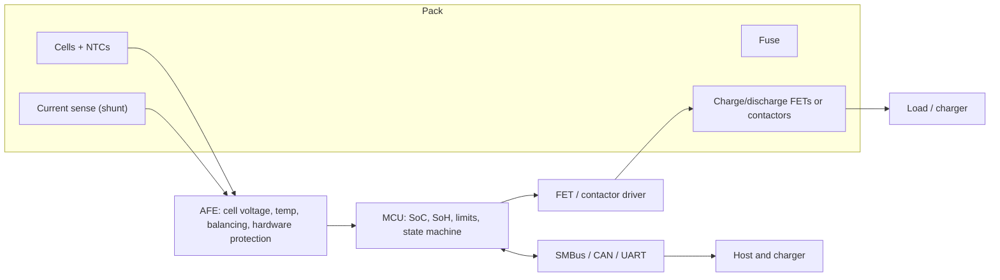

::: testing
Whether you can describe a BMS as a *system*: sensing (cell voltages, current, temperature), protection (the hardware that opens the circuit), estimation (state of charge, state of health), control (charge limits, balancing, thermal) and communication (telling the host and charger what is allowed). The interviewer also wants to know you can scale the answer: a single-cell protection IC in a wearable is a BMS in its simplest form, while an EV pack has a master controller, cell monitors, contactors and isolation monitoring. Mentioning the layered, fail-safe philosophy is the mark of someone who has thought about safety.
:::

::: why
Lithium cells have a narrow safe window and will not protect themselves. The BMS is the part of the product that enforces that window, extracts maximum life and runtime, and tells the user how much energy is left. It is also where much of the product's safety certification effort lands. Understanding what a BMS does is the foundation for the related questions on monitoring ([[q0295]]), charging ([[q0296]]), balancing ([[q0314]]) and the charge/discharge design problem ([[q0323]]).
:::

::: concepts
- **Cell monitoring**: per-cell voltage, pack current, temperature ([[q0294]]).
- **Protection**: overvoltage, undervoltage, overcurrent, short circuit, over/under temperature, with hardware switches ([[q0295]]).
- **State estimation**: state of charge, state of health, remaining runtime ([[q0308]], [[q0312]]).
- **Cell balancing**: equalising series cells, passive (bleed) or active (shuffle) ([[q0314]]).
- **Charge management**: CC/CV limits, temperature derating, communicating limits to the charger ([[q0296]]).
- **Communication**: SMBus/I²C, CAN, UART, with the host and charger.
- **Fail-safe design**: independent redundant protection layers.
:::

::: answer
"A battery management system is the electronics that keeps a battery pack safe, healthy and informative. At the core it measures: each cell's voltage, the pack current, and temperature. From that it protects: if any cell goes above about 4.2 volts or below about 3, if the current is too high or there's a short, or if it's too hot or cold, it opens a switch, usually back-to-back MOSFETs or a contactor, and tells the charger or host. The fast protections are done in hardware.

On top of that it estimates things: state of charge, using coulomb counting and voltage, state of health from capacity and resistance, and remaining runtime. It balances cells in a series pack, typically passively by bleeding the higher cells through a resistor near the end of charge, so the weakest cell doesn't limit the pack. It manages charging: it tells the charger what current and voltage are allowed, derating with temperature. And it communicates, over SMBus, CAN or I2C, so the host can show the battery percentage and respond to faults. It may also log data, handle pre-charge, check insulation in high-voltage packs, and control a cooling system.

For a small single-cell product, it can be as simple as one protection IC with two MOSFETs and a fuel gauge. For an EV, it's a distributed system with cell-monitor chips, a master controller and contactors. The key design philosophy is layers: independent hardware protection under the firmware, plus a fuse."
:::

::: technical
**Functional blocks.**

1. **Analog front end (AFE)**: multiplexed ADC measuring each cell (accuracy about 1-5 mV class), temperatures (NTCs), and pack current (shunt, [[q0294]]); supplies balancing FET drive; often includes hardware comparators for OV/UV/OC/short.
2. **Controller (MCU)**: runs state estimation, safety state machine, charge limits, balancing decisions, diagnostics and communications.
3. **Power switches**: back-to-back MOSFETs (or contactors/pre-charge relay for high voltage) in the charge/discharge path; optional fuse or pyro-fuse.
4. **Communication**: SMBus/I²C (Smart Battery style gauges in laptops), CAN (EV, e-bike, industrial), UART/BLE for hobby and consumer packs.

**Typical protections (single-cell Li-ion, indicative).**

| Protection | Typical threshold | Response time |
|---|---|---|
| Overvoltage (OVP) | about 4.25-4.35 V per cell | hundreds of ms (noise filter) |
| Undervoltage (UVP) | about 2.3-2.9 V | tens to hundreds of ms |
| Overcurrent discharge/charge | set by a sense voltage across the FETs/shunt, e.g. 150 mV | ms to tens of ms |
| Short circuit | higher sense voltage, e.g. about 1 V | tens to hundreds of µs |
| Over/under temperature | e.g. >60 °C discharge, <0 °C or >45 °C charge | seconds |

With two FETs of 25 mΩ each (50 mΩ total, illustrative) a 150 mV overcurrent threshold corresponds to $0.15/0.05=3$ A and a 1 V short-circuit threshold to $1/0.05=20$ A.

**State estimation.** SoC by coulomb counting $SoC(t)=SoC_0-\frac{1}{Q}\int \eta I\,dt$ corrected by OCV lookup at rest, or by model-based filters (e.g. Kalman) using the cell's equivalent circuit ([[q0308]]). SoH from capacity and resistance trends ([[q0312]]).

**Balancing.** Passive: switch a bleed resistor across a high cell, e.g. 47 Ω at 4.2 V gives $4.2/47=89$ mA and $4.2^2/47=0.375$ W of heat. Active: transfer charge between cells with capacitors, inductors or transformers (more efficient, more complex).

> [!UNCERTAIN]
> Threshold values, delays and sense voltages are part- and vendor-specific; the numbers above are representative of single-cell protection ICs, not any specific part. Use the datasheets of your cell and BMS IC.
:::

::: short
"A BMS is the electronics that keeps a pack safe, healthy and informative. It measures cell voltages, pack current and temperature; protects against overvoltage, undervoltage, overcurrent, short circuit and over-temperature by opening MOSFETs or contactors, with the fast ones in hardware; estimates state of charge and health; balances series cells, usually passively with bleed resistors; controls charging limits; and communicates over SMBus or CAN. For a single cell it can be one protection IC and a gauge; for an EV it's a distributed system."
:::

::: long
"A battery management system, BMS, is the electronics that keeps a lithium pack inside its safe operating window and tells the rest of the product what the battery is doing.

The first job is measurement. It reads every cell's voltage, the pack current through a sense resistor, and temperatures from NTCs. The second job is protection. If a cell goes over about 4.2 volts, under about 3 volts, if current is too high, if there's a short, or if temperature is out of range, it opens a switch, usually two back-to-back MOSFETs so it blocks current in both directions, or a contactor in a big pack. The fast ones, short circuit especially, are in hardware because firmware can't react in microseconds, and there's usually a fuse as a last resort.

The third job is estimation. It computes state of charge by integrating current, which is coulomb counting, and correcting with the open-circuit voltage when the battery has rested. It tracks state of health from capacity and resistance, and from that it gives you the percentage and time remaining.

Fourth is balancing. In a series pack cells drift apart, and the first cell to reach full stops the charge, so passive balancing bleeds the higher cells through resistors, or active balancing moves charge between cells. Fifth is charge control: telling the charger how much current and voltage it may use, derating when temperature is off. And sixth is communication: SMBus in laptops, CAN in EVs and e-bikes, so the host can display the battery level and respond to faults. Extras include logging, pre-charge, insulation monitoring and cooling control.

The design philosophy is layered safety: hardware limits independent from firmware, firmware limits independent from the charger, and a fuse behind all of it."
:::

::: terms
- **BMS**: battery management system.
- **AFE**: analog front end; multi-cell voltage/temperature measurement and protection IC.
- **Coulomb counting**: integrating current to track charge.
- **SoC / SoH**: state of charge / state of health.
- **Passive balancing**: dissipating excess charge from high cells in a resistor.
- **Active balancing**: transferring charge between cells.
- **Back-to-back MOSFETs**: two series FETs with opposed body diodes, blocking current in both directions.
- **Contactor / pre-charge**: high-voltage relay and the resistor path that limits inrush before closing it.
- **SMBus / CAN**: communication buses used for battery data.
:::

::: exceptional
**An average answer** says "it protects the battery from overcharge and over-discharge and balances cells".

**An exceptional answer**:
- Organises the BMS into **sense, protect, estimate, balance, charge-control, communicate** with a block diagram.
- Distinguishes **hardware (µs-ms) from firmware (ms-s)** protections and calls for independent layers plus a fuse.
- Explains *why* back-to-back MOSFETs are needed (body diodes) and gives a numeric threshold example from the Rds(on).
- Gives the passive-balancing numbers (47 Ω → 89 mA, 0.375 W) and the limitation (heat, time), contrasting with active balancing.
- Scales the answer from a single-cell wearable to an EV pack (contactors, pre-charge, isolation monitoring, CAN).
- Mentions what makes SoC hard, and how the BMS reports health.
:::

::: mistakes
- **Thinking one MOSFET is enough.** A single FET's body diode conducts the other way, so you need two back-to-back to block both charge and discharge.
- **Firmware-only protection.** A crashed MCU or slow loop leaves the pack unprotected; keep hardware comparators and a fuse.
- **Balancing at the wrong time.** Passive balancing is small current (tens of mA) and is typically done near the end of charge, when cell voltages diverge; it cannot fix a large imbalance quickly.
- **Measuring only pack voltage.** The BMS must see each cell ([[q0295]]).
- **Forgetting its own power draw.** A BMS that draws 100 µA for a 2 Ah pack consumes 2.4 mAh/day (about 0.12%/day), significant over months of storage; protection ICs advertise µA-level or lower quiescent current.
- **Ignoring communication safety.** A BMS that loses its comms bus should fail to a safe state (disable charge or reduce current) rather than assume everything is fine.
:::

::: deep
## What problem does a BMS solve?

A lithium cell is safe only inside a window of voltage, current and temperature, and it is only long-lived if you stay well inside that window. A pack of several cells in series makes this harder because cells differ. The BMS exists to (1) enforce the window for every cell, (2) squeeze out available energy without crossing it, (3) keep the cells matched, and (4) tell the system what is happening.


Figure: The block structure of a typical BMS. Sensing flows up into the AFE and MCU; commands flow down to the switches; the comms bus carries limits and status to the host and charger. Hardware protection in the AFE can open the switches without the MCU. A fuse sits in the main current path as the last layer.

## Feature 1: measurement

Per-cell voltage, with 1-5 mV accuracy for 4.2 V cells (tighter for LFP's flat curve), pack current (shunt, [[q0294]]) and temperature on multiple points. Measurement quality sets everything else: current offset becomes coulomb-counting drift, voltage error becomes SoC and balancing error.

## Feature 2: protection

The simplest BMS is a single-cell protection IC with two N-channel MOSFETs in the low side.

```circuit
{"elements":[
 {"t":"battery","a":[0,2],"b":[0,10],"label":"Cell"},
 {"t":"wire","pts":[[0,2],[0,0],[22,0]]},
 {"t":"term","at":[22,0],"label":"P+","side":"right"},
 {"t":"wire","pts":[[5,3],[3,3],[3,0]]},{"t":"dot","at":[3,0]},
 {"t":"box","at":[5,2],"w":10,"h":6,"label":"Protection IC","pins":[{"side":"left","pos":1,"name":"VDD"},{"side":"left","pos":3,"name":"VSS"},{"side":"right","pos":3,"name":"VM"},{"side":"bottom","pos":1,"name":"DO"},{"side":"bottom","pos":9,"name":"CO"}]},
 {"t":"wire","pts":[[0,10],[0,14],[8,14]]},
 {"t":"wire","pts":[[5,5],[2,5],[2,14]]},{"t":"dot","at":[2,14]},
 {"t":"nmos","at":[6,12],"bodyDiode":true},
 {"t":"nmos","at":[14,12],"flip":true,"bodyDiode":true},
 {"t":"wire","pts":[[8,10],[12,10]]},
 {"t":"wire","pts":[[6,8],[6,12]]},
 {"t":"wire","pts":[[14,8],[14,12]]},
 {"t":"wire","pts":[[12,14],[22,14]]},
 {"t":"wire","pts":[[15,5],[18,5],[18,14]]},{"t":"dot","at":[18,14]},
 {"t":"term","at":[22,14],"label":"P-","side":"right"},
 {"t":"text","at":[6,16.5],"text":"Q1 (left) blocks discharge, Q2 (right) blocks charge","anchor":"start","muted":true}
]}
```
Figure: Single-cell protection. The IC watches the cell voltage across VDD-VSS and the voltage across the two FETs (VM) as a current sense. DO drives Q1 (discharge switch) and CO drives Q2 (charge switch). The FET body diodes are opposed, so turning one FET off blocks current in one direction while the other direction can still flow through its body diode: undervoltage turns off Q1 (charging still allowed), overvoltage turns off Q2 (discharging still allowed).

Behaviour: during discharge, the voltage at P- rises above the cell negative by $I\times R_{DS(on),total}$, and that sensed voltage triggers overcurrent and short-circuit trips. With 50 mΩ total, 150 mV threshold gives 3 A and 1 V gives 20 A; so the FET Rds(on) also sets the trip current (and the pack's series resistance, adding to $R_{int}$ in [[q0303]]).

Multi-cell packs use a multi-cell AFE with the same logic per cell, plus high-side or low-side FETs sized for the pack current, fuses, and for high voltage, contactors with a pre-charge resistor to limit inrush into capacitive loads (inverters).

## Feature 3: state estimation

The BMS firmware maintains a model of each cell. Coulomb counting integrates current but drifts; OCV lookup is accurate at rest but poor under load and on flat curves; model-based filters blend the two and track resistance and capacity as they age ([[q0308]], [[q0312]]).

```sim
{"id":"soc-estimator","offset":0.01,"gainErr":0.01}
```
Figure: The estimator blends coulomb counting with OCV corrections at rest. Increase the offset and gain error to see what the BMS must cope with; this is the reason a good current sensor and a periodic recalibration point (full charge, rest) matter.

## Feature 4: cell balancing

In a series string, the same current flows through every cell, but cells differ in capacity, self-discharge and resistance. The charger stops when the *first* cell reaches 4.2 V, so the others are not full and usable capacity shrinks over time. Passive balancing switches a resistor across the highest cell during or near the end of charge:

$$I_{bal}=\frac{V_{cell}}{R_{bal}}=\frac{4.2}{47}=89\ \text{mA},\qquad P=\frac{V^2}{R}=0.375\ \text{W}$$

To remove a 100 mAh imbalance takes $0.1/0.089=1.1$ h of balancing on that cell, producing heat in the board, so balancing currents are limited to tens or hundreds of mA and balancing is time-limited. Active balancing transfers charge instead of burning it (efficient, useful for large capacity mismatch or large packs) but needs more components. See [[q0314]].

```sim
{"id":"cell-balancing","cells":4,"mismatch":0.05,"balance":"passive"}
```
Figure: Compare balance: "none" and "passive" with a 5% capacity mismatch. Without balancing, the weakest cell reaches 4.2 V first and the pack's usable capacity is limited; passive bleed equalises them at the cost of heat.

## Feature 5: charge and discharge management

The BMS enforces maximum charge current and voltage per cell, derates with temperature (see the derating profile in [[q0295]]), and tells the charger what it may do (via SMBus/CAN, or by NTC emulation and enable pins in simple designs). It also limits discharge current, may allow a short high-power burst, pre-charges the bus, and shuts down gracefully at low SoC with some energy reserved.

## Feature 6: communication, logging and diagnostics

SMBus/I²C is common for laptops (Smart Battery System style gauges), CAN for EVs, e-bikes and industrial equipment, UART/BLE for hobby and consumer packs. The BMS reports voltage, current, temperature, SoC, SoH, cycle count, faults and limits, and logs events (time-stamped over-temperature, under-voltage, max current) that are valuable for warranty and failure analysis.

## High-voltage extras

EV-class packs add contactor welding detection, isolation (insulation) resistance monitoring between pack and chassis, high-voltage interlock loops, thermal management control (coolant pumps, heaters), functional-safety design and cyber-security. These are well beyond a single-cell design but are common interview follow-ups.

## Layered safety, once more

1. Charger IC limits and timers.
2. AFE hardware protection thresholds (independent of the MCU).
3. MCU firmware limits, plausibility checks and diagnostics.
4. Fuse or PTC (or pyro-fuse) in the current path.
5. Cell-level safety devices.
Each layer assumes the others can fail. For safety-critical applications, a formal failure-mode analysis (FMEA) is done for single-point failures such as a stuck-on MOSFET.
:::

::: applications
- **Smartphones and wearables**: single-cell protection IC + MOSFETs + fuel gauge inside the pack.
- **Laptops**: multi-cell AFE + MCU with SMBus gauge reporting to the OS and charger.
- **E-bikes and power tools**: BMS board with balancing, high-current MOSFETs and CAN/UART.
- **EVs and grid storage**: distributed cell monitors, master controller, contactors, isolation monitoring, thermal control.
- **Hobby LiPo and drone packs**: balance connector with an external balance charger, plus low-voltage alarms.
:::

::: assumptions
The answer assumes a lithium-ion/LiPo pack and describes typical functions. LiFePO4 packs use lower voltage thresholds and a more careful SoC approach due to the flat curve; lead-acid and nickel packs need different charge control but similar monitoring and protection ideas. Thresholds and the single-cell example are illustrative.

Not every product has a full BMS: a cheap hobby cell may have only a protection board, and consumer power banks bundle protection with a boost converter. The functions listed are what a *complete* BMS provides; the interviewer may want you to adapt the scope to the product in the question ([[q0323]]).
:::

::: followups
### Why do you need two MOSFETs and not one?
A MOSFET has a body diode that conducts one way even when the FET is off. One FET would only block current in one direction. Two back-to-back, with opposite body-diode polarity, can block both: turning off the discharge FET stops discharge, but charging can still flow through its body diode; turning off the charge FET stops charge but discharging still flows. That allows recovery after under- or over-voltage events.

### How does a BMS detect a short circuit so quickly?
A comparator watches the voltage across the series FETs or a sense resistor. A short produces tens of amps, so the sense voltage jumps (e.g. 20 A × 50 mΩ = 1 V). The comparator trips within tens to hundreds of microseconds and drives the FET gates off, with no MCU involvement. A fuse backs this up.

### Passive vs active balancing: when would you choose each?
Passive is simple and cheap: a bleed resistor and FET per cell, good when mismatch is small and balancing time is long (small to mid packs, with several hours of charge top-off). It wastes energy as heat and is slow (tens to hundreds of mA). Active balancing moves charge between cells (efficient, faster, useful when cells have large capacity differences or in large high-cycling packs) but needs inductors/capacitors, more parts and cost.

### What would you do if the BMS MCU hangs?
A hardware watchdog resets it; the AFE's independent hardware protection continues to enforce OV/UV/OC; the switches default to a safe (open) state if the drive signal is lost or stuck; and the charger/host see the loss of communication and stop. The principle is that a firmware fault must not remove protection.

### How would you handle a 12S pack in an e-bike at 48 V?
A 12-cell AFE (or two stacked 6-cell chips) with level shifting, high-side or low-side FETs rated for above 60 V and the peak current, current sensing, balancing (passive or active), temperature sensors on cell groups, CAN or UART comms, a pre-charge path if the controller has large capacitors, and a main fuse. Check creepage/clearance and isolation for the higher voltage.
:::

::: interpretations
"What features does it offer?" invites the list; the better answer is a structured one (sense, protect, estimate, balance, control charge, communicate) with examples scaled to the product. If the interviewer follows with "design a charge/discharge circuit" ([[q0323]]) they expect you to draw something like the single-cell figure above plus a charger IC. Related monitoring questions ([[q0313]], [[q0314]]) go deeper into charging ICs and balancing.
:::

::: references
- Plett, *Battery Management Systems, Volume I and II* (Artech House): BMS functions, state estimation, balancing and protection.
- Linden & Reddy (eds.), *Linden's Handbook of Batteries*: battery management and protection circuits.
- Smart Battery System specifications (Smart Battery Data Specification, SBS-IF) for the SMBus battery data model used in laptops.
- Manufacturer datasheets for single-cell protection ICs and multi-cell AFE/monitor ICs (thresholds, delays, balancing current).
:::

::: rubric
- Describes measurement of cell voltage, current and temperature :: Sensing underlies every other function.
- Describes protection (OV, UV, OC, short, temperature) and the switching element :: The core safety function.
- Explains back-to-back MOSFETs or contactors and hardware vs firmware speed :: Shows circuit-level understanding.
- Mentions state-of-charge/health estimation :: A major feature that users see.
- Mentions cell balancing, passive vs active, with a number or trade-off :: Essential for series packs.
- Mentions charge control and communications (SMBus/CAN) :: Integration with charger and host.
- Mentions layered redundancy/fuse and scales the answer to product size :: Mature safety thinking.
:::

::: quiz
```json
[
 {"type":"mcq","level":"fundamental","q":"Which of these is NOT typically a BMS function?","options":["Cell voltage monitoring","Overcurrent and short-circuit protection","Increasing the pack's open-circuit voltage above its chemistry limit","Cell balancing"],"answer":2,"explain":"A BMS enforces limits; it cannot raise the chemistry's voltage. It monitors, protects, balances, estimates SoC and communicates."},
 {"type":"mcq","level":"fundamental","q":"Why are two back-to-back MOSFETs used in a single-cell protection circuit?","options":["To double the current rating only","A single FET's body diode would still conduct in one direction; two opposed FETs can block both charge and discharge","To reduce cost","To provide galvanic isolation"],"answer":1,"explain":"The body diode of a single FET conducts when the FET is off in one direction. Opposed FETs allow independent blocking of charge and discharge."},
 {"type":"numeric","level":"intermediate","q":"The protection FETs have a total on-resistance of 50 mΩ and the overcurrent comparator trips at 150 mV. At what current does it trip?","answer":3,"tolerance":0.02,"unit":"A","explain":"$I=V/R=0.150/0.050=3$ A."},
 {"type":"numeric","level":"intermediate","q":"A passive balancer uses a 47 Ω resistor across a 4.2 V cell. How much current does it bleed?","answer":89,"tolerance":0.02,"unit":"mA","explain":"$I=4.2/47=0.0894$ A = 89 mA; power is $4.2^2/47=0.375$ W."},
 {"type":"truefalse","level":"advanced","q":"Short-circuit protection can be reliably implemented purely in BMS firmware polling the ADC every 100 ms.","answer":false,"explain":"A short drives tens of amps and heats the cell by several K/s; response must be in microseconds to milliseconds using a hardware comparator, with a fuse as backup."},
 {"type":"mcq","level":"advanced","q":"A 4-cell series pack has one cell with 5% less capacity. Without balancing, what happens over many cycles?","options":["Nothing; series cells always stay matched","The weaker cell hits its voltage limit first on charge and empties first on discharge, so usable pack capacity shrinks and the weak cell is stressed","The strongest cell fails first","The pack voltage rises"],"answer":1,"explain":"Charge stops when the weakest cell reaches the limit and discharge stops when it empties, limiting the pack and overworking it. Balancing equalises charge states."}
]
```
:::
