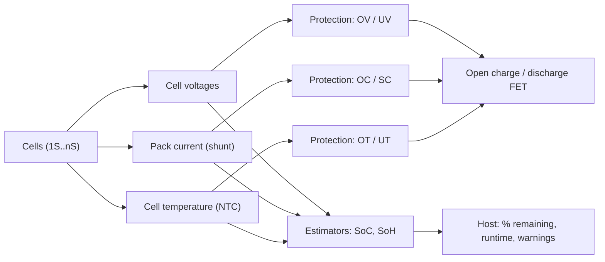

::: basics
### In plain words
To use a LiPo battery safely, a circuit has to keep watching three things: the voltage of each cell, the current in and out, and the temperature. From those it can work out how full the battery is and how healthy it is. If a reading crosses a limit, the circuit acts: it cuts the connection, reduces the charge current or tells the main device.

### Picture it
Think of the dashboard in a car. The speedometer, the fuel gauge and the temperature gauge are the readings. The warning lights and the engine cutoff are the actions. A dashboard that shows numbers but never warns or acts is not much use. A battery monitor is the same: measuring is the first half, acting on the limits is the second half.

### Words you need
- **Per-cell voltage**: the voltage of each cell on its own, since in a series pack the total can hide one bad cell ([[q0305]]).
- **Shunt resistor**: a tiny, precise resistor. The voltage across it tells you the current, by Ohm's law.
- **NTC thermistor**: a sensor whose resistance changes with temperature, used to read the cell temperature ([[q0306]]).
- **State of charge (SoC)**: how full the battery is, found by adding up current over time and checking voltage.
- **Threshold**: the limit value at which the circuit takes action.

### The simplest example
Put a 10 mΩ shunt in the battery path. At 5 A, the voltage across it is $5 \times 0.01 = 0.05$ V, or 50 mV, and the shunt wastes $5^2 \times 0.01 = 0.25$ W. A 10 kΩ NTC in a divider with a 10 kΩ resistor from 3.3 V reads 1.65 V at 25 °C, and the reading shifts with temperature. If voltage reaches 4.2 V, or temperature leaves about 0 to 45 °C during charging, the circuit stops the charge.

That is the whole idea. The rest of this page covers how to measure each quantity, what accuracy you need, and the typical limits and delays.
:::

::: testing
Whether you can turn "a LiPo is dangerous if abused" into a concrete **list of measurements and thresholds**, and say how each one is measured in hardware. The core three are **voltage (per cell), current (both directions) and temperature**. Stronger answers add derived quantities (state of charge, state of health, cycle count), fault flags, and the measurement-chain details: shunt vs Hall sensor, NTC divider, ADC resolution, accuracy needed. You are also being tested on whether you know that each parameter has an action attached: monitoring without a response is just logging.
:::

::: why
A lithium cell has no tolerance for abuse and gives few warning signs. Overvoltage, overcurrent, overtemperature and undervoltage all have defined damage mechanisms, and a few hundred millivolts or a few tens of degrees separate "fine" from "fire". Every battery product, from earbuds to e-bikes, has a monitor or BMS that measures these quantities. This question is also the doorway to current sensing, ADC resolution and thermistor design, topics interviewers love because they are concrete and calculable.
:::

::: concepts
- **Cell voltage** governs the allowed window (3.0 to 4.2 V) and, with a model, the state of charge. See [[q0305]].
- **Current** (with sign) determines heating ($I^2R$), C-rate compliance and coulomb counting. See [[q0315]] and [[q0308]].
- **Temperature** sets the allowed charge and discharge windows ([[q0306]]) and flags thermal runaway.
- **Shunt-based current sensing**: $V = I R_{shunt}$, amplified and digitized. See [[q0294]] and the sim below.
- **Thermistor dividers**: an NTC in a resistor divider turns temperature into a voltage ([[q0008]]).
- **Derived quantities**: SoC, SoH, remaining runtime, cycle count, imbalance.
:::

::: answer
"I'd group it into three things you must measure, a few things you derive, and the faults you act on.

The must-measure ones are voltage, current and temperature. Voltage I want per cell, not just pack voltage, because in a series pack the sum hides imbalance, and each cell has its own window of about 3.0 to 4.2 volts. Current I measure with a low-ohmic shunt and an amplifier or a coulomb counter, in both directions, so I can see charge versus discharge, catch overcurrent and short circuit, and integrate it for state of charge. Temperature I get from an NTC thermistor touching the cell, and maybe one on the power FETs, because both charging and discharging have temperature windows.

From those I derive state of charge, using coulomb counting plus a voltage lookup, state of health from capacity and internal resistance, cycle count, and remaining runtime.

And then each of those has a threshold with an action. Overvoltage around 4.25 to 4.3 volts per cell, undervoltage somewhere in the 2.5 to 3 range, overcurrent and short circuit with different delays, and over and under temperature. The action is to open a protection FET, reduce charge current, or just tell the host. A monitor that doesn't act or report isn't doing much."
:::

::: technical
**Primary measurements**

| Quantity | How | Typical limit/trip | Action |
|---|---|---|---|
| Cell voltage (each series cell) | Divider + ADC or multi-cell AFE with level shifting | Charge limit 4.20 V; OVP backup about 4.25 to 4.35 V; UVP about 2.5 to 3.0 V | Stop charge, open discharge FET |
| Current (signed) | Low-side or high-side shunt (1 to 50 mΩ) + current-sense amp or coulomb-counter IC | Datasheet max continuous/peak; short-circuit threshold set by IC (often 50 to 200 mV across the sense element) | Limit, open FET with delay, flag fault |
| Temperature | 10 kΩ NTC (B about 3380 K) on the cell; additional on FETs/board | Charge about 0 to 45 °C; discharge about −20 to 60 °C (cell-dependent) | Derate/stop |

**Derived quantities:** state of charge (coulomb counting, OCV lookup or model-based, [[q0308]]); state of health (capacity fade, resistance growth, [[q0312]]); cycle count; remaining time $= \text{remaining capacity} / I_{avg}$; imbalance $\Delta V_{cell}$.

**Current-sense design numbers.** Shunt $R_s = 10$ mΩ, $I_{max} = 5$ A: $V_s = 50$ mV, $P = I^2R = 0.25$ W. Gain 50 puts 2.5 V at the ADC for 5 A. With a 12-bit, 3.3 V ADC, 1 LSB is $3.3/4096/50/0.01 = 1.61$ mA. A standby current of 1 mA is below one LSB, so for low-current accuracy you need a coulomb-counter IC with a µV-level front end or a larger shunt (trading dissipation and voltage drop).

**Voltage accuracy needed.** Charge termination at 4.20 V should be accurate to about ±0.5 to 1 % (21 to 42 mV). For SoC from OCV in the flat region (about 6 mV per 1 % SoC), a 10 mV error is about 1.6 % SoC, so gauges target a few mV.

**Thermistor.** $R_{NTC}(T) = R_0\exp[B(1/T - 1/T_0)]$. A 10 kΩ NTC (B = 3380 K) with a 10 kΩ pull-up to 3.3 V gives 1.65 V at 25 °C, 2.44 V at 0 °C, 1.09 V at 45 °C and 0.77 V at 60 °C.

**Faults** typically detected with delays (to ignore transients): overvoltage (hundreds of ms to 1 s), undervoltage (tens to hundreds of ms), overcurrent (ms to s), short circuit (tens to hundreds of µs).
:::

::: short
"Three things: per-cell voltage, current in both directions, and temperature. Voltage keeps each cell in its roughly 3.0 to 4.2 V window, current from a shunt gives overcurrent protection and lets me coulomb-count, and an NTC on the cell enforces the charge and discharge temperature windows. From those I derive state of charge, state of health and cycle count. Each one has a threshold tied to an action, such as opening the protection FET or cutting the charge current, because monitoring without a response is pointless."
:::

::: long
"I'd start with the three physical quantities, then the derived ones, then what the system does with them.

First, cell voltage. In a single cell it's straightforward, but in a series pack I need each cell individually, because the pack total hides imbalance. Each cell has to stay in its window, about 3.0 to 4.2 volts, with a tight upper limit of 4.2 plus or minus tens of millivolts. I'd use a multi-cell analog front end or a divider and ADC per cell.

Second, current, with sign. I'd put a low-ohmic shunt, say 10 milliohms, in series with the pack, and measure the drop with a current-sense amplifier or a coulomb-counter IC. At 5 amps that's 50 millivolts and a quarter of a watt, so it's a trade-off between signal and loss. I need both directions, so I can tell charging from discharging, detect overcurrent and short circuit, and integrate for state of charge.

Third, temperature. A 10k NTC thermistor on the cell body in a divider, because charging below zero or above about 45 degrees is a problem, and discharge has a wider but still limited window. I might add a second sensor on the FETs.

Derived from those: state of charge from coulomb counting corrected by an open-circuit-voltage lookup, state of health from capacity and internal resistance, cycle count, and time remaining. For a pack, also the cell imbalance.

Finally the response: thresholds for overvoltage, undervoltage, overcurrent, short circuit and over and under temperature, each with a time delay to ignore glitches, and the action: open the charge or discharge FET, reduce charge current, and report to the host. I'd also keep a fault log."
:::

::: terms
- **BMS (battery management system)**: electronics that measure, protect, balance and report on a battery pack ([[q0304]]).
- **AFE (analog front end)**: a multi-cell measurement chip that level-shifts and digitizes cell voltages, temperatures and current.
- **Shunt (sense resistor)**: a low-value precision resistor in the current path; $V = IR$ gives current.
- **Coulomb counter**: a circuit that integrates current over time to track charge in and out.
- **NTC thermistor**: negative temperature coefficient resistor used as a temperature sensor.
- **OVP / UVP / OCP / SCP**: over-voltage, under-voltage, over-current and short-circuit protection.
- **Fuel gauge**: an IC (or algorithm) that estimates SoC, SoH and time remaining.
- **SoC / SoH**: state of charge, state of health.
:::

::: exceptional
**An average answer** lists "voltage, current, temperature" and stops.

**An exceptional answer**:
- Insists on **per-cell** voltage for series packs and says why the total is not enough.
- Specifies **signed current** and explains the shunt trade-off with real numbers (50 mV, 0.25 W, mA/LSB).
- Places the **temperature sensor** where it matters and notes the different charge and discharge windows.
- Separates measured from derived quantities (SoC, SoH, cycles) and names the limits and actions for each fault, including **time delays** for glitch rejection.
- Mentions accuracy requirements (±0.5 to 1 % at 4.2 V) and the low-current sensing problem (µV offsets).
:::

::: mistakes
- **Measuring only pack voltage.** A series pack can have one cell over 4.2 V while the total looks normal ([[q0314]]).
- **Unsigned or single-direction current.** You cannot tell charge from discharge or detect reverse conditions, and coulomb counting breaks.
- **A shunt that is too big or too small.** Too big wastes power and drops the rail. Too small gives millivolt-level signals buried in amplifier offset.
- **Putting the NTC on the PCB far from the cell.** It reads the board, which may lag the cell by minutes.
- **No delay or hysteresis on thresholds.** A motor start current spike or voltage glitch trips protection, then the pack chatters on and off.
- **Measuring without acting.** A gauge that reports a fault but cannot open a FET is only logging.
:::

::: deep
## The measurement list and why each item exists

Every monitored quantity maps to a damage mechanism or a state estimate:


Figure: Three raw measurements feed two paths. The fast path (upper branches) goes to protection and opens a FET. The slow path (lower branch) feeds estimators that report to the host. Protection must work even if the host firmware hangs, which is why it is often a hardware IC.

### 1. Voltage

For a single cell the need is simple: do not exceed 4.2 V on charge and do not fall below the cutoff on discharge ([[q0305]]). In a series pack, each cell has its own SoC because capacities and self-discharge differ slightly, so each needs its own measurement. A multi-cell AFE (for example the TI bq769x family, not to be confused with fuel gauges) level-shifts and digitizes up to several cells with a few mV accuracy.

What accuracy do you need? The OCV curve near the top climbs about 1 V per unit SoC, so 10 mV is about 1 % SoC there. In the flat middle (3.67 to 3.92 V from 30 to 70 % SoC) the slope is only 0.625 V per unit SoC, i.e., 6.25 mV per 1 % SoC, so a 10 mV error means about 1.6 % SoC error ([[q0308]]). For termination, 1 % of 4.2 V is 42 mV, an error that costs life and safety margin.

A simple divider to an MCU ADC for a 1S cell: two 100 kΩ resistors halve 4.2 V to 2.1 V, drawing only 21 µA (see [[q0008]]); a series switch can disconnect the divider when not sampling to eliminate this standby drain.

### 2. Current

A shunt in the low side (between the pack negative and system ground) is simple, but it lifts the "ground" of the load by $IR$ and breaks a common ground to a charger. A high-side shunt keeps ground solid, but the amplifier must handle a common-mode voltage equal to the pack voltage. For a 1S pack the high-side common mode is only 3 to 4.2 V, which many current-sense amplifiers handle easily.

```circuit
{"caption":"Low-side shunt measurement of pack current","elements":[
 {"t":"battery","a":[0,1],"b":[0,5],"label":"LiPo","value":"1S"},
 {"t":"wire","pts":[[0,1],[0,0],[12,0],[12,1]]},
 {"t":"R","a":[12,1],"b":[12,5],"label":"Load","color":"orange"},
 {"t":"wire","pts":[[0,5],[0,7],[4,7]]},
 {"t":"dot","at":[2,7]},{"t":"gnd","at":[2,7]},
 {"t":"R","a":[4,7],"b":[9,7],"label":"R_{shunt} = 10 mΩ"},
 {"t":"wire","pts":[[9,7],[12,7],[12,5]]},
 {"t":"wire","pts":[[4,7],[4,9]]},{"t":"dot","at":[4,7]},
 {"t":"wire","pts":[[9,7],[9,9]]},{"t":"dot","at":[9,7]},
 {"t":"term","at":[4,9],"label":"to CSA −","side":"bottom"},
 {"t":"term","at":[9,9],"label":"to CSA +","side":"bottom"},
 {"t":"arrow","a":[10.5,3.2],"b":[10.5,4.6],"label":"I"}
]}
```
Figure: The load current returns through the shunt, so $V_{shunt} = I R_{shunt}$ is measured by a differential pair of sense lines routed as a Kelvin connection to the shunt pads. Route the two sense traces together and directly to the shunt's inner pads so the copper trace resistance does not corrupt the reading.

The numbers for a 10 mΩ shunt: 5 A gives 50 mV and 0.25 W; 100 mA gives 1 mV; 1 mA gives 10 µV. Typical amplifier offsets are 10 to 100 µV (zero-drift parts are better), which swamps the low-current signal. This is why coulomb counters and fuel gauges use a dedicated high-resolution front end (or a larger shunt) when sleep-current accuracy matters.

```sim
{"id":"current-sense","imax":5,"imin":0.01,"rsense":0.01,"gain":50,"bits":12,"vref":3.3,"side":"low"}
```
Figure: Try shrinking $R_{sense}$ to 1 mΩ and watch the resolution in mA/LSB get worse; raise the gain to recover it until the amplified voltage clips at the ADC range at $I_{max}$. The $R_{sense}$ power and the headroom trade directly.

### 3. Temperature

A 10 kΩ NTC (B about 3380 K) with a 10 kΩ pull-up to a 3.3 V reference is the classic divider.

```circuit
{"caption":"Thermistor and cell-voltage dividers feeding an ADC","elements":[
 {"t":"rail","at":[0,0],"label":"V_{REF} = 3.3 V","dir":"up"},
 {"t":"R","a":[0,0],"b":[0,4],"label":"R_{pu} = 10 kΩ"},
 {"t":"dot","at":[0,4]},
 {"t":"wire","pts":[[0,4],[4,4]]},
 {"t":"term","at":[4,4],"label":"V_{TS} to ADC","side":"right"},
 {"t":"thermistor","a":[0,4],"b":[0,8],"label":"NTC 10 kΩ"},
 {"t":"gnd","at":[0,8]},
 {"t":"rail","at":[12,0],"label":"V_{BAT} (4.2 V max)","dir":"up"},
 {"t":"R","a":[12,0],"b":[12,4],"label":"100 kΩ"},
 {"t":"dot","at":[12,4]},
 {"t":"wire","pts":[[12,4],[16,4]]},
 {"t":"term","at":[16,4],"label":"V_{CELL}/2 to ADC","side":"right"},
 {"t":"R","a":[12,4],"b":[12,8],"label":"100 kΩ"},
 {"t":"gnd","at":[12,8]}
]}
```
Figure: Left: the NTC divider gives a voltage that falls as temperature rises (the NTC's resistance drops). Right: the cell-voltage divider halves 4.2 V to 2.1 V. Each sits on a different reference, so the ADC reading must be ratiometric or use a stable reference.

| T (°C) | R_NTC (kΩ) | V_TS (V) |
|---|---|---|
| −10 | 45.2 | 2.70 |
| 0 | 28.2 | 2.44 |
| 10 | 18.2 | 2.13 |
| 25 | 10.0 | 1.65 |
| 45 | 4.9 | 1.09 |
| 60 | 3.0 | 0.77 |

Sensitivity is about 30 mV/°C between 0 and 25 °C, easily resolved by a 12-bit ADC (0.8 mV/LSB), so temperature to ±1 °C is straightforward. The limiting factor is **thermal coupling**: tape or glue the NTC to the cell, not just near it.

### 4. Derived quantities

- **SoC**: coulomb counting corrected by OCV ([[q0308]]).
- **SoH**: capacity compared with rated and resistance rise ([[q0312]]).
- **Cycle count**: number of full-equivalent charge throughputs, useful to estimate aging.
- **Imbalance**: spread between max and min cell voltage; a growing spread signals a weak cell.

### 5. Faults and actions

| Fault | Typical trip | Typical delay | Action |
|---|---|---|---|
| Overvoltage | 4.25 to 4.35 V/cell | 0.1 to 1 s | Open charge FET |
| Undervoltage | 2.3 to 3.0 V/cell | 10 to 100s of ms | Open discharge FET |
| Overcurrent | 1 to 3× rated | ms to s | Open FET, retry |
| Short circuit | tens of A | 10s to 100s of µs | Open FET fast |
| Over/under temp | 45/0 °C (charge), 60/−20 °C (discharge) | seconds | Stop/derate |

> [!UNCERTAIN]
> The trip points and delays are typical of protection ICs and cells in consumer packs. They vary by IC and cell; read the datasheet of the specific protection IC and cell.

## Putting it together: what the interviewer wants to hear

For a 1S 2000 mAh pack on a wearable you might say: a protection IC (hardware, always on) handles OV, UV, OC and SC with its own thresholds, a fuel gauge IC measures voltage, current (10 mΩ shunt) and temperature, and the host MCU reads SoC and a fault flag over I²C. Cheap designs use only the protection IC and an ADC divider. Better designs add a coulomb counter. The more you rely on the battery (EV, drone, medical), the more you need independent redundancy.
:::

::: applications
- **Smartphones and laptops**: a fuel gauge (such as the TI bq27xxx family or Maxim ModelGauge parts) measures voltage, current and temperature and reports SoC and health over I²C or SMBus.
- **Cheap single-cell products** (Bluetooth speakers, toys): a protection IC plus dual back-to-back MOSFETs (the common DW01 and 8205 pair) and an NTC wired into the charger.
- **Drone and RC flight controllers**: pack voltage and current sensor on the power module, with a low-voltage alarm per cell.
- **E-bike and power-tool packs**: multi-cell AFE plus MCU, current shunt, and several NTCs across the pack.
- **Energy-harvesting IoT**: ultra-low-power gauges that count microamps of sleep current with µV-level front ends.
:::

::: assumptions
- The answer assumes a **Li-ion/LiPo cell with graphite anode and 4.2 V charge limit**. Other chemistries have different voltage limits (LiFePO$_4$ about 3.65 V).
- The limits are **typical**. Cells designed for fast charge or low temperature have wider windows. The datasheet governs.
- The current-sense numbers assume a **10 mΩ shunt, gain of 50, 12-bit 3.3 V ADC**. A different shunt or ADC moves the resolution and power numbers proportionally.
- For a **1S** pack, per-cell monitoring is the same as pack monitoring. For a **parallel** pack (xP), cells share one voltage but you may still want temperature per module.
- "Important characteristics" might also include **swelling** or pressure and **isolation resistance** in large systems; these are mentioned only briefly here.
:::

::: followups
### Why measure current in both directions?
Because charge and discharge have different limits and different consequences: charge current must stay within the charge C-rate and the temperature window, discharge current within the discharge C-rate. For coulomb counting you need the sign to add or subtract charge. Reverse current from a short on the charger side or a regenerative event also shows up as a negative sign.

### You use a 10 mΩ shunt and a 12-bit ADC with gain 50 on 3.3 V. What is the smallest current you can resolve, and what could you do about it?
One LSB is $3.3/4096 = 0.806$ mV at the ADC, which is $0.806/50 = 16.1$ µV at the shunt, or $16.1\ \mu V / 10\ m\Omega = 1.61$ mA. Amplifier offset (say 50 µV) adds an error of 5 mA. To do better you can raise the gain (but clip at 5 A: $5 \times 0.01 \times 50 = 2.5$ V, so the ceiling is about 66 on a 3.3 V ADC, and gain 60 leaves some headroom), use a larger shunt, use a higher-resolution ADC, or use a coulomb-counter IC with a µV-level front end and auto-zero.

### Why do protection ICs use delays?
Real loads have inrush and glitches: a motor start, a capacitor charge, or a noise spike on a cell voltage. If the IC reacted instantly it would cycle on and off. Different faults have different delays: a short-circuit has to be cut in tens to hundreds of microseconds because the current rises fast, whereas an overvoltage can take hundreds of milliseconds to a second because it changes slowly.

### What if the NTC is on the board and the cell is in a hot enclosure?
You will misjudge the cell temperature: the board lags, so a charge window could be violated for minutes before the NTC sees it. Move the sensor onto the cell (glue or tape), use a flex-PCB tab, or use a model that includes the thermal time constant. For high-power systems use several sensors and also look at the rate of rise.

### How would you design the monitoring for a 4S pack that must be robust if the host MCU hangs?
Use a hardware protection AFE that independently monitors each cell, current and temperature, and controls the FETs with its own timers and thresholds, with the MCU as a secondary layer for SoC and communication. Add a second, independent overvoltage protection if the pack is safety-critical, and a fuse or similar last-resort device ([[q0304]]).
:::

::: interpretations
"Important characteristics" could be read as **cell parameters** (voltage, current, temperature) or **pack-level estimates** (SoC, SoH). I cover both: first the three raw measurements with the hardware chain, then the derived quantities and the faults. See [[q0295]] for the general-battery version of this question and [[q0322]] for the charging-specific list.
:::

::: references
- Plett, *Battery Management Systems, Volume I* and *Volume II*: measurement, state estimation and protection functions.
- Linden & Reddy, *Handbook of Batteries*: lithium-ion chapter, safety and protection.
- Horowitz & Hill, *The Art of Electronics*, 3rd ed.: current sensing, sense resistors and Kelvin connections; thermistor circuits.
- Manufacturer datasheets for single-cell protection ICs and multi-cell battery monitors (for example the TI bq76920/bq769x0 family) for real thresholds and delays.
:::

::: rubric
- Measures voltage (per cell), current (signed) and temperature :: These are the three primary quantities for protection and estimation.
- Explains why per-cell voltage matters in series packs :: The pack total hides cell imbalance and overvoltage on a single cell.
- Describes current sensing with a shunt and the signal/power trade-off :: Shows you can design the actual measurement chain, not just name it.
- Describes thermistor sensing and sensor placement :: Temperature windows only work if the sensor reads the cell.
- Lists derived quantities (SoC, SoH, cycles, imbalance) :: Distinguishes measurement from estimation.
- Ties thresholds to actions with delays (OV, UV, OC, SC, OT/UT) :: Monitoring is only useful when it triggers protection or reporting.
- Mentions accuracy needs and low-current limits (offset, LSB) :: This is where real designs go wrong.
:::

::: quiz
```json
[
 {"type":"mcq","level":"fundamental","q":"In a 3S LiPo pack, why is measuring only the total pack voltage not enough?","options":["The total voltage is always too high for an ADC","A single cell can be above 4.2 V or below its cutoff while the total looks normal","Pack voltage cannot be measured","Cells in series have different currents"],"answer":1,"explain":"Series cells carry the same current but can have different SoC and capacity. The sum can be 12.6 V or 11.1 V even when one cell is out of its window. You need per-cell voltage."},
 {"type":"numeric","level":"fundamental","q":"A 10 mΩ shunt carries 5 A. How much power does it dissipate?","answer":0.25,"tolerance":0.01,"unit":"W","explain":"$P = I^2 R = 25 \\times 0.01 = 0.25$ W. The voltage across it is $5 \\times 0.01 = 50$ mV."},
 {"type":"numeric","level":"intermediate","q":"A 12-bit, 3.3 V ADC measures a 10 mΩ shunt through a gain-of-50 amplifier. What current does one LSB represent?","answer":1.61,"tolerance":0.02,"unit":"mA","explain":"$V_{LSB} = 3.3/4096 = 0.806$ mV. Dividing by gain 50 gives 16.1 µV at the shunt, and $16.1\\ \\mu V/10\\ m\\Omega = 1.61$ mA."},
 {"type":"numeric","level":"intermediate","q":"A 10 kΩ NTC (B = 3380 K) sits in a divider with a 10 kΩ pull-up to 3.3 V. What is the divider voltage at 25 °C?","answer":1.65,"tolerance":0.01,"unit":"V","explain":"At 25 °C the NTC equals its 10 kΩ nominal, so the divider is $3.3 \\times 10/(10+10) = 1.65$ V."},
 {"type":"mcq","level":"intermediate","q":"Why do short-circuit and overvoltage protections use very different delay times?","options":["They are measured by different ADCs","A short circuit makes current rise very fast and must be cut in microseconds, while overvoltage changes slowly and needs glitch rejection","Overvoltage is not dangerous","The delays are random"],"answer":1,"explain":"Short-circuit energy builds in microseconds so the response is fast. Overvoltage develops slowly, so a longer delay ignores noise without danger."},
 {"type":"truefalse","level":"advanced","q":"Placing the NTC on the PCB near the protection IC is as good as placing it on the cell for enforcing the charge temperature window.","answer":false,"explain":"The board's temperature is driven by the electronics and can lag the cell by minutes. The charge window is about the cell's electrochemistry, so the sensor must be thermally coupled to the cell."}
]
```
:::
