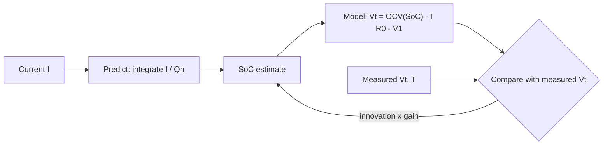

::: basics
### In plain words
State of charge (SoC) is how full a battery is, as a percentage. No sensor reads it directly, so a device has to estimate it from things it can measure: voltage, current and temperature. Each method has a weakness, so real battery gauges combine them.

### Picture it
Imagine a water tank you cannot see into. One option is a float that shows the level, but on this tank the float barely moves through the middle, and it jiggles whenever water is flowing. The other option is to count every bucket poured in and out. That works while water flows, but a small counting mistake adds up day after day. Combining the float and the bucket count gives a better answer than either alone.

### Words you need
- **Open-circuit voltage (OCV)**: the cell's voltage when it has rested with no current, which maps to SoC ([[q0305]]).
- **Voltage curve**: the graph of OCV against SoC. In the middle it is very flat, about 6 mV per 1% of charge.
- **Coulomb counting**: adding up current over time to track charge in and out.
- **Drift**: a small measurement error that grows over time as it accumulates.
- **Internal resistance**: it makes voltage sag under load, which confuses a voltage-based guess ([[q0303]]).

### The simplest example
Take a 2 Ah cell. A current sensor that wrongly reads 10 mA too high adds an error of $0.010 \times 24 = 0.24$ Ah in one day. That is 0.24 / 2 = 12% of the battery's capacity. Now try the voltage method. A 10 mV measurement error at 6 mV per 1% is about 1.7% SoC. Pull 1 A through 100 mΩ and the sag alone is 0.1 V, which would fool the guess by about 17%.

That is the whole idea. The rest of this page shows how the two methods are fused with a model, how gauges learn capacity as the cell ages, and why the hard parts are what they are.
:::

::: testing
Whether you know that **state of charge cannot be measured directly** and has to be *estimated*, and that you can name the standard methods (voltage lookup, coulomb counting, a model-based filter that combines them) along with the specific reason each one fails alone. The "why is it difficult" half is the real test: flat OCV curve, $IR$ drop and relaxation, hysteresis, temperature, aging, sensor offset drift and an unknown starting point. Good candidates give numbers (mV per percent of SoC, mA of offset turned into percent per day).
:::

::: why
Every "battery percentage" you have ever seen is an estimate. A fuel gauge that is wrong by 10 % makes a phone shut down at 15 % or a drone fall out of the sky. The estimation problem sits where analog measurement, battery physics and filtering meet, so it is a favourite interview topic for roles touching power, BMS or embedded firmware. It also shows whether you understand the limits of a sensor measurement (offset, resolution, drift) instead of treating it as ground truth.
:::

::: concepts
- **SoC definition**: the fraction of remaining capacity, $SoC = Q_{remaining}/Q_{full}$, where $Q_{full}$ itself changes with temperature, rate and age ([[q0311]], [[q0312]]).
- **OCV-SoC relationship**: the rested voltage is a monotonic function of SoC, but flat in the middle ([[q0305]]).
- **Internal resistance and polarization**: the terminal voltage is OCV minus $IR$ and a slow RC term ([[q0303]]).
- **Coulomb counting**: integrate current over time (needs a current sensor, [[q0307]]).
- **State estimation / Kalman filtering**: combine a predictive model (current integral) with a noisy measurement (voltage) using weights based on uncertainty.
- **Hysteresis**: for some chemistries, the OCV after charging differs from after discharging at the same SoC.
:::

::: answer
"You can't measure SoC directly. You estimate it, and there are three basic ways.

The first is voltage. The open-circuit voltage maps to state of charge through a lookup table, so if the cell has rested I can read the voltage and look up SoC. It's simple and has no drift, but the curve is really flat in the middle, only about 6 millivolts per percent, so a 10 mV measurement error is already a couple of percent. And under load the voltage sags by $I R$, so it's useless while the device is running unless I correct for it.

The second is coulomb counting: integrate the current in and out and subtract from the full capacity. That works under load and is smooth, but any offset in the current sensor integrates into a drift. A 10 milliamp offset on a 2 amp-hour cell is 12 percent per day. And it needs a known starting point and the correct capacity, which falls with age and temperature.

So real fuel gauges combine them: coulomb counting for short-term tracking, with voltage corrections whenever the cell is at rest or at the full and empty endpoints, often through a Kalman filter or an impedance-tracking model that also learns capacity and resistance over time.

Why it's hard overall: flat curve, load and temperature dependence, hysteresis, aging, sensor error, and the fact that the thing you are estimating, the full capacity, itself moves."
:::

::: technical
**Definitions.** $SoC(t) = SoC(0) - \frac{1}{Q_n}\int_0^t \eta\, I(\tau)\,d\tau$ with $I>0$ on discharge, $Q_n$ the present usable capacity and $\eta$ the coulombic efficiency (about 0.99+ for Li-ion at moderate rates).

**Method 1: voltage (OCV) lookup.** After a rest (minutes to hours depending on temperature and SoC), $V_{rest} \approx V_{OCV}(SoC)$, so $SoC = f^{-1}(V_{rest})$. Under load, correct: $V_{OCV} \approx V_t + I R_0 + V_{RC}$. A sample table (graphite/NMC, 25 °C): 3.50 V at 10 %, 3.67 V at 30 %, 3.77 V at 50 %, 3.92 V at 70 %, 4.09 V at 90 %.
- Slope between 30 % and 70 %: $(3.92-3.67)/40 = 6.25$ mV per 1 % SoC.
- A 10 mV error gives 1.6 % SoC; a 100 mV $IR$ error (1 A through 100 mΩ) gives 16 %.

**Method 2: coulomb counting.** Needs a shunt and a good ADC or coulomb-counter IC. Errors: offset $I_{os}$ gives a drift $I_{os}\,t/Q_n$ (10 mA over 24 h on 2 Ah is 240 mAh = 12 %); gain error $\epsilon$ scales the *net* charge, so after discharging 1.5 Ah, 1 % gain error is 15 mAh (0.75 % of 2 Ah). It also needs the right $Q_n$ and a correct initial SoC.

**Method 3: model-based fusion.** An equivalent-circuit model: $V_t = V_{OCV}(SoC) - I R_0 - V_1$, $\dot V_1 = I/C_1 - V_1/(R_1C_1)$, $\dot{SoC} = -I/Q_n$. An (extended) Kalman filter predicts SoC from the current and corrects it using the voltage innovation $V_{meas} - V_{model}$ with a gain that depends on the slope $dV_{OCV}/dSoC$: where the curve is steep the voltage is informative (large gain), where it is flat the filter trusts the coulomb count.

**Method 4: impedance tracking / learning.** Gauges such as TI's Impedance Track learn $Q_n$ and $R(SoC,T)$ from rests and full discharges, so aging is tracked.

**Other:** electrochemical impedance (EIS) correlates with SoC (research and lab), temperature compensation, and a calibration at full charge (CC-CV termination) and empty (cutoff) to reset drift.
:::

::: short
"SoC can't be measured directly, only estimated. Voltage lookup uses the open-circuit voltage curve, but that curve is flat, about 6 mV per percent, and it sags by I R under load. Coulomb counting integrates current and works under load, but sensor offset accumulates, 10 mA on a 2 amp-hour cell is about 12 percent per day, and it needs a starting point and the correct capacity. So gauges fuse them with a Kalman filter or impedance tracking, and correct at rest and at full or empty. The difficulty is flat curves, load, temperature, hysteresis and aging."
:::

::: long
"State of charge is not a physical quantity you can put a meter on, so it has to be estimated, and the interesting part is why each simple method fails.

Method one is voltage. The open-circuit voltage of a Li-ion cell is a monotonic function of state of charge, so after the cell rests I can look the voltage up in a table. The problems: first, the curve is flat in the middle. Between 30 and 70 percent it moves only about 6 millivolts per percent, so a 10 millivolt measurement error is nearly 2 percent SoC. Second, under load the terminal voltage sags by $I R$ plus a slower polarization term, so a 1 amp draw through 100 milliohms looks like 16 percent less charge. Third, the cell needs to rest for many minutes for the voltage to relax, and some chemistries show hysteresis, so charging and discharging give slightly different curves.

Method two is coulomb counting. I integrate the current into and out of the cell. It works under load and has low noise, but it's an open-loop integrator. Any current offset accumulates: a 10 milliamp offset on a 2 amp-hour cell is 12 percent per day. It also needs the right starting point and the right full capacity, and capacity changes with temperature, rate and age.

So practical gauges combine them. Coulomb counting tracks the short-term, and the voltage, corrected for $I R$, pulls the estimate back when the cell is rested or at the endpoints. A Kalman filter does that formally, weighting the voltage more where the OCV curve is steep and less where it is flat. Fancier gauges learn the capacity and resistance over time.

So it's hard because of the flat curve, the load and temperature dependence, hysteresis, sensor errors, aging, and an unknown starting point."
:::

::: terms
- **State of charge (SoC)**: remaining capacity as a fraction of full usable capacity.
- **OCV (open-circuit voltage)**: the rested cell voltage; the basis of voltage-lookup SoC.
- **Coulomb counting**: integrating current to track charge in and out.
- **Relaxation**: slow settling of the terminal voltage after current is removed (tens of seconds to hours).
- **Hysteresis**: dependence of OCV on charge/discharge history at the same SoC.
- **Kalman filter**: a recursive estimator that blends model prediction and measurement by their uncertainties.
- **Fuel gauge**: an IC or firmware that estimates SoC and often SoH and time remaining.
- **Coulombic efficiency ($\eta$)**: ratio of charge out to charge in over a cycle, close to 1 for Li-ion.
:::

::: exceptional
**An average answer** says "measure the voltage or count the coulombs".

**An exceptional answer**:
- Names at least three approaches (OCV lookup, coulomb counting, model-based filter) and the specific weakness of each, with numbers: about 6 mV per % in the flat region; 10 mA offset on 2 Ah is about 12 %/day.
- Explains that the Kalman gain follows the OCV slope, which is why a gauge trusts voltage more near the ends.
- Mentions **recalibration points** (full charge termination, empty cutoff, long rests).
- Notes that $Q_n$ itself changes with temperature, current and age, so SoC and SoH are coupled.
- Points out that **LiFePO$_4$** is even harder (extremely flat curve) and that "percent remaining" shown to a user is often smoothed to hide estimation noise.
:::

::: mistakes
- **"SoC = voltage"** with no correction. Under load the voltage is low by $IR$, and at rest it still depends on temperature and history.
- **Trusting coulomb counting forever.** Offset integrates, so drift grows with time. It needs periodic resets or fusion.
- **Using the nominal capacity** from the label. An aged or cold cell has less, so 50 % of rated capacity is not 50 % of what is available.
- **Reading voltage immediately after unplugging the charger.** The cell has not relaxed; surface voltage is high and the SoC reads too high.
- **Ignoring sensor resolution at low current.** A 1.6 mA/LSB sense chain cannot see a 1 mA sleep current, which then silently drains the cell uncounted ([[q0307]]).
- **Treating the displayed percent as exact.** It is a filtered estimate with a quantified error, ideally a few percent.
:::

::: deep
## What SoC means and why it is slippery

SoC looks like a simple percentage but the denominator is a moving target. Is 100 % the nameplate capacity, the capacity measured last week, or the capacity at this temperature and current? Fuel gauges track "full charge capacity" separately for this reason. We will define $SoC = Q_{rem}/Q_{full}$ with $Q_{full}$ the present usable capacity.

The numerator, $Q_{rem}$, is hidden inside the cell as lithium distributed between the electrodes. Everything we can observe from outside (voltage, current, temperature, impedance) is an indirect clue.

## Method 1: the OCV lookup and why the curve is flat

At equilibrium the cell voltage depends only on lithium concentration in each electrode, so $V_{OCV} = f(SoC)$ is a unique curve ([[q0305]]). If we know $f$ and can wait for equilibrium, we read SoC from the voltage.

```plot
{"title":"Voltage sensitivity: how many percent of SoC does a 10 mV error cost?","x":{"label":"State of charge","unit":"%","min":5,"max":100},"y":{"label":"SoC error from 10 mV (%)","unit":"","min":0,"max":2.2},
 "series":[{"label":"10 mV / (dOCV/dSoC)","points":[[10,0.67],[20,1.3],[30,1.8],[40,2.0],[50,1.7],[60,1.35],[70,1.25],[80,1.2],[90,1.05],[100,0.83]]}],
 "hlines":[{"at":1.6,"label":"1.6 % at 6.25 mV/%","color":"orange"}],
 "xspans":[{"from":30,"to":70,"label":"flat region: worst"}]}
```
Figure: The same 10 mV voltage error causes the biggest SoC error in the flat 30 to 70 % region (about 1.3 to 2 %, worst near 40 %) and the smallest near the steep ends. This is why voltage-only gauges are fine near empty and very uncertain mid-pack. Values come from a typical graphite/NMC OCV table.

Then three further problems for the voltage method:

**1. Load sag.** $V_t = V_{OCV} - I R_0 - V_1$. With $R_0 = 100$ mΩ and 1 A, the error is 100 mV, which in the flat region is $100/6.25 = 16$ % SoC. You can correct with a resistance model, but $R_0$ depends on SoC, temperature and age ([[q0303]]).

**2. Relaxation.** After current stops, the polarization voltage decays with time constants from tens of seconds to hours (diffusion in the solid particles is slow), so a "rested" reading takes a long time, especially in the cold and near the ends.

**3. Hysteresis and chemistry.** Silicon-containing anodes and LiFePO$_4$ show visible hysteresis; LiFePO$_4$'s curve is nearly flat from about 20 % to 90 % (differences of a few mV per percent), making voltage almost useless there.

## Method 2: coulomb counting

This is the dual: it works under any load and gives high resolution, but it is an integrator, so errors accumulate:

$$SoC(t) = SoC_0 - \frac{1}{Q_n}\int_0^t \eta I\,d\tau$$

| Error source | Effect | Example |
|---|---|---|
| Offset ($I_{os}$) | Linear drift in SoC with time | 10 mA on 2 Ah: 12 % per day |
| Gain error | Proportional to net charge | 1 % on 1.5 Ah: 0.75 % of capacity |
| Wrong $Q_n$ | Scales the whole estimate | Aged cell at 80 %: 20 % over-reading |
| Unknown $SoC_0$ | Constant offset | Starts from a guess |
| Unmeasured sleep current | Uncounted drain | 1 mA below the LSB |
| Self-discharge | Charge lost with no current flow | A few % per month |

```sim
{"id":"soc-estimator","offset":0.01,"gainErr":0.01}
```
Figure: The simulator runs a drive cycle and compares true SoC with coulomb counting (drifts as offset and gain error act), OCV lookup (flat curve plus $IR$ error under load) and a blended estimator that corrects with OCV at rest. Increase the offset to 0.03 A: over the 2.3-hour cycle the coulomb counter drifts about 3.5 points and keeps going, while the blended estimator snaps back at each park and stays within about 1 point. Then push the offset past 0.04 A (C/50 for this 2 Ah cell): the BMS can no longer detect rest, never takes an OCV correction, and the blended trace follows the drifting coulomb count.

## Method 3: fusing them (Kalman filter and friends)

The two methods have complementary error profiles: coulomb counting is accurate over the short term and drifts over the long term, while voltage is noisy but has no drift. That is exactly the structure of a Kalman filter (or a simpler complementary filter).


Figure: The estimator predicts SoC from current, uses a model to predict what the terminal voltage should be, and then corrects SoC with the difference between measured and predicted voltage. The gain is large where $dV_{OCV}/dSoC$ is large (informative voltage) and small in the flat region.

Formally, with state $x = [SoC, V_1]^T$, output $y = V_{OCV}(SoC) - I R_0 - V_1$, the EKF linearises $H = [dV_{OCV}/dSoC,\ -1]$. The Kalman gain is $K = P H^T (H P H^T + R_v)^{-1}$; with a small $dV_{OCV}/dSoC$ the term $H P H^T$ is small relative to the voltage noise $R_v$, so $K$ shrinks. That is the mathematical version of "trust the voltage less in the flat region".

## Method 4: learning gauges

Gauges such as TI's Impedance Track family and similar parts store OCV tables and learn resistance and capacity: they update $Q_{max}$ when a qualifying rest and a later rest are available, and track resistance by comparing voltage under load with the OCV estimate. This addresses aging, which a fixed table cannot.

> [!UNCERTAIN]
> The details of commercial gauge algorithms are proprietary and differ between vendors. The generic structure (coulomb counting plus OCV correction plus parameter learning) is common, but do not claim a specific IC uses a specific filter without checking its documentation.

## Worked example: how bad can it get?

A 2 Ah cell, resting voltage 3.77 V reads 50 %. You turn on a 1 A load; $R_0 = 100$ mΩ so the terminal voltage reads $3.77 - 0.10 = 3.67$ V. Naive lookup says about 30 %. The error is 20 points, at a time when the user cares most. Add a 10 mV measurement error: 1.6 % more.

Now coulomb counting: the true load is 1 A for 30 min = 0.5 Ah = 25 % of capacity. The estimate is 50 - 25 = 25 % ± drift. With a 5 mA offset the 30-minute error is 2.5 mAh = 0.125 %, negligible; the same offset over 5 days idle is 600 mAh = 30 %. That is why gauges treat idle periods with extreme care and correct against rested voltage.

## Calibration points

- **Full**: when the charger terminates (CV phase with taper current below the threshold), the cell is full by definition. Reset SoC to 100 % and update full-charge capacity.
- **Empty**: when the cell reaches the discharge cutoff under a known load, reset to 0 %.
- **Rested**: if the cell sits for a long time with a near-zero current, take OCV and correct.

## What users actually see

Phones and laptops filter the displayed value (it is monotonic, slow, and sometimes "sticks" at 100 % while the charger tapers). The goal is a stable, trustworthy percentage rather than the raw estimator output.
:::

::: applications
- **Smartphones and laptops**: dedicated fuel-gauge ICs (for example TI Impedance Track parts or Maxim ModelGauge parts) report SoC over I²C/SMBus; the OS shows a filtered percentage.
- **Electric vehicles**: the BMS fuses coulomb counting and model-based voltage correction because pack capacity is expensive; range estimates depend on it.
- **Drones**: a low-voltage alarm per cell plus a flight-time estimate from current and capacity used.
- **Medical devices**: infusion pumps and portable ventilators need conservative SoC and a guaranteed minimum runtime.
- **Grid storage and UPS**: SoC errors translate directly into lost usable energy or damaged batteries.
:::

::: assumptions
- The numbers here use a **graphite/NMC (or LCO) cell at 25 °C** with the curve shown. For **LiFePO$_4$** the middle of the curve is almost flat, which pushes toward coulomb counting with careful offset control, and voltage corrections only near the ends.
- The offset and gain error values are **typical examples** (10 mA, 1 %), not specifications of any particular sensor.
- The estimator assumes a **first-order Thevenin cell model**; real cells need temperature- and SoC-dependent parameters and sometimes second-order RC branches.
- The "rest" time needed for OCV varies from minutes (warm, mid-SoC) to hours (cold, near the ends).
- Alternative answers: **impedance spectroscopy**, **machine-learning estimators**, and for lead-acid, **specific gravity**. They are valid but less common in an interview for LiPo.
:::

::: followups
### Why does a Kalman filter help over simply averaging the two estimates?
Because it weights them by their *current* uncertainty. When the cell is at rest and the OCV curve is steep, voltage is highly informative and the gain is large, so the filter pulls the estimate toward the voltage result. In the flat region or under heavy load (where the $IR$ model is uncertain), the gain falls and it relies on the coulomb count. A fixed 50/50 average would be wrong in both regimes.

### A 2 Ah cell is used with a current sensor that has 5 mA of offset. After a week in standby, how far can the coulomb counter drift?
$5\ \text{mA} \times 168\ \text{h} = 840$ mAh, which is 42 % of the 2 Ah capacity. That is why a gauge corrects drift with OCV after long rests, reduces offset by auto-zeroing or by using a coulomb-counter IC with µV offset, and often counts the standby current in a separate low-current path.

### What would you do for a LiFePO4 pack, where the voltage curve is almost flat?
Rely on coulomb counting with a high-quality sense chain and careful offset calibration, then correct at the two ends where the voltage knees (below about 10 % and above about 95 %) and when the charger terminates. You can also use a model that exploits hysteresis and small voltage differences with temperature compensation, but accuracy is limited, so you may accept a wider error budget or add a margin.

### How would you calibrate a new fuel gauge on a prototype?
Characterize the cell: measure OCV versus SoC at several temperatures (very slow discharge, or discharge steps with long rests), and the resistance versus SoC and temperature with current pulses. Load those tables into the gauge, run learning cycles (full charge, rest, discharge, rest), and verify against an independent reference such as a battery cycler's integrated amp-hours, across typical load profiles and temperature.

### The gauge says 15 %, but the device shuts down. What would you check?
First, did the load spike cause a voltage dip below the cutoff of the regulator or MCU brownout? Sag grows with low SoC, high resistance (cold or aged cells) and large current peaks. Second, is the stored full-charge capacity out of date? An aged cell with the wrong $Q_n$ over-reads SoC. Third, is the sense chain offset or gain drifting? Compare the gauge's integrated current with a bench measurement, and the measured OCV after a rest with the reported SoC.
:::

::: interpretations
"State of charge (SoC)" may be asked in the context of a single-cell gauge (as here) or an EV pack. The principle is the same. If the interviewer asks "how would you *measure* it" they want the estimation methods; if they ask for the "easiest" way, say voltage lookup with $IR$ compensation, and then explain its flaws. See [[q0309]] for why accuracy matters and [[q0310]] for when it matters most.
:::

::: references
- Plett, *Battery Management Systems, Volume II: Equivalent-Circuit Methods* (Artech House): state-of-charge estimation with Kalman filters.
- Linden & Reddy, *Handbook of Batteries*: Li-ion open-circuit voltage and state-of-charge discussion.
- Battery University (Cadex): "How to Measure State-of-charge".
- Manufacturer fuel-gauge datasheets and technical references (for example TI battery gauge documentation) for the architecture of commercial gauges.
:::

::: rubric
- States that SoC is estimated, not measured :: Sets the correct framing: it is an inference problem.
- Describes OCV lookup and its limits (flat curve, $IR$ sag, relaxation, hysteresis) :: Shows you know why the simple method fails, with the key number (about 6 mV per %).
- Describes coulomb counting and its limits (offset drift, unknown start, capacity changes) :: The other half of the problem, and the reason for fusion.
- Describes fusion (Kalman filter, impedance-tracking, reset points) :: This is how real gauges work.
- Gives quantitative examples (10 mV is about 1.6 %; 10 mA offset on 2 Ah is about 12 %/day) :: Demonstrates engineering judgement rather than hand-waving.
- Mentions aging and temperature changing $Q_{full}$ :: SoC accuracy is meaningless if the denominator is wrong.
:::

::: quiz
```json
[
 {"type":"mcq","level":"fundamental","q":"Which statement best describes SoC?","options":["It is measured directly by a voltmeter","It is estimated from voltage, current, temperature and a model","It is the same as the cell voltage","It equals the cycle count"],"answer":1,"explain":"SoC is an internal state (lithium distribution) that cannot be measured directly. Gauges infer it using voltage, current integration, temperature and models."},
 {"type":"numeric","level":"fundamental","q":"A 2 Ah cell has a constant 10 mA current-sensor offset in a coulomb counter. By how many percent of capacity does the SoC estimate drift in 24 hours?","answer":12,"tolerance":0.02,"unit":"%","explain":"$0.01\\ \\text{A}\\times 24\\ \\text{h} = 0.24$ Ah, and $0.24/2 = 12$ %."},
 {"type":"numeric","level":"intermediate","q":"Between 30 % SoC (3.67 V) and 70 % SoC (3.92 V), how many millivolts of OCV change per 1 % SoC?","answer":6.25,"tolerance":0.02,"unit":"mV/%","explain":"$(3.92 - 3.67)\\ \\text{V}/40\\ \\% = 6.25$ mV per percent."},
 {"type":"numeric","level":"intermediate","q":"Using that 6.25 mV/% slope, a 1 A load through 100 mΩ creates a voltage error of 100 mV if uncorrected. How many percent of SoC error does that cause in a voltage-lookup estimate?","answer":16,"tolerance":0.02,"unit":"%","explain":"$100\\ \\text{mV} / 6.25\\ \\text{mV per \\%} = 16$ %."},
 {"type":"mcq","level":"advanced","q":"Why does a Kalman-filter fuel gauge reduce its trust in voltage measurements in the flat region of the OCV curve?","options":["The ADC saturates","The voltage barely changes with SoC, so a given voltage noise maps to a large SoC uncertainty (small $H$ gives a small gain)","Voltage is always unreliable","Temperature is constant there"],"answer":1,"explain":"The measurement Jacobian $dV_{OCV}/dSoC$ is small there, so the innovation carries little SoC information relative to its noise, and the gain falls. The filter leans on the coulomb count instead."},
 {"type":"truefalse","level":"advanced","q":"Gain error in the current sensor causes an SoC drift that grows with idle time even when the battery is not used.","answer":false,"explain":"Gain error scales the measured current, so it only matters when current actually flows (error proportional to net charge). Idle-time drift is caused by offset, which integrates even for zero true current."}
]
```
:::
