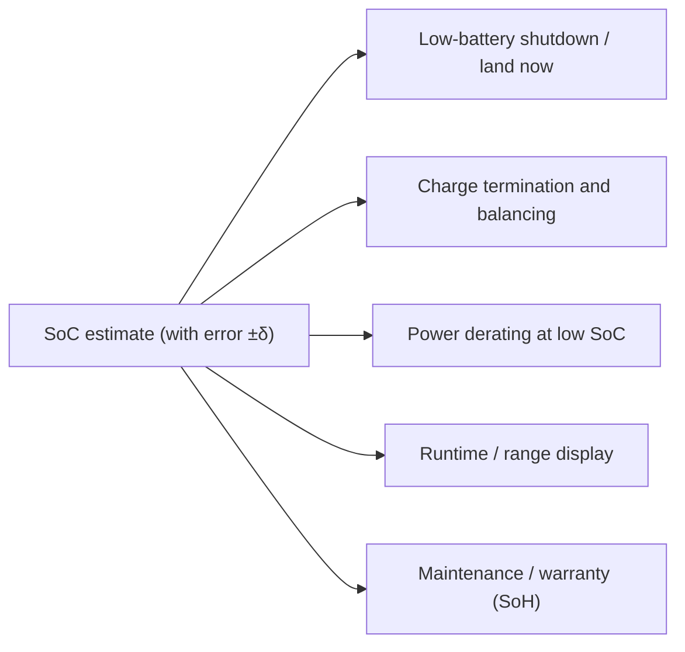

::: testing
Whether you can connect an abstract number (the error of a state-of-charge estimate) to **engineering and business consequences**: safety margins, usable energy, runtime prediction, protection decisions, battery sizing cost and user trust. Interviewers want to hear that error forces you to carry **reserve** at both ends, that wrong SoC can push a cell outside its safe window, and that accuracy has a cost (sensors, characterization, compute), so you decide how much you need from the application. The skill is quantitative reasoning: turning "5 % error" into minutes, kilometres or dollars.
:::

::: why
In a consumer gadget a bad SoC estimate means an annoying shutdown at 20 %. In a drone, an EV or a medical device, it means a crash, a stranded car or a patient without power. In every product it determines how much battery you must buy and how much of it the customer can actually use. SoC accuracy is where measurement hardware ([[q0307]]), battery physics and system design meet, which is why battery and power teams care about it so much.
:::

::: concepts
- **SoC estimation error**: the difference between the reported and true SoC; sources in [[q0308]].
- **Usable window**: the part of the capacity you allow the system to use, bounded by protection limits ([[q0305]]).
- **Reserve / guard band**: the extra capacity you hold back at each end to cover estimation error.
- **Runtime prediction**: remaining time = remaining energy / power. Errors in SoC scale directly into time errors.
- **Cell imbalance**: in a series pack, one cell's SoC sets the limits ([[q0314]]).
- **State of health (SoH)**: if the full capacity is wrong, SoC is wrong too ([[q0312]]).
:::

::: answer
"SoC accuracy matters for four reasons: safety, usable energy, user trust and cost.

For safety, the SoC estimate often decides when you stop discharging or when you stop charging. If I think a cell has 10 percent left but it's actually empty, I'm going to over-discharge it, and that damages the anode current collector and can make it unsafe. If I think it's at 95 percent but it's full, I might keep charging into overvoltage. So I carry margin, and the worse the estimate, the more margin I need.

That margin is the second reason. If my estimate is plus or minus 5 percent, I have to stop at 5 percent on the bottom and I never trust the top, so I give up around 10 percent of the battery I paid for. On a 75 kilowatt-hour EV pack, 5 percent is about 3.75 kWh, which is more than 20 kilometres of range.

Third, the user. A phone that says 20 percent and dies, or a drone that says 30 percent and lands hard, loses trust. Runtime predictions and range are only as good as the SoC.

And fourth, cost: better accuracy needs better sensors, characterization and software. So the answer to 'how accurate' depends on the application, which is the design question. For a toy it's a voltage threshold, for a drone or EV it's a Kalman filter and a proper sense chain."
:::

::: technical
**Reserve and usable energy.** If the SoC error is bounded by $\pm\delta$, the system must stop discharge when reported SoC reaches $\delta$ (so the true SoC is never below 0) and, if it must never overcharge, hold back $\delta$ at the top. Usable fraction: $U \approx 1 - 2\delta$. With $\delta = 5\%$, $U = 90\%$; with $\delta = 1\%$, $U = 98\%$. Equivalent battery oversize factor: $1/U$ (1.11× versus 1.02×).

**Runtime and range.** $t_{rem} = \dfrac{SoC \cdot Q_{full}}{I_{avg}}$. A 5 % error on a 3 Ah pack is 0.15 Ah; at a 10 A draw that is $0.15/10 \times 3600 = 54$ s of flight time. For an EV, $5\% \times 75\ \text{kWh} = 3.75$ kWh; at an assumed 0.17 kWh/km that is about 22 km.

**Safety.** SoC often feeds charge termination, balancing decisions, derating (power limit at low SoC), and low-battery shutdown. Protection ICs back up the hard limits (4.25 to 4.35 V, 2.5 to 3.0 V), but those are last-resort thresholds; the gauge is the first line.

**Aging / SoH coupling.** SoC is relative to the present full capacity. If a gauge keeps assuming the nameplate capacity after the cell has faded to 80 %, it over-reads: at the point where it shows 50 % of a 2 Ah nameplate (1.0 Ah), the cell only holds 0.6 Ah of its real 1.6 Ah, i.e. the true SoC is about 37 %, and the cell reaches its cutoff while the gauge still shows about 20 %. So a wrong $Q_{full}$ is an SoC error ([[q0312]]).

**Pack-level.** In a series string the weakest or lowest-SoC cell ends discharge and the highest-SoC cell ends charge, so per-cell SoC (and balance, [[q0314]]) matter more than the pack average.

**Cost of accuracy.** Each factor of 2 in accuracy typically needs better analog front end (µV offset, low drift), temperature compensation, more characterization and compute. Match it to the application.
:::

::: short
"SoC accuracy decides when you stop charging and discharging, so errors push cells out of the safe window or force you to carry reserve. A plus-minus 5 percent error costs about 10 percent of the battery you paid for, and on a 75 kilowatt-hour EV, 5 percent is about 3.75 kWh or more than 20 kilometres. It also drives runtime prediction and user trust. The level of accuracy you need depends on the application, since better accuracy costs sensors, characterization and compute."
:::

::: long
"I'd frame SoC accuracy as four things: safety, usable energy, user experience and cost.

Safety first. The gauge's estimate often determines when the system stops discharging and when it stops charging. If I overestimate remaining charge, I may keep discharging below the 2.5 to 3 volt floor and into over-discharge, which permanently damages the cell and, if it goes deep enough, dissolves the copper current collector. If I underestimate at the top, I'm fine, but if I overestimate it, I may charge into overvoltage. Hard protection ICs back these up, but they are the last line of defense, not what you design around.

Second, usable energy. Estimation error forces a guard band. If the estimate is plus or minus 5 percent, I need to stop discharge when it reads 5 percent so the true value never goes below zero, and I can't push to the very top either. So I lose around 10 percent of capacity, which means I have to buy a battery about 11 percent bigger for the same usable energy. For a 75 kilowatt-hour EV pack, 5 percent is 3.75 kWh, which is more than 20 kilometres of range at about 0.17 kWh per kilometre, so the numbers get real quickly. For a drone, 5 percent of a 3 amp-hour pack at 10 amps is about 54 seconds of flight, and that's the difference between landing and not landing.

Third, user experience. People judge a device by its percentage display. Sudden drops from 20 percent to zero look like a defect. Runtime and range predictions depend on SoC directly.

Fourth, cost. A more accurate SoC needs a better current sensor, temperature compensation, characterization of the cells and a better algorithm. So the engineering decision is to decide how accurate it needs to be for the application."
:::

::: terms
- **SoC error / accuracy**: the bound on the difference between estimated and true state of charge.
- **Guard band (reserve)**: capacity held back at each end to absorb estimation error.
- **Usable capacity**: the part of nominal capacity the system is allowed to use.
- **Over-discharge / overcharge**: leaving the voltage window at the low or high end ([[q0319]], [[q0330]]).
- **Runtime / range estimate**: predicted time or distance to empty, based on SoC and load.
- **State of health (SoH)**: the present capacity (and resistance) relative to new.
- **Fuel gauge**: the IC or algorithm producing SoC.
- **Derating**: reducing power when SoC (or temperature) makes full power unsafe.
:::

::: exceptional
**An average answer** says "so you know how much battery is left".

**An exceptional answer**:
- Ties the estimate to **decisions** (stop charge, stop discharge, derate, balance, display), so it has consequences.
- Quantifies the **reserve penalty**: $U \approx 1 - 2\delta$, with the cost converted to range, flight time, or battery size.
- Explains the safety asymmetry: overestimating the low end is the dangerous direction, so firmware biases estimates conservatively there.
- Recognizes that SoC and SoH are coupled, and that pack-level accuracy depends on the worst cell.
- Treats accuracy as a **specification traded against cost**, and matches it to the product.
:::

::: mistakes
- **"Accuracy is just a nice-to-have."** Wrong SoC pushes cells outside their window or costs usable energy, so it is both a safety and a money issue.
- **Using a symmetric margin without thinking.** The danger is mostly on the low end (over-discharge), and the cost of conservatism is lost capacity. Choose each guard band deliberately.
- **Quoting "1 % accuracy" without conditions.** Accuracy depends on temperature, load, age and where in the curve you are; a spec without those is not a spec.
- **Ignoring aging.** An estimator that uses the original capacity becomes inaccurate as the cell fades.
- **Evaluating the pack average only.** The weakest cell decides when the pack must stop.
:::

::: deep
## Why the estimate has consequences

Think of SoC as the input to a few decision blocks in the battery system:


Figure: One number feeds many decisions. A bias in the estimate turns into the wrong decision in all of them at once, which is why design teams spend effort on accuracy.

Each decision has an asymmetric cost:

- **Shutdown too early** (underestimate): you waste capacity, the user sees "0 %" with energy left. Annoying and costly, but safe.
- **Shutdown too late** (overestimate): the cell drops below the safe window, the device browns out, or the aircraft runs out of energy. Potentially damaging or dangerous.

So firmware typically biases the low end conservatively. A 5 % error band means shutting down at a reported 5 % rather than 0 %, which costs capacity on every cycle.

## The cost of the guard band

Let the estimator be unbiased with maximum error $\pm\delta$. To guarantee that the true SoC stays within $[0, 100]\ \%$ you restrict the reported range to $[\delta, 100 - \delta]$:

$$U = 1 - 2\delta$$

```plot
{"title":"Usable fraction of the pack vs worst-case SoC error","x":{"label":"Worst-case SoC error δ","unit":"%","min":0,"max":15},"y":{"label":"Usable capacity","unit":"%","min":60,"max":100},
 "series":[{"label":"U = 1 − 2δ (both ends guarded)","fn":"100*(1-2*x/100)"},{"label":"U = 1 − δ (only the bottom guarded)","fn":"100*(1-x/100)","dashed":true,"color":"blue"}],
 "points":[{"x":1,"y":98,"label":"1 %: 98 %"},{"x":5,"y":90,"label":"5 %: 90 %"},{"x":10,"y":80,"label":"10 %: 80 %"}]}
```
Figure: Each percent of SoC error costs about two percent of usable capacity if both ends are guarded. Going from 5 % to 1 % accuracy gives back 8 percentage points of the battery. Many products only guard the bottom (dashed), which halves the penalty.

The same arithmetic in battery size: to deliver a given usable energy, you need $1/U$ times the nominal energy. At $\delta = 5\%$ that is 1.11×; at $\delta = 1\%$ it is 1.02×. For a pack costing, as an illustration, USD 150 per kWh and holding 75 kWh (USD 11,250), the 9 % difference in battery size is about USD 1,000 per vehicle. The numbers are illustrative; the point is that accuracy has a price tag on both sides.

## Worked examples

**Drone.** 3 Ah pack, 10 A average flight current. The estimator is ±5 %.

- Uncertainty in charge: $0.05 \times 3 = 0.15$ Ah.
- Uncertainty in flight time: $0.15/10 = 0.015$ h = 54 s.
- The return-to-home threshold has to cover this plus landing time and a safety margin, say 60 s. If SoC accuracy was ±1 %, the uncertainty would be 11 s and you could fly longer before returning.

**Electric vehicle.** 75 kWh pack, 0.17 kWh/km (illustrative).

- ±5 % is 3.75 kWh, or 22 km.
- If the car says "30 km remaining" with ±22 km uncertainty, the driver cannot trust it. ±1 % means ±4.4 km.

**Phone.** 3 Ah at 3.85 V is 11.6 Wh. A 3 % error is 0.35 Wh, about 5 minutes of heavy use, and it shows up as "died at 4 %".

```sim
{"id":"soc-estimator","offset":0.02,"gainErr":0.02}
```
Figure: Increase the offset and gain error and watch the gap between true and estimated SoC open up. The gap's maximum is the guard band the system designer has to leave, and the "usable energy" shrinks accordingly. See how the blended estimator limits the error.

## Where accuracy has a safety function

Over-discharge damages the anode current collector ([[q0305]], [[q0330]]) and can make a cell hazardous to recharge. Overcharge leads to plating, gas and thermal runaway ([[q0319]]). Protection ICs have hard thresholds (for example 2.5 V and 4.3 V), but the SoC estimate allows the system to stop earlier, in a controlled way: saving data, landing a drone, going into limp mode, rather than being cut off abruptly.

For a series pack, the *cell* with the least charge ends the discharge and the cell with the most charge ends the charge. So per-cell SoC (or at least per-cell voltage) matters. Pack-average SoC hides the worst cell ([[q0314]]).

## Accuracy is a cost-managed specification

| Application | Typical need | Why |
|---|---|---|
| Toy, flashlight | Voltage threshold, ±20 % fine | Low cost, no safety impact |
| Phone, laptop | ±3 to 5 % | Display trust, avoid unexpected shutdown |
| Drone, e-bike | ±2 to 5 % plus a conservative low-voltage alarm | Safety of the vehicle and rider |
| EV, grid storage | ±1 to 3 % (pack), plus SoH | Range, warranty and cost |
| Medical life-support | Conservative, certified | Patient safety; regulatory |

> [!UNCERTAIN]
> The accuracy figures in this table are typical expectations for illustration. Real requirements come from the product's specification, safety analysis and regulations. Do not quote them as standards.

Getting better accuracy costs: a low-offset current sensor and ADC, temperature sensing, per-cell characterization (OCV, resistance), a model-based filter and the compute for it, and a calibration or learning routine over the life of the product ([[q0308]]).

## The bottom line

SoC accuracy is a specification you derive from the application: what are the consequences of over- and under-estimation, how much battery can the product afford to waste, and what is the cost of the sensing and software? In an interview, giving that framework (consequence, margin, cost) is more convincing than reciting a percent.
:::

::: applications
- **EV and plug-in hybrid battery management**: range display, charge scheduling, thermal management, and warranty all depend on SoC and SoH accuracy.
- **Drones and RC aircraft**: return-to-home thresholds and low-voltage alarms are chosen from the SoC uncertainty.
- **Phones and laptops**: fuel gauge ICs support shutdown at a predictable point and a stable percentage display.
- **Medical and safety equipment**: portable ventilators, defibrillators and infusion pumps need a guaranteed minimum runtime.
- **Grid and UPS storage**: usable energy and cycle scheduling depend on SoC; errors cost money or reliability.
:::

::: assumptions
- The guard-band formula $U = 1 - 2\delta$ assumes a **worst-case bounded** error and guarding both ends. If the estimator error is statistical, you might design for 2σ or 3σ instead of the maximum. If only the bottom is guarded, $U = 1 - \delta$.
- The EV and drone examples use **illustrative** numbers (0.17 kWh/km, 10 A, USD 150/kWh). They show the method rather than describe a specific product.
- "Accuracy" here means SoC error relative to *true* usable capacity at the present conditions. If you measure it relative to nominal capacity, aging adds an additional error.
- For **LFP** and other flat-curve chemistries, accuracy is harder and guard bands are larger.
- The answer changes for **non-critical** products, where a voltage cutoff is good enough ([[q0310]]).
:::

::: followups
### What is the cost of ±5 % SoC accuracy on a pack?
If you guard both ends you lose about 10 % of the nominal capacity ($U = 0.9$), so to deliver 100 Wh usable you must carry about 111 Wh. If you only guard the bottom the loss is about 5 %. In either case, that is battery cost, weight and volume paid on every unit sold.

### Which direction of error is more dangerous?
Overestimating SoC at the low end. The system thinks it has charge, keeps discharging, and may push the cell below its safe window or run out of energy during a critical operation. Underestimating is safe but wasteful. Hence a conservative bias at the bottom. At the top, overestimating SoC during charging can allow overcharging, so charge termination is normally tied to voltage and current thresholds from the charger, not to the SoC alone.

### How does a degraded battery break the SoC reading?
The gauge may still assume the original full capacity. If the true $Q_{full}$ has faded by 20 %, "100 %" corresponds to 20 % less energy. If it reports SoC relative to the old capacity, the user sees 50 % but has only 30 % of the original capacity. Learning gauges update $Q_{full}$ from full-to-empty cycles and rests to fix this. Otherwise estimates drift and the device shuts down "early" or unexpectedly.

### A drone returns to home at 25 % SoC and still lands with 5 % left sometimes, and 0 % other times. What is happening?
The variation suggests a SoC error that depends on conditions: cold pack (more sag, early cutoff), different current profile, aged pack with lower real capacity, or a miscalibrated sensor. The fix is to determine the spread by logging actual remaining capacity at landing, and set the return threshold from the worst case (or improve the estimator with SoH and temperature compensation).

### How would you decide how accurate a gauge you need for a new product?
Start from consequences: what happens if the reported SoC is off by 5 %? Then quantify the capacity cost with $U = 1 - 2\delta$, compare it with the added BOM and software cost of a better gauge (for example a µV-offset coulomb counter, model-based filtering, characterization). Choose the smallest accuracy that meets safety and user-experience requirements, and verify it across temperature, load and age.
:::

::: interpretations
"SoC measurement accuracy" assumes the SoC *estimation* is imperfect. The question has a sibling, [[q0310]], which asks *when* the accuracy matters more or less. The two are best answered together: [[q0309]] explains the consequences and [[q0310]] explains how context scales them.
:::

::: references
- Plett, *Battery Management Systems, Volume I and II* (Artech House): state estimation, accuracy requirements and their impact on pack design.
- Linden & Reddy, *Handbook of Batteries*: the lithium-ion chapters on capacity, voltage limits and safety.
- Battery University (Cadex): articles on measuring state of charge and on the consequences of over-discharge and overcharge.
- Datasheets and application documentation from fuel-gauge IC manufacturers describing accuracy specifications and conditions.
:::

::: rubric
- Links SoC to protection decisions (stop charge, stop discharge, derate) :: Explains why it is more than a display.
- Explains the safety asymmetry (overestimating the low end is dangerous) :: Shows engineering judgment about failure direction.
- Quantifies the guard-band penalty ($1 - 2\delta$) :: Turns "accuracy" into lost capacity and cost.
- Gives a concrete conversion (EV kWh/km, drone seconds, phone minutes) :: Demonstrates practical sense of scale.
- Mentions user trust and runtime prediction :: These drive product perception.
- Notes coupling with SoH and per-cell effects in packs :: Real accuracy depends on aging and the weakest cell.
- Treats accuracy as a cost trade-off set by the application :: Design thinking, not just physics.
:::

::: quiz
```json
[
 {"type":"mcq","level":"fundamental","q":"Which SoC error direction is generally more dangerous at the low end of discharge?","options":["Underestimating remaining charge","Overestimating remaining charge","Both are equally harmless","Neither matters if there is a protection IC"],"answer":1,"explain":"If the system believes there is more charge than there is, it keeps discharging into the damaging region (below about 2.5 to 3 V per cell) or runs out of energy at a critical moment. Underestimating just wastes capacity."},
 {"type":"numeric","level":"fundamental","q":"A system guards both ends of the pack for a worst-case SoC error of ±5 %. What percent of nominal capacity is usable?","answer":90,"tolerance":0.01,"unit":"%","explain":"$U = 1 - 2\\delta = 1 - 0.10 = 0.90$, i.e. 90 %."},
 {"type":"numeric","level":"intermediate","q":"A 75 kWh EV pack has a ±5 % SoC error. At 0.17 kWh/km, how many kilometres of range does that uncertainty represent?","answer":22,"tolerance":0.03,"unit":"km","explain":"$0.05 \\times 75 = 3.75$ kWh; $3.75/0.17 \\approx 22$ km."},
 {"type":"numeric","level":"intermediate","q":"A drone has a 3 Ah pack, draws 10 A, and the SoC estimate has ±5 % error. How many seconds of flight time does that represent?","answer":54,"tolerance":0.02,"unit":"s","explain":"$0.05 \\times 3 = 0.15$ Ah; $0.15/10 = 0.015$ h $= 54$ s."},
 {"type":"truefalse","level":"advanced","q":"A cell that has aged to 80 % of its original capacity will still be reported correctly by a gauge that always assumes the nameplate capacity.","answer":false,"explain":"The gauge would compute remaining capacity relative to the nameplate value, so the reported SoC over-reads the true charge available. Learning gauges update the full-charge capacity to track aging."},
 {"type":"multi","level":"advanced","q":"Which of these are consequences of poor SoC accuracy?","options":["Larger guard bands and an oversized battery","Possible over-discharge of cells","Better runtime predictions","Unexpected shutdowns that damage user trust"],"answer":[0,1,3],"explain":"Poor accuracy forces larger reserves (cost), can allow over-discharge, and produces unreliable displays and surprise shutdowns. It does not improve runtime predictions."}
]
```
:::
