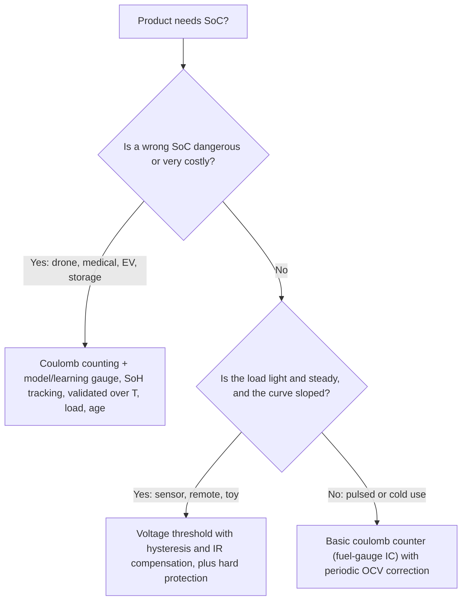

::: basics
### In plain words
How accurate a battery gauge needs to be depends on what happens if it is wrong. If the error could crash a drone or cost a lot of money, you need a precise gauge. If the worst case is a cheap flashlight dimming a bit early, a simple voltage check is enough. The goal is the cheapest method that is good enough for the job.

### Picture it
Compare the fuel gauge on a lawnmower with the one on an airliner. If the lawnmower gauge is off, you walk to a gas can. If the airliner gauge is off, the stakes are very different, so it gets redundant sensors and careful testing. You spend effort in proportion to what a mistake costs. Battery gauges follow the same rule.

### Words you need
- **State of charge (SoC)**: how full the battery is, as a percentage ([[q0308]]).
- **Voltage-based estimate**: guessing SoC from the cell voltage. It is cheap, but poor in the flat part of the curve and under load.
- **Coulomb counting**: adding up current over time to track charge. It works under load but drifts.
- **Flat region**: the middle of the voltage curve, where each 1% of charge changes the voltage by only a few millivolts.
- **Load profile**: how much current the device draws, and whether it comes in short pulses.

### The simplest example
Use the same simple voltage method on a cell with 100 mΩ of resistance and a slope of about 6 mV per 1% SoC. A sensor node draws 0.1 A. The sag is $0.1 \times 0.1 = 0.01$ V, or 10 mV, which is an error of about 1.7%. That is fine. A drone draws 1 A, so the sag is 0.1 V, an error of about 17%, which is not acceptable. The heavier load needs a better method.

That is the whole idea. The rest of this page lists the factors that decide how accurate you need to be and what each level of accuracy costs.
:::

::: testing
Whether you can **match a requirement to an application** instead of saying "more accuracy is always better". The interviewer wants a framework: accuracy matters when the **consequence of error is high** (safety, mission-critical, expensive battery, warranty, range anxiety) and matters less when a **simple voltage threshold** protects the cell and the user can tolerate surprise shutdown (toys, flashlights, cheap accessories). You are also being tested on *where in the discharge* accuracy matters, because the OCV curve is steep at the ends and flat in the middle, and on engineering economics.
:::

::: why
Over-engineering costs money and time; under-engineering costs safety and trust. A senior battery engineer's job is to choose the right estimator, sensor and margin for each product. In an interview, answering this well shows system-level judgment, and it lets you tie the technical content of [[q0308]] (how SoC is estimated) and [[q0309]] (why it matters) to design decisions.
:::

::: concepts
- **Consequence of error**: what happens if the estimate is wrong by $\delta$: wasted energy, bad UX, damage, safety event ([[q0309]]).
- **Voltage-threshold gauging**: shutdown at a fixed voltage; cheap and good enough when the load is light and the stakes low.
- **Model-based gauging**: coulomb counting plus OCV correction plus learning; needed when stakes are high ([[q0308]]).
- **OCV slope**: steep near the ends, flat in the middle; voltage-only methods are best near empty/full.
- **Pack size and cost**: the bigger and more expensive the battery, the more each percent of accuracy is worth ([[q0309]]).
- **Load profile**: pulsed or high current makes voltage-based estimates much worse.
:::

::: answer
"I'd say accuracy matters in proportion to the consequence of being wrong, so I look at four things: safety, cost of the battery, how much the user relies on the number, and how hard the load is.

It matters most where an error is dangerous or expensive: drones and aircraft where running out means a crash, EVs where range and a big pack mean every percent is worth real money, medical devices where the battery has to last a guaranteed time, and anything where the warranty depends on usage tracking. It also matters in grid storage, because usable energy is what you sell.

It matters less in a cheap product where the cell is protected by a hard voltage cutoff and nobody cares if it shuts down a bit early: toys, flashlights, a TV remote, or a small sensor you can swap batteries on. There a simple voltage threshold is enough.

There's also a technical angle: where in the discharge it matters. The voltage curve is steep near empty, so a voltage threshold is actually fairly good there. In the flat middle it is poor. And under a heavy pulsed load, voltage-based estimates are the worst, so applications with that profile need the full coulomb counting and model-based approach.

So the answer is to pick the least expensive method whose error still gives an acceptable consequence, and verify it across temperature, load and age."
:::

::: technical
**Decision variables**

| Factor | Higher accuracy needed when... | Lower accuracy OK when... |
|---|---|---|
| Safety consequence | Loss of power is dangerous (UAV, medical, e-mobility) | Shutdown is harmless |
| Battery cost/size | Pack is expensive (EV, storage): each 1 % is real money | Cell is cheap, replaceable |
| User dependence | User plans around the number (range, flight time) | Number is cosmetic |
| Load profile | Pulsed/high-current: voltage is a poor proxy | Light constant load |
| Chemistry | Flat curve (LFP) | Sloping curve (LCO/NMC) near the ends |
| Lifetime/warranty | Usage must be tracked and SoH reported | Disposable device |
| Regulatory | Certified minimum runtime | None |

**Where in the curve.** With typical graphite/NMC numbers: the OCV slope is about 15 mV/% at 10 % SoC, about 5 to 6 mV/% at 30 to 50 %, and about 9 to 12 mV/% at 90 to 100 %. So a 10 mV measurement error costs about 0.7 % SoC at 10 %, about 1.7 to 2 % at 30 to 50 %, and about 0.8 to 1 % at the top. Near empty a voltage threshold is both more accurate and the quantity you care most about.

**Load.** $V_t = V_{OCV} - I R$. The voltage-only error is $I R / \text{slope}$. For $R = 100$ mΩ and 1 A this is 16 % in the flat region and 6.7 % at 10 % SoC; at 0.1 A (a sensor node) it is 1.6 % and 0.7 %. So light loads let a voltage gauge work.

**Cost of the method.** Voltage threshold: an ADC or comparator (cents). Coulomb counter with fuel-gauge IC: about a dollar or so plus a shunt and firmware. Learned, model-based gauge with characterization and temperature compensation: engineering time and validation plus compute. Match to the product margin.
:::

::: short
"Accuracy matters in proportion to the consequence of being wrong. It matters most in drones, medical devices, EVs and grid storage, where an error means a crash, a patient at risk, or real money in unused battery. It matters less in cheap or replaceable products like toys or remotes, where a voltage cutoff protects the cell. Technically, it also depends on load and where you are on the curve: voltage is fine near empty and light loads, but poor in the flat middle or under pulses."
:::

::: long
"I'd decide by consequence. If an SoC error just means the device shuts off a bit early, a simple voltage threshold is enough. If it means a crash, a stranded patient, or paying for 10 percent of battery I can't use, I need real accuracy.

So where does it matter most? Safety-critical products: drones and aircraft, where running out of energy in flight is a crash; medical devices like portable ventilators or infusion pumps, where I have to guarantee a minimum runtime; and e-mobility where a rider is stranded. Expensive packs: an EV pack costs thousands of dollars, so each percent of guard band is real money, and range anxiety is a customer-experience issue. Grid storage and UPS, where the usable energy is the product. Anything with a warranty tied to usage or state of health.

Where does it matter less? Cheap, replaceable or disposable products: toys, flashlights, remote controls, simple sensors. A hard voltage cutoff protects the cell and nobody is harmed if it shuts down early.

There's a technical side too. The open-circuit voltage curve is steep near empty and fairly flat in the middle, so voltage thresholds work reasonably near the end where it matters, and badly in the middle. Light, steady loads let voltage-based estimates work, because the $IR$ drop is small. Pulsed or high loads, cold temperatures and aged cells make voltage lie, so those need coulomb counting and a model.

So I'd pick the cheapest estimator whose worst-case error still gives an acceptable consequence, and I'd validate it across temperature, load and aging."
:::

::: terms
- **Consequence of error**: the impact (safety, cost, UX) of an SoC estimate being wrong.
- **Voltage-threshold cutoff**: shutting down when the loaded voltage crosses a fixed value.
- **Coulomb counting**: integrating current; works under load, drifts with offset ([[q0308]]).
- **Fuel gauge**: a dedicated estimator IC or firmware.
- **Guard band**: capacity held in reserve to cover estimation error ([[q0309]]).
- **Mission-critical**: a use where power loss has serious consequences.
- **OCV slope**: $dV_{OCV}/dSoC$; sets how much a voltage error costs in SoC.
- **Range anxiety**: user worry about running out of energy because the display is not trusted.
:::

::: exceptional
**An average answer** lists a few applications on each side.

**An exceptional answer**:
- Offers a **framework**: consequence of error, battery cost, user dependence, load profile, chemistry.
- Adds the **technical dimension**: where in the SoC curve and under what load a given method is adequate, with numbers (10 mV is 0.7 % at 10 % SoC versus about 2 % at 40 %; 100 mV of $IR$ is 16 % in the flat region).
- Chooses a **method to match** (voltage cutoff, coulomb counter, model-based learning gauge) and justifies the cost.
- Recognizes that low-accuracy products still need a **hard protection** layer.
- Notes that accuracy must be validated over temperature and aging, not only at room temperature on a fresh cell.
:::

::: mistakes
- **"Always maximize accuracy."** Accuracy costs sensors, characterization and compute. Over-engineering a toy wastes money.
- **"Cheap products don't need protection."** Even if SoC accuracy is loose, over-discharge and overcharge protection (hardware thresholds) are still mandatory ([[q0313]]).
- **Judging accuracy by a bench test only.** A gauge that works at 25 °C with a fresh cell and a steady load can fail in the cold, with pulses or when aged.
- **Forgetting the flat region.** Saying "voltage is fine" ignores the mid-curve error; the middle is where voltage-only gauges disappoint.
- **Treating all chemistries alike.** LiFePO$_4$ makes voltage-based estimation far weaker.
:::

::: deep
## A decision framework

Start from the question: "What happens if the displayed or used SoC is wrong by 5, 10, 20 %?" Then work out costs on both sides:


Figure: A simple way to choose the estimator class. The branch is controlled by consequence first, then by how well voltage can serve as a proxy. In every branch, hard overvoltage/undervoltage/overcurrent protection stays.

## Where accuracy matters in the discharge curve

The SoC error from a voltage error is $\delta SoC = \delta V / (dV_{OCV}/dSoC)$. For the typical curve:

| SoC | OCV slope (mV per 1 % SoC) | SoC error for 10 mV |
|---|---|---|
| 10 % | about 15 | 0.7 % |
| 20 % | about 7.7 | 1.3 % |
| 30 % | about 5.5 | 1.8 % |
| 40 % | about 5.0 | 2.0 % |
| 50 % | about 5.8 | 1.7 % |
| 70 % | about 8 | 1.25 % |
| 90 % | about 9.5 | 1.05 % |
| 100 % | about 12 | 0.8 % |

(Values are derived from a typical graphite/NMC OCV table; a different cell shifts them.)

Near empty (10 %), where the decision "shut down now" is made, a voltage reading is relatively informative. In the middle, which is where the user watches the percentage drift, it is not. This is why many products with only a voltage gauge have jumpy, unreliable percentages in the middle and surprise shutdowns at the end if the load is heavy.

## How the load changes everything

Under load, $V_t = V_{OCV} - I R$ and the error from ignoring it is $I R/\text{slope}$:

```plot
{"title":"SoC error of a voltage-only gauge that ignores IR drop (R = 100 mΩ)","x":{"label":"Load current","unit":"A","min":0,"max":3},"y":{"label":"SoC error","unit":"%","min":0,"max":50},
 "vars":{"r":0.1},
 "series":[{"label":"mid-curve, 6.25 mV/%","fn":"x*r*1000/6.25","color":"red"},{"label":"near empty, 15 mV/%","fn":"x*r*1000/15","color":"blue"}],
 "points":[{"x":1,"y":16,"label":"1 A: 16 %"},{"x":0.1,"y":1.6,"label":"0.1 A: 1.6 %"}]}
```
Figure: The error grows linearly with load current and is worst in the flat mid-curve. A sensor node at 0.1 A has only 1.6 % error, so voltage alone is fine; a drone at 10 A would be hopeless without current compensation (and even with it, $R$ depends on SoC, temperature and age).

For a light, steady load (a sensor, a remote), voltage is a good-enough proxy. For a pulsed load (radio bursts, motor start) the instantaneous voltage dips are huge, so you must average, filter or measure at low-current moments. For high loads (drones, power tools, EVs) you need current sensing.

## Applications on the "more accuracy" side

- **Drones / e-mobility.** Consequence: crash or stranded rider. The return-to-home threshold depends directly on the uncertainty ($5\%$ of 3 Ah at 10 A is 54 s, [[q0309]]).
- **EV and grid storage.** The battery is 30 to 40 % of the vehicle cost (a rough, commonly quoted share, which varies with the year and vehicle), and each percent of unusable guard band is lost range or revenue.
- **Medical.** Regulatory and safety expectations: a ventilator must run for a guaranteed time.
- **Warranties and SoH reporting**: you need to know capacity fade accurately.

> [!UNCERTAIN]
> The battery share of vehicle cost changes with pack prices and vehicle class; treat the 30 to 40 % as a rough, dated figure and do not quote it as a statistic.

## Applications on the "less accuracy" side

- **Toys, flashlights, hobby gadgets, cheap Bluetooth accessories.** A voltage threshold with a brown-out detector; if it dies early, the user recharges.
- **Replaceable-cell sensors** where a battery swap is routine.
- **Short-lived, disposable devices.**

Even so, **protection must remain**: the overdischarge and overcurrent protection IC or the MCU's undervoltage cutoff ([[q0313]]). Low accuracy is OK; no protection is not.

## Chemistry matters

For LiFePO$_4$, the OCV is nearly flat from about 20 % to 90 %, with just a few mV per percent. A voltage-only gauge in the middle region is almost meaningless, so even products that "don't care" about accuracy use coulomb counting. For lead-acid or NiMH there are different relationships (the latter famously has a flat curve and needs $-\Delta V$ detection).

## Mid-range design: a "basic coulomb counter"

Many products sit between the extremes (wearables, handheld tools, e-readers). A low-cost fuel-gauge IC with a 10 mΩ shunt, a lookup table of OCV, and periodic correction at charge termination and rest gets within a few percent. The step up to a learning/model-based gauge is justified when the cost of error rises or the pack ages in a way that matters.

```sim
{"id":"soc-estimator","offset":0.01,"gainErr":0.01}
```
Figure: The simulation shows three estimators in the same drive cycle. Compare the OCV-only estimate (noisy under load, especially mid-curve) with coulomb counting (drifting) and the blended estimator. Increase the offset to see which application classes can tolerate which estimator.

## Verification

Whatever you choose, validate: sweep temperature (cold is worst), load profile (steady and pulsed), age (fresh and cycled cells) and idle time (self-discharge, standby current). State accuracy with its conditions, for example "±3 % SoC from 0 to 45 °C, fresh to 80 % SoH, standard drive profile".
:::

::: applications
- **Drone flight controllers**: pack voltage/current telemetry, per-cell low-voltage alarms and mAh-used estimates for a return-to-home trigger.
- **EV battery management**: model-based SoC and SoH estimation for range, charging and warranty.
- **Portable medical devices**: guaranteed runtime, with conservative low-battery behaviour.
- **Smartphones and wearables**: fuel-gauge ICs for a stable percentage display.
- **Remote controls, toys and flashlights**: simple voltage-threshold cutoffs, with a protection IC to prevent over-discharge.
:::

::: assumptions
- The slopes and errors come from a **typical graphite/NMC OCV curve at 25 °C** with a 100 mΩ cell resistance; other chemistries, ages and temperatures move the numbers.
- "More desired" and "does not matter as much" are **relative to consequence**. There is no universal threshold.
- Hard **protection is assumed present** in all cases; low SoC accuracy is only acceptable behind it.
- For **primary (non-rechargeable)** cells or other chemistries (NiMH, lead-acid), the method choice differs.
- The cost statements ("cents", "about a dollar") are order-of-magnitude illustrations and vary by volume and year.
:::

::: followups
### Give an example where a voltage-only gauge is acceptable and explain why.
A TV remote or a small environmental sensor drawing about 100 µA to a few mA. The $IR$ drop is a few millivolts, so the voltage tracks OCV closely. The consequence of an early or late "low battery" is trivial, the cells are cheap and replaceable, and a brown-out detector protects the electronics. The only care is to add hysteresis and averaging to avoid a flickering indicator.

### Why is accuracy especially important for a flat-curve chemistry like LiFePO4?
Because the OCV barely changes between roughly 20 and 90 % SoC (a few mV per percent), a voltage reading carries almost no SoC information there, and the measurement noise of a few mV swamps it. So you rely on coulomb counting, which means sensor offset and gain accuracy and periodic recalibration become critical. It is simultaneously harder and more important because LFP packs are used in stationary storage and EVs where energy accounting matters.

### A client wants a "±1 % SoC" claim for a USD 20 consumer gadget. How do you respond?
Ask what the requirement is for: what happens at 5 % error? Show the cost: a µV-offset coulomb counter, characterization, temperature compensation and validation. Propose a realistic spec such as ±5 % from 0 to 45 °C, or a feature like a conservative low-battery warning. If they insist on ±1 %, identify what it will cost in BOM and test and what the product price can bear.

### How does cold weather change which products need accuracy?
In the cold the resistance rises, so voltage sags more under load and voltage-based estimates read low SoC, and usable capacity falls. Outdoor products (drones, e-bikes, handheld GPS) should be validated at low temperature, and need temperature compensation in the gauge. A product that never leaves a living room can get away with less.

### If the SoC accuracy is poor, what must you still guarantee?
The hard limits: cell overvoltage, undervoltage, overcurrent, short circuit and temperature protection, implemented in hardware (a protection IC or an independent comparator) so they work even if the SoC estimate is wrong. SoC is a convenience and efficiency feature; protection is a safety feature.
:::

::: interpretations
The wording "When it SoC measurement accuracy more desired?" has a typo ("When *is*"). The answer addresses the intended question: in which applications and operating conditions is accurate SoC measurement most valuable, and when is rough accuracy adequate. It is the companion to [[q0309]] (why accuracy matters) and [[q0308]] (how it is determined).
:::

::: references
- Plett, *Battery Management Systems, Volume II: Equivalent-Circuit Methods*: state-of-charge estimation accuracy and its application dependence.
- Linden & Reddy, *Handbook of Batteries*: battery chemistry chapters (voltage curves, LiFePO$_4$ versus LCO/NMC).
- Battery University (Cadex): articles on state-of-charge measurement and battery usage patterns.
- Fuel-gauge IC datasheets (for example from TI and Analog Devices/Maxim) list accuracy specifications and conditions, which illustrate typical product-level targets.
:::

::: rubric
- States that required accuracy follows the consequence of error :: Frames the answer as engineering judgement rather than a list.
- Names high-need applications (drones, EV, medical, storage) with reasons :: Shows you understand the stakes.
- Names low-need applications (toys, remotes, cheap replaceable devices) with reasons :: The question explicitly asks for both sides.
- Explains that accuracy varies along the curve and with load (flat mid-curve, IR drop under pulses) :: The technical reason voltage-only works sometimes.
- Matches estimator class to need (voltage threshold, coulomb counter, model-based) and mentions cost :: Design trade-off thinking.
- Notes that protection must remain regardless :: Safety is independent of SoC accuracy.
:::

::: quiz
```json
[
 {"type":"mcq","level":"fundamental","q":"Which product most clearly needs accurate SoC estimation?","options":["A TV remote control","A toy car","A portable ventilator","A desk-lamp night light"],"answer":2,"explain":"A ventilator has a guaranteed runtime and failure endangers a patient. The other devices are cheap, replaceable, and tolerate early shutdown."},
 {"type":"truefalse","level":"fundamental","q":"A product with a very simple voltage-threshold SoC indicator can safely omit overdischarge protection.","answer":false,"explain":"Protection against overdischarge, overcharge, overcurrent and over-temperature is independent of SoC accuracy and must remain in hardware."},
 {"type":"numeric","level":"intermediate","q":"A voltage-only gauge ignores the IR drop. With R = 100 mΩ, a load of 0.5 A and a 6.25 mV/% OCV slope, what SoC error results?","answer":8,"tolerance":0.02,"unit":"%","explain":"Voltage error $= 0.5 \\times 0.1 = 50$ mV; $50/6.25 = 8$ %."},
 {"type":"numeric","level":"intermediate","q":"Near 10 % SoC the OCV slope is about 15 mV per 1 %. A 10 mV measurement error causes roughly what SoC error?","answer":0.67,"tolerance":0.05,"unit":"%","explain":"$10/15 \\approx 0.67$ %. Compare with about 1.6 % at 6.25 mV/% in the flat region."},
 {"type":"mcq","level":"advanced","q":"Why does a LiFePO4 pack generally need coulomb counting even in modest applications?","options":["Its voltage is too high","Its OCV curve is nearly flat over most of the range, so voltage carries little SoC information","It has no internal resistance","It cannot be charged by CC-CV"],"answer":1,"explain":"With only a few mV per percent in the middle of the curve, voltage noise and IR drop swamp the SoC signal, so current integration (with periodic correction) is needed."},
 {"type":"multi","level":"advanced","q":"Which conditions make a voltage-only SoC estimate worse?","options":["Heavy pulsed loads","Cold temperature","Light, steady loads","Aged cells with higher resistance"],"answer":[0,1,3],"explain":"Pulsed loads, cold (higher R) and aging (higher R) all enlarge the $IR$ error. Light steady loads reduce it."}
]
```
:::
