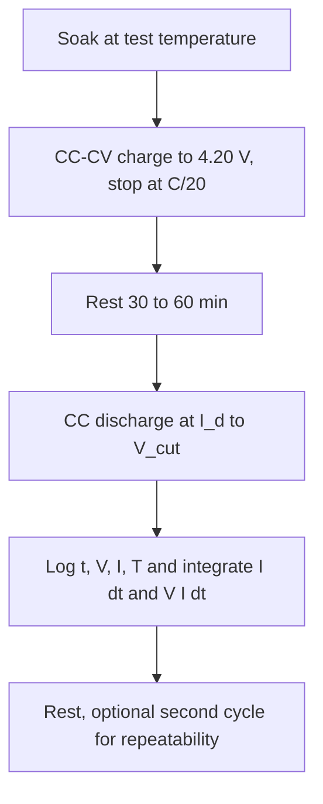

::: basics
### In plain words
Battery capacity is how much charge a battery can deliver, in amp-hours (Ah). You measure it by fully charging the cell, letting it rest, then draining it at a steady current until it reaches its cutoff voltage. Capacity is the current multiplied by the time it took. The answer depends on the current, temperature and cutoff, so you must state the test conditions.

### Picture it
Picture timing how long a bucket lasts under a tap running at a steady rate. If you know the flow rate and the time until it is empty, you know the volume. A battery test works that way, with the flow being current. The picture misses one thing. A battery test stops at a cutoff voltage, and a bigger current or a colder cell reaches that cutoff sooner. So the same cell can measure less, which is why the conditions must be stated.

### Words you need
- **Capacity (Ah)**: current times time. A 1 A draw for 2 hours is 2 Ah.
- **C-rate**: the test current compared with rated capacity. 0.2C on a 2 Ah cell is 0.4 A.
- **Cutoff voltage**: the voltage at which the test stops, such as 3.0 V.
- **Rated capacity**: the datasheet value, measured under stated conditions such as a low rate at room temperature.
- **Internal resistance**: higher current and cold make the voltage sag more, ending the test earlier ([[q0303]]).

### The simplest example
Take a cell rated at 2 Ah. Charge it fully, let it rest, then discharge it at a constant 0.4 A (that is 0.2C). Suppose it reaches the 3.0 V cutoff after 4.62 hours. Capacity is $0.4 \times 4.62 = 1.85$ Ah, which is about 92% of the rating. Discharged at a much higher current, the same cell would give less.

That is the whole idea. The rest of this page covers the full procedure, how rate and temperature change the answer, how to measure accuracy, and how gauges learn capacity in the field.
:::

::: testing
Whether you know that capacity is **not a single fixed number**: it is the charge (Ah) or energy (Wh) you can extract under a *stated set of conditions* (rate, temperature, cutoff voltage, starting state). The interviewer wants the test procedure (full charge, rest, constant-current discharge to cutoff, integrate current), the equipment, and the sources of error. A strong answer also explains why a rated 2000 mAh battery delivers less at high current or in the cold, and how a fuel gauge measures capacity in the field.
:::

::: why
Capacity is the headline spec of any battery, the basis of runtime estimates, the main indicator of aging ([[q0312]]) and the denominator of SoC ([[q0308]]). Engineers measure it to validate a supplier's claim, to characterize a cell for a model, to qualify a pack, or in production for binning. Confusing "rated" with "available" capacity is a classic source of products that miss their runtime spec.
:::

::: concepts
- **Capacity as charge**: $Q = \int I\,dt$, in ampere-hours (Ah) or mAh.
- **Capacity as energy**: $E = \int V I\,dt$, in watt-hours (Wh); the one that determines runtime for a given power.
- **C-rate**: current normalized to capacity; $1C$ discharges the cell in one hour ([[q0315]]).
- **Cutoff voltage**: the end-of-discharge criterion (for example 3.0 V); capacity depends on it ([[q0305]]).
- **Rate and temperature dependence**: higher current and lower temperature reduce accessible capacity ([[q0306]]).
- **Coulombic efficiency**: charge out / charge in; near 1 for Li-ion.
:::

::: answer
"Capacity is measured by fully charging the cell, letting it rest, then discharging it at a constant current down to the cutoff voltage, and integrating current over time: capacity in amp-hours is current times time, or the sum of $I \Delta t$ if the current isn't constant. You do it with a programmable electronic load or a battery cycler, a precise current measurement, and ideally in a temperature chamber.

The important part is that the result depends on the conditions, so you have to state them. The datasheet 'rated capacity' is usually measured at a low rate, something like C over 5, at room temperature, with a specific cutoff voltage. For example, a 2 amp-hour cell discharged at 400 milliamps that lasts 4.62 hours has delivered 1.85 amp-hours, which is 92 percent of nameplate, so it's a bit aged or a weaker cell. Discharge the same cell at 2C or in the cold and you'll get less, because the higher $IR$ drop hits the cutoff earlier.

If I care about energy rather than charge, I integrate voltage times current, which gives watt-hours. That's what actually determines runtime for a given power.

In the field, a fuel gauge measures capacity by coulomb counting between two known points, such as full and empty, or between two rested OCV states, and updates its full-charge capacity as the cell ages."
:::

::: technical
**Definition and standard procedure** (lab test):
1. Condition: bring the cell to the test temperature (for example 25 ± 2 °C) in a chamber.
2. Charge fully: CC-CV to 4.20 V, terminating at a specified current (for example C/20 or C/10).
3. Rest 30 to 60 min (or per spec) so the voltage and temperature settle.
4. Discharge at constant current $I_d$ (commonly 0.2C for the rated value, other rates for characterization) to the cutoff voltage $V_{cut}$ (for example 3.0 V).
5. Integrate: $Q = \int_0^{t_{end}} I\,dt \approx \sum I_k \Delta t_k$. Energy $E = \sum V_k I_k \Delta t_k$.

**Example.** A 2.0 Ah cell, 0.2C → $I = 0.4$ A. If it reaches 3.0 V after 4.62 h: $Q = 0.4 \times 4.62 = 1.848$ Ah → 92.4 % of rated.

**Rate dependence.** In the cell model used in this site's simulator (2 Ah, 50 mΩ), the delivered capacity to 3.0 V at 25 °C is 1.989 Ah at 0.2C, 1.951 Ah at 1C, 1.887 Ah at 2C and 0.904 Ah at 5C, because the $IR$ drop makes the terminal voltage reach the cutoff earlier. At 0 °C the same cell gives 1.776, 1.631 and 0.804 Ah at 0.2C, 1C and 2C.

**Accuracy.** Capacity error ≈ current accuracy (gain and offset) + timing accuracy + the termination criterion (voltage threshold at a non-zero current) + temperature variation. Equipment current accuracy of 0.05 to 0.1 % is typical for a cycler; a shunt-and-ADC setup with a 1 % gain error gives about 1 % capacity error.

**Rest-based method.** Capacity can also be computed between two rested OCV points: $Q_{full} = \Delta Q_{counted}/(SoC_2 - SoC_1)$, which is how gauges learn capacity without a full discharge.

**Charge capacity vs discharge capacity.** The charge capacity (integral of charge current in CC and CV) is usually slightly larger than the discharge capacity; the ratio is coulombic efficiency, typically above 99 % for healthy Li-ion cells.

> [!UNCERTAIN]
> Specific conditions (rate, cutoff voltage, temperature, charge termination current) vary between cell datasheets and between standards. Use the conditions printed on the cell datasheet. I cite the general structure of rated-capacity tests, not clause numbers.
:::

::: short
"You fully charge the cell, let it rest, then discharge it at a constant current to the cutoff voltage and integrate current over time: capacity in amp-hours is the sum of current times time step. It's done with a battery cycler or electronic load, ideally in a temperature chamber. Capacity depends on conditions, so you state them: the rated value is usually at about C over 5 and room temperature. Higher current or cold reduces it because of the $IR$ drop. For energy, integrate V times I to get watt-hours."
:::

::: long
"Capacity is the charge, in amp-hours, you can pull out of the cell, and the key thing to say first is that it depends on how you measure it, so the measurement is really a procedure.

The procedure: put the cell in a temperature chamber at, say, 25 degrees. Charge it fully using constant current, constant voltage, so up to 4.2 volts and holding until the current tapers to something like C over 20. Let it rest for 30 minutes to an hour so the voltage and temperature settle. Then discharge at a constant current, typically 0.2C for the rated number, until the terminal voltage hits the cutoff, say 3.0 volts. Throughout, I log current and voltage with timestamps and integrate current over time, that is the sum of $I \Delta t$, to get amp-hours. If I also multiply by voltage and integrate I get watt-hours, which is what actually sets runtime for a given power draw.

A quick example: a 2 amp-hour cell at 0.2C is 400 milliamps. If it runs 4.62 hours, that's 1.85 amp-hours, 92 percent of nameplate, so it's aged or a weak cell.

The result depends on conditions: at higher current the internal resistance drop makes the terminal voltage hit the cutoff earlier, so the delivered capacity is lower. In my model a 2 amp-hour cell gives about 1.99 Ah at 0.2C, 1.95 at 1C and only 0.9 at 5C. In the cold it's lower still.

For accuracy I need a good current measurement, since a 1 percent gain error is a 1 percent capacity error. In a product, the fuel gauge measures capacity by coulomb counting between known points, like full to empty or two rested voltages, and keeps updating it as the cell ages."
:::

::: terms
- **Capacity (Ah/mAh)**: charge available under specified conditions.
- **Energy (Wh)**: $\int VI\,dt$; capacity weighted by voltage.
- **Rated / nominal capacity**: the datasheet figure, measured at a stated low rate, temperature and cutoff.
- **Cutoff voltage**: end-of-discharge threshold at which the measurement stops.
- **C-rate**: discharge current as a multiple of rated capacity.
- **Coulomb counting**: integrating current over time.
- **Battery cycler**: instrument that charges and discharges cells with programmable profiles and logs data.
- **Coulombic efficiency**: discharge Ah / charge Ah.
:::

::: exceptional
**An average answer** says "discharge it and multiply current by time".

**An exceptional answer**:
- Specifies the **full procedure** (temperature, CC-CV charge with termination, rest, CC discharge to cutoff, integrate).
- Insists that conditions define the number, and shows **numerically** how rate and temperature change it (1.99 Ah at 0.2C, 0.90 Ah at 5C in a model; reduced further in the cold).
- Distinguishes **Ah from Wh** and says why energy is used for runtime.
- Discusses **measurement error sources**: current gain/offset, timing, termination criteria, thermal drift.
- Describes **in-system measurement** (gauge learning between known SoC points) and how aging is tracked.
:::

::: mistakes
- **Quoting capacity without conditions.** "2000 mAh" without rate, temperature and cutoff is half a number.
- **Starting from a partly charged cell** and calling the result capacity. You need a defined full-charge starting state.
- **Not resting after charge** and starting discharge while the cell is warm and polarized, which biases the result.
- **Using a non-constant load** (for example a resistor) without integrating. Current falls as voltage falls, so $I \times t$ with a single value is wrong.
- **Mixing Ah and Wh.** A cell with 2 Ah at 3.7 V is 7.4 Wh; a pack's Wh depends on its voltage, not just Ah.
- **Ignoring the cutoff choice.** Using 2.5 V instead of 3.0 V adds capacity but takes the cell into the damaging region ([[q0305]]).
:::

::: deep
## What "capacity" means

A cell's capacity is the total charge that flows through the external circuit between two defined end points: fully charged and discharged to the cutoff. The charge comes from lithium ions moving between electrodes, so there is a thermodynamic upper bound (all available lithium), but the *accessible* capacity depends on how hard you pull on it. When the current is high or the temperature low, the voltage sags by $IR$ and diffusion limits the electrode surface concentrations, so the terminal voltage reaches the cutoff while lithium remains inside. That "lost" capacity is available again if you slow down or warm up.

So a proper statement is: "$Q = 1.95$ Ah at 1C, 25 °C, 3.0 V cutoff, after a CC-CV charge to 4.2 V with C/20 termination".

## The test procedure step by step


Figure: The standard capacity test. The rest steps keep thermal and electrochemical transients out of the result, and repeating the cycle two or three times shows whether the measurement has converged (the first cycle on a stored cell is often lower).

**Integration.** If the log has samples $I_k$ at interval $\Delta t_k$:

$$Q = \sum_k I_k \Delta t_k, \qquad E = \sum_k V_k I_k \Delta t_k$$

For a constant-current discharge this reduces to $Q = I \times t_{end}$. For a constant-power or resistive load, the current changes, so the integral is essential.

**Worked example.** Rated 2000 mAh, test at 0.2C = 400 mA. The cell reaches 3.0 V after 4 h 37 min (4.617 h). $Q = 0.4 \times 4.617 = 1.847$ Ah = 92.3 % of rated. The average voltage during the test was 3.78 V, so $E = 1.847 \times 3.78 = 6.98$ Wh versus a nominal $2 \times 3.7 = 7.4$ Wh.

## Why the answer depends on rate

The terminal voltage is $V_t = V_{OCV}(SoC) - IR(SoC,T) - V_{RC}$. The cutoff test is on $V_t$, not $V_{OCV}$. At higher current $IR$ is larger, so the test ends at a higher true SoC, leaving unused charge in the cell.

```plot
{"title":"Delivered capacity to 3.0 V vs C-rate for a 2 Ah, 50 mΩ cell (model)","x":{"label":"Discharge rate","unit":"C","min":0,"max":5},"y":{"label":"Capacity delivered","unit":"Ah","min":0,"max":2.1},
 "series":[{"label":"25 °C","color":"accent","points":[[0.05,1.997],[0.1,1.995],[0.2,1.989],[0.5,1.973],[1,1.951],[2,1.887],[3,1.727],[4,1.437],[5,0.904]]},
 {"label":"0 °C","color":"blue","points":[[0.05,1.794],[0.1,1.788],[0.2,1.776],[0.5,1.744],[1,1.631],[2,0.804],[3,0.115],[4,0.031],[5,0.001]]}]}
```
Figure: Accessible capacity is nearly flat at low rates and collapses at high C-rate, and the knee moves to a much lower rate in the cold. Model values from the simulator below (Arrhenius resistance, 3.0 V cutoff); real cells differ, but the shape is typical.

```sim
{"id":"lipo-lab","view":"discharge","capacity":2,"crate":0.2,"temp":25,"rint":0.05}
```
Figure: Step the C-rate from 0.2 to 5 and watch "Ah delivered" and the heat. Then switch to 0 °C. The capacity that "disappeared" is still in the cell: lower the rate and it returns.

> [!UNCERTAIN]
> The numbers are from an equivalent-circuit model with a representative resistance. The exact knee depends on the real cell's resistance and thermal behaviour. Measure your own cell at the rates and temperatures you care about.

## Measurement hardware and errors

| Element | Typical choice | Error contribution |
|---|---|---|
| Load | Battery cycler or programmable electronic load in CC mode | Current regulation accuracy (0.05 to 1 %) |
| Current measurement | Shunt + precision ADC or built-in | Gain and offset; offset matters at low rates |
| Voltage measurement | 4-wire (Kelvin) at the cell | Lead resistance causes early cutoff if 2-wire |
| Timing | Instrument clock | Negligible |
| Temperature | Chamber plus cell thermocouple | Capacity changes about 0.4 %/°C in the cold (model value) |
| Termination criterion | Voltage at the cutoff, with a specified current | Cutoff voltage tolerance |

Use **4-wire (Kelvin) voltage sensing** so the cutoff is judged on the cell's terminals, not at the end of resistive leads. At 5 A, 20 mΩ of lead plus contact resistance shifts the measured voltage by 100 mV and ends the test early.

## Measuring capacity in the product

A battery in a product rarely gets a clean full-to-empty test. Fuel gauges use:

- **Full-to-empty learning**: coulomb count between charge termination (full) and the empty cutoff.
- **Rested OCV pairs**: with two rested voltage readings at different SoC, $Q_{full} = \Delta Q_{counted} / (SoC_2 - SoC_1)$ using the OCV table. This is accurate only if the OCV-SoC table is accurate and the SoC difference is large enough.
- **Charge capacity**: integrate current during CC-CV from a known low point to termination.

These updates are what lets a gauge follow aging ([[q0312]]).

## Ah vs Wh

Runtime for a load of power $P$: $t = E/P$. Two cells with the same Ah but different average voltage (say, 3.7 V vs 3.2 V LFP) have different energy. A 3S pack of 2 Ah cells is still 2 Ah, but at 11.1 V nominal it holds 22.2 Wh, three times a single cell's 7.4 Wh. Always compare packs in Wh.

## Self-check: is the capacity measurement trustworthy?

- Did the cell start at the same SoC every time (same CC-CV termination)?
- Was the temperature stable within a degree?
- Is the result repeatable within 1 % over two or three cycles?
- Did the cutoff voltage use Kelvin sensing?
- Is the current measurement calibrated (compare with a calibrated DMM in series)?
:::

::: applications
- **Supplier qualification**: incoming inspection of cells or packs against the datasheet.
- **Cell characterization** for building SoC and runtime models.
- **Aging studies**: cycle a cell and track capacity fade versus cycle number.
- **Production binning and matching** cells into packs by measured capacity.
- **Fuel gauges** learning full-charge capacity during use.
:::

::: assumptions
- Standard conditions are assumed: **25 °C, CC-CV charge to 4.2 V, rest, CC discharge to 3.0 V**. Other cells use different limits (for example 2.75 V cutoff, 4.35 V charge).
- The rate dependence numbers come from a **simplified equivalent-circuit model**, not a measurement of a specific cell.
- Capacity is defined as **discharge** capacity. Charge capacity is slightly larger because coulombic efficiency is below 100 %.
- The answer would change for **primary cells** (discharge only) and for chemistries with flat curves, where the voltage cutoff criterion is sharper.
- For a *pack*, capacity is limited by the weakest series cell, so pack capacity is not simply a single-cell number ([[q0314]]).
:::

::: followups
### A cell rated 3000 mAh lasts 2.4 h at 1 A. What is its measured capacity and percent of rated?
$Q = 1 \times 2.4 = 2.4$ Ah = 2400 mAh, which is 80 % of rated. At 1 A (about 0.33C) some shortfall is expected from rate effects, but 20 % is large; it suggests either an aged cell (80 % is a common end-of-life figure, [[q0312]]) or a low-quality cell. I would repeat at 0.2C to separate rate effects from true fade.

### Why does a cell show different capacity at 0.2C and 2C?
At 2C the current is ten times larger, so $IR$ drop plus polarization is ten times larger and the terminal voltage hits the cutoff when more lithium remains in the electrodes. Also, at high rate, heat and diffusion limits matter. In the model, 2 Ah at 25 °C gives 1.99 Ah at 0.2C but 1.89 Ah at 2C.

### How would you measure capacity with just a power supply, a resistor and a DMM?
Charge to 4.2 V with a current-limited supply (CC-CV), rest, then discharge through a power resistor while logging the voltage and current (DMM, or the voltage across a known shunt) at regular intervals, e.g. every 30 s. Integrate $I_k\Delta t$. Because the resistor current falls as $V$ falls ($I = V/R$), you must integrate, not multiply. Be careful with heat, accuracy of the DMM, lead resistance, and make sure you stop at the cutoff.

### How does a fuel gauge track capacity as the cell ages without a full discharge?
It uses two rested OCV measurements at different states of charge and counts the charge in between: $Q_{full} = \Delta Q / (SoC_2 - SoC_1)$. It updates the stored full-charge capacity when a qualifying rest and discharge occurs. It might also learn at full-charge termination. The accuracy depends on the OCV table and on rest quality.

### What if the cutoff voltage is changed from 3.0 V to 2.5 V?
Measured capacity rises a little (the curve falls steeply there, so only a few percent), but the cell is taken closer to over-discharge, where the anode SEI is stressed and, on deeper excursions, the copper current collector can dissolve, so repeated cycling to 2.5 V costs life. Hence manufacturers spec a cutoff of 2.75 to 3.0 V, and the number is only comparable if the cutoff is the same.
:::

::: interpretations
"How is capacity measured?" might mean (a) the **lab test** (what's covered first), (b) **in-system measurement** by a fuel gauge, or (c) what **units** capacity has (Ah vs Wh). The answer covers all three. For the related question of how to judge a cell's remaining life, see [[q0312]]; for general characterization see [[q0291]].
:::

::: references
- Linden & Reddy, *Handbook of Batteries*: capacity, rate capability and test methods for lithium-ion cells.
- Plett, *Battery Management Systems, Volume I: Battery Modeling*: capacity, coulomb counting and cell testing.
- IEC 61960 (secondary lithium cells and batteries for portable applications): the standard whose rated-capacity tests define discharge conditions; consult the current edition for exact conditions.
- Battery University (Cadex): articles on measuring capacity and on discharge rate effects.
:::

::: rubric
- Defines capacity as charge delivered under stated conditions :: Shows that you know it is condition-dependent.
- Lists the procedure: full CC-CV charge, rest, CC discharge to cutoff, integrate current :: This is the core of the question.
- Computes an example (current times time, percent of rated) :: Demonstrates fluency with the arithmetic.
- Explains rate and temperature dependence via $IR$ drop and cutoff :: Explains why the datasheet and real capacity differ.
- Distinguishes Ah from Wh and explains why Wh sets runtime :: Prevents pack-level comparison errors.
- Names error sources (current accuracy, Kelvin sensing, termination) :: Shows you can design a trustworthy test.
- Mentions in-system measurement by fuel gauges :: Connects lab practice to products.
:::

::: quiz
```json
[
 {"type":"numeric","level":"fundamental","q":"A cell is discharged at a constant 0.5 A for 3.6 hours until it reaches the cutoff voltage. What capacity did it deliver?","answer":1.8,"tolerance":0.01,"unit":"Ah","explain":"$Q = I \\times t = 0.5 \\times 3.6 = 1.8$ Ah."},
 {"type":"mcq","level":"fundamental","q":"Why does a cell deliver less capacity at 5C than at 0.2C?","options":["The lithium disappears at high current","The larger IR drop and polarization pull the terminal voltage to the cutoff while charge remains in the cell","The cell's rated capacity changes","The ADC saturates"],"answer":1,"explain":"The test ends on terminal voltage. At high current the voltage sags more, so the cutoff is reached earlier. The remaining charge is recoverable at a lower current."},
 {"type":"numeric","level":"intermediate","q":"A 2.0 Ah (rated) cell is discharged at 0.2C and lasts 4.62 h. What percent of rated capacity is that?","answer":92.4,"tolerance":0.01,"unit":"%","explain":"$I = 0.2 \\times 2 = 0.4$ A, $Q = 0.4 \\times 4.62 = 1.848$ Ah; $1.848/2 = 92.4$ %."},
 {"type":"numeric","level":"intermediate","q":"A 3S pack uses 2 Ah cells with 3.7 V nominal each. What is the pack's nominal energy?","answer":22.2,"tolerance":0.01,"unit":"Wh","explain":"Series cells add voltage, capacity stays 2 Ah: $2 \\times (3 \\times 3.7) = 22.2$ Wh."},
 {"type":"truefalse","level":"advanced","q":"When discharging through a fixed resistor, capacity can be found by multiplying the initial current by the discharge time.","answer":false,"explain":"Through a resistor, $I = V/R$ falls as $V$ falls. You must integrate $I\\,dt$ (sum $I_k\\Delta t_k$), which gives a smaller value than initial current times time."},
 {"type":"mcq","level":"advanced","q":"A fuel gauge wants to update full-charge capacity without a full discharge. Which method works?","options":["Use two rested OCV readings at different SoC and divide the counted charge by the SoC difference","Multiply the nominal capacity by the cycle count","Measure the cell's temperature","Use the pack voltage at full charge only"],"answer":0,"explain":"$Q_{full} = \\Delta Q_{counted}/(SoC_2 - SoC_1)$ with SoC from the OCV table at rest. Its accuracy depends on the table and on a large enough SoC span."}
]
```
:::
