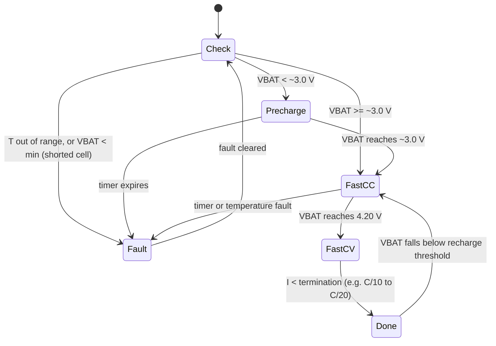
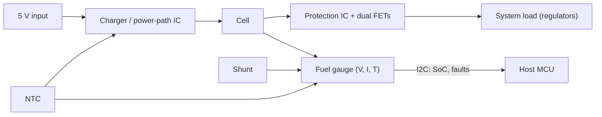

::: testing
Whether you understand that a lithium cell needs **closed-loop, tightly toleranced control** that you cannot get from a bare supply and a resistor, and that you can name the families of ICs (charger, protection, fuel gauge, multi-cell AFE/BMS) and what each does. The question sits in the *monitoring* section, so the interviewer wants the monitoring side (voltage, current and temperature measurement, protection, SoC) as well as the charging profile. Strong answers give accuracy and power-dissipation numbers and say what the IC buys you over a discrete design: safety, accuracy, size, cost, certification.
:::

::: why
Almost no commercial Li-ion product uses a hand-rolled charger. Overcharge by 100 mV and you cut life and raise risk; miss a short circuit by a few milliseconds and you start a fire. Dedicated ICs package years of failure-mode knowledge into a few millimetres of silicon. Choosing, configuring and laying out these ICs is a core job in consumer electronics, wearables, robotics and EVs. This page covers the monitoring angle; [[q0325]] is the same list asked from the charging side.
:::

::: concepts
- **CC-CV charging**: constant current to 4.2 V, then constant voltage until the current tapers ([[q0321]]).
- **Cell limits**: 4.2 V ceiling with about ±1 % tolerance, 3.0 V floor, temperature windows ([[q0305]], [[q0306]]).
- **Protection thresholds**: overvoltage, undervoltage, overcurrent, short circuit, over-temperature ([[q0307]]).
- **Fuel gauging**: estimating SoC and SoH ([[q0308]], [[q0312]]).
- **Balancing**: equalizing series cells ([[q0314]]).
- **Power path**: supplying the system from the input while charging the battery in parallel.
:::

::: answer
"Charging and monitoring ICs are important because a lithium cell has to be controlled very precisely, and getting it wrong is both a life and a safety problem.

A charger IC does the whole charge profile on its own. It checks the cell, pre-charges a deeply discharged one gently, runs constant current up to 4.2 volts, holds 4.2 volts with something like plus or minus 0.5 to 1 percent accuracy while the current tapers, then terminates. It also reads an NTC so it won't charge when it's too hot or cold, runs a safety timer, handles input overvoltage, and often limits its own temperature.

A protection IC, typically with two back-to-back MOSFETs, watches the cell for overvoltage, undervoltage, overcurrent and short circuit, and disconnects within microseconds to milliseconds without any firmware.

A fuel gauge measures voltage, current and temperature and does the state-of-charge and health estimation. In multi-cell packs there's an analog front end that measures every cell and drives the balancing.

You could build these from discrete parts, but you'd struggle to match the voltage accuracy, you'd need certification, you'd use more board area, and each safety function would need its own validation. The IC gives a known, tested behavior, smaller size, lower cost at volume, and it works even when the MCU hangs. That's why basically every battery product uses them."
:::

::: technical
**IC families and what they do**

| Function | What it does | Typical specs |
|---|---|---|
| **Linear charger** (for example MCP73831-class) | CC/CV profile, precharge, termination, timer, thermal regulation | 4.20 V ±0.5 to 1 %, current programmable by a resistor (up to 500 mA for the MCP73831 family, about 1 A for larger linear parts), dissipation $(V_{IN}-V_{BAT})I$ |
| **Switch-mode charger** | Same profile with a buck for higher currents; higher efficiency | 1 to several A, efficiency 90 %+ |
| **Power-path charger** (for example bq2407x-class) | Runs the load directly from input while charging; battery supplements | Input current limit, dynamic power management |
| **Protection IC + dual FETs** (for example DW01 with an 8205-type dual FET) | OV, UV, OC, SC and often charger-reverse protection | OVP about 4.25 to 4.35 V, UVP about 2.3 to 2.8 V, SC delay about µs to ms |
| **Fuel gauge** (for example MAX17048-class model gauge, bq27441-class coulomb counter) | SoC/SoH from V, I, T and a model | SoC accuracy typically a few %, I²C interface |
| **Multi-cell AFE / BMS IC** (for example bq76920-class) | Per-cell V, current, temperature, balancing, FET drive, fault flags | Cell V accuracy of order mV, several cells per chip |

> [!UNCERTAIN]
> Part-family names above are examples of the kind of device in each category. Check current datasheets for exact features, limits and availability; I am describing types, not recommending a part.

**Why the voltage accuracy matters.** The charge limit is 4.20 V. A ±1 % regulator is ±42 mV. A discrete design with a 1 % reference and 1 % divider can be about ±2 % (±84 mV) before temperature drift; 84 mV above the limit speeds aging and starts to enter gas-generating territory ([[q0305]]).

**Power dissipation in a linear charger.** $P = (V_{IN} - V_{BAT})\,I_{chg}$. From a 5 V USB source at 0.5 A with the cell at 3.7 V: $P = 1.3 \times 0.5 = 0.65$ W. At 3.0 V and 0.5 A: 1.0 W. Hence thermal regulation (the IC reduces current as its die temperature rises) is a standard feature.

**Protection timing.** Short circuit detect: tens to hundreds of µs; overcurrent: ms to seconds; overvoltage/undervoltage: 10 ms to 1 s with filtering ([[q0307]]).

**Fuel gauge value.** Without it, SoC from voltage alone has errors of 10 to 20 % under load; with coulomb counting and model-based correction, a few percent ([[q0308]]).

**Ideal combination for a 1S product.** Charger/power-path IC + protection IC with FETs + fuel gauge + NTC; for multi-cell packs use an AFE with balancing and an MCU, plus an independent second overvoltage protection if safety-critical.
:::

::: short
"Lithium cells need tight, closed-loop control, and ICs give that safely. A charger IC runs the whole profile: precharge, constant current, constant voltage at 4.2 V within about one percent, termination, plus NTC temperature checks and a safety timer. A protection IC with back-to-back FETs cuts off overvoltage, undervoltage, overcurrent and short circuits in microseconds to milliseconds without firmware. A fuel gauge handles state of charge and health, and multi-cell chips measure and balance each cell. You get accuracy, safety, small size and tested behavior."
:::

::: long
"I'd split the answer into what each type of IC does and why you wouldn't do it discretely.

The charger IC implements the full Li-ion profile. It first checks that the cell is within range: if it's deeply discharged it pre-charges at about a tenth of the normal current. Then constant current until the cell reaches 4.2 volts, then constant voltage at 4.2 volts with an accuracy of roughly half a percent to one percent. It terminates when the current falls to a set fraction, say a twentieth of the charge current. Around that, it reads an NTC so it doesn't charge outside about 0 to 45 degrees, it has a safety timer, input overvoltage protection, and often thermal regulation which backs off the current when the die gets hot. A linear charger from 5 volts at half an amp into a 3.7 volt cell dissipates 0.65 watts, so that thermal feature matters.

The protection IC and its two MOSFETs watch for overvoltage, undervoltage, overcurrent and short circuit, and disconnect without any software, with a short-circuit response in microseconds.

The fuel gauge measures voltage, current through a shunt, and temperature, and runs the estimation algorithm for state of charge and state of health, reporting over I2C.

For a multi-cell pack there's an analog front end that measures every cell, drives balancing and protection, and talks to an MCU.

Why not discrete? You won't easily hit the 4.2 volt accuracy: 100 millivolts too high ages the cell and raises risk. You'd need to design, validate and certify each safety function. The IC saves area and cost at volume, has tested behavior, and keeps working if the firmware crashes."
:::

::: terms
- **CC-CV**: constant-current then constant-voltage charge profile.
- **Precharge / trickle**: low-current charge for a deeply discharged cell before full-rate charging.
- **Termination current**: the taper current at which charging stops.
- **Power path**: topology that supplies the load from the input while charging the battery.
- **AFE (analog front end)**: IC measuring multiple cell voltages, temperatures and current.
- **Fuel gauge**: IC or algorithm that estimates SoC and SoH ([[q0308]]).
- **Protection IC**: monitors and disconnects the cell on OV, UV, OC, SC and temperature faults.
- **Thermal regulation**: automatic reduction of charge current as die temperature rises.
:::

::: exceptional
**An average answer** says "they charge and protect the battery".

**An exceptional answer**:
- Breaks the topic into **charger, protection, gauge, AFE/balancer**, and says which is hardware-only (protection) and which can be firmware-assisted.
- Gives **numbers**: ±0.5 to 1 % voltage accuracy (±21 to 42 mV), linear charger dissipation (0.65 W), protection timing (µs to ms).
- Explains the **failure modes** each IC prevents, tying back to cell physics ([[q0305]], [[q0319]], [[q0330]]).
- Mentions **power-path** and system issues (the device must run while charging; input OVP; USB current limits).
- Notes the **independence** principle: protection should work even if the MCU hangs, and critical packs add a second, independent layer.
:::

::: mistakes
- **"A resistor and a 4.2 V supply charge a LiPo."** There is no current limit or termination, and the supply tolerance is too loose. See [[q0320]].
- **Using a protection IC as the charger.** Protection thresholds are last-resort; normal operation should terminate before they trip.
- **Ignoring dissipation in linear chargers.** A 2 A linear charge from 5 V into a 3.5 V cell dissipates 3 W, which needs a heat-sinking plan or a switch-mode part.
- **Placing the NTC far from the cell.** The charger then makes decisions from the wrong temperature ([[q0306]]).
- **Assuming a fuel gauge replaces protection.** The gauge estimates; the protection IC acts. They have different failure behaviour and different jobs.
- **Skipping the power-path.** Without it, a depleted battery can prevent the device from booting on USB power.
:::

::: deep
## The problem the ICs solve

A Li-ion cell asks for a lot of things at once:

1. A **voltage limit** of 4.20 V held within about ±1 %.
2. A **current limit** (typically ≤ 1C) and a **taper** to a small termination current.
3. A **gentle start** for deeply discharged cells.
4. A **temperature window** (about 0 to 45 °C for charge).
5. **Fault response** on short circuits and overvoltage, in a timeframe of microseconds to milliseconds.
6. **Knowledge of state** (SoC, SoH) for the user and for decisions.

A bare supply plus resistor cannot do any of it. You could build each piece from op-amps and comparators, but then you also own the validation of their interplay, including the corner cases (hot-plug, reversed polarity, deeply discharged start, cell removed mid-charge).

## Charger IC: the state machine

Most single-cell chargers implement the same state machine:


Figure: The charger is a small state machine around the cell voltage, current and temperature. The thresholds shown (about 3.0 V precharge, C/10 to C/20 termination, a recharge threshold some 100 mV below full) are typical; each IC specifies its own values.

Inside, two control loops (current and voltage) share the pass element or switching stage. The lower of the two commands wins, so the output is automatically CC at the start and CV near full ([[q0321]]).

### Linear charger dissipation

$$P_{diss} = (V_{IN} - V_{BAT})\,I_{chg}$$

```plot
{"title":"Power dissipated in a linear charger from 5 V at 0.5 A","x":{"label":"Battery voltage","unit":"V","min":3.0,"max":4.4},"y":{"label":"Dissipation","unit":"W","min":0,"max":1.2},
 "vars":{"vin":5,"i":0.5},
 "series":[{"label":"(Vin − Vbat) × 0.5 A","fn":"(vin-x)*i","color":"red"}],
 "points":[{"x":3.0,"y":1.0,"label":"1.0 W at 3.0 V"},{"x":3.7,"y":0.65,"label":"0.65 W at 3.7 V"},{"x":4.2,"y":0.4,"label":"0.4 W at 4.2 V"}]}
```
Figure: The linear charger is hottest when the cell is empty and the full current flows, which is why chargers back off (thermal regulation) and why many designs use a switching charger above roughly 1 A. At 5 V in, each amp costs $(5 - 3.7) \times 1 = 1.3$ W at nominal cell voltage.

> [!NOTE]
> Many chargers precharge at a reduced current while the cell is below about 3 V. The worst-case dissipation therefore occurs just *above* the precharge threshold at full current, as the plot shows at 3.0 V.

### Minimal charger circuit

```circuit
{"caption":"Charger IC with programming resistor, NTC and cell (generic)","elements":[
 {"t":"V","a":[0,3],"b":[0,7],"label":"V_{USB}","value":"5 V"},
 {"t":"wire","pts":[[0,3],[8,3]]},
 {"t":"box","at":[8,2],"w":8,"h":6,"label":"Charger IC","pins":[{"side":"left","pos":1,"name":"VIN"},{"side":"left","pos":3,"name":"PROG"},{"side":"left","pos":5,"name":"TS"},{"side":"right","pos":1,"name":"VBAT"},{"side":"bottom","pos":4,"name":"GND"}]},
 {"t":"wire","pts":[[8,5],[5,5]]},
 {"t":"R","a":[5,5],"b":[5,9],"label":"R_{PROG}","labelSide":"other"},
 {"t":"wire","pts":[[5,9],[5,11]]},
 {"t":"wire","pts":[[8,7],[7,7]]},
 {"t":"thermistor","a":[7,7],"b":[7,11],"label":"NTC"},
 {"t":"wire","pts":[[16,3],[22,3]]},{"t":"dot","at":[19,3]},
 {"t":"C","a":[19,3],"b":[19,7],"label":"C_{BAT}"},
 {"t":"battery","a":[22,3],"b":[22,9],"label":"LiPo"},
 {"t":"wire","pts":[[19,7],[19,11]]},
 {"t":"wire","pts":[[0,7],[0,11],[22,11],[22,9]]},
 {"t":"dot","at":[5,11]},{"t":"dot","at":[7,11]},{"t":"dot","at":[12,11]},{"t":"dot","at":[19,11]},
 {"t":"wire","pts":[[12,8],[12,11]]},
 {"t":"gnd","at":[12,11]}
]}
```
Figure: A generic single-cell charger. $R_{PROG}$ sets the fast-charge current, the NTC on the TS pin lets the IC refuse to charge when the cell is too hot or cold, and a small capacitor at VBAT stabilizes the loop. Pin names and exact values vary by part; a typical programming rule for one popular family is $I_{CC} \approx 1000\ \text{V}/R_{PROG}$, so 2 kΩ would give 500 mA, but always check the datasheet.

## Protection IC: independent and fast

The protection IC sits between the cell and the load/charger with back-to-back N-channel FETs (one controls charge, one discharge). Its comparators and timers run entirely in hardware. A typical low-end part (such as the DW01 family) has fixed thresholds around:

- Overcharge: about 4.25 to 4.35 V with a delay.
- Overdischarge: about 2.3 to 2.8 V with a delay.
- Overcurrent / short circuit: detected as the voltage across the FET's on-resistance.

This design is intentionally primitive so that it is robust. It is a last-resort layer: the charger should terminate at 4.2 V well before 4.25 V trips ([[q0307]]).

## Fuel gauge and AFE: monitoring

A gauge integrates the shunt current, measures voltage and temperature, and runs the SoC algorithm ([[q0308]]). The AFE in a multi-cell BMS reads every cell through level-shifters, measures current, drives balancing FETs and may include the protection comparators. The MCU adds SoC, communications and policies.


Figure: A typical single-cell architecture. The charger and the protection IC act in hardware; the gauge reports to the host. Each layer can fail independently, which is the point.

## Why not discrete?

| Concern | Discrete | IC |
|---|---|---|
| 4.2 V accuracy | Needs a precision reference and ratio resistors; ±1 to 2 % is hard with temperature | ±0.5 to 1 % specified over temperature |
| Fault corner cases | You must design and test each | Tested and often certified |
| Board area | Dozens of parts | One or two packages |
| Failure independence | You have to design it | Protection runs without MCU |
| Cost at volume | Parts count adds up | Cents to dollars |

Discrete is justified for exotic requirements (very high current, unusual chemistries), at the price of validation effort.

## Worked example

Design a 1S 1500 mAh product charged from USB at C/2 = 750 mA. A linear charger would dissipate up to $(5 - 3.0) \times 0.75 = 1.5$ W at the beginning of fast charge in a small enclosure, which is too much. A switch-mode charger converts at about 90 % efficiency: $P_{in} = 3.7 \times 0.75 / 0.9 = 3.1$ W, loss about 0.3 W. So you choose a buck charger with power-path, add a protection IC and a gauge.

## Thermal foldback: what current does a linear charger really deliver?

The dissipation plot shows the heat, but a datasheet "750 mA charger" is limited by temperature, not by its nameplate. Suppose the IC enters thermal regulation at a die temperature of 110 °C, its package and board give $\theta_{JA}=60$ K/W, and the enclosure sits at 40 °C ambient (all three are assumed round numbers, to be replaced with the datasheet's thermal data and your own measurement). The most power the part can dissipate is

$$P_{max}=\frac{T_{reg}-T_{amb}}{\theta_{JA}}=\frac{110-40}{60}=1.17\ \text{W}$$

and since $P=(V_{IN}-V_{BAT})I$, the current it can actually deliver at a given cell voltage is $I=\min\!\big(I_{set},\,P_{max}/(V_{IN}-V_{BAT})\big)$:

```plot
{"title":"Charge current available from a linear charger in thermal regulation (5 V in, 750 mA set, 40 °C ambient)","x":{"label":"battery voltage","unit":"V","min":3.0,"max":4.2},"y":{"label":"charge current","unit":"A","min":0,"max":0.9},
 "vars":{"vin":5,"iset":0.75,"pmax":"(110-40)/60"},
 "series":[{"label":"delivered current","fn":"min(iset,pmax/(vin-x))","color":"accent"},{"label":"requested","fn":"iset","color":"muted","dashed":true}],
 "vlines":[{"at":3.44,"label":"foldback ends ≈ 3.44 V","color":"orange"}]}
```
Figure: Below about 3.44 V the thermal limit holds the current under the 750 mA setting. It falls to 0.58 A at 3.0 V and 0.69 A at 3.3 V. Above that the full 750 mA is available. The loss in charge time is modest here, but at 60 °C ambient the allowed power drops to $P_{max}=0.83$ W and the foldback extends up to about 3.9 V. Test charge time at the hottest ambient the product will see, and not just on a cool bench.

## Protection FETs: they are resistors, and that sets the trip current

Most protection ICs sense overcurrent by measuring the voltage across the on-resistance of the two series FETs. Suppose each FET has 25 mΩ at 25 °C, so the pair is 50 mΩ. At 2 A discharge the drop is 100 mV and the loss is $2^2\times0.05=0.2$ W, which is small but matters in a tiny pouch with no airflow. If the overcurrent threshold is a 150 mV drop (a generic round number, not a specific part), the trip current is $0.15/0.05=3.0$ A at 25 °C. MOSFET resistance rises with temperature, roughly 0.4% per kelvin for silicon, so at 85 °C the pair is about $0.05\times1.24=62$ mΩ and the same threshold trips at 2.4 A. The practical consequences:

- The nominal trip current is not a constant: it moves with temperature and FET lot, and a hot product trips earlier. Set the system's peak current with a 30% margin below the minimum trip current, not the typical.
- A load spike that is fine at room temperature may cause a nuisance shutdown at 60 °C. This is a classic field failure: "it only resets in the sun".
- A shorted cell load is detected much faster by the separate short-circuit comparator (a higher threshold and a much shorter delay, typically microseconds to a few hundred microseconds depending on the part); the slower overcurrent path is for sustained overload.

> [!UNCERTAIN]
> Thresholds, delays and FET resistance are illustrative. Different protection ICs use different sensing schemes, some with an external sense resistor. Use the specific part's datasheet for the thresholds and tolerance bands.

## Power-path in numbers

The key idea of a power-path charger is that the system load comes first. Take a USB port limited to 500 mA at 5 V (2.5 W) and a 1500 mAh cell. With a switching power-path charger at 90% conversion efficiency, the power available to the battery node is $2.5\times0.9=2.25$ W, or 0.61 A at 3.7 V. If the system is also drawing 300 mA at 3.7 V, the battery receives $0.61-0.30=0.31$ A. A full charge takes about $1.5/0.31\approx4.8$ h instead of the 2.5 h you would expect at 0.6 A. On a linear power-path part the same port gives the battery only $0.5-0.3=0.2$ A (7.5 h) because linear conversion does not multiply current. If the system peak load exceeds the input budget, the battery must supply the difference ("supplement mode"), which is why a product can discharge while plugged in during a heavy load. Both effects are a normal behavior to test for, and a frequent source of complaints that "it doesn't charge while running".

## Accuracy: where each tenth of a percent comes from

The IC's regulation tolerance is not the whole story. At the cell, the charge voltage has these contributors (typical sizes):

- IC reference and regulation: ±0.5% to ±1% (±21 to ±42 mV at 4.2 V).
- Voltage drop in wiring or PCB trace between the charger BAT pin and the cell, which reduces the cell voltage by $I\times R$ during CC and fades to zero as the current tapers (it matters in CC, not at termination).
- For a product that has the charger and cell on separate boards, the connector resistance adds the same way.
- The charge-current programming resistor (±1% part) plus the IC's own current accuracy (often ±5% to ±10%).

So a design that wants to guarantee not exceeding 4.20 V uses a part whose maximum specified regulation voltage over temperature is at or below 4.20 V, rather than counting on the typical.

## Bench verification checklist

1. Compare the measured charge voltage at the cell terminals (4-wire, at the end of CV) with the spec, at cold, room and hot.
2. Log charge current and die or case temperature through a full charge in a closed enclosure at the hottest ambient; look for thermal foldback.
3. Hot-plug the input at 5 V and 5.5 V with a scope on VIN and VBAT, looking for overshoot from a long USB cable; add a TVS or a clamp if it exceeds the IC's absolute maximum.
4. Remove and reinsert the cell mid-charge (or use a battery emulator) and confirm that the charger re-qualifies the cell from the start (detection, temperature check, precharge if the cell is below the precharge threshold) rather than resuming blindly at the old state.
5. Force each fault: NTC open and shorted, a short at the output, a cell below the precharge threshold, input removal. The protection IC and charger should behave per the datasheet.
6. Sweep the load current of the system while charging to see the power-path priority and the minimum battery current.

:::

::: applications
- **Phones, earbuds, smartwatches**: single-cell charger/power-path IC, protection and gauge integrated or in a small cluster.
- **Power banks**: charger IC for the internal cell plus a boost/USB-output controller, protection and cell balancing for multi-cell designs.
- **Drone and RC chargers**: balance chargers with per-cell monitoring and selectable chemistry/cell count.
- **E-bike and power-tool packs**: multi-cell AFE with balancing, MCU, current shunt and several NTCs.
- **Medical wearables**: ultra-low-quiescent charger and gauge ICs to maximize shelf life.
:::

::: assumptions
- The answer assumes a **single-cell or small multi-cell Li-ion/LiPo** with a 4.2 V charge limit. LiFePO$_4$ and other chemistries need different ICs and limits.
- The example specs (±0.5 to 1 %, 4.25 to 4.35 V OVP, C/10 to C/20 termination) are **typical**; the cell and IC datasheets rule.
- The linear-charger numbers assume a **5 V USB input**. Other inputs change the dissipation proportionally.
- "Charging/monitoring ICs" can be one chip (charger with power path and gauge) or several; modern PMICs integrate many functions.
- For **very large packs** (EVs), the same functions exist but are implemented as distributed BMS ICs with functional-safety requirements.
:::

::: followups
### Why do chargers have a precharge mode?
A deeply discharged cell (below about 3.0 V) cannot take high current without damage and may have internal problems. The charger applies a small current (around C/10) until the voltage rises above the precharge threshold, with a timer: if the voltage fails to rise in time it declares a fault, because a cell that will not recover may be shorted internally.

### Why is the protection IC not enough on its own?
Its thresholds are intended as a backstop, not for normal operation: OVP at 4.25 to 4.35 V is already beyond the ideal charge limit, and the protection FETs are not meant to take the load of regular charge termination. It also doesn't control the charge profile, so it can't provide the CC-CV behavior or temperature-qualified charging.

### A linear charger runs hot. What are your options?
Lower the charge current, reduce the input voltage with a series resistor or dropper, add copper/heat spreading, rely on thermal regulation (accepting a slower charge), or switch to a buck charger. At 5 V in and 1 A out into a 3.5 V cell you dissipate 1.5 W, which is a lot for a small package; a buck charger at 90 % efficiency would lose roughly 0.4 W.

### How would you make the protection robust against a hung MCU?
Use hardware-only protection that does not depend on firmware (protection IC or an AFE with its own comparators and timers), keep thresholds fixed in silicon or in non-volatile memory, add a watchdog that triggers a safe state, and for safety-critical products add a second independent overvoltage layer (a separate comparator or fuse) so a single fault cannot cause a hazard.

### What changes for a 4S pack?
You need a charger regulating 16.8 V (±1 % is ±168 mV total, but per-cell accuracy depends on balance), an AFE measuring each cell, balancing circuitry, and protection that watches every cell. Per-cell OVP matters: with imbalance, one cell can reach 4.3 V while the pack average looks fine ([[q0314]]).
:::

::: interpretations
This question appears twice in the source: here (Q313, under *Monitoring*) and as [[q0325]] (under *Charging/Discharging*). The facts are the same; this page emphasizes the **monitoring/protection/gauging** side and the architecture, while [[q0325]] emphasizes the **charging** profile and the charger IC's behaviour. Read both and use whichever side the interviewer leans on.
:::

::: references
- Linden & Reddy, *Handbook of Batteries*: chapters on lithium-ion batteries and charging methods.
- Plett, *Battery Management Systems, Volume I*: BMS functions, protection and charging.
- Manufacturer datasheets for single-cell linear chargers (for example Microchip MCP7383x family), power-path chargers (for example TI bq2407x family), protection ICs (DW01 family) and fuel gauges (TI bq27xxx family, Maxim/Analog Devices ModelGauge family): useful for real thresholds and accuracy specifications.
- Horowitz & Hill, *The Art of Electronics*, 3rd ed.: power supplies and battery charging discussion.
:::

::: rubric
- Names the main IC types: charger, protection, fuel gauge, multi-cell AFE/balancer :: Shows you know the functional blocks of a battery system.
- Describes the charger's CC-CV profile with precharge, termination, NTC and timer :: This is the central function and the safety-relevant behaviour.
- States the voltage accuracy requirement (about ±1 % at 4.2 V) :: Explains why a discrete design is hard.
- Describes the protection IC's fast, firmware-independent action :: The safety layer must not depend on software.
- Mentions power dissipation in linear chargers and thermal regulation (numbers) :: Real engineering constraint with a calculation.
- Explains why ICs beat discrete (accuracy, tested behaviour, size, cost, independence) :: Answers the "why important" half directly.
:::

::: quiz
```json
[
 {"type":"mcq","level":"fundamental","q":"Which IC function is normally implemented in hardware, independent of firmware, to protect a LiPo from short circuit?","options":["Fuel gauge","Protection IC with FETs","The charger's status LED","The ADC"],"answer":1,"explain":"A protection IC with its own comparators and timers disconnects the cell within microseconds to milliseconds, even if the MCU is hung. A fuel gauge only estimates and reports."},
 {"type":"numeric","level":"fundamental","q":"A linear charger runs from 5 V and delivers 0.5 A into a cell at 3.7 V. What power does the charger dissipate?","answer":0.65,"tolerance":0.02,"unit":"W","explain":"$P = (5 - 3.7) \\times 0.5 = 0.65$ W."},
 {"type":"numeric","level":"intermediate","q":"A charger regulates 4.2 V with ±1 % accuracy. What is the maximum voltage error in millivolts?","answer":42,"tolerance":0.01,"unit":"mV","explain":"$0.01 \\times 4200$ mV $= 42$ mV."},
 {"type":"numeric","level":"intermediate","q":"A buck charger at 90 % efficiency charges a 3.7 V cell at 0.75 A. How many watts does it draw from the input?","answer":3.08,"tolerance":0.02,"unit":"W","explain":"Output power $3.7 \\times 0.75 = 2.775$ W; input $= 2.775/0.9 = 3.08$ W, so loss is about 0.31 W."},
 {"type":"truefalse","level":"advanced","q":"Because a protection IC trips at 4.3 V, a charger may safely regulate to 4.28 V without affecting cell life.","answer":false,"explain":"Protection thresholds are backstops. Charging above the 4.20 V rating accelerates aging, gas generation and plating risk, and leaves no margin for tolerances."},
 {"type":"multi","level":"advanced","q":"Which features does a good single-cell charger IC typically provide?","options":["Precharge for deeply discharged cells","NTC-qualified charging window","Safety timer","Boosting the cell to 5 V"],"answer":[0,1,2],"explain":"Chargers implement precharge, temperature qualification and timers, plus CC-CV and termination. Boosting the cell to 5 V is a different function (a boost converter for the output)."}
]
```
:::
