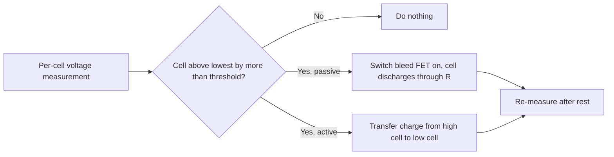

::: basics
### In plain words
Cell balancing keeps all the cells in a series battery pack at the same charge level. The cells are never exactly identical, so their charge slowly drifts apart. Without balancing, the weakest cell decides when the whole pack must stop, and some cells can end up outside their safe voltage range.

### Picture it
Picture a line of hikers roped together. The group can only move as fast, and go as far, as the one who tires first. If one hiker is much more tired than the others, everyone has to stop while the rest still have energy. Balancing is like giving the tired hikers a rest while the strong ones wait. A rope is a fair picture for a pack, with one difference: the cells cannot simply talk to each other, so a circuit has to do the evening out.

### Words you need
- **Series pack**: cells connected end to end, so the same current flows through all of them ([[q0305]]).
- **State of charge (SoC)**: how full a cell is, as a percentage ([[q0308]]).
- **Passive balancing**: bleeding extra charge from the fullest cells through a resistor, as heat.
- **Active balancing**: moving charge from fuller cells to emptier ones, with little waste.
- **Cell imbalance**: the difference in charge or voltage between cells in the pack.

### The simplest example
Take two 2 Ah cells in series. The charger stops when the first cell reaches 4.2 V. Say cell A is full, at 2.0 Ah, and cell B only reached 90%, at 1.8 Ah. On discharge, both lose charge at the same rate, so cell B runs out after 1.8 Ah while cell A still holds 0.2 Ah. The pack delivers 1.8 Ah, not 2.0 Ah. A 100 Ω bleed resistor on cell A draws $4.2 / 100 = 0.042$ A, and would take about 4.8 hours to remove that 0.2 Ah.

That is the whole idea. The rest of this page covers why cells drift, what each balancing method costs and when it is needed.
:::

::: testing
Whether you understand **why series cells drift apart** (same current, different capacity, self-discharge and resistance) and what that does: charge stops when the *first* cell is full, discharge stops when the *first* cell is empty, so the pack is limited by its weakest cell and the strongest can be driven out of its safe window. You are expected to give both balancing styles (passive bleed and active transfer), say **when** it is needed (series strings, mainly at the top of charge) and when not (1S, parallel groups), and describe the consequences of omitting it with numbers.
:::

::: why
Every multi-cell Li-ion product (laptops, power tools, drones, e-bikes, EVs) depends on this. A pack that is not balanced loses capacity from the first week, ages unevenly and, in the worst case, overcharges one cell while the pack total looks fine. It is also a rich design question: how much bleed current, how much heat, when to balance, how many measurements are needed.
:::

::: concepts
- **Series connection**: the same current flows through every cell, so cells integrate the same charge but have different capacities ([[q0001]]).
- **Cell mismatch**: manufacturing spread in capacity and resistance, plus differences in self-discharge and temperature.
- **Voltage window per cell**: 3.0 to 4.2 V each, not for the pack as a whole ([[q0305]]).
- **State of charge differences**: determined by voltage at rest, or by model ([[q0308]]).
- **Passive balancing**: dissipating the excess charge of the highest cells in resistors.
- **Active balancing**: moving charge between cells with capacitors, inductors or transformers.
- **Per-cell monitoring**: needed to balance at all ([[q0307]]).
:::

::: answer
"Cell balancing is making all the cells in a series pack sit at the same state of charge. It matters because in a series string every cell gets the same current, but the cells aren't identical: they differ a few percent in capacity, resistance and self-discharge, so over cycles their charge levels drift apart.

The problem then is that the pack's limits are set by individual cells. When I charge, the charger stops when the first cell hits 4.2 volts, so the others are left partly charged. When I discharge, the pack has to stop when the first cell hits the cutoff, so the others still have energy. The pack capacity is limited by the weakest cell, not the average. Worse, if there's no per-cell protection, the strongest cell can go past 4.2 volts while the total pack voltage looks normal, which means plating, gas and a fire risk.

There are two ways to do it. Passive balancing bleeds the higher cells through a resistor, usually at the top of charge. It's cheap and simple but wastes the energy as heat. Active balancing shuttles charge from high cells to low cells with capacitors, inductors or transformers, which is efficient but more complex and expensive.

It's needed for any series pack, two cells or more, particularly at the top of charge. It's not needed for a single cell, and cells in parallel balance themselves. Without it, you get lost capacity, faster aging of the worst cell and potential safety issues."
:::

::: technical
**Why cells diverge.** Cell $i$ has capacity $Q_i$ and SoC $s_i$. In series $\dot s_i = \pm I/(3600 Q_i)$: for equal current, a cell with smaller $Q_i$ moves faster in SoC, so charge/discharge cycles stretch the spread. Self-discharge and temperature differences add a drift. Different resistance gives different voltage at the same SoC under load.

**Limits.** Charge ends when $\max_i V_i = 4.2$ V; discharge ends when $\min_i V_i = V_{cut}$. Usable pack capacity is therefore, at low rate,
$$Q_{pack} \approx \min_i (s_i Q_i)\ \text{at the end of charge, minus the shortfall}$$
more intuitively, it equals the capacity of the weakest cell *only if all cells start full*; if they start at different SoC, a further amount is lost.

**Simulation numbers** (4S, 2 Ah nominal, capacities spread ±2.5 % around nominal, initial SoC spread 10 %): without balancing the pack delivers 1.788 Ah, with passive balancing 1.948 Ah (ideal, limited by the weakest cell: 1.950 Ah), a loss of 0.162 Ah or 8.3 %. Charging takes 81 min without balancing but 139 min with it, because the balancer needs time to equalize.

**Passive balancing numbers.** Bleed current $I_b = V_{cell}/R_{bal}$; heat $P = V^2/R_{bal}$. With $R_{bal} = 33$ Ω at 4.2 V: 127 mA, 0.53 W per bleeding cell. With 100 Ω: 42 mA, 0.18 W. Time to remove a charge difference $\Delta Q$: $t = \Delta Q / I_b$; 0.162 Ah at 127 mA is about 1.3 h.

**Active balancing.** Charge is moved cell-to-cell (switched capacitor, inductor/flyback, transformer). Efficiency 80 to 95 % (typical), currents 0.5 to several amps in high-end designs; more parts and cost.

**When needed.** Series strings (2S+). Balancing is usually done at the top of charge (high voltage region, where the OCV curve is steep so voltage differences reflect SoC) or by SoC-based rules.

**Not needed.** 1S; parallel cell groups (cells in parallel share voltage and self-equalize, with current flowing between them, which is a separate safety consideration).
:::

::: short
"Balancing keeps every cell in a series pack at the same state of charge. Series cells carry the same current but differ in capacity, self-discharge and resistance, so they drift apart. Then the first cell to hit 4.2 volts ends the charge and the first to hit cutoff ends the discharge, so capacity is limited by the weakest cell, and a strong cell can be overcharged while the pack total looks fine. Passive balancing bleeds high cells through resistors; active balancing moves charge between cells. It's needed for any series pack, not for a single cell."
:::

::: long
"Cell balancing means keeping each cell in a series string at the same state of charge.

The reason it's needed: in series, every cell carries the same current, so each cell integrates the same amount of charge. But cells aren't identical. Capacity differs by a few percent, resistance differs, self-discharge differs, and temperature gradients make them age differently. Because of that, the states of charge slowly drift apart over cycles.

Why that matters comes from the limits. The pack charge stops when the first cell reaches 4.2 volts. The pack discharge stops when the first cell reaches its cutoff. So capacity is limited by the weakest cell, not the average. In a simulation of a 4-cell, 2 amp-hour pack with a few percent spread, I lose about 0.16 amp-hours, which is 8 percent of the pack, without balancing. And the safety angle is worse: if the charger only sees the total pack voltage, a high cell can go to 4.3 volts or more while the total looks normal, and that's plating, gas and a fire risk. In the other direction, the weakest cell can be over-discharged. Because weak cells then get stressed more, they age faster, so the imbalance gets worse over time.

There are two approaches. Passive balancing: when a cell is higher than the others, usually near the top of charge, a MOSFET switches a bleed resistor across it. It's cheap and simple, but the energy is wasted as heat, and the current is limited, say 40 to 130 milliamps, so it takes hours. Active balancing moves charge from high cells to low cells using capacitors, inductors or transformers; it's efficient and fast but costs more and is more complex.

You need it for any series string of two or more cells; you don't for a single cell, and cells in parallel balance each other naturally."
:::

::: terms
- **Cell balancing**: equalizing SoC or voltage across series cells.
- **Passive balancing**: shunting the highest cells through bleed resistors.
- **Active balancing**: transferring charge between cells using reactive elements.
- **Top balancing**: balancing at the end of charge, when voltage reflects SoC well.
- **Bleed current**: current through the balancing resistor, $V_{cell}/R_{bal}$.
- **Imbalance (spread)**: difference between the highest and lowest cell voltages or SoCs.
- **AFE (analog front end)**: IC measuring cell voltages and driving the balance switches ([[q0313]]).
- **Weakest cell**: the cell with the least usable capacity, which sets pack capacity.
:::

::: exceptional
**An average answer** says "it equalizes the cells so they charge evenly".

**An exceptional answer**:
- Explains the mechanism (same current, different $Q_i$, self-discharge and resistance) and **why limits are cell-by-cell**.
- Quantifies the loss (for example 0.16 Ah, 8 % in a 4S example) and the passive-bleed numbers (127 mA, 0.53 W at 33 Ω; time = $\Delta Q/I_b$).
- Compares **passive vs. active** with efficiency, cost and thermal trade-offs.
- States **when** (series, top of charge, after rest; not for 1S or parallel) and the **safety** consequences of omitting it (overcharge plating, over-discharge, thermal event).
- Mentions the **positive feedback**: weak cells are stressed more and age faster, widening the spread.
:::

::: mistakes
- **"The charger sees the pack voltage, so it's fine."** Pack voltage hides per-cell voltage. Balance leads and per-cell monitoring are essential.
- **Balancing a pack by the pack average SoC.** The weakest cell sets capacity, so you balance cell voltages or SoCs to each other, not to the mean.
- **Believing balancing adds capacity.** It recovers capacity lost to imbalance, but pack capacity can't exceed the weakest cell's capacity.
- **Ignoring balance-resistor heat.** 0.53 W per cell in a sealed pack is a thermal design item, and bleeding at the same time as charging can heat the cells and the board.
- **Mixing old and new cells or different capacities.** This forces large imbalance that no balancer can fix.
- **Balancing at mid-SoC using voltage.** In the flat region voltage differences of 10 mV are only ~1.6 % SoC and noisy; top-of-charge balancing is more reliable ([[q0308]]).
:::

::: deep
## Why series cells drift apart

Consider $n$ cells in series, each with capacity $Q_i$ (Ah). A series string passes the same current $I(t)$ through every cell, so:

$$\frac{ds_i}{dt} = -\frac{I(t)}{3600\,Q_i}$$

If the cells start at the same SoC and all discharge by the same $\Delta Q$, a cell with smaller $Q_i$ ends at a lower SoC. After a full charge (limited by the first cell reaching 4.2 V) and a full discharge (limited by the first reaching cutoff), the weakest cell is always the one at the limit; the other cells are never fully used. It is like pulling a rope with different-length strands.

Other drivers add up over time:

- **Self-discharge** differs cell to cell (temperature dependent).
- **Resistance** differs: at a given current a higher-resistance cell reaches the voltage limit sooner, and heats more.
- **Temperature gradients**: the hotter cell ages faster and has lower resistance, so mismatch grows.
- **Measurement and balance-circuit leakage** may draw different currents from different cells.

Imbalance grows with cycles unless corrected. Weak cells get more stress per cycle, so they age faster: positive feedback.

## What happens without balancing: a worked example

Four 2 Ah-class cells with capacities 1.95, 1.98, 2.02, 2.05 Ah and initial SoCs spread across 25 to 35 % (the simulator's default 5 % capacity spread and 10 % SoC spread). Charge the pack at C/2. The first cell reaches 4.2 V while the others sit at about 4.08 to 4.17 V (the two lowest still about 10 % short of full).

| Case | Usable pack capacity | Charge time | Cell end voltages |
|---|---|---|---|
| No balancing | 1.788 Ah | 81 min | 4.17, 4.20, 4.08, 4.10 V |
| Passive balancing (33 Ω) | 1.948 Ah | 139 min | 4.199, 4.198, 4.195, 4.196 V |
| Ideal (weakest cell) | 1.950 Ah | n/a | |

(From the equivalent-circuit simulator, nominal 2 Ah, 0.5C charge, 33 Ω bleed resistors.)

The loss is $1.950 - 1.788 = 0.162$ Ah (8.3 %). The charge takes 58 min longer because the balancing phase must move that charge through bleed resistors.

```sim
{"id":"cell-balancing","cells":4,"mismatch":0.05,"balance":"none"}
```
Figure: With balancing set to "none", note the cell voltages at the end of charge: the first cell to reach 4.2 V stops the charge and leaves the others lower, and the "usable capacity lost" counter shows the cost. Switch to "passive" and compare the cell voltages, the lost capacity, and the heat and bleed current.

## Passive balancing

A resistor and a switch across each cell:

```circuit
{"caption":"Passive balancing channel for one cell","elements":[
 {"t":"battery","a":[0,0],"b":[0,6],"label":"Cell k","value":"4.20 V"},
 {"t":"wire","pts":[[0,0],[8,0],[8,1]]},
 {"t":"R","a":[8,1],"b":[8,4],"label":"R_{bal}","value":"33 Ω"},
 {"t":"nmos","at":[6,6],"label":"Q_{bal}","bodyDiode":true},
 {"t":"wire","pts":[[0,6],[0,8],[8,8]]},
 {"t":"wire","pts":[[3,6],[6,6]]},
 {"t":"term","at":[3,6],"label":"Gate","side":"left"},
 {"t":"arrow","a":[12.5,2],"b":[12.5,6],"label":"I_{bal}"}
]}
```
Figure: When the AFE decides cell k is high, it drives the gate and turns on $Q_{bal}$, and the cell discharges through $R_{bal}$ at $I_b = V/R_{bal} = 4.2/33 = 127$ mA, dissipating $V^2/R = 0.53$ W as heat. One such channel sits across every cell, and only the high cells are switched on.

**Bleed current vs time.** To remove $\Delta Q$ you need $t = \Delta Q/I_b$. The usual choice: 20 to 100 mA to keep heat manageable (0.1 to 0.4 W per cell). With a 50 mA bleed, correcting 100 mAh takes 2 h; and typical packs balance over multiple charge cycles.

> [!WARNING]
> Balancing resistors dissipate real power in a small enclosure. The sum for many cells can be several watts if they all bleed at once. Thermal design and limits (balance only a few cells at a time, or only when charger input is present) are part of the BMS design.

**Voltage thresholds.** Passive balancing is usually enabled above about 3.9 to 4.0 V and when a cell exceeds the lowest by 10 to 50 mV (with hysteresis), because above that range the voltage correlates well with SoC and the cell is close to full ([[q0308]]).

## Active balancing

Active balancers move charge rather than burn it:

- **Switched capacitor ("flying cap")**: a capacitor is connected alternately across a high and a low cell, carrying a small charge each cycle. Simple, slow, and effective for small imbalance.
- **Inductive (buck-boost or flyback)**: an inductor shuttles energy from a cell (or the whole pack) to the weakest cell with 80 to 90 %+ efficiency.
- **Transformer based**: multi-winding transformers return energy from the pack to individual cells.

Pros: no wasted heat, can balance during discharge, faster at large currents (0.5 to several A). Cons: parts count, cost, noise/EMI, complexity. Common in EVs and big packs; passive dominates small consumer packs.


Figure: Both schemes use the same measure-decide-act loop. They differ in what happens to the extra charge: dissipated as heat (passive) or redistributed (active).

## When is balancing needed?

| Case | Needed? | Reason |
|---|---|---|
| 1S pack | No | One cell has nothing to balance against |
| Parallel cells (xP) | No (self-balancing) | Cells at the same node equalize voltage through their internal resistances |
| Series (2S and up) | Yes | Same current, different cells; drift accumulates |
| New matched cells, short life, low cost | Sometimes minimal | Matched cells drift slowly, but still need per-cell OVP |
| Aged or mismatched cells | Strongly | Spread widens, weakest cell dominates |
| Fast-charge, high-C packs | Yes, and at higher current | Less time for passive balancing, so active or higher-current bleed |

> [!NOTE]
> Cells in parallel do equalize, but if one cell has an internal short or a very different SoC, large equalizing currents flow between them. Connect parallel groups only after matching voltages (within tens of mV).

## What if it isn't implemented?

1. **Lost capacity**: as in the example, the pack delivers less than the weakest cell can; cycle by cycle the spread widens.
2. **Overcharge of the strongest/highest cell**: if the charger regulates only pack voltage (e.g. 16.8 V for 4S), the high cell can exceed 4.2 V by 100 to 300 mV while a low cell is under-charged, producing plating, gas and swelling ([[q0319]]).
3. **Over-discharge of the weakest cell**: the pack is still above its total cutoff while the weakest cell is below 3.0 V, and may go below 2.5 V; a deep enough excursion dissolves the copper current collector ([[q0330]]).
4. **Accelerated aging and runaway divergence**: the stressed cell loses capacity faster, increasing the imbalance.
5. **Heat and safety events**: in extreme cases thermal runaway of the overcharged cell can propagate to neighbours ([[q0332]]).

Mitigation: per-cell monitoring with overvoltage/undervoltage protection is the minimum; balancing is the maintenance on top of it. A pack with protection but no balancing will trip on the weak cell earlier and earlier, which is annoying but safer than no protection.

## Design checklist

- Per-cell voltage measurement with accuracy of a few mV.
- Balance current sized from the expected imbalance and charge time: $I_b \ge \Delta Q_{max}/t_{charge,top}$.
- Thermal limits for bleed resistors and a policy on how many can be on at once.
- Balancing threshold and hysteresis (for example start at 3.9 V, stop within 3 to 10 mV).
- Balance connector and wiring that can carry the current; sense-line fuses/resistors.
- Cell matching at assembly (capacity and resistance binning).
:::

::: applications
- **Laptop and power-tool packs**: passive balancing in the BMS IC, with bleed currents of tens of mA.
- **RC and drone balance chargers**: the charger reads each cell via the balance connector and bleeds high cells during CV.
- **E-bike packs**: BMS boards with passive balancing for each series group, sized by pack voltage.
- **EV traction packs and grid storage**: passive or active balancing integrated into module BMS boards.
- **Power banks with 2S or more**: balancing ICs to keep cells matched for safety and life.
:::

::: assumptions
- The numbers come from a **simplified equivalent-circuit simulation** (4S, 2 Ah nominal, ±2.5 % capacity spread, 10 % initial SoC spread, 0.5C charge, 33 Ω bleed). Real packs differ.
- **Top balancing** (near full) is assumed. Some systems balance at the bottom (matching empty) or by SoC across the range; the choice depends on application and chemistry.
- Active-balancing efficiencies and currents are **typical ranges**, not specifications of a particular IC.
- A **per-cell protection layer** (OVP/UVP) is assumed alongside balancing; balancing alone does not replace protection ([[q0313]]).
- For **LiFePO$_4$**, the flat curve makes voltage-based top balancing even more dependent on reaching the knee near full.
:::

::: followups
### A 4S pack: cell voltages at the end of charge are 4.20, 4.19, 4.10, 4.12 V. What is happening and what should the BMS do?
The first two cells are full and the other two are 80 to 100 mV lower, around 5 to 10 % SoC behind in the steep region. Charging stops (or tapers) because the highest cell is at 4.2 V. The BMS should enable bleed on the top cells (or active transfer) while holding CV, until the spread falls below the target of 10 to 20 mV. A passive 127 mA bleed on 5 % of 2 Ah (100 mAh) takes about 0.8 h per cell.

### How big should the bleed resistor be?
Choose the bleed current from the imbalance and available time: $I_b = \Delta Q/t$. With 100 mAh to remove in 2 h, you need 50 mA, so $R = 4.2/0.05 = 84$ Ω and the dissipation is $4.2^2/84 = 0.21$ W. Check the board's thermal capability, remembering that several channels may be on at once, and that the resistor's heat warms the neighbouring cells.

### Why do parallel cells not need a balancer?
Parallel cells share the same terminal voltage, so any difference in OCV drives current through the cells' internal resistances until they equalize. The self-balancing current can be large if the mismatch is big, which is why you pair parallel cells carefully, but there's no accumulating drift across a parallel group.

### When would you choose active balancing over passive?
For large packs or fast cycling where wasted energy and heat are unacceptable, or where imbalance is large and a passive bleed of tens of mA would take days; when you want to balance during discharge; or when the energy loss matters (EV, grid storage). For small consumer packs, passive is the usual choice because of cost and simplicity.

### What if one cell in a pack is much weaker (say 70 % capacity of the others)?
Balancing can't fix it. The pack's capacity is limited to about 70 % of the others' and the weak cell is cycled deeper each time, aging faster. The right fix is to replace the cell (or the pack), not to balance harder. A BMS should flag a persistent outlier in capacity or resistance ([[q0312]]).
:::

::: interpretations
"Cell balancing" here applies to **series strings** of cells (or cell groups). In a pack described as "3S2P" you balance the three series groups; the two parallel cells inside each group self-balance. A sibling question, [[q0326]] ("What is balance charging? When is it needed?"), asks about the charging-side procedure (balance chargers); this page covers the underlying mechanism and consequences.
:::

::: references
- Plett, *Battery Management Systems, Volume I and II* (Artech House): cell imbalance, balancing strategies and BMS functions.
- Linden & Reddy, *Handbook of Batteries*: battery pack design and cell matching for lithium-ion batteries.
- Battery University (Cadex): articles on battery pack protection, cell balancing and multi-cell charging.
- Manufacturer BMS/AFE datasheets and application notes on cell balancing (for example the TI bq76xxx and Analog Devices/Linear multi-cell monitor families) for real thresholds and currents.
:::

::: rubric
- Explains why series cells drift (same current, different capacity/self-discharge/resistance) :: The root cause drives the whole answer.
- States that the first full/empty cell sets the pack limits (weakest cell) :: Explains lost capacity and why balancing helps.
- Gives consequences without balancing: lost capacity, overcharge, over-discharge, faster aging :: The question asks "what happens if it's not implemented?"
- Describes passive and active balancing with trade-offs (heat vs complexity) :: Shows breadth and engineering judgement.
- Says when it's needed: series packs, top of charge; not 1S or parallel :: Answers the "when" part precisely.
- Gives numbers (bleed current/heat, time to balance, capacity lost) :: Turns qualitative understanding into a design capability.
- Notes need for per-cell measurement and protection :: Balancing depends on monitoring and does not replace OVP/UVP.
:::

::: quiz
```json
[
 {"type":"mcq","level":"fundamental","q":"Why does the capacity of a series pack equal roughly that of its weakest cell?","options":["Weak cells have higher voltage","The same current flows through all cells, so the first to reach a limit ends the charge or discharge","Capacities add in series","The balancer deletes extra capacity"],"answer":1,"explain":"In series, current is common. The smallest-capacity cell reaches full (or empty) first, which stops the pack, leaving the others underused."},
 {"type":"numeric","level":"fundamental","q":"A passive balancer uses a 33 Ω resistor across a cell at 4.2 V. What is the bleed current?","answer":127,"tolerance":0.02,"unit":"mA","explain":"$I = 4.2/33 = 0.127$ A = 127 mA."},
 {"type":"numeric","level":"intermediate","q":"The same 33 Ω bleed resistor at 4.2 V: how much power does it dissipate?","answer":0.53,"tolerance":0.02,"unit":"W","explain":"$P = V^2/R = 4.2^2/33 = 17.64/33 = 0.535$ W."},
 {"type":"numeric","level":"intermediate","q":"You need to remove 100 mAh of imbalance with a 50 mA bleed current. How long does balancing take?","answer":2,"tolerance":0.02,"unit":"h","explain":"$t = \\Delta Q/I_b = 100\\ \\text{mAh}/50\\ \\text{mA} = 2$ h."},
 {"type":"mcq","level":"advanced","q":"A 4S charger regulates the pack to 16.8 V with no per-cell monitoring. What is the main danger if the cells are imbalanced?","options":["The charger will draw less current","A high cell may exceed 4.2 V while the pack total looks normal","The pack voltage will be 12 V","Parallel cells will overheat"],"answer":1,"explain":"The sum 16.8 V can be reached with one cell at 4.35 V and another at 4.05 V. The high cell is overcharged (plating, gas, thermal risk) even though the pack total is correct."},
 {"type":"multi","level":"advanced","q":"Which statements about balancing are correct?","options":["Cells in parallel largely self-balance","Passive balancing converts excess charge to heat","Balancing can make a 70 % capacity cell behave like a new cell","Top-of-charge balancing works because voltage reflects SoC well at high SoC"],"answer":[0,1,3],"explain":"Parallel cells share voltage; passive balancing dissipates; top balancing exploits the steeper voltage-SoC relationship. Balancing cannot add capacity to a physically weak cell."}
]
```
:::
