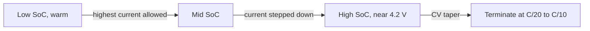

::: testing
Whether you can read the CC-CV profile and say **where charge goes in fast and where it crawls**. The headline answer is the constant-current phase (low to about 80 to 85 % SoC), because the charger pushes its maximum current into a cell that accepts it; the constant-voltage tail is slow because current decays. A strong answer adds the conditions that *change* the answer: temperature (warm is better accepted, cold is dangerous), SoC (acceptance falls as the cell fills), and cell resistance. It also recognizes that "fastest" and "safe" are different, and that fast-charge designs shape the current vs SoC and temperature.
:::

::: why
Charge time is a headline product spec (phones, e-bikes, EVs), and the profile determines how a charger IC is designed and how much of the "fast" figure is marketing (the "50 % in 15 minutes" style claims describe the CC part). Knowing where the time goes lets you predict, for example, that going from 1C to 2C saves far less than half the total time, and tells you which conditions to protect.
:::

::: concepts
- **CC-CV profile**: constant current to 4.2 V, then constant voltage with decaying current ([[q0321]]).
- **State of charge**: the cell's ability to accept lithium falls as the anode fills.
- **Resistance and $IR$ rise**: higher current lifts the terminal voltage, so 4.2 V is hit at a lower SoC ([[q0316]]).
- **Temperature**: resistance and diffusion improve when warm, plating risk rises when cold ([[q0306]]).
- **Charge C-rate limit**: set by the cell datasheet ([[q0318]]).
- **Lithium plating**: limits fast charging at high SoC, low temperature and high current.
:::

::: answer
"A LiPo charges fastest during the constant-current phase, which is from low state of charge up to about 80 or 85 percent. In that phase the charger delivers its full programmed current, say 1C, and the cell takes it, so the charge rate in percent per minute is constant. In my model of a 2 amp-hour cell at 1C, I get about 1.7 percent per minute, so 80 percent is reached in 48 minutes.

After the cell hits 4.2 volts, the charger switches to constant voltage, and the current decays exponentially. The last 15 percent in that model takes about 26 minutes, at only about 0.6 percent per minute, so it's the slowest part. That's why a phone charges quickly to 80 percent and slows down after.

A few conditions change it. Warmer cells, within limits, around 25 to 45 degrees, have lower resistance and diffusion limits, so they stay in the CC phase to a higher state of charge and accept charge best; cold cells are slow and must be derated because of lithium plating. A fresh cell with low resistance also reaches the voltage limit later than an aged one. And higher current charges faster but with diminishing returns: 2C only cuts the total time from 77 to 54 minutes, and increases heating and plating risk. So 'fastest' is mid state of charge, warm, in the CC phase, at the highest current the cell is rated for."
:::

::: technical
**Charge rate vs SoC.** In CC, $\dot{SoC} = I_{cc}/Q$ is constant: at 1C, 100 %/h = 1.67 %/min. In CV, $I(t)$ decays with $\tau_{CV} \approx R Q/(dV_{OCV}/dSoC)$ and so does $\dot{SoC}$.

**Model numbers (2 Ah, 50 mΩ, 25 °C, from empty, termination C/20):**

| Charge rate | CC duration | SoC at CC end | Time to 80 % | Time to 90 % | Total |
|---|---|---|---|---|---|
| 0.5C | 111.7 min | 93.1 % | 96.0 min | 108 min | 130.6 min |
| 1C | 50.7 min | 84.5 % | 48.0 min | 54.8 min | 76.9 min |
| 2C | 19.5 min | 65.0 % | 25.3 min | 31.8 min | 53.9 min |

In the 1C case the average SoC gain is 1.66 %/min up to 80 %, 1.48 %/min from 80 to 90 % and 0.60 %/min from 90 to 98 %.

**Temperature (1C, same model).** CC lasts 29 min at 0 °C (SoC at CV start 54 %), 40 min at 10 °C, 51 min at 25 °C and 57 min at 45 °C (92 %); totals 96, 85, 77 and 70 min. Warm cells spend longer in CC because $IR$ is smaller.

**Real-world limits not in the model.** Datasheet charge-rate limits fall with temperature (below about 10 to 15 °C many cells are limited to 0.1 to 0.5C and none are charged below 0 °C), and fast-charge protocols step the current down as SoC rises to avoid plating ([[q0318]]).

> [!UNCERTAIN]
> The simulator's charge model includes the temperature dependence of resistance but not plating-based current derating. Real products reduce current in the cold and at high SoC, so the cold-charge times above are optimistic.
:::

::: short
"They charge fastest during the constant-current phase, from low state of charge to about 80 or 85 percent, where the charger delivers its full current and the cell accepts it. After the voltage hits 4.2 volts the charger holds it and the current decays, so the last 15 percent is slow: in my model it's 26 minutes at 1C after 51 minutes for the first 85 percent. Warm, mid-SoC cells with low resistance are fastest; cold cells have to be derated for plating. Higher current helps but with diminishing returns."
:::

::: long
"The fastest part of a charge is the constant-current phase. The charger applies a fixed current, for example 1C, and as long as the cell voltage is below 4.2 volts, that current flows at full value, so the cell gains charge at a constant rate: 1C is 100 percent per hour, about 1.7 percent per minute. In my model of a 2 amp-hour cell, that gets to 80 percent in 48 minutes and the constant-current phase finishes at about 85 percent after 51 minutes.

Then the cell reaches 4.2 volts and the charger holds the voltage. Now the current equals the difference between 4.2 volts and the cell's open-circuit voltage, divided by the resistance, which shrinks as the cell fills, so the current decays exponentially. The rate falls to about 0.6 percent per minute, and the last 15 percent takes about 26 more minutes. That's why a phone shows 80 percent quickly and then crawls.

Conditions matter. Temperature: warm cells, 25 to 45 degrees, have lower resistance, so they spend more time in CC, in the model going from 29 minutes of CC at 0 degrees to 57 at 45. But I must not charge cold cells fast, because lithium plates on the anode; real chargers cut the current below about 10 to 15 degrees and stop at 0. State of charge: the anode accepts lithium less readily as it fills, so fast-charge protocols step the current down at high SoC. Current: 2C reaches 80 percent in 25 minutes, but the total only drops from 77 to 54 minutes because of the longer CV tail, and heating is four times larger.

So the fastest charging is mid-SoC, warm, in CC at the highest current the cell is rated for."
:::

::: terms
- **CC phase**: constant-current portion of charging.
- **CV phase / taper**: constant-voltage portion where current decays.
- **Charge acceptance**: how readily the cell takes current without exceeding limits.
- **Fast charge**: charging above about 0.5C to 1C.
- **Stepped CC (multi-stage)**: lowering current in steps as SoC or voltage rises.
- **Lithium plating**: metal deposition on the anode that limits fast charging.
- **Termination current**: where charging stops (C/20 to C/10).
- **Thermal derating**: lowering current with temperature.
:::

::: exceptional
**An average answer** says "during the constant-current phase".

**An exceptional answer**:
- Quantifies **rate in %/min** per phase and the time budget (CC to 85 % in 51 min vs CV for 26 min).
- Explains **why** CV is slow (current set by $V_{set} - V_{OCV}$ and decays with $\tau \approx RQ/(dV/dSoC)$).
- Shows that **higher current has diminishing returns** (2C: 54 vs 77 min).
- Brings in **temperature** (warm accepts better; cold must be derated due to plating) and **cell resistance/age**.
- Distinguishes **fast** from **safe**, and mentions stepped-CC protocols and thermal management.
:::

::: mistakes
- **"Charging is fastest at the end."** The tail is the slowest part.
- **Believing the charger charges at constant speed to 100 %.** Only until 4.2 V is reached.
- **"2C is twice as fast as 1C."** The CV tail does not shrink, and the CC fraction falls (65 % vs 85 % SoC at CC end).
- **Heating the cell to charge faster.** Moderate warmth helps, but above about 45 °C aging and safety limits apply.
- **Ignoring cold.** A cold cell may accept current electrically while plating lithium.
- **Reading "80 % in 30 minutes" as a full-charge claim.** It describes the CC phase only.
:::

::: deep
## Where the time goes

A CC-CV charge splits into two regimes with different physics.

**Constant current.** The charger regulates the current to $I_{cc}$. The cell's terminal voltage $V_t = V_{OCV}(SoC) + I_{cc}R_{eff}$ rises as SoC rises, until it reaches 4.2 V. During this time $\dot{SoC} = I_{cc}/(3600\,Q)$ is fixed, so the percentage gained per minute is $100 \cdot C_{rate}/60$: 0.83 %/min at 0.5C, 1.67 %/min at 1C and 3.33 %/min at 2C.

**Constant voltage.** From the moment $V_t$ reaches 4.2 V, the charger lowers the current to keep it there:

$$I(t) = \frac{4.2 - V_{OCV}(SoC(t))}{R_{eff}}$$

The numerator shrinks as the cell fills, so $I$ and thus $\dot{SoC}$ decay ([[q0321]]).

```plot
{"title":"State of charge vs time for a 2 Ah cell charged at three rates (model, 25 °C, from empty)","x":{"label":"Time","unit":"min","min":0,"max":125},"y":{"label":"State of charge","unit":"%","min":0,"max":100},
 "series":[
 {"label":"0.5C","color":"green","points":[[0,0],[24,20],[48.1,40],[72,60],[96,80],[102,85],[108,90],[114.5,95],[121.9,98]]},
 {"label":"1C","color":"accent","points":[[0,0],[12,20],[24,40],[36,60],[48,80],[51,85],[54.8,90],[60.7,95],[68,98]]},
 {"label":"2C","color":"red","points":[[0,0],[6,20],[12,40],[18,60],[25.3,80],[28,85],[31.8,90],[37.7,95],[45.1,98]]}],
 "hlines":[{"at":80,"label":"80 %","color":"muted"}]}
```
Figure: Each curve is a straight line (constant rate) until it bends near 85 % at 1C (earlier at 2C, later at 0.5C). The slope after the bend is the CV taper. The line for 2C is twice as steep as 1C at the start but the tail is much longer relative to the total.

The consequences:

- To 80 % the time scales almost exactly as $1/C$: 96, 48 and 25 min.
- To 98 % the gain from doubling the rate is smaller: 122, 70 and 45 min.
- The CV tail occupies 15 % of SoC at 1C but 35 % at 2C.

## Why the CC phase ends earlier at higher current

The terminal voltage in CC is $V_t = V_{OCV} + I(R_0 + R_1)$. At 2C the $IR$ term is four times the 0.5C value, so 4.2 V is reached when $V_{OCV}$ is lower, i.e. at lower SoC: 65 % at 2C vs 93 % at 0.5C. Lower resistance (fresh, warm cells, high-power cells) postpones the CC-to-CV switch, which is why a cell's resistance and a charger's fast-charge ability are linked.

```sim
{"id":"lipo-lab","view":"charge","capacity":2,"crate":2,"temp":25,"rint":0.05}
```
Figure: Try 2C, then lower rint to 0.02 Ω: the CC phase extends well past 65 % and the total time falls. Then raise rint to 0.1 Ω (an aged cell) and watch CC end much earlier. This is the signature of aging in charge time.

## Temperature: warm is better accepted, cold is dangerous

Electrochemically, a warmer cell has lower resistance and faster diffusion in the anode. In the model at 1C:

| Temp | CC duration | SoC when CV starts | Total time |
|---|---|---|---|
| 0 °C | 29.2 min | 54 % | 96.2 min |
| 10 °C | 40.0 min | 71 % | 84.7 min |
| 25 °C | 50.7 min | 84.5 % | 76.9 min |
| 45 °C | 56.6 min | 92.5 % | 70.3 min |

Even this simple model shows the effect of resistance on the CC-to-CV switch. But reality adds a hard constraint: at low temperature the intercalation kinetics at the graphite are slow and a high charging current drives the anode surface potential below 0 V versus lithium, so lithium plates ([[q0306]]). Datasheets therefore reduce the allowed charge current below roughly 10 to 15 °C (typical cells) and prohibit charging below 0 °C. High temperature, on the other hand, speeds aging and is bounded at about 45 °C for charge.

So the "fastest" window in practice is roughly 20 to 40 °C, mid SoC, within the datasheet's charge-rate limit.

## State of charge dependence

At low SoC the anode has plenty of room for lithium and its potential is well above 0 V, so high current is safe. As the anode fills (high SoC), its potential approaches 0 V versus lithium and the margin to plating shrinks. Fast-charge profiles therefore use:

- **Stepped CC**: a high current (for example 1.5C to 2C) up to 40 to 60 % SoC, lower current above that.
- **Voltage-based taper** that acts earlier than CV.
- **Pulse charging** with rest periods to relax concentration gradients (a claimed benefit with varying evidence; treat as a design option rather than a rule).


Figure: Fast-charge profiles shape the current: aggressive when the anode has headroom, gentle as it fills. The final taper is always slow.

> [!UNCERTAIN]
> Stepped-charge schedules and their limits are cell-specific and proprietary; the stages shown are generic. Always follow the cell datasheet or the manufacturer's charge specification.

## Practical consequences

- **Spec reading.** "0 to 80 % in 30 minutes" is a CC-phase statement; 100 % takes substantially longer.
- **Charger sizing.** The charger needs full power only during CC; at the CV stage, input power falls, which relaxes thermal design for the end of charge.
- **Thermal.** Heat is $I^2R$, so it is highest in the CC phase at high current. A linear charger dissipates $(V_{in} - V_{bat})I$ and is hottest at low $V_{bat}$ ([[q0313]]).
- **Battery sizing.** For a fixed charger power, bigger packs have lower C-rate and so charge more gently; the number to compare is C-rate.
:::

::: applications
- **Smartphones and laptops**: high-current CC to about 70 to 80 %, then taper; thermal management limits the first phase.
- **E-bikes and power tools**: chargers specified by current (for example 2 to 4 A), with 80 % reached in about an hour.
- **EV DC fast charging**: high C-rate at low SoC with stepped reduction above about 50 to 80 % and temperature management.
- **Drone/RC chargers**: user sets 1C (or the cell's rated charge C) and the charger runs CC-CV with balancing.
- **IoT devices with small cells**: C/2 charge for longevity, 2 to 3 h total.
:::

::: assumptions
- The numbers come from the site's **equivalent-circuit model** (2 Ah, 50 mΩ, graphite/NMC, termination at C/20) starting from an empty cell, without precharge or temperature-based derating.
- "Fastest" is taken as **percent SoC gained per minute**; other definitions (energy per minute at the input) are similar but include converter losses.
- Plating limits and stepped-charge protocols are **cell-specific**; real fast-charge rates are lower or higher depending on cell design (high-power cells tolerate 2C to 5C).
- The charger is assumed to have **enough input power** to sustain the programmed current throughout CC.
- If the question means **per-cell charge acceptance in hobby packs**, the CC/CV answer holds, with the cell's rated charge C limiting the CC current ([[q0318]]).
:::

::: followups
### Why does charging slow down at the end?
Because of CV. Once the terminal voltage reaches 4.2 V the charger can't push more current without exceeding the limit, so it lets the current fall as the cell's open-circuit voltage rises toward 4.2 V. The current is $(4.2 - V_{OCV})/R$, so it decays exponentially. For the model cell ($R \approx 0.08$ Ω, 2 Ah) $\tau \approx 8$ min, so the 26 minutes the last 15 % takes is roughly three time constants.

### If I want a faster charge without exceeding the cell's current rating, what can I change?
Keep the cell warm (within limits), reduce resistance (better contacts, thicker leads, a lower-resistance cell), terminate at a higher current (C/10 instead of C/20) to shorten the tail, and charge to a slightly lower voltage (for example 4.1 V gives 90 to 95 % of capacity and a much shorter tail, at the cost of capacity and with life benefits). Also use a charger that stays in CC to the higher SoC by compensating the $IR$ drop at the terminals.

### Is it safe to charge a LiPo faster when it is warm?
Moderately warm (20 to 40 °C) improves acceptance, but aging accelerates with temperature, and above about 45 °C most datasheets forbid charging. Self-heating during fast charge ($I^2R$) adds to ambient temperature, so thermal design matters.

### 1C vs 2C: how much faster, really?
In the model the full charge time falls from 76.9 to 53.9 min, about 30 % faster, because the CC phase ends at 65 % instead of 85 % and the CV tail lengthens. $I^2R$ heat in the CC phase is four times higher. To 80 %, the time halves (48 to 25 min), so the benefit depends on the target SoC.

### What would happen if you applied 2C to a cell at 0 °C?
The higher resistance means the cell hits 4.2 V very early (low SoC), and the anode potential can go negative against lithium, causing plating. Plated lithium reduces capacity and may form dendrites. A good charger won't allow this: it limits or blocks charging below about 10 to 15 °C and below 0 °C.
:::

::: interpretations
"Charge fastest" can mean fastest in **time per percent SoC** (the CC phase, mid SoC), fastest at **which conditions** (warm, low resistance) or fastest in the **hobby** sense of "at the highest allowed C rating". I cover all three. The safe upper limit on the rate is in [[q0318]]; the procedures are in [[q0320]] and [[q0321]].
:::

::: references
- Linden & Reddy, *Handbook of Batteries*: lithium-ion charging methods and rate capability.
- Plett, *Battery Management Systems, Volume I*: equivalent-circuit model and CC-CV charging simulation.
- Battery University (Cadex): articles on charging lithium-ion batteries, charge rates and fast charging.
- Charger IC datasheets (single-cell CC-CV chargers): charge profile, preconditioning, termination and temperature qualification descriptions.
:::

::: rubric
- Identifies the CC phase (low to about 80 to 85 % SoC) as the fastest :: The direct answer.
- Explains why the CV phase is slow (decaying current) :: Shows physical understanding.
- Quantifies the rates or times (%/min, 48 min to 80 %, 26 min tail) :: Demonstrates numerical reasoning.
- Notes that higher current has diminishing returns (CC ends earlier, longer tail) :: Avoids the 2C-is-twice-as-fast trap.
- Brings in temperature and resistance (warm accepts better; cold needs derating for plating) :: Real operating conditions.
- Mentions SoC-dependent current limits (stepped CC) and the cell's rated charge C :: How fast-charge actually works safely.
:::

::: quiz
```json
[
 {"type":"mcq","level":"fundamental","q":"During which part of a CC-CV charge does a LiPo gain charge fastest?","options":["Constant-voltage taper","Constant-current phase","After termination","During precharge"],"answer":1,"explain":"In CC the full programmed current flows, so SoC rises at a constant $100 \\cdot C/60$ %/min. In CV the current decays."},
 {"type":"numeric","level":"fundamental","q":"At a 1C charge rate, how many percent of SoC per minute does a cell gain during CC?","answer":1.67,"tolerance":0.02,"unit":"%/min","explain":"1C delivers 100 % of capacity per hour, i.e. $100/60 = 1.67$ %/min."},
 {"type":"numeric","level":"intermediate","q":"At 2C (CC phase), how many minutes would it take to gain 40 % SoC?","answer":12,"tolerance":0.02,"unit":"min","explain":"2C is $200/60 = 3.33$ %/min, so $40/3.33 = 12$ min."},
 {"type":"mcq","level":"intermediate","q":"Why does the CC phase end at a lower SoC when charging at 2C than at 0.5C?","options":["The cell has less capacity at 2C","The larger IR rise brings the terminal voltage to 4.2 V earlier","The charger cannot supply 2C","OCV is higher at 2C"],"answer":1,"explain":"$V_t = V_{OCV} + I R$: at higher current the $IR$ rise is larger, so $V_t$ hits 4.2 V when $V_{OCV}$ (and SoC) is lower."},
 {"type":"truefalse","level":"advanced","q":"Doubling the charge current from 1C to 2C halves the total time to reach full charge.","answer":false,"explain":"The CC phase ends earlier and the CV tail becomes a larger part of the time. In the model the total drops only from 77 to 54 min."},
 {"type":"multi","level":"advanced","q":"Which conditions help a LiPo accept charge quickly and safely?","options":["Moderate warmth (about 20 to 40 °C)","Low cell resistance","Charging at 0 °C at 2C","Mid state of charge"],"answer":[0,1,3],"explain":"Warmth, low resistance and mid SoC improve acceptance. Fast charging at 0 °C risks lithium plating."}
]
```
:::
