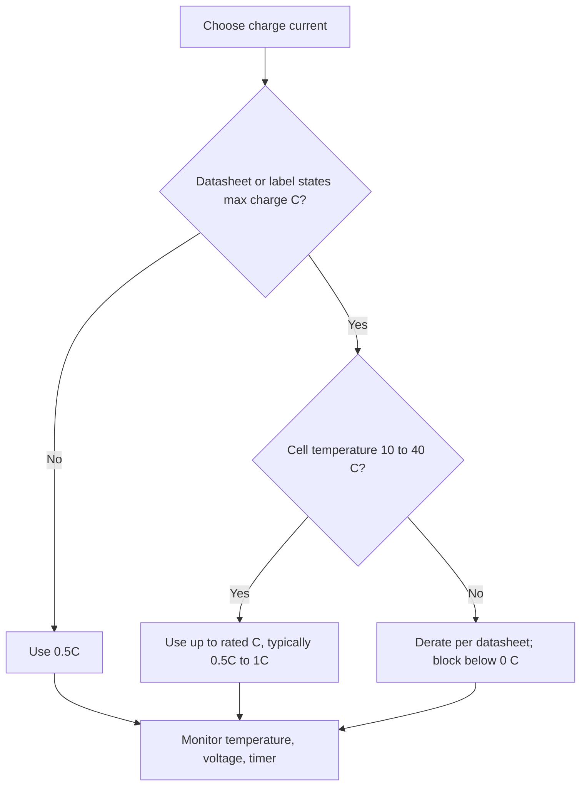

::: testing
Whether you give a **defensible number with its qualifiers** instead of a slogan. The usual answer is "1C is safe for typical LiPo; some cells allow 2C or more, and the datasheet rules". The real test is the reasoning: charge rate is limited by lithium plating (a function of temperature, SoC and current), by heating ($I^2R$), and by the charger's own limits. You should also be able to say why higher rates have diminishing returns and what a charger does at the edges (temperature derating, stepped current).
:::

::: why
Charge rate is a trade-off between convenience (time), cell life and safety. Product teams push for faster charging; battery engineers must say how fast is too fast for a given cell and conditions. A wrong number costs either customers (slow) or safety and warranty claims (fast). Hobby users run into it daily when picking the charge current on a balance charger.
:::

::: concepts
- **C-rate for charge**: charge current as a multiple of capacity ([[q0315]]).
- **Lithium plating**: the main fast-charge failure mechanism, worse in the cold and at high SoC ([[q0306]]).
- **Heating**: $I^2R$ in the cell and in the charger (linear charger dissipation).
- **CC-CV profile**: only the CC phase sees the full rate ([[q0317]]).
- **Datasheet limits**: standard charge, maximum (fast) charge, and temperature-dependent limits.
- **Cell design**: high-power cells with low resistance and thin electrodes tolerate more.
:::

::: answer
"For a typical LiPo or Li-ion cell the safe, standard charge rate is 0.5C to 1C, so for a 2 amp-hour cell, 1 to 2 amps. Plenty of manufacturers rate their cells for more, 2C or even higher for fast-charge or high-power cells, but the rule is that the datasheet number is the limit and I don't exceed it.

Why isn't it unlimited? The main danger is lithium plating. If I push current faster than lithium can diffuse into the graphite, the surface potential of the anode drops below zero versus lithium and metal plates out. That's permanent loss of capacity and can grow dendrites. It gets worse in the cold and at high state of charge, so the safe rate depends on conditions. The other limit is heat: $I^2R$ grows with the square of the current, so at 4C the cell heats sixteen times more than at 1C.

There's also a diminishing return. In my model, going from 1C to 2C only cuts the total charge time from 77 to 54 minutes, because the constant-voltage tail doesn't get shorter. So the extra stress buys little.

Practically I'd charge at 0.5 to 1C, only between about 0 and 45 degrees with reduced current near the cold end, with the charger terminating by current and a timer, and I'd use the faster rate only if the cell is specifically specified for it."
:::

::: technical
**Typical numbers.**
- Standard charge: 0.5C to 1C (datasheet "standard charge" for many consumer pouch and 18650 cells is 0.5C; some state 1C max).
- Fast/rapid charge on cells designed for it: 2C to 3C (sometimes higher for power cells) within a limited temperature window.
- Hobby LiPo: "1C" is the conventional safe default; some packs are labelled for 2C to 5C charging, which should be read as the manufacturer's claim ([[q0315]]).
- Low temperature: allowed charge current is derated below about 10 to 15 °C and charging is prohibited below 0 °C.
- High temperature: derated above about 40 to 45 °C and prohibited above about 45 to 50 °C (cell dependent).

**Time vs rate (model, 2 Ah, 50 mΩ, 25 °C, from empty, C/20 termination):**

| Charge C-rate | Current | SoC at end of CC | Total time | CC-phase $I^2R_0$ |
|---|---|---|---|---|
| 0.25C | 0.5 A | 97 % | 245 min | 0.01 W |
| 0.5C | 1 A | 93 % | 131 min | 0.05 W |
| 1C | 2 A | 85 % | 77 min | 0.2 W |
| 2C | 4 A | 65 % | 54 min | 0.8 W |
| 3C | 6 A | 38 % | 48.5 min | 1.8 W |

The total time bottoms out near 48 min even at 3C to 4C: the diminishing returns are severe, while ohmic heat grows with $C^2$.

**Why plating limits the rate.** Anode surface potential during charge $\phi_s = \phi_{eq}(y) - \eta$, where $\eta$ is the overpotential growing with current. When $\phi_s < 0$ V vs Li/Li$^+$ lithium metal can nucleate. Lower temperature (larger $\eta$ per amp), higher SoC (lower $\phi_{eq}$), and thicker electrodes all narrow the safe current.

**Charger-side limits.** Linear chargers dissipate $(V_{in} - V_{bat})I$; at 5 V in and 2 A with $V_{bat} = 3.5$ V that is 3 W, too much for a small package, so higher currents require a switching charger ([[q0313]]).
:::

::: short
"For a standard LiPo the safe charge rate is about 0.5C to 1C, so 1 to 2 amps for a 2 amp-hour cell. Some cells are rated for 2C or more, but the datasheet is the limit. The constraints are lithium plating, which gets worse at low temperature and high state of charge, and I squared R heating. Faster has diminishing returns, since 2C only saves about 30 percent of total time versus 1C, so I charge at 1C or below within about 0 to 45 degrees, with current-based termination."
:::

::: long
"My default answer is 0.5C to 1C. For a 2 amp-hour cell that's 1 to 2 amps. Many datasheets list a standard charge of 0.5C and a maximum of 1C, and specialized cells can be charged at 2C or more. The rule I'd follow is that the datasheet value for the cell and temperature is the limit, and I don't trust marketing numbers on hobby packs.

The reason there's a limit is physical. During charging, lithium has to diffuse into the graphite. If the current is too high for the temperature and state of charge, the anode surface potential falls below zero versus lithium and metallic lithium plates out. It's partly irreversible, it reduces capacity, and it can grow dendrites through the separator, which is a short-circuit and fire risk. The cold makes it worse because diffusion and kinetics slow down, and so does a high state of charge, because the anode has less headroom. That's why chargers cut the current below about 10 to 15 degrees and stop at 0.

The second limit is heat. The heating is $I^2R$, so quadrupling the current raises heating sixteen-fold. In the model, 1C produces 0.2 watts in the constant-current phase, but 3C produces 1.8 watts, and a linear charger in the supply chain dissipates input voltage minus battery voltage times the current, which can be several watts.

Finally, diminishing returns. In my model of a 2 amp-hour cell, 0.5C takes 131 minutes, 1C takes 77, 2C 54, and 3C only 48. The constant-voltage tail doesn't shrink. So I'd charge at 1C or below, in the 0 to 45 degree window, and terminate by current with a safety timer, and use higher rates only for cells designed and specified for them."
:::

::: terms
- **Standard charge**: the datasheet's recommended routine charge rate (often 0.5C).
- **Maximum charge current**: the highest allowed continuous charge current.
- **Fast charge**: rates above about 1C.
- **Lithium plating**: deposition of metallic lithium on the anode surface during charge.
- **Overpotential ($\eta$)**: voltage loss driving a reaction; grows with current and falls with temperature.
- **Thermal derating**: lowering current as temperature leaves the ideal band.
- **Stepped CC**: reducing current in stages as SoC increases.
- **Safety timer**: a hardware limit on total charge time.
:::

::: exceptional
**An average answer** says "1C".

**An exceptional answer**:
- Gives 0.5C to 1C as the default and states that **the datasheet rules**, with 2C+ for specific cells.
- Explains the **plating mechanism** and its dependence on temperature, SoC and current.
- Shows the **diminishing return** with numbers (131, 77, 54, 48 min) and the $C^2$ heating growth.
- Mentions **temperature derating and the 0 °C rule**, stepped CC and CV/termination.
- Covers the **charger hardware limit** (linear dissipation, input power) and the pack-level view (weakest cell, balance).
:::

::: mistakes
- **"If the discharge rating is 30C I can charge at 30C."** Charge and discharge ratings are independent ([[q0315]]).
- **Believing hobby-pack labels such as "5C charge" without checking.** Treat them as a manufacturer claim and verify temperature.
- **Charging fast in the cold.** The safe rate falls sharply at low temperature; charging below 0 °C should be blocked.
- **Assuming faster is proportionally faster.** The CV tail limits the gain.
- **Ignoring the charger.** A linear charger at 2 A from 5 V can overheat, and a USB port may not supply it.
- **Charging unattended at high rates** without a timer, temperature sensing and a fireproof arrangement ([[q0320]]).
:::

::: deep
## Why charge has a speed limit

Discharge and charge are not symmetric. On discharge, lithium leaves the graphite, and the main limit is voltage sag and heat. On charge, lithium has to move into the graphite, and there is a competing reaction: metallic lithium deposition.

The anode potential relative to lithium metal during charge is the equilibrium potential of the graphite (which falls from about 0.2 V at low lithiation to about 0.1 V near full) minus the overpotential, which grows with current and shrinks with temperature:

$$\phi_{anode} = \phi_{eq}(SoC_{anode}) - I\,R_{anode}(T)$$

If $\phi_{anode}$ becomes negative, plating is thermodynamically allowed. A fast, cold or nearly full cell reaches that point first. Plated lithium is partly reversible (it can strip on the next discharge) but a fraction becomes electrically isolated "dead" lithium, so each plating event costs capacity, and needle-like growths can pierce the separator ([[q0319]]).

> [!UNCERTAIN]
> The anode-potential picture is a simplification. Commercial cells have their own design margins, and the permissible charge rate versus temperature and SoC is determined by the manufacturer's testing, not derived from first principles.

## Time versus rate: diminishing returns

```plot
{"title":"Total charge time vs charge rate (model: 2 Ah, 50 mΩ, 25 °C, C/20 termination)","x":{"label":"Charge rate (C)","unit":"","min":0,"max":4},"y":{"label":"Total time","unit":"min","min":0,"max":260},
 "series":[{"label":"model total time","color":"accent","points":[[0.25,245],[0.5,130.6],[0.75,94.2],[1,76.9],[1.5,60.9],[2,53.9],[3,48.5],[4,47.6]]},
 {"label":"ideal 60/C min (CC only, no tail)","color":"muted","dashed":true,"fn":"60/x"}],
 "points":[{"x":1,"y":76.9,"label":"1C: 77 min"},{"x":2,"y":53.9,"label":"2C: 54 min"}]}
```
Figure: The solid curve is the real total time; the dashed hyperbola is the naive $60/C$ minutes. They converge at low rates, but beyond about 1C the gap is a CV tail that does not shrink. Going from 1C to 4C saves only about 29 minutes while the CC heating is 16 times larger. The 4C point in the model is nearly all CV because the cell hits 4.2 V almost at once.

Since heat in the cell scales as $I^2R$, and charge time scales as $\sim 1/I$ at best, the energy lost as heat per charge ($\propto I^2 R \cdot t \propto I R\,Q$) rises linearly with rate. The model reports about 0.16 Wh of resistive heat per full charge at 0.5C and 0.57 Wh at 2C for this cell.

## What the datasheet limits look like

Manufacturers publish the safe charge region as a table or graph of **maximum charge current vs temperature**, and often vs voltage. Many follow a pattern similar to the sketch below.

| Cell temperature | Typical allowed charge | Reason |
|---|---|---|
| below 0 °C | none | plating risk too high |
| 0 to 10 °C | about 0.1C to 0.5C | slow kinetics |
| 10 to 40 °C | up to the rated charge rate (0.5C to 1C standard) | normal window |
| 40 to 45 °C | reduced (for example 0.5C), CV may be lowered | aging, gas |
| above 45 to 50 °C | none | safety and life |

> [!UNCERTAIN]
> The table is a generic pattern, not any specific datasheet. Thresholds and fractions differ per cell and standard (some chargers follow JEITA-style guidance for temperature-dependent current and voltage). Use the datasheet for the cell in front of you.

## Hobby LiPo: the 1C rule and its exceptions

The traditional rule for hobby packs is to charge at 1C. A 2200 mAh pack is charged at 2.2 A. Many modern packs claim 2C to 5C charging, which assumes high-quality, low-resistance cells and good thermal conditions. If you push it:

- Watch the temperature: the pack should stay near ambient (a few °C of rise at 1C, more at higher rates).
- Check the balance: higher rates exaggerate cell mismatch in the CV tail ([[q0314]]).
- Never exceed the rating on the label, and treat the label with skepticism if the manufacturer is unknown.


Figure: A simple decision for picking a safe charge current. When in doubt, 0.5C; use the rated C only in the normal temperature window; derate or block outside it.

## Heat and the charger

Cell heating in CC: $P = I^2R$. For the 2 Ah, 50 mΩ cell, 1C gives 0.2 W and 3C gives 1.8 W. Higher currents also heat the contacts, wires and the charger. For a linear charger from 5 V into a cell at 3.5 V and 2 A: $P = 1.5 \times 2 = 3$ W. A switching charger at 90 % efficiency delivering 3.7 V × 2 A = 7.4 W dissipates about 0.8 W.

```sim
{"id":"lipo-lab","view":"charge","capacity":2,"crate":1,"temp":10,"rint":0.05}
```
Figure: Compare the simulation at 1C at 25 °C and at 10 °C: the CC phase shortens (the cell reaches 4.2 V sooner because of the larger $IR$). Then try 3C at 25 °C and read the SoC at the CV transition: the "fast charge" is mostly the CV tail. The model has no plating limit, so real current limits are stricter than the simulation implies in the cold.

## The CV and termination settings also affect "safe"

Charging to 4.2 V with a C/20 termination uses the full capacity; stopping at 4.1 V reduces capacity by roughly 10 % but extends cycle life and shortens charge time. Fast-charge designs sometimes do this. The overcharge protection must remain independent of these settings ([[q0319]]).

## A worked recommendation

Cell: 2 Ah pouch, datasheet standard charge 0.5C (1 A), maximum 1C (2 A), 0 to 45 °C, derate 0.5C below 10 °C.
- At 25 °C: 1 A for a gentle charge (about 2.2 h), or 2 A (about 1.3 h).
- At 5 °C: 0.5C = 1 A at most, check NTC.
- At −5 °C: no charge; warm the pack first.
- Timer: set at about 1.5 to 2× the expected time, e.g. 4 h for 1 A.
:::

::: applications
- **Consumer devices**: phone batteries designed for 1C to 2C charge rates with thermal management and adaptive charging.
- **E-bike packs**: 0.3C to 0.5C chargers (for example 2 to 4 A on 10 Ah) for life; 1 to 2 A is typical.
- **RC/drone**: balance chargers set to 1C, sometimes 2C for race packs designed for it.
- **EV fast charging**: high C-rate at low SoC with temperature management and tapering.
- **Wearables and IoT**: C/2 or lower to preserve small cells and avoid heating.
:::

::: assumptions
- The answer assumes **graphite-anode Li-ion/LiPo cells with a 4.2 V limit**. LTO and some LFP cells accept much higher charge rates; silicon-containing cells may be more restrictive.
- The model numbers use a **2 Ah, 50 mΩ cell**, constant resistance model with temperature dependence but **no plating derating**, so they are optimistic in the cold.
- "Safe" means **within the manufacturer's specification** at the stated temperature, with monitoring. There is no universal number.
- The **charger** must provide the current; linear charger limits and USB power budgets can be the real constraint.
- Different readings: "safely" may be about **life** (slower is better) vs **hazard** (limit set by plating and heat); the answer addresses both.
:::

::: followups
### A pack is labelled 2200 mAh, 25C discharge, 5C charge. Would you charge it at 5C?
Not by default. A 5C charge is 11 A; I'd treat the label as a claim, check the cell maker's datasheet, and only use it with a charger that monitors temperature and cell voltages, in a normal temperature window, and with attention to the heat and balance. For regular use I'd choose 1C (2.2 A) which costs about 77 versus maybe 48 minutes, a small difference for much less stress.

### What happens if you charge a LiPo at 1C at −5 °C?
The cell resistance is about 3× its room-temperature value, so the voltage reaches 4.2 V very early and, more importantly, the anode potential drops below 0 V against lithium. Metallic lithium plates on the graphite, which permanently reduces capacity and may grow dendrites. A proper charger won't start charging below 0 °C; warm the pack first.

### How does the allowed charge current change as the cell gets fuller?
It decreases. The anode's headroom against plating shrinks as it lithiates, so fast-charge protocols use stepped CC (high current at low SoC, lower at high SoC) and the CV phase naturally tapers the current. That's why you see 0 to 50 % fast and 80 to 100 % slow on phones.

### How would you choose between 0.5C and 1C charging for a product?
Compare time, life and heat: 0.5C takes 131 min versus 77 min at 1C in the model, with a quarter the heating (0.05 W vs 0.2 W in CC). If the product needs a charge in under 90 minutes, 1C is the choice, if the cell's datasheet allows it and the temperature window is controlled. If battery life is the priority (wearables, long-lived products), 0.5C or lower. Validate with cycle-life tests at the product's temperature.

### What is the thermal risk in a linear charger at 2 A from USB?
USB 5 V in and a 3.5 V cell give 1.5 V across the pass element, times 2 A is 3 W, which a small package can't dissipate without thermal regulation cutting the current. Use a buck charger (about 90 % efficient, losing about 0.8 W), or reduce the current.
:::

::: interpretations
"How fast can you safely charge" has no single answer; it depends on the cell and conditions. I give the general default (0.5C to 1C), the datasheet-governed exceptions (2C+) and the physical limits. The companion questions are [[q0317]] (where the charge is fastest) and [[q0320]] (the procedure and precautions).
:::

::: references
- Linden & Reddy, *Handbook of Batteries*: lithium-ion charging, rate capability and lithium plating.
- Plett, *Battery Management Systems, Volume I*: charge protocols and model-based limits.
- Battery University (Cadex): articles on charging lithium-ion batteries and on fast charging risks.
- Cell datasheets: "standard charge" and "rapid charge" conditions and temperature-dependent charge current limits.
:::

::: rubric
- Gives 0.5C to 1C as the default and says the datasheet governs :: A defensible number with the correct authority.
- Explains lithium plating and its dependence on temperature, SoC and current :: The physical reason for the limit.
- Mentions heating ($I^2R$) and charger dissipation :: Second limiting mechanism.
- Notes diminishing returns with numbers :: Shows the trade-off is real.
- Mentions temperature windows (0 to 45 °C) and derating :: The conditions that move the safe limit.
- Distinguishes charge vs discharge C ratings and treats hobby labels skeptically :: Avoids a common dangerous error.
:::

::: quiz
```json
[
 {"type":"numeric","level":"fundamental","q":"What is a 1C charge current for a 2200 mAh LiPo?","answer":2.2,"tolerance":0.01,"unit":"A","explain":"1C equals the capacity in Ah expressed in amps: 2.2 A."},
 {"type":"mcq","level":"fundamental","q":"What is the main failure mechanism when a LiPo is charged too fast or too cold?","options":["Copper dissolution","Lithium plating on the anode","Cathode becomes lithium","Separator turns to metal"],"answer":1,"explain":"If the anode surface potential falls below 0 V versus Li, lithium metal plates out. Copper dissolution is an over-discharge mechanism."},
 {"type":"numeric","level":"intermediate","q":"A cell with R = 50 mΩ is charged at 4 A. How much power is dissipated in its resistance during CC?","answer":0.8,"tolerance":0.02,"unit":"W","explain":"$P = I^2R = 16 \\times 0.05 = 0.8$ W."},
 {"type":"numeric","level":"intermediate","q":"A linear charger runs from 5 V and charges a 3.5 V cell at 2 A. How much power does the charger dissipate?","answer":3,"tolerance":0.02,"unit":"W","explain":"$P = (5 - 3.5) \\times 2 = 3$ W."},
 {"type":"truefalse","level":"advanced","q":"Because 2C is twice the current of 1C, a 2C charge takes half the total time of a 1C charge.","answer":false,"explain":"The CC phase ends earlier at 2C and the CV tail is longer. In the model the total goes from 77 to 54 minutes, not to 38."},
 {"type":"multi","level":"advanced","q":"Which of these should reduce the allowed charge current?","options":["Cell temperature of 5 °C","Cell temperature of 25 °C","Cell temperature of 42 °C","High state of charge"],"answer":[0,2,3],"explain":"Low temperature (plating), high temperature (aging, gas) and high SoC (less anode headroom) all call for lower current. 25 °C is the normal window."}
]
```
:::
