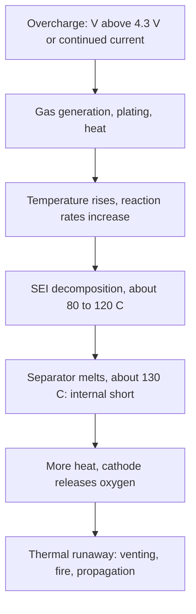

::: testing
Whether you can narrate the **chain of events** from "a bit too much voltage or charge" to "thermal runaway", and attach mechanisms to it: cathode over-delithiation, electrolyte oxidation and gas, lithium plating, heat, internal short. The interviewer also wants the **protection layers** that prevent it (charger CV and termination, timer, per-cell monitoring, protection IC, mechanical safety devices) and the sense of scale: tens of millivolts shorten life, a few hundred millivolts risk gassing, and a runaway needs sustained abuse.
:::

::: why
Overcharge is the classic Li-ion failure and a main reason lithium battery products have layered safety. Designers choose charger accuracy, protection thresholds and cell-level monitoring by thinking through exactly this chain. The question also separates people who say "it explodes" from those who can explain why, and which layer is supposed to stop it.
:::

::: concepts
- **Voltage window**: 4.2 V per graphite/LCO or NMC cell ([[q0305]]).
- **CC-CV and termination**: the correct way to end a charge ([[q0321]]).
- **Lithium plating**: metal deposition when the anode is saturated ([[q0318]]).
- **Electrolyte oxidation and gas**: carbonate decomposition at high cathode potential.
- **Thermal runaway**: self-accelerating exothermic reactions ([[q0332]]).
- **Protection layers**: charger, protection IC/BMS, fuses or CID, thermal cutoffs ([[q0313]]).
:::

::: answer
"Overcharging means pushing a cell above 4.2 volts, or putting in more charge than the anode can accept. The effects escalate with how far and how long.

A little over, say 4.25 to 4.3 volts, mostly shortens life: the cathode is stripped of more lithium than is healthy, the structure degrades, and the electrolyte slowly oxidizes. Go further and several things happen. The electrolyte oxidizes at the cathode surface and produces gas, so the pouch swells. The graphite anode becomes full, so extra lithium plates out as metal, which is permanent capacity loss and can grow dendrites through the separator. All the energy being pushed in beyond what the cell can store goes into side reactions, and that is heat. Heat speeds up the reactions, which makes more heat.

If it continues, the separator can melt at around 130 degrees, which creates an internal short, and then the cathode releases oxygen at high temperature and the cell goes into thermal runaway, venting and possibly fire, which is the failure everyone knows.

So prevention is layered: the charger holds 4.2 volts within about 1 percent and terminates on current and a timer; per-cell monitoring stops it for each cell in a series pack; a protection IC opens a MOSFET at around 4.25 to 4.35 volts; and cells have mechanical devices and the pack has a fuse and temperature cutoff. In a series pack, one cell can overcharge while the total looks right, so balancing and per-cell protection matter."
:::

::: technical
**Escalation with voltage (graphite/LCO or NMC; qualitative, approximate).**

| Cell voltage | Effect |
|---|---|
| 4.20 V (±0.05) | Normal full charge |
| 4.25 to 4.30 V | Accelerated aging: extra oxidation and cathode stress; cycle life drops quickly; typical protection OVP trips here |
| 4.3 to 4.5 V | Rapid electrolyte oxidation, gas generation (swelling), cathode structural change, cobalt/nickel dissolution |
| above about 4.5 V and continuing | Possible internal short, heat generation from side reactions, runaway risk |

**Overcharge by current.** If the charger continues in CC after full, the voltage rises without bound until protection acts. The electrical power $P = V I$ has nowhere to go but side reactions and heat. For a 2 Ah cell at 1 A and 4.5 V, $P \approx 4.5$ W into a pouch of roughly 45 g (assumed $c_p \approx 1$ J/(g·K)): $dT/dt \approx 0.1$ K/s, about 6 K/min before cooling, and rising as reactions accelerate.

**Anode saturation.** In a cell with balanced electrodes the graphite is fully lithiated at about 4.2 V; additional lithium has nowhere to intercalate, so it deposits as metal ($\phi_{anode} \le 0$ V vs Li/Li$^+$). Plating is exacerbated by cold and by high current.

**Gas and swelling.** Carbonate solvents oxidize at the cathode surface above roughly 4.3 to 4.5 V versus lithium, producing CO$_2$ and other gases. A pouch cell swells; a cylindrical cell's pressure can open a current interrupt device (CID) or vent.

**Thermal runaway sequence (approximate temperatures, chemistry dependent).** Heating drives: SEI decomposition (about 80 to 120 °C), then polyethylene separator melting (about 130 °C) giving internal shorts, then cathode decomposition releasing oxygen (about 150 to 250 °C depending on chemistry) which burns the electrolyte.

> [!UNCERTAIN]
> Onset temperatures and voltages depend on cathode chemistry (LCO, NMC, NCA, LFP), electrolyte, state of charge and heating rate. The values are typical orders of magnitude, not thresholds for a specific cell; LiFePO$_4$ is notably more tolerant.

**Layers of protection.** (1) Charger: CV accuracy about ±0.5 to 1 %, current termination, timer, NTC. (2) Per-cell monitoring/BMS: stop charge when any cell exceeds its limit. (3) Independent protection IC with FETs: OVP at about 4.25 to 4.35 V. (4) Pack-level fuse or thermal fuse; cell-level CID and vents in cylindrical cells. (5) Layout and enclosure design ([[q0307]], [[q0313]]).
:::

::: short
"Overcharging is pushing a cell above 4.2 volts or past what the anode can hold. A little over mostly shortens life. Further over, the electrolyte oxidizes and makes gas so the pouch swells, and extra lithium plates as metal on the anode, which can grow dendrites. The energy has nowhere to go but heat, which speeds up the reactions, and eventually the separator melts, the cell shorts and thermal runaway starts. It's prevented in layers: an accurate charger with termination and timer, per-cell monitoring, a protection IC at about 4.3 volts, and fuses or vents."
:::

::: long
"Overcharging means taking the cell above its 4.2 volt limit or putting in more charge than the electrodes can store. The consequences escalate with how far and how long.

At the mild end, 4.25 to 4.3 volts, the main effect is accelerated aging. The cathode is stripped of more lithium than is healthy, its crystal structure starts to degrade, and the electrolyte oxidizes slowly. The cell loses capacity faster each cycle.

Further above that, several things happen at once. The carbonate electrolyte oxidizes at the cathode and produces gas, which is why a pouch cell swells. The graphite anode is fully loaded, so additional lithium plates out as metal; plated lithium is permanent capacity loss and can grow needles through the separator. And since the energy being forced in can't be stored, it goes into side reactions and heat. In a 2 amp-hour cell pushed with 1 amp at 4.5 volts, that's about 4.5 watts into a small pouch, several degrees per minute.

Heat accelerates all the reactions, which generates more heat. Around 130 degrees the polyethylene separator melts, causing an internal short; at higher temperatures the cathode releases oxygen, which burns the electrolyte. That's thermal runaway: venting, fire, and it can propagate to neighbouring cells.

That's why protection is layered. The charger itself regulates 4.2 volts within about a percent, terminates on current and has a timer and temperature qualification. For series packs, a BMS watches every cell, because one cell can be high while the total looks normal. A protection IC opens a MOSFET at about 4.25 to 4.35 volts. And at the cell or pack level there are fuses, thermal cutoffs and, in cylindrical cells, current interrupt devices and vents. The point is that no single failure should lead to overcharge."
:::

::: terms
- **Overcharge**: charging beyond the rated voltage (4.2 V) or capacity.
- **Over-delithiation**: removal of too much lithium from the cathode, destabilizing its structure.
- **Electrolyte oxidation**: decomposition of the solvent at high cathode potential, producing gas.
- **Lithium plating**: metallic lithium deposition on the anode.
- **Thermal runaway**: self-accelerating heat generation from exothermic reactions.
- **CID (current interrupt device)**: pressure-activated disconnect in cylindrical cells.
- **OVP (overvoltage protection)**: the threshold circuit that opens the charge path.
- **Separator shutdown**: melting of the porous separator, which blocks ion flow (and can lead to shorts).
:::

::: exceptional
**An average answer** says "it swells and can catch fire".

**An exceptional answer**:
- Gives a **voltage ladder** (4.2 normal, about 4.25 to 4.3 aging, above 4.3 gas and plating) and the **mechanisms** (cathode over-delithiation, electrolyte oxidation, anode saturation and plating).
- Explains **why heat is the end of the story**: energy forced into side reactions, positive feedback, separator melt and oxygen release.
- Includes a **number** (4.5 W into a 45 g pouch, about 6 K/min).
- Lists **layers of protection** and notes the **series-pack trap** (one cell high while the total looks normal).
- Mentions that **chemistry matters** (LFP much more tolerant) and that onset values are conditional.
:::

::: mistakes
- **"Overcharging only matters at much higher voltages."** Small overcharges (4.25 to 4.3 V) cause measurable life loss every cycle.
- **Relying on the protection IC as the charger's limit.** It is the last line; the charger must stop at 4.2 V.
- **Forgetting the series-pack case.** The pack total may be correct while one cell is at 4.4 V ([[q0314]]).
- **Charging "just a bit longer" in CV.** In CV the voltage is capped, but keeping a cell at 4.2 V for hours (trickle) ages it and is not recommended; terminate and don't float.
- **Believing a swollen cell can be fixed.** Gas is a sign of internal damage; retire the cell.
- **Treating all chemistries the same.** LFP is much more tolerant of overcharge; NMC/LCO are not.
:::

::: deep
## What overcharge physically does

In a Li-ion cell, charging moves lithium from the cathode to the anode. The cell is designed so that at 4.2 V the cathode still has some lithium (for LCO, roughly half the lithium remains) and the anode is nearly fully lithiated. Overcharge pushes beyond both limits.

```svg
<svg viewBox="0 0 600 310" role="img" aria-label="Voltage ladder showing what happens as cell voltage rises above 4.2 V">
  <text x="20" y="22" font-family="Inter, sans-serif" font-size="13" fill="var(--d-ink)" font-weight="600">Cell voltage (graphite / LCO or NMC)</text>
  <rect x="70" y="30" width="56" height="15" fill="var(--d-red)" opacity="0.85"/>
  <rect x="70" y="45" width="56" height="30" fill="var(--d-red)" opacity="0.55"/>
  <rect x="70" y="75" width="56" height="15" fill="var(--d-orange)" opacity="0.8"/>
  <rect x="70" y="90" width="56" height="180" fill="var(--d-green)" opacity="0.6"/>
  <rect x="70" y="30" width="56" height="240" fill="none" stroke="var(--d-ink)"/>
  <g font-family="Inter, sans-serif" font-size="12" fill="var(--d-ink)">
    <text x="62" y="34" text-anchor="end">4.6 V</text>
    <text x="62" y="49" text-anchor="end">4.5 V</text>
    <text x="62" y="79" text-anchor="end">4.3 V</text>
    <text x="62" y="94" text-anchor="end">4.2 V</text>
    <text x="62" y="274" text-anchor="end">3.0 V</text>
    <text x="140" y="58">Gas, plating, separator damage, runaway risk if sustained</text>
    <text x="140" y="85">4.25 to 4.3 V: accelerated aging, protection IC trips here</text>
    <text x="140" y="180">Normal operating window</text>
    <text x="140" y="196" fill="var(--d-muted)">(3.0 to 4.2 V, charge ends at 4.20 V)</text>
    <text x="140" y="40" fill="var(--d-red)">Above 4.5 V: electrolyte oxidation and cathode breakdown accelerate</text>
  </g>
  <line x1="126" y1="90" x2="136" y2="90" stroke="var(--d-ink)"/>
  <line x1="126" y1="75" x2="136" y2="75" stroke="var(--d-ink)"/>
  <text x="20" y="300" font-family="Inter, sans-serif" font-size="11" fill="var(--d-muted)">Thresholds are typical orders of magnitude, not specifications for any one cell.</text>
</svg>
```
Figure: The safe window ends sharply at 4.2 V. The orange band just above is where life loss accelerates and where protection ICs usually trip; the red region is where gas, plating and runaway risk build up if the abuse continues.

### Cathode

For LCO, deintercalating more than about half of the lithium (beyond roughly 4.2 V) destabilizes the layered structure: it undergoes phase transitions, cracks particles, dissolves cobalt and, at high temperature, releases oxygen. NMC and NCA tolerate somewhat higher voltages but degrade similarly past their design limit.

### Electrolyte

The carbonate solvents oxidize at the cathode surface above about 4.3 to 4.5 V versus Li/Li$^+$. The products include CO$_2$ and other gases plus resistive films, so swelling and an increase in resistance come together.

### Anode

Once the graphite is full ($\phi \to 0$ V vs Li), charge current can only plate lithium metal. Plated lithium is partly irreversible, consumes electrolyte, and can form dendrites. Overcharge by *current* (a charger that never terminates) pushes this far.

### Heat

All the electrical work beyond storage becomes heat via side reactions. With $P = VI$:

```plot
{"title":"Adiabatic temperature rise of a 45 g cell under continued overcharge at 4.5 V (upper bound)","x":{"label":"Time since the cell stopped accepting charge","unit":"min","min":0,"max":30},"y":{"label":"Cell temperature","unit":"°C","min":20,"max":220},
 "vars":{"v":4.5,"m":45,"cp":1},
 "series":[{"label":"0.5 A","color":"green","fn":"25+v*0.5/(m*cp)*60*x"},{"label":"1 A","color":"orange","fn":"25+v*1/(m*cp)*60*x"},{"label":"2 A","color":"red","fn":"25+v*2/(m*cp)*60*x"}],
 "hlines":[{"at":130,"label":"about 130 °C: separator melts","color":"muted"}]}
```
Figure: If all of $V \cdot I$ became heat with no cooling, a 45 g pouch (assumed $c_p$ = 1 J/(g·K)) would reach separator-melt temperature in about 17 min at 1 A and about 9 min at 2 A. Real cooling and partial storage make it slower, but real reactions accelerate with temperature, so the trend (minutes, not hours, and faster at higher current) is the point.

### Thermal runaway

Typical sequence for a charged NMC/LCO cell (temperatures approximate):


Figure: Each stage supplies the heat that triggers the next. Protection is designed to break the chain at the start (voltage and current limits) rather than rely on the later mechanical stages.

## Series packs: the hidden overcharge

In a series string, a charger sees the total. A 4S pack at 16.8 V can have one cell at 4.35 V and another at 4.05 V. Without per-cell monitoring the first cell is overcharged although the pack total is right ([[q0314]]). Two defenses: balancing (keeps cells equal over time) and per-cell OVP (stops charge when any cell exceeds the limit).

```sim
{"id":"cell-balancing","cells":4,"mismatch":0.1,"balance":"none"}
```
Figure: With balancing off, this per-cell-aware charger stops when the first cell reaches 4.2 V and leaves the others short. Now read the "Pack-level CV, no cell monitor" readout: a charger that only regulates the 16.8 V total drives the highest cell to about 4.27 V with this 10 % mismatch, past a typical protection-IC trip. This is why per-cell monitoring is needed.

## Protection layers

1. **Charger**: CV set-point accurate to about ±0.5 to 1 %; termination on current (C/20 to C/10); safety timer; temperature qualification.
2. **BMS / per-cell monitor**: stop charge if any cell exceeds its limit; balance.
3. **Protection IC with FETs**: independent hardware OVP (about 4.25 to 4.35 V with a delay).
4. **Pack/cell-level devices**: PTC or fuse, thermal fuse, CID and vents in cylindrical cells.
5. **System design**: enclosure, spacing, and monitoring of temperature rise.

A well-designed system keeps layers independent: a single component or firmware failure doesn't defeat all of them.

## Numbers and sanity checks

- 1 % charger error at 4.2 V is 42 mV, so a cell regulated at 4.242 V is still well below the damaging region, but the margin to the 4.25 to 4.3 V protection trip is small. Hence the 0.5 to 1 % target.
- Overcharge by 10 % capacity at 1 A on 2 Ah takes 12 min of CC after full; the cell voltage would climb well above 4.5 V in that time.
- Cycle life falls as the charge voltage rises above the rating, but by how much varies widely by cell; use the manufacturer's cycle-life vs charge-voltage data if it exists rather than a rule of thumb.

## An energy budget for the first 20 minutes of an overcharge

Take the same 2 Ah, 45 g cell from the figure, charger stuck in constant current at 1 A after the cell is full. The first thing to check is how much energy is needed to reach the separator-melt region. Heating 45 g with $c_p\approx1$ J/(g·K) from 25 °C to 130 °C needs $45\times1\times105=4.7$ kJ. At 4.5 W (4.5 V times 1 A, optimistic upper bound because some of it is stored chemically) that takes $4725/4.5=1050$ s, 17.5 minutes, which is the number on the plot. For scale, pushing a further 20% of capacity (0.4 Ah) at 1 A takes only 24 minutes, so even a timer of a couple of hours is far too slow to be the main protection; the timer is a backstop behind accurate voltage regulation and current termination.

A reality check on the assumptions: real cells lose heat to their surroundings, but a pouch inside a phone-like enclosure with insulation (foam, plastic) has a heat loss of well under a watt, so the adiabatic estimate is not far off for a small device. Furthermore the heating is not uniform: gas generation lifts the electrodes away from each other and hot spots form near the tabs. Treat 17.5 minutes as the "no cooling" bound and test your enclosure to see how far real hardware sits from it.

## A little gas goes a long way: the pressure estimate

Gas generation is why overcharged pouches swell and cylindrical cells vent. Consider a cell with a free internal volume of about 2 cm³ (assumed; it varies with the format and fill). By the ideal-gas law, one millimole of gas at 25 °C gives

$$P=\frac{nRT}{V}=\frac{10^{-3}\times8.314\times298}{2\times10^{-6}}=1.2\ \text{MPa}\approx12\ \text{bar}$$

and one millimole of CO₂ is only 44 mg. So decomposing a few tens of milligrams of electrolyte is sufficient to take a sealed can to pressures that open a safety vent, and the gas is hot, which raises the pressure further in proportion to absolute temperature. That is also the reason a swollen pouch is a serious warning: the gas inside is evidence of electrolyte decomposition that already happened, even if the cell still reads normal voltage.

> [!UNCERTAIN]
> Free volume, vent or current-interrupt-device pressures and the gas mix all depend on the cell design. The 2 cm³ and 1.2 MPa figures illustrate scale only, and should not be taken as a spec for any cell.

## The series-pack case in numbers

Return to the 4S pack. A charger that regulates only the total at 16.8 V (4 × 4.2 V) assumes all cells are equal. Suppose three cells sit at 95% state of charge, where the OCV table gives about 4.14 V, and the fourth is higher because of a capacity or self-discharge mismatch. The charger keeps pushing until the sum is 16.8 V, so the odd cell must reach $16.8-3\times4.14=4.38$ V. That is 180 mV over the 4.20 V limit, above the 4.25 to 4.35 V trip of a typical protection IC, and into the oxidation range of the earlier voltage ladder. The two other things to notice are that the pack voltage looked perfect all the way, and that the problem repeats every cycle: the cell that overshoots ages faster, its capacity falls, and the mismatch grows. This is a positive feedback loop of its own, and the reason balancing circuits and per-cell protection are not optional on series packs.

## Why timing matters: delay settings in the protection IC

The protection IC does not trip the instant a cell crosses its threshold. A delay (often hundreds of milliseconds to a second; a typical order of magnitude) filters out noise. For a slow overcharge the delay costs nothing, because the cell voltage rises on a time scale of minutes, not milliseconds. The delay matters in the other direction, for false trips caused by a noisy supply. If you set a monitor to trip at the exact charge limit it will trip repeatedly through normal CV charging as voltage and noise sit right at the limit. That is why the protection threshold sits 50 to 150 mV above the charge target: it is a safety net, and the margin is deliberate. It is also why moving a charger set point to "just under the trip" to gain capacity is a bad idea.

## How to test overcharge protection without hurting a cell

1. Test the protection board on the bench with the cell replaced by a low-impedance bench supply, stepping the voltage up slowly and watching the charge FET gate. Record the trip voltage and the delay, then compare with the datasheet limits. No cell is at risk.
2. Test the charger's termination by connecting a battery emulator or a capacitor bank and a series resistor, and observe that the charger enters CV, the current falls, and termination happens at the stated current.
3. Test the BMS cell-overvoltage path on a multi-cell pack by injecting a voltage on a single sense line using a bench supply with a current limit, and confirm that charging is disabled.
4. Never overcharge a real cell to "see what happens" outside a proper abuse-test facility: do the testing on electronics and emulators, and use certified test labs for abuse tests (see [[q0327]]).

:::

::: applications
- **Charger IC design**: CV accuracy, termination current and timer specifications are set by this failure chain ([[q0313]]).
- **Multi-cell BMS**: per-cell OVP comparators and balancing.
- **Drone/RC chargers**: balance chargers that monitor each cell and abort on a cell above about 4.25 V.
- **Cylindrical cell design**: CID, vent and PTC elements as last-resort mechanical safeties.
- **Regulatory/transport testing**: overcharge abuse tests are part of battery safety qualification (details depend on the standard).
:::

::: assumptions
- The voltage ladder applies to **graphite-anode cells with LCO or NMC cathodes** at room temperature. High-voltage cells (4.35 to 4.4 V) have higher limits; LFP is more tolerant; LTO behaves differently.
- Temperatures for SEI breakdown, separator melting and oxygen release are **typical order-of-magnitude values** and depend on cell design and state of charge.
- The heating-rate estimate is **adiabatic and assumes all power becomes heat**, which is an upper bound.
- "Overcharge" includes both **over-voltage** (charge limit set too high) and **over-current/over-time** (no termination); both lead to the same mechanisms.
- Protection ICs and thresholds listed are **typical**; specific parts differ.
:::

::: followups
### Does 4.25 V instead of 4.2 V cause a fire?
Not by itself. A 50 mV overshoot mostly accelerates degradation (more cathode stress and electrolyte oxidation, lower cycle life). Hazard rises with higher voltage, longer time, higher temperature and a damaged or old cell. But it removes safety margin: the protection IC typically trips at 4.25 to 4.35 V, so the charger tolerance eats into it.

### Why can one cell in a series pack overcharge while the pack voltage is normal?
Because the charger regulates the sum. If cells differ in SoC or capacity, the cell with the smallest capacity or highest SoC reaches 4.2 V first, and if charging continues to reach the pack's total target, it goes above 4.2 V while others stay low. The remedy is per-cell monitoring and balancing ([[q0314]]).

### What would you expect to see on a scope or log during an overcharge event?
Cell voltage rising above 4.2 V (it keeps rising in CC), current staying constant instead of decaying, temperature climbing at an increasing rate (dT/dt growing), and possibly a voltage plateau or drop as the cell shorts internally or the CID opens. Pouch cells swell. A good BMS flags rising dT/dt before an absolute temperature limit.

### Is a protection IC at 4.3 V enough as the only overcharge protection?
No. It is designed as a backup layer; its thresholds, accuracy (often ±25 to 50 mV) and delay are looser than the charger's. Relying on it means the cell is repeatedly stressed at the edge. You want the charger to terminate correctly (accuracy, termination current, timer), the BMS to monitor each cell, and the protection IC as the independent last layer.

### What if the cell is LiFePO4?
LFP has a lower full-charge voltage of about 3.6 to 3.65 V and a very stable olivine cathode that does not release oxygen the same way, so it is far more tolerant of overcharge and less prone to thermal runaway. It still shouldn't be overcharged (electrolyte decomposition and plating can occur), and the charger limit and protection must match 3.65 V, not 4.2 V.
:::

::: interpretations
"Overcharge" can mean exceeding the **voltage** limit, delivering more **charge** than capacity, or continuing **current** past full. The mechanisms overlap and I treat them together. For the related over-discharge case see [[q0330]], and for the extreme end of this chain see [[q0332]] (heat) and [[q0327]] (dangers and prevention).
:::

::: references
- Linden & Reddy, *Handbook of Batteries*: lithium-ion safety, overcharge and thermal behaviour.
- Plett, *Battery Management Systems, Volume I*: protection requirements and cell limits.
- Battery University (Cadex): articles on lithium-ion safety, overcharge and thermal runaway.
- Cell datasheets and manufacturer safety documents: charge voltage limits, protection recommendations and abuse behaviour for the specific cell.
:::

::: rubric
- States the limit (4.2 V per cell) and that overcharge exceeds the voltage or capacity limit :: Defines the event.
- Names the mechanisms: cathode over-delithiation, electrolyte oxidation and gas, plating :: Shows understanding of why.
- Describes the escalation to heat, separator melt, internal short and thermal runaway :: The consequence chain.
- Explains that mild overcharge mainly accelerates aging :: Correct sense of scale.
- Describes protection layers (charger, BMS, protection IC, fuse/CID) :: How the hazard is prevented in practice.
- Mentions series-pack imbalance and per-cell monitoring :: The classic real-world trap.
:::

::: quiz
```json
[
 {"type":"mcq","level":"fundamental","q":"Which is a direct consequence of overcharging a LiPo pouch cell?","options":["Gas generation and swelling","The cell voltage drops to 3.0 V","The cell becomes lighter","Its capacity increases permanently"],"answer":0,"explain":"At high cathode potential the electrolyte oxidizes and produces gas, swelling the pouch. Capacity decreases, not increases."},
 {"type":"mcq","level":"fundamental","q":"What happens to lithium that cannot be accommodated by a full graphite anode during overcharge?","options":["It plates out as metallic lithium","It dissolves harmlessly","It turns into copper","It leaves the cell as gas"],"answer":0,"explain":"With the anode saturated, extra lithium deposits as metal (plating), causing permanent capacity loss and dendrite risk."},
 {"type":"numeric","level":"intermediate","q":"A 45 g cell is still charged at 1 A with the cell voltage at 4.5 V and cannot store charge. Assuming all power becomes heat and cp = 1 J/(g·K), what is the adiabatic heating rate?","answer":6,"tolerance":0.03,"unit":"K/min","explain":"$P = 4.5 \\times 1 = 4.5$ W; $dT/dt = 4.5/45 = 0.1$ K/s = 6 K/min."},
 {"type":"numeric","level":"intermediate","q":"A charger has ±1 % regulation accuracy at 4.2 V. What is the worst-case voltage error?","answer":42,"tolerance":0.01,"unit":"mV","explain":"$0.01 \\times 4.2$ V $= 0.042$ V = 42 mV."},
 {"type":"truefalse","level":"advanced","q":"In a 4S pack charged to 16.8 V total, it is impossible for any single cell to exceed 4.2 V.","answer":false,"explain":"The sum can reach 16.8 V with cells at, for example, 4.35, 4.2, 4.15 and 4.1 V. Without per-cell monitoring or balancing, a high cell is overcharged."},
 {"type":"multi","level":"advanced","q":"Which are independent protection layers against overcharge?","options":["Accurate CV regulation with current termination and a timer","Per-cell monitoring/BMS","A protection IC with its own OVP threshold","Choosing a bigger battery label"],"answer":[0,1,2],"explain":"The charger profile, per-cell monitoring and an independent protection IC are separate layers. The label size has no protective function."}
]
```
:::
