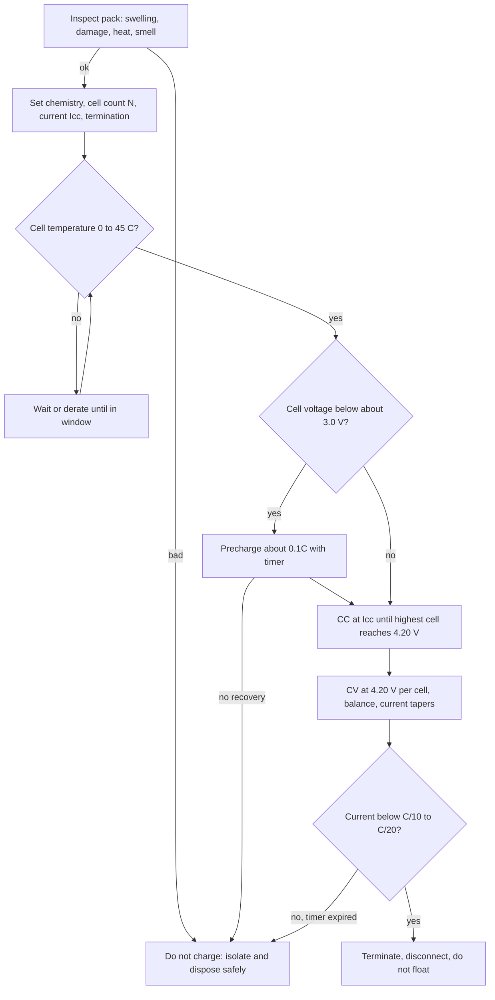

::: testing
Whether you can give a **procedure**, not a slogan: inspect, set the right chemistry, cell count and current, check temperature, precondition if deeply discharged, CC to 4.2 V per cell, CV with current taper, terminate on current and a timer, disconnect, and then the safety environment (supervision, fire-safe surface, balance lead for multi-cell). You are also showing you know *why* each step exists, tied to plating, overcharge and thermal runaway, and that you can translate it into charger-IC behaviour.
:::

::: why
Charging is where most LiPo incidents happen, from hobby packs to product failures. A candidate who can walk through the procedure and justify the precautions shows safety judgement, and the same steps are what a charger IC or BMS implements, so this is also a design question in disguise.
:::

::: concepts
- **CC-CV charging**: the standard algorithm ([[q0321]]).
- **Charge rate limit**: typically 0.5C to 1C by default ([[q0318]]).
- **Voltage and temperature windows**: 4.20 V per cell, about 0 to 45 °C ([[q0305]], [[q0306]]).
- **Precharge**: gentle current for a deeply discharged cell.
- **Balancing**: series packs need per-cell monitoring ([[q0314]], [[q0326]]).
- **Failure chain**: overcharge, plating and runaway ([[q0319]]).
:::

::: answer
"I'd treat it as a procedure with checks before, during and after.

Before: inspect the pack. If it's swollen, punctured, hot, or has been deeply discharged and sat, I don't charge it. Confirm the chemistry and the cell count, so a 3S gets a 12.6 volt target, and set the charge current to the cell's rating, typically 0.5C to 1C, so about 1 to 2 amps for a 2 amp-hour cell. For multiple cells I connect the balance lead so every cell is monitored. Check that the cell is between about 0 and 45 degrees.

During: if the cell is below roughly 3.0 volts, the charger precharges at about a tenth of the normal current until it recovers. Then constant current at the set rate until the cell reaches 4.2 volts. Then constant voltage at 4.2 volts, where the current falls, until it drops to roughly C over 10 to C over 20. At that point it terminates. I also want a safety timer and a temperature cut-off.

After: disconnect when done, don't trickle or float it at 4.2 volts for days; if it's going to sit, take it to storage voltage around 3.8 volts per cell.

Precautions: use a charger designed for Li-ion, not a generic power supply; charge on a non-flammable surface, ideally in a fireproof bag or container, within sight, never unattended or overnight on a bed; don't charge a cold or hot cell; watch for swelling, heat or smell, and if so unplug and move it somewhere safe."
:::

::: technical
**Procedure (single cell; multiply voltage by $N$ for series packs).**
1. **Inspect** for swelling, punctures, damaged wires, heat, smell; reject suspicious cells ([[q0328]]).
2. **Configure**: chemistry (Li-ion/LiPo), cell count $N$ (target $4.20 N$ V), current $I_{cc} \le$ rated charge rate (0.5C to 1C by default), termination current.
3. **Qualify**: temperature within about 0 to 45 °C (NTC), input OK, cell not shorted.
4. **Precharge** if $V_{cell} <$ about 3.0 V: $\approx 0.1C$ until above the threshold, with a timer; fail if it doesn't recover (possible internal short).
5. **CC phase**: $I = I_{cc}$ until $V_{cell}$ (the highest cell in a series pack) reaches 4.20 V.
6. **CV phase**: hold 4.20 V per cell (±0.5 to 1 %); current decays; balance high cells.
7. **Terminate** when $I < I_{term}$ ($C/20$ to $C/10$), or when the safety timer expires.
8. **Disconnect/rest**; do not float. If storage is planned, discharge/charge to about 3.8 V per cell ([[q0324]]).

**Example numbers.** 3S 2200 mAh pack, 1C: $I_{cc} = 2.2$ A, target 12.6 V, precharge current about 0.22 A below 9.0 V (3.0 V/cell), termination about 0.11 to 0.22 A. In the simulator model of a 2 Ah, 50 mΩ cell, 1C takes about 51 min in CC and 77 min total.

**Timer.** Set to about 1.5 to 2× the expected time; at 1C on a flat cell, 2 to 2.5 h.

**Charger hardware limits.** Linear chargers dissipate $(V_{in} - V_{bat})I$ (3 W for 5 V in, 3.5 V cell, 2 A); a switching charger is more efficient ([[q0313]]).

**Environment.** Non-flammable surface, away from combustibles, fire-resistant bag or box, a smoke detector nearby, someone present. Charge at room temperature; let a cold cell warm first.
:::

::: short
"First inspect the pack and don't charge anything swollen or damaged. Set the right chemistry, cell count and a current of 0.5 to 1C, connect the balance lead for series packs, and check the temperature is between about 0 and 45 degrees. A deeply discharged cell gets a gentle precharge. Then constant current until 4.2 volts per cell, constant voltage with the current tapering to about C over 10 to C over 20, then terminate, with a timer as backup. Charge on a non-flammable surface, never unattended, and don't leave it floating at full."
:::

::: long
"I'd think of it as before, during and after.

Before charging, I inspect the pack. Swelling, a punctured pouch, damaged leads, heat or a smell means no charge; it gets retired. Then I set up the charger for the right chemistry and cell count, so a 3S gets a 12.6 volt target. I pick the current: 0.5 to 1C by default, within the cell's datasheet. For a 2.2 amp-hour pack that's 1.1 to 2.2 amps. If it's a multi-cell pack I connect the balance lead so the charger sees each cell. And I check the temperature: the cell should be between about 0 and 45 degrees, and I wait if it's cold or warm.

During charging the charger does the profile. If a cell is below roughly 3.0 volts, it precharges at about a tenth of the normal current, with a timer, and rejects a cell that doesn't recover. Then constant current at the set rate until the highest cell reaches 4.2 volts. Then constant voltage, holding 4.2 volts within about a percent, while the current decays, and balancing bleeds the higher cells. It terminates when the current falls to between a tenth and a twentieth of C, with a safety timer in case that never happens. In the model of a 2 amp-hour cell at 1C, that's about 51 minutes of CC and 77 in total.

After charging I disconnect. I don't trickle or float at 4.2 volts; if the pack will sit for more than a few days I bring it to storage voltage of about 3.8 volts per cell.

The precautions are about the failure case, which is overcharge, plating and thermal runaway: use a proper Li-ion charger rather than a bench supply, charge on a non-flammable surface or in a fireproof bag, in sight, never overnight or unattended, and if anything swells, gets hot or smells, unplug it and move it somewhere safe."
:::

::: terms
- **CC-CV**: constant-current then constant-voltage charging.
- **Precharge / trickle**: low-current stage for deeply discharged cells.
- **Termination current**: the taper current at which charging ends (C/20 to C/10).
- **Safety timer**: a time limit that ends charge if termination isn't reached.
- **Balance lead**: connector giving access to each series cell's voltage.
- **Storage voltage**: about 3.8 V per cell for long-term storage ([[q0324]]).
- **LiPo bag**: fire-resistant container for charging and storage.
- **Floating/trickle**: holding a full cell at 4.2 V, which is not recommended.
:::

::: exceptional
**An average answer** says "use a LiPo charger, 1C, don't overcharge".

**An exceptional answer**:
- Gives the full **sequence with thresholds** (inspect, precharge below about 3.0 V, CC, CV at 4.20 V/cell, terminate at C/20 to C/10, timer).
- Gives **numbers for a real pack** (3S 2200 mAh: 2.2 A, 12.6 V, 0.22 A precharge).
- Explains **why each precaution exists** (plating, overcharge, series-cell imbalance, thermal runaway).
- Covers **system design**: charger IC features, temperature qualification, per-cell monitoring, not floating.
- Includes the **environment and human factors**: fire-safe surface, supervision, handling damaged cells.
:::

::: mistakes
- **Charging with a lab power supply set to 4.2 V.** There's no termination, timer or temperature check, and a deeply discharged cell will draw high inrush current.
- **Wrong cell count setting.** Telling the charger a 3S pack is a 4S targets 16.8 V, i.e. 5.6 V per cell, a catastrophic overcharge.
- **Skipping the balance lead on a series pack.** Cells go out of balance, one can be overcharged ([[q0314]]).
- **Charging a swollen, cold or hot pack.** Those are exactly the cells that fail.
- **Leaving the pack on the charger for days.** Floating at 4.2 V ages the cell and removes the safety margin of termination.
- **Charging unattended on a flammable surface.** If it fails, it fails quickly.
:::

::: deep
## The charge as a sequence of checks and states

A good charge is a state machine with entry conditions and exits. Whether you are standing at a bench or designing a charger IC, it's the same:


Figure: The procedure is a chain of conditional steps with exits to a "do not charge" state. The same graph appears inside every charger IC, as a state machine around cell voltage, current, temperature and time ([[q0313]]).

## Step by step, with the reasons

**1. Inspect.** Swelling means gas from electrolyte decomposition (overcharge or abuse), a punctured pouch can short internally, and a warm pack at rest suggests a self-discharge short. Charging adds energy to a cell that may already have an internal fault; this is the situation where fires start ([[q0327]]).

**2. Set up the charger.** The target voltage is $4.20\,N$. A wrong $N$ is dangerous in either direction: too low undercharges, too high overcharges every cell ([[q0319]]). Current: $I_{cc} = r\,Q$ with $r$ from the datasheet (0.5C to 1C default, [[q0318]]).

**3. Temperature.** Charging below 0 °C risks lithium plating; above about 45 °C accelerates aging and gas. Use an NTC (or let the pack's internal NTC speak to the charger) and wait until the cell is in range.

**4. Precharge.** Below about 3.0 V (per cell) the cell may have started to degrade, and high current into it risks plating and heating. Precharge at $\approx 0.1C$ until the voltage passes the threshold; if it doesn't recover in the timer (for example 30 to 60 min), reject the cell as likely shorted.

**5. CC.** The charger delivers $I_{cc}$ and the voltage rises. For multi-cell packs the *highest* cell sets the transition.

**6. CV.** $V_{cell}$ is held at 4.20 V; current decays as $I = (4.2 - V_{OCV})/R$ ([[q0321]]). Balancing acts here: high cells are bled so the others can catch up.

**7. Terminate.** When $I \le I_{term}$ ($C/20$ for max capacity, $C/10$ for a shorter tail with slightly less capacity), stop. The timer is a backup for a failed current sensor or a bad cell.

**8. Disconnect.** Don't float: keeping a cell at 4.2 V for long periods accelerates aging and keeps the cell in a high-energy state.

## Worked example: 3S 2200 mAh, 1C

| Parameter | Value |
|---|---|
| Target voltage | $3 \times 4.20 = 12.6$ V |
| Fast-charge current | 2.2 A |
| Precharge threshold | 9.0 V total (3.0 V per cell), at about 0.22 A |
| Termination | about 0.11 to 0.22 A (C/20 to C/10) |
| Time | CC about 50 min, total about 77 min (model scaled from 2 Ah); timer 2.5 h |
| Charger power | $12.6 \times 2.2 \approx 28$ W out, about 31 W in at 90 % efficiency |

A 12 V/5 A supply can feed this charger, but a USB-C 5 V port cannot without a boost stage.

```sim
{"id":"lipo-lab","view":"charge","capacity":2,"crate":1,"temp":25,"rint":0.05}
```
Figure: Watch the CC-CV profile and the termination current. Change the temperature to 5 °C: the CC phase is shorter in this model because of the higher resistance. In a real charger the current would be reduced there for plating reasons, and below 0 °C blocked entirely.

## Precautions: what they protect against

| Precaution | Failure it prevents |
|---|---|
| Right chemistry and $N$ setting | Systematic overcharge or undercharge |
| Balance lead on series packs | One cell overcharged while the total looks fine |
| Temperature window | Plating (cold) and accelerated aging/gas (hot) |
| Precharge with timer | Fast charge into a deeply discharged or shorted cell |
| Termination and timer | Overcharge from a failed CV or sensor |
| No floating | Aging and avoidable stress |
| Non-flammable surface, bag, supervision | Limits the damage if a cell fails |
| Inspect/reject damaged cells | Charging a cell with an internal short |
| Proper Li-ion charger | All of the above implemented correctly |

> [!WARNING]
> A damaged, swollen or deeply over-discharged LiPo should not be charged "to see what happens". If a cell becomes hot, swells, hisses or smells while charging, disconnect the charger if it is safe to do so and move the pack away from flammable material, preferably outdoors on a non-flammable surface. For disposal see [[q0328]].

## Designing the charge function into a product

A single-cell product normally uses a charger IC with all these steps built in: precharge, CC (programmed by a resistor or I²C), CV with ±0.5 to 1 % accuracy, termination current, safety timer, NTC input and thermal regulation. For multi-cell packs the BMS adds per-cell voltage monitoring and balancing. An MCU may configure the charge parameters but the safety limits should be in hardware ([[q0313]], [[q0323]]).

## Interviewer follow-up traps

- *"What if you only have a bench power supply?"* Set voltage to 4.20 V per cell and a current limit at 0.5C to 1C, watch the current taper, and disconnect manually when it falls below about C/10. Never leave it. It's a lab workaround, not a charger.
- *"What if the cell is at 2.0 V?"* Treat it as damaged; many chargers refuse it. Some labs attempt a gentle recovery at 0.05C to 0.1C under supervision, with the understanding that the cell's safety and life are compromised ([[q0330]]).
:::

::: applications
- **Hobby balance chargers**: user selects LiPo, cell count and current; the charger runs CC-CV with per-cell balancing and terminates on current.
- **Phone and laptop charging ICs**: automated precharge, CC, CV and termination, with NTC-qualified thermal derating.
- **E-bike chargers**: dedicated CC-CV chargers for the specific pack voltage, with the BMS handling cell protection.
- **Power banks**: internal charger IC for the cell plus a boost stage for the outputs.
- **Production line formation and test**: programmable battery cyclers executing the same profile and logging capacity.
:::

::: assumptions
- The procedure is for **graphite-anode Li-ion/LiPo cells with 4.20 V limit**. Other chemistries have different voltages (LFP 3.65 V) and different charger types.
- The default rates (0.5C to 1C), precharge threshold (about 3.0 V, 0.1C) and termination (C/20 to C/10) are **typical**; the cell datasheet and charger IC documentation govern.
- The timing numbers are scaled from the **simplified model** (2 Ah, 50 mΩ) and ignore precharge and thermal derating.
- A **protection circuit** in the pack and a **per-cell** monitor are assumed for multi-cell packs.
- The answer for **hobby** charging emphasizes human precautions (supervision, fireproof storage); for **product design** the emphasis shifts to charger IC features and BMS.
:::

::: followups
### Why precharge rather than just starting at 1C?
A deeply discharged cell (below about 3.0 V) has an elevated resistance, a possibly damaged anode and a higher plating risk; forcing 1C into it can produce heating and damage, and if the cell has an internal short, high current makes it worse. The gentle precharge at about 0.1C lifts the voltage safely and reveals a bad cell: if the voltage doesn't rise within the timer, the charger flags a fault.

### What current do you terminate at, and why?
C/20 gives the fullest charge but the longest tail; C/10 shortens the charge (the last 5 % of capacity takes disproportionate time) at the price of slightly less capacity (in the model, stopping at C/10 instead of C/20 saves about 6 minutes and gives up under 1 % of capacity). Cell datasheets specify the value; charger ICs often fix it at about 7 to 10 % of the programmed current. A timer is the backup.

### You must charge a 4S pack from a 12 V supply. What do you need?
A boost-capable charger: 4S needs 16.8 V at the end of charge, above 12 V. So a boost or buck-boost charger, or a higher-voltage supply (for example 19 to 24 V) with a buck charger. Also per-cell balancing, a current limit at 0.5C to 1C and thermal monitoring.

### How do you charge a pack when you don't know what condition it's in?
Check voltage per cell first: if all cells are above about 3.0 V and the pack is not swollen or hot, start at a low current (0.1C to 0.5C) and watch the temperature and voltage of each cell. If any cell is below about 2.5 V, or swollen, don't charge. In a product, the BMS applies the same checks automatically.

### What if the charger stays in CV for hours and the current never drops below termination?
Something is wrong: a failing cell with high self-discharge or an internal short is consuming the current, or the current sense is broken. The safety timer should stop the charge. Disconnect and examine the cell: a cell that can't terminate is a candidate for retirement ([[q0312]]).
:::

::: interpretations
"How do you charge a LiPo?" can be asked from a **hobbyist/user** view (settings and precautions) or a **designer** view (what a charger implements). I cover both: steps, parameters and precautions, and how they map to charger-IC and BMS features. The CC and CV phases are detailed in [[q0321]], and what to monitor is in [[q0322]].
:::

::: references
- Linden & Reddy, *Handbook of Batteries*: charging methods for lithium-ion cells, CC-CV and safety.
- Battery University (Cadex): articles on charging lithium-ion batteries and on LiPo safety practices.
- Plett, *Battery Management Systems, Volume I*: charge control and protection logic.
- Datasheets of single-cell and multi-cell Li-ion charger ICs and of the specific cell/pack for charge current, voltage, termination and temperature limits.
:::

::: rubric
- Pre-charge checks: inspect, correct chemistry/cell count, temperature window :: Prevents charging a bad or mis-set cell.
- CC to 4.20 V per cell at about 0.5C to 1C :: The first charging phase with the right limit.
- CV at 4.20 V with current taper and termination at C/20 to C/10 :: The second phase and its stopping rule.
- Precharge for deeply discharged cells, with timer :: Handles the edge case safely.
- Safety timer, temperature cutoff, no floating :: Backup protections.
- Balance lead and per-cell monitoring for series packs :: Avoids the hidden overcharge.
- Physical precautions (fire-safe surface, supervision, reject damaged cells) :: The practical safety side the question asks for.
:::

::: quiz
```json
[
 {"type":"numeric","level":"fundamental","q":"What is the target (CV) voltage for charging a 3S LiPo pack?","answer":12.6,"tolerance":0.01,"unit":"V","explain":"Three cells in series at 4.20 V each: $3 \\times 4.2 = 12.6$ V."},
 {"type":"numeric","level":"fundamental","q":"A 2200 mAh pack is charged at 1C. What charge current should you set?","answer":2.2,"tolerance":0.01,"unit":"A","explain":"1C equals the capacity in Ah expressed in amps: 2.2 A."},
 {"type":"mcq","level":"intermediate","q":"A single cell reads 2.6 V before charging. What should a good charger do first?","options":["Charge at 2C","Precharge at about 0.1C (with a timer) or refuse to charge","Apply 5 V directly","Skip to CV"],"answer":1,"explain":"Deeply discharged cells need a gentle precharge to avoid plating and heating, with a timer to reject a cell that doesn't recover."},
 {"type":"numeric","level":"intermediate","q":"A 2200 mAh cell is charged at 1C with termination at C/10. At what current does charging terminate?","answer":0.22,"tolerance":0.02,"unit":"A","explain":"$C/10 = 2.2/10 = 0.22$ A."},
 {"type":"truefalse","level":"advanced","q":"Setting a 3S pack to charge as a 4S (16.8 V target) is only a minor issue because the protection circuit will catch it.","answer":false,"explain":"The 16.8 V target spread over three cells is 5.6 V per cell, far beyond 4.2 V. The protection IC is a last-resort layer; charger configuration errors are a major hazard."},
 {"type":"multi","level":"advanced","q":"Which precautions are appropriate when charging a LiPo pack?","options":["Charge on a non-flammable surface and stay nearby","Use the balance lead for multi-cell packs","Leave it on the charger for days at 4.2 V per cell to keep it topped up","Refuse to charge a swollen pack"],"answer":[0,1,3],"explain":"Supervision, a fire-safe surface, per-cell monitoring and rejecting damaged cells are standard. Floating at 4.2 V ages the cell and removes the safety of termination."}
]
```
:::
