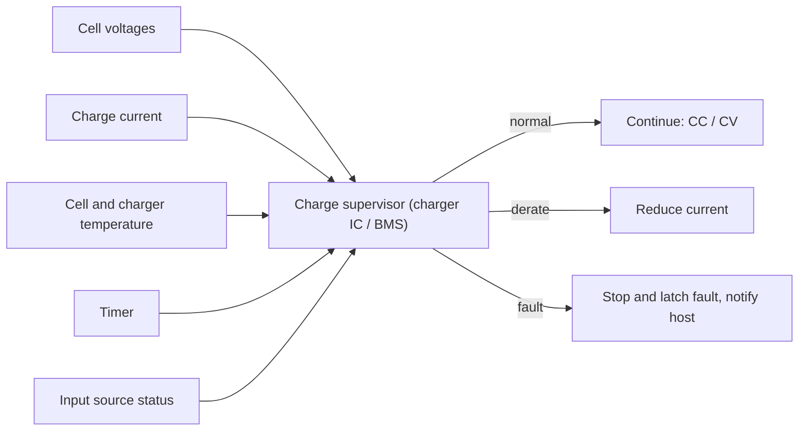

::: testing
Whether you can list what must be watched **during charging specifically**, with limits and the reason for each: per-cell voltage (4.20 V limit, imbalance), charge current (CC set-point, taper, termination), temperature (0 to 45 °C window, rate of rise), time (timer) and input conditions. Strong answers also describe what a *healthy* charge looks like versus what a *faulty* one looks like (current that never tapers, voltage that doesn't rise, temperature that runs away), so monitoring becomes diagnosis, not just limit checking.
:::

::: why
Most of the damage and nearly all of the hazard in a LiPo's life happens while it is being charged. A designer must decide which signals the charger or BMS must sense, how accurately, and what the action is on each fault. A user must know what to watch for at the bench. This question connects the general monitoring list ([[q0307]]) to the charge profile ([[q0321]]).
:::

::: concepts
- **Per-cell voltage**: limit 4.20 V each; spread indicates imbalance ([[q0314]]).
- **Charge current**: the CC value, the CV taper and the termination threshold ([[q0321]]).
- **Temperature**: NTC on the cell; window about 0 to 45 °C ([[q0306]]).
- **Time**: a safety timer as a backstop for failed termination.
- **Input source**: voltage and current limit of the supply (USB, adapter).
- **Fault signatures**: patterns in V, I and T that reveal a bad cell ([[q0312]], [[q0319]]).
:::

::: answer
"When I charge a LiPo I watch four things: voltage, current, temperature and time, plus a few supporting signals.

Voltage, per cell. Each cell must stay at or below 4.20 volts, and in a series pack I watch the spread between cells. If one cell is racing ahead, that's imbalance, and the charger needs to balance or stop.

Current. In the constant-current phase it should sit at the set value, say 1C. In constant voltage it should fall smoothly. I terminate when it reaches about C over 20 to C over 10. If the current doesn't taper, the cell has a leakage path or something is wrong.

Temperature, from an NTC on the cell. I want about 0 to 45 degrees for charging, and I also watch the rate of rise: a pack warming at a degree a minute during a gentle charge is a red flag. A few degrees' rise at 1C is normal.

Time: a safety timer, so if termination never happens the charge ends anyway.

And then the surroundings: the input voltage and current limit of the supply, the charger IC's own temperature, and physically, swelling, smell, hissing. A healthy charge looks like a flat current, then voltage pinned at 4.2, current decaying and temperature rising only a few degrees. Anything else, a cell voltage that doesn't rise in precharge, current stuck in CV, a cell hot at low current, means stop and disconnect."
:::

::: technical
**Signals, limits and actions**

| Signal | Normal | Limit / trip | Action |
|---|---|---|---|
| Cell voltage (each) | rises to 4.20 V, then held | above about 4.20 V (charger); 4.25 to 4.35 V (protection) | End CC → CV; stop; balance |
| Cell spread | below about 10 to 50 mV near full | above about 50 to 100 mV | Balance; investigate weak cell |
| Charge current | $I_{cc}$ in CC; decays in CV | above rating; fails to taper | Limit; stop on timer; flag |
| Termination | $I \le C/20$ to $C/10$ | n/a | End of charge |
| Cell temperature | within a few °C of ambient at 1C | charge window about 0 to 45 °C; fast rise (for example $> 1$ °C/min at low rate) | Derate, pause or stop |
| Charger/FET temperature | below limit | thermal regulation near 100 to 125 °C (device dependent) | Reduce current |
| Charge time | about expected (1.3 h at 1C) | timer at 1.5 to 2× expected | Stop, fault |
| Input voltage/current | within source rating | brownout or overcurrent | Reduce input current |
| Precharge progress | voltage rises above 3.0 V | no rise within the timer | Declare cell faulty |

**NTC measurement.** With a 10 kΩ NTC (B = 3380 K) and a 10 kΩ pull-up to a 3.3 V reference: 2.44 V at 0 °C, 1.65 V at 25 °C, 1.09 V at 45 °C ([[q0307]]). Charger TS pins implement the window comparison directly; thresholds are device-specific.

**Heat rate check.** At 1C, 2 A through $R = 50$ mΩ dissipates 0.2 W, so a 45 g cell warms by about 0.27 K/min adiabatically ($0.2/(45) \times 60$); with cooling the rise is a few degrees. A rise of several K/min at this current points to a fault (internal short, bad contact, wrong settings).

**Healthy signature.** CC: $I$ flat, $V$ rising slowly (4.2 V reached after about 50 min at 1C in the model). CV: $V$ flat, $I$ decays with $\tau \approx RQ/k$. End: $I \to C/20$.

**Fault signatures.** (a) Voltage doesn't rise in precharge: shorted cell. (b) CV current plateaus at a nonzero value: leakage or internal short. (c) Cell hot at low current: internal resistance or short. (d) Voltage overshoots 4.2 V: charger regulation fault. (e) One cell far from the others: weak or imbalanced cell.
:::

::: short
"Per-cell voltage, current, temperature and time. Each cell must stay at or below 4.2 volts and I watch the spread in a series pack. Current should hold at the set value in CC, then taper in CV until about C over 20 to C over 10, where I terminate. Temperature from an NTC, within about 0 to 45 degrees and without a fast rise. And a safety timer as a backstop. A healthy charge is flat current, voltage pinned at 4.2, current decaying; a stuck current, a hot cell or a cell out of line means stop."
:::

::: long
"I'd monitor voltage, current, temperature and time, and I'd know what a healthy charge looks like so that I can recognize a bad one.

Voltage, per cell. The hard limit is 4.20 volts per cell, within about a percent. In a series pack I need each cell individually through the balance lead, and I watch the spread: in CV, near full, I'd expect the cells within tens of millivolts, and a bigger gap means imbalance or a weak cell, which I'd balance or flag.

Current: in the constant-current phase it should sit at the programmed value, like 1C. In constant voltage it should decay smoothly toward the termination threshold, C over 20 to C over 10. If it flattens at a non-zero value, the cell is leaking, perhaps an internal short, and the charge would run forever without a timer.

Temperature: an NTC thermistor against the cell, with a window of about 0 to 45 degrees. I'd look not only at absolute temperature but at the rate. At 1C a 2 amp-hour cell dissipates only 0.2 watts, so it should barely warm, a few degrees. If it's rising a degree or more per minute, something's wrong and I'd stop.

Time: a safety timer, say twice the expected charge time, in case current termination fails.

Supporting signals: the supply's voltage and current limit, the charger IC's own temperature, since a linear charger from 5 volts dissipates a lot, and the physical signs: swelling, smell, hissing.

So a healthy charge is: precharge if needed, flat current until the voltage reaches 4.2, then voltage flat and current falling to the threshold, temperature only a few degrees above ambient, in about 77 minutes at 1C for my model cell. Anything outside that, I stop."
:::

::: terms
- **Per-cell voltage monitoring**: measuring each series cell individually.
- **Imbalance (spread)**: difference between highest and lowest cell voltages.
- **Termination current**: current at which charging ends (C/20 to C/10).
- **NTC (TS pin)**: thermistor input to the charger for temperature-qualified charging.
- **Safety timer**: hardware limit on charge duration.
- **Thermal regulation**: charger reducing current as its die heats.
- **dT/dt**: temperature rate of rise, an early warning signal.
- **Fault signature**: a pattern in V/I/T that identifies a specific failure.
:::

::: exceptional
**An average answer** says "voltage and temperature".

**An exceptional answer**:
- Lists **voltage (per cell), current (CC, taper, termination), temperature (absolute and rate), time and input**, with a number for each.
- Describes the **healthy charge signature** and uses it for **diagnosis** (non-tapering current, hot at low current, no precharge rise).
- Computes an expected **heat rate** ($I^2R$) to say what temperature rise is normal.
- Distinguishes **protection thresholds** (4.25 to 4.35 V) from **charging limits** (4.20 V).
- Covers **multi-cell** (spread, balance), and the **charger's own temperature** (linear dissipation).
:::

::: mistakes
- **Monitoring only pack voltage on a series pack.** Individual cells can exceed 4.2 V ([[q0314]]).
- **Terminating at 4.2 V.** The end of charge is defined by current falling in CV, not by the voltage reaching 4.2 V.
- **Looking only at absolute temperature.** A cell at 40 °C that was 25 °C five minutes ago is more alarming than a stable 40 °C.
- **No timer.** If the current sense or termination logic fails, nothing stops the charge.
- **Ignoring the charger's own heat.** A linear charger at 5 V in and 2 A out dissipates 3 W; thermal regulation or an external over-temperature is needed.
- **Ignoring the supply.** A USB source that sags below the charger's minimum input causes oscillation or reduced current ([[q0313]]).
:::

::: deep
## What a good charge looks like

The healthy charge has a characteristic signature in all four signals. Using the 2 Ah, 50 mΩ model at 1C:

```plot
{"title":"Healthy CC-CV signature (model, 2 Ah, 1C): voltage and current normalized","x":{"label":"Time","unit":"min","min":0,"max":77},"y":{"label":"Fraction of limit","unit":"","min":0,"max":1.1},
 "series":[{"label":"V / 4.2 V","color":"accent","points":[[0,0.714],[2,0.839],[4,0.870],[9.8,0.894],[17.8,0.913],[25.6,0.927],[33.5,0.945],[41.4,0.969],[49.3,0.995],[51.2,1],[76.9,1]]},
 {"label":"I / 2 A","color":"green","points":[[0,0],[2,1],[49.3,1],[51.2,0.941],[55.2,0.641],[59.1,0.432],[63.1,0.276],[67,0.17],[71,0.104],[74.9,0.064],[76.9,0.05]]}],
 "hlines":[{"at":0.05,"label":"C/20 termination","color":"orange"}],
 "vlines":[{"at":50.7,"label":"CC → CV","color":"muted"}]}
```
Figure: Normalized to their limits, the voltage rises to 1.0 and then stays pinned, while the current stays at 1.0 and then decays to the 0.05 (C/20) termination line. The monitoring logic detects exactly these events: V reaching the limit (transition), and I falling below the threshold (end).

A faulty charge deviates from this shape in specific ways:

| Observation | Likely cause | What the monitor should do |
|---|---|---|
| Cell voltage fails to rise in precharge | Internal short or damaged cell | Timer fault, stop, flag |
| CV current plateaus above termination | Leakage/internal soft short; sense error | Timer stops charge; flag cell |
| Voltage exceeds 4.2 V in CV | Charger regulation fault; sense wire loss | Protection IC OVP; stop |
| Cell much hotter than ambient at 1C | High resistance, bad contact, internal short | Stop; temperature fault |
| One cell spread > 100 mV | Weak or imbalanced cell | Balance; if persistent, retire |
| Charge time far above expected | High resistance (aged cell), low input power, thermal derating | Report; check source and cell health |
| Current at 0 immediately | Protection tripped, no pack, NTC fault | Check connections |

## Voltage monitoring

For a single cell, one ADC channel or the charger itself. For $N$ cells in series you want $N$ measurements with a common reference, usually a multi-cell AFE; the accuracy goal is a few mV near full ([[q0307]]). In CV the charger's regulation loop holds the highest cell (or pack) at the limit; balancing bleeds the others. The controller watches the spread:

$$\Delta V = \max_i V_i - \min_i V_i$$

Typical rules: balance when $\Delta V > 10$ to $20$ mV and the cells are above about 3.9 V ([[q0314]]); flag when $\Delta V$ persists above 50 to 100 mV at the end of charge.

## Current monitoring

A shunt and a comparator or ADC measure charge current. Three checks: (1) the CC value is within ±5 to 10 % of the set-point (a wrong value means a faulty sense or a source limit); (2) in CV the current is monotonic decaying; (3) termination when $I < I_{term}$. Also watch for **current at zero** while voltage is below 4.2 V: the source is limited or the cell's protection FET has opened.

## Temperature monitoring

Charge is permitted only inside a window (about 0 to 45 °C). Inside the window, monitor the rate. With the model numbers: at 1C the cell's $I^2R$ heat is 0.2 W (CC) and the adiabatic rise rate is $0.2/(45 \times 1)\times 60 = 0.27$ K/min, so with normal cooling the cell rises only a few degrees above ambient. At 4C (3.2 W by the CC-phase $I^2R_0$), the rate is 4.3 K/min adiabatic and active cooling or throttling is needed ([[q0318]]). An unexpected rate is a stronger indicator than an absolute value.

```circuit
{"caption":"NTC-qualified charging: the TS voltage window","elements":[
 {"t":"rail","at":[0,0],"label":"V_{TS,bias}","dir":"up"},
 {"t":"R","a":[0,0],"b":[0,4],"label":"R_{bias}","value":"10 kΩ"},
 {"t":"dot","at":[0,4]},
 {"t":"wire","pts":[[0,4],[5,4]]},
 {"t":"term","at":[5,4],"label":"TS pin: V_{TS}","side":"right"},
 {"t":"thermistor","a":[0,4],"b":[0,8],"label":"NTC 10 kΩ"},
 {"t":"gnd","at":[0,8]},
 {"t":"text","at":[11,1],"text":"0 °C: 28 kΩ → 0.74 V_{bias}","muted":true,"anchor":"start"},
 {"t":"text","at":[11,3],"text":"25 °C: 10 kΩ → 0.50 V_{bias}","muted":true,"anchor":"start"},
 {"t":"text","at":[11,6],"text":"45 °C: 4.9 kΩ → 0.33 V_{bias}","muted":true,"anchor":"start"}
]}
```
Figure: A charger with a TS input compares the divider voltage against low- and high-temperature thresholds, allowing charge only between them. The ratios shown follow from the 10 kΩ NTC with B = 3380 K; actual thresholds and bias schemes (voltage divider or internal current source) differ by IC.

## Time monitoring

A hardware timer (inside the charger, or the BMS) ends charging after a set duration, typically 1.5 to 2× the expected full-charge time. At 1C this is around 2 to 2.5 h; at 0.5C, 4 h. A precharge timer (for example 30 to 60 min) protects against a cell that doesn't recover. The timer is the last line against sensor failures in the termination logic.

## Supporting signals

- **Input voltage/current**: a weak USB port or adapter can droop; the charger should reduce current rather than collapse (dynamic power management).
- **Charger temperature**: a linear charger dissipates $(V_{in} - V_{bat})I$; thermal regulation reduces current at about 100 to 125 °C die temperature (part dependent).
- **Pack switch states**: whether the protection FETs are on, plus fault flags from the protection IC or gauge.
- **Cycle count and history**: logs for later diagnosis of a weak cell ([[q0312]]).
- **Physical**: swelling, hissing, odour or discoloration; any of these is "stop now".


Figure: The supervisor merges five inputs. Each has a "normal / derate / fault" outcome: for example, temperature near the window edge derates; a non-tapering CV current at the timer limit faults.

## Worked example: a diagnosis

A 2200 mAh single cell is charging at 1C (2.2 A). After 55 min the voltage is 4.20 V (expected at about 55 min), but the CV current has been flat at 0.35 A for 20 min, and the cell surface is 12 °C above ambient. Check: heat from $I^2R$ at 0.35 A and 50 mΩ would be 6 mW, so a 12 °C rise indicates a heat source elsewhere. The flat 0.35 A means a leakage path consuming $4.2 \text{ V} \times 0.35 \text{ A} = 1.5$ W. That is an internal soft short: the correct action is to stop the charge, disconnect the cell, and isolate it safely ([[q0328]]).

```sim
{"id":"lipo-lab","view":"charge","capacity":2,"crate":1,"temp":25,"rint":0.05}
```
Figure: Use the charge view as the reference for a healthy charge. Note where the current starts to decay and what the termination current looks like. Then imagine the current flattening at a non-zero value: that is the fingerprint of a leaking cell.
:::

::: applications
- **Charger ICs**: all of these checks (voltage regulation, current, TS temperature window, timers, thermal regulation) are built in.
- **Multi-cell BMS boards**: per-cell voltage, pack current, multiple NTCs, fault latching and balancing during charge.
- **Hobby balance chargers**: display cell voltages and spread, current, charged capacity and time on the screen.
- **Production line testing**: charge-signature checks for bad cells (voltage rise, CV tail, temperature).
- **EV charging**: the BMS reports allowable current and voltage limits to the charger, including temperature-based derating.
:::

::: assumptions
- The numbers use the **site's model cell** (2 Ah, 50 mΩ) at 25 °C ambient and 1C; other cells and rates change the times and heat rates.
- Temperature window (0 to 45 °C), termination (C/20 to C/10), spread thresholds (10 to 100 mV) and timer (1.5 to 2×) are **typical** values to be taken from the cell and charger datasheets.
- The adiabatic rise rates assume **45 g and 1 J/(g·K)** and ignore cooling; they bound the actual rate.
- For **multi-cell packs**, the answer assumes access to the balance lead or a BMS.
- For **very high-power charging (EV)**, the list is the same but implemented with liquid-cooled thermal management and communication with the charger.
:::

::: followups
### What temperature rise is normal during a 1C charge?
A few degrees. The cell's $I^2R$ at 2 A and 50 mΩ is 0.2 W; with a 45 g cell, that's about 0.27 K/min if there were no cooling at all, and natural convection removes much of it, so the steady-state rise is usually in the single-digit kelvin range (cell and enclosure dependent). A rise of 10 to 15 °C at 1C, or a rate over a degree per minute, suggests a problem.

### Why would the current in the CV phase flatten out and never reach the termination threshold?
Because something is drawing a steady current beyond what the cell stores: an internal soft short, a leaky protection FET, a load connected across the pack, or a current-sense offset in the charger. The cell can't reach "full" because the current never falls to $I_{term}$; the safety timer should end the charge, and the cell should be tested ([[q0312]]).

### How would you monitor a 4S pack during charge?
Four cell voltages through the balance lead or an AFE, pack current through a shunt, at least two NTCs (cell mid-pack and near the protection FETs), and the charger's status. Rules: stop CC when any cell reaches 4.20 V; balance in CV above about 3.9 V; alarm if any cell exceeds about 4.25 V (protection IC trips); alarm if spread exceeds 100 mV near full, or any NTC leaves 0 to 45 °C or rises faster than a set dT/dt.

### What's the difference between the charger's 4.20 V limit and the protection IC's trip level?
The charger's regulation is the operating limit: 4.20 V ±0.5 to 1 %. The protection IC's OVP (about 4.25 to 4.35 V) is a backstop with looser accuracy and a delay. If the cell ever reaches the protection threshold something has failed in the charger or the sense path, and the system should log a fault.

### What if the NTC is open or shorted?
A good charger treats an out-of-range TS voltage as a fault (open NTC reads cold/high voltage, shorted reads hot/low) and refuses to charge, so a failed thermistor can't silently remove the temperature protection. In a design you check that behaviour of the particular IC and pick the failure mode that's safe.
:::

::: interpretations
The question is under *Charging/Discharging*, so the focus is **what to watch during the charge** (the dynamic signals and their limits), which complements the general list in [[q0307]]. For the sequence of the charge itself see [[q0320]] and [[q0321]].
:::

::: references
- Plett, *Battery Management Systems, Volume I*: BMS measurement and protection functions during charge.
- Linden & Reddy, *Handbook of Batteries*: lithium-ion charging safety and control.
- Battery University (Cadex): articles on charging lithium-ion batteries and on safe charging practices.
- Single-cell and multi-cell charger datasheets: sections on temperature qualified charging (TS/NTC), safety timers, termination and thermal regulation.
:::

::: rubric
- Per-cell voltage with the 4.20 V limit and spread :: The first protection variable, with the series-pack nuance.
- Charge current: CC value, CV taper, termination at C/20 to C/10 :: How the charge proceeds and ends.
- Temperature via NTC with a 0 to 45 °C window, and rate of rise :: The second safety variable, with early warning.
- Safety timer and fault timeouts :: Backstop for sensing failures.
- Input and charger-side conditions (source limit, die temperature) :: Practical supporting measurements.
- Recognizes healthy vs faulty signatures :: Makes monitoring diagnostic.
- Gives numbers (heat rate, NTC voltages, timer values) :: Engineering depth.
:::

::: quiz
```json
[
 {"type":"mcq","level":"fundamental","q":"Which signal indicates that a CC-CV charge is complete?","options":["Voltage reaches 4.2 V","Current in the CV phase falls to the termination threshold","Temperature reaches 25 °C","The timer starts"],"answer":1,"explain":"Reaching 4.2 V ends CC only. The charge ends when the CV current has decayed to about C/20 to C/10."},
 {"type":"numeric","level":"fundamental","q":"For a 2200 mAh cell, what is the C/10 termination current?","answer":0.22,"tolerance":0.02,"unit":"A","explain":"1C is 2.2 A for a 2200 mAh cell, so $C/10 = 2.2/10 = 0.22$ A."},
 {"type":"numeric","level":"intermediate","q":"A 45 g cell (cp = 1 J/(g·K)) dissipates 0.2 W with no cooling. What is the heating rate in K/min?","answer":0.27,"tolerance":0.03,"unit":"K/min","explain":"$0.2/45 = 0.00444$ K/s, which is 0.27 K/min."},
 {"type":"mcq","level":"intermediate","q":"During CV the charge current flattens at 0.35 A and never falls. What is the most likely explanation?","options":["Normal behaviour","A leakage path or internal soft short drawing current","The cell is too cold","The charger is too accurate"],"answer":1,"explain":"In a healthy cell the CV current decays exponentially. A non-zero floor means current is being consumed by a leakage path (or the sense is faulty)."},
 {"type":"numeric","level":"intermediate","q":"A 10 kΩ NTC (B = 3380 K) with a 10 kΩ pull-up gives what fraction of the bias voltage at 25 °C?","answer":0.5,"tolerance":0.01,"unit":"","explain":"At 25 °C the NTC is 10 kΩ, so the divider gives $10/(10+10) = 0.5$ of the bias voltage."},
 {"type":"truefalse","level":"advanced","q":"Monitoring the total voltage of a 4S pack is enough to guarantee no cell exceeds 4.2 V.","answer":false,"explain":"Cells can differ: the total can be 16.8 V with one cell above 4.2 V and others below. Per-cell monitoring and balancing are required."}
]
```
:::
