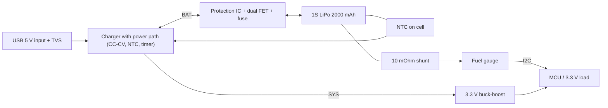

::: testing
Whether you can run an open-ended design interview: **ask for requirements, choose an architecture, size the key parts with numbers, and justify trade-offs.** The skeleton is well known (USB or adapter input, charger IC, battery with protection, regulator to the load, optional fuel gauge and NTC), but interviewers want to see that you know *why* each block exists, how to program the charge current, what a linear charger dissipates, why a 3.3 V rail from a 3.0 to 4.2 V cell needs thought (LDO vs buck-boost), and how you would verify it. Mention safety layers and failure modes before being asked.
:::

::: why
This is the canonical battery-powered product design problem: wearables, handhelds, sensors, speakers. It exercises power electronics, battery knowledge, protection and system thinking in one answer. A structured walk-through (requirements, architecture, calculations, parts, verification) is what hardware interviewers look for in "design X" questions.
:::

::: concepts
- **Charger IC / power path**: CC-CV, precharge, termination, NTC, timer, load sharing ([[q0313]], [[q0321]]).
- **Protection**: overvoltage, undervoltage, overcurrent, short circuit with back-to-back FETs ([[q0307]]).
- **Voltage range of the cell**: 3.0 to 4.2 V, so a regulated rail needs buck, boost or buck-boost ([[q0305]]).
- **LDO vs switcher**: dropout, efficiency, noise, quiescent current ([[q0008]]).
- **Fuel gauge / monitoring**: SoC and health ([[q0308]]).
- **Thermal and safety**: linear charger dissipation, NTC, fusing, layout.
:::

::: answer
"I'd start by asking for requirements, because they decide everything: battery capacity and cells in series, input source, output rail and load current, charge time, size, cost and safety. Let me assume a single-cell 2000 milliamp-hour LiPo charged from USB 5 volts, powering a 3.3 volt system that averages 150 milliamps and peaks at 1 amp.

Architecture: USB input into a charger IC with power path, so the system can run while charging. The charger does CC-CV: precharge below about 3 volts, constant current, then 4.2 volts constant voltage with termination, plus an NTC input and a safety timer. The cell goes through a protection circuit, a protection IC with two back-to-back MOSFETs, for overvoltage, undervoltage, overcurrent and short circuit, and optionally a fuse. Then the load: because the cell runs from 4.2 down to about 3.0 volts, a 3.3 volt rail needs a buck-boost, or an LDO if I accept stranding roughly the bottom 12 percent of capacity. Optionally a fuel gauge with a 10 milliohm shunt.

Numbers: USB 2.0 gives 500 milliamps, so I'd charge at 500 milliamps, a quarter C, which takes about 4 hours. A linear charger would dissipate $(5 - 3.7) \times 0.5 = 0.65$ watts, fine in a small package with thermal regulation. A programming resistor sets the current, for example 2 kilohms for 500 milliamps on one popular family. At 150 milliamps the load runs about 14 hours from a buck-boost versus about 12 from an LDO in my model.

Verification: test the charge profile on a scope with a source meter, test short-circuit and over-temperature, cold and hot, and check dropout at the lowest battery voltage."
:::

::: technical
**Assumed requirements.** 1S LiPo 2000 mAh (3.0 to 4.2 V); input USB 5 V, 500 mA max; load 3.3 V, average 150 mA, peak 1 A; charge while operating; ambient 0 to 40 °C; safe on single faults.

**Charge current.** $I_{chg} = 0.25C = 0.5$ A (USB 2.0 limit; with USB 3.x or a wall adapter 1 A = 0.5C is possible). Programming: for one popular linear charger family $I_{chg} \approx 1000\ \text{V}/R_{PROG}$, so $R_{PROG} = 2$ kΩ for 500 mA (check the chosen part's datasheet). Charge time from the model (0.25C, 100 mΩ total): about 250 min.

**Charger dissipation.** Linear: $P = (V_{in} - V_{bat})I$: 0.65 W at 3.7 V, 0.5 W at 4.0 V, 1.0 W at 3.0 V (if full current were applied at 3.0 V; precharge current is about 10 % of full, so the 3.0 V worst case is 0.1 W at 50 mA and the maximum is just above the threshold). With a power path, the charger limits input current and shares it with the system.

**Protection.** Dual N-FET low-side switch (charge and discharge control), protection IC thresholds: OVP about 4.25 to 4.35 V, UVP about 2.4 to 2.8 V, overcurrent/short circuit by sensing FET drop. Added series resistance: e.g. 50 mΩ for the FET pair at 1 A is a 50 mV drop and 50 mW. A fuse or PTC rated above 1 A peak.

**3.3 V rail options.**

| Option | Vin range | Efficiency | Usable capacity (150 mA, model) | Comment |
|---|---|---|---|---|
| LDO (dropout 0.2 V) | needs ≥ 3.5 V loaded | $3.3/V_{bat}$: 79 % at 4.2 V, 94 % at 3.5 V | stops at 3.5 V: 1.76 Ah, 11.7 h | cheap, quiet, low Iq |
| Buck-boost | 2.5 to 5.5 V typical | about 90 to 95 % | to 3.0 V: about 14 h | handles all SoC, costs inductor and ripple |
| Buck only | needs ≥ 3.5 V | 90 %+ | like LDO's range | efficient, same dropout limit |

At the 1 A peak: LDO dissipation $(4.2 - 3.3) \times 1 = 0.9$ W at full battery; a 92 %-efficient buck-boost loses $3.3/0.92 - 3.3 = 0.29$ W.

**Monitoring.** 10 mΩ shunt, fuel gauge IC over I²C, NTC on cell ([[q0307]]); at 1 A the shunt gives 10 mV and dissipates 10 mW.

**Quiescent budget.** Charger, gauge, protection and regulator Iq must be small vs 150 mA average; for standby of months you need microamps.
:::

::: short
"I'd gather requirements, then use a charger IC with power path from USB, a battery with a protection IC and dual MOSFETs, and a buck-boost or LDO to the load, plus an NTC and optionally a fuel gauge. For a 2 amp-hour cell on USB, charge at 500 milliamps; a resistor programs it, and a linear charger dissipates about 0.65 watts. Because the cell swings 3.0 to 4.2 volts, a 3.3 volt rail wants a buck-boost; an LDO works but strands roughly the bottom 12 percent. Then verify the charge profile, the faults and the temperature extremes."
:::

::: long
"I'd begin by asking questions: how many cells and what capacity, what input source, what output rail and current, charge time target, size and cost, and the operating temperature. Let me assume a single 2000 milliamp-hour LiPo, USB 5 volt input, a 3.3 volt system averaging 150 milliamps with 1 amp peaks, and it must run while charging.

Architecture, left to right. USB input with a small input filter and possibly a TVS or overvoltage protection. A charger IC with power path, so USB feeds the system directly and the battery only supplements or charges. The charger implements precharge below about 3 volts at roughly a tenth of the current, constant current, constant voltage at 4.2 volts with plus or minus one percent accuracy, termination at about a tenth of the charge current, a safety timer, and an NTC input. Charge current: USB 2 gives 500 milliamps, which is a quarter C, so about 4 hours. I'd set it with a programming resistor. For one common family that's about 1000 divided by the resistor in kilohms, so 2 kilohms for 500 milliamps, but I'd check the datasheet. A linear charger at 500 milliamps from 5 volts into 3.7 volts dissipates 0.65 watts, which is OK with thermal regulation; at higher currents I'd use a switching charger.

The cell goes through a protection IC and a dual back-to-back MOSFET switch for overvoltage at about 4.3, undervoltage around 2.5, overcurrent and short circuit. Those FETs add something like 50 milliohms, which matters at 1 amp. A fuse or PTC in series for a hard fault.

For the 3.3 volt rail: the cell goes from 4.2 to 3.0, so a plain buck or LDO can't hold 3.3 below about 3.5 volts. An LDO is simple and quiet, but it burns $(V_{bat} - 3.3) \times I$, and in my model gives about 11.7 hours at 150 milliamps versus about 14 for a buck-boost, which keeps regulating down to 3.0. At 1 amp the LDO dissipates 0.9 watts at 4.2 volts, the buck-boost about 0.3. So I'd choose a buck-boost, unless the load is tiny and noise-sensitive.

Finally a fuel gauge with a 10 milliohm shunt and an NTC. Verification: log the CC-CV profile, trigger over-temperature and short circuit, test with a cold and a hot cell, check the rail at the minimum battery voltage during a 1 amp peak, and measure standby current."
:::

::: terms
- **Power path**: topology that supplies the system from the input while charging the battery, with the battery supplementing.
- **Charger IC**: implements precharge, CC, CV, termination, timer, NTC qualification.
- **Protection IC + dual FET**: hardware OV/UV/OC/SC protection.
- **Buck-boost**: converter that regulates an output above or below the input.
- **LDO dropout**: minimum $V_{in} - V_{out}$ for regulation.
- **$R_{PROG}$**: resistor setting the charge current.
- **Fuel gauge**: SoC/SoH estimator with coulomb counting.
- **Quiescent current ($I_q$)**: the regulator/IC's own current draw.
:::

::: exceptional
**An average answer** draws USB → charger → battery → load and stops.

**An exceptional answer**:
- Starts with **requirements and clarifying questions**, and states assumptions.
- Chooses architecture with reasons (**power path, hardware protection independent of firmware**).
- Does the **numbers**: charge current and time, linear dissipation (0.65 W), protection FET drop, shunt power, regulator efficiency and dropout.
- Compares **LDO vs buck-boost** quantitatively (runtime 11.7 h vs about 14 h; 0.9 W vs 0.3 W at 1 A).
- Covers **safety, faults and verification** (NTC, timer, short-circuit tests, cold/hot, input hot-plug) and standby current.
:::

::: mistakes
- **Using a bench-supply-like charger (just a regulator at 4.2 V).** No CC limit, precharge, termination or NTC.
- **No protection, relying on the charger alone.** A single fault (shorted FET, broken sense) then leads to overcharge or over-discharge.
- **Forgetting dropout.** An LDO set to 3.3 V from a cell at 3.4 V browns out; check the lowest battery voltage under peak load including FET and fuse drops.
- **Ignoring system current during charge** with no power path: the charger sees the load as part of the battery current and never terminates.
- **Sizing the linear charger without the thermal calculation.** 1 A from 5 V into a 3 V cell is 2 W.
- **Not measuring standby current.** A 100 µA quiescent total kills a 2 Ah battery in 2.3 years of standby, and 1 mA in about 83 days.
:::

::: deep
## Step 1: requirements (and what to ask)

| Question | Assumed answer | Why it matters |
|---|---|---|
| Cells/capacity | 1S, 2000 mAh | sets $C$-rates, charger type |
| Input | USB 5 V, 500 mA | charge current limit |
| Rail | 3.3 V, 150 mA avg, 1 A peak | regulator choice |
| Charge time | under 5 h | charge C-rate |
| Run while charging | Yes | power path |
| Temperature | 0 to 40 °C | NTC thresholds, derating |
| Standby life | months | quiescent budget |
| Cost/size | small, moderate cost | integration vs discrete |

## Step 2: architecture


Figure: The system is two power paths around the battery: the charge path (USB → charger → protected cell) and the discharge path (cell → regulator → load). The power-path charger also lets USB feed the system directly. The NTC reads the cell for the charger and the gauge; the gauge reports to the MCU.

## Step 3: charge path

**Charger choice.** A single-cell linear charger with power path suits 0.5 to 1 A from USB; above that choose a switching charger.

**Charge current.** From USB 2.0, 500 mA is also the system's limit while charging; with power path the load takes first, the rest charges the cell. So effective charge current = $I_{USB} - I_{load}$ (dynamic power management); at 150 mA load, the battery gets 350 mA. Time: about 5.7 h at 0.35 A (0.175C); in the model at 0.25C total time is about 250 min. At 0.5 A with no load: 4.2 h.

**Programming.** $R_{PROG}$ per datasheet: for the family quoted, 1000 V / 2 kΩ = 500 mA.

> [!UNCERTAIN]
> The $I = 1000\ \text{V}/R_{PROG}$ rule is for one popular single-cell linear charger family from memory of its datasheet; programming equations, termination fractions and thresholds are part-specific. Always use the datasheet of the part you pick.

**Thermal.** Linear charger dissipation $(V_{in} - V_{bat}) I$:

```plot
{"title":"Linear charger dissipation from 5 V at several charge currents","x":{"label":"Battery voltage","unit":"V","min":3.0,"max":4.2},"y":{"label":"Dissipation","unit":"W","min":0,"max":2.2},
 "vars":{"vin":5},
 "series":[{"label":"0.25 A","color":"green","fn":"(vin-x)*0.25"},{"label":"0.5 A","color":"accent","fn":"(vin-x)*0.5"},{"label":"1 A","color":"red","fn":"(vin-x)*1"}],
 "points":[{"x":3.7,"y":0.65,"label":"0.5 A at 3.7 V: 0.65 W"}]}
```
Figure: Dissipation falls as the cell charges. At 0.5 A the package sees at most about 1 W at the start of CC and 0.65 W at nominal; at 1 A it would be 2 W, which usually needs thermal regulation or a switching charger. Real chargers precharge at low current below about 3 V, so the 3.0 V point of the 1 A line is not reached at full current.

**Input protection.** TVS and a small series element or ferrite bead for hot-plug transients, input capacitor sized per the datasheet. Many chargers have input OVP (about 6 V or above) built in.

## Step 4: battery protection

A low-side dual N-FET disconnect, driven by a protection IC:

```circuit
{"caption":"Low-side protection: common-drain back-to-back N-FETs controlled by a protection IC","elements":[
 {"t":"battery","a":[0,2],"b":[0,8],"label":"LiPo"},
 {"t":"wire","pts":[[0,2],[18,2]]},
 {"t":"term","at":[18,2],"label":"P+","side":"right"},
 {"t":"wire","pts":[[0,8],[0,13],[4,13]]},
 {"t":"text","at":[-0.6,12.4],"text":"B−","anchor":"end"},
 {"t":"nmos","at":[6,11],"flip":true,"bodyDiode":true},
 {"t":"text","at":[4.5,7.9],"text":"Q1 (DSG)","anchor":"middle"},
 {"t":"nmos","at":[10,11],"bodyDiode":true},
 {"t":"text","at":[11.5,7.9],"text":"Q2 (CHG)","anchor":"middle"},
 {"t":"wire","pts":[[4,9],[12,9]]},
 {"t":"wire","pts":[[12,13],[18,13]]},
 {"t":"term","at":[18,13],"label":"P−","side":"right"},
 {"t":"box","at":[2,16],"w":12,"h":4,"label":"Protection IC","pins":[{"side":"top","pos":2,"name":"VSS"},{"side":"top","pos":4,"name":"DO"},{"side":"top","pos":8,"name":"CO"},{"side":"left","pos":1,"name":"VCC"},{"side":"right","pos":2,"name":"V−"}]},
 {"t":"wire","pts":[[4,13],[4,16]]},{"t":"dot","at":[4,13]},
 {"t":"wire","pts":[[6,11],[6,16]]},
 {"t":"wire","pts":[[10,11],[10,16]]},
 {"t":"wire","pts":[[2,17],[-3,17],[-3,2],[0,2]]},{"t":"dot","at":[0,2]},
 {"t":"wire","pts":[[14,18],[15,18],[15,13]]},{"t":"dot","at":[15,13]}
]}
```
Figure: Q1 and Q2 are N-FETs in series in the cell's negative leg with their drains tied together (the common-drain arrangement used by most dual-FET packages), so their body diodes point in opposite directions and block current both ways when both FETs are off. Q1's source sits at B−, so the IC's DO pin can drive it relative to its own VSS; it opens Q1 on undervoltage, overcurrent or short circuit, and Q1's body diode still conducts charge current (P− into B−), so a charger can recover the cell. CO drives Q2, whose source is at P−; it opens Q2 on overvoltage, and Q2's body diode still lets the pack discharge. The V− pin senses P− to detect a charger connection and to read overcurrent as the voltage drop across the two FETs' on-resistance. Pin names follow common single-cell protection ICs; check the datasheet of the part you use.

**Typical numbers.** FET pair about 50 mΩ total (example), so at 1 A: 50 mV drop, 50 mW; at the 1 A peak the cell sees an extra 50 mΩ in series with its own 50 to 100 mΩ. A PTC or fuse rated for about 2 A hold covers a hard fault.

## Step 5: the 3.3 V rail

```sim
{"id":"regulator-compare","mode":"compare","vin":3.7,"vout":3.3,"iout":0.15}
```
Figure: Compare LDO and buck efficiency across load current for a 3.7 V input and a 3.3 V output: the LDO's efficiency is capped at $3.3/3.7 = 89$ %, while the sim's buck reaches about 96 % at the 150 mA operating point. The LDO only wins below a crossover of about 40 mA (with PFM off), where the buck's fixed switching and quiescent losses dominate. Change vin to 4.2 and then to 3.5 to see the LDO efficiency change from 79 % to 94 % and the crossover move. The sim models a plain buck, which stands in for the buck-boost here while the cell is above about 3.5 V.

With the battery from 4.2 to 3.0 V:

| Metric | LDO | Buck-boost (92 %) |
|---|---|---|
| Efficiency at 4.2 V | 79 % | about 92 % |
| Efficiency at 3.7 V | 89 % | about 92 % |
| Lowest usable battery voltage | about 3.5 V loaded | about 3.0 V (protection cutoff) |
| Heat at 1 A, 4.2 V | 0.9 W | 0.29 W |
| Runtime at 150 mA (model, R = 0.1 Ω) | 11.7 h | about 14 h |
| Noise/ripple | very low | switching ripple, EMI |
| Parts | 1 IC, 2 caps | IC, inductor, caps |

The runtime gap comes from the bottom of the discharge curve: the LDO cannot regulate below about 3.5 V loaded, which strands roughly 12 % of capacity (1.76 of 2 Ah used), and the buck-boost converts the remaining energy at roughly constant efficiency. (Model discharge to cutoffs 3.5 V and 3.0 V at 0.15 A, constant-current load for the LDO and constant-power for the buck-boost.)

> [!TIP]
> For a very low-power node, say 5 mA average, an LDO's simplicity and quiescent current often beat the buck-boost: efficiency matters less than $I_q$ and the 12 % stranded capacity is worth the saved parts.

## Step 6: monitoring

A 10 mΩ shunt in the cell's negative leg and a gauge gives SoC/SoH ([[q0308]]); the NTC is shared with the charger. Power: $10$ mΩ at 1 A is 10 mW, 10 mV signal. The gauge's own quiescent current is about tens of µA; budget it.

## Step 7: standby and quiescent budget

Standby life $= Q/I_{sb}$: with 2 Ah, 100 µA gives 20,000 h (2.3 years), 1 mA gives 2000 h (83 days). Sum the charger, gauge, protection IC, regulator and MCU sleep currents and the protection FET leakage; choose ship/shutdown modes for long storage.

## Step 8: verification plan

1. **Charge profile**: log V, I, T with a source meter; confirm precharge, CC, CV, termination and the timer.
2. **Faults**: short at the output, reverse hot-plug, overvoltage at USB, cell removal, NTC open/shorted.
3. **Temperature**: charge at 0, 25, 45 °C; check NTC behaviour and derating.
4. **Dropout**: with the cell at the cutoff voltage and a 1 A peak, confirm the 3.3 V rail holds.
5. **Efficiency and thermals**: measure charger and regulator temperature rise in the enclosure.
6. **Standby current**: measure after shutting down peripherals.
7. **Abuse**: over-discharge and overcharge via a separate lab supply with current limits to verify protection trips.
:::

::: applications
- **Bluetooth speakers and headsets**: single-cell charger with power path, protection IC and a buck-boost or boost to the amp rail.
- **Smartwatches and fitness bands**: tiny charger, protection and fuel gauge (sometimes in one PMIC), LDOs for low-power rails.
- **Handheld instruments and sensors**: buck-boost to 3.3 V for the full cell range.
- **Drones/RC (multi-cell variant)**: balance charger, per-cell monitoring, ESC fed directly from the pack.
- **IoT devices with solar harvesting**: charger with MPPT-like input regulation, protection, ultra-low Iq regulators.
:::

::: assumptions
- Requirements are **assumed**: 1S 2000 mAh, USB 5 V/500 mA, 3.3 V load (150 mA average, 1 A peak). Different inputs or loads change the choice (switching charger above about 1 A, multi-cell needs balancing).
- Efficiency numbers: buck-boost **92 %** constant is an approximation; real efficiency varies with load and $V_{in}$.
- Runtime numbers come from the **site's cell model** with total series resistance 0.1 Ω (cell plus FETs plus fuse) and constant 0.15 A or 0.495 W loads, ignoring converter quiescent current.
- The $R_{PROG}$ formula and thresholds are **typical for one family**; use the datasheet of the chosen IC.
- A **power-path** charger is assumed; a simple charger without power path works if the load is off during charge or if you accept slower termination.
:::

::: followups
### Why do you need both a charger IC and a protection IC?
They do different jobs. The charger regulates the normal charge profile and ends it: its limits are tight (4.20 V ±1 %). The protection IC is an independent last-resort layer with looser thresholds (OVP about 4.3 V) that also protects the discharge path (undervoltage, overcurrent, short circuit). If one fails, the other should still keep the cell safe.

### The system browns out on a 1 A peak at 3.4 V cell voltage. What do you check and change?
Sum the drops: cell $R$ (about 50 to 100 mΩ at room temperature, more cold), protection FETs (about 50 mΩ), fuse and traces: total about 0.15 Ω, so 150 mV at 1 A; with OCV 3.4 V the cell sees 3.25 V at the regulator input, below an LDO's need (3.5 V). Fix: use a buck-boost, add bulk capacitance for the peak, lower the peak current in firmware, or reduce the series resistance.

### How do you set charging for a 1.5 A adapter instead of USB 500 mA?
Charge at up to 1C (2 A) or 0.5C (1 A): with a 1.5 A adapter choose a switching charger rather than linear (1 A from 5 V into 3.7 V dissipates 1.3 W), program about 1 A, make sure the input current limit and power path are set to the adapter's capability, and check the NTC and thermal limits. Check cell datasheet for the charge limit.

### How would you add overtemperature safety if the charger's NTC input fails?
The charger should treat an out-of-range TS as a fault. Add a second independent temperature sensor to the MCU or gauge with its own cutoff, and consider a thermal fuse or PTC at the cell. Keep at least two independent layers for charging: charger-level (NTC, timer) and system-level (MCU/gauge or protection IC).

### What changes for a 2S pack?
Charge voltage 8.4 V with a 2-cell charger (a boost or buck charger since USB 5 V is below it), per-cell monitoring and balancing (an AFE or 2-cell protection IC), a series protection FET pair across the whole pack, and a buck or buck-boost for 3.3 V (pack range 6 to 8.4 V so a buck suffices). Balance connector or on-board AFE ([[q0314]]).
:::

::: interpretations
"Design a circuit to charge/discharge a LiPo" is open-ended: I treat it as a **complete single-cell power system** (charge path, protection, discharge regulation, monitoring) and state the assumed requirements, which an interviewer will usually adjust. If the interviewer wants only the **charger**, focus on steps 3 and 4 and the CC-CV behaviour ([[q0321]]); if they want the **discharge** path, focus on step 5. See also [[q0313]] and [[q0325]] for the IC functions.
:::

::: references
- Horowitz & Hill, *The Art of Electronics*, 3rd ed.: linear and switching regulators, battery charging and power design.
- Plett, *Battery Management Systems, Volume I*: charge control, protection and cell models.
- Battery University (Cadex): articles on charging lithium-ion batteries and protection circuits.
- Datasheets of single-cell charger/power-path ICs, protection ICs (with dual FETs), fuel gauges, LDOs and buck-boost converters from major vendors; they supply programming equations, thresholds and layout guidance.
:::

::: rubric
- Starts with requirements and assumptions :: Open-ended design needs scoping.
- Block diagram: input, charger with power path, protection, cell, regulator, gauge/NTC :: The expected architecture.
- Charge current choice and programming, with charge time :: Shows calculation and understanding of USB limits.
- Linear charger dissipation or switching alternative :: Real thermal constraint with numbers.
- Hardware protection with dual FETs and thresholds :: Safety layer independent of firmware.
- LDO vs buck-boost for the 3.0 to 4.2 V swing, with numbers :: Key trade-off specific to a LiPo.
- Verification plan and standby current :: Completes the design process.
:::

::: quiz
```json
[
 {"type":"numeric","level":"fundamental","q":"A linear charger runs from 5 V and charges a cell at 3.7 V with 0.5 A. How much power does it dissipate?","answer":0.65,"tolerance":0.02,"unit":"W","explain":"$P = (5 - 3.7) \\times 0.5 = 0.65$ W."},
 {"type":"mcq","level":"fundamental","q":"Why is an LDO a poor way to hold 3.3 V from a LiPo across its entire 3.0 to 4.2 V range?","options":["It cannot regulate when the battery is within its dropout of 3.3 V (about 3.5 V), stranding capacity","It would damage the battery","LDOs cannot supply 150 mA","It increases the cell voltage"],"answer":0,"explain":"The LDO needs $V_{in} \\ge V_{out} + V_{dropout}$. Below roughly 3.5 V loaded, the rail sags, so the bottom part of the cell's capacity is not usable."},
 {"type":"numeric","level":"intermediate","q":"A 2000 mAh cell charged at 0.5 A (ignoring the CV tail), how many hours is the nominal charge?","answer":4,"tolerance":0.03,"unit":"h","explain":"$2.0\\ \\text{Ah}/0.5\\ \\text{A} = 4$ h; the CV tail adds to this in practice."},
 {"type":"numeric","level":"intermediate","q":"A 3.3 V, 1 A load is fed from a 4.2 V cell through an LDO. How much power does the LDO dissipate?","answer":0.9,"tolerance":0.02,"unit":"W","explain":"$P = (4.2 - 3.3) \\times 1 = 0.9$ W (ignoring quiescent current)."},
 {"type":"numeric","level":"intermediate","q":"The total quiescent/standby current of the system is 100 µA. How many days does a 2 Ah cell last in standby (ignoring self-discharge)?","answer":833,"tolerance":0.02,"unit":"days","explain":"$2\\ \\text{Ah}/100\\ \\mu\\text{A} = 20{,}000$ h = 833 days."},
 {"type":"multi","level":"advanced","q":"Which are valid reasons to use a power-path charger?","options":["The system can run while the battery charges","Charge termination is not confused by the system load current","It removes the need for any protection","It supplies the load directly from USB when the battery is deeply discharged"],"answer":[0,1,3],"explain":"Power path separates system load from battery charge current so termination works and the device can run (or boot) from the input with a depleted battery. It doesn't replace protection."}
]
```
:::
