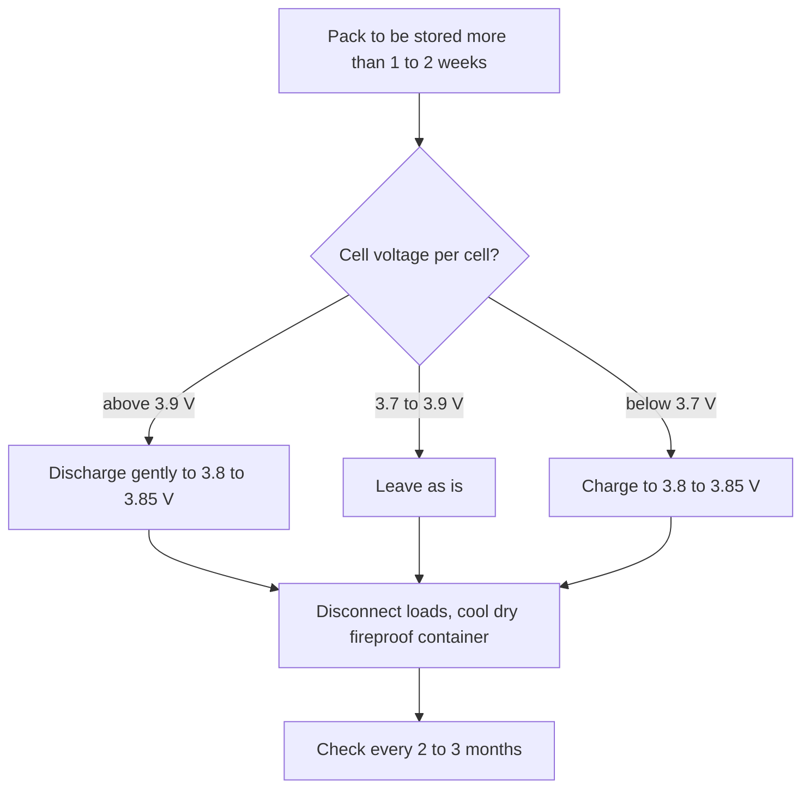

::: basics
### In plain words
Storage charge is how full you should leave a lithium battery when you will not use it for a while. The answer is about 3.8 V per cell, roughly half full. Storing it full wears the cell out faster. Storing it empty is risky, because the battery slowly loses charge by itself and may end up too low to recover.

### Picture it
Think of a spring. Held fully compressed for months, a spring gets tired and loses its bounce. Left fully loose, it is fine. A battery differs here, because it slowly leaks charge on its own, and an empty one can leak past its safe limit. The best place to rest it is partway, with margin on both sides.

### Words you need
- **State of charge (SoC)**: how full the battery is, as a percentage ([[q0308]]).
- **Storage voltage**: about 3.8 to 3.85 V per cell, which is roughly 50 to 60% SoC ([[q0305]]).
- **Self-discharge**: charge a cell loses just sitting, a few percent a month.
- **Parasitic drain**: tiny currents drawn by attached electronics even when the device is off.
- **Calendar aging**: wear that happens with time, faster when the cell is full and warm ([[q0301]]).

### The simplest example
A 2 Ah cell stored at 3.8 V (about 54%) holds about $0.54 \times 2000 = 1080$ mAh above empty. Self-discharge of 3% a month, about 60 mAh, would take roughly 18 months to drain it. A parasitic drain of 1 mA is much worse: $1080 / 1 = 1080$ hours, or about 45 days. A full cell is safe from running flat, but it ages faster, especially in the heat.

That is the whole idea. The rest of this page covers why high charge speeds up aging, how long a stored cell lasts before it goes too low, and the practical storage rules.
:::

::: testing
Whether you know the practical rule (**store LiPo at about 3.8 to 3.85 V per cell, roughly 40 to 60 % charge**, cool and dry) and can explain **both sides of it**: why not full (calendar aging, gas and safety margin at high voltage and temperature) and why not empty (self-discharge and parasitic drain take the cell below about 2.5 to 3 V into over-discharge, where the anode is damaged, copper can dissolve on deeper excursions, and the cell may become unusable or unsafe). A strong answer converts the rule into numbers (days to reach cutoff at a given drain) and says how a charger or a product implements storage mode.
:::

::: why
Batteries sit on shelves, in drones between flying seasons, in shipped products and in spare packs. Storing them wrongly is one of the most common ways to ruin a pack without ever using it. Hobby chargers have a "storage" button because of this, and phone/laptop firmware may hold the battery at 50 to 80 % when idle. In hardware work the same thinking drives the "ship mode" of a product and the protection IC's undervoltage lockout.
:::

::: concepts
- **Voltage-SoC relation**: about 3.8 V is roughly 50 to 55 % SoC ([[q0305]], [[q0316]]).
- **Calendar aging**: capacity loss with time even at rest, faster at high SoC and temperature ([[q0301]]).
- **Self-discharge**: slow loss of charge, a few percent per month at room temperature.
- **Parasitic drain**: protection IC, gauge and electronics draw microamps to milliamps from the cell.
- **Over-discharge damage**: below about 2.5 V the anode is stressed, and deeper over-discharge dissolves the copper collector ([[q0330]]).
- **Temperature**: higher temperature accelerates both aging and self-discharge ([[q0306]]).
:::

::: answer
"Storage charge is the state of charge you leave a LiPo at when you won't use it for a while, and the rule is about 3.8 volts per cell, which is roughly 50 percent charged. Hobby chargers have a 'storage' mode that takes each cell there, charging or discharging as needed.

Why that voltage? There's a tension between two failure modes. If I store the cell full, at 4.2 volts, the electrodes are in their most reactive state. The cathode is delithiated and the electrolyte is closer to its oxidation limit, so side reactions like growth of the solid-electrolyte layer go faster, capacity fades faster over time, and it's worse when it's warm. A full pack is also higher energy if something goes wrong. If I store it empty, though, the cell's self-discharge and any parasitic drain, like a protection IC or a gauge, slowly pull the voltage down, and once it drifts below about 2.5 to 3 volts it's over-discharged: the anode gets damaged, and if it keeps going the copper collector starts dissolving, so the cell can be permanently damaged or unsafe to recharge. Around 3.8 volts there's lots of headroom against drift but the cell is in a gentle state.

Practically: store at 3.8 to 3.85 volts per cell, in a cool, dry place, around 10 to 20 degrees, never frozen or hot, in a fireproof container, and check the voltage every few months and top up if it's drifted. For a product, I'd also make sure the standby current is tiny or use a ship mode."
:::

::: technical
**Rule of thumb.** Store at $V_{cell} \approx 3.80$ to $3.85$ V (about 50 to 60 % SoC on the typical OCV curve: 3.77 V is 50 %, 3.84 V is 60 %), at 10 to 20 °C, dry, in a non-flammable container, for more than about 1 to 2 weeks of non-use. Some manufacturers specify different storage SoC (for example 30 to 50 %) and temperature ranges; follow the cell datasheet.

**High-SoC aging.** Side reactions (SEI growth on graphite, electrolyte oxidation at the cathode, transition-metal dissolution) have rates that increase with cell voltage and with temperature (Arrhenius). Storing at 4.2 V and 40 to 50 °C is the worst case; storing near 3.8 V and 15 °C is among the best. The effect is large: calendar fade at full charge and high temperature can be several times faster than at mid-SoC and cool conditions, though exact factors depend on chemistry.

**Low-SoC risk.** Self-discharge ($\approx$ a few % per month at room temperature) and parasitic loads reduce the voltage. Time to reach the damaging region: $t = Q\,\Delta SoC / I_{drain}$. For a 2 Ah cell stored at 54 % SoC (3.8 V) to reach 0 % (3.0 V): $0.54 \times 2000\ \text{mAh} = 1080$ mAh. At 3 %/month self-discharge (60 mAh/month) that's 18 months; with a 1 mA parasitic drain, 1080 h = 45 days; with 100 µA, 450 days.

**Protection ICs.** Their quiescent current is typically a few µA, and many disconnect the load below an undervoltage threshold (about 2.3 to 2.8 V). That prevents deep over-discharge by the load but not by self-discharge below that point.

**Implementation.** Hobby chargers: "storage" mode charges or discharges to 3.8 to 3.85 V per cell. Products: fuel gauge/BMS can limit charge to 50 to 80 % in long idle or in "battery care" modes; ship mode disconnects the cell with a FET and draws nanoamps to microamps.

> [!UNCERTAIN]
> Storage voltage recommendations vary slightly (3.7 to 3.9 V per cell, or 30 to 60 % SoC) between manufacturers and sources, and the quantitative aging benefit depends on chemistry and temperature. Treat 3.8 to 3.85 V as the common hobby rule and check the datasheet of your cell.
:::

::: short
"Storage charge is the level you leave a LiPo at when it's not in use, about 3.8 volts per cell, roughly 50 percent. Full charge accelerates calendar aging and gas, especially when warm, and leaves more stored energy if something fails. Empty is worse in a different way: self-discharge and parasitic drain can pull the cell below about 2.5 to 3 volts into over-discharge, which damages the anode and, deep enough, dissolves the copper collector. So store around 3.8 volts, cool and dry, away from flammable things, and check it every few months."
:::

::: long
"Storage charge is the state of charge at which you leave a LiPo when you won't use it for a while, and the standard value is about 3.8 volts per cell, which is roughly half full. Hobby chargers have a storage mode that will charge or discharge each cell to that voltage.

It's a compromise between two failure mechanisms. At the full end, 4.2 volts, the cell is in its most reactive state: the cathode is heavily delithiated, the electrolyte is close to oxidizing, and the graphite is fully lithiated, so the side reactions that thicken the solid-electrolyte layer and consume lithium go faster. That's calendar aging, and it gets much worse with temperature. A fully charged cell also has the most energy to release if something fails.

At the empty end, the issue is drift. Every cell self-discharges at a few percent per month, and a pack with a protection IC or a gauge has extra parasitic drain. If it starts low, it can fall below about 2.5 to 3 volts. Below that it's over-discharged, and if it keeps sinking the anode's copper current collector begins to dissolve and then plates back as dendrites on recharge, so the cell may be ruined or unsafe. As an example, a 2 amp-hour cell at 3.8 volts has about 1.1 amp-hours of charge to lose; at 3 percent a month that's well over a year, but with just a 1 milliamp parasitic load it's only 45 days.

So the practice is: set 3.8 to 3.85 volts per cell, store at around 10 to 20 degrees, dry, not frozen, in a fireproof bag or box, away from anything flammable, check the voltage every few months and top up if needed. For a product, I'd keep standby current in the microamp range or provide a ship mode that disconnects the cell."
:::

::: terms
- **Storage charge / storage voltage**: the SoC (about 3.8 to 3.85 V per cell) for long-term storage.
- **Calendar aging**: degradation over time at rest, independent of cycling.
- **SEI (solid-electrolyte interphase)**: layer on the anode that grows with side reactions.
- **Self-discharge**: gradual internal loss of charge.
- **Parasitic drain**: current taken by attached electronics at rest.
- **Ship mode**: a low-power state with the cell disconnected for shipping/storage.
- **Over-discharge**: dropping below the minimum voltage (about 2.5 to 3 V).
- **LiPo bag**: fire-resistant storage container.
:::

::: exceptional
**An average answer** says "store at 3.8 V".

**An exceptional answer**:
- Explains **why not full** (calendar aging: SEI growth, electrolyte oxidation, accelerated by voltage and temperature; higher stored energy) and **why not empty** (self-discharge plus parasitic drain below about 2.5 V: copper dissolution).
- Puts **numbers** on it (3.8 V is about 54 % SoC; 1080 mAh of 2 Ah; days to empty at several drains).
- Gives **practical conditions**: 10 to 20 °C, dry, fireproof container, periodic checks.
- Mentions **implementation** in chargers (storage mode), BMS (limit SoC when idle) and products (ship mode, low standby).
- Notes the **UNCERTAIN spread** in recommendations and defers to the datasheet.
:::

::: mistakes
- **"Store it full so it's ready."** Full storage accelerates aging; a cell stored at 100 % loses capacity faster than a half-charged one, especially when warm.
- **"Store it empty so nothing can go wrong."** An empty cell drifts below the safe limit within weeks to months and may become unrechargeable.
- **Storing hot.** A parked car or a warm cupboard speeds up aging and self-discharge; also unsafe.
- **Storing in the freezer.** Condensation and cold stress; very cold storage isn't needed and is not recommended for hobby LiPo.
- **Forgetting devices with standby drain.** A product with 1 mA standby can deeply discharge a stored battery in weeks.
- **Never checking.** A set-and-forget storage for a year with a drain can end below 2.5 V.
:::

::: deep
## Two failure modes, one sweet spot

Think of storage as an optimization problem over SoC (or voltage) $V$ with two penalties:

- **Aging penalty** increasing with $V$ (and temperature $T$).
- **Over-discharge risk** that increases as $V$ decreases (because there is less margin before the damage threshold).

The sweet spot sits in the middle of the OCV curve, where the cell is not highly stressed and still has several months of margin.

```plot
{"title":"Rested OCV vs SoC with the storage band (typical graphite/NMC cell)","x":{"label":"State of charge","unit":"%","min":0,"max":100},"y":{"label":"OCV","unit":"V","min":2.4,"max":4.4},
 "series":[{"label":"OCV","points":[[0,3.0],[5,3.4],[10,3.5],[15,3.56],[20,3.61],[30,3.67],[40,3.72],[50,3.77],[60,3.84],[70,3.92],[80,4.0],[90,4.09],[95,4.14],[100,4.2]]}],
 "hlines":[{"at":4.2,"label":"4.20 V: full (highest aging)","color":"red"},{"at":3.8,"label":"3.8 V: storage","color":"green"},{"at":2.5,"label":"2.5 V: damage below","color":"orange"}],
 "xspans":[{"from":50,"to":60,"label":"storage band"}]}
```
Figure: The storage band sits mid-curve, about 3.77 to 3.84 V. Above it the cell is increasingly reactive; below it the margin to the damaging region shrinks. The curve's steep foot below 10 % is where drift hurts most.

## High SoC and temperature: calendar aging

At rest, a Li-ion cell still loses capacity because of:

1. **SEI growth** on the anode: the graphite surface is at a low potential and reduces the electrolyte slowly, consuming lithium irreversibly. The rate rises when the anode is more lithiated (higher SoC).
2. **Cathode and electrolyte reactions**: at high cathode potential (near 4.2 V), the electrolyte oxidizes slowly and transition metals can dissolve and migrate to the anode.
3. **Temperature**: all of these reactions are thermally activated; a rule of thumb is a rate increase of roughly 2× per 10 °C near room temperature, but the factor depends on chemistry and SoC.

So the worst case is 100 % SoC at 40 °C or more; the best case for a long idle period is a mid SoC and a cool temperature. The effect is significant: storing full and warm for months can cost a visible percent or more of capacity per month; at mid-SoC and cool, the loss over the same period is a fraction of that. The exact numbers depend on the cell.

> [!UNCERTAIN]
> Quantitative calendar-life numbers vary by chemistry, additive package and test conditions. Published tables exist (for example in battery-university-style summaries), but they are generic. Use a datasheet or your own accelerated aging test for design decisions.

## Low SoC and drift: how long is the margin?

The cell must never go below its safe minimum while stored. Drift sources:

- **Self-discharge**: a few percent per month at room temperature (roughly doubling per 10 °C).
- **Protection IC and gauge**: quiescent currents from about 1 to 20 µA.
- **Connected electronics**: a device with a 100 µA to several mA standby.

```plot
{"title":"Days from 3.8 V storage (54 % of 2 Ah) until the cell is empty vs constant parasitic drain","x":{"label":"Parasitic drain","unit":"A","min":1e-5,"max":1e-2,"log":true},"y":{"label":"Days to empty","unit":"","min":1,"max":10000,"log":true},
 "vars":{"q":1.08},
 "series":[{"label":"days = 1.08 Ah / (I × 24)","color":"accent","fn":"q/(x*24)"}],
 "points":[{"x":0.0001,"y":450,"label":"100 µA: 450 d"},{"x":0.001,"y":45,"label":"1 mA: 45 d"},{"x":0.005,"y":9,"label":"5 mA: 9 d"}]}
```
Figure: The time to reach empty falls inversely with the drain, from more than a year at 100 µA to under two weeks at 5 mA. The self-discharge of the cell itself (about 60 mAh/month for 3 %/month) is equivalent to a drain of about 83 µA. A deeply discharged cell can be unrecoverable, so the product's standby current is a real design number.

Check: 60 mAh/month ≈ 2 mAh/day = 83 µA, which gives 1080/2 = 540 days to empty from the storage state.

## What to do in practice

1. **Bring the cell to 3.8 to 3.85 V** (storage mode on a charger, or partially discharge a full pack through a load, or charge a low pack).
2. **Disconnect from loads** and unplug balance leads from monitors with parasitic draw.
3. **Store at about 10 to 20 °C**, dry, in a fire-resistant container (LiPo bag, metal box), away from combustibles.
4. **Check voltage every 2 to 3 months**; top up if below about 3.6 V.
5. **Inspect** for swelling or damage before use; do not charge a swollen pack ([[q0328]]).


Figure: A simple storage decision. The target is the same band wherever you start; the only question is whether to add or remove charge to get there.

## Storage in products and BMS design

- **Ship mode**: a protection IC or a PMIC input disconnects the cell and draws nanoamps to a few µA until the product is plugged in.
- **Charge limits for idle**: some devices stop charging at 80 % when plugged in for long periods ("battery care" modes), reducing time at 100 % SoC and so calendar aging.
- **Standby budget**: keep the MCU in deep sleep (µA) and avoid quiescent leakage in regulators; calculate days-to-empty like the plot ($t = Q\,\Delta SoC/I$).
- **Gauge learning**: a pack stored for a long time may have a stale SoC; gauge firmware may require a rested OCV reading to correct.

```sim
{"id":"lipo-lab","view":"discharge","capacity":2,"crate":0.05,"temp":25,"rint":0.05}
```
Figure: At a very low rate (0.05C) the discharge curve is close to the OCV curve. Find 3.8 V and note how much capacity remains: about 1.1 Ah of the 2 Ah. Compare that margin with the foot of the curve below 3.4 V where little energy remains and voltage is dropping fast.

## Special case: multi-cell packs

In a series pack, cells have different self-discharge rates; a weak cell can fall below the limit while the pack total looks fine. Store at 3.8 to 3.85 V per cell *balanced* (use storage mode with balancing), and check per-cell voltages periodically ([[q0314]]).

## Worked example

You are storing a 3S 2200 mAh pack for six months. Storage voltage: $3 \times 3.82 = 11.46$ V. Charge remaining: $0.55 \times 2.2 = 1.2$ Ah per cell. Parasitic drain: say a protection IC and balance-board leak of 20 µA total, plus 3 %/month self-discharge ($\approx 66$ mAh/month, equivalent to 92 µA): six months uses about 0.5 Ah of the 1.2 Ah, leaving the cell at about 33 % SoC, near 3.67 V. That's within the safe band, but I'd still check it every 2 to 3 months, and unplug anything with a milliamp-level drain.
:::

::: applications
- **Hobby/RC and drone packs**: chargers with a storage function; pilots store packs between seasons.
- **Spare laptops and tools**: batteries shipped and stored at 30 to 50 % SoC (many manufacturers ship cells partially charged).
- **Wearables and IoT**: ship mode in production and warehousing so the cell is not drained before the customer opens the box.
- **EVs and energy storage**: guidance to keep a parked vehicle in a moderate SoC and avoid sitting at 100 %.
- **Spares and field service**: periodic top-up policies for stocked battery packs.
:::

::: assumptions
- The numbers refer to **graphite-anode Li-ion/LiPo (LCO/NMC) cells**; for LiFePO$_4$ storage voltage is about 3.2 to 3.3 V per cell and aging is less sensitive to SoC.
- 3.8 V is taken as **about 54 % SoC** from the typical OCV table; the true SoC at 3.8 V depends on the cell and temperature.
- Self-discharge of **3 % per month** at room temperature is a typical figure for healthy cells; it is higher when warm and in aged cells.
- The days-to-empty calculation assumes a **constant drain** and ignores the voltage cliff and protection IC cutoffs.
- Different sources recommend **3.7 to 3.9 V** (30 to 60 %) and temperatures 5 to 25 °C; the 3.8 to 3.85 V and 10 to 20 °C values are the common hobby rule.
:::

::: followups
### Why not store at 100 % so the pack is ready to use?
Because high state of charge accelerates calendar aging (SEI growth, electrolyte oxidation) and raises the stored energy. A pack held full for months, especially in a warm place, loses capacity faster than one at about 3.8 V. If you must keep it ready, charge it shortly before use rather than storing it full.

### A pack has been stored for a year and reads 2.8 V per cell. What do you do?
Treat it as suspect. Inspect for swelling and warmth. A cell near 2.8 V is below the normal discharge cutoff but may not be damaged if it never dropped below about 2.5 V. Charge at a low current (about 0.05C to 0.1C) under supervision with temperature monitoring, preferably with a charger that has a recovery mode, and watch for abnormal heating or voltage. If it doesn't recover or the cell swells, retire it ([[q0330]]).

### How does temperature change the storage recommendation?
Cooler is better (10 to 20 °C): self-discharge and aging slow roughly by half per 10 °C. Hot storage (above 30 to 40 °C) accelerates both and is unsafe. Freezing is not beneficial and is discouraged; very cold storage risks condensation when removed and can affect the electrolyte. If the environment is warm, use an even lower SoC (about 3.7 to 3.8 V) and check more often.

### How would you design a product so its battery survives six months on a warehouse shelf?
Ship the cell at about 40 to 60 % SoC; implement ship mode that disconnects the cell with the protection FETs and draws under about 1 µA; keep the gauge and MCU off; use a protection IC with low quiescent current and undervoltage lockout above the damage threshold; and only exit ship mode when the user plugs it in or presses a button. Budget the days-to-empty: 1.1 Ah at 10 µA is over 12 years in principle, but self-discharge dominates (about 18 months).

### If a pack has a 1 mA standby drain, how often must it be recharged during storage?
The 54 % SoC reserve of a 2 Ah cell (1.08 Ah) lasts 45 days at 1 mA. To stay above, say, 3.5 V (about 10 % SoC) you have 0.44 × 2 = 0.88 Ah of margin, or about 37 days. So recharge or disconnect the pack within about a month; better, remove the drain.
:::

::: interpretations
"Storage charging" refers to the **storage state of charge** (and the charger function that sets it), not a charging method like CC-CV. I cover the target voltage, the aging and over-discharge reasons, the conditions, and how products implement it. For handling and disposal see [[q0328]]; for what happens when a cell is over-discharged see [[q0330]].
:::

::: references
- Linden & Reddy, *Handbook of Batteries*: lithium-ion storage, self-discharge and capacity loss during storage.
- Plett, *Battery Management Systems, Volume I*: aging mechanisms (SEI growth, calendar aging).
- Battery University (Cadex): articles on storing lithium-ion batteries and on how to prolong lithium-based batteries.
- Cell and pack datasheets: manufacturers' recommended storage voltage, temperature and duration.
:::

::: rubric
- States the storage level (about 3.8 to 3.85 V per cell, 40 to 60 % SoC) :: The direct answer.
- Explains why not full: calendar aging, side reactions, temperature, energy at risk :: One half of the "why".
- Explains why not empty: self-discharge and parasitic drain leading to over-discharge/copper dissolution :: The other half.
- Gives storage conditions: cool, dry, fire-safe, periodic checks :: Practical completeness.
- Quantifies drift (days to empty vs drain, self-discharge rate) :: Shows engineering reasoning.
- Mentions implementation: charger storage mode, BMS limits, ship mode :: Connects to product design.
:::

::: quiz
```json
[
 {"type":"mcq","level":"fundamental","q":"What is the usual recommended storage voltage for a LiPo cell?","options":["4.2 V","3.8 to 3.85 V","3.0 V","2.5 V"],"answer":1,"explain":"About 3.8 to 3.85 V per cell (roughly half charge) balances low calendar aging against margin before over-discharge."},
 {"type":"truefalse","level":"fundamental","q":"Storing a LiPo fully charged at high temperature is the best way to keep it ready and healthy.","answer":false,"explain":"High SoC and high temperature are the worst combination for calendar aging and safety margin."},
 {"type":"numeric","level":"intermediate","q":"A 2 Ah cell stored at about 54 % SoC has how many mAh available before reaching empty?","answer":1080,"tolerance":0.01,"unit":"mAh","explain":"$0.54 \\times 2000 = 1080$ mAh."},
 {"type":"numeric","level":"intermediate","q":"With a constant 1 mA parasitic drain and 1080 mAh of charge, how many days until the cell is empty?","answer":45,"tolerance":0.02,"unit":"days","explain":"$1080\\ \\text{mAh}/1\\ \\text{mA} = 1080$ h $= 45$ days."},
 {"type":"numeric","level":"intermediate","q":"A 2 Ah cell self-discharges at 3 % per month. How many mAh is that per month?","answer":60,"tolerance":0.01,"unit":"mAh","explain":"$0.03 \\times 2000 = 60$ mAh/month."},
 {"type":"multi","level":"advanced","q":"Which statements about LiPo storage are correct?","options":["Cooler storage slows aging and self-discharge","A stored cell can drift below 2.5 V if it is stored nearly empty with a parasitic drain","Storage voltage should be checked periodically","Storing in a freezer is required"],"answer":[0,1,2],"explain":"Cool, dry storage with periodic checks is standard, and low SoC plus drain risks over-discharge. A freezer isn't needed and is discouraged."}
]
```
:::
