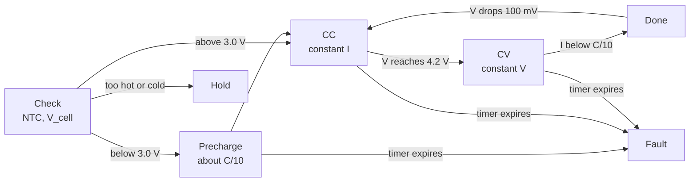

::: testing
Whether you understand that a lithium cell is not a "dumb" voltage source you can plug into a bench supply. Underneath the question sit three skills:

1. You know the cell has **narrow safe limits** (voltage, current, temperature) and that going outside them is a safety event, not just a lifetime issue.
2. You can name the **functions** a charger/monitor IC performs: CC/CV control, precharge, termination, thermal and timer safety, protection, fuel gauging.
3. You can say **why a dedicated IC beats discrete logic** (accuracy, integration, certification, fault coverage) and what trade-offs remain.
:::

::: why
A single mistake in a lithium charger design can start a fire, so the charging/monitoring chip is the part of a battery product that gets the most scrutiny. In an interview this question separates people who have only used batteries from people who have designed around them. In real work you almost never build a charger from op-amps: you pick a charger or BMS IC, size the external parts, and verify protection behaviour. Knowing *what the IC is actually doing* lets you debug "why won't it charge" problems (cold battery, tripped timer, dead cell) in minutes instead of days.
:::

::: concepts
- **Li-ion/LiPo voltage window**: roughly 3.0 V empty to 4.2 V full per cell, with a tight ±1% or better upper limit. See [[q0305]].
- **CC/CV charging**: constant current until the cell reaches 4.2 V, then constant voltage while current tapers. See [[q0321]].
- **Protection limits**: over-voltage, under-voltage, over-current, short-circuit and over-temperature each need a fast, independent response. See [[q0327]].
- **Coulomb counting and fuel gauging**: integrating current (and correcting with voltage) to estimate state of charge. See [[q0308]].
- **Current sensing**: a low-value sense resistor plus an amplifier gives the charger and gauge their measurements. See [[q0395]].
- **Thermal sensing (NTC)**: a thermistor on the cell lets the IC refuse to charge when too cold or too hot.
:::

::: answer
"The core reason is that a lithium cell has a very narrow safe operating window. It wants 4.2 V maximum per cell, within maybe 1%, a current limit set by the manufacturer, and a temperature window for charging, roughly 0 to 45 °C. Outside that you get lifetime damage at best and thermal runaway at worst. A bench supply and a resistor can't enforce all of that, so we use a charger IC.

What it does: it runs the CC/CV profile accurately, so constant current up to 4.2 V and then constant voltage until the current falls to a termination threshold, typically around C/10. If the cell is deeply discharged it does a gentle precharge first. It reads an NTC thermistor and stops if the battery is too hot or cold. It has a safety timer in case termination never happens, it limits input current so it doesn't crash a USB port, and it often does power-path management so the system can run while charging.

A monitoring IC or BMS adds the other half: it measures cell voltage, current and temperature, cuts off the pack with FETs on over-voltage, under-voltage, over-current or short circuit, and a fuel gauge integrates current to report state of charge. All of that in a certified silicon part is far more reliable than something I'd cobble together from discrete parts."
:::

::: technical
**Why a dedicated IC.** The cell's allowed charge voltage is $V_{max} \approx 4.20\ \text{V} \pm 1\%$ (a typical charger spec is better than ±0.5%, check the datasheet). Charging 100 mV too high can raise stress dramatically, while charging 100 mV too low (4.1 V) gives up roughly 10% of capacity in exchange for noticeably longer cycle life. This is why the regulation accuracy of the CV loop is a headline spec.

**Typical charger-IC functions** (single-cell linear or switch-mode):

- **Preconditioning**: if $V_{cell} < \approx 3.0$ V, charge at roughly $C/10$ (about 10% of the CC current) until the cell recovers. Below about 2 to 2.5 V many ICs refuse to charge at all (possible internal damage, see [[q0330]]).
- **Constant current**: $I_{CC}$ set by a resistor on a PROG/ISET pin, usually $\le 1\,\text{C}$ for consumer LiPo.
- **Constant voltage**: the IC holds $4.2\ \text{V}$ at the battery terminal and the current decays roughly exponentially.
- **Termination**: stops when $I_{chg} < I_{term}$ (often $C/10$ or $C/20$), then optionally re-starts if $V_{cell}$ drops about 100 mV below full.
- **Safety timer**: ends the cycle after a fixed time (for example a few hours) if termination never triggers.
- **NTC monitoring**: pauses charge outside a window; typical Li-ion limits are about 0 to 45 °C for charging.
- **Input limiting/power path**: regulates input current to the source capability and shares it between the system and the battery.
- **Thermal regulation**: reduces charge current when the die gets hot.

**Monitoring/protection (BMS front end or protector IC):** thresholds like over-voltage (about 4.25 to 4.30 V), under-voltage (about 2.4 to 3.0 V), over-current and short-circuit detection (microsecond-to-millisecond response through a sense resistor or the FET $R_{DS(on)}$), and over-temperature, driving back-to-back MOSFETs in series with the cell. Multi-cell packs add cell balancing ([[q0326]]).

**Fuel gauging.** Coulomb counting is $SoC(t) = SoC_0 - \frac{1}{Q}\int I\,dt$; it drifts with sensor offset, so gauge ICs combine it with open-circuit-voltage lookup and impedance models ([[q0308]]).

> [!UNCERTAIN]
> Exact thresholds (precharge voltage, termination fraction, OVP/UVP trip points, timer length) are vendor- and cell-specific. Always take them from the cell's datasheet and the IC's datasheet.
:::

::: short
"A lithium cell has a very tight safe window: about 4.2 V per cell within a percent or so, limited current, and a temperature range for charging. A charger IC enforces that automatically with CC/CV control, precharge for deep-discharged cells, termination, a safety timer and NTC temperature checks. A monitor or BMS IC adds over-voltage, under-voltage, over-current and short-circuit cutoff and reports state of charge. Getting that right with discrete parts is hard, so we use certified silicon."
:::

::: long
"A lithium-ion or LiPo cell isn't forgiving. It wants a maximum of 4.2 V per cell with roughly one percent accuracy, a current limit set by its C rating, and a temperature window for charging of about 0 to 45 degrees. Violate that and you lose lifetime quickly, and if you really push it you get gas, swelling, and potentially thermal runaway. That's why every serious lithium product has a charging IC and some form of monitoring.

Start with the charger. It does constant-current, constant-voltage charging. Below about 3 volts it precharges at maybe a tenth of the normal current, because hammering a deeply discharged cell is bad. Then it charges at constant current until the cell reaches 4.2 V, then holds 4.2 V while the current tapers, and it terminates when the current falls to something like C over 10. Around that, it has a safety timer in case the cell never terminates, an NTC input so it won't charge a frozen or hot cell, input current limiting so it doesn't brown out a USB port, and often a power path so the system runs from the source while the battery charges.

Then the monitoring side. A protection IC watches each cell for over-voltage, under-voltage, over-current and short circuit, and opens back-to-back MOSFETs in the pack path within microseconds to milliseconds. In multi-cell packs it also balances cells. A fuel gauge measures current with a sense resistor and integrates it, corrects with open-circuit voltage, and tells the system the state of charge.

You can build pieces of this with op-amps and comparators, but accuracy, drift, fault coverage and certification all get painful. An integrated IC is cheaper, smaller and, more importantly, already tested for the failure modes."
:::

::: terms
- **CC/CV**: constant-current then constant-voltage charge profile used for Li-ion/LiPo.
- **Precharge (trickle charge)**: low-current charging of a deeply discharged cell until it reaches a safe voltage.
- **Termination current**: the taper current at which the charger declares the cell full, commonly $C/10$ to $C/20$.
- **BMS (battery management system)**: electronics that monitor, protect, balance and report on a battery pack.
- **OVP / UVP / OCP / SCP**: over-voltage, under-voltage, over-current and short-circuit protection.
- **NTC thermistor**: temperature sensor whose resistance falls as temperature rises, used to gate charging.
- **Power path**: topology that powers the system from the input source and the battery in parallel, independent of charge state.
- **Fuel gauge**: IC or algorithm estimating state of charge using coulomb counting and voltage.
:::

::: exceptional
**An average answer** says "they make charging safe and monitor the battery" and lists "overcharge protection".

**An exceptional answer**:
- Starts with *why*: narrow voltage/current/temperature window, with numbers (4.2 V, about 1% accuracy, 0 to 45 °C).
- Walks through the **charge cycle** the IC implements (precharge, CC, CV, termination, recharge) and names the safety nets (timer, NTC, thermal regulation).
- Distinguishes **charger IC** (controls the charging) from **protector/BMS** (a last line of defence that cuts the pack) and **fuel gauge** (information, not protection).
- Mentions **redundancy**: charger, protector and cell-level safety devices are independent layers.
- Points out the practical issues: sense-resistor accuracy, charger regulation tolerance, and what you must still design around the IC (NTC placement, layout, input protection).
:::

::: mistakes
- **"The charger just limits voltage to 4.2 V."** It also limits current, preconditions, terminates, and watches temperature. Voltage limiting alone would charge a cold cell, a dead cell, or a damaged cell.
- **Treating the charger as the safety system.** A charger IC controls normal charging. If it fails (for example a shorted pass FET) you want an independent protector or fuse. Safety needs layers.
- **Using a lead-acid style float charge.** Li-ion must not be held at 4.2 V forever once full: the charger terminates.
- **Confusing a fuel gauge with a protector.** A gauge reports SoC; it does not disconnect the cell.
- **Believing coulomb counting alone is accurate.** Small current-sense offset integrates into big SoC error over hours.
- **Ignoring the NTC.** Without correct NTC wiring many chargers refuse to start (or worse, a tied-off pin disables the safety).
:::

::: deep
## The problem the IC is solving

A lithium cell stores energy in a chemical potential difference that can only be changed over a small range without damage. Its terminal voltage is a decent proxy for state of charge, but it is not a safe control variable by itself because of the cell's internal resistance. This is the core of the question: why is a simple supply plus a series resistor not enough?

Take a 1S 2000 mAh LiPo with internal resistance $R_{int} = 50\ \text{m}\Omega$, charged from a 5 V USB source with a 1 Ω resistor.

- At an open-circuit voltage of 3.5 V, $I = (5 - 3.5)/(1 + 0.05) \approx 1.43\ \text{A}$ (about 0.7 C, probably too high for a gentle charge).
- At 4.1 V, $I = 0.9/1.05 \approx 0.86$ A. Still large near full charge.
- Nothing stops the charge at 4.2 V: current only reaches zero when the *cell terminal* reaches 5 V, which is a serious overcharge.

So a resistor controls current *only roughly* and does not stop the voltage at the right place. You need a **regulator that has its own voltage reference and a feedback loop on the cell terminal**.

## What a CC/CV charger actually does


Figure: The charger is a state machine, not just a regulator. Notice how many exits lead to Hold or Fault: each one is a protection that a plain supply lacks.

The current and voltage versus time for the middle part of this machine looks like this (shape is schematic; the real taper time constant depends on the cell's internal resistance and the cell's capacity):

```plot
{"title":"CC/CV charge profile (schematic, 2 Ah cell, 1 C = 2 A)","x":{"label":"time (h)","min":0,"max":2.5},"y":{"label":"I (A) / V (V)","min":0,"max":4.6},
 "vars":{"icc":2,"t1":0.75,"tau":0.35,"vmax":4.2,"tterm":"t1+tau*ln(10)"},
 "series":[{"label":"charge current I (A)","fn":"min(icc, icc*exp(-(x-t1)/tau))*step(tterm-x)","color":"accent"},
           {"label":"cell voltage V (V)","fn":"min(vmax, 3.6+(vmax-3.6)*pow(x/t1,0.7))","color":"orange"}],
 "hlines":[{"at":"0.2","label":"C/10 termination (0.2 A)","color":"muted"}],
 "vlines":[{"at":"t1","label":"CC to CV","color":"red"},{"at":"tterm","label":"terminate","color":"muted"}]}
```
Figure: During CC (left of the red line) the current is flat and the voltage climbs. At 4.2 V the charger flips to CV: voltage is pinned and current decays until it falls below the C/10 line (about 0.8 h after CV starts with this time constant), where the charger stops and the current drops to zero.

The tapering current is physical. Once the terminal sits at 4.2 V, the cell's internal EMF keeps rising as it fills, so the voltage across $R_{int}$, hence the current, shrinks: $I = (V_{set} - V_{OCV})/R_{int}$. Termination at $C/10$ is a compromise: charging all the way to zero current takes much longer for a few percent of extra capacity.

Each feature in the state machine exists to block a specific failure:

| IC feature | Failure it prevents |
|---|---|
| Precharge | Hammering a deeply discharged cell (copper dissolution, see [[q0330]]) |
| Voltage accuracy (≤ ±1%) | Overcharge stress, lithium plating, gas |
| Current limit | Overheating, accelerated ageing |
| NTC window | Plating when charging cold; thermal stress when hot |
| Safety timer | A dead/damaged cell that never reaches termination |
| Input current limit | Collapsing a USB source, brownout in the system |
| Thermal regulation | IC overheating at high power |
| Protector (OVP/UVP/OCP) | Charger failure, wrong charger, short circuit |

## A typical single-cell design

```circuit
{"elements":[
 {"t":"term","at":[0,3],"label":"V_{USB} 5 V","side":"left"},
 {"t":"wire","pts":[[0,3],[4,3]]},
 {"t":"box","at":[4,2],"w":6,"h":8,"label":"Charger IC","pins":[{"side":"left","pos":1,"name":"IN"},{"side":"left","pos":6,"name":"GND"},{"side":"right","pos":1,"name":"BAT"},{"side":"right","pos":3,"name":"ISET"},{"side":"right","pos":5,"name":"TS"}]},
 {"t":"wire","pts":[[10,3],[18,3]]},
 {"t":"battery","a":[18,3],"b":[18,8],"label":"1S LiPo"},
 {"t":"R","a":[10,5],"b":[15,5],"label":"R_{ISET}"},{"t":"wire","pts":[[15,5],[15,13]]},
 {"t":"thermistor","a":[10,7],"b":[15,7],"label":"NTC","labelSide":"other"},{"t":"dot","at":[15,7]},
 {"t":"wire","pts":[[18,8],[18,13],[15,13]]},{"t":"dot","at":[15,13]},
 {"t":"wire","pts":[[4,8],[2,8],[2,13],[15,13]]},
 {"t":"gnd","at":[8,13]},{"t":"dot","at":[8,13]}
]}
```
Figure: The IC sets the current from one resistor (ISET), watches the battery temperature through the NTC, and regulates the BAT pin voltage to 4.2 V. The protector (not drawn) sits in series with the cell inside the pack.

## Why monitoring is a separate job

A charger only acts when it is connected. A cell in a product also experiences discharge faults: a short at the load, a stalled motor drawing 40 A, a deep discharge in storage. A **protector IC** (sometimes in the pack, with a dual-FET switch) watches the cell continuously and opens the path if a threshold trips. Typical response times: short-circuit detection in the microsecond-to-hundreds-of-microsecond range, over-current in milliseconds, over/under-voltage in tens of milliseconds to seconds (with a deliberate delay to avoid false trips). These numbers are datasheet-dependent.

Short-circuit protection can use the voltage across the series FETs: $V_{DS} = I \cdot 2R_{DS(on)}$. With two FETs of 10 mΩ each, a 30 A threshold gives a 600 mV drop to compare against. That avoids a separate sense resistor but is less accurate because $R_{DS(on)}$ changes with temperature.

## Fuel gauging

```sim
{"id":"soc-estimator","offset":0.01,"gainErr":0.01}
```
Figure: Try raising the sensor offset. Pure coulomb counting drifts away from true SoC, while the blended estimator (which re-anchors to open-circuit voltage at rest) stays bounded. This is why gauge ICs combine methods.

With 10 mA of sensor offset on a 2000 mAh cell, the integrated error is $10\ \text{mA} \times 10\ \text{h} = 100\ \text{mAh}$ in ten hours, or 5% of capacity. A gauge IC corrects this using voltage-based references each time the cell rests.

## Seeing the cell side of charging

```sim
{"id":"lipo-lab","view":"charge","capacity":2,"crate":1,"temp":25,"rint":0.05}
```
Figure: Switch to a higher C-rate or colder temperature and watch the CC phase end sooner (the internal-resistance drop makes the terminal reach 4.2 V earlier). The cell is "full" in voltage terms before it is full in charge, which is the reason the CV tail exists.

## Real hardware notes

- **Layout matters.** The sense resistor and NTC must be kelvin-connected and routed away from noise; the NTC should be thermally close to the cell, not the charger.
- **The IC is only one layer.** A good product also has a cell-level protection (PTC, fuse or vent) and a secondary protector in the pack ([[q0327]]).
- **Integrate vs. select.** Power-path chargers (like the common single-cell linear charger families from major vendors) integrate the pass transistor; for higher power a switch-mode buck charger is used to cut heat.
:::

::: applications
- **Phones and wearables**: a PMIC-integrated charger with power path and fuel gauge; the gauge typically uses a sense resistor and a voltage model.
- **Hobby LiPo packs (drones, RC)**: balance chargers plus a protection board or an ESC with low-voltage cutoff.
- **Laptop packs**: multi-cell BMS with cell monitors, balancing, and a secondary hardware protector.
- **Single-cell IoT devices**: a small linear charger (such as the Microchip MCP73831 family) with a protector IC or protection built into the cell.
- **E-bikes and power tools**: BMS boards with high-current MOSFET arrays, temperature sensing, and communication to the host.
:::

::: assumptions
- Answer is for **single-cell or low-series-count Li-ion/LiPo** (4.2 V/cell, LiCoO₂-type chemistry). LiFePO₄ uses 3.6 to 3.65 V/cell and different thresholds; the same *functions* apply but the numbers change ([[q0300]]).
- Numbers like 0 to 45 °C and C/10 termination are typical consumer values; always use the cell datasheet.
- "Charging IC" means a dedicated CC/CV charger. "Monitoring IC" is deliberately broad: it might be a protector, a fuel gauge, or an analog front-end.
- If asked about a **multi-cell** pack, bring in balancing ([[q0326]]) and per-cell voltage monitoring; a single pack-level voltage measurement is not enough.
:::

::: followups
### Could you build a LiPo charger from an LM317 or a bench supply?
Technically you can set 4.2 V and a current limit, which is exactly what a lab supply does at the bench, but only with supervision. A bench supply has no NTC input, no timer, no termination, and no protection if you set it wrong. An LM317 with a resistor can approximate CC/CV but has poor voltage accuracy and no safety features. For a product you'd use a purpose-built IC.

### What does C/10 termination mean and why that value?
At $C/10$ the charge current is 10% of the capacity rating (200 mA for a 2 Ah cell). By then the cell is typically ~95 to 99% full. Continuing to near-zero current adds very little capacity but holds the cell at 4.2 V longer, which ages it. So C/10 (or C/20) is the engineering compromise. The exact value is cell-specific.

### Why does the charger need an NTC if it already limits voltage and current?
Because the safe voltage depends on temperature. Charging below about 0 °C causes lithium plating on the anode, which is permanent and can create dendrites. Charging hot accelerates degradation. Voltage and current limits can't see temperature.

### What happens if the charger IC's pass element fails short?
The battery sees the raw input voltage. 5 V on a 4.2 V cell is a mild overcharge, but a 12 V or 20 V adapter would be dangerous. Safety is layered: a protector IC with an over-voltage threshold (about 4.3 V) in the pack opens its FET, and a fuse is the last resort.

### A customer says the device "won't charge" in winter. What do you check?
Look first at the NTC window: a cold battery (below about 0 °C) is correctly refused. Measure the NTC resistance at that temperature and compare with the IC's thresholds. Also check the safety timer and the charger's status pin. If the battery is merely cold, the right fix is to warm it, not widen the window.

### How would you choose between a linear and a switch-mode charger?
Linear chargers dissipate $(V_{in} - V_{bat})\cdot I_{chg}$ as heat: for 5 V in, 3.7 V cell, 1 A, that is 1.3 W, fine for a small cell but hot in a sealed enclosure. A switch-mode charger converts with about 90% efficiency, so heat drops to about 0.4 W, at the cost of an inductor, EMI, and complexity. Use linear for low currents or tiny products; use switch-mode above about 1 A.
:::

::: interpretations
Q325 repeats Q313 in the Monitoring section; this page is written for the charging/discharging context, so the emphasis is on the charge profile and protection of the *charging* process. See [[q0313]] for the monitoring-focused version and [[q0326]] / [[q0314]] for balancing. "Monitoring IC" can mean a protector, a fuel gauge, or a cell-monitor analog front end; the answer covers all three.
:::

::: references
- Battery University, "Charging Lithium-ion Batteries" (CC/CV profile, termination and voltage-limit discussion).
- Texas Instruments and Microchip single-cell Li-ion/LiPo charger datasheets (for example the MCP73831 and BQ2407x families): feature descriptions of precharge, CC/CV, termination, safety timer and NTC sensing.
- IEC 62133 (safety requirements for secondary lithium cells and batteries): referenced for the idea that cells and chargers must prevent over-charge and short circuits.
- Horowitz & Hill, *The Art of Electronics*, 3rd ed., battery charging and linear regulator sections.
:::

::: rubric
- States the narrow safe window (4.2 V per cell, current limit, temperature range) :: Establishes why a dedicated controller is necessary.
- Describes CC/CV charging with termination current :: This is the core function of a charger IC.
- Mentions precharge for deeply discharged cells :: Shows you know a dead cell must not be charged at full current.
- Mentions NTC/temperature gating and the safety timer :: These are the safety nets beyond voltage and current.
- Names protection functions (OVP, UVP, OCP, short circuit) and that they disconnect the cell :: Separates protection from charging.
- Mentions fuel gauging or SoC estimation as a monitoring function :: Rounds out the "monitoring" half of the question.
- Notes layered safety (charger, protector, fuse) rather than trusting one chip :: Shows safety-engineering maturity.
:::

::: quiz
```json
[
 {"type":"mcq","level":"fundamental","q":"What is the main reason a Li-ion charger IC regulates voltage with ±1% or better accuracy?","options":["To make charging faster","The safe upper limit (about 4.2 V per cell) is narrow, and overshoot accelerates damage and risk","So the battery stays cold","Because the cell's internal resistance is zero"],"answer":1,"explain":"Li-ion has a hard upper voltage limit near 4.2 V. A few tens of millivolts too high measurably shortens life and raises the risk of plating and gas; a few tens too low only costs a little capacity."},
 {"type":"truefalse","level":"fundamental","q":"A fuel gauge IC protects the battery by disconnecting it on over-current.","answer":false,"explain":"A fuel gauge reports state of charge and related data. Disconnecting the cell is the job of a protector/BMS with FET switches."},
 {"type":"numeric","level":"intermediate","q":"A 2400 mAh cell is charged with CC/CV at 1 C and terminates at C/10. What termination current is used?","answer":240,"tolerance":0.01,"unit":"mA","explain":"C/10 = 2400 mA / 10 = 240 mA."},
 {"type":"numeric","level":"intermediate","q":"A linear charger runs from 5 V and charges a cell at 3.7 V with 1 A. How much power does the charger dissipate (ignore quiescent current)?","answer":1.3,"tolerance":0.02,"unit":"W","explain":"The pass element drops $5 - 3.7 = 1.3$ V at 1 A, so $P = 1.3$ W. A switch-mode charger would waste far less."},
 {"type":"multi","level":"intermediate","q":"Which are functions of a typical Li-ion charger IC? Select all that apply.","options":["Precharge for deeply discharged cells","Constant-voltage regulation at the full-charge voltage","Safety timer","Raising the cell voltage above 4.2 V to speed up charging"],"answer":[0,1,2],"explain":"Precharge, CV regulation and a safety timer are standard. Going above the rated full-charge voltage damages the cell."},
 {"type":"mcq","level":"advanced","q":"A cell is rejected by the charger in a cold warehouse (-5 °C) even though voltage and current look fine. What is the most likely reason and the right fix?","options":["The charger is broken; bypass the NTC","The NTC says the cell is below the allowed charge temperature to prevent lithium plating; warm the cell","The safety timer expired; increase the timer","The cell's internal resistance is too low"],"answer":1,"explain":"Charging Li-ion below about 0 °C causes metallic lithium plating that is permanent and hazardous. The charger is correctly refusing. Widening the window or bypassing the NTC removes a safety feature."}
]
```
:::
