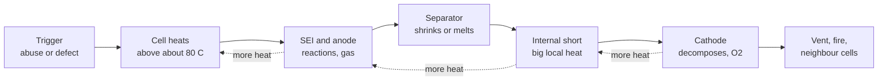

::: testing
Whether you can think about a battery as a **stored-energy hazard** and not just a voltage source. The hidden sub-skills:

1. You can name the main hazards (thermal runaway, fire, toxic gas, swelling, electric shock/arcing) and the *abuse conditions* that trigger them.
2. You understand the **positive-feedback mechanism** that makes lithium fires self-sustaining.
3. You can describe **layered prevention**: cell design, protection electronics, charger controls, mechanical design, process and user practice, and that no single layer is trusted alone.
:::

::: why
Lithium cells pack a lot of energy into a small, sealed, flammable package. A 2 Ah, 3.7 V cell stores 7.4 Wh, which is 26.6 kJ, and it can release much of it in seconds. Hardware engineers get asked about this because someone has to design the protection, choose the chemistry and write the handling rules. Real incidents (recalls, grounded aircraft equipment, house fires from e-bike chargers) are the reason charger ICs, protection circuits, and standards like IEC 62133 and UN 38.3 exist.
:::

::: concepts
- **Energy density vs safety**: more energy in less volume is the whole point of lithium cells, but it makes failure more severe. See [[q0299]].
- **Operating window**: voltage, current and temperature limits that keep the cell chemistry stable. See [[q0305]].
- **Thermal runaway**: self-heating reactions that accelerate with temperature. See [[q0332]].
- **Abuse modes**: overcharge, overdischarge, short circuit, puncture/crush, heat. See [[q0330]], [[q0331]], [[q0329]].
- **Protection layers**: charger control, BMS/protector, fuse/PTC, cell-level devices. See [[q0325]].
:::

::: answer
"The big danger is thermal runaway. A lithium cell has a flammable organic electrolyte and a lot of stored energy in a sealed package. If something pushes it outside its safe window, like overcharge, overdischarge, a short circuit, a crush or puncture, or just excessive heat, it starts to heat up internally. Heat speeds up the reactions that produce more heat, and above roughly 100 to 150 degrees C it becomes self-sustaining. The cell vents flammable gas, can catch fire, and can set off the cells next to it. Fumes can also be toxic, because the electrolyte salt can form hydrogen fluoride. Also, a short on a big pack is an electrical hazard with hundreds of amps of arc and burns.

Prevention is layered. At the cell level you have a separator that shuts down, a vent, and sometimes a current-interrupt device. At the pack level you have a protector or BMS with over-voltage, under-voltage, over-current, short-circuit and temperature cutoffs, plus a fuse. The charger enforces CC/CV with a temperature check and a timer. Mechanically you protect the cell from crush and puncture and leave room for swelling. And you pick the chemistry: LiFePO4 is much more tolerant than cobalt-based cells. Finally there's handling: charging unattended, storage and transport rules."
:::

::: technical
**Hazards.**

1. **Thermal runaway**: exothermic decomposition reactions (SEI breakdown, reaction of lithiated anode with electrolyte, separator melting and internal short, cathode decomposition releasing oxygen) accelerate with temperature.
2. **Fire/explosion**: the electrolyte (organic carbonate solvents with a lithium salt, commonly LiPF₆) is flammable; venting produces flammable gas and, with cells in pouches or cans, pressure rupture.
3. **Toxic emissions**: LiPF₆ can decompose to form hydrogen fluoride (HF) and other irritants.
4. **Swelling**: gas generation from electrolyte decomposition (overcharge, heat, ageing) inflates pouch cells.
5. **Electrical**: very high short-circuit current (tens to hundreds of amps for small packs), arcs, burns, and shock in high-voltage packs.
6. **Latent defects**: lithium plating and metallic contaminants can create internal shorts that only show up later.

**Approximate temperature ladder** (chemistry-dependent):

| Temperature | What happens |
|---|---|
| about 60 to 80 °C | Accelerated ageing, SEI starts to degrade |
| about 90 to 130 °C | SEI decomposition, anode-electrolyte reactions, separator shutdown/shrink |
| about 130 to 165 °C | Separator melts, internal short |
| above about 150 to 250 °C | Cathode decomposition, oxygen release, fire |

> [!UNCERTAIN]
> Onset temperatures depend on chemistry, state of charge, cell size and heating rate. The ladder above is a rough teaching guide, not specification data. LiFePO₄ cathodes release oxygen far less readily, which is the main reason they are considered safer.

**Prevention layers.**

- **Cell**: shutdown separator, safety vent, current-interrupt device (CID) or PTC in cylindrical cells, tab/insulation design, quality control.
- **Electronics**: charger with CC/CV, NTC and timer; protector IC with OVP, UVP, OCP, short-circuit, over-temperature; fuse as last resort; cell balancing for series packs.
- **Mechanical/thermal**: protect from puncture and crush, allow expansion, spacing or barriers between cells, venting paths, heat sinking.
- **Chemistry and design margins**: choose LFP for safety, derate charge voltage and C-rate.
- **Qualification**: cells and packs tested against abuse (overcharge, short, crush, nail penetration, thermal) per standards such as UL 1642 (cells), UL 2054 (packs), IEC 62133 and UN 38.3 for transport.
- **User practice**: use matching chargers, do not charge unattended or on flammables, store at partial charge, inspect for swelling, use fire-safe bags for hobby LiPos.
:::

::: short
"The main danger is thermal runaway. Lithium cells have a flammable electrolyte and a lot of stored energy, and abuse like overcharge, overdischarge, shorting, puncture or heat makes them self-heat until they vent and burn, sometimes with toxic gas. You prevent it in layers: cell-level separator and vent, a protection IC with voltage, current and temperature cutoffs plus a fuse, a proper CC/CV charger with a temperature check, mechanical protection, a safer chemistry like LiFePO4, and good handling."
:::

::: long
"The main thing to understand is that a lithium cell is a compact, sealed package with a lot of stored energy and a flammable organic electrolyte. A 2 amp-hour cell is about 26 kilojoules. When it's treated within its limits, around 3 to 4.2 volts per cell, reasonable current, reasonable temperature, it's perfectly safe. The danger comes from abuse: overcharge, overdischarge, short circuits, puncture or crush, or just external heat.

The mechanism is thermal runaway. Something raises the cell temperature, and above roughly 80 to 130 degrees the protective layer on the anode starts to break down, then the separator shrinks or melts and you get an internal short, and the cathode eventually decomposes and releases oxygen. Each step releases heat, which accelerates the next step, so it's positive feedback. You get venting of flammable gas, fire, and toxic fumes, because the lithium salt can form hydrogen fluoride. And in a pack, one cell can heat its neighbours into runaway too.

The other hazards are swelling from gas, and the electrical side: a short circuit on a big pack can deliver hundreds of amps.

Prevention is about layers, because you can't depend on any one. Inside the cell: shutdown separator, vent, and in cylindrical cells a CID. In the pack: a protection IC doing over-voltage, under-voltage, over-current, short-circuit and over-temperature, plus a fuse. The charger limits voltage and current and won't charge when cold or hot. Mechanically, you protect from puncture and leave room to swell. You choose the chemistry for the application, LiFePO4 if safety dominates. And you pass standardized abuse tests and give users clear handling instructions."
:::

::: terms
- **Thermal runaway**: self-accelerating heating where reaction heat raises temperature, which speeds the reactions.
- **Electrolyte**: the ionic conductor, typically a lithium salt (such as LiPF₆) in organic carbonate solvents; flammable.
- **Separator**: porous polymer film between anode and cathode that stops electrical contact; may "shut down" by closing its pores when hot.
- **SEI (solid-electrolyte interphase)**: passivating layer on the anode that forms during first cycles and decomposes when hot.
- **CID (current-interrupt device)**: pressure-activated switch in cylindrical cells that opens the circuit when internal gas builds up.
- **Venting**: controlled release of internal gas through a designed weak point.
- **Lithium plating**: metallic lithium deposition on the anode (for example from cold or fast charging) that can form dendrites.
- **Abuse test**: standardized test (overcharge, short, crush, nail, thermal) used to qualify a cell or pack.
:::

::: exceptional
**An average answer** lists "fire, explosion" and "use a BMS".

**An exceptional answer**:
- Explains the **mechanism** (positive feedback, the stages of decomposition) rather than just naming runaway.
- Separates **causes** (electrical, thermal, mechanical, manufacturing) and gives one example of each.
- Talks about **layers of protection** and independence (cell, electronics, charger, mechanical, procedural), and that protection ICs can fail.
- Mentions **chemistry choice** (LFP vs NMC/LCO) and the energy-vs-safety trade.
- Mentions **latent failures** (internal short from plating or contamination) and why standards/testing exist.
- Gives numbers: 4.2 V limit, charge temperature limit near 0 to 45 °C, energy in a typical cell.
:::

::: mistakes
- **"Lithium batteries contain metallic lithium that reacts with water."** Li-ion/LiPo cells contain lithium *ions* in electrodes, not bulk lithium metal (unless plating occurs). The fire fuel is the electrolyte and cell materials.
- **"The BMS makes it safe."** A BMS reduces risk but can fail; safety needs layers and design margins.
- **"Only overcharging is dangerous."** Overdischarge, cold charging, short circuits, mechanical damage and heat all matter.
- **"Swollen cell means just old."** Swelling is gas from decomposition. The cell should be taken out of service.
- **"A discharged cell is safe."** It has much less energy, but a damaged cell at low SoC can still short and heat; an overdischarged cell can be dangerous to recharge.
- **Ignoring series packs.** Higher voltage means more arc energy, and cells can heat neighbours.
:::

::: deep
## Where the energy is

The reason lithium cells are hazardous is also the reason we use them: energy density. A typical cell stores about 250 Wh/kg, which is $250 \times 3.6 = 900$ kJ per kilogram. A 2000 mAh LiPo at 3.7 V holds

$$E = 2\ \text{Ah} \times 3.7\ \text{V} = 7.4\ \text{Wh} = 26.6\ \text{kJ}$$

If a 40 g cell converted all of that to heat with a specific heat of about $1\ \text{kJ/(kg·K)}$, the temperature rise would be $26\,640\ /\ (0.04 \times 1000) \approx 666$ K. Real incidents do not release all stored energy as internal heat (some goes out as hot gas, some as an external short), but the arithmetic shows why a cell can exceed its decomposition temperature many times over, and why the energy of the cell plus the flammable electrolyte matters.

## The runaway chain


Figure: Every stage releases heat and hands the cell a higher temperature, so the dashed arrows are the feedback that makes runaway self-sustaining. Prevention means stopping the chain at the trigger, or limiting how fast heat escapes and spreads.

The mathematical form is an Arrhenius-type heat generation, $\dot{Q}_{gen} \propto e^{-E_a/(k T)}$, against roughly linear cooling, $\dot Q_{loss} = hA(T - T_{amb})$. Below a critical temperature the cooling line crosses the generation curve and the cell settles. Above it, generation outruns cooling no matter what. [[q0332]] works through that picture in detail.

## Causes, grouped

| Class | Examples | How it ends in heat |
|---|---|---|
| Electrical abuse | Overcharge, overdischarge then recharge, external short, high C-rate | Plating, oxygen release, copper dissolution, I²R heating ([[q0330]], [[q0331]]) |
| Thermal abuse | Hot car, adjacent hot component, fire | Starts the ladder directly ([[q0332]]) |
| Mechanical abuse | Crush, puncture, drop, bending of a pouch | Separator breach and internal short ([[q0329]]) |
| Manufacturing defect | Metal particles, burrs, misaligned electrodes, poor sealing | Latent internal short that appears weeks later |
| Ageing | Plating, SEI growth, gas | Higher resistance and risk |

Standards testing mirrors this table: external short, overcharge, forced discharge, crush, impact and heating tests appear in documents like IEC 62133 and UL 1642.

## Chemistry matters

| Chemistry | Nominal V | Safety character | Trade-off |
|---|---|---|---|
| LiCoO₂ (LCO) | 3.7 V | Least thermally stable; releases oxygen readily | High energy density |
| NMC / NCA | 3.6 to 3.7 V | Intermediate; depends on nickel content | High energy, EV use |
| LiFePO₄ (LFP) | 3.2 V | Much more stable, strong P–O bonds | Lower energy density, flatter voltage curve |

> [!UNCERTAIN]
> Qualitative ranking is widely accepted; quantitative onset temperatures vary by paper, cell format and test method. LiPo refers to the pouch format (gel/polymer electrolyte) of Li-ion cells and is usually a cobalt-based chemistry like LCO or NMC.

## Building the protection stack

```circuit
{"elements":[
 {"t":"battery","a":[0,2],"b":[0,8],"label":"Cell","labelSide":"other"},
 {"t":"wire","pts":[[0,2],[0,0],[5,0]]},
 {"t":"F","a":[5,0],"b":[9,0],"label":"Fuse"},
 {"t":"wire","pts":[[9,0],[22,0]]},{"t":"term","at":[22,0],"label":"PACK +","side":"right"},
 {"t":"wire","pts":[[0,8],[0,10],[6,10]]},
 {"t":"box","at":[6,8],"w":8,"h":4,"label":"Protector\nFETs","pins":[{"side":"left","pos":2,"name":"CELL"},{"side":"right","pos":2,"name":"PACK"},{"side":"top","pos":4,"name":"TS"}]},
 {"t":"wire","pts":[[14,10],[22,10]]},{"t":"term","at":[22,10],"label":"PACK -","side":"right"},
 {"t":"thermistor","a":[10,3],"b":[10,8],"label":"NTC on cell"},
 {"t":"wire","pts":[[10,3],[3,3],[3,10]]},{"t":"dot","at":[3,10]},
 {"t":"text","at":[16,5],"text":"IC watches V, I and T:\nopens FETs on a fault","anchor":"start","muted":true}
]}
```
Figure: A minimal protection path. The fuse is the independent last resort (if the FETs weld shut), the protector FETs open on OVP/UVP/OCP/short, and the NTC (from the TS pin to cell negative, mounted against the cell) lets the electronics see temperature. All three layers are needed because each covers failures of the others.

A good design adds a **charger** with CC/CV and temperature gating ([[q0325]]), balancing for series packs ([[q0326]]), and spacing/venting so that a cell failure does not take out its neighbours.

## Try the cell side

```sim
{"id":"lipo-lab","view":"discharge","capacity":2,"crate":2,"temp":0,"rint":0.05}
```
Figure: This starts at 2C and 0 °C. The cold cell's resistance is about 2.5 times its room-temperature value, so the terminal voltage drops about 0.5 V the instant the load is applied and hits the 3.0 V cutoff with only about 40% of the capacity delivered, turning a larger share of the energy into I²R heat. Set the temperature to 25 °C to compare, then try 3C at 0 °C: the cell barely runs at all. A cold, high-rate pull stresses a cell without ever hitting the charge-voltage limit.

## Handling and transport

- Store at partial charge (commonly around 3.7 to 3.85 V per cell) and in a cool place; long storage at full charge and heat accelerates ageing.
- Use fire-resistant bags or containers for charging hobby packs and never leave them charging unattended.
- Do not charge a swollen, punctured or hot pack. Do not charge below 0 °C.
- Air-transport rules for lithium batteries (UN 38.3 testing, watt-hour limits) exist because of past incidents; check current regulations for any shipping.

## A quantitative short-circuit scenario

The energy argument above is about the worst case. A more common event is an electrical short, and it can be estimated in two lines. A 4S1P pack has cells of 50 mΩ each and an additional 20 mΩ of wiring, connectors and the protection FETs. A hard short across the pack terminals draws

$$I_{sc}=\frac{16.8}{4\times0.05+0.02}=\frac{16.8}{0.22}=76\ \text{A}$$

(at full charge, ignoring the fuse and protection). The power dissipated inside the cells is $I^2R=76^2\times0.2=1.16$ kW in total, or about 290 W in each 45 g cell. With $c_p\approx1$ J/(g·K) the adiabatic heating rate of each cell is $290/45=6.5$ K/s, so a 90 K rise takes about 14 seconds, long before an unprotected pack is noticed by its owner. A single cell at 4.2 V into a 10 mΩ short does even more per cell: 70 A and 5.4 K/s. The numbers explain three design rules:

- A short-circuit protector must act in microseconds to milliseconds, not seconds, and the fuse must be sized so that it blows well before the cells reach the separator-shutdown region (see the ladder above). That puts the fuse rating above the normal peak load but below what the cells and wiring can carry continuously, and the fuse's interrupt rating (the maximum fault current it can safely clear) above the prospective short-circuit current of 76 A, or 100 A once the margin is added.
- Wiring, tabs and connectors carry the same current, so they heat too. A 20 mΩ connector at 76 A dissipates 116 W, which is how plastic housings melt and PCB traces vaporize.
- A larger pack scales the current: paralleling cells divides the resistance and multiplies the short-circuit current. Prospective fault current is the number to put on the safety review.

## Layers of protection and the arithmetic of independence

Layered protection works only if the layers fail independently. Suppose, as an assumption for illustration, that each protection layer (charger termination, protector IC, fuse) has a 1% probability of failing when called upon. If they were truly independent the chance that all three fail together is $0.01^3=10^{-6}$. In practice the layers share things: one power supply, one temperature sensor, one MCU, one PCB, one wire harness. A common-cause fraction (usually called a beta factor) of 10% would put the joint failure at about $0.01\times0.1=10^{-3}$, a thousand times worse than the naive product. The practical lesson, which interviewers like to hear, is that a safety design should make the layers physically and electrically different: a hardware comparator that does not depend on the firmware, a fuse that has no electronics at all, a thermal fuse or PTC that responds to heat directly, and a separator and vent that work without any power.

> [!UNCERTAIN]
> The 1% per-layer failure probability and the 10% common-cause fraction are illustrative assumptions to show the effect of common-cause failures, not measured data for any protection component.

## Toxic and corrosive products: a bounding estimate

The electrolyte salt LiPF₆ can produce hydrogen fluoride when it decomposes in the presence of moisture or heat. A bounding calculation shows the scale and its limits. Suppose a 2 Ah cell contains about 6 g of electrolyte (assumed: roughly 1.5 to 3 g per Ah is a typical range, and the top of it is used here to keep this an upper bound) that is roughly 12% LiPF₆ by mass: 0.72 g, or 4.7 mmol (molar mass about 152 g/mol). Each LiPF₆ holds six fluorine atoms, so the theoretical maximum is $6\times4.7=28$ mmol of HF, which is 0.57 g or about 0.7 L of gas at room temperature. The real yield is much smaller because most of the fluorine ends up in fluorides such as LiF, and because the amount depends on the temperature, the moisture available and the burn. The point is not the number: a small cell can produce a gram-scale quantity of a very toxic gas in a small room, so the guidance is to ventilate, keep away from the smoke, and not to assume it is only "a fire".

> [!UNCERTAIN]
> Electrolyte mass per Ah, salt fraction and HF yield vary with the cell design, and measured emissions from cell fires depend strongly on the test. This is a maximum, not a prediction.

## Safe lab practice when you have to test cells

- Work with a current-limited bench supply and set the voltage and current limits before connecting the cell. An unlimited supply is an unprotected cell.
- Test inside a fire-resistant container or a vented hood, away from combustibles, with an extinguisher appropriate for the cell chemistry and for the surroundings, and with a second person present for abuse-adjacent work.
- Use 4-wire sensing for voltage, a thermocouple on the cell, and an automated shutdown that trips on temperature rate of change as well as on an absolute limit.
- Never leave a charging or high-rate test unattended, and never test damaged or swollen cells outside a proper abuse-test facility.
- Verify the protection circuit separately with a bench supply instead of a cell, so protection thresholds are tested without risking a cell.

## Verifying the design: what a qualification report looks like

For a design review, the evidence is a table that pairs each hazard with a test and a measured result: external short at room temperature and hot (peak temperature, whether the fuse or protector opened, any venting), overcharge at the maximum allowed charger fault, forced discharge, crush and impact (per the applicable standard), thermal exposure, and propagation between cells in the pack. Pass criteria are usually "no fire or explosion" and a maximum surface temperature, specified by the standard. Show the result next to your calculated prospective short-circuit current and the fuse's interrupt rating; a reviewer will check the margin.

:::

::: applications
- **Smartphone and laptop packs**: protector IC plus fuel gauge plus thermal sensing, with a mechanical design that avoids crush and leaves swelling room.
- **E-bike and scooter packs**: cell-level fusing, BMS with temperature monitoring, and chargers matched to the pack.
- **Drone/RC LiPo**: balance chargers, storage mode, fire-safe bags; hobby packs have no protection built in.
- **Aircraft and shipping**: UN 38.3 qualification and Wh limits for cargo and carry-on.
- **Energy storage and EVs**: thermal management, cell-to-cell barriers and venting to stop propagation.
:::

::: assumptions
- Written for **Li-ion/LiPo with organic liquid or gel electrolyte**. Solid-state cells change the hazard (no flammable liquid) but not all risk.
- Temperatures, voltages and onset points are **typical** and vary by chemistry and cell design.
- "Prevention" here means design-level and process-level measures; the exact requirements depend on the product category and regulations.
- An interviewer might narrow the question to **LiPo specifically**; the answer is the same, but mention pouch fragility ([[q0329]]) and swelling.
:::

::: followups
### Why is LiFePO4 considered safer?
Its olivine cathode has strong phosphorus–oxygen bonds, so it releases oxygen far less easily when heated or overcharged. Thermal runaway still happens in abusive conditions but starts at a higher temperature and is less violent. The price is lower energy density (about 3.2 V nominal) and a flatter voltage curve that makes SoC estimation harder.

### What is the difference between a protection circuit and a fuse?
A protection circuit senses voltage, current, temperature and opens a FET, and it is resettable. A fuse is passive and one-shot, a last line of defence for failures the electronics miss (like shorted FETs). Using both gives independent layers.

### How would you stop one cell failing from taking down the whole pack?
Limit heat propagation: leave spacing or use thermal barriers between cells, provide venting paths, fuse individual cells in large parallel groups, monitor temperature of several cells, and shut down the pack on early warning. In an EV pack the design target is to delay propagation long enough for occupants to get out.

### A device's battery pack is swollen. What should the user do and why?
Stop using and charging it, remove it from the device if safe, and place it somewhere non-flammable and ventilated, then take it to proper battery recycling. Swelling means gas from electrolyte decomposition, so the cell is damaged internally and can short or vent.

### Scenario: a customer reports that their device got very hot while charging in a cold garage in winter. What do you suspect?
Charging below 0 °C causes lithium plating, which is cumulative damage that creates a latent internal short risk, and if the charger's NTC is missing, miswired, or placed far from the cell, it could not stop the charge. Check the charger's temperature cut-off, NTC placement, and the cell for swelling. The design fix: enforce a charge temperature window in hardware, not just in firmware.

### Why is a short circuit more dangerous on a bigger pack?
Current is limited by $V/R$ and cell resistance is only milliohms, so a 4S pack can push hundreds of amps into a short, with $I^2R$ heating in wires, connectors and cells, and an arc that can weld contacts. Higher voltage also sustains arcs. A fuse sized to the wiring and a fast short-circuit protector are essential ([[q0331]]).
:::

::: interpretations
"Lithium-based battery chemistries" covers Li-ion variants (LCO, NMC, NCA, LFP, LTO) and LiPo, which is a pouch format of Li-ion. Primary lithium metal batteries (coin cells, Li-SOCl₂) have different hazards (metallic lithium reacts with water) and are only briefly mentioned. This page is about rechargeable cells, the focus of the surrounding questions. For individual abuse modes, see [[q0329]], [[q0330]], [[q0331]], and [[q0332]].
:::

::: references
- IEC 62133 (safety requirements for portable sealed secondary lithium cells and batteries) and UL 1642 / UL 2054 (lithium cell and battery safety): cited by name for the idea of standardized abuse tests.
- UN Manual of Tests and Criteria, section 38.3 (lithium battery transport testing).
- Battery University, articles on safety of lithium-ion batteries and thermal runaway (qualitative background).
- Linden's *Handbook of Batteries*, chapters on lithium-ion batteries and battery safety.
:::

::: rubric
- Names thermal runaway as the core hazard and explains the positive feedback :: This is the mechanism; listing "fire" without it is shallow.
- Lists abuse triggers: overcharge, overdischarge, short, puncture/crush, heat :: The hazards depend on triggers, and prevention targets each.
- Mentions flammable electrolyte and toxic gas (HF) :: Shows awareness of consequences beyond "it gets hot".
- Describes cell-level safety features (separator shutdown, vent, CID/PTC) :: Prevention starts inside the cell.
- Describes electronic protection (protector/BMS, fuse) and the charger's role :: Core of the engineering answer.
- Mentions mechanical design and chemistry selection (LFP vs LCO) :: Demonstrates system-level thinking.
- Notes that safety is layered and qualified by standards testing :: Signals maturity: no single point of failure.
:::

::: quiz
```json
[
 {"type":"mcq","level":"fundamental","q":"What is the best description of thermal runaway?","options":["The cell voltage slowly rises during charging","Self-accelerating heating where reaction heat raises temperature and speeds up the reactions","A battery being too cold to deliver current","The charger turning off at 4.2 V"],"answer":1,"explain":"Thermal runaway is a positive-feedback process: heat accelerates exothermic reactions which produce more heat, until the cell vents or burns."},
 {"type":"truefalse","level":"fundamental","q":"A normal Li-ion/LiPo cell contains a block of metallic lithium that reacts violently with water.","answer":false,"explain":"The lithium is in ionic form inside electrode materials. The fuel in a fire is mostly the flammable electrolyte and cell components; metallic lithium appears only as plating after abuse."},
 {"type":"numeric","level":"intermediate","q":"How much energy is stored in a 3000 mAh, 3.7 V cell? Give the answer in kJ.","answer":39.96,"tolerance":0.02,"unit":"kJ","explain":"$E = 3\\,\\text{Ah}\\times3.7\\,\\text{V} = 11.1$ Wh. Multiply by 3600 s/h: 39.96 kJ."},
 {"type":"multi","level":"intermediate","q":"Which are independent layers of protection for a LiPo pack? Select all that apply.","options":["Protector IC opening FET switches","A fuse in the pack path","Charger NTC temperature gating","Painting the pack red"],"answer":[0,1,2],"explain":"The protector, fuse and charger controls each act independently. Colour has no safety function."},
 {"type":"mcq","level":"advanced","q":"Why is a cold, high-rate charge a hazard even if voltage and current are within limits?","options":["Cold cells have lower internal resistance","At low temperature lithium intercalation is slow so lithium plates as metal on the anode, creating latent internal-short risk","The charger stops working in the cold","Cold increases the electrolyte conductivity"],"answer":1,"explain":"Below about 0 °C ion diffusion into graphite is slow, so lithium deposits on the surface. Plated lithium and dendrites can pierce the separator later. That is why chargers use an NTC to block cold charging."},
 {"type":"mcq","level":"advanced","q":"Which statement about LiFePO4 vs LiCoO2 is most accurate?","options":["LFP stores more energy per kg and is less safe","LFP is more thermally stable but has lower energy density and lower nominal voltage","LFP needs no protection electronics","LFP cells never fail"],"answer":1,"explain":"LFP's strong P-O bonds resist oxygen release, giving better thermal stability, at the cost of lower energy density and about 3.2 V nominal. It still needs protection."}
]
```
:::
