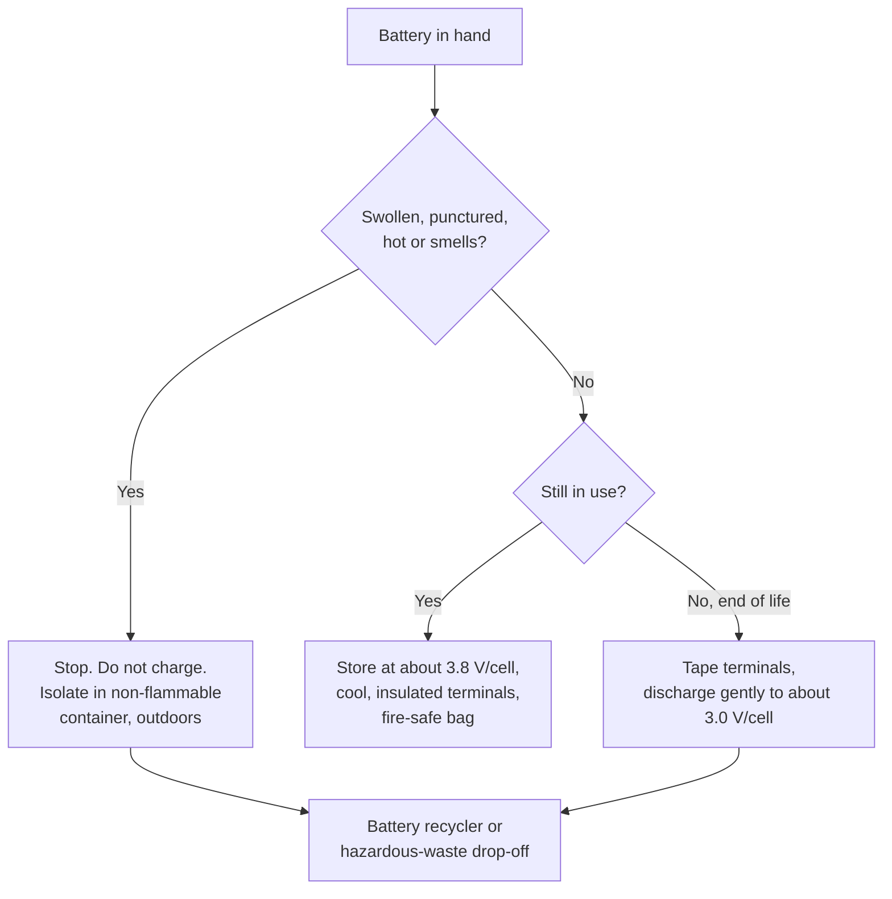

::: testing
Whether you treat a LiPo as a **pocket-sized energy store** that needs respect through its whole life, not just while it is in the product. The hidden sub-skills:

1. You know *why* a pouch cell is fragile (thin foil, no rigid can) and what damages it (puncture, crush, heat, shorting terminals).
2. You can describe **safe handling** (storage charge, insulated terminals, temperature, charging practice) and the **end-of-life route** (never general trash, discharge/tape/recycle).
3. You can connect the rules to physics: stored energy, short-circuit current, and delayed failure.
:::

::: why
Most LiPo fires do not happen in the lab at the moment of design; they happen later: a pack dropped in a bag, a swollen pack in a drawer, a dead battery thrown in the bin and crushed in a garbage truck. Engineers who ship products are expected to write the handling instructions, design the packaging, and specify the end-of-life route. In an interview this question is a quick check that you will be someone who does not cut corners on safety, and that you know the reasons rather than just the slogans.
:::

::: concepts
- **Stored energy**: a 2 Ah, 3.7 V cell holds 7.4 Wh (26.6 kJ) even when the device is "off". See [[q0327]].
- **Pouch construction**: aluminium-laminate foil with tabs, no rigid case, so physical damage is easy. See [[q0329]].
- **Short-circuit current**: milliohm-level internal resistance means tens of amps from a coin or wire. See [[q0331]].
- **Voltage and temperature window**: abuse modes at both extremes. See [[q0330]], [[q0332]].
- **Delayed failure**: damage (dendrites, internal shorts, gas) can show up hours or days later.
:::

::: answer
"LiPos are dangerous to mishandle because they're a lot of energy in a thin, soft package with a flammable electrolyte, and the damage isn't always visible or immediate. If you puncture or crush one, or short the terminals, you can get an internal short and thermal runaway, which is fire and toxic smoke. And a pack can look fine after a drop and ignite later.

For handling: keep terminals insulated, don't carry them loose with metal objects, store them at a partial charge, around 3.8 V per cell, in a cool place, ideally in a fire-resistant bag or box. Charge only with the right charger, never unattended, and never charge a swollen or damaged pack. Don't solder directly to the cell tabs because the heat damages the seal.

For disposal: they can't go in the normal trash or ordinary recycling because in compactors and shredders they get crushed and start fires. You discharge the pack safely, tape the terminals, and take it to battery recycling or a take-back point. If it's swollen or damaged, you isolate it in a non-flammable container first. That also recovers cobalt, nickel and lithium instead of landfilling toxic materials."
:::

::: technical
**Why handling matters (physics).**

- Energy: $E = Q\,V = 2\ \text{Ah} \times 3.7\ \text{V} = 7.4\ \text{Wh} = 26.6$ kJ per 2 Ah cell, present at any state of charge above zero.
- Short-circuit: with $R_{int} \approx 50\ \text{m}\Omega$ and a 20 mΩ contact (coin or tool), $I = 4.2/(0.05+0.02) = 60$ A, dissipating $I^2 \times 0.02 \approx 72$ W at the contact and $\approx 180$ W inside the cell. That is why a loose pack in a pocket with keys can ignite.
- Pouch cells have no rigid case; the aluminium-laminate envelope and tabs are fragile, so pressure, bending or sharp objects can breach the separator ([[q0329]]).
- Heat: the sealed pouch is stressed above about 60 °C and the cell's reactions accelerate ([[q0332]]).

**Handling practice.**

- Insulate terminals (caps, tape) when stored or transported; keep away from metal.
- Store at about 3.7 to 3.85 V per cell (roughly 40 to 60% SoC) in a cool, dry place; avoid full-charge storage and avoid storage below about 3.0 V.
- Charge on a non-flammable surface with a charger set for the cell count and chemistry; use balance leads for series packs ([[q0326]]).
- Inspect for swelling, dents, punctures, or heat before every use; retire damaged packs.
- Do not solder directly on cell tabs (heat damages the seal and internals); use pre-attached leads, spot-welded tabs or the supplied connector.
- Avoid operating or storing below 0 °C or above about 60 °C.

**Disposal practice.**

- Do not put in household trash, ordinary recycling bins, or incinerators.
- Bring to a battery collection point or battery recycler. Many jurisdictions regulate lithium batteries as hazardous or universal waste.
- Before disposal, tape terminals; for packs, discharge slowly through a resistive load (for example a lamp or a power resistor at a moderate rate, ≤ 0.5 C) down to near 3.0 V per cell, or use the recycler's instructions.
- Damaged/swollen cells: isolate in a non-flammable container (such as sand or a metal ammo can) and follow the recycler's rules for damaged batteries.

> [!UNCERTAIN]
> Advice such as "discharge before disposal" and "saltwater bath" varies. Saltwater discharging is widely circulated but is discouraged by many sources because it can cause uncontrolled shorting, corrosion and gas. Always follow local regulations and the recycler's guidance.
:::

::: short
"LiPos are soft pouch cells holding a lot of energy and a flammable electrolyte, so puncture, crush, heat or shorted terminals can start an internal short and thermal runaway, even hours later. So I store them insulated, at a partial charge, cool, in a fire-safe bag, charge them only with the right charger and never unattended, and retire swollen ones. At end of life they go to battery recycling, with the terminals taped and the pack discharged, never in household trash where compactors crush them and start fires."
:::

::: long
"The reason handling and disposal matter is that a LiPo is a lot of stored energy in a thin, soft pouch with a flammable electrolyte. A 2 amp-hour cell is about 26 kilojoules, and that energy is there even when the device is off. The pouch is aluminium foil laminate with no rigid can, so a puncture, crush or a sharp bend can damage the separator and cause an internal short. Same if the terminals are shorted: the internal resistance is tens of milliohms, so a coin or a screwdriver across the terminals can pull tens of amps and heat up fast.

So handling rules follow from that. Keep the terminals insulated and never carry packs loose with metal. Store them at partial charge, about 3.8 volts per cell, cool, ideally in a fire-resistant bag. Use a charger set for the correct cell count, charge on a non-flammable surface and never leave it unattended. Don't solder to the tabs, because the heat damages the seal. Inspect for swelling and dents, and retire anything damaged. Cold charging below zero is also a no.

Disposal is the same logic. If you throw a LiPo in the trash, a compactor or shredder can crush it and it ignites, which is a known cause of waste-truck and recycling-plant fires. So you tape the terminals, discharge it safely at a gentle rate, and take it to a battery recycling point. A swollen or damaged pack gets isolated in a non-flammable container first and handed to the recycler. Recycling also recovers cobalt, nickel and lithium and keeps the electrolyte and metals out of landfill."
:::

::: terms
- **Pouch cell**: a cell whose electrode stack is sealed in aluminium-laminate foil instead of a metal can.
- **Storage voltage**: the partial-charge state (about 3.7 to 3.85 V per cell) recommended for long storage.
- **Swelling**: bulging from gas generated by electrolyte decomposition; a sign the cell is damaged.
- **LiPo bag / safe box**: fire-resistant container used when charging or storing packs.
- **Universal / hazardous waste**: regulatory categories requiring battery collection and recycling rather than trash disposal.
- **Take-back program**: retailer, manufacturer or municipal scheme for collecting used batteries.
- **Delayed failure**: internal damage that causes a short or fire later, not at the time of the incident.
:::

::: exceptional
**An average answer** says "they can catch fire so be careful, and recycle them".

**An exceptional answer**:
- Ties each rule to **physics**: stored energy (26.6 kJ in a 2 Ah cell), short-circuit currents (tens of amps), fragile pouch.
- Notes **delayed failure** after a drop or crush, which is why damaged packs are retired rather than "tested".
- Gives **specific practices** (storage voltage, insulated terminals, charge bag, no tab soldering) rather than "be careful".
- Explains **why trash and shredders are the real hazard** and that recycling recovers valuable materials.
- Acknowledges that **local regulations** govern disposal and transport and flags uncertainty about home discharge methods.
- Mentions product-design responsibility: label, pack protection and packaging.
:::

::: mistakes
- **"If it looks fine after a drop, it's fine."** Internal separator damage may not show; treat dropped or crushed packs as suspect.
- **Throwing a "dead" battery in the bin.** Dead means low SoC, not zero energy, and cells can still short and ignite when crushed.
- **Saltwater bath as a safe discharge method.** Controversial: it can short the cell, heat, produce gas and corrode; use a resistive load or the recycler's process.
- **Storing fully charged for months.** Accelerates ageing and increases risk; store at partial charge.
- **Carrying loose cells with metal objects.** A coin can short the terminals.
- **Charging a swollen pack "carefully".** Swollen cells have gas and likely internal damage; do not charge.
:::

::: deep
## Why "dead" is not "safe"

A battery rated 2000 mAh that your device says is "0%" usually still sits at about 3.0 to 3.3 V per cell, because the protection or the gauge cuts off before the true bottom. The remaining energy is smaller but nonzero, and the *short-circuit current* depends on voltage and internal resistance, not on how much capacity is left:

$$I_{sc} = \frac{V_{cell}}{R_{int} + R_{contact}}$$

At 3.3 V with $R_{int} = 50\ \text{m}\Omega$ and $R_{contact} = 20\ \text{m}\Omega$: $I_{sc} = 3.3/0.07 = 47$ A. Not much less than at 4.2 V (60 A). This is why discharged cells still need their terminals insulated and why the disposal rule is not just "wait until it's empty".

## How much heat can a short make?

```plot
{"title":"Heat in the contact vs contact resistance (1S LiPo, 4.2 V, R_int = 50 mΩ)","x":{"label":"Contact resistance","unit":"Ω","min":0.001,"max":10,"log":true},"y":{"label":"Power","unit":"W","min":0,"max":100},
 "vars":{"v":4.2,"rint":0.05},
 "series":[{"label":"heat in contact","fn":"x*pow(v/(rint+x),2)","color":"orange"},
           {"label":"heat inside cell","fn":"rint*pow(v/(rint+x),2)","color":"red"}],
 "vlines":[{"at":"rint","label":"R_contact = R_int","color":"muted"}],
 "hlines":[{"at":"v*v/(4*rint)","label":"max contact power = V²/4R_int = 88 W","color":"muted"}]}
```
Figure: The dangerous region is any low-resistance contact: wire, tool, coin. The contact dissipates a maximum of $V^2/(4R_{int}) = 88$ W when its resistance matches the cell's, and the cell itself heats even more at the lowest contact resistances (the red curve runs off the top of the chart, to about 340 W at 1 mΩ). Together that is hundreds of watts split between a small cell and a few grams of metal.

(That 88 W peak is the maximum power transfer theorem: the load that extracts the most power from a source is the one that matches the source resistance.)

## The "pocket" accident in numbers

Assume a 40 g, 1S cell shorted by a 20 mΩ metal contact:

- Current: $I = 4.2/(0.05 + 0.02) = 60$ A.
- Inside the cell: $P = I^2 R_{int} = 3600 \times 0.05 = 180$ W.
- With specific heat $c \approx 1$ kJ/(kg·K): $dT/dt \approx 180/(0.04 \times 1000) = 4.5$ K/s.

From 25 °C to about 100 °C takes roughly $75/4.5 \approx 17$ s, comfortably inside the time it takes someone to notice a warm pocket and not enough to do anything about the cell. Real heating is non-uniform (hot spots at tabs and the contact), and the cell's resistance changes with temperature, so treat these as order-of-magnitude numbers. [[q0331]] looks at the short-circuit case in more detail.

## Safe handling workflow


Figure: The decision is made by the cell's condition. Any sign of damage (swelling, puncture, heat, smell) takes the damaged branch: isolate and hand it to a recycler who handles damaged batteries. Healthy packs get storage rules during life and a gentle discharge plus insulation at end of life.

## Why the trash is the dangerous route

Waste trucks and shredders use compaction and crushing. A pouch cell that is crushed in that environment can short internally, and a fire inside a compacted load is hard to stop. Recycling facilities report this as a recurring hazard. Beyond the fire risk, the materials (cobalt, nickel, copper, aluminium, lithium) are valuable and the electrolyte and salts are toxic; recycling recovers metals and handles the hazardous components. Regulations in many regions require battery take-back or ban disposal in the general waste stream (for example EU battery legislation and universal-waste rules in various countries). Check local rules rather than assuming.

## Discharging for disposal

A gentle resistive load is the controlled way: choose $R$ to keep the current at or below about 0.5 C. For a 3S 2200 mAh pack at about 11.1 V:

$$R = \frac{V}{I} = \frac{11.1\ \text{V}}{1.1\ \text{A}} \approx 10\ \Omega,\quad P = V I = 12.2\ \text{W}$$

so a 10 Ω, 25 W (or more) wirewound resistor or a 12 V automotive bulb works, but must be monitored and disconnected near 3.0 V per cell (9.0 V for 3S). The load must be rated for the power and located on a non-flammable surface.

```sim
{"id":"lipo-lab","view":"discharge","capacity":2.2,"crate":0.5,"temp":25,"rint":0.05}
```
Figure: At 0.5 C the cell terminal voltage stays high for most of the discharge and the I²R heat is small, so heating stays modest. Try 5 C: the voltage sags quickly and heat rises, which is why a gentle load is recommended for end-of-life discharge.

## Design responsibility

If you design the product rather than just use batteries, handling includes: using cells from reputable suppliers with traceability, a protection IC and a fuse, making the pack mechanically safe from puncture and crush, labelling with correct hazard marks, and meeting transport tests such as UN 38.3. User-replaceable batteries should have insulated, polarised connectors that cannot short on a table.

## A worked end-of-life discharge, with the resistor sized

The earlier example chose a 10 Ω load for a 3S 2200 mAh pack. Check what that implies. At full 12.6 V the load draws 1.26 A and dissipates $12.6^2/10=15.9$ W; at the 9.0 V cutoff it is 0.9 A and 8.1 W. A resistor rated only for the nominal 12.3 W would be stressed at the beginning, so the rule is to choose a rating at least twice the peak, 30 W or more, mounted so air can flow around it. A bare wirewound resistor at 16 W gets too hot to touch, and its leads can melt insulation and plastics, so put it on a ceramic or metal plate, not on a bench mat or in a plastic box.

Assuming the pack starts around mid-charge with about 0.9 Ah to remove, and that the average load current is about $(11.4+9.0)/2/10=1.02$ A (from about 3.8 V per cell down to 3.0 V per cell), the discharge takes $0.9/1.02\approx0.88$ h, roughly 50 to 55 minutes. The energy dissipated is about $3\times3.6\ \text{V}\times0.9\ \text{Ah}=9.7$ Wh, all of it turned into heat in the resistor. This is the quantitative reason you do not discharge a big pack through a tiny resistor, and the reason it is not a job to be started and left unattended.

Do not stop at exactly 9.0 V and walk away without checking again: when the load is removed, each cell's voltage rises slightly (from the $IR$ drop plus a slow relaxation), so a pack that read 9.0 V loaded will rest at a somewhat higher voltage, around 9.2 V for the 0.17 V drop computed from $1.1\ \text{A}\times3\times0.05\ \Omega$. For a pack with protection that cuts off at about 2.5 V per cell, discharging to ≤3.0 V per cell leaves a small residual charge. It is not "zero energy". It is why terminals still get taped before disposal.

## How long can a pack sit in storage before it drifts too low?

Storage voltage advice (about 3.8 V per cell) assumes the pack will be used or checked within months. Self-discharge sets how long that is, and temperature changes it a lot. Take a rule of thumb that chemical rates roughly double for every 10 K rise (an approximation to the Arrhenius law, fine for a quick estimate), a Li-ion self-discharge of 2% of capacity per month at 25 °C, and a protection IC that draws about 5 µA. The IC drain on a 2.2 Ah pack is $5\ \mu\text{A}\times8760\ \text{h}=44$ mAh per year, about 2%, so it adds roughly 0.17% per month on top of the self-discharge. From 3.8 V (about 55% SoC on the NMC OCV curve) down to about 3.5 V (about 10% SoC) is a 45% loss:

Each row adds the 0.17% per month IC drain; 15 K either side of 25 °C is a factor of $2^{1.5}\approx2.8$ in self-discharge rate.

| Storage temperature | Self-discharge assumed | Time from 55% to 10% |
|---|---|---|
| 10 °C | about 0.7% per month | about 50 months |
| 25 °C | 2% per month | about 21 months |
| 40 °C (hot garage or car) | about 5.7% per month | about 8 months |

So at room temperature a pack stored at 3.8 V is still fine after a year, whereas the same pack in a hot place reaches the bottom in well under a year, where it can be damaged by being driven under the safe voltage and shut down by its protection IC. For long storage, check voltage every few months, or add a hard cutoff in the pack that disconnects below a stored threshold. A pack that has dropped to 2.0 V or less should be treated as damaged (see [[q0330]]), not recharged.

> [!UNCERTAIN]
> The 2% per month figure and the doubling rule are typical, not guaranteed. Actual self-discharge varies by cell, aging and state of charge, and the rate may be higher in an aged or damaged cell, which is itself a warning.

## Shipping and storage by energy, not just by count

Regulators and carriers classify lithium batteries by watt-hours, not amp-hours or cell count, which is why the nominal energy matters. The 3S 2200 mAh pack above is $3\times3.7\times2.2=24.4$ Wh. Ten of them are 244 Wh, a quantity that falls into a different category of rules than one pack does. Wh also scales the fire load in storage: a shelf of 244 Wh is 880 kJ of stored chemical energy before the electrolyte and plastics are counted. The practical consequences are keeping inventory in small, separated groups, in a cool room, with terminals insulated, and keeping the current regulations for the specific mode of transport in hand before shipping a product with a battery. I am not quoting limits here because they are revised and depend on the mode of transport and region; verify them with the current carrier or regulator guidance.

## What to check on a batch of returned or old packs

1. Inspect first, without electrical contact: swelling, dents, torn laminate, corrosion at the tabs, discoloration, or electrolyte smell. Any of these ends the evaluation: isolate the pack.
2. Measure the open-circuit voltage per cell with a DMM using a high-impedance input. A pack with any cell below about 2.5 V, or a large spread between cells, is not recharged by a normal charger.
3. For packs that look healthy, measure the voltage again after a day. A fall of tens of millivolts per day is much faster than normal self-discharge and signals an internal leak.
4. Record the date, voltage, appearance and storage temperature, so the next reading has a baseline.
5. Sort the results into use, recycle, and isolate bins before anything is charged.

:::

::: applications
- **Hobby drones and RC**: fire-safe charging bags, storage mode on chargers (storage voltage), and discharge-to-storage after a flying day.
- **Consumer electronics**: sealed packs that discourage user damage; manufacturers' take-back programs.
- **Shipping and travel**: lithium battery shipping and carry-on rules (UN 38.3, watt-hour limits) to prevent incidents in cargo.
- **Recycling plants**: handling protocols that discharge or freeze packs and process under inert conditions to prevent fires.
- **Lab/prototyping benches**: battery cabinets, fire-rated bags, inspection logs for swelling.
:::

::: assumptions
- Applies to **rechargeable Li-ion and LiPo** packs. Primary lithium cells (e.g. lithium metal coin cells) have different disposal rules.
- Voltages are typical (3.8 V storage, 3.0 V end discharge); follow the cell datasheet.
- Disposal law varies by region; the engineering reasoning stays the same.
- A pack with built-in protection electronics may disconnect on a short, but you cannot rely on it for a damaged pack or a protection board that has failed.
:::

::: followups
### What is the right storage voltage and why?
Around 3.7 to 3.85 V per cell (about 40 to 60% SoC). At full charge the cathode is delithiated and the anode is highly lithiated, which speeds up side reactions, especially when warm. At very low voltage the cell can drift below the safe limit through self-discharge and suffer copper dissolution ([[q0330]]). The middle is the lowest-stress region for storage.

### How would you ship a battery pack in a product?
Qualify the cells and pack to UN 38.3, limit state of charge for transport as regulations require, include protection electronics and insulate terminals, and package so that crush or vibration cannot damage the cells. Check the current IATA/DOT rules and watt-hour limits for the relevant mode of transport.

### Why not discharge a damaged pack through a resistor?
A damaged pack can have internal shorts or high-resistance paths; loading it can heat the damaged region, and a puncture can ignite once current flows or air gets in. For damaged packs, isolate and hand them to a recycler that has procedures; don't try to "fix" them.

### What would you add to a product to make end-of-life handling safer?
Clear labelling and take-back instructions, a user-removable pack with insulated, keyed connectors or a service route, a protection circuit with an undervoltage cutoff, and information for recyclers (chemistry, voltage, how to open). For a sealed device, design for a safe battery removal procedure.

### Scenario: a technician finds a slightly puffy LiPo in a drawer of old drones. What do you tell them?
Do not use, charge or puncture it. Move it away from flammable items, put it in a metal or ceramic container with sand or a LiPo bag, preferably outdoors, and arrange recycling through a facility that takes damaged lithium batteries. Don't discharge it through a load and don't try to "deflate" it. The gas indicates decomposition and likely internal damage.

### Why does fire-safe bag charging help if the cell vents?
The bag does not stop thermal runaway; it contains flames and sparks and slows the spread, giving you time and protecting surroundings. Charging on a non-flammable surface, away from combustible materials, with an attendant nearby, is still needed. It is damage limitation, not prevention.
:::

::: interpretations
"Properly handle and dispose" has two halves: the in-use handling (storage, charging, transport, mechanical care) and the end-of-life route (discharge, insulate, recycle). This page covers both. The next questions drill into specific abuse cases: puncture ([[q0329]]), over/under charging ([[q0330]]), short circuit ([[q0331]]), heat ([[q0332]]); the general hazard overview is [[q0327]].
:::

::: references
- Battery University, articles on safe handling, storage, and disposal of lithium-ion batteries.
- UN Manual of Tests and Criteria, section 38.3, and IATA/DOT lithium battery guidance for transport (rules change; check the current edition).
- Linden's *Handbook of Batteries*, chapters on lithium-ion batteries and on battery recycling/safety.
- IEC 62133 and UL 1642/UL 2054 (cell and pack safety standards), cited by name.
:::

::: rubric
- Explains why LiPos are hazardous (energy, flammable electrolyte, fragile pouch) :: The rules only make sense if you know the physical reason.
- Gives concrete handling practice (insulate terminals, storage voltage, temperature, charging supervision) :: Shows practical competence, not just "be careful".
- Mentions that damage can be delayed and invisible :: Explains why damaged or dropped packs are retired.
- Says never to put in household trash; explains compaction/shredding fires :: Core of the disposal half.
- Describes safe disposal steps (discharge gently, tape terminals, take to recycler) :: Completes the end-of-life route.
- Treats swollen/damaged cells as a special case (isolate, don't charge or discharge) :: Shows risk-based thinking.
- Mentions recovery of materials / environmental toxicity and local regulations :: Adds the "why dispose properly" beyond fire.
:::

::: quiz
```json
[
 {"type":"mcq","level":"fundamental","q":"Why must lithium batteries not go into household trash?","options":["They contain lead","Compaction and shredding can crush them and start fires, and they contain valuable and toxic materials","They dissolve in landfill water","They are too heavy"],"answer":1,"explain":"Crushing in trucks or shredders can short the cell internally and ignite it. They also contain recoverable metals and toxic electrolyte, so take-back or recycling is required."},
 {"type":"truefalse","level":"fundamental","q":"A LiPo that shows 0% on a device's gauge has no remaining energy and cannot short-circuit dangerously.","answer":false,"explain":"A cell at about 3.0 V still delivers large short-circuit current ($V/R$), and it still has some stored energy. Insulate terminals regardless."},
 {"type":"numeric","level":"intermediate","q":"A 1S cell (4.2 V, R_int = 50 mΩ) is shorted by a 20 mΩ contact. What is the short-circuit current?","answer":60,"tolerance":0.02,"unit":"A","explain":"$I = 4.2/(0.05+0.02) = 60$ A."},
 {"type":"numeric","level":"intermediate","q":"A 3S 2200 mAh pack at 11.1 V is to be discharged at 0.5 C through a resistor. What resistance is needed?","answer":10.09,"tolerance":0.03,"unit":"Ω","explain":"0.5 C is 1.1 A, so $R = 11.1/1.1 \\approx 10.1$ Ω; use about 10 Ω and a rating above 12 W."},
 {"type":"mcq","level":"intermediate","q":"What is the recommended long-term storage charge for a LiPo cell?","options":["Fully charged at 4.2 V","Fully discharged at 0 V","About 3.8 V per cell (partial charge)","Any voltage; it does not matter"],"answer":2,"explain":"Mid-range voltage minimizes both high-SoC side reactions and the risk of drifting into over-discharge during storage."},
 {"type":"multi","level":"advanced","q":"A pack was dropped and looks undamaged. Which actions are appropriate? Select all that apply.","options":["Treat it as suspect and inspect closely for swelling, dents or warmth","Charge it immediately to test it","Keep it away from combustibles for observation and, if in doubt, retire it","Check the cell voltage balance before reuse"],"answer":[0,2,3],"explain":"Internal damage is not always visible, so inspect, quarantine and verify before reuse; charging immediately risks driving a damaged cell into runaway."}
]
```
:::
