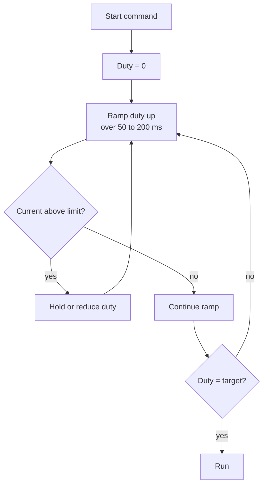

::: testing
Whether you know **inrush** as a general idea (a large transient current at turn-on) and can apply it to motors and solenoids specifically. The hidden sub-skills:

1. A definition: the peak current drawn when a load is first energized, which exceeds its steady-state running current.
2. The *cause* for each load: motor stall/back-EMF = 0, AC solenoid with low impedance when the plunger is open, capacitive loads charging, cold filaments, transformer cores.
3. The *consequences and cures*: supply sag and brownouts, tripped fuses and current limits, contact wear; soft-start, current limit, series resistance/NTC, precharge, sequencing.
:::

::: why
Inrush is the reason a supply that "easily" handles the running current can brown out or trip at start, why microcontrollers reset when a motor starts, and why fuses and breakers have time-current curves. Designing for it means looking at peak, not running, current for supplies, wiring, switches and drivers. Interviewers ask it because it is the practical consequence of $V/R$ at stall, and a good answer connects the physics to the design fix.
:::

::: concepts
- **Back-EMF is zero at standstill**, so only $R$ limits the motor current. See [[q0341]].
- **RL rise**: the peak builds over $L/R$ (ms). See [[q0336]].
- **Source impedance**: supply and wiring resistance drop voltage with the inrush current. See [[q0001]].
- **Current limit and soft start**: control the rate of rise of voltage or current.
- **Time-current curves**: fuses and breakers tolerate brief overcurrent.
:::

::: answer
"Inrush current is the large surge a load draws at the moment it's turned on, before it settles to its normal running current. For a motor it happens because, at standstill, there's no back-EMF. The only thing limiting current is the winding resistance, so you get roughly V over R, which can be many times the running current. In my example, a 12 volt, 1 ohm motor running at 5 amps under load would start at up to about 12 amps, and with no load the ratio is 20 or more. It lasts until the rotor speeds up and the back-EMF builds, tens of milliseconds for a small motor.

The inductance does smooth the first few milliseconds, but doesn't remove the peak. For solenoids on DC the max is just the steady current, but AC solenoids have a large inrush when the plunger is open because the impedance is low. Other loads have inrush for other reasons: capacitors charging, cold lamp filaments, transformer cores.

It matters because the supply, wiring and driver see that peak. A battery with internal resistance sags, which can reset a microcontroller. A fuse or current limit can trip. To handle it you use soft start, ramping the PWM duty, a current limit in the driver, series resistance or an NTC thermistor, and bulk capacitors near the logic."
:::

::: technical
**Definition.** Inrush (or starting) current is the peak current at turn-on; the ratio of inrush to steady-state current is the inrush ratio.

**Motor.** At $\omega = 0$, $E = 0$ and $I_{peak} \le V/R_{total}$ where $R_{total}$ includes the winding, brushes, wiring, FET $R_{DS(on)}$ and source resistance. After a few $L/R$ the current approaches $V/R$ and then falls as $E = K_e\omega$ rises on the mechanical time scale $\tau_m = JR/(K_tK_e)$.

- Example: $V = 12$ V, $R = 1\ \Omega$: stall limit 12 A; running with 0.1 N·m load: 5 A, ratio 2.4; no-load: 0.5 A, ratio 24 (the rated-current ratio depends on what "rated" means).
- Peak from the second-order response ($L = 1$ mH, $J = 10^{-5}$): 10.9 A at 3.4 ms ([[q0336]]).
- Rules of thumb quoted for small brushed motors: inrush several times running current, often 5 to 10 times at rated load (design-dependent).

**With source resistance.** $R_s = 0.15\ \Omega$ (battery plus wiring): $R_{total} = 1.15\ \Omega$, peak 9.6 A, and the voltage at the motor terminals dips to $12 - 0.15\times9.6 = 10.6$ V; the common rail seen by the electronics sags by the same amount.

**Solenoid.** DC: no inrush beyond the steady $V/R$; current rises with $\tau = L/R$. AC: $I = V/|Z|$ with $|Z|$ small while the gap is open; inrush is typically several times the sealed-in current.

**Other inrush sources.** Capacitive load: $I_{peak} \approx V/(R_s + ESR)$; cold incandescent lamp (resistance of the cold filament is about 1/10 of hot); transformer magnetizing inrush.

**Mitigation.** Soft start (duty ramp), current limit (cycle-by-cycle), series NTC or resistor, precharge, staggered starts, bulk capacitance to hold up the logic rail.

> [!UNCERTAIN]
> The "5 to 10 times" inrush ratio for motors and AC solenoids is a rough guideline; actual ratios depend on winding resistance, load and supply impedance. Check the datasheet's stall current.
:::

::: short
"Inrush current is the surge a load draws when first switched on, above its steady running current. For a motor it's because at standstill there's no back-EMF, so only the winding resistance limits the current, roughly V over R, 12 amps for a 12 volt, 1 ohm motor versus maybe 5 amps running; it lasts until the rotor speeds up. AC solenoids also have it, while the plunger is open. It sags supplies and trips protection, so you handle it with soft start, current limiting, series resistance or an NTC, and bulk capacitance."
:::

::: long
"Inrush current is the surge of current a load draws right when you switch it on, before it settles to its normal operating current.

For motors, the cause is the back-EMF. A running motor generates a voltage proportional to speed that opposes the supply, so the current is V minus K_e omega over R. At the instant of start the rotor is stationary, there's no back-EMF, and the only thing limiting the current is the winding resistance, plus whatever wiring and source resistance there is. So the inrush is roughly V over R. For a 12 volt, 1 ohm motor that's up to 12 amps, which could be 2 to 5 times a loaded running current of 5 amps or less, and 20 times its no-load current. The coil's inductance delays this by a millisecond or so, and the peak is a bit lower than V over R, about 11 amps in my example, then it decays over a few tens of milliseconds as the motor speeds up.

Solenoids on DC just climb to V over R, so they don't have a separate inrush beyond that, but AC solenoids do: with the plunger open the impedance is low, so the current can be several times the holding current. And I should mention other loads: capacitor banks charging, cold lamp filaments, transformers.

The effects: the battery or supply voltage sags, since V drops across its internal resistance and the wiring, maybe resetting a microcontroller; fuses and current limits can trip; and contacts get stressed. The cures are soft start, by ramping the PWM duty so the back-EMF builds as the voltage rises; a current limit in the driver; a series resistor or NTC; bulk capacitance for the logic; and staggering starts when you have several motors."
:::

::: terms
- **Inrush current**: the peak current drawn when a load is first energized.
- **Inrush ratio**: peak current divided by steady-state running current.
- **Stall / locked-rotor current**: $V/R$ with the rotor held.
- **Soft start**: gradually ramping voltage or duty to limit inrush.
- **Current limit**: driver feature clamping current to a set value.
- **NTC inrush limiter**: thermistor with high cold resistance that falls as it self-heats.
- **Brownout**: supply voltage dropping low enough to reset or disturb electronics.
- **Time-current curve**: plot of how long a fuse or breaker tolerates a given overcurrent.
:::

::: exceptional
**An average answer** says "a big current at startup".

**An exceptional answer**:
- Defines it and gives the **mechanism for motors** (no back-EMF, $V/R$), including the L/R delay and the slower mechanical decay.
- Gives **numbers**: 12 A vs 5 A running vs 0.5 A no-load; a sag calculation (battery plus wiring 0.15 Ω gives 1.4 V dip).
- Covers **solenoids** correctly (DC: none beyond steady state; AC: low impedance with the plunger open) and **other loads** briefly.
- Lists **mitigations with trade-offs** (soft start slows the response; NTCs are lossy and slow to recover; current limits reduce starting torque).
- Notes design implications: size supply and wiring for the peak, fuse time-current curve, TVS/hold-up for logic, stagger multiple motors.
:::

::: mistakes
- **"Inrush is a spike from the inductance."** It is the *absence* of back-EMF at standstill; inductance only delays and slightly lowers it.
- **Sizing the supply from the running current.** The supply sees the starting peak.
- **Assuming a fuse rated at the running current is fine.** It will blow on startup unless it is a slow-blow type chosen against the time-current curve.
- **Limiting inrush by a series resistor on a motor without noting the torque loss.** Less current means less starting torque ($\tau = K_tI$).
- **Mixing up inrush with flyback.** Inrush is at turn-on; flyback is the voltage spike at turn-off.
- **Forgetting the source resistance.** The real peak is lower than $V/R_{motor}$ but the rail sag can be worse.
:::

::: deep
## Why the motor inrush exists

The motor equation $V = IR + L\,\dot I + K_e\omega$ with $\omega(0) = 0$ gives, after the first few $L/R$, $I \approx V/R$. The rotor then accelerates according to $J\dot\omega = K_tI - \tau_L$; the back-EMF $K_e\omega$ grows and the current falls with the mechanical time constant $\tau_m = JR/(K_tK_e)$. The inrush is the period between those two time scales. [[q0336]] derives the waveform; here is what it does to a real system.

```circuit
{"elements":[
 {"t":"V","a":[0,2],"b":[0,8],"label":"V_{oc}","value":"12 V"},
 {"t":"wire","pts":[[0,2],[0,0],[3,0]]},
 {"t":"R","a":[3,0],"b":[7,0],"label":"R_s","value":"0.15 Ω","color":"orange"},
 {"t":"wire","pts":[[7,0],[9,0]]},{"t":"dot","at":[9,0]},
 {"t":"term","at":[9,-2],"label":"V_{rail} to MCU","side":"top"},{"t":"wire","pts":[[9,0],[9,-2]]},
 {"t":"wire","pts":[[9,0],[12,0],[12,2]]},
 {"t":"Z","a":[12,2],"b":[12,8],"label":"Motor","value":"R, L, E"},
 {"t":"wire","pts":[[12,8],[12,10],[0,10],[0,8]]},{"t":"gnd","at":[6,10]},{"t":"dot","at":[6,10]}
]}
```
Figure: The motor's inrush flows through the source and wiring resistance $R_s$ (battery internal resistance plus wires and connector). The rail seen by the logic electronics drops by $I\,R_s$ during the start.

## Numbers: supply sag during a start

With $R_s = 0.15\ \Omega$ and the motor $R = 1\ \Omega$: peak current is about 9.6 A (second-order response with $R_{total} = 1.15\ \Omega$) and the rail sags to $12 - 1.44 = 10.6$ V at the peak.

```plot
{"title":"Startup current and rail voltage with 0.15 Ω source/wiring resistance","x":{"label":"time","unit":"s","min":0,"max":0.12},"y":{"label":"A  /  V","min":0,"max":13},
 "vars":{"v":12,"rs":0.15,"r":1.15,"l":0.001,"k":0.02,"j":0.00001,"a":"r/l","b":"k*k/(j*l)","d":"sqrt(a*a/4-b)","p1":"-a/2+d","p2":"-a/2-d"},
 "series":[{"label":"motor current (A)","fn":"v/l/(p1-p2)*(exp(p1*x)-exp(p2*x))","color":"red"},
           {"label":"rail voltage (V)","fn":"v-rs*v/l/(p1-p2)*(exp(p1*x)-exp(p2*x))","color":"blue"}],
 "points":[{"x":0.0032,"y":9.6,"label":"peak 9.6 A"},{"x":0.0032,"y":10.56,"label":"rail 10.6 V"}]}
```
Figure: At turn-on the current (red) peaks near 9.6 A within about 3 ms while the rail (blue) dips by 1.4 V, then both recover as the motor speeds up (about 25 to 100 ms). A logic rail fed from this bus must ride through a 1.4 V dip without resetting; that is what bulk capacitance, an LDO headroom or a separate regulator is for.

For a high-resistance source the effect is worse: a coin cell or thin wire with 2 Ω source resistance would collapse the rail almost entirely during start.

## Soft starting

The goal is to let the back-EMF build up while the applied voltage ramps, so that $V_{applied} - K_e\omega$ never creates a large current. With a PWM drive, ramp the duty $D$ from 0 to the target over a time comparable to $\tau_m$ (tens to hundreds of ms): the current stays near the load requirement. The cost: slower acceleration, less starting torque (since $\tau = K_tI$).

```sim
{"id":"dc-motor-lab","view":"transient","v":12,"r":1,"l":1e-3,"kt":0.02,"load":0.01}
```
Figure: The sim has no source resistance, so at 12 V the peak is about 11.3 A. Reduce the supply voltage to 6 V and compare: the peak current halves (about 5.7 A) and the final speed roughly halves too, while the running current stays near 0.5 A because the load sets it. A PWM duty ramp acts like this sweep of supply voltage, so the motor starts at low voltage, with low current, and accelerates as the voltage rises.


Figure: A typical soft-start loop: ramp the duty, and back off if the measured current exceeds the limit. The same structure applies to a hardware cycle-by-cycle limit in the driver IC.

## Other mitigation options

| Method | How it works | Trade-off |
|---|---|---|
| PWM ramp | Gradually raise voltage | Slower start; needs a controller |
| Driver current limit | Clamp the current at a set value | Reduced starting torque |
| Series NTC thermistor | High cold resistance, drops as it heats | Slow to recover; wastes power; hot restart not protected |
| Series resistor, shorted by a relay after start | Limits initial current | Extra parts |
| Bulk capacitors at the logic rail | Hold up the rail during the dip | Cost, size |
| Staggered starts | Avoid overlapping peaks from several motors | Delays |
| Larger battery / lower source resistance | Reduces the sag | Cost, weight |

## Inrush in other loads

- **AC solenoid:** with the plunger open, $L$ is small, so $|Z|$ is small; as the plunger seats, $L$ rises and the current falls to the holding level (inrush ratio commonly several times; design-dependent).
- **Capacitive load / supply input capacitor:** $I_{peak} \approx V/(R_s + ESR)$, limited by a series resistor, NTC or soft-start FET.
- **Incandescent lamp:** cold filament resistance is much lower (order of one tenth) than hot, so inrush is about 10 times.
- **Transformers:** magnetizing inrush when the core saturates at switch-on.

## Protection design with inrush in mind

- **Fuse:** choose a slow-blow type with the time-current curve above the start pulse's $I^2t$ and below the wire/driver damage curve.
- **Driver:** rated for the peak current, with a current limit or thermal shutdown that does not false-trip on a normal start (blanking/filtering).
- **Layout:** keep high-current return paths away from logic grounds; add local decoupling.
- **Measurement:** put a current probe or shunt on the supply and look at the first 100 ms of the start, not the steady current.
:::

::: applications
- **Robot drivetrains:** soft-started PWM and current limits to avoid battery sag and brownout of the controller.
- **Power tools:** electronic soft start to reduce inrush and mechanical shock.
- **Automotive:** window lifts and seat motors have specified inrush and stall currents for harness and fuse sizing.
- **HVAC compressors and AC solenoids:** inrush ratings for contactors and breakers.
- **Switching supplies with large input caps:** NTC or active inrush limiting at plug-in.
:::

::: assumptions
- Brushed DC motor, example numbers ($12$ V, $1\ \Omega$, $K = 0.02$, $L = 1$ mH, $J = 10^{-5}$ kg·m²); real motors differ by large factors.
- Source resistance 0.15 Ω is an illustrative figure for a battery plus wiring.
- The inrush "ratio" depends on what you compare to (rated load, no-load); numbers like 5 to 10 times are guidelines.
- Linear model: no saturation; with saturation the peak and rise time can be higher.
- AC solenoid numbers vary by design.
:::

::: followups
### Why doesn't the inductance prevent the inrush?
It only delays it. The electrical time constant $L/R$ is about 1 ms, short compared with the rotor's mechanical time constant (tens of ms), so the current reaches nearly $V/R$ before the back-EMF builds. That separation of time scales is why the peak is close to $V/R$.

### How would you size a fuse for a motor with a 12 A stall current and 2 A running current?
Not at 2 A. Use a slow-blow (time-delay) fuse or breaker whose time-current curve tolerates the start pulse (12 A for tens of ms, with $I^2t$ margin) but opens on a sustained stall in seconds, and whose rating is below the wire's and driver's limits. A fast fuse sized at 2 to 3 A would blow on every start.

### Does an H-bridge driver protect against inrush?
Only if it has a current limit. Many integrated drivers (cycle-by-cycle current limit, e.g., 3 A, 5 A) clamp the peak by chopping; discrete bridges need a sense resistor and comparator. Without it the peak is limited only by $V/R$ and the MOSFETs' $R_{DS(on)}$ and SOA.

### How do you reduce inrush from a bank of motors turning on together?
Stagger starts by tens of ms (the peaks last only about $\tau_m$), soft-start each, and size the bus for the overlap you cannot avoid. For a battery, lowering its internal resistance (parallel cells, higher C-rate) reduces the sag.

### Scenario: your microcontroller browns out whenever the wheel motor starts, but only in cold weather. Why?
Cold increases battery internal resistance (Arrhenius), so $I\,R_s$ is larger and the rail sags more; in the cold the motor's friction is also higher, lengthening the inrush. Fix: soft start, local bulk capacitance, a separate logic regulator with ride-through, or a heated or larger battery.

### Is inrush the same as peak current?
Inrush is the peak at turn-on; overload peaks can also occur during operation (a sudden load step, a jam, a reversal), which can exceed inrush ([[q0344]]). In a design both are checked against the driver and supply ratings.
:::

::: interpretations
Inrush current is a general term; for this section it is the startup surge of an inductive load. Some sources use it for capacitor-charging surges (power supply inputs), which is mentioned for completeness. The related question [[q0345]] asks why a coil (which opposes current changes) still has fast, large inrush: the answer is the time-scale separation between $L/R$ and the mechanical time constant, together with the absence of back-EMF.
:::

::: references
- Horowitz & Hill, *The Art of Electronics*, 3rd ed.: motor drive, soft start, thermistors and inrush limiting.
- Chapman, *Electric Machinery Fundamentals*: starting of DC motors, starting current and starters.
- Fuse manufacturer application guides on time-current curves and $I^2t$ (for example Littelfuse and Bussmann; check specific parts).
- Motor driver IC datasheets and application notes on current limiting and soft-start features.
:::

::: rubric
- Defines inrush as the turn-on surge above steady current :: The core definition.
- Explains the motor mechanism: no back-EMF at standstill, so $V/R$ :: The physics.
- Gives numbers (e.g. 12 A vs running current) :: Quantitative understanding.
- Mentions solenoid (DC vs AC) and other inrush sources briefly :: Covers the scope "motors/solenoids".
- Describes consequences: supply sag, brownout, fuse/driver stress :: The reason it matters.
- Lists mitigations: soft start, current limit, series R/NTC, bulk caps :: Engineering response.
:::

::: quiz
```json
[
 {"type":"mcq","level":"fundamental","q":"Why does a stopped motor draw a large current when first powered?","options":["It has no resistance","There is no back-EMF at zero speed, so only the winding resistance limits current","The inductance is zero","Friction creates current"],"answer":1,"explain":"With $\\omega = 0$, $E = K_e\\omega = 0$, so $I \\approx V/R$."},
 {"type":"numeric","level":"fundamental","q":"A 12 V motor with 1 Ω winding and 5 A running current starts at V/R. What is the inrush ratio?","answer":2.4,"tolerance":0.02,"unit":"","explain":"Inrush 12 A divided by 5 A running = 2.4."},
 {"type":"numeric","level":"intermediate","q":"A battery plus wiring has 0.15 Ω of resistance. During a 9.6 A start, by how much does the rail sag?","answer":1.44,"tolerance":0.02,"unit":"V","explain":"$\\Delta V = I R_s = 9.6\\times0.15 = 1.44$ V."},
 {"type":"numeric","level":"intermediate","q":"A 12 V supply with 0.1 Ω internal resistance feeds a stalled 1 Ω motor. What is the stall current?","answer":10.9,"tolerance":0.02,"unit":"A","explain":"$I = 12/(1 + 0.1) = 10.9$ A; the terminal voltage sags to 10.9 V."},
 {"type":"multi","level":"intermediate","q":"Which measures reduce motor inrush effects? Select all that apply.","options":["PWM soft start","Driver cycle-by-cycle current limit","Adding a flyback diode","Bulk capacitor near the logic supply"],"answer":[0,1,3],"explain":"Soft start and current limiting reduce the peak, and local capacitance rides through the dip. A flyback diode handles turn-off spikes, not inrush."},
 {"type":"truefalse","level":"advanced","q":"A DC solenoid has a large inrush current above its steady-state V/R.","answer":false,"explain":"A DC solenoid's current rises smoothly to $V/R$ (with a brief dip during plunger travel); the maximum is the steady state. AC solenoids, whose impedance changes with plunger position, do have inrush."}
]
```
:::
