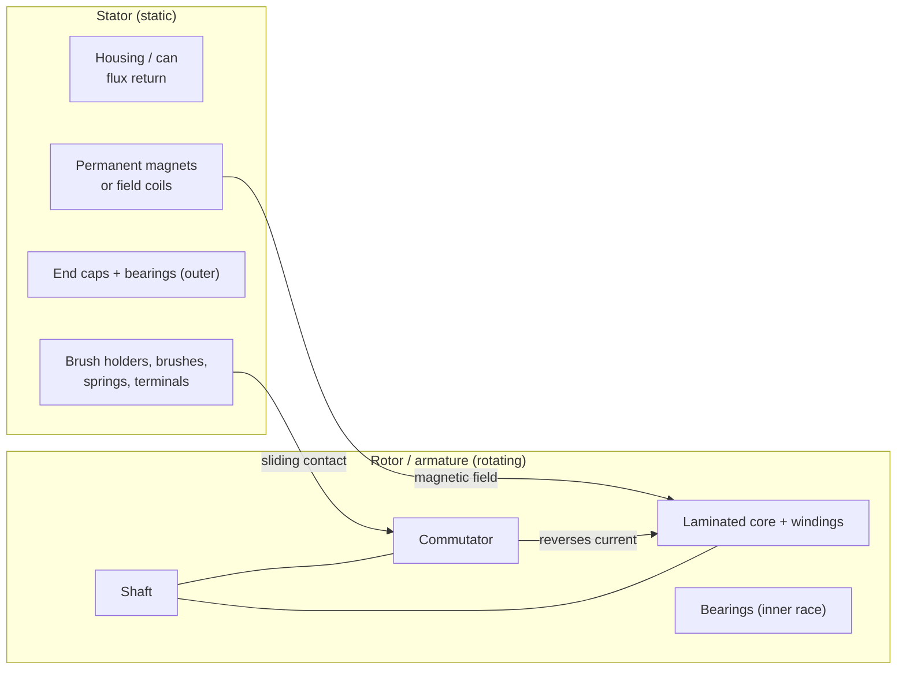

::: basics
### In plain words
A brushed DC motor has two groups of parts. The static parts (the stator) stay still: the housing, the magnets, the brushes and the end caps. The rotating parts (the rotor) turn: the shaft, the wire-wound core and the commutator. Knowing which is which explains how the motor works.

### Picture it
Picture a bicycle wheel with fixed brake pads touching the rim. The wheel (rotor) spins, and the pads (brushes) stay put and rub against it. In the motor, the "rim" is a ring of copper segments called the commutator, and the pads carry electric current into it instead of slowing it down. The analogy has a twist: the pads also help flip the current direction as the wheel turns.

### Words you need
- **Stator**: the stationary part: housing, magnets, brush holders.
- **Rotor (armature)**: the rotating part: shaft, iron core and copper coils.
- **Commutator**: a ring of copper segments on the shaft, each wired to a coil.
- **Brush**: a stationary contact, often carbon, pressed against the commutator. See [[q0357]].
- **Bearing**: a part that lets the shaft turn smoothly in the housing.

### The simplest example
Imagine one wire loop between two magnets. Its two ends connect to two half-ring copper segments. Two fixed brushes touch those segments. Current flows in through one brush, around the loop, and out through the other, so the loop is pushed and starts to turn. After half a turn, the segments swap places under the brushes, so the current in the loop reverses and the push keeps going the same way.

That is the whole idea: the brushes stay still and the commutator turns under them. The rest of this page lists every part and shows how they work together to keep the torque in one direction.
:::

::: testing
Whether you can name the parts of a brushed DC motor and, more importantly, explain **what each part does and why it is where it is**. The classification (rotor vs stator) is the easy part; the interviewer wants to hear that the commutator rotates while the brushes do not, that the magnets are static in a permanent-magnet brushed motor (the opposite of a BLDC, where the magnets rotate), and that the only way to get power into a spinning winding without slip rings is the sliding brush-commutator contact.
:::

::: why
When you debug a motor you work part by part: intermittent contact (brushes, commutator), friction and noise (bearings), no torque (magnets, windings), overheating (windings, brush contact). When you spec a replacement, you need to know which parts wear (brushes, bearings, commutator) and which do not. This question is also the setup for the brush questions that follow in this section ([[q0357]]–[[q0362]]) and for understanding why brushless motors turn the architecture inside out ([[q0363]]).
:::

::: concepts
- **Magnetic field source**: in a permanent-magnet (PM) brushed motor, magnets on the housing provide a fixed field. Field-wound motors use stator coils instead. See [[q0334]].
- **Armature / rotor**: the winding on a laminated iron core that carries the current and spins. See [[q0335]] for why coils are used.
- **Commutator**: a segmented copper ring on the shaft that reverses the current in each coil every half turn.
- **Brushes**: stationary conductors (usually carbon or metal fingers) pressed onto the commutator. See [[q0357]].
- **Bearings**: support the shaft and let it rotate with low friction.
- **Flux return path**: the iron housing (can) closing the magnetic circuit.
:::

::: answer
"A brushed DC motor has a stationary part, the stator, and a rotating part, the rotor, which is also called the armature.

The stator is the housing or can, which doubles as the magnetic return path, plus the field source: in most small motors that's permanent magnets glued inside the can; in bigger ones it's field windings. The end caps and the brush holders with the brushes are also static. The brushes are the stationary contacts, usually carbon, pressed by springs against the commutator, and the motor terminals connect to them.

The rotor is the shaft, a laminated iron core with copper windings in slots, and the commutator, a ring of copper segments on the shaft, each segment wired to a coil. The bearings sit between them: the inner race turns with the shaft, the outer race is fixed.

How it works: current goes in through the brushes to the commutator segments they touch, through the coils, and the field from the magnets pushes on those conductors to make torque. As the rotor turns, the brushes slide onto the next segments and reverse the current in each coil at the right moment, so the torque keeps the same direction. So the important thing to remember is that the brushes stay still and the commutator moves under them, and that's the sliding contact that wears."
:::

::: technical
**Stator (static)**
- *Housing/can/frame*: mechanical support and, for steel cans, the **flux return path** for the magnets.
- *Field source*: PM motors use two or more arc magnets (ferrite in cheap motors, neodymium in high-performance ones); wound-field motors use field coils (series, shunt, separately excited, or compound).
- *End caps (bearing end-bells)*: hold bearings and the brush holder assembly; carry the motor terminals.
- *Brush gear*: brush holders, brushes, springs and flexible shunts (pigtails). Brushes are static but are pressed against the rotating commutator ([[q0362]]).

**Rotor / armature (rotating)**
- *Shaft*: transmits torque.
- *Armature core*: stacked silicon-steel laminations (reduce eddy currents) with slots.
- *Armature windings*: copper coils in the slots; each coil's ends go to commutator segments.
- *Commutator*: copper segments insulated by mica or plastic; $k$ segments for $k$ coils; reverses current in each coil as it passes the neutral zone.
- *Bearing inner races or sleeve bearing journals*.
- Optional: balance weights, fan, encoder disc.

**Electrical interface.** Terminals → brushes → commutator → windings → commutator → brushes → terminals. Contact via sliding friction, with a voltage drop of order 1 V for carbon brushes ([[q0357]]).

**Torque production.** For a single loop with $N$ turns, area $A$, flux density $B$, current $I$, torque is $\tau = NBIA\cos\theta$, with $\theta$ the angle between the coil plane and the field direction: maximum when the coil plane is parallel to the field, zero at the neutral plane ($\theta = 90°$), where commutation happens. Example: $N = 40$, $B = 0.3$ T, $A = 20\ \text{mm}\times25\ \text{mm}=5\times10^{-4}\ \text{m}^2$, $I = 1$ A gives $\tau_{max} = 6$ mN·m for one loop. Commutation flips the current each half turn to keep the sign. Several coils offset in angle smooth the ripple.

**Static vs rotating summary:** static: housing, magnets/field coils, end caps, brush holders and brushes, terminals, bearing outer races. Rotating: shaft, core, windings, commutator, bearing inner races, fan.
:::

::: short
"A brushed DC motor has a stator that doesn't move: the housing, the permanent magnets or field windings, the end caps, the brush holders and the brushes. The rotor, or armature, spins: the shaft, laminated iron core, copper windings and the commutator. Bearings let the shaft turn. The brushes stay still and press on the rotating commutator to feed current into the windings and reverse it each half turn, so torque stays in one direction. That sliding contact is also what wears out."
:::

::: long
"I'll split it into the part that stays still, the stator, and the part that turns, the rotor or armature.

The stator is the outer can or frame. In a small permanent-magnet motor, it holds two or more curved magnets glued to the inside, and the steel can also acts as the return path for their flux. In bigger motors you'd have field windings instead of magnets. The end caps are static too, they carry the bearings, and mounted on one of them are the brush holders. The brushes sit in those holders and are pushed by springs onto the commutator. The motor terminals connect to the brushes.

The rotor is the shaft, which carries a stack of laminated steel with slots, the copper windings sitting in those slots, and the commutator, a ring of copper segments with insulation between them. Each coil is wired to a pair of segments. The bearings are in between: inner race rotating, outer race fixed.

For how they work together: current enters through one brush, goes through whichever commutator segments it's touching, round the coils, and out the other brush. The windings sit in the magnet's field, so each conductor feels a force $BIL$ and the rotor gets torque. As the shaft turns, the brushes slide to the next segments, which reverses the current in the coils that have moved past the neutral zone. That's what keeps the torque the same sign instead of oscillating. With several coils the torque ripple is only a few percent.

So the thing to remember is: the brushes are static, the commutator rotates, and that sliding electrical contact is what makes a brushed motor simple but gives it limited life, arcing and electrical noise. A brushless motor flips it around: the windings are static, the magnets rotate, and electronics replace the commutator."
:::

::: terms
- **Stator**: the stationary part of the motor (housing, magnets or field coils, end caps, brush gear).
- **Rotor / armature**: the rotating part carrying the windings and commutator.
- **Commutator**: segmented copper ring on the shaft; a rotary switch that reverses coil current.
- **Brush**: stationary sliding contact that conducts current to the commutator. See [[q0357]].
- **Field magnets / field winding**: the source of the stator magnetic field.
- **Laminations**: thin insulated steel sheets that reduce eddy-current loss in the core.
- **Slot**: channel in the core that holds the winding conductors.
- **Flux return path**: iron closing the magnetic circuit (the can).
- **Bearing**: ball or sleeve bearing supporting the shaft.
- **Pigtail / shunt**: flexible braided lead carrying current from the brush to the holder.
:::

::: exceptional
An average answer lists stator, rotor, commutator and brushes. An exceptional answer:

- Splits the list cleanly (static vs rotating) *and* explains the one subtle pair: brushes static, commutator rotating, with a sliding contact between them.
- Explains the *function* of each part: magnets (field), laminations (low eddy loss), commutator (current reversal), can (flux return), springs (contact force).
- Mentions PM vs wound-field stators, and that a brushless motor swaps the arrangement.
- Connects to the electrical behaviour: terminals-brushes-commutator path, brush drop ~1 V, the ripple from a finite number of segments.
- Mentions the wear parts (brushes, commutator, bearings) and noise sources (arcing).
- Notes inrunner vs outrunner naming where relevant for BLDC, and that the "rotor" is where the magnets are in a brushless motor.
:::

::: mistakes
- **Putting the brushes on the rotor.** They are stationary; the commutator rotates under them.
- **Calling the commutator "static" because it's attached to the brushes' circuit.** It is mounted on the shaft.
- **Forgetting that the magnets are stator parts in PM brushed motors**, then getting confused when asked about BLDC, where the magnets rotate.
- **Saying the "armature" is the magnet.** In a DC machine the armature is the current-carrying winding that interacts with the field, which in brushed motors is the rotor.
- **Missing the function of the iron housing.** It isn't just a shell: the steel can closes the flux path.
- **Treating the bearing as wholly static or wholly rotating.** The inner race moves with the shaft, the outer race with the housing.
:::

::: deep
## The big picture: two assemblies and one sliding contact

Every electric motor needs two things: a magnetic field and a current-carrying conductor in that field. In a brushed DC motor, the field is fixed in space (the stator's magnets), the conductor is on the shaft (the rotor), and the problem to solve is how to get current into a conductor that spins. The answer is the commutator and brushes: a **mechanical rotary switch** that doubles as the power connection.

```svg
<svg viewBox="0 0 660 300" xmlns="http://www.w3.org/2000/svg" font-family="Inter, sans-serif" font-size="12">
  <!-- housing -->
  <rect x="70" y="50" width="380" height="170" rx="6" fill="none" stroke="var(--d-ink)" stroke-width="2"/>
  <rect x="450" y="50" width="16" height="170" fill="var(--d-box)" stroke="var(--d-ink)" stroke-width="2"/>
  <rect x="54" y="50" width="16" height="170" fill="var(--d-box)" stroke="var(--d-ink)" stroke-width="2"/>
  <!-- magnets -->
  <rect x="100" y="58" width="260" height="22" fill="var(--d-blue)" fill-opacity="0.35" stroke="var(--d-blue)" stroke-width="1.5"/>
  <text x="230" y="74" text-anchor="middle" fill="var(--d-ink)">N magnet</text>
  <rect x="100" y="190" width="260" height="22" fill="var(--d-red)" fill-opacity="0.35" stroke="var(--d-red)" stroke-width="1.5"/>
  <text x="230" y="206" text-anchor="middle" fill="var(--d-ink)">S magnet</text>
  <!-- rotor core -->
  <rect x="120" y="92" width="230" height="86" fill="var(--d-orange)" fill-opacity="0.25" stroke="var(--d-orange)" stroke-width="2"/>
  <g stroke="var(--d-orange)" stroke-width="1" opacity="0.7">
    <line x1="140" y1="92" x2="140" y2="178"/><line x1="160" y1="92" x2="160" y2="178"/><line x1="180" y1="92" x2="180" y2="178"/><line x1="200" y1="92" x2="200" y2="178"/><line x1="220" y1="92" x2="220" y2="178"/><line x1="240" y1="92" x2="240" y2="178"/><line x1="260" y1="92" x2="260" y2="178"/><line x1="280" y1="92" x2="280" y2="178"/><line x1="300" y1="92" x2="300" y2="178"/><line x1="320" y1="92" x2="320" y2="178"/><line x1="340" y1="92" x2="340" y2="178"/>
  </g>
  <!-- winding end turns -->
  <ellipse cx="116" cy="135" rx="10" ry="36" fill="none" stroke="var(--d-orange)" stroke-width="3"/>
  <ellipse cx="358" cy="135" rx="10" ry="36" fill="none" stroke="var(--d-orange)" stroke-width="3"/>
  <!-- shaft -->
  <rect x="20" y="130" width="620" height="10" fill="var(--d-orange)" fill-opacity="0.5" stroke="var(--d-orange)" stroke-width="2"/>
  <!-- commutator -->
  <rect x="385" y="108" width="46" height="54" fill="var(--d-orange)" fill-opacity="0.55" stroke="var(--d-orange)" stroke-width="2"/>
  <g stroke="var(--d-ink)" stroke-width="1"><line x1="385" y1="120" x2="431" y2="120"/><line x1="385" y1="132" x2="431" y2="132"/><line x1="385" y1="144" x2="431" y2="144"/><line x1="385" y1="154" x2="431" y2="154"/></g>
  <!-- brushes -->
  <rect x="396" y="86" width="24" height="22" fill="var(--d-green)" fill-opacity="0.5" stroke="var(--d-green)" stroke-width="2"/>
  <rect x="396" y="162" width="24" height="22" fill="var(--d-green)" fill-opacity="0.5" stroke="var(--d-green)" stroke-width="2"/>
  <polyline points="408,86 400,78 416,72 400,66 416,60 408,54" fill="none" stroke="var(--d-green)" stroke-width="2"/>
  <polyline points="408,184 400,192 416,198 400,204 416,210 408,216" fill="none" stroke="var(--d-green)" stroke-width="2"/>
  <!-- bearings -->
  <rect x="76" y="118" width="22" height="34" fill="var(--d-box)" stroke="var(--d-ink)" stroke-width="2"/>
  <rect x="436" y="118" width="12" height="34" fill="var(--d-box)" stroke="var(--d-ink)" stroke-width="2"/>
  <!-- terminals -->
  <line x1="408" y1="54" x2="408" y2="30" stroke="var(--d-ink)" stroke-width="2"/><circle cx="408" cy="26" r="4" fill="none" stroke="var(--d-ink)" stroke-width="2"/>
  <line x1="408" y1="216" x2="408" y2="250" stroke="var(--d-ink)" stroke-width="2"/><circle cx="408" cy="254" r="4" fill="none" stroke="var(--d-ink)" stroke-width="2"/>
  <!-- labels -->
  <g fill="var(--d-ink)">
    <text x="470" y="30" font-weight="600" fill="var(--d-blue)">Static (stator)</text>
    <text x="470" y="46" fill="var(--d-orange)" font-weight="600">Rotating (rotor)</text>
    <text x="440" y="76" text-anchor="start">brush + spring</text>
    <text x="260" y="244" text-anchor="middle">steel can (flux return) + magnets: static</text>
    <text x="235" y="124" text-anchor="middle">laminated core + windings</text>
    <text x="548" y="124">shaft</text>
    <text x="520" y="160" font-size="11" fill="var(--d-muted)">commutator (rotating)</text>
    <text x="87" y="170" text-anchor="middle" font-size="11">bearing</text>
  </g>
</svg>
```
Figure: Side cutaway of a small PM brushed motor. Blue/red: static magnets inside the steel can. Orange: everything that rotates (shaft, laminated core with windings, commutator). Green: static brushes with springs pressing down on the rotating commutator, wired to the two terminals. Bearings carry the shaft; their outer races are fixed.


Figure: The only electrical link between the static and rotating halves is the sliding brush-commutator contact; the only magnetic link is the field crossing the air gap from magnets to armature core.

## Stator: what each static piece does

**Housing / can.** Holds everything together and positions the magnets precisely around the rotor. In small motors it is a steel tube that also carries the magnets' flux from one pole to the other, so its thickness limits how strong the magnets can be before the steel saturates.

**Field magnets.** In low-cost motors these are curved *ferrite* segments (cheap, lower field, tolerate heat); in high-performance or small coreless motors, *neodymium* (higher field, higher cost, lose strength with temperature). The number of poles is usually 2 in small motors, 4 or more in larger ones. In wound-field motors the stator has electromagnet coils: in a **series** motor they are in series with the armature (high starting torque, runs away unloaded), in **shunt** they're in parallel (constant speed), and **separately excited** motors let you vary field current to extend speed range.

**End caps and bearing seats.** The back cap holds the brush plate; the front cap has the output bearing. Plastic caps in toys, die-cast or machined in larger motors.

**Brush gear.** Brush holders (boxes or fingers), brushes, springs and braided shunts. In small motors the brush is a metal finger spring and its own contact, in larger motors a carbon block with a spring and pigtail ([[q0362]]).

## Rotor: what each rotating piece does

**Shaft.** Transmits torque and carries the other rotor parts; often hardened steel.

**Laminated core.** The windings sit in slots. Using thin insulated laminations (0.35–0.5 mm silicon steel is typical) instead of solid iron reduces eddy-current loss because induced loops can't close across the insulation. A skewed slot pattern reduces cogging.

**Windings.** Enamelled copper wire wound in slots, each coil's ends welded or soldered to commutator segments. More turns give higher $K_t$ and $K_e$ and higher resistance; thicker wire gives the opposite (see [[q0354]]).

**Commutator.** A ring of copper segments (typically 3 to 24+ in small motors) separated by mica or plastic insulation. For a coil at angle $\theta$, the commutator changes which brush it connects to each half revolution, reversing its current when the coil passes the neutral plane (where its sides are not cutting flux).

## Why the commutator is needed: torque on a single loop

A single loop of $N$ turns and area $A$ in a uniform field $B$ carrying current $I$ has torque $\tau = NBIA\cos\theta$ (with $\theta$ the angle between the coil plane and the field, so the torque is maximum at $\theta = 0$ and zero at the neutral plane, $\theta = 90°$). Example: $N = 40$, $B = 0.3$ T, $A = 5\times10^{-4}\ \text{m}^2$, $I = 1$ A gives a peak of $6$ mN·m. If the current simply flowed one way, the torque would reverse sign for half the revolution and the loop would oscillate. The commutator flips the current every half revolution so that the torque keeps its sign: $|\cos\theta|$ instead of $\cos\theta$.

With several coils spaced around the rotor, the torque contributions overlap:

```plot
{"title":"Torque vs angle: 1 coil vs 3 coils (ideal)","x":{"label":"rotor angle","unit":"°","min":0,"max":180},"y":{"label":"torque per coil-equivalent","min":0,"max":1.1},
 "series":[{"label":"1 coil: |cos θ|","fn":"abs(cos(x*pi/180))","dashed":true,"color":"orange"},{"label":"3 coils (60° apart), average","fn":"(abs(cos(x*pi/180))+abs(cos((x+60)*pi/180))+abs(cos((x+120)*pi/180)))/3","color":"accent"}],
 "hlines":[{"at":0.6366,"label":"mean = 2/π ≈ 0.64","color":"muted"}]}
```
Figure: With a single coil the torque drops to zero twice per revolution (a motor with 2 segments can stall there). Three coils offset by 60° smooth it to about ±7% ripple around a mean of $2/\pi \approx 0.64$ of the single-coil peak (between 0.58 and 0.67). More segments make it smoother still; that is why even cheap motors have 3 or more.

## What this means in real hardware

- **Wear parts**: brushes (sliding contact), commutator surface, bearings (bushings or ball) ([[q0360]]).
- **Noise sources**: brush arcing and commutation transients ([[q0355]]), cogging torque from slot/magnet interaction, bearing noise.
- **Heat path**: copper losses are in the *rotor*, which is thermally isolated from the case by an air gap, so the rotor gets hot first. BLDC motors put the windings on the stator, bonded to the case; that is a main reason they handle more continuous power ([[q0366]]).
- **Terminals**: the polarity of the supply decides rotation direction, because it reverses the current in the winding relative to the fixed field.

## The brushless contrast, briefly

In a BLDC motor the roles of the windings and magnets swap: the windings are on the stator (no sliding contact needed) and the magnets rotate, with electronics (an ESC) performing the commutation from rotor-position feedback ([[q0363]]). An outrunner BLDC even has the rotor on the *outside*. So "rotor = where the windings are" is true only for brushed motors.
:::

::: applications
- **Toy and hobby motors (e.g. the 130-size "can" motor)**: ferrite magnets in a steel can, 3-pole rotor, metal-finger brushes.
- **Automotive actuators**: power windows, wipers, seat adjusters and fuel pumps use brushed PM motors with carbon brushes.
- **Power tools and appliances**: universal motors (series-wound) with large carbon brushes on the commutator.
- **Small coreless motors in pagers, cameras and drones (brushed micro-quadcopters)**: ironless rotor, precious-metal brushes.
- **Servo and positioning systems**: brushed DC servo motors with an encoder disc on the shaft.
- **Repair and teardown**: identifying worn brushes, burnt commutator segments and dry bearings in appliance motors.
:::

::: assumptions
- **Permanent-magnet brushed DC motor** as the default; wound-field and universal motors share the rotor/commutator/brush structure but replace the magnets by field windings.
- **"Parts" at the functional level**, not a full bill of materials; real motors also have retaining clips, wave washers (preload), spacers and shielding.
- **Radial-flux, inrunner layout** (rotor inside the stator). Pancake/printed-armature and coreless motors rearrange the geometry but keep the same function split.
- The torque equation uses a **uniform field and single rectangular loop** for illustration; real motors have distributed windings and non-uniform fields.
- Different vendors name parts differently (e.g. "can" vs "frame", "armature" vs "rotor").
:::

::: followups
### Which parts of a brushed motor wear out first, and which parts cost the most?
Brushes and the commutator surface wear fastest because of the sliding contact and arcing; bearings follow (especially in sleeve-bearing, low-cost motors). The most expensive parts are the armature (core + windings + commutator) and, in high-end motors, the magnets. In small motors this is why the whole motor is replaced; in large industrial ones brushes are replaceable ([[q0361]]).

### Why are the rotor cores laminated, not solid?
The armature iron sees a changing flux as it rotates, which induces eddy currents in a solid core, causing loss ($P \propto B^2f^2t^2/\rho$, with $t$ the lamination thickness). Thin insulated laminations break up the eddy-current loops and cut that loss roughly with the square of thickness.

### How does a brushed motor know when to reverse the coil current?
It doesn't compute anything: the geometry does it. The brushes are placed at a fixed angle (the neutral zone), and as each coil passes that angle its commutator segments swap brushes, so the current reverses. Because it is mechanical, the timing tracks rotor angle at any speed. Some motors shift the brushes slightly (brush advance) to compensate for armature reaction.

### What is the difference between a stator and rotor in a brushless motor?
In a BLDC the **stator holds the windings** and the **rotor holds the magnets**, so there is no sliding contact. An external controller energises the stator phases in sequence using rotor position feedback (Hall sensors, back-EMF). An outrunner is a BLDC whose rotor surrounds the stator ([[q0363]]).

### Suppose a motor runs but only in one direction, or sticks at certain positions. Which parts might be at fault?
Stalling at specific angles suggests a dead commutator segment, a broken or shorted winding, or a worn brush that no longer touches both segments (the few-segment case). One-direction-only is unusual for a plain PM motor; check the driver, a diode in series, or brush advance in a specialised motor. A multimeter resistance check between segments finds open or shorted coils.

### Where does the magnetic flux go in a PM brushed motor?
Out of the north magnet, across the air gap into the armature core, through the core's teeth and back across the gap to the south magnet, then back through the steel can. The can's cross-section must carry that flux without saturating, which is why can thickness limits the magnet strength.
:::

::: interpretations
"Which parts rotate and which remain static?" is for the *brushed* motor (the section heading), so the answer centres on the commutator/brush split and PM magnets in the stator. For a brushless motor the same question has the opposite answer for the windings and magnets ([[q0363]]), and many interviewers will follow up with exactly that contrast. Terminology differs between sources: "armature" in a DC motor usually means the rotor winding, while in some AC machines it means the stator winding.
:::

::: references
- Chapman, *Electric Machinery Fundamentals*: DC machine construction (stator, armature, commutator and brushes).
- Hughes and Drury, *Electric Motors and Drives*: construction of DC machines.
- Fitzgerald, Kingsley and Umans, *Electric Machinery*: DC machine chapter, including the role of the commutator as a mechanical rectifier/inverter.
- Manufacturer application notes on brushed DC motors from motor vendors (for example the technical sections of Maxon and Faulhaber catalogues) describe coreless and precious-metal-brush construction.
:::

::: rubric
- Lists the stator parts (housing, magnets/field windings, end caps, brush holders and brushes) :: Shows you know what stays still.
- Lists the rotor parts (shaft, core, windings, commutator) :: Shows you know what rotates, in particular that the commutator is on the rotor.
- Gets the brushes-static / commutator-rotating pair right :: This is the most commonly confused detail.
- Explains the function of each part, not just its name :: Distinguishes understanding from memorisation.
- Explains why the commutator exists: reversing current to keep torque in one direction :: This is the essence of brushed operation.
- Mentions laminations and the flux return path of the can :: Shows depth on the magnetic side.
- Contrasts with brushless (windings on stator, magnets on rotor) :: Anticipates the next questions and shows breadth.
:::

::: quiz
```json
[
 {"type":"mcq","level":"fundamental","q":"In a permanent-magnet brushed DC motor, which set lists only rotating parts?","options":["Shaft, armature windings, commutator","Shaft, brushes, magnets","Commutator, brushes, can","Magnets, windings, end caps"],"answer":0,"explain":"The shaft, laminated core with windings and the commutator all spin. Brushes, magnets, the can and end caps are static."},
 {"type":"truefalse","level":"fundamental","q":"In a brushed DC motor the brushes rotate with the shaft and the commutator is stationary.","answer":false,"explain":"It is the reverse: the commutator is a ring of segments on the shaft, and the brushes are fixed in the end cap and spring-loaded against it."},
 {"type":"mcq","level":"intermediate","q":"Why is the armature core made of thin laminations rather than solid steel?","options":["To make it lighter","To reduce eddy-current losses","To increase the winding resistance","To allow the brushes to slide more easily"],"answer":1,"explain":"The changing flux induces eddy currents in a solid core. Thin insulated sheets confine the loops and reduce loss roughly with thickness squared."},
 {"type":"numeric","level":"intermediate","q":"A single rectangular loop has $N = 40$ turns, area $5\\times10^{-4}\\ \\text{m}^2$, sits in $B = 0.3$ T and carries 1 A. What is the maximum torque in mN·m?","answer":6,"tolerance":0.02,"unit":"mN·m","explain":"$\\tau_{max} = NBIA = 40\\times0.3\\times1\\times5\\times10^{-4} = 6\\times10^{-3}$ N·m = 6 mN·m."},
 {"type":"multi","level":"advanced","q":"Select all statements that are true of a brushless DC motor compared with a brushed one.","options":["The windings are on the stator","The permanent magnets are on the rotor","The motor needs no commutation at all","An electronic controller replaces the commutator and brushes"],"answer":[0,1,3],"explain":"Windings static, magnets rotating, and electronic commutation replaces the mechanical one. Commutation (switching the winding currents with rotor angle) is still needed, just done electronically."},
 {"type":"mcq","level":"advanced","q":"A small brushed motor turns smoothly except that it will not start from one particular shaft angle, though it runs if you push it. The most likely cause is:","options":["Weak magnets in the can","An open circuit in a winding or a brush touching no live segments at that angle","Too much supply voltage","Excessive bearing clearance"],"answer":1,"explain":"Position-dependent failure to start points to the commutator/brush/winding connection at that angle (open coil, dead segment, brush bridging only dead segments). Weak magnets or bearings would reduce torque at all angles."}
]
```
:::
