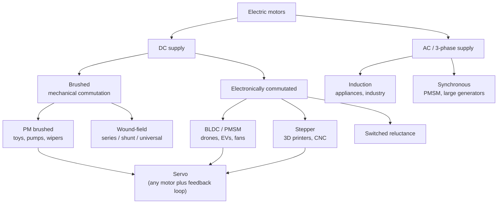

::: testing
Whether you have a map of the motor landscape and can match a motor type to a job using the right criteria: torque vs speed shape, control complexity, efficiency, life, cost and positioning accuracy. A list of names is the floor. The interviewer wants a one-line "why" for each (for example, steppers for open-loop positioning because torque is held at standstill, BLDC for efficiency and life, induction for cheap mains-powered fixed-speed work).
:::

::: why
Choosing the motor type is usually the first and most consequential actuator decision, and it fixes the driver electronics. A 3D printer with brushed motors, or a drone with steppers, is a design failure. In interviews this question checks that you can reason from requirements (precision? efficiency? cost? lifetime? supply?) to an architecture before you ever calculate a torque.
:::

::: concepts
- **Brushed PM DC**: simplest, voltage controls speed, current controls torque. See [[q0348]].
- **Brushless DC / PMSM**: windings on the stator, magnets on the rotor, electronic commutation. See [[q0363]].
- **Stepper**: many poles, moves in discrete steps. See [[q0376]].
- **AC induction**: rotor currents are induced, so no magnets or brushes; speed tied to line frequency.
- **Servo**: not a motor type but a motor plus feedback and a control loop.
- **Linear and special actuators**: voice coil, linear motors ([[q0350]]), vibration motors ([[q0351]]), piezo.
:::

::: answer
"I'd group them by how they're built and driven.

Brushed DC motors are the simplest: apply a DC voltage and it spins, reverse the polarity and it reverses. You control speed with voltage or PWM. They're cheap and good for toys, small pumps, power windows, wipers, and small robots, but brushes wear and make electrical noise.

Brushless DC motors put the windings on the stator and magnets on the rotor, and an electronic controller does the commutation. They're more efficient, longer lived and quieter, so they're in drones, fans, hard drives, power tools and EVs. The cost is a three-phase driver and position sensing.

Stepper motors move in discrete steps, typically 200 per revolution, so you get open-loop positioning and holding torque at standstill. That's 3D printers, CNC stages, camera focus.

AC induction motors run directly from mains or a VFD, are rugged and cheap, and are used in appliances, pumps and industrial drives.

Servos are a motor plus feedback, usually an encoder or potentiometer, and a control loop, so you can command position or speed, like hobby servos and robot joints. And there are special ones: voice coils and linear motors for linear motion, and little vibration motors in phones.

So the question I'd ask is: do I need position, efficiency, long life, or lowest cost? That picks the type."
:::

::: technical
| Type | Commutation | Torque-speed shape | Control | Typical strengths | Typical weaknesses |
|---|---|---|---|---|---|
| Brushed PM DC | Mechanical (brushes) | Linear, $T = K_t(V-K_e\omega)/R$ | One H-bridge, PWM | Cheap, simple, high start torque | Brush wear, EMI, lower efficiency |
| Brushed wound-field (series, shunt) / universal | Mechanical | Series: torque $\propto I^2$, hyperbolic speed-torque | Phase control (AC) or PWM | Very high starting torque, runs on AC (universal) | Runaway unloaded, brush wear |
| BLDC / PMSM | Electronic | Linear (BLDC, trapezoidal) | 3-phase inverter + position | Efficient, long life, high speed | Complexity, cost |
| Stepper | Electronic (open-loop sequence) | Torque falls with speed | Driver with current control, microstepping | Position without feedback, holding torque | Resonance, lost steps if overloaded, low efficiency (full current at rest) |
| AC induction | None (induced rotor current) | Slip-dependent, pull-out torque | Line or VFD | Rugged, cheap, no magnets | Speed tied to frequency, lower efficiency at small sizes |
| Switched reluctance | Electronic | Variable | Special drive | No magnets, robust | Torque ripple, acoustic noise |
| Voice coil / linear | Lorentz, no commutation | Force $\propto I$ | Current driver | Fast, precise linear motion | Limited stroke (voice coil) |

**Key relations.** Brushed or BLDC: $T = K_tI$, $E = K_e\omega$. Synchronous AC machine: $n_s = 120f/p$ rpm. Induction motor: $n = n_s(1-s)$. Stepper: step angle $= 360°/(\text{steps per rev})$ (1.8° typical, 200 steps), microstepping subdivides it.

**Selection heuristics.** Smallest cost and short life → brushed. Long life, efficiency, high speed → BLDC. Position without sensors at low speed → stepper. Fixed speed from mains → induction. Closed-loop position → servo (brushed, BLDC or PMSM plus encoder). Short stroke, fast → voice coil or solenoid ([[q0347]]).
:::

::: short
"Brushed DC: simple, cheap, voltage sets speed, good for toys, pumps and automotive actuators. Brushless DC: electronic commutation, efficient and long-lived, used in drones, fans, drives and EVs. Steppers move in discrete steps with holding torque, so they're used for open-loop positioning such as 3D printers. AC induction motors run off mains and are rugged, used in appliances and industry. Servos are any motor plus feedback and a control loop for position. Plus special ones like voice coils and vibration motors. I'd choose based on precision, efficiency, life and cost."
:::

::: long
"I'd organise motors by how the torque is produced and how they're commutated.

First, brushed DC. A rotor winding, a commutator and brushes, with permanent magnets on the stator. It's the simplest to drive: the voltage sets the speed, the current sets the torque, and reversing the polarity reverses the direction. It's cheap and has great starting torque, so you'll find it in toys, wipers, power windows, small pumps and cheap robots. The downsides are brush wear, arcing, noise and lower efficiency. A variation is the series-wound or universal motor in power tools and vacuum cleaners, with huge starting torque but a tendency to run away without load.

Second, brushless DC and PMSM. Windings on the stator, magnets on the rotor, and an electronic controller does what the commutator did. You get better efficiency, longer life and higher speeds, and they cool better since the heat is in the stator. Drones, computer fans, hard drives and EVs all use them. The cost is a three-phase inverter and some form of position sensing.

Third, steppers. These have many poles and move in fixed steps, 200 per rev is typical, so you can position open-loop and hold torque at standstill. Perfect for 3D printers and small CNC axes, with downsides of resonance, lost steps when overloaded, and being inefficient because they draw current even at rest.

Fourth, AC induction motors, rugged, no magnets, run on mains or a VFD. Appliances, pumps, fans and industrial drives.

On top of those, a servo isn't a motor type, it's a motor plus encoder or potentiometer plus a control loop. And there are special actuators: voice coils and linear motors for linear motion, and the eccentric or linear resonant actuators in phones.

When asked to pick, I'd start from the requirement: precision, efficiency, lifetime, cost, supply, and choose from there."
:::

::: terms
- **Brushed DC (PM)**: motor with magnets on the stator and a commutator/brush system. See [[q0348]].
- **BLDC**: brushless DC motor, electronically commutated; often called PMSM when driven with sinusoidal currents.
- **Stepper**: motor that moves in discrete angular steps by energising phases in sequence.
- **Induction motor**: AC machine in which the rotor current is induced by the stator's rotating field.
- **Synchronous speed**: $n_s = 120f/p$ rpm for $p$ poles at frequency $f$.
- **Slip**: $s = (n_s - n)/n_s$, the lag of an induction rotor behind the field.
- **Servo**: closed-loop actuator with feedback and a controller.
- **VFD**: variable-frequency drive for AC motors.
- **Holding torque**: torque a stepper provides when energised at rest.
- **Cogging**: torque ripple due to magnet-slot interaction.
:::

::: exceptional
An average answer lists three or four types and one application each. An exceptional answer:

- Organises by physics (commutation method, torque-speed shape) rather than by a random list.
- Gives a one-line selection rationale per type: efficiency, positioning, cost, life, supply.
- Mentions the **driver implications** (H-bridge vs three-phase inverter vs VFD) because that is the electrical-engineering angle.
- Notes that servo is a system, not a motor type, and that stepper, BLDC and brushed motors can all be servos.
- Gives numbers: 1.8° / 200 steps; $n_s = 120f/p$ (1800 rpm for 4 poles at 60 Hz); brushed life in thousands of hours vs BLDC tens of thousands.
- Asks what the requirement is before choosing.
:::

::: mistakes
- **Calling a servo a motor type.** It is a motor with feedback and control; hobby servos use a small brushed motor and gearbox, industrial servos use BLDC/PMSM.
- **Using steppers for high-speed or high-efficiency drives.** Torque falls fast with speed and the driver burns current at standstill.
- **Saying BLDC motors "run on DC".** They run on DC *supply* through an inverter producing three-phase AC-like waveforms.
- **Assuming induction motors have a speed set by voltage.** Speed follows frequency (minus slip); voltage mostly sets torque and flux.
- **Letting a series-wound or universal motor run unloaded**: speed rises until the rotor or bearings fail (runaway).
- **Quoting lifetimes as facts without ranges.** Brush life varies hugely with duty and grade (see [[q0360]]).
:::

::: deep
## Start from how torque is made

All rotating motors use the same force: current in a magnetic field. The families differ in **where the field comes from**, **where the current is injected**, and **who switches it**.


Figure: Family tree by supply and commutation. A servo is a layer on top of any of these; it is defined by the feedback loop, not the machine.

## Brushed PM DC: the baseline

Equations: $V = IR + K_e\omega$, $T = K_tI$. Speed is nearly proportional to voltage; torque to current ([[q0353]]). A 12 V, 2 Ω, $K=0.02$ motor stalls at 6 A and 0.12 N·m, and has a no-load speed near 5700 rpm ([[q0352]]). Its drive is one H-bridge. Strengths: low cost, strong starting torque, simple control, easy to reverse. Weaknesses: brush life ([[q0360]]), noise ([[q0355]]), heat in the rotor.

## Series-wound and universal: torque squared

In a series motor the field current equals the armature current, so flux $\propto I$ and torque $\propto I^2$. The speed is $\omega = (V - IR)/(K I)$, which grows without bound as $I\to0$. The plot compares it with a PM motor using the same resistance, in normalised units:

```plot
{"title":"PM brushed vs series-wound torque (normalised)","x":{"label":"speed ω / (V/K)","min":0,"max":1},"y":{"label":"torque (normalised)","min":0,"max":30},
 "vars":{"r":0.1},
 "series":[{"label":"PM brushed: T ∝ (1−x)/R","fn":"(1-x)/r"},{"label":"series-wound: T ∝ 1/(x+R)²","fn":"1/((x+r)*(x+r))","color":"orange"}]}
```
Figure: The series motor's torque rises steeply at low speed (it leaves the top of the plot below about 0.08 and reaches 100 at standstill, against 10 for the PM motor) (great for starting loads: traction, starters, power tools) and drops fast with speed. At light load its speed keeps rising, which is the runaway risk. The PM motor is a straight line.

This is why universal motors in drills and vacuum cleaners have a gearbox or fan load and are never run unloaded at full voltage.

## Brushless: the same physics, electronic switch

A BLDC replaces the commutator with a three-phase bridge that energises the stator phases in step with rotor position (from Hall sensors or back-EMF). In the trapezoidal case, torque is $K_tI$ and back-EMF is $K_e\omega$ again, so the speed-torque line looks like the brushed motor's. Benefits: no brush wear, windings on the stator (better cooling), higher speeds, quieter electrically, higher efficiency. Cost: inverter plus rotor position sensing ([[q0363]], [[q0366]]). PMSMs are driven with sinusoidal currents for lower torque ripple, as in EV traction and industrial servos.

## Steppers: positioning without feedback

A hybrid stepper has typically 50 rotor teeth and two phases; each full step is 1.8° (200 steps/rev). Microstepping interpolates by driving the phase currents as sine/cosine. Advantages: precise open-loop positioning, holding torque at zero speed, simple. Disadvantages: torque drops with speed (back-EMF and coil inductance limit current), resonance, missed steps when overloaded, low efficiency because the driver pushes rated current even when still. For $200$ steps and a 2 mm lead screw, one full step is $2/200 = 0.01$ mm.

```sim
{"id":"stepper-lab","mode":"full"}
```
Figure: Press Step (or Play) and switch between full, half and microstep modes: see how the rotor lands on discrete positions and how microstepping smooths the motion (but does not guarantee proportional accuracy in position).

## AC induction and synchronous

Three-phase stator windings create a rotating field at synchronous speed $n_s = 120f/p$ (e.g. 1800 rpm for $p=4$, $f=60$ Hz). An induction rotor lags by slip $s$ (a few percent at rated load), inducing rotor currents that create torque. No magnets, brushes or electronics are needed to run from the mains, which is why it dominates industrial and appliance use. Speed control needs a VFD. Synchronous machines (including PMSMs) lock to the field with zero slip.

## Servo: the system layer

A servo drive closes a loop around any of these: encoder or potentiometer feedback, a controller (PID or cascaded current/velocity/position loops), and a power stage. A hobby servo is a small brushed motor, gear train, potentiometer and control IC accepting a pulse of 1–2 ms every 20 ms for position. Industrial servos use BLDC/PMSM with encoders and cascaded loops. The "servo vs stepper" question is really "closed loop vs open loop".

## Special and linear actuators

- **Voice coil**: a coil in a magnet gap, force $= BLI$, short stroke, fast and precise (hard-drive heads, speaker cones, camera autofocus).
- **Linear motors**: an unrolled motor with long travel ([[q0350]]).
- **Vibration motors** (ERM, LRA): see [[q0351]].
- **Piezo and ultrasonic motors**: tiny, no magnets, used in camera lenses.

## Choosing quickly

| Requirement | First choice |
|---|---|
| Cheapest, simple, intermittent | Brushed PM |
| Efficient, continuous, long life | BLDC |
| Position open-loop at low speed | Stepper |
| Fixed-speed from mains | Induction |
| Precise closed-loop motion | Servo (BLDC + encoder) |
| Short fast linear stroke | Voice coil or solenoid |
:::

::: applications
- **Brushed PM**: automotive power windows, mirrors and seat motors; toy cars; small pumps; robot wheels with gearboxes.
- **Series-wound / universal**: drills, blenders, vacuum cleaners, angle grinders (high speed, lightweight, runs on AC or DC).
- **BLDC/PMSM**: multirotor drones, computer cooling fans, hard-drive spindles, cordless tools, EV traction motors.
- **Stepper**: FDM 3D-printer axes, desktop CNC, camera sliders, small valve positioners.
- **Induction**: washing machines, HVAC blowers, conveyors and industrial pumps, often with VFDs.
- **Servo**: RC servos, robot arm joints, CNC axes, pan-tilt camera heads.
:::

::: assumptions
- **Qualitative selection.** Real choices depend on power level; at kW level induction/PMSM dominate and brushed motors rarely appear, whereas at milliwatts brushed/coreless and piezo dominate.
- **Typical values** (200 steps, 1.8°, 1800 rpm at 4 poles) are conventional but vary (0.9° steppers, different pole counts).
- **Supply type** drives some choices: mains, battery, or three-phase industrial. Battery-powered systems tend to BLDC or brushed; mains systems to induction or universal motors.
- **Efficiency and life figures** vary widely by size and quality; treat qualitative comparisons as general, not guaranteed.
- A valid alternative answer organises by **application** (traction, positioning, fans/pumps, haptics) rather than machine type.
:::

::: followups
### Why do drones use BLDC and not brushed motors?
Efficiency and power density determine flight time and thrust, brushes would wear quickly at high speed, and brush arcing would corrupt IMU and radio signals. BLDC windings sit on the stator, so heat leaves through the case. The cost is an ESC. (Micro quadcopters with tiny coreless brushed motors are the exception because of cost and weight at very small scale.)

### When would you choose a stepper over a servo?
When cost and simplicity matter, loads are predictable and below the torque margin, and moderate speeds are enough: open-loop positioning with no encoder. Choose a servo if you need high speed, efficiency, a dynamic load, or guaranteed position (no lost steps). A hybrid is a stepper with an encoder ("closed-loop stepper").

### What does the nameplate of an induction motor tell you about its speed?
A 4-pole 60 Hz motor has $n_s = 1800$ rpm; at rated load the nameplate might say 1750 rpm, giving slip $= (1800-1750)/1800 = 2.8\%$. Speed hardly changes with load, which is why you need a VFD to change it.

### What is the difference between a BLDC and a PMSM?
Same hardware (permanent-magnet synchronous machine); the name reflects the winding and drive. "BLDC" usually means trapezoidal back-EMF driven by six-step commutation; "PMSM" means sinusoidal back-EMF driven by field-oriented control for smoother torque. Many motors can be driven either way.

### A client wants a motor for a battery-powered rotary table with 0.1° accuracy and long idle periods. What would you ask and propose?
Ask for load inertia, torque, speed, duty and battery limits. A microstepped stepper with a gearbox is a candidate for simplicity, but holding current drains the battery, so use current reduction at standstill or a self-locking worm gear. If efficiency or dynamic loads matter, a BLDC with an encoder and a gearbox is better.

### Can you run a three-phase BLDC from a DC battery without electronics?
No. The windings must be energised in sequence tied to rotor angle; without an inverter and position information the rotor just aligns once and stops. The "DC" in BLDC refers to the supply and the trapezoidal control, not to a motor that spins from a DC voltage directly.
:::

::: interpretations
The question sits in the brushed DC motor section but asks for "a few types of motors", so it is a survey question; answer broadly, then say you'll focus on brushed motors in detail if asked. "Each used for" invites a one-line application per type. Adjacent questions treat BLDC ([[q0363]]), steppers ([[q0376]]) and linear motors ([[q0350]]) in depth.
:::

::: references
- Hughes and Drury, *Electric Motors and Drives*: survey of DC, induction, synchronous, stepper and reluctance machines.
- Chapman, *Electric Machinery Fundamentals*: DC motors, induction motors, and synchronous machines.
- Krishnan, *Permanent Magnet Synchronous and Brushless DC Motor Drives*: BLDC vs PMSM and their drives.
- Horowitz & Hill, *The Art of Electronics*, 3rd ed.: motors and motor drive, including steppers and servos.
:::

::: rubric
- Names at least brushed DC, brushless DC, stepper and AC induction :: Covers the standard set an interviewer expects.
- Gives an application for each type :: The question asks explicitly what each is used for.
- Gives the *reason* each fits its application (position, efficiency, cost, life) :: Turns a list into engineering judgement.
- Distinguishes servo as a system (motor + feedback + control) :: A common point of confusion.
- Mentions driver requirements (H-bridge, three-phase inverter, VFD) :: Connects the motor choice to the electronics.
- Quotes at least one number (200 steps, $120f/p$, stall current) :: Shows quantitative fluency.
- Notes trade-offs or failure modes (brush wear, lost steps, series runaway) :: Shows depth beyond marketing statements.
:::

::: quiz
```json
[
 {"type":"mcq","level":"fundamental","q":"Which motor type gives open-loop positioning with holding torque at standstill?","options":["Brushed PM DC","Stepper","Series-wound universal","AC induction"],"answer":1,"explain":"A stepper moves in fixed angular steps (typically 1.8°) and holds position with energised phases, so no encoder is required as long as it does not lose steps."},
 {"type":"numeric","level":"fundamental","q":"A hybrid stepper has 200 full steps per revolution. What is the step angle in degrees?","answer":1.8,"tolerance":0.01,"unit":"°","explain":"The step angle is the full circle divided by steps per revolution: $360°/200 = 1.8°$. Microstepping subdivides this further."},
 {"type":"numeric","level":"intermediate","q":"A 4-pole induction motor runs on 60 Hz mains. What is its synchronous speed in rpm?","answer":1800,"tolerance":0.01,"unit":"rpm","explain":"$n_s = 120f/p = 120\\times60/4 = 1800$ rpm. The rotor turns slightly slower because of slip."},
 {"type":"numeric","level":"intermediate","q":"The motor above is rated at 1750 rpm. What is the slip as a percentage?","answer":2.78,"tolerance":0.03,"unit":"%","explain":"$s = (1800-1750)/1800 = 0.0278 = 2.78\\%$."},
 {"type":"mcq","level":"advanced","q":"Why is a series-wound universal motor not run unloaded at full voltage?","options":["Its torque drops to zero at stall","Its flux is proportional to armature current, so as load falls the speed rises without limit (runaway)","It overheats because of eddy currents in the magnets","It cannot start under load"],"answer":1,"explain":"$\\omega = (V - IR)/(KI)$ grows as $I\\to0$. Starting torque is high, but there is no natural no-load speed limit, so the rotor can overspeed and fail."},
 {"type":"truefalse","level":"advanced","q":"A servo motor is a distinct motor type with its own winding and magnet design, separate from brushed, brushless and stepper motors.","answer":false,"explain":"A servo is a closed-loop system: a motor (brushed, BLDC or even a stepper) plus position feedback and a controller. The name describes the control loop."}
]
```
:::
