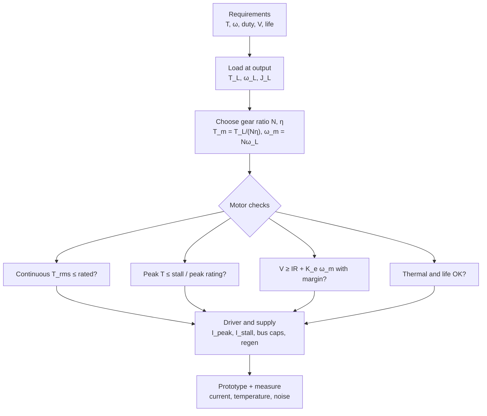

::: basics
### In plain words
Choosing a motor means starting with the job, not the motor. First work out how much twisting force (torque) and how much speed the load needs. Then pick a motor, and usually a gearbox, that delivers that with some safety margin. Finally, check that the supply and the driver (the circuit that switches the motor's power) can handle the current.

### Picture it
It is like picking a vehicle for moving house. First you decide what you must carry and how far. Only then do you choose a van or a truck. A sports car is fast but cannot carry a sofa. A motor works the same way: a high-speed motor is a poor match for a slow, heavy load unless a gearbox sits between them. The analogy has one gap: motors also get hot, so how long you run them matters.

### Words you need
- **Torque**: the twisting force at the shaft, in newton-meters (N·m): force in newtons (N) times the lever arm in meters.
- **Gear ratio ($N$)**: how many motor turns make one output turn. It trades speed for torque.
- **Duty cycle**: the fraction of time the motor is actually running.
- **Stall current**: the current with the shaft held still, $V/R$.
- **Margin**: extra capacity beyond the calculated need, for battery sag and heating.

### The simplest example
A robot wheel has a 0.05 m radius and must push with 2 N. The torque at the wheel is 2 × 0.05 = **0.1 N·m**. The wheel should turn at 20 rad/s (radians per second; one turn is about 6.28 radians). Suppose the chosen motor runs best near 400 rad/s, so pick a gear ratio of 400 / 20 = **20:1**. The motor then supplies 0.1 / 20 = 0.005 N·m. With $K_t = 0.02$ N·m/A, that is 0.005 / 0.02 = **0.25 A**.

That is the whole idea: work from the load back to the motor. The rest of this page adds gearbox losses, voltage and thermal margins, brush life, and why you prototype and measure.
:::

::: testing
Whether you can turn an application into motor requirements and check a candidate motor against them in a disciplined order, rather than picking "a 12 V motor". The interviewer wants: clarifying questions (load, speed, duty, supply, life, size, environment, control), the key calculations (load torque and speed at the shaft, gearing, current and voltage at the operating point, continuous vs peak, thermal), and the electrical interface (driver current, stall protection, noise). Sizing a motor is a multi-constraint design problem, and the sign of experience is checking *continuous* rating and *supply voltage margin*, not just stall torque.
:::

::: why
Motor specs drive the battery, driver, thermal design, mechanical envelope and cost. A motor that is too small overheats or stalls; too large wastes mass, money and efficiency; one with the wrong winding needs a different supply or driver. Choosing wrongly late in the project is expensive, because the power stage, connectors and gearbox are all built around it. This question also leads naturally to "design a motor driver" and "spec an ESC" ([[q0375]]).
:::

::: concepts
- **Torque-speed line**: $T = K_t(V - K_e\omega)/R$, stall torque and no-load speed. See [[q0352]].
- **Torque ↔ current, speed ↔ voltage**: sets driver current and supply voltage. See [[q0353]].
- **Stall current and heat**: $V/R$, $I^2R$. See [[q0342]].
- **Duty cycle and RMS torque**: the thermal limit depends on the RMS (continuous-equivalent) load, not the peak.
- **Gearing**: trades speed for torque, $T_{out} = N\eta T_m$.
- **Regeneration and braking**: bus effects of deceleration ([[q0346]]).
:::

::: answer
"I'd start by asking what the motor has to do, then work from the load to the motor, not the other way round.

Requirements first: what torque and speed at the output, continuous and peak? What duty cycle, what supply voltage and current, what size and weight, what lifetime and environment, and how will it be controlled?

Then the calculation. I find the load torque and speed at the shaft, for example force times wheel radius for a drive wheel. Then pick a gear ratio that puts the motor in its efficient region: motor speed $N$ times output speed, motor torque the output torque over $N$ times the gearbox efficiency. Next I check the motor against that operating point: continuous torque is below the motor's rated continuous torque, peak torque is below its stall or peak rating, and the supply can provide enough voltage to overcome the back-EMF plus the $IR$ drop, with 15 to 20% margin for battery sag. I compute the current from torque over $K_t$ to size the driver and wiring, and check stall current against what the supply and driver can handle.

Beyond that I look at the practical bits: thermal limit with the real duty cycle, brush life or BLDC if I need thousands of hours, noise and EMI, the shaft and mounting, the encoder if I need feedback, and cost. Finally I'd prototype and measure current and temperature, because datasheet curves are at 25°C and the real system will always have extra friction."
:::

::: technical
**Spec chain (load → motor → electrical).**
1. **Load**: peak and continuous torque $T_L$ and speed $\omega_L$; inertia $J_L$ and required acceleration $\alpha$; duty profile. For a vehicle: $F = m(a + gC_{rr}) + \tfrac12\rho C_dAv^2 + mg\sin\theta$, $T = Fr$.
2. **Transmission**: ratio $N$, efficiency $\eta$ (0.6–0.9 for spur/planetary gearheads; worm gears lower). $T_m = T_L/(N\eta)$, $\omega_m = N\omega_L$.
3. **Motor torque check**: $T_{m,rms} \le T_{cont}$ (thermal), $T_{m,peak} \le T_{stall}$ and below the peak rating of the gearbox and brushes.
4. **Voltage check**: $V \ge I R + K_e\omega_m$ at the worst point (peak torque and speed together), plus margin for battery sag and PWM duty ceiling (typ. 90–95%). Check no-load speed vs max permitted by brush or bearing.
5. **Current check**: $I = (T_m + T_f)/K_t$; stall current $V/R$ for driver, fuse and wiring sizing.
6. **Thermal**: continuous heating $\approx I_{rms}^2R$; temperature rise $= P R_{th}$ (vendor $R_{th}$ values). Winding resistance rises ~0.4%/°C.
7. **Efficiency**: operate near the efficiency peak $\sqrt{I_0/I_{stall}}$ of stall current; check battery energy $E = P_{in}t$.
8. **Inertia match**: $N^2J_m$ vs load inertia $J_L$, with $J_L/(N^2J_m)\le$ ~1–5 as a rule of thumb for good dynamic response (depends on application).

**Other specs**: brush life ([[q0360]]), noise/EMI ([[q0355]]), shaft load and bearing life, temperature range, IP rating, sensors (encoder, Hall), connector, mass, cost, certifications.

**Worked example** (differential-drive robot, 4 kg, 2 wheels, $r = 40$ mm, top speed 1 m/s, acceleration 1 m/s², $C_{rr} = 0.03$): total force $F = 4(1 + 9.81\times0.03) = 5.18$ N, so per wheel 2.59 N, torque at the wheel $T_w = 0.1035$ N·m, wheel speed 25 rad/s (239 rpm). Take a motor with $K = 0.02$ N·m/A, $R = 2\ \Omega$, $T_f = 2$ mN·m on 12 V and a gearbox with $\eta = 0.8$:

| $N$ | $T_m$ (mN·m) | motor speed (rpm) | $I$ (A) | $V$ needed (V) | efficiency |
|---|---|---|---|---|---|
| 10 | 12.9 | 2387 | 0.75 | 6.5 | 67% |
| 20 | 6.5 | 4775 | 0.42 | 10.8 | 70% |
| 30 | 4.3 | 7162 | 0.32 | 15.6 (too much) | 66% |
| 40 | 3.2 | 9549 | 0.26 | 20.5 (too much) | 60% |

(Voltage and current are at the *peak* acceleration-at-top-speed point, a conservative case.) $N=30$ and $N=40$ need more than the 12 V supply. $N=20$ needs 10.8 V, only 10% margin, which is tight with a sagging battery and PWM headroom. $N=10$ uses only 6.5 V so plenty of margin and speed headroom, with a stall torque at the wheel of $0.118\times10\times0.8 = 0.94$ N·m, 9× what's needed. Pick $N\approx$ 10–15. Then check the motor's *continuous* torque rating (cruise needs only about 3 mN·m at the motor with $N = 10$) and that the driver handles the stall current (6 A).
:::

::: short
"I work from the load backwards. Get the output torque and speed, continuous and peak, plus duty cycle, supply voltage, size and life. Pick a gear ratio that sets motor torque as load torque over $N\eta$ and motor speed as $N$ times load speed. Then check the motor: continuous torque under its rated continuous value, peak under stall, and enough voltage for back-EMF plus $IR$ with margin. Current is torque over $K_t$, which sizes the driver, and stall current is $V/R$. Then check thermal, brush life, noise, mounting and cost, and verify on the bench."
:::

::: long
"I'd treat it as a requirements-to-hardware chain.

First, the load. I want the torque and speed at the output, both peak and continuous, how long and how often it runs, and the supply voltage and current I'm allowed. I also want size, weight, lifetime, environment, noise limits and how it'll be controlled. For a robot wheel, torque is the force times the wheel radius, and the force comes from mass times acceleration plus rolling resistance and any slope. So a 4 kilogram robot with 1 metre per second squared acceleration needs about 5 newtons of total force, which on 40 millimetre wheels is about 0.1 newton-metres per wheel and 240 rpm at 1 metre per second.

Second, the transmission. A motor is happiest at high speed, low torque. So I pick a gear ratio $N$: motor torque is the wheel torque over $N$ times gearbox efficiency, and motor speed is $N$ times wheel speed. For a 12 volt motor with $K = 0.02$ and 2 ohms, a ratio of 10 puts it at 13 millinewton-metres and 2400 rpm.

Third, I check the motor against that point. The voltage must cover back-EMF plus the resistive drop, which for N = 10 is 6.5 volts, fine, while N = 30 would need 15.6 and fail. I'd keep a 15 to 20% margin for battery sag and the PWM headroom. Current is torque over $K_t$, so I know the driver and fuse sizing, and stall current $V/R$ is the worst case. I compare continuous torque, using the RMS over the duty cycle, to the motor's rated continuous torque, and peak to stall. I check thermal with $I^2R$ and the vendor's thermal resistance.

Finally, the practical items: brush life versus BLDC, EMI and noise, shaft and bearing loads, encoder, mounting, cost, and then I'd prototype and measure current and temperature because real friction is always worse than the datasheet."
:::

::: terms
- **Continuous (rated) torque**: highest torque sustainable without exceeding the winding temperature limit.
- **Peak / stall torque**: short-term maximum, limited by current and demagnetisation.
- **Torque constant $K_t$ / speed constant $K_v$**: electromechanical conversion factors ([[q0353]]).
- **Terminal resistance $R$**: winding plus brush resistance; sets stall current.
- **No-load current $I_0$**: friction/losses at no-load speed.
- **Thermal resistance $R_{th}$**: °C per watt from winding to ambient.
- **Gear ratio and efficiency**: $N$ and $\eta$.
- **RMS torque**: the root-mean-square of torque over the duty cycle, which determines heating.
- **Inertia ratio**: load inertia reflected to the motor vs motor inertia.
- **Motor constant $K_m$**: $K_t/\sqrt R$; torque per root-watt.
:::

::: exceptional
An average answer lists "voltage, current, torque, speed". An exceptional answer:

- Starts with clarifying questions and works load → gearbox → motor → driver, with equations.
- Separates continuous (thermal, RMS) from peak (stall, current) requirements.
- Checks **voltage headroom** with back-EMF plus $IR$, not only torque. Picks $N$ using a table of options.
- Sizes driver, wiring and fuse for stall/peak current, and thinks about inrush ([[q0345]]) and regeneration ([[q0346]]).
- Covers non-torque items: brush life, EMI, noise, temperature, shaft loads, mounting, encoder, cost.
- Ends with verification: measure current, temperature and speed on a prototype.
- Names alternatives (BLDC, stepper) when life or efficiency requirements demand them ([[q0349]]).
:::

::: mistakes
- **Sizing for stall torque only.** Continuous torque (thermal) is usually the binding limit.
- **Ignoring voltage headroom.** A motor with enough torque but a no-load speed barely above the required speed can't reach it under load or when the battery sags.
- **Forgetting gearbox efficiency and the motor's friction** and so underestimating current.
- **Picking the motor by power rating alone.** Two motors of the same watts can have a very different $K_v$, torque and voltage.
- **Using peak current as continuous.** RMS current over the duty cycle sets heating, but the driver must still survive the peak.
- **Not checking inertia or acceleration.** A high-inertia load can need far more peak torque for acceleration than for steady running.
- **Skipping thermal in an enclosure.** Datasheet thermal ratings assume free air.
:::

::: deep
## Start with the question set

Before touching a catalogue, ask:

| Topic | Questions |
|---|---|
| Motion | Output torque and speed? Peak vs continuous? Reversing? Position or speed accuracy? |
| Load | Inertia, friction, gravity, impact, stall events? |
| Duty | On-time, off-time, repetition rate, acceleration profile |
| Supply | Voltage range (battery sag), peak current, regeneration allowed? |
| Mechanical | Space, mass, shaft type, mounting, gearbox, noise, vibration |
| Life/environment | Hours, temperature, dust, humidity, IP rating |
| Control | Open loop, speed loop, position loop? Encoder? Driver choice? |
| Cost/volume | Prototype or 1M units? Off-the-shelf or custom winding? |


Figure: Spec flow. Iterate on the gear ratio and winding until all four motor checks pass, then size the electronics and verify on the bench.

## Load torque and speed

For a vehicle wheel or any linear load pulled by a drum or screw, find the force at the load, then convert. For rotation:
$$T_L = F\,r + J_L\alpha + T_{friction} + T_{gravity},\qquad \omega_L = v/r.$$
Include the *acceleration* term: $J\alpha$ is often the peak load in positioning systems. Compute the **duty profile** (torque vs time), then the RMS torque
$$T_{rms} = \sqrt{\frac{1}{T_{cycle}}\int T^2\,dt}$$
which sets the heating through $I_{rms} = T_{rms}/K_t$.

**Robot example (from above).** Wheel torque 0.1035 N·m and 25 rad/s. At steady cruise (flat, no acceleration) only $F = mgC_{rr} = 1.18$ N, i.e. 0.0235 N·m per wheel: 23% of the peak. A move profile of 2 s acceleration and 8 s cruise gives $T_{rms}$ at the wheel $= \sqrt{(2\times0.1035^2 + 8\times0.0235^2)/10} = 0.0509$ N·m (accel 20% of the time). Continuous rating needs to exceed *that*, with the peak covered by the stall/peak torque.

## Choose the gear ratio

A motor is efficient at high speed, low torque (see [[q0352]]). The ratio $N$ is picked so that, at the load's peak point:

- the voltage required, $V_{req} = \frac{T_m + T_f}{K_t}R + K_e N\omega_L$, is at most ~80–85% of the minimum supply;
- the motor speed is below its maximum rated speed (brushes, bearings);
- the operating point is near or below the motor's continuous rating, ideally near its efficiency peak.

```plot
{"title":"Motor line (12 V, K = 0.02, R = 2 Ω) and robot operating points","x":{"label":"motor speed","unit":"rpm","min":0,"max":10500},"y":{"label":"motor torque (mN·m)","min":0,"max":125},
 "vars":{"v":12,"r":2,"k":0.02,"tf":0.002},
 "series":[{"label":"available torque at 12 V","fn":"max(0,1000*(k*(v-k*x*pi/30)/r-tf))"},{"label":"available at 10.2 V (15% sag)","fn":"max(0,1000*(k*(0.85*v-k*x*pi/30)/r-tf))","color":"orange","dashed":true}],
 "points":[{"x":2387,"y":12.9,"label":"N=10"},{"x":4775,"y":6.5,"label":"N=20"},{"x":7162,"y":4.3,"label":"N=30"},{"x":9549,"y":3.2,"label":"N=40"}],
 "hlines":[{"at":20,"label":"assumed continuous rating 20 mN·m","color":"muted"}]}
```
Figure: The required motor operating point (peak demand) for different gear ratios. The point must lie *below* the supply line, with margin from the sagged-battery line. Here the demand is the same output power at every ratio: N = 30 and N = 40 sit above the 12 V line (they cannot reach that speed), N = 20 is just under the 12 V line but above the sagged-battery line (it fails at 10.2 V), and N = 10 is comfortable. A real motor's continuous-torque line (assumed 20 mN·m here) is a separate limit: the RMS operating torque must stay under it.

For $N=10$: peak motor current is $0.75$ A, $V_{req} = 6.5$ V, so the headroom is large; the motor never runs near its no-load speed (5634 rpm), and its 67% efficiency there is not far below the 76% peak. For $N=20$ the motor runs at 4775 rpm, 85% of no-load speed: efficient, but with just 1.2 V of headroom; risky with a battery sagging below ~11 V.

## Checking the motor

**Torque.** $T_m$ (RMS) $\le T_{cont}$ from the datasheet at the *expected ambient temperature*; peak torque $\le T_{stall}$ and below gearbox rating.

**Voltage.** At the worst point $V_{req} \le V_{min,supply}\times D_{max}$ (PWM duty ceiling around 0.9–0.95 when a bootstrap gate driver is used).

**Current.** $I_{peak} = (T_{m,peak} + T_f)/K_t$ sizes the driver's current limit, the fuse and the connectors; stall current $V/R$ is what you will see in a jam unless the driver limits it ([[q0345]], [[q0342]]). Rated continuous current in the datasheet corresponds to continuous torque.

**Thermal.** Winding temperature rise $\Delta T = I_{rms}^2R_{hot}R_{th}$ and the winding limit (e.g. 100–155 °C depending on insulation class). Vendor $R_{th}$ values are measured on a specified heat-sink; in a closed enclosure expect worse. Resistance rises with temperature, so the $I^2R$ for a given torque is $\sim$30% higher at 100 °C.

**Efficiency and battery.** Convert the duty profile to energy. In our example the whole robot at 1 m/s cruise needs $Fv = 1.18$ W of mechanical power; at roughly 50% overall efficiency (motor, gearbox and driver) that is about 2.4 W electrical, so runtime is battery energy divided by the average power over the duty profile.

**Inertia and dynamics.** For fast positioning, the reflected load inertia $J_L/N^2$ vs rotor inertia $J_m$: when they are similar the motor delivers maximum acceleration for a given power (inertia matching). Very large mismatches make control hard and waste torque on accelerating the rotor.

## Choose winding and driver

For a given motor frame the vendor offers several windings. If your supply is fixed, choose the winding so that $V_{supply}$ gives your required speed at the load current. A higher-resistance, more-turn winding gives lower current for the same torque (smaller driver, thinner wire) but needs higher voltage ([[q0353]]). The driver must supply $I_{peak}$ and tolerate stall; add a current limit, a flyback path, bulk capacitance and regeneration handling. For a bidirectional H-bridge see [[q0346]] and the H-bridge simulation:

```sim
{"id":"h-bridge-lab","mode":"h"}
```
Figure: Try drive, coast and brake modes. The driver you pick must handle the peak and stall current of the motor spec and survive the freewheel/brake currents.

## Brushed vs alternatives

Brushed motors are the cheap default for low-duty loads. Move to **BLDC** if the life requirement is more than a few thousand hours, if efficiency matters (battery life), or if EMI/noise from brushes is unacceptable ([[q0366]]); to a **stepper** if you need open-loop positioning at low speeds ([[q0349]]). For brushed motors check the **brush life** at your current and speed ([[q0360]]) and whether brush replacement is an option ([[q0361]]).

## Sanity checks before ordering

1. $T_{stall}$, no-load speed and $R$ from the datasheet are consistent with $K_t$, $K_e$.
2. Datasheet curves are at nominal voltage and 25 °C, so derate for hot and low battery.
3. Gearbox rated torque ≥ 2× expected peak (shock loads) and its efficiency at your speed.
4. Mounting, shaft diameter, D-flat, and radial/axial load ratings.
5. The motor's rated voltage ≠ your supply voltage necessarily, but the *winding* decides the speed.
6. Bench test with a current probe and thermocouple on a real load.
:::

::: applications
- **Robot drive train**: wheel force → torque → gear ratio → motor, with voltage headroom checks.
- **Automotive window lifts and seat motors**: stall detection via current, high peak torque, short duty.
- **Pumps and fans**: load torque grows with $\omega^2$ (fans) so the operating point is where the fan curve crosses the motor line.
- **Camera gimbals and pan-tilt heads**: low-speed, low-noise, high-torque-density motors, often with encoders.
- **Consumer appliances and tools**: continuous rating and temperature dominate sizing.
- **Gripper and actuator drive**: the torque limit is set by a current limit chosen from $T = K_tI$.
:::

::: assumptions
- **Brushed PM DC motor with a gearbox** as the reference design case; BLDC specs add inverter, sensor and field-weakening considerations ([[q0368]]).
- **Linear motor model**, constants at 25 °C, with constant friction.
- **Peak and continuous demands** are taken from a simple profile; real specs come from an agreed duty cycle.
- **Gearbox efficiency** of 0.8 is a typical assumption for a spur or planetary gearhead; worm gears may be 0.4–0.7, high-ratio ones lower.
- **Supply** is an ideal source with a known sag margin; in reality battery impedance, cable drop and PWM headroom matter.
- Different industries quote ratings differently (continuous torque at a given temperature rise, intermittent duty class); read the vendor's definitions.
:::

::: followups
### What is the difference between rated, continuous and peak torque?
Rated (nominal) torque is the torque at the nominal operating point the vendor specifies, usually at nominal voltage and speed. Continuous torque is the highest torque sustained indefinitely without exceeding the winding temperature limit; it depends on mounting and ambient. Peak (stall) torque is available for seconds or milliseconds and is limited by the current and magnet demagnetisation limits. Size the motor so the RMS torque of your duty cycle is below the continuous rating.

### How do you choose the gear ratio?
Match the load's speed and torque to the motor's efficient region. Start with $N = \omega_{m,target}/\omega_L$ for a target motor speed of 50–70% of no-load speed, then check voltage headroom, torque at the shaft (with $\eta$) and inertia reflection. Candidate ratios are restricted to the catalogue's gearheads (e.g. 10:1, 19:1, 30:1...), so evaluate the options in a table like the one above.

### The motor meets torque and speed on paper but overheats. Why?
Typical causes: you used peak instead of RMS torque, the enclosure raises ambient temperature, the winding resistance rose with temperature, the load friction is higher than assumed, or the gearbox is inefficient. Measure the current: if it is above $(T_L/(N\eta) + T_f)/K_t$, the load is harder than modelled. Fixes: larger motor frame, better thermal path, a lower-resistance winding, reduce the duty cycle or the gear ratio.

### When would you pick a winding with more turns?
When your supply voltage is high relative to the speed you need and you want lower current (smaller driver, less wiring loss and heating in the harness). More turns means higher $K_t$, higher $R$ and a lower no-load speed per volt. Motor constant $K_m$ stays the same, so the motor itself isn't more or less efficient; the choice shifts voltage vs current.

### What if the battery sags to 9 V under load?
Then the maximum speed falls: the voltage headroom is $9 - IR$ and no-load speed scales down. For the robot with $N = 20$, the required 10.8 V isn't available, so the robot can't reach its top speed. Spec at the *minimum* battery voltage (or use a boost/higher pack voltage) and always include sag in the margin.

### How would you detect a stalled motor in firmware?
Measure the current (shunt or driver sense): stall current is $V/R$, much higher than running current. Use a threshold with a debounce time longer than the inrush transient ([[q0345]]), plus a speed or encoder check if available. Respond by cutting PWM, because a stalled motor at full voltage can overheat in seconds.
:::

::: interpretations
"How do you spec a motor?" can mean (a) *choosing* a motor for an application, as covered here, or (b) *writing the specification* for a custom motor supplier (voltage, torque, speed, life, noise, connector, tolerances). The workflow is the same: start with requirements, derive electrical and mechanical requirements, add margins, and list acceptance tests. For brushless motors see [[q0368]]; for ESCs [[q0375]].
:::

::: references
- Hughes and Drury, *Electric Motors and Drives*: motor selection concepts and DC motor characteristics.
- Chapman, *Electric Machinery Fundamentals*: DC motor operation and ratings.
- Vendor application and selection guides from motor manufacturers (for example Maxon and Faulhaber motor selection and "sizing" documents) describe the load-to-motor workflow, continuous vs peak and thermal limits.
- Horowitz & Hill, *The Art of Electronics*, 3rd ed.: motors and motor drive practical considerations.
:::

::: rubric
- Starts with requirements: torque, speed, duty, supply, size, life :: The spec is only meaningful relative to the application.
- Works from load to motor via gear ratio with $T_m = T_L/(N\eta)$ and $\omega_m = N\omega_L$ :: Shows the standard calculation path.
- Checks continuous (RMS) vs peak torque and thermal limits :: Heating, not peak torque, usually limits the choice.
- Checks voltage headroom: $V \ge IR + K_e\omega$ with margin for sag :: A common failure to meet speed.
- Derives current from $T/K_t$ and sizes driver, wiring and stall handling :: Links the motor to the electronics.
- Mentions non-torque specs: brush life, EMI/noise, shaft loads, environment, cost :: Real-product awareness.
- Closes with verification on a prototype :: Datasheet curves are idealised.
:::

::: quiz
```json
[
 {"type":"mcq","level":"fundamental","q":"Which motor rating is most closely linked to long-term heating?","options":["Stall torque","Continuous (rated) torque","No-load speed","Peak current"],"answer":1,"explain":"Continuous torque is the highest torque the motor can sustain without exceeding its winding temperature limit; it is set by $I_{rms}^2R$ heating."},
 {"type":"numeric","level":"fundamental","q":"A load needs 0.1 N·m at 25 rad/s. A 10:1 gearbox with 80% efficiency is used. What torque must the motor produce, in mN·m?","answer":12.5,"tolerance":0.02,"unit":"mN·m","explain":"$T_m = T_L/(N\\eta) = 0.1/(10\\times0.8) = 0.0125$ N·m = 12.5 mN·m. Motor speed is $10\\times25 = 250$ rad/s (2387 rpm)."},
 {"type":"numeric","level":"intermediate","q":"A motor ($K = 0.02$ N·m/A, $R = 2\\ \\Omega$, friction torque 2 mN·m) must deliver 12.9 mN·m at 250 rad/s. What supply voltage is needed, in V?","answer":6.5,"tolerance":0.03,"unit":"V","explain":"$I = (0.0129 + 0.002)/0.02 = 0.745$ A, $IR = 1.49$ V, $E = 0.02\\times250 = 5$ V, so $V = 6.49$ V."},
 {"type":"numeric","level":"intermediate","q":"A motor spends 2 s at 0.1 N·m and 8 s at 0.0235 N·m each cycle. What is the RMS torque in N·m?","answer":0.0494,"tolerance":0.03,"unit":"N·m","explain":"$T_{rms} = \\sqrt{(2\\times0.1^2 + 8\\times0.0235^2)/10} = \\sqrt{0.024418/10} = 0.0494$ N·m. Note it is far below the 0.1 N·m peak, which is why continuous rating is judged on RMS."},
 {"type":"mcq","level":"advanced","q":"A motor has enough continuous torque but cannot reach the required top speed once the battery sags. The most likely cause is:","options":["Too low stall current","Insufficient voltage headroom: $IR + K_e\\omega$ exceeds the available voltage","Excessive brush life","Too much friction in the bearings only"],"answer":1,"explain":"At high speed the back-EMF eats most of the supply. If $IR + K_e\\omega_{required}$ exceeds the sagged supply voltage, the motor simply cannot reach that speed; fix with a lower gear ratio, lower-$K_e$ winding or higher voltage."},
 {"type":"truefalse","level":"advanced","q":"If a motor's stall torque exceeds the peak load torque, it is automatically suitable for continuous operation at that load.","answer":false,"explain":"Stall torque is a short-term limit. Continuous operation is limited by winding temperature (RMS current), voltage headroom and brush/bearing life, so continuous rating and thermal checks are separate."}
]
```
:::
