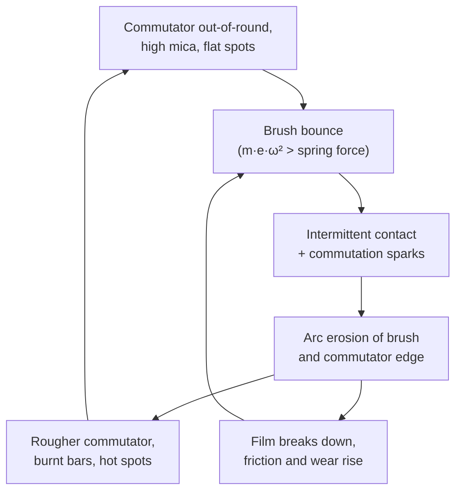

::: testing
Whether you can explain wear with mechanisms rather than "friction": **mechanical abrasion** (Archard-type wear), **electrical erosion** from arcing and contact heating, **chemical/film** effects (humidity, oxide film, contamination), **thermal** degradation, and the **commutator condition** that feeds back into brush wear. A strong answer gives the wear law, shows which knobs matter (spring force, sliding speed, current, environment, surface finish) and says how you would measure or extend life.
:::

::: why
Brush wear sets the life of brushed motors, the service interval of industrial machines, and the warranty risk of consumer products. If you understand the mechanisms you can predict life from duty, choose a grade and spring force sensibly, diagnose a premature failure from the pattern of wear (even wear, one-sided wear, grooves, burnt marks) and decide when to move to brushless ([[q0361]], [[q0366]]).
:::

::: concepts
- **Sliding contact and friction**: $F_f = \mu N$, with heat $\mu N v$. See [[q0357]].
- **Archard wear law**: wear volume proportional to normal load and sliding distance.
- **Arc erosion**: energy from commutation sparks removes material. See [[q0356]].
- **Film (patina) formation**: oxide/graphite layer that protects when healthy. See [[q0358]].
- **Contact pressure and bounce**: spring force and surface following. See [[q0362]].
- **Environmental factors**: humidity, altitude, contaminants, temperature ([[q0359]]).
:::

::: answer
"Brushes wear because they're a sliding contact doing several jobs at once, and each job removes a little material.

The first cause is mechanical. The brush is pressed against a moving commutator, so friction slowly abrades it away. The wear is roughly proportional to the contact force times the distance slid, which is the Archard idea, so higher spring force, higher speed and a rougher commutator all wear it faster.

The second is electrical. Every time the brush bridges segments, the coil is inductive and there's a small spark. That arcing erodes material and roughens the surface. More current, higher speed and bad commutation make it worse. Even without sparks, current heats the contact spots and weakens the film.

The third is chemical and environmental. Graphite brushes depend on a thin film of copper oxide and adsorbed water to lubricate. In very dry air or at altitude the film breaks down and wear skyrockets. Oil, silicone and dirt also damage it, and humidity or temperature that's too high or low changes it.

And it's coupled: a worn or out-of-round commutator, or high mica between the segments, makes the brush bounce, which causes arcs, which worsen the surface. That feedback is how a slowly wearing motor suddenly fails. Fixes are the right grade, correct spring force, a clean round commutator, suppression, and keeping within the speed and current ratings."
:::

::: technical
**1. Mechanical wear (Archard).** Wear volume $V_w = k_s F_N s$, where $k_s$ is the specific wear rate (mm³/N·m), $F_N$ the normal force and $s$ the sliding distance. Linear wear rate (depth per time) is
$$\dot h = \frac{k_s F_N v}{A}$$
with $v$ the surface speed and $A$ the contact area. Example (illustrative): $k_s = 10^{-6}$ mm³/N·m, $F_N = 0.5$ N, $v = 3.77$ m/s (12 mm commutator at 6000 rpm), $A = 5$ mm² give $\dot h = 1.36\ \mu$m/h; 6 mm of usable length lasts about 4400 h. Doubling spring force halves life; doubling speed halves life.

> [!UNCERTAIN]
> The wear coefficient $k_s$ varies by orders of magnitude with grade, film, humidity, current and temperature. The number above is for illustration only; use manufacturer data or measure the life of your motor.

**2. Electrical wear.** Arc erosion energy per commutation event is a fraction of $\tfrac12L_ci_c^2$ (e.g. for 20 µH, 3 A: 90 µJ, of which a share goes to the arc). Events per second are segments × rev/s (e.g. 12 × 100 = 1200/s), so the average arc power can be ~0.1 W: small, but concentrated at brush edges and the commutator bar edges. Joule heating at the contact spots and $V_bI$ interface power (≈1 V × 3 A = 3 W per brush pair) heat the contact and film. Excess current density ($>$ 8–12 A/cm² for carbon) accelerates wear sharply.

**3. Chemical/film wear.** The film is copper oxide plus graphite and adsorbed water. Dry atmospheres (< few g/m³ water vapour), vacuum, silicones, halogens and oil vapours degrade the film; low humidity gives "dusting"; excessive humidity leads to corrosion and film streaking. Film health shows as an even chocolate-brown commutator track.

**4. Thermal.** Temperature rises from friction, contact drop and the motor body soften resin binders and oxidise the carbon above ~(grade-dependent) limits, and change the lubrication behaviour.

**5. Commutator condition (the feedback).** Out-of-round (high TIR), high mica, flat spots, grooves or burnt bars cause bounce; bounce causes arcs; arcs burn the commutator and brush; the surface worsens. Wear thus accelerates near end of life.

**6. Brush dynamics.** Spring force too low gives bounce and arcs; too high gives rapid abrasive wear and heating; the optimum is the minimum force that follows the surface ([[q0362]]).

**Typical life.** Hundreds of hours (cheap, high-current, high-speed) to several thousand hours (good small motors) up to years for large industrial machines with proper brush gear. Brush life should be taken from datasheets for the specific duty; field data are the best predictor.
:::

::: short
"Brushes wear from three things at once. Mechanical: friction against the moving commutator removes material in proportion to spring force times sliding distance. Electrical: commutation sparks erode the contact, and current heats the contact spots. Chemical and environmental: graphite needs a film and humidity to lubricate, so dry air, altitude, oil or silicone make it wear fast. A rough or out-of-round commutator makes the brush bounce, which makes sparks, which makes everything worse."
:::

::: long
"Brush wear has mechanical, electrical and chemical causes, and they feed on each other.

Mechanically, the brush is spring-loaded against a moving surface, so it abrades. The standard model is the Archard law: wear volume is proportional to the normal force times the sliding distance, divided by hardness. So depth wear per hour is roughly the specific wear rate times force times sliding speed over contact area. For a 12 millimetre commutator at 6000 rpm, with a half-newton spring on a 5 square-millimetre brush, a plausible wear rate gives about a millimetre and a half per thousand hours, so six millimetres of brush lasts a few thousand hours. Double the spring force and the life halves. That's an illustrative number, since the specific wear rate depends hugely on the grade and the film.

Electrically, every commutation involves a small arc because the coil is inductive. That arc erodes material from the brush and from the commutator edge, and it's worse at high current and speed, or with poor commutation. The interface also dissipates a volt times the current, heating the contact spots.

Chemically, the graphite brush relies on a thin film of copper oxide and adsorbed moisture. If the air is too dry, at altitude, or contaminated with silicone or oil, the film breaks down, friction goes up and the brush dusts away in hours. Too humid and you get corrosion and streaking.

And they interact. A commutator that's out of round, scored, or has high mica makes the brush bounce, which causes sparking, which roughens the surface further. That's why wear tends to accelerate near the end.

To extend life: the right grade for the current density and environment, the minimum spring force that tracks the commutator, a round, clean, properly undercut commutator, suppression capacitors, and staying within current and speed ratings."
:::

::: terms
- **Archard wear law**: wear volume $= k_sF_Ns$; linear wear rate $= k_sF_Nv/A$.
- **Specific wear rate $k_s$**: volume worn per unit load and sliding distance (mm³/N·m).
- **Arc erosion**: material loss caused by sparks at the contact.
- **Film / patina**: oxide-graphite layer that protects and lubricates.
- **Dusting**: accelerated wear in dry or low-pressure environments.
- **TIR (total indicated runout)**: out-of-roundness of the commutator.
- **High mica**: insulation standing proud of the segments, causing bounce.
- **Glazing**: hard shiny film that increases friction and noise.
- **Wear limit**: minimum brush length at which replacement is required.
- **Stick-slip**: jerky friction that can cause squeal.
:::

::: exceptional
An average answer says "friction". An exceptional answer:

- Lists mechanical, electrical, chemical and thermal mechanisms and the feedback with commutator condition.
- Gives the Archard relation and what it predicts: life $\propto 1/(F_Nv)$, with a worked number and a caveat about $k_s$.
- Explains the film and why dry air/altitude/silicone are deadly.
- Connects arcing to wear and to commutation ([[q0356]], [[q0359]]).
- Reads wear patterns as diagnostics (uneven wear, grooves, burnt bars).
- Gives levers to extend life: grade, spring force, commutator care, suppression, derating, replacing with brushless.
:::

::: mistakes
- **Blaming only friction.** Electrical erosion can dominate in poorly commutating motors.
- **Assuming wear is linear forever.** Near end of life, bounce and commutator damage accelerate it.
- **Increasing spring force to "fix" sparking** without noting that wear rises in proportion.
- **Cleaning or polishing the commutator to a mirror finish.** A bright polished surface lacks the film and can wear brushes faster; a lightly textured, film-covered surface is better.
- **Ignoring the environment.** Dry air or silicone vapours can kill brushes in a fraction of their rated life.
- **Quoting a single "brush life" number without duty.** Life depends on current, speed, spring force, humidity and temperature.
:::

::: deep
## Four wear mechanisms

Think of the brush face as a block of soft composite sliding at a few m/s under a few tenths of a newton, carrying amps, on a copper surface, in air. The material comes off through four routes.

**1. Mechanical (adhesive and abrasive) wear.** At the microscopic level, asperities weld, shear and tear; hard particles (oxide, dust, mica fragments) plough grooves. Graphite's layered structure and the film moderate this, but the sliding still removes material.

Archard's law is the engineering model:
$$V_w = k_s\,F_N\,s,\qquad \dot h = \frac{dh}{dt} = \frac{k_sF_Nv}{A}.$$

**Worked example** (illustrative parameters): $k_s = 10^{-6}$ mm³/N·m, $v = 2\pi r n = 2\pi\times0.006\times100 = 3.77$ m/s (12 mm commutator, 6000 rpm), contact area 5 mm².

```plot
{"title":"Mechanical brush wear vs run time (Archard model, illustrative)","x":{"label":"run time","unit":"h","min":0,"max":8000},"y":{"label":"wear depth","unit":"mm","min":0,"max":12},
 "vars":{"k":1e-6,"v":3.77,"a":5},
 "series":[{"label":"F = 0.3 N","fn":"k*0.3*v*3600*x/a","color":"accent"},{"label":"F = 0.5 N","fn":"k*0.5*v*3600*x/a","color":"orange"},{"label":"F = 1.0 N","fn":"k*1.0*v*3600*x/a","color":"red"}],
 "hlines":[{"at":6,"label":"usable brush length 6 mm","color":"muted"}]}
```
Figure: With these assumed numbers the brush reaches the 6 mm wear limit at about 7400 h (0.3 N), 4400 h (0.5 N) and 2200 h (1.0 N). Life is inversely proportional to spring force and to speed. The real wear coefficient $k_s$ differs by grade and condition by orders of magnitude; the *scaling* is the useful part.

**2. Electrical wear.** Three sources:
- *Commutation sparks* ([[q0356]]): energy $\sim\tfrac12L_ci_c^2$ per event, event rate = segments × rev/s. With 12 segments at 6000 rpm that is 1200 events per second; each spark vaporises a minute amount of brush and copper. Bad commutation (brush off neutral, high $L_c$, worn grades) raises it.
- *Contact heating*: interface power $\approx V_bI$ concentrated in micron-sized contact spots, giving local temperatures much above the bulk; this thermally breaks down the film and softens binders.
- *Current-density excess*: above the grade limit, the whole brush heats and wears faster.

**3. Chemical/film effects.** The copper commutator forms a thin oxide layer with embedded graphite. This film (a) lubricates, (b) stabilises the contact drop, and (c) separates the metals so they don't weld. Its health depends on:
- *Humidity*: adsorbed water is the lubricant for graphite. Below a threshold (a few g/m³ of water vapour, order of magnitude) friction and wear jump; in vacuum or at altitude "dusting" appears.
- *Contaminants*: silicone vapours (from sealants, lubricants) form insulating deposits and poison the film; oils and halogen compounds attack it.
- *Temperature*: film formation and lubrication have an optimum band.
- *Load*: a minimum current is needed to maintain the film (very light loads can lead to a poor film and noisy contact).

**4. Thermal.** Friction and electrical heating raise brush temperature; resin binders oxidise or soften above design limits, the brush crumbles, and the thermal expansion of the commutator changes the geometry.

## The feedback loop


Figure: Wear is self-reinforcing. A small commutator defect causes bounce, bounce causes sparks, sparks damage the surface, and the damage worsens the bounce. This is why motors often run for a long time then fail quickly. The fix is to break the loop at an early stage: round commutator, undercut mica, correct spring force, correct grade.

## Reading the wear pattern

| Observation | Likely cause |
|---|---|
| Uniform, shiny brush face, chocolate-brown commutator | Healthy |
| Brush chipped at the trailing edge | Bounce or high mica |
| Commutator with grooves (thread-like) | Abrasive contaminant or hard brush |
| Burnt/blackened bars at regular spacing | Open or shorted armature coil, poor commutation |
| All brushes wearing much faster than rated | Spring force too high, overcurrent or high current density, wrong grade for the load or environment |
| One brush of a pair wearing faster | Unequal spring force or brush position off-neutral |
| Streaked or "threaded" commutator surface | Light load, contamination, humidity |
| Copper dragging (smearing) | Soft copper and too high force or heat |

## Design levers to extend life

1. **Grade selection** for current density, speed, environment ([[q0358]]): the single biggest lever.
2. **Spring force**: minimum force that tracks the surface without bouncing ([[q0362]]); constant-force springs keep it constant as the brush wears.
3. **Commutator quality**: TIR below tens of micrometres, smooth surface, undercut mica.
4. **Suppression and commutation**: capacitors at terminals, correct brush position, inductance control.
5. **Derating**: lower speed and current; run in the grade's current-density range (too low can also be bad: films need a minimum load).
6. **Environment**: keep silicone out, control humidity, seal the motor.
7. **Duty**: avoid frequent stall/starts; stall raises current to $V/R$ with the commutator stationary, heating one spot ([[q0345]]).
8. **Go brushless** when the life target is tens of thousands of hours ([[q0366]]).

## Life testing

Because $k_s$ is highly condition dependent, life is established by test: run motors at the real current, speed, temperature and humidity, measure brush length periodically (or the motor's performance, e.g. current and noise), extrapolate. Accelerated testing by increasing speed or current can mislead because it changes the film and mechanisms; use it with care.
:::

::: applications
- **Power-tool and appliance motors**: brush life is the service-life limit; designers add wear indicators or auto-stop brushes.
- **Automotive motors**: rated life tests (hours or cycles) at temperature extremes; brush grade selection for AM/FM noise and life.
- **Aerospace motors at altitude**: special brush grades to avoid dusting.
- **Industrial DC machines**: predictive maintenance by measuring brush length and commutator film colour.
- **Slip rings in wind turbines**: brush wear sets the maintenance interval.
- **Robotics and consumer devices**: choosing brushless where tens of thousands of hours are required.
:::

::: assumptions
- **Sliding-wear model (Archard)** with constant $k_s$, normal force and speed; real $k_s$ changes with film, humidity, temperature and current.
- **Illustrative numbers**: the wear coefficient, area and dimensions are example values; the scaling with force and speed is what generalises.
- **Healthy, round commutator** in the baseline; defects add the feedback loop.
- **Normal air with moderate humidity**: dry, vacuum, and contaminated atmospheres are separate regimes.
- **Small brushed DC motor** as the example; large machines have the same mechanisms but different scale and mitigations.
- Alternative answer emphasis: some sources list the brush's wear as "mechanical (friction), electrical (arcing), and chemical (oxidation/film)" - the same three groups.
:::

::: followups
### How would you estimate the life of a brush from datasheet information?
Take the usable length (new minus wear limit) divided by the wear rate for your conditions. If the vendor gives mm per 1000 h at a rated current, speed and force, scale by force and speed ($\propto F_Nv$) and check the current density and environment match. Then verify by test, since conditions like humidity and commutation quality change the wear rate a lot.

### Why do brushes wear faster in very dry air?
Graphite relies on adsorbed water vapour to lubricate. In dry air the friction coefficient rises, the film is not maintained and the brush dusts away; at altitude or in vacuum it can fail in hours. Remedies are special brush grades with additives or sealed or brushless motors.

### What does a brush that wears unevenly (one side faster) tell you?
Misalignment or non-uniform spring force or contact: brush tilted in the holder, a holder worn or too loose, a bent spring or an uneven commutator. The result is a smaller contact area, higher local current density and heating, and faster wear.

### The commutator is clean and round but the brushes still wear quickly. What else?
Check current density (brush too small or wrong grade), spring force too high, ambient or internal temperature too high, silicone contamination, or the wrong brush grade for the speed. Also check commutation (brush position, shorted armature coil).

### What if the brushes last far longer than expected on a lightly loaded motor, but the motor is noisy and erratic?
Very low current can prevent a proper film from forming ("dry circuit"), so contact noise and glazing occur even though wear is low. A minimum load is needed for some grades, or a precious-metal brush designed for low current.

### Does PWM drive change brush wear?
It can: the ripple current increases RMS current and heating, and the pulsed current changes commutation conditions. With high ripple (low PWM frequency, low inductance) the peak current at commutation is larger, increasing sparking. Higher PWM frequency or added inductance reduces ripple and wear.
:::

::: interpretations
"Why do brushes wear out?" asks for causes; a good answer separates mechanical, electrical and chemical/environmental causes and mentions the feedback with the commutator condition. If the interviewer follows with "what can you do?", use the levers listed in the deep dive. Related pages: [[q0359]] (concerns), [[q0361]] (replace vs scrap) and [[q0362]] (spring contact).
:::

::: references
- Archard, J. F., "Contact and rubbing of flat surfaces", *Journal of Applied Physics* (1953): the original wear law; also summarised in tribology texts.
- Rabinowicz, *Friction and Wear of Materials*: wear mechanisms and the Archard equation.
- Hughes and Drury, *Electric Motors and Drives*: commutator and brush behaviour in DC machines.
- Brush manufacturers' technical handbooks (for example from Morgan Advanced Materials or Mersen): brush wear, film formation, environment effects and troubleshooting guides.
:::

::: rubric
- Names the mechanical cause: friction/abrasion, related to force and sliding distance :: The primary, expected mechanism.
- Names electrical causes: arcing at commutation and contact heating :: Shows you understand brushes are electrical as well as mechanical contacts.
- Names chemical/environmental factors: film, humidity, contaminants, temperature :: Distinguishes expert answers.
- Gives the scaling (Archard: wear $\propto F_Nv$) with a number or example :: Quantitative understanding of life.
- Notes the feedback with the commutator condition and bounce :: Explains accelerating failure.
- Lists levers to extend life (grade, spring force, commutator care, suppression, derating) :: Turns the analysis into action.
- Mentions brushless as the alternative for long life :: Shows system-level judgement.
:::

::: quiz
```json
[
 {"type":"mcq","level":"fundamental","q":"Which set lists the main wear mechanisms of motor brushes?","options":["Magnetic, optical, acoustic","Mechanical abrasion, electrical (arcing), chemical/film effects","Thermal expansion only","Inductive coupling and capacitance"],"answer":1,"explain":"Brushes wear from sliding friction, arc erosion and contact heating, and chemical/film and environmental effects, with the commutator condition coupling them."},
 {"type":"numeric","level":"fundamental","q":"If brush wear is proportional to spring force and a brush lasts 4400 h at 0.5 N, how long would it last at 1.0 N (all else equal), in hours?","answer":2200,"tolerance":0.02,"unit":"h","explain":"Archard: wear rate $\\propto F_N$, so doubling the force halves the life: 2200 h."},
 {"type":"numeric","level":"intermediate","q":"Using $\\dot h = k_sF_Nv/A$ with $k_s = 10^{-6}$ mm³/N·m, $F_N = 0.5$ N, $v = 3.77$ m/s and $A = 5$ mm², what is the wear rate in µm per hour?","answer":1.36,"tolerance":0.03,"unit":"µm/h","explain":"$\\dot h = 10^{-6}\\times0.5\\times3.77/5 = 3.77\\times10^{-7}$ mm/s = $1.36\\times10^{-3}$ mm/h = 1.36 µm/h."},
 {"type":"numeric","level":"intermediate","q":"At that rate, how many hours does it take to wear through 6 mm of brush?","answer":4420,"tolerance":0.03,"unit":"h","explain":"$6\\text{ mm}/(1.357\\times10^{-3}\\text{ mm/h}) = 4420$ h."},
 {"type":"mcq","level":"advanced","q":"A brushed motor is flown at high altitude and its graphite brushes wear out in hours. The most likely explanation is:","options":["The magnets lose strength","The lubricating film needs adsorbed water vapour, which is absent at altitude, so friction and wear soar ('dusting')","The brush spring becomes stronger","The commutator becomes smoother"],"answer":1,"explain":"Graphite's lubrication depends on adsorbed vapour; in low-pressure dry air the film breaks down and the brush wears extremely fast. Special grades or other motor types are needed."},
 {"type":"truefalse","level":"advanced","q":"Polishing a commutator to a bright mirror finish is the best way to extend brush life.","answer":false,"explain":"A healthy commutator carries a thin chocolate-brown film that lubricates and stabilises contact. Over-polishing removes the film and surface texture, often raising friction and wear."}
]
```
:::
