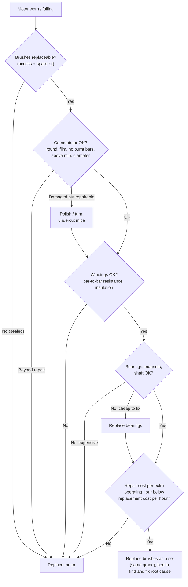

::: basics
### In plain words
When a brushed motor stops working because its brushes are worn, you must decide whether to replace the brushes or the whole motor. It depends on whether the brushes can be replaced at all, what condition the rest of the motor is in, and what each option costs. Also ask why the brushes wore out, or the new ones will fail the same way.

### Picture it
It is like a worn tire on a car. If the rest of the car is healthy, you replace the tires. If the engine and frame are also worn out, you buy a different car. A sealed toy motor is more like a disposable item, where the "tire" cannot be changed at all. The analogy has a gap: with a motor you must inspect the commutator and bearings to know how healthy the rest is.

### Words you need
- **Serviceable**: designed so you can open it and change the brushes.
- **Brush kit**: a set of replacement brushes and springs.
- **Commutator**: the copper segments the brushes slide on. It should be round and evenly colored. See [[q0357]].
- **Bearings**: the parts the shaft turns in. They should have no play or noise.
- **Root cause**: the real reason the part failed, such as overload or arcing.

### The simplest example
Take a power drill with worn brushes. Its brush holders are easy to reach. The commutator is smooth with an even brown film, and the bearings are quiet. So you replace the brushes and the drill is nearly like new. Now take a small sealed toy motor with worn brushes. The brushes are part of the can and cannot be changed, so you replace the motor.

That is the whole idea: replace the brushes if they are accessible and the rest is healthy, otherwise replace the motor. The rest of this page covers the inspection checklist, resurfacing, the cost comparison and fixing the root cause.
:::

::: testing
Whether you can make a sound repair-or-replace decision and justify it with engineering evidence rather than habit. The interviewer wants the criteria: is the motor *designed* to be serviced (access to brush caps, standard brush sets), what is the condition of the commutator, windings, bearings and magnets, what is the cost and downtime of each option, and what failure caused the wear. A good answer includes inspection steps with measurable pass/fail criteria, a cost-per-hour argument, and the observation that new brushes on a damaged commutator die quickly.
:::

::: why
This is a real maintenance and product-design question: do you design a serviceable motor with replaceable brushes (industrial equipment, power tools) or a sealed consumable one (small gearmotors, toys, appliances)? Technicians face it daily with fans, pumps, drill motors and robot drives. Knowing what to inspect, and when brushes are the symptom rather than the cause, avoids repeated failures and wasted parts.
:::

::: concepts
- **Brush wear limit**: minimum remaining length marked by the manufacturer. See [[q0360]].
- **Commutator condition**: round, smooth, film-covered, mica undercut. See [[q0359]].
- **Failure root cause**: wear, arcing and overload patterns point to the underlying fault.
- **Motor serviceability**: access to brush holders and standard brush kits.
- **Cost per operating hour**: compare repair cost over expected extra life with replacement cost over its life.
- **Alternatives**: upgrading to brushless for long life ([[q0366]]).
:::

::: answer
"I'd decide based on three things: can the motor be serviced, what shape is the rest of it in, and the economics.

First, serviceability. Larger motors, power tools, industrial and automotive motors are designed with accessible brush holders and standard brush sets, so replacing brushes is routine maintenance. Small sealed motors, the can motors in toys, small gearmotors, or phone-size devices have brushes that are part of the can and not replaceable, so when the brushes wear out you replace the motor.

Second, inspection. If the motor is serviceable, I look at the commutator: is it round, with an even brown film, no deep grooves, burnt bars or high mica, and still above its minimum diameter? Then bearings: no play or noise. Windings: resistance balanced between segments, insulation resistance fine, no burnt smell. Magnets intact. If all of that is good and only the brushes are worn, new brushes bring it back to like-new. If the commutator is scored or burnt, I'd resurface it if the motor is valuable and there's material left; otherwise replace the motor. If the windings or bearings are failing, I'd replace the motor.

Third, economics: brush kit plus labour and downtime versus the cost of a new motor and its remaining life. And I'd always ask why the brushes wore out: if it's overload or arcing, fix the cause or the new brushes will fail again."
:::

::: technical
**Decision criteria**

| Check | Pass (replace brushes) | Fail (consider replacing motor) |
|---|---|---|
| Brush access | Accessible holders/caps, standard kit available | Sealed can motor; brushes inseparable |
| Brush wear | Worn to limit mark; no chips; springs OK | n/a (this is why you act) |
| Commutator surface | Even brown film; slight polish; no grooves | Deep grooves, burnt bars, flats, copper smear |
| Commutator geometry | TIR within spec (typical small motors: a few tens of µm; check the maker's limit); diameter above minimum | Out of round beyond spec; diameter at/below minimum (can't be resurfaced) |
| Mica | Undercut below the bar surface | High mica not fixable, or bars lifted |
| Windings | Bar-to-bar resistance matches within a few %; insulation resistance OK; no short/open | Open/shorted coils, burnt smell, discoloured varnish |
| Bearings | Smooth, no play/noise | Worn bearings (replace if cheap; else motor) |
| Magnets/housing | Intact, no cracks, no demagnetisation | Cracked or demagnetised magnets |
| Cause analysis | Normal wear at expected hours | Overload, overheating, arcing or contamination not fixed |

**Economic model.** Cost per operating hour of the repair option is $(C_b + C_{labour} + C_{downtime})/H_{ext}$, where $H_{ext}$ is the extra life gained, which is limited by the *remaining life of the commutator and bearings*, not just the new brush life. Replacement costs $C_m/H_m$. Example: new industrial motor USD 600, rated 10,000 h; brush kit USD 25 plus 1.5 h labour at USD 60/h = USD 115 gives 3000 h if the rest is healthy: $0.038$ USD/h vs $0.06$ USD/h for replacement. Repair wins, as long as the remaining commutator life exceeds about 19% of a new motor's ($115/(0.06\times10{,}000) = 0.19$). For a USD 15 sealed motor with USD 3 brushes plus 30 minutes of labour at USD 40/h (USD 23 total), replacement wins immediately.

**Wear limits.** Manufacturers mark a minimum brush length (often when about one third of the original length remains; check the spec). Replace brushes in sets (all brushes on a commutator, same grade), and let new brushes bed in (run in at light load, or sand-in with fine abrasive stripe to the commutator radius per manufacturer procedure).

**Commutator resurfacing.** Light polishing with fine abrasive (e.g. a commutator stone/ fine paper per vendor guidance, not emery containing conductive particles) restores the film; turning in a lathe removes material and is limited by the minimum diameter, e.g. a 40 mm commutator with a 38 mm minimum can lose 1 mm of radius, i.e. only about three 0.3 mm cuts. After turning, undercut the mica.
:::

::: short
"It depends on serviceability, condition and cost. If the motor has accessible brush holders and a standard kit, and the commutator is round with a good film, the bearings and windings are fine, then replacing the worn brushes restores it cheaply. If the commutator is grooved, burnt or below minimum size, or windings or bearings are failing, or the motor is a sealed consumable, replace the motor. Compare repair cost over the extra life with the new-motor cost, and fix the cause of the wear."
:::

::: long
"I'd treat it as a diagnosis and an economics question.

First, can I even replace brushes? Industrial motors, power tools and automotive units usually have brush caps or holders you can open and a standard brush set. Small sealed motors, like the can motors in toys or small gearmotors, have brushes that are staked in and not serviceable, so the motor is the consumable.

If it is serviceable, I inspect before I order parts. The commutator is the key: I want a round surface with an even chocolate-brown film. Deep grooves, burnt bars, flat spots or high mica mean new brushes will wear out quickly. A small amount of damage I can polish or turn on a lathe, remembering there's a minimum diameter, and then undercut the mica. Then I check the windings, measuring resistance between adjacent bars for an open or short, insulation resistance, and look for a burnt smell. I check the bearings for play and noise, and the magnets for cracks. If those are fine, new brushes make it essentially like new.

Then the economics. The repair cost is the brush kit plus labour plus downtime, divided by the extra life I'll get, which is limited by the rest of the motor. For a 600 dollar industrial motor, 115 dollars of brushes and labour for 3000 hours is about four cents an hour versus six cents for a new motor, so repair wins. For a 15 dollar sealed motor, the answer is always replace.

And I'd ask why they wore out. If it's normal life, fine. If it's overload, overheating, arcing or a contaminated environment, new brushes will just fail again, so I'd fix the cause or move to a brushless motor if life is the recurring problem."
:::

::: terms
- **Wear limit / minimum length**: brush length at which replacement is required.
- **Serviceable motor**: one with accessible brush holders and available spare brushes.
- **Commutator TIR**: total indicated runout, a measure of out-of-roundness.
- **Undercutting**: cutting mica below the bar surface after turning.
- **Bedding-in (seating)**: shaping a new brush to the commutator curve so contact is full-width.
- **Bar-to-bar resistance**: resistance between adjacent commutator bars, used to find opens/shorts.
- **Insulation resistance (megger test)**: resistance between winding and frame.
- **Run-in**: initial operation at light load to form the film.
- **Brush set**: all brushes on a commutator, replaced together.
- **Consumable motor**: a motor designed to be replaced rather than repaired.
:::

::: exceptional
An average answer says "replace the brushes if they're worn, otherwise the motor". An exceptional answer:

- Starts with serviceability by design and lists inspection steps with measurable criteria (commutator, mica, TIR, minimum diameter, bar-to-bar resistance, insulation resistance, bearings).
- Notes that brush life is limited by the commutator and the rest of the motor, so the repair's value is $H_{ext}$, not the new brush life.
- Performs the cost-per-hour comparison and gives a break-even fraction.
- Asks for root cause (overload, arcing, wrong grade, environment) and notes that repeated brush failure suggests redesign or brushless.
- Mentions practical procedure details: replace as a set, same grade, bed in, resurface and undercut.
- Considers downtime, safety and availability of spares.
:::

::: mistakes
- **Replacing brushes on a damaged commutator** and expecting normal life; the new brushes die quickly or the arcs burn more bars.
- **Replacing only one brush** or mixing grades; current sharing and film are then unbalanced.
- **Waiting until the brush is fully worn.** The spring or holder may contact the commutator, scoring it and destroying the motor.
- **Over-turning the commutator** below its minimum diameter, or leaving mica high after turning.
- **Using conductive abrasives** (metal-containing emery, or steel wool) that leave particles which short bars.
- **Treating the symptom.** Repeated early failure usually means overload, bad commutation, contamination or the wrong grade.
- **Ignoring economics.** A repair that costs most of a new motor and gives little extra life isn't worth it.
:::

::: deep
## A brush is a consumable; the question is what else is worn

In a brushed motor the brushes are designed to wear, so that the commutator, bearings and windings last longer. In a serviceable motor you replace brushes at regular intervals (typically when about a third of the length remains, or at an hour interval) as maintenance. The decision to scrap the motor instead arises when something else has reached end of life, or the motor isn't designed for brush replacement.


Figure: Decision flow. Serviceability and commutator condition come first; windings and bearings next; economics last. "Fix the root cause" applies on every path where the brush failure was premature.

## Inspection details

**Brushes.** Measure remaining length against the wear mark or spec. Look at the face: even, glossy contact over the full width is healthy; chipped edges (bounce or high mica), a burnt or blue-heated face (overheating), a scored face (grit) or a glazed face show causes. Check that brushes slide freely in the holder (no sticking from dust) and that pigtails are intact. Check spring force is still adequate (spring fatigued, discoloured from overheating, or stuck).

**Commutator.** Look at the track: a uniform chocolate-brown film is healthy. Rough or grooved surfaces, burnt/black bars (pairs of burnt bars at spacing equal to a number of segments can indicate an open or shorted coil), copper drag, flat spots and out-of-round are faults. Measure TIR with a dial gauge on the commutator, comparing to the maker's limit (for small motors typically a few tens of micrometres at most; use the motor's data). Check that mica is undercut below bar level (commonly about 0.5–1 mm depth in larger machines); if mica is high the brushes will bounce.

**Armature windings.** Measure resistance between adjacent bars: values should match within a few percent; a low reading suggests a shorted coil, a very high or open reading an open coil. Use an insulation tester between winding and shaft/frame at a voltage appropriate for the rating (consult the motor spec). A growler test finds shorted turns in larger armatures.

**Bearings and shaft.** Spin by hand: roughness, play, noise. Check shaft runout and wear.

**Magnets and housing.** Cracked ceramic magnets, loose magnets or demagnetisation (low torque constant for the same current) are fatal for small motors.

## The economics

Let $C_b$ be brush set cost, $C_l$ labour, $C_d$ downtime cost, $C_m$ new-motor cost, $H_m$ its rated life, $H_b$ the brush life and $f$ the fraction of motor life remaining (commutator, bearings). The extra life from a brush replacement is $H_{ext} = \min(H_b,\,fH_m)$. So

$$\text{repair: }\frac{C_b + C_l + C_d}{\min(H_b, fH_m)}\quad\text{vs}\quad\text{replace: }\frac{C_m + C_l' + C_d}{H_m}.$$

Industrial example: $C_m = $ USD 600, $H_m = 10{,}000$ h, $C_b + C_l = 25 + 1.5\times60 = $ USD 115, $H_b = 3000$ h. With the rest of the motor healthy ($f$ large) the repair costs 0.038 USD/h versus 0.06 USD/h (ignoring downtime and the labour of fitting a new motor): repair wins. If the commutator has used 90% of its life ($f = 0.1$), $H_{ext} = 1000$ h and repair costs 0.115 USD/h: replace.

```plot
{"title":"Repair cost per extra hour vs remaining motor life","x":{"label":"fraction of motor life remaining, f","min":0.05,"max":1},"y":{"label":"USD per operating hour","min":0,"max":0.25},
 "vars":{"cb":115,"hb":3000,"hm":10000,"cm":600},
 "series":[{"label":"replace brushes: 115 / min(3000, f·10 000)","fn":"cb/min(hb,x*hm)","color":"accent"},{"label":"replace motor: 600 / 10 000","fn":"cm/hm","color":"orange","dashed":true}],
 "vlines":[{"at":0.19,"label":"break-even f ≈ 0.19"}]}
```
Figure: Brush replacement is cheaper per hour unless the rest of the motor has less than about 19% of its life left; above f = 0.3 the extra life is limited by the brushes (3000 h) and the cost line is flat. The numbers are illustrative and ignore downtime and risk (a failing motor may also take down the machine), which push the decision towards replacement earlier.

For a small sealed motor ($C_m = 15$, brushes not separately available) there is no repair option. For a serviceable small motor costing USD 15 with USD 3 brushes, labour of 30 minutes at USD 40/h (USD 20) makes repair USD 23: more than the motor, so replace it.

## Resurfacing the commutator

If the commutator is slightly rough or glazed, polish it with the manufacturer-approved method (a fine commutator stone or very fine abrasive paper, with the motor turning, then clean off all dust). If it is out of round, grooved or burnt, turn it on a lathe or in the motor's own bearings, removing as little as possible, and then **undercut** the mica below the bar surface and deburr. Each cut removes radius: a 40 mm commutator with a 38 mm minimum has 1 mm of radius to spare, which is about three 0.3 mm cuts. Never turn below the minimum diameter (the bars become thin, can lift or the solder joints get damaged).

## Replace brushes right

1. Replace all brushes as a set, same grade and size (manufacturer's part).
2. Check the brush slides freely in the holder, the pigtail is secure, and the spring has full force and is not fatigued; replace springs if discoloured or weak ([[q0362]]).
3. Bed in the new brushes so their faces conform to the commutator curve (the manufacturer procedure: sandpaper strip wrapped around the commutator, or run-in at no load / light load) and clean up all dust.
4. Run in under light load for a period before full load so the film re-forms.
5. Check brush position (neutral), and that the motor runs without excessive sparking.
6. Record hours and brush length for the next service interval.

## Find the root cause

If the brushes wore out unusually quickly, the new set will do so too. Check overload (current vs rating), speed, duty cycle, spring force, brush grade, humidity/contamination, commutation quality (sparking, burnt bar patterns), PWM ripple and temperature ([[q0360]]). A motor that is repeatedly consuming brushes in a product is a design problem, which is where brushless motors ([[q0366]]) or a larger brush/commutator come in.

## Design implication

If you are designing a product, decide at the start: **serviceable** (brush caps, standard sizes, documented wear limits and tools) or **consumable** (sealed, designed life above product life). Sealed brushed motors are chosen when the required life is below the motor's life; for long-life products choose brushless, or a serviceable design with a maintenance plan ([[q0354]]).
:::

::: applications
- **Power tools and appliances**: user-replaceable brush caps and standard brush sets extend the tool's life.
- **Industrial DC drives, elevators, cranes**: scheduled brush replacement and commutator care in maintenance programmes.
- **Automotive**: starter and alternator brush sets are typical repair parts; window and seat motors are usually replaced as units.
- **Hobby and RC**: brushed can motors are consumables; serious users switch to brushless.
- **Robotics and lab equipment**: sealed gearmotors replaced at end of life; BLDC for long duty.
- **Wind turbines and slip rings**: planned brush replacement by monitoring wear.
:::

::: assumptions
- **Serviceable motors have standard brush kits**; if not available, replacement of the motor is the only option.
- **Costs and lives** (USD 600 motor, 10,000 h, brush set 3000 h) are illustrative; use real figures.
- **Wear limit** (about one third of length remaining) is a common rule; follow the motor/brush maker's value.
- **Inspection thresholds** (TIR, minimum diameter, mica depth, bar-to-bar resistance tolerance) come from the motor manufacturer; the values here are examples.
- **Downtime and safety** costs can dominate for critical machines and push the decision towards scheduled replacement.
- Alternative viewpoint: for a high-volume product, the answer is a design one: make the motor a consumable or move to brushless rather than plan repairs.
:::

::: followups
### How do you know when the brushes need replacing, without opening the motor?
Symptoms: more noise or sparking, reduced torque or erratic speed, higher no-load current, voltage drop or intermittent running, and the interval (hours) approaching the rated brush life. Some motors have a wear indicator or auto-stop (a spring-loaded sensor or a shut-off brush that stops the motor before damage). Otherwise inspect at scheduled intervals.

### Is it okay to replace only the brush that looks worn?
No: replace the set. Different lengths and wear states give different spring force and current sharing, and mixed grades have different drops. New and old brushes on one commutator also form different films and cause uneven wear.

### The commutator looks fine but the motor still sparks a lot with new brushes. What next?
Check the brush position (neutral setting), spring force and seating (is the full face in contact after bedding-in?), the grade (too hard or too low-resistance), shorted or open coils (look for burnt bar pairs; measure bar-to-bar resistance), the supply (PWM ripple or overload), and mica height. If the armature has a shorted coil, replace the armature or the motor.

### What would you do for a product that must last 20,000 hours with a brushed motor?
Evaluate whether brushed is feasible: a robust large-brush design with replaceable brushes and scheduled maintenance, de-rated current and speed, controlled environment. Otherwise switch to brushless, which removes brush wear and often costs less over life ([[q0366]]). Validate with life testing.

### How would you test the armature quickly?
Measure resistance between adjacent commutator bars (should be consistent), check for opens, test insulation resistance from the winding to the shaft, and for large armatures use a growler to detect shorted turns. For small motors, check no-load current and compare to the datasheet; a high no-load current suggests shorted turns or friction.

### What if the replacement brushes are not the original grade?
It might work or not. Different grades have different drop, hardness and film behaviour; wrong choice can wear the commutator or spark. Use the manufacturer's part or a cross-referenced grade from the brush maker, and run it in and monitor the film colour and sparking.
:::

::: interpretations
"When should you replace brushes vs replace the whole motor?" can be read as maintenance (existing equipment) or as design (what to build into a product). The answer here covers both: inspection and economics for repair decisions, and the design implication in the last section. Related: [[q0359]] (concerns), [[q0360]] (wear), [[q0362]] (springs).
:::

::: references
- Hughes and Drury, *Electric Motors and Drives*: commutator maintenance and brush gear for DC machines.
- Chapman, *Electric Machinery Fundamentals*: DC machine construction and maintenance topics.
- Brush manufacturers' maintenance guides (for example from Morgan Advanced Materials or Mersen): brush replacement, bedding-in, commutator resurfacing and troubleshooting charts.
- Motor manufacturers' service manuals for the specific motor: wear limits, TIR and minimum diameter.
:::

::: rubric
- Establishes serviceability first: replaceable brushes vs sealed motor :: Many small motors cannot be repaired by design.
- Inspects the commutator: roundness, film, grooves, burnt bars, min diameter, mica :: The commutator determines whether new brushes will last.
- Checks windings, bearings and magnets (resistance, insulation, play) :: Other failing parts make a brush replacement futile.
- Does an economic comparison (cost per extra hour, remaining life) :: Shows engineering and business judgement.
- Replaces brushes as a set, same grade, bed in and run in :: Correct procedure.
- Investigates root cause of the wear :: Prevents repeat failures.
- Mentions design alternatives (consumable design or brushless) :: Connects to the bigger decision.
:::

::: quiz
```json
[
 {"type":"mcq","level":"fundamental","q":"A tiny sealed gearmotor in a toy has worn brushes. What is the sensible action?","options":["Replace only the brushes","Replace the motor","Turn the commutator on a lathe","Increase the supply voltage"],"answer":1,"explain":"The brushes in sealed small motors are not designed to be replaced; the motor is the consumable."},
 {"type":"mcq","level":"fundamental","q":"When replacing brushes, you should:","options":["Replace only the worst-looking brush","Replace the full set with the same grade and bed them in","Mix different grades to spread wear","Use the strongest spring available"],"answer":1,"explain":"Brushes on a commutator should be a matched set; mixed grades and wear states give unequal current sharing and films."},
 {"type":"numeric","level":"intermediate","q":"A brush kit costs USD 25, labour is 1.5 h at USD 60/h, and the brushes give 3000 h. What is the repair cost per operating hour, in USD/h?","answer":0.0383,"tolerance":0.03,"unit":"USD/h","explain":"$(25 + 90)/3000 = 0.0383$ USD/h."},
 {"type":"numeric","level":"intermediate","q":"A new motor costs USD 600 and lasts 10,000 h. What is its cost per hour in USD/h?","answer":0.06,"tolerance":0.02,"unit":"USD/h","explain":"$600/10{,}000 = 0.06$ USD/h, so brush replacement (0.038) is cheaper while the rest of the motor is healthy."},
 {"type":"numeric","level":"advanced","q":"With the 115 USD repair giving $H_{ext} = f\\times10{,}000$ h (when f is small), at what fraction f of remaining motor life does the repair cost per hour equal the new-motor cost of 0.06 USD/h?","answer":0.19,"tolerance":0.03,"unit":"","explain":"Set $115/(f\\times10{,}000) = 0.06$ so $f = 115/600 = 0.192$."},
 {"type":"mcq","level":"advanced","q":"After fitting new brushes, a motor sparks heavily and the brushes wear quickly. The commutator shows deep grooves and burnt bars. The best conclusion is:","options":["The new brushes are too soft; fit harder ones and carry on","The commutator (and probably the armature) is the root problem; resurface if above minimum diameter, otherwise replace the motor","Reduce spring force to the minimum","Increase PWM frequency only"],"answer":1,"explain":"A damaged commutator makes the brushes bounce and arc. Fix or replace it (and check the windings) rather than treating the brushes."}
]
```
:::
