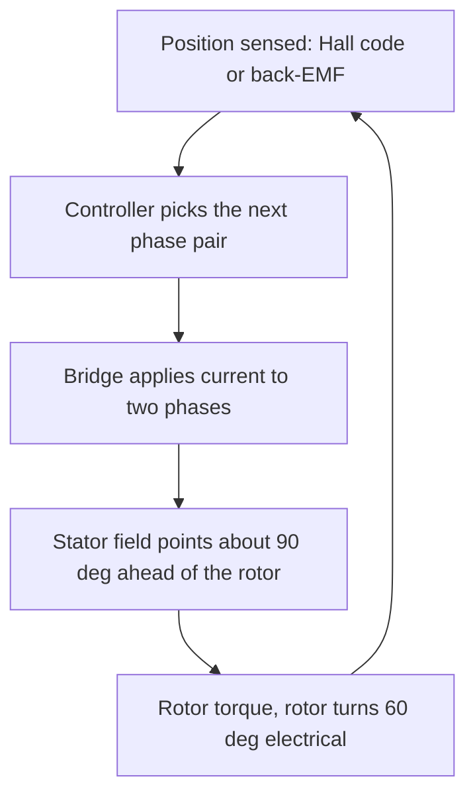

::: testing
Whether you understand a brushless motor as a **brushed motor turned inside out with the commutator replaced by electronics**, not as a magic box. The interviewer is looking for:

1. The physical structure: permanent magnets on the rotor, copper windings on the stator, usually three phases.
2. The core idea: the stator field must be kept roughly 90° (electrical) ahead of the rotor field, and since there are no brushes, something has to sense rotor position and switch the phase currents.
3. The vocabulary: Hall sensors, six-step (trapezoidal) commutation, back-EMF, electrical vs mechanical angle.
4. Whether you can say *why* the name "DC" is slightly misleading: the motor itself is a three-phase synchronous machine, and the "DC" is only at the supply.
:::

::: why
BLDC motors are in drones, hard drives, laptop fans, power tools, e-bikes, EVs, gimbals, robot joints and most modern appliances. If you work on anything that moves, you will meet one. The question is also a clean test of whether you understand motors in general: torque from $B$ and $I$, back-EMF from rotation, and the role of the commutator. If you can explain the brushed motor from [[q0334]] and then say "now move the commutator into a microcontroller", you have the whole story. It also sets up every follow-on question in this section: control, ESCs, poles and spec'ing.
:::

::: concepts
- **Lorentz force / torque from a current-carrying conductor in a field**: torque is proportional to the product of field and current, $T = K_t I$. See [[q0334]].
- **Back-EMF**: a spinning magnet induces a voltage in the windings proportional to speed, $E = K_e\omega$. See [[q0341]].
- **Commutation**: reversing/steering the current in the coil at the right rotor angle so torque keeps the same sign. In a brushed motor this is mechanical ([[q0348]]); in a BLDC it is electronic.
- **Three-phase winding**: three coils 120° apart (electrical) so that switching which two are energised walks the stator field around in 60° steps.
- **Hall sensors / back-EMF sensing**: the two ways to know where the rotor is.
- **Half-bridge / inverter**: six switches drive the three phases from a DC bus. See [[q0423]].
:::

::: answer
"A brushless DC motor is basically a brushed motor inside out. In a brushed motor the magnets are on the stator and the coils spin, and the brushes and commutator flip the current at the right moment. In a BLDC the permanent magnets are on the rotor and the coils are fixed in the stator, so there's nothing to carry current to a spinning winding, and no brushes.

The stator usually has three phase windings. If I energise two of them, I create a magnetic field pointing in some direction, and the rotor magnet tries to line up with it. Before it gets there, I switch to the next pair of phases, so the stator field jumps ahead by 60 electrical degrees and the rotor keeps chasing it. Six switching states make one electrical revolution. That's six-step, or trapezoidal, commutation.

To know *when* to switch, the controller needs the rotor position. Most motors have three Hall sensors, 120 electrical degrees apart, that give a 3-bit code telling me which of the six sectors the rotor is in. Sensorless drives instead watch the back-EMF on the phase that is currently floating and detect its zero-crossing.

So physically it's a three-phase permanent-magnet synchronous machine. It's called 'DC' because you feed it from a DC supply and an electronic inverter does the commutation, which gives it the same torque-versus-current, speed-versus-voltage behaviour as a brushed DC motor."
:::

::: technical
**Structure.** Stator: laminated steel with slots and three phase windings (typically wye-connected). Rotor: permanent magnets (usually NdFeB or ferrite) with $2p$ poles, $p$ = number of pole pairs. Position sensing: three Hall sensors or an encoder, or none (sensorless).

**Torque.** Each phase produces torque $\propto$ (phase current) × (the flux linkage derivative with respect to rotor angle, i.e. that phase's back-EMF constant). For an ideal trapezoidal motor, the line-to-line back-EMF has a flat top for 120° electrical, and if the controller drives a constant current through the two phases whose back-EMF is flat at that moment, the torque is constant:

$$T = K_t I,\qquad E_{LL} = K_e\,\omega_m,\qquad K_t = K_e \;(\text{SI units, line-to-line})$$

**Electrical vs mechanical angle.**

$$\theta_e = p\,\theta_m,\qquad f_e = \frac{p\cdot \text{rpm}}{60}$$

A 14-pole motor ($p=7$) at 6000 rpm has $f_e = 700$ Hz, and since six-step has six states per electrical period, the commutation rate is $6f_e = 4.2$ kHz.

**Six-step.** At any time two phases conduct (one to the positive rail, one to the negative rail) and the third floats. Rotating through A→B, A→C, B→C, B→A, C→A, C→B moves the stator MMF in 60° steps. The rotor sees a field that leads it by between 60° and 120° (average 90°), so the torque is within about 13% ripple of the maximum (for sinusoidal back-EMF; see the deep dive).

**Electrical model per line-to-line pair.** $V = I R_{LL} + L_{LL}\frac{di}{dt} + K_e\omega$. This is identical in form to the brushed DC motor, which is why speed control with PWM duty and the torque–speed line look the same (see [[q0352]]).

**Speed control.** Average voltage across the conducting pair, set by PWM duty $D$ on the bus: $\omega_{no-load} \approx D\,V_{bus}/K_e$.

**Sensing.** Hall: 3 bits, 6 valid codes (000 and 111 are faults). Sensorless: during each sector the floating phase's back-EMF crosses the virtual neutral at the sector's midpoint (30° electrical after the previous commutation); the controller waits another 30° and commutates. Needs enough speed for the back-EMF to be measurable, so startup is open-loop.
:::

::: short
"A BLDC motor has permanent magnets on the rotor and three coils on the stator, so there's no brush or commutator. An electronic inverter energises two of the three phases at a time to create a stator field, and steps to the next pair every 60 electrical degrees so the rotor keeps chasing the field. It knows the rotor position from Hall sensors or from back-EMF. So it's really a three-phase synchronous motor, but because the torque goes with current and speed goes with voltage, it behaves like a DC motor."
:::

::: long
"I think of a BLDC as a brushed DC motor turned inside out. In a brushed motor the coils spin and a mechanical commutator reverses the current as they turn. A BLDC puts the permanent magnets on the rotor and fixes the coils on the stator, so you don't need brushes at all. That gives you long life, less noise and better cooling, because the heat is generated in the stator, which is attached to the case.

The stator typically has three windings, 120 electrical degrees apart. If I push current in through phase A and out through phase B, those coils make a field in a particular direction, and the rotor's magnet tries to align with it. The torque is highest when the stator field is about 90 degrees away from the rotor field. As the rotor moves, that angle collapses, so I switch to the next pair, A to C, then B to C, and so on. That's six states per electrical revolution, each 60 degrees apart, and this is called six-step or trapezoidal commutation.

To switch at the right time, I need to know where the rotor is. The simple way is three Hall sensors that output a three-bit code identifying the sector. The alternative is sensorless: the unpowered phase shows the rotor magnet's back-EMF, and when it crosses zero I know the rotor is at the midpoint of the sector, so I commutate 30 degrees later. That doesn't work at standstill, so startup is open-loop.

The electronics are a three-phase bridge: six MOSFETs, a gate driver and a microcontroller. Speed is set with PWM duty on the bus, torque is proportional to current, and back-EMF is proportional to speed, exactly like a DC motor. If I want smoother torque I go to sinusoidal drive or field-oriented control, which treats it as the permanent-magnet synchronous machine it actually is."
:::

::: terms
- **Rotor / stator**: the rotating magnet assembly / the fixed winding assembly.
- **Pole pairs ($p$)**: number of N-S magnet pairs; electrical angle is $p$ times mechanical angle.
- **Commutation**: switching which windings carry current as a function of rotor angle.
- **Six-step (trapezoidal) drive**: six 60° states, two phases on and one floating.
- **Hall sensor**: magnetic-field sensor that reports which magnet pole is near, giving a 3-bit position code.
- **Back-EMF ($K_e\omega$)**: voltage induced in the windings by the moving magnets.
- **Sensorless**: position inferred from back-EMF instead of a sensor.
- **PMSM**: permanent-magnet synchronous motor; the BLDC family sits on the same hardware, with a sinusoidal-vs-trapezoidal distinction.
- **Torque constant $K_t$**: N·m per amp, numerically equal to the back-EMF constant in V·s/rad.
:::

::: exceptional
An average answer says "no brushes, the controller switches the coils, Hall sensors tell it when." An exceptional answer adds the physics:

- States that the stator field needs to lead the rotor by about 90° electrical, and that six-step gives an average of 90° with ±30° wobble, which is the source of torque ripple.
- Distinguishes electrical and mechanical angle and does a quick number, e.g. $f_e = p\cdot\text{rpm}/60$.
- Notes that $K_t = K_e$ and that the motor obeys the same $V = IR + K_e\omega$ equation as a brushed motor.
- Explains the sensorless trick (zero-crossing on the floating phase, 30° delay) and why startup needs open-loop.
- Mentions that "DC" is about the supply, and that the motor is really a PMSM, linking to field-oriented control.
:::

::: mistakes
- **"BLDC motors run on DC directly."** Connect a battery across two terminals and the rotor snaps to one position and stays. The motor needs a stream of switched phase currents.
- **"The Hall sensors power or drive the motor."** They only report rotor position as logic levels. The power path is the bridge.
- **"Three phases means three-phase AC from the wall."** The phases are generated by the controller from a DC bus, at a frequency that follows the rotor.
- **Mixing electrical and mechanical speed.** Commutation frequency scales with pole pairs. A 2-pole and a 14-pole motor at the same rpm need very different switching rates.
- **Saying the motor has no back-EMF problem because there are no brushes.** It has back-EMF just like a brushed motor; it sets the top speed at a given bus voltage and is also what sensorless control uses.
- **"The rotor is always locked to the stator field at 90°."** In six-step the lead angle sweeps from 60° to 120°; only the average is 90°.
:::

::: deep
## Start from the brushed motor

In a brushed DC motor ([[q0334]], [[q0348]]) the field comes from permanent magnets on the stator, and the armature coils sit on the rotor. The commutator and brushes do two jobs at once: they carry current to the rotating coils, and they reverse the current in a coil as it passes the neutral axis so the torque never changes sign. The brushes are the weak link: friction, arcing, wear, electrical noise, and a limit to how fast you can spin.

Now turn it inside out. Put the magnets on the rotor, the coils on the stator, and replace "reverse the current at the right angle" with transistors controlled by position information. That is the BLDC motor. You trade a mechanical commutator for electronics.

## The magnetic picture


Figure: The BLDC control loop in one picture. The rotor moves, the position code changes, and the controller steps the stator field forward again. Nothing mechanical decides when to switch.

Two energised phases produce a stator magnetic field vector. Rotating through six combinations moves the vector in 60° jumps. Torque on the rotor is proportional to $\sin\delta$, where $\delta$ is the angle between stator and rotor fields; it is maximal at 90°. With six-step commutation, you switch when the rotor has moved so that $\delta$ has shrunk from 120° to 60°, so $\delta$ sweeps from 120° down to 60°, giving average torque factor of

$$\overline{\sin\delta} = \frac{3}{\pi}\int_{60^\circ}^{120^\circ}\sin\delta\,d\delta = \frac{3}{\pi}(\cos 60^\circ-\cos 120^\circ) = \frac{3}{\pi}\approx 0.955$$

and a ripple between $\sin 60^\circ = 0.866$ and $1$, i.e. $1-\sqrt3/2 \approx 13\%$ peak-to-peak. Real motors have trapezoidal back-EMF that partly compensates, but a few percent to 15% torque ripple at the commutation rate is normal for six-step.

> [!NOTE]
> Strictly, six-step drive of an *ideal trapezoidal-EMF* motor gives flat torque; the 13% figure applies to a *sinusoidal-EMF* motor driven by six-step currents. Real motors sit in between, so quote "up to roughly 10 to 15%" rather than a hard number.

## Three-phase bridge

```circuit
{"caption":"Three-phase inverter","elements":[
 {"t":"V","a":[2,3],"b":[2,11],"label":"V_{bus}"},
 {"t":"wire","pts":[[2,3],[2,0],[24,0]]},
 {"t":"wire","pts":[[2,11],[2,14],[24,14]]},{"t":"gnd","at":[2,14]},
 {"t":"nmos","at":[6,4],"label":"Q_{AH}","bodyDiode":true},
 {"t":"nmos","at":[6,10],"label":"Q_{AL}","bodyDiode":true},
 {"t":"nmos","at":[14,4],"label":"Q_{BH}","bodyDiode":true},
 {"t":"nmos","at":[14,10],"label":"Q_{BL}","bodyDiode":true},
 {"t":"nmos","at":[22,4],"label":"Q_{CH}","bodyDiode":true},
 {"t":"nmos","at":[22,10],"label":"Q_{CL}","bodyDiode":true},
 {"t":"wire","pts":[[8,0],[8,2]]},{"t":"wire","pts":[[16,0],[16,2]]},{"t":"wire","pts":[[24,0],[24,2]]},
 {"t":"wire","pts":[[8,6],[8,8]]},{"t":"wire","pts":[[16,6],[16,8]]},{"t":"wire","pts":[[24,6],[24,8]]},
 {"t":"wire","pts":[[8,12],[8,14]]},{"t":"wire","pts":[[16,12],[16,14]]},{"t":"wire","pts":[[24,12],[24,14]]},
 {"t":"dot","at":[8,0]},{"t":"dot","at":[16,0]},{"t":"dot","at":[8,14]},{"t":"dot","at":[16,14]},
 {"t":"wire","pts":[[8,7],[11,7]]},{"t":"term","at":[11,7],"label":"A","side":"right"},
 {"t":"wire","pts":[[16,7],[19,7]]},{"t":"term","at":[19,7],"label":"B","side":"right"},
 {"t":"wire","pts":[[24,7],[27,7]]},{"t":"term","at":[27,7],"label":"C","side":"right"},
 {"t":"dot","at":[8,7]},{"t":"dot","at":[16,7]},{"t":"dot","at":[24,7]}
]}
```
Figure: Six switches make three half-bridges. Each phase terminal (A, B, C) can be tied to the bus or to ground, or left floating with both switches off. The body diodes carry the winding current when a switch turns off. The three terminals connect to the stator windings.

## Six-step in a table

| Sector (electrical angle) | High side on | Low side on | Floating |
|---|---|---|---|
| 1 (0 to 60°) | A | B | C |
| 2 (60 to 120°) | A | C | B |
| 3 (120 to 180°) | B | C | A |
| 4 (180 to 240°) | B | A | C |
| 5 (240 to 300°) | C | A | B |
| 6 (300 to 360°) | C | B | A |

```timing
{"signals":[
 {"name":"Hall A","wave":"111000","color":"blue"},
 {"name":"Hall B","wave":"001110","color":"green"},
 {"name":"Hall C","wave":"100011","color":"orange"},
 {"name":"Phase A","wave":"11z00z"},
 {"name":"Phase B","wave":"0z11z0"},
 {"name":"Phase C","wave":"z00z11"}
],"marks":[{"t":0,"label":"S1"},{"t":1,"label":"S2"},{"t":2,"label":"S3"},{"t":3,"label":"S4"},{"t":4,"label":"S5"},{"t":5,"label":"S6"}],"hscale":1.4}
```
Figure: One electrical revolution. Each Hall output is high for 180° and the three are offset by 120°, so the 3-bit code changes every 60° and uniquely identifies the sector. Each phase is high for 120°, low for 120°, and floating (dashed) for two 60° windows. The pairing between Hall code and phase pattern depends on how the sensors are placed in your particular motor, so it comes from the datasheet or from trial and error.

## Back-EMF and the DC-motor analogy

Each phase's winding sees the rotor magnets sweep by, so it develops $e = K\omega f(\theta_e)$. For a trapezoidal motor, $f$ is a flat-topped trapezoid. Between the two conducting phases, the line-to-line EMF is nearly constant during a sector, so

$$V_{bus}D = I\,R_{LL} + K_e\omega$$

with $R_{LL}$ the resistance of two phases in series. That is exactly the brushed-motor equation, so:

- no-load speed $\omega_0 = D V_{bus}/K_e$,
- stall current $V/R_{LL}$,
- torque $K_t I$ with $K_t = K_e$.

**Worked number.** A motor with $K_v = 1000$ rpm/V has $K_e = 60/(2\pi\cdot1000) = 0.00955$ V·s/rad, so $K_t = 0.00955$ N·m/A. Drawing 10 A produces 95.5 mN·m; at 12 V it spins at about 12 000 rpm unloaded.

## What the sensorless trick looks like

During sector 1 phase C floats. Its terminal voltage equals the virtual neutral plus the phase back-EMF, and it passes through the neutral (about half the bus voltage in the PWM-on window) at the middle of the sector. The controller detects that crossing, waits 30° (about half the time since the last commutation), and switches. At low speed the EMF is too small ($E\propto\omega$) and PWM noise too large, so the motor must be kicked into motion open-loop by aligning the rotor and then ramping the commutation frequency until the EMF is measurable. See [[q0364]] for control strategies.

```sim
{"id":"dc-motor-lab","view":"curves","v":12,"r":1,"l":0.001,"kt":0.02,"load":0.01}
```
Figure: A brushed motor's torque-speed lines. The BLDC obeys the same electromechanical equations per commutation sector. Raise V and watch the no-load speed and stall-torque readouts both rise in proportion (the line moves outward, same slope); lower R and only the stall torque rises, because the line gets flatter. Compare with [[q0366]] for what actually differs.

## From six-step to sinusoidal and FOC

If the back-EMF is sinusoidal and the controller applies sinusoidal phase currents in phase with it, torque is constant (no six-step ripple). Field-oriented control (FOC) goes further: it measures phase currents, transforms them into a rotating $d$-$q$ frame (Clarke and Park transforms), and regulates the torque-producing $q$ current and the flux-producing $d$ current independently. This needs a good rotor angle (encoder, resolver, Hall interpolation or an observer). That is a PMSM drive in all but name, which is why "BLDC" and "PMSM" are used loosely.

## Real hardware notes

- **Magnets:** NdFeB gives high torque density but demagnetises at high temperature or high current; ferrite is cheaper and weaker.
- **Cogging:** the magnets prefer certain positions relative to the stator teeth, causing a ripple torque at rest; slot/pole combinations and skewing reduce it.
- **Inductance:** each phase is an inductor, so the controller needs to handle current rise/fall and inductive kick (flyback through the body diodes). See [[q0340]].
- **Cooling:** copper loss $I^2R$ is in the stator, which touches the housing, so a BLDC can carry more continuous current than a brushed motor of the same size.
:::

::: applications
- **Drones and RC models**: outrunner BLDC motors with an ESC (see [[q0369]]) for propeller thrust.
- **PC fans and hard drives**: tiny single-chip commutation drivers. A fan typically uses one Hall sensor and a single-phase or two-phase winding; a hard-drive spindle is a three-phase motor driven sensorlessly from back-EMF.
- **Power tools and e-bikes**: hub or mid-drive BLDC with a controller that sets torque from throttle.
- **Robot joints and gimbals**: BLDC/PMSM with encoder and FOC for smooth low-speed torque.
- **Automotive**: fuel pumps, HVAC blowers, EV traction machines (PMSM).
- **Appliances**: washing machine and air-conditioner compressors, chosen for efficiency.
:::

::: assumptions
- I assumed the common **three-phase, wye-connected, inner-rotor or outer-rotor surface-magnet** motor driven by a **voltage-source inverter**. Single-phase BLDC fans, interior-magnet motors with reluctance torque, and delta windings change details but not the principle.
- "BLDC" is sometimes reserved for trapezoidal-EMF motors and "PMSM" for sinusoidal ones. In practice vendors use the terms loosely, and any three-phase PM motor can be driven either way with different efficiency and smoothness.
- Numbers assume ideal switches and neglect cogging, saturation and the commutation inductance delay.
- If the interviewer's context is a cheap fan, the answer simplifies to "one or two coils, one Hall sensor, a small driver IC".
:::

::: followups
### Why do you need a position sensor at all?
Torque depends on the angle between rotor and stator fields. If I energise the wrong phases, the torque can be zero or negative. Without knowing the angle, I can only guess, like a stepper in open loop. The position code tells me when to advance the field so it stays in front of the rotor.

### What is the difference between a BLDC and a stepper?
Both have permanent-magnet rotors and multi-phase stators. A stepper has many poles (50 rotor teeth is typical) and is driven open-loop in discrete steps, optimised for holding torque. A BLDC has few poles, is driven in closed loop with position feedback, and is optimised for efficient continuous rotation. See [[q0377]].

### What happens if one Hall sensor fails?
The code becomes inconsistent: you get invalid states or wrong sectors, and the motor jerks, runs noisily, draws extra current, or stalls. Good controllers detect invalid codes (000/111) and the sector sequence and flag a fault.

### How fast does the controller have to commutate for a 14-pole motor at 30 000 rpm?
Pole pairs $p=7$, so $f_e = 7\cdot30000/60 = 3.5$ kHz, and six-step commutates 21 000 times per second, once every 47.6 µs. With 24 kHz PWM that is fewer than 7 PWM periods per electrical cycle, so the control loop and PWM frequency must be chosen with care. High-speed drives often go to 50 to 100 kHz PWM.

### Why does a sensorless BLDC need an open-loop startup?
Back-EMF is $K_e\omega$, which is zero at rest. With no EMF, I cannot see the rotor. So I align the rotor to a known position with a DC pulse, then step the commutation at an increasing rate until the back-EMF is large enough to detect, then hand over to closed-loop zero-crossing control. A heavy or varying load at startup can make this fail, which is why sensored control is used where start torque matters.

### Scenario: your BLDC motor spins but gets hot and loud and draws far more current than expected. What do you check?
First, commutation timing: a wrong Hall mapping or advance angle means current is applied when the torque factor is poor, so the motor takes more current for the same torque. I would swap the Hall/phase mapping and look at current at fixed load. Then check for a shorted turn, demagnetised magnets, PWM frequency too low for the winding inductance (current ripple heating the copper), or mechanical drag.
:::

::: interpretations
"How do BLDC motors work?" is the broad conceptual question; [[q0364]] and [[q0365]] go deeper on control and microcontroller interfacing, and [[q0377]] asks the same question for steppers. I answered at the level of "structure, field, commutation, sensing", which is what an interviewer wants in a couple of minutes.
:::

::: references
- Mohan, Undeland & Robbins, *Power Electronics: Converters, Applications, and Design*: chapter on motor drives, including permanent-magnet AC and brushless DC drives.
- Krishnan, *Permanent Magnet Synchronous and Brushless DC Motor Drives*: operating principle, back-EMF waveforms and commutation.
- Hanselman, *Brushless Permanent Magnet Motor Design*: motor constants and torque production.
- Texas Instruments and STMicroelectronics motor-control application notes and training material on trapezoidal vs FOC control (search by title on the vendor sites).
:::

::: rubric
- Describes rotor magnets and stator windings (inside-out brushed motor) :: Shows you know the structural reason there are no brushes.
- States that the stator field must be kept ahead of the rotor, switching every 60 electrical degrees :: This is the actual mechanism of commutation and torque production.
- Identifies the need for rotor position, via Hall sensors or back-EMF :: Without position, the electronics cannot commutate correctly.
- Describes six-step: two phases on, one floating, six states :: Demonstrates concrete knowledge, not just "electronic commutation".
- Relates torque to current and speed to voltage, back-EMF $K_e\omega$ :: Links to the DC-motor model every controller is built on.
- Mentions the inverter hardware (six switches/gate driver) :: Shows you know what physically does the commutation.
- Notes torque ripple and the step up to sinusoidal/FOC :: Shows awareness of limits and what more advanced control fixes.
:::

::: quiz
```json
[
 {"type":"mcq","level":"fundamental","q":"In a BLDC motor, where are the permanent magnets and where are the windings?","options":["Magnets on the stator, windings on the rotor","Magnets on the rotor, windings on the stator","Both on the rotor","Both on the stator"],"answer":1,"explain":"A BLDC is a brushed motor turned inside out: magnets rotate, coils are fixed. That removes the need for brushes to feed current to moving windings."},
 {"type":"truefalse","level":"fundamental","q":"Connecting a DC battery directly across two terminals of a BLDC motor makes it spin continuously.","answer":false,"explain":"A static DC current produces a static stator field, so the rotor just aligns to it and stops. The phase currents have to be switched in step with rotor position."},
 {"type":"numeric","level":"intermediate","q":"A BLDC motor has 14 poles (7 pole pairs) and spins at 6000 rpm. What is the electrical frequency?","answer":700,"tolerance":0.01,"unit":"Hz","explain":"$f_e = p\\cdot\\text{rpm}/60 = 7\\cdot6000/60 = 700$ Hz."},
 {"type":"numeric","level":"intermediate","q":"Same motor, six-step drive: how many commutation events per second at 6000 rpm?","answer":4200,"tolerance":0.01,"unit":"events/s","explain":"Six commutations per electrical period: $6\\cdot700 = 4200$ per second."},
 {"type":"mcq","level":"intermediate","q":"Why does a sensorless BLDC drive need an open-loop startup?","options":["Hall sensors are slow","Back-EMF is proportional to speed and is zero at standstill","The PWM frequency is too low","The inverter has dead-time"],"answer":1,"explain":"Sensorless control reads rotor position from back-EMF $K_e\\omega$. At zero speed there is none, so the drive must align and ramp open-loop until the EMF is measurable."},
 {"type":"multi","level":"advanced","q":"Select all that are true of six-step commutation of a three-phase BLDC.","options":["Exactly two phases carry current in each sector","All three phases always carry current","The floating phase's back-EMF is used for sensorless detection","The commutation advances every 60 electrical degrees"],"answer":[0,2,3],"explain":"Two phases conduct and one floats; the floating phase shows the back-EMF zero-crossing at mid-sector; and the states advance every 60° electrical (six per electrical revolution)."}
]
```
:::
