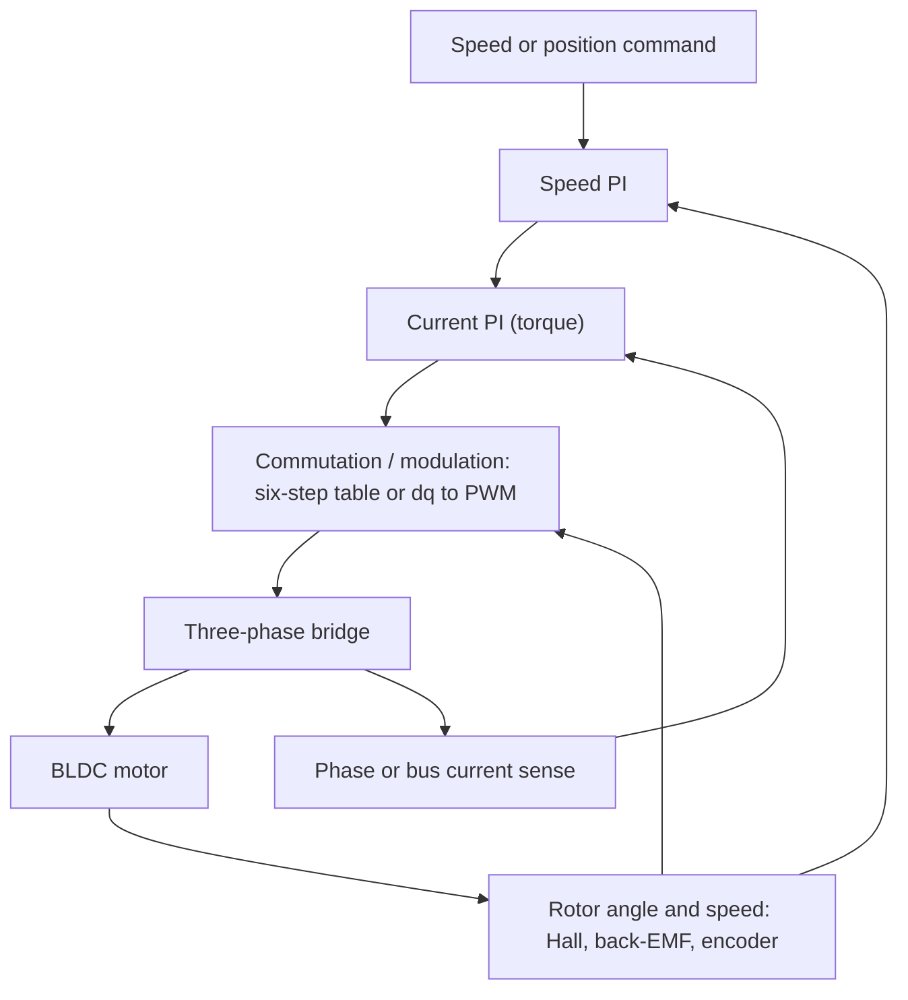

::: basics
### In plain words
Controlling a BLDC motor has three layers. First, work out which coils to power, based on where the rotor (the spinning magnet) is. Second, use PWM to set how much voltage the coils get. Third, run control loops on speed and current. Six-step is the simple method; field-oriented control is the smooth, efficient one.

### Picture it
Think of pushing a child on a swing. You need to push at the right moment in the swing, which means watching where the swing is. That is commutation, with a sensor as your eyes. How hard you push sets how high the swing goes. That is the voltage or current. The analogy has one gap: a motor needs a push in a new direction six times per electrical turn, not just once per swing.

### Words you need
- **Commutation**: choosing which of the three coil groups (phases) to power as the rotor turns. See [[q0363]].
- **PWM**: switching the supply on and off very fast. The fraction of time it is on, the duty, sets the average voltage. See [[q0145]].
- **Hall sensor**: a position sensor, so the controller knows the rotor's sector.
- **Six-step control**: a simple method that powers two phases at a time from a lookup table.
- **Field-oriented control (FOC)**: a smoother method that controls the current's angle and size.

### The simplest example
Say a motor runs from a 24 V supply. Three Hall sensors each report on or off, and together they tell the controller which of six sectors the rotor is in. A lookup table then says which two phases to power. If the PWM duty is 50%, the coils see an average of 12 V, so the motor runs at about half speed. A control loop measures the speed and nudges that duty up or down to hold the speed you asked for.

That is the whole idea: read the position, switch the phases, and PWM the voltage. The rest of this page compares six-step, sensorless and FOC control, and when to use each.
:::

::: testing
Whether you can go beyond "an ESC does it" and describe the actual **control strategies** and the loops inside them. The interviewer is looking for:

1. The hierarchy: commutation (which phases), modulation (how voltage is applied, PWM) and regulation (speed and current loops).
2. Knowledge of the main methods: six-step with Hall sensors, sensorless back-EMF, sinusoidal drive, and field-oriented control (FOC).
3. Trade-offs: simplicity and cost against torque ripple, noise, efficiency and low-speed performance.
4. Practical hardware awareness: current sensing, dead-time, startup and protection.

This is a different angle from [[q0363]] (how the motor works) and [[q0365]] (what hardware a microcontroller needs).
:::

::: why
Anyone building a robot, a drone or an appliance picks a control strategy for its motor, and the choice drives cost, noise, efficiency and software effort. A fan can use a 50-cent Hall-based driver; an exoskeleton joint needs FOC with a torque loop. Interviewers use this question to see if you understand the layers of a motor drive and can match the method to the requirement instead of just naming FOC because it sounds advanced.
:::

::: concepts
- **Electronic commutation**: choose which phases conduct based on rotor angle. See [[q0363]].
- **PWM voltage control**: duty cycle sets average voltage, hence speed (or current). See [[q0145]].
- **Back-EMF**: $K_e\omega$ sets top speed and enables sensorless sensing. See [[q0341]].
- **Cascaded loops**: inner current (torque) loop, outer speed loop, optional outer position loop.
- **Current sensing**: shunt plus amplifier or ADC to close the current loop and protect the bridge.
- **Dead-time**: delay between turning one switch off and its complement on, to prevent shoot-through. See [[q0424]].
:::

::: answer
"There are really three layers. The lowest is commutation: figuring out which phases to energise based on rotor position. Above that is modulation: PWM-ing the bridge so the average voltage is what I want. Above that are the regulation loops: a speed loop wrapped around a current loop.

The simplest method is six-step, or trapezoidal, control. Three Hall sensors give me the sector, a lookup table picks which two phases conduct, and I PWM the high or low side to set the voltage. Speed control is a PI loop on measured speed from the Hall edge timing, and I'd add a current limit using a shunt. It's cheap and robust, but you get torque ripple at six times the electrical frequency, so it's audible and not great at low speed.

If there are no Hall sensors, I use sensorless control: watch the floating phase's back-EMF, detect the zero-crossing, and commutate 30 electrical degrees later. It needs an open-loop startup and doesn't work at standstill.

For smooth, efficient, quiet control I'd use field-oriented control. I measure two phase currents, transform them with Clarke and Park into a rotating frame aligned with the rotor, and run PI loops on the $d$ and $q$ currents. The $q$ current gives torque directly, so torque control is clean, and I can drive sinusoidal phase currents. It needs a good rotor angle, so an encoder or an observer, and more compute. So I'd pick six-step for fans and pumps, FOC for robot joints, e-bikes and anything where smoothness and efficiency matter."
:::

::: technical
**Layer 1, commutation.**
- *Hall six-step:* 3-bit code → one of six phase patterns; position resolution 60° electrical.
- *Sensorless trapezoidal:* floating-phase zero-crossing (relative to the virtual neutral $V_{bus}D/2$ during PWM-on) detects 30° before the next commutation; wait $T_{60}/2$, switch.
- *Sinusoidal/FOC:* continuous angle from an encoder, resolver, interpolated Hall, or a sensorless observer (flux observer, sliding mode, PLL on back-EMF).

**Layer 2, modulation.** PWM at 16 to 50 kHz (above audio). Six-step uses 1 PWM leg with complementary or single-switch modulation. Sinusoidal/FOC uses three-phase sine-PWM or space-vector PWM (SVPWM), which gets about 15% more bus utilisation: peak phase voltage $V_{bus}/\sqrt3 \approx 0.577V_{bus}$ vs $V_{bus}/2$ for sine-PWM.

**Layer 3, regulation.**

$$\text{speed PI}\;\rightarrow\; I^*_q \;\rightarrow\;\text{current PI}\;\rightarrow\; V_q \;\rightarrow\; \text{PWM}$$

In FOC, typical bandwidth: current loop 500 Hz to 2 kHz, speed loop 10 to 100 Hz, ratio at least ~5 to 10 between nested loops. Torque $T = \tfrac{3}{2}\,p\,\lambda_m I_q$ (for surface-magnet PMSM; $\lambda_m$ the flux linkage) and $I_d = 0$ for maximum torque per amp.

**Feedback hardware.** Phase-current shunts (low-side in each leg, or one DC-link shunt with reconstruction), bus voltage divider, optionally a temperature sensor.

**Protection.** Overcurrent (cycle-by-cycle and latched), undervoltage lockout, overvoltage on regeneration, over-temperature, stall detection, invalid-Hall detection.

**Startup (sensorless).** Align rotor (DC pulse) → open-loop ramp of electrical frequency with current limit → switch to closed loop when back-EMF is detectable.
:::

::: short
"I think in three layers. Commutation chooses the active phases from rotor position, using Hall sensors, back-EMF zero-crossings or an encoder. Modulation uses PWM on a three-phase bridge to set the voltage. On top are a current loop and a speed loop. The simple version is six-step with Hall sensors, which is cheap but has torque ripple; the high-performance version is field-oriented control, which regulates the $d$ and $q$ currents for smooth, efficient torque."
:::

::: long
"I'd break BLDC control into commutation, modulation and regulation.

Commutation is deciding which phases carry current. The simplest scheme is six-step. Three Hall sensors give a 3-bit code that tells me which 60 degree sector the rotor is in, and a lookup table maps that to one high-side and one low-side switch. If there are no Hall sensors, I use the back-EMF on the floating phase: it crosses the neutral voltage in the middle of the sector, so I detect that crossing and commutate 30 electrical degrees later. That needs enough speed to see the EMF, so startup is open-loop: align the rotor, then ramp the commutation rate with a current limit until the EMF is detectable.

Modulation is how I apply voltage. I PWM the bridge, typically 20 kHz or higher so it's inaudible, and the duty cycle sets the average voltage on the winding, so it sets speed. Dead-time keeps the high and low switches in one leg from conducting together.

Regulation is the loops. Even in six-step I'd close a speed loop with a PI controller, using Hall edge timing as the speed measurement, and add a current limit from a shunt so the motor and the bridge are protected.

For better performance I'd use field-oriented control. I measure two phase currents, apply the Clarke and Park transforms to get $I_d$ and $I_q$ in the rotor frame, and PI-control them: $I_d$ at zero, $I_q$ set by the speed loop. The output voltages are transformed back and fed to space-vector PWM. That gives smooth torque at low speed, lower noise and better efficiency, at the cost of a faster processor, accurate current sensing and a good angle estimate.

My rule of thumb: six-step for fans, pumps and cost-sensitive stuff, FOC for servos, gimbals, e-bikes and anything quiet or precise."
:::

::: terms
- **Six-step / trapezoidal control**: six commutation states, two phases conducting at a time.
- **Sensorless control**: rotor position inferred from back-EMF or an observer.
- **FOC (field-oriented control)**: current control in the rotor-fixed $d$-$q$ frame.
- **Clarke / Park transforms**: three-phase → two-phase stationary ($\alpha\beta$) → rotating ($dq$) frame.
- **SVPWM**: space-vector PWM, gives higher bus utilisation than sine-PWM.
- **Dead-time**: blanking interval between complementary gate signals.
- **Cascaded loop**: inner fast current loop inside an outer slower speed loop.
- **Open-loop startup**: forced commutation ramp until back-EMF is large enough to track.
:::

::: exceptional
An average answer lists "Hall sensors, PWM, sensorless, FOC". An exceptional answer:

- Organises it as commutation / modulation / regulation and shows where each method plugs in.
- Quantifies the main trade-off: six-step has 60° resolution and torque ripple at $6f_e$; FOC uses a continuous angle and gives near-constant torque.
- Gives loop bandwidth ordering (current loop at least 5 to 10 times faster than speed loop) and why.
- Explains the sensorless startup problem unprompted, and the 30° delay after zero-crossing.
- Chooses a method for a concrete application and says what would change the choice (cost, noise, low-speed torque, regeneration).
:::

::: mistakes
- **Equating "BLDC control" with PWM only.** PWM is only modulation; without correct commutation the motor doesn't turn properly.
- **Using a single PI on speed driving duty directly with no current limit.** Startup and stall will blow the bridge. Always bound current.
- **Believing sensorless works from zero speed.** Back-EMF is $K_e\omega$, so it needs an open-loop start.
- **Forgetting dead-time and shoot-through.** The two switches in a leg must never conduct together.
- **Calling FOC "better" unconditionally.** It needs more MCU, current sensors and tuning; for a fan, six-step is the right answer.
- **Ignoring PWM frequency vs electrical frequency.** At high electrical frequency there are few PWM cycles per commutation, which limits control resolution.
:::

::: deep
## The three layers


Figure: Everything in BLDC control fits this loop. Position feedback feeds both commutation (fast) and the speed loop (slow). Current feedback closes the inner loop and doubles as the overcurrent protection.

### Layer 1: commutation

**Six-step with Hall sensors.** The three sensors give codes that change every 60° electrical. Software or hardware maps code → phase pattern, which is a six-entry table. Speed is measured from the time between edges: with $T_{60}$ the time between two Hall edges, electrical frequency is $f_e = 1/(6T_{60})$ and mechanical speed is $f_e\cdot60/p$ rpm. Resolution gets coarse at low speed, since you only learn the speed once per 60° and the speed loop must tolerate that.

**Sensorless trapezoidal.** During a sector, the floating phase voltage is $V_{neutral} + e_{phase}$. In the PWM-on window of the conducting high side, $V_{neutral} \approx V_{bus}/2$ (approximately, for a symmetric, wye-connected motor). The crossing happens at the middle of the sector, so you commutate $T_{60}/2$ later. Practical points:

- Sample during PWM-on to avoid chopped noise, or attenuate and filter in hardware.
- Mask false zero-crossings right after a commutation (flyback through the freewheeling diode).
- Minimum speed: when $K_e\omega$ is only a few times the comparator noise/offset, detection fails.

**Sinusoidal and FOC.** The angle comes from an encoder, a resolver, interpolated Hall signals, or a software observer. FOC with an observer works at medium and high speed, and is increasingly able to work at low speed with high-frequency injection on salient motors.

### Layer 2: modulation

At the modulation layer the question is: how do I turn "I want 6 V across this winding" into gate signals? Average voltage is $D\,V_{bus}$. Choosing PWM frequency means balancing:

| PWM frequency | Higher | Lower |
|---|---|---|
| Current ripple $\Delta I \approx \dfrac{V_{bus}D(1-D)}{L f_{sw}}$ | smaller | larger (heating, noise) |
| Switching loss $\propto f_{sw}$ | worse | better |
| Audible noise | inaudible above ~20 kHz | whine |
| Loop resolution at high $f_e$ | more PWM per cycle | few cycles per electrical period |

**Worked example.** A winding with $L_{LL} = 100\;\mu$H on 24 V at $D=0.5$ and 20 kHz: $\Delta I \approx 24\cdot0.25/(100\mu\cdot20k) = 3$ A peak-to-peak. For a 5 A average that is a significant ripple; going to 50 kHz brings it to 1.2 A. This is why low-inductance gimbal motors need high PWM frequency or external inductance.

### Layer 3: regulation

Pick the inner loop first. The current loop sees the electrical time constant $\tau_e = L/R$, e.g. $100\;\mu\text{H}/0.2\;\Omega = 0.5$ ms, so a current-loop bandwidth of a kilohertz or so is realistic. The speed loop sees the mechanical time constant, typically tens to hundreds of milliseconds, so bandwidth is tens of hertz. Keeping at least a decade between them lets you design each loop independently.

### FOC in five lines

1. Measure $i_a, i_b$ (and $i_c = -i_a - i_b$).
2. **Clarke**: $i_\alpha = i_a$, $i_\beta = (i_a + 2i_b)/\sqrt3$.
3. **Park**: rotate by the electrical angle $\theta_e$ to get $i_d, i_q$.
4. PI controllers: $v_d$ from $(i_d^* = 0) - i_d$, $v_q$ from $i_q^* - i_q$, with optional decoupling terms $\mp\omega_e L i_{q/d}$.
5. Inverse Park, then SVPWM to generate gate signals.

In the rotating frame, the AC phase currents become DC quantities, so a PI controller can regulate them with zero steady-state error.

```sim
{"id":"pwm-lab","duty":0.5,"f":20000,"amp":24,"view":"time"}
```
Figure: PWM voltage is what you control; the winding's inductance filters it into current. The sim's Motor box models a winding with $R$ = 2 Ω, $L$ = 2 mH and shows its current ripple (150 mA p-p at 24 V, 50%, 20 kHz). Change duty and watch the average follow $D\cdot A$; halve the frequency and the ripple doubles, as $\Delta I \approx V D(1-D)/(L f)$ predicts. That is why low-inductance motors need a higher PWM frequency for the same ripple.

### Choosing

| Requirement | Method |
|---|---|
| Cheapest, fan/pump, speed only | Six-step, Hall or sensorless |
| Quiet, smooth, low torque ripple | Sinusoidal or FOC |
| Accurate torque or position (robot joint, gimbal) | FOC with encoder |
| No sensor wires, moderate/high speed | Sensorless six-step or FOC with observer |
| Large starting torque with load | Sensored |

## Regeneration and braking

When decelerating, the motor generates and can push current back into the bus. If the supply cannot absorb it (a battery usually can, a bench supply cannot), the bus pumps up. Controllers either limit regeneration, dump it into a brake resistor, or use it deliberately for regenerative braking. Six-step "brake" can be implemented by turning on all three low-side switches, shorting the windings so the back-EMF drives a braking current limited by $E/R$.

> [!INTERVIEW]
> Offer a decision, not a list: "For this application I'd use X because Y; if the requirement were Z instead, I'd move to FOC." That shows engineering judgment.
:::

::: applications
- **Computer and appliance fans**: Hall-based six-step, often with an integrated driver IC.
- **Drone ESCs**: sensorless six-step, with sinusoidal or FOC increasingly used in newer firmware for efficiency and smoothness (see [[q0369]]).
- **E-bike and scooter hub motors**: Hall sensors for startup, sometimes switching to FOC.
- **Robot joints, gimbals**: FOC with absolute encoder, current loop executed at the PWM rate (tens of kHz) for a bandwidth of a kilohertz or more.
- **Compressors and washing machines**: sensorless FOC for efficiency and low noise.
:::

::: assumptions
- Three-phase, surface-magnet motor and a voltage-source inverter. Interior-magnet motors add reluctance torque and field-weakening, which FOC handles with a non-zero $I_d$.
- Numbers like loop bandwidths and PWM frequencies are typical ranges, not rules; they depend on the motor inductance, MCU speed and application.
- I assumed the bus can supply the required current and that the motor is not saturated.
- "Control" here covers the electronics and firmware; a position loop for servo use adds one more outer layer.
:::

::: followups
### Why is FOC smoother than six-step?
Six-step moves the stator field in 60° jumps, so the angle between stator and rotor fields varies between 60° and 120° and the torque wobbles at $6f_e$. FOC applies sinusoidal currents synchronised with the rotor angle, so the angle stays at 90° continuously and torque is nearly constant.

### How does sensorless control find the rotor position?
It observes the back-EMF of the floating phase. Its voltage crosses the motor neutral at the midpoint of the sector; the controller detects the crossing and commutates after another 30° electrical. The delay is computed from the last interval between zero-crossings.

### Why do you need the inner current loop at all?
Because current is torque and current is also what damages hardware. A speed loop acting directly on voltage cannot limit current: a big step in speed command gives a large voltage step across a tiny winding resistance. The current loop bounds torque and gives the speed loop a clean, linear plant.

### What happens if the PWM frequency is only a few times the electrical frequency?
You have too few PWM cycles per electrical period to approximate the voltage waveform, and phase delay of the current loop grows. For a 7-pole-pair motor at 30 000 rpm ($f_e = 3.5$ kHz), 24 kHz PWM gives under 7 cycles per period, so you raise $f_{sw}$, use a faster loop or accept six-step.

### Scenario: a sensorless drone motor desyncs under a quick throttle punch. Why, and what do you change?
Rapid acceleration changes the commutation period faster than the zero-crossing predictor assumes, and large current spikes distort the floating-phase signal, so the controller loses lock. Fixes: limit the throttle slew or acceleration, increase the commutation timing advance margin, filter or mask the blanking window better, raise PWM frequency, or use a faster observer.
:::

::: interpretations
"Control" might mean (a) algorithms (this page), or (b) the physical interface from a microcontroller, covered in [[q0365]]. For ESC-specific interfacing and protocols, see [[q0373]]. For a general intro to the machine, see [[q0363]].
:::

::: references
- Krishnan, *Permanent Magnet Synchronous and Brushless DC Motor Drives*: trapezoidal and sinusoidal control, sensorless methods.
- Mohan, *Electric Drives: An Integrative Approach* and Mohan et al., *Power Electronics*: vector control and inverter modulation chapters.
- Texas Instruments and STMicroelectronics motor-control application notes on trapezoidal control, sensorless BLDC and FOC (find by topic on the vendor sites).
- Erickson & Maksimović, *Fundamentals of Power Electronics*: inverter and PWM fundamentals.
:::

::: rubric
- Separates commutation, modulation and regulation :: Shows a structured understanding of a drive.
- Describes six-step with Hall lookup table and PWM duty :: The baseline method every interviewer expects.
- Explains sensorless back-EMF zero-crossing and open-loop startup :: Demonstrates real-world knowledge of the limitation at low speed.
- Describes FOC at least at the level of Clarke/Park and $I_d$/$I_q$ PI loops :: Shows you know the high-performance alternative and what it buys.
- Mentions cascaded loops and current limiting :: Protects hardware and is how real drives are structured.
- Mentions dead-time and PWM frequency trade-offs :: Shows awareness of power-stage constraints.
- Chooses a method for an application and justifies it :: Interviewers want judgment, not a glossary.
:::

::: quiz
```json
[
 {"type":"mcq","level":"fundamental","q":"In six-step BLDC control with Hall sensors, what do the Hall sensors provide?","options":["Phase current","Rotor sector (position) information","DC bus voltage","Winding temperature"],"answer":1,"explain":"The three Hall outputs form a 3-bit code that identifies the 60° electrical sector the rotor is in, which selects the phase pattern."},
 {"type":"truefalse","level":"fundamental","q":"A sensorless BLDC drive can reliably detect rotor position at zero speed using back-EMF.","answer":false,"explain":"Back-EMF is $K_e\\omega$ and is zero at standstill, so sensorless drives start open-loop (align and ramp) until the EMF is measurable."},
 {"type":"numeric","level":"intermediate","q":"A winding has $L = 100$ µH and is driven from 24 V at 50% duty and 50 kHz. Estimate the peak-to-peak current ripple using $\\Delta I = V D(1-D)/(L f_{sw})$.","answer":1.2,"tolerance":0.03,"unit":"A","explain":"$\\Delta I = 24\\cdot0.25/(100\\times10^{-6}\\cdot50\\times10^{3}) = 6/5 = 1.2$ A."},
 {"type":"mcq","level":"intermediate","q":"Why does the FOC current loop run much faster than the speed loop?","options":["Because the speed sensor is faster","Because the electrical time constant L/R is much shorter than the mechanical time constant","Because PWM runs at 1 kHz","Because it reduces dead-time"],"answer":1,"explain":"Current responds on the electrical time constant (sub-millisecond to millisecond), speed on the mechanical one (tens to hundreds of ms). Separating bandwidths lets each loop be designed independently."},
 {"type":"multi","level":"advanced","q":"Which are advantages of FOC over six-step Hall control?","options":["Lower torque ripple at low speed","Needs no current sensing","Better efficiency through sinusoidal currents and $I_d=0$ torque per amp","Works with a simpler microcontroller"],"answer":[0,2],"explain":"FOC gives smooth torque and efficient current use, but needs current sensing and more computation, so options 2 and 4 are wrong."},
 {"type":"numeric","level":"advanced","q":"A 7-pole-pair motor spins at 30 000 rpm with 24 kHz PWM. How many PWM cycles per electrical period?","answer":6.86,"tolerance":0.02,"unit":"cycles","explain":"$f_e = 7\\cdot30000/60 = 3500$ Hz. $24000/3500 = 6.86$ PWM cycles per electrical period, which is why high-speed drives raise the PWM frequency."}
]
```
:::
