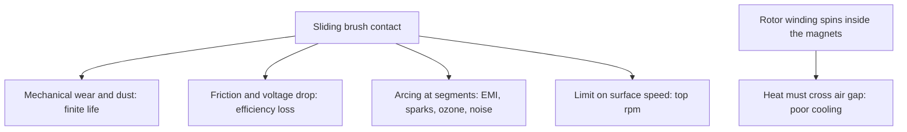

::: testing
Whether you can compare two technologies **with reasons and numbers**, not a memorised list of "longer life, more efficient". The interviewer wants to hear:

1. The root cause: brushes and commutator are a mechanical, wearing, arcing sliding contact; brushless moves that job to electronics.
2. The consequences: life, efficiency, noise (acoustic and electrical), speed limit, thermal path, maintenance.
3. Balance: brushed motors still win on cost and simplicity, so a good answer also says **when you would pick brushed**.
4. Awareness of the cost you pay: controller, sensing and firmware.
:::

::: why
Choosing a motor is one of the first architectural decisions in any electromechanical product, and it shapes cost, battery life, EMC testing and reliability. A toy and a medical pump make opposite choices for good reasons. Interviewers use this question to see if you tie features to physical causes ([[q0359]], [[q0360]]) and if you can make a trade-off decision. It also shows whether you appreciate that brushless pushes complexity into electronics and firmware.
:::

::: concepts
- **Brushes and commutator**: sliding contact that delivers current to the rotating coils and reverses it. See [[q0357]] and [[q0359]].
- **Brush wear and arcing**: friction, sparking and carbon dust limit life and cause EMI. See [[q0360]], [[q0356]].
- **Electronic commutation**: transistors and position sensing replace the mechanical switch. See [[q0363]].
- **Efficiency**: $\eta = P_{mech}/P_{elec}$; losses are copper, iron, friction and brush drop.
- **Thermal path**: heat generated in the winding must conduct to the outside; on a brushed motor the winding is on the rotor in the middle.
- **Total system cost**: motor plus electronics plus firmware plus lifetime maintenance.
:::

::: answer
"The core difference is that a brushed motor commutates mechanically with brushes riding on a commutator, and a brushless one commutates electronically with transistors. Almost every advantage follows from getting rid of that sliding contact.

First, lifetime and reliability. Brushes wear out, typically somewhere in the range of a few thousand hours depending on the motor, while a brushless motor only has bearings to wear. Second, efficiency. There's no brush friction and no brush voltage drop, which on a 12 V motor can be around a volt, so roughly 8 percent of the input power, and much more on a 3 V motor. Third, electrical and acoustic noise. Brushes arc and generate broadband EMI and audible noise, and I need extra filtering. A brushless motor can still be noisy, but the noise comes from PWM switching, which I control. Fourth, speed and power density. Brushes limit top speed through bounce and wear, and the rotor winding is hard to cool because it's spinning in the middle. In a BLDC the windings are on the stator, directly against the housing, so I can push more continuous current. And there's no commutator spark, so it's safer in flammable environments.

The trade-off is cost and complexity. A brushed motor runs from a battery and a transistor, whereas a BLDC needs a three-phase bridge, position sensing and firmware. For a cheap toy or a low-duty-cycle actuator, I'd still choose brushed."
:::

::: technical
| Aspect | Brushed DC | Brushless DC |
|---|---|---|
| Commutation | Mechanical (brushes + commutator) | Electronic (bridge + position sensing) |
| Life | Limited by brush wear (order of 1000s of hours, application dependent) | Limited by bearings (often 10,000+ hours) |
| Efficiency | Lower: brush drop and friction, rotor copper hard to cool | Higher: no brush loss, stator cooling |
| EMI | Arcing, broadband noise | PWM-related; no arcing |
| Max speed | Limited by brush/commutator | Limited by bearings, rotor retention, electronics |
| Torque-speed | Linear; torque $\propto I$ | Linear in trapezoidal mode, same $K_t$, $K_e$ |
| Heat removal | Rotor winding: poor path | Stator winding: good path through housing |
| Control | One transistor or H-bridge | Three-phase bridge, sensors, firmware |
| Cost | Low | Higher (electronics and magnets) |
| Safety (sparks) | Spark source | None from commutation |

**Brush drop loss.** If the brush/commutator drop is $V_b$ (order of 0.5 to 2 V for a pair, depends on brush grade and current), the loss is $P = V_b I$ and the fraction of input power is $V_b/V_{supply}$. For $V_b = 1$ V at 12 V: 8.3%; at 24 V: 4.2%; at 3 V: 33%.

**Thermal.** For a given winding copper loss $P_{cu}=I^2R$, the temperature rise is $\Delta T = P_{cu}R_{th}$. A BLDC has a smaller $R_{th}$ (winding to ambient), so it can carry more continuous current for the same temperature rise. Rated power per unit volume is typically higher.

**Speed limit.** The commutator's peripheral speed and brush bounce limit practical top speed; BLDC speeds are limited by bearings and rotor mechanical strength, often by the controller's ability to commutate (electrical frequency $f_e = p\cdot\text{rpm}/60$).
:::

::: short
"Brushed motors commutate mechanically; brushless motors commutate electronically, and nearly every advantage follows from that. No brushes means no wear, so longer life, no arcing, so less EMI and no sparks, and no brush friction or voltage drop, so higher efficiency. The winding sits on the stator against the housing, so it cools better and handles more continuous power, and top speed isn't limited by the commutator. The cost is the controller: a three-phase bridge, sensing and firmware, so brushed is still the cheap, simple choice for low-duty or low-cost applications."
:::

::: long
"The way I think about it: both motors need the current in the coils to flip at the right moment. A brushed motor does that mechanically, with carbon brushes sliding on a segmented commutator. A brushless motor does it with transistors and a position sensor. Nearly every difference comes from that one choice.

Reliability and life: brushes wear and shed dust, and the commutator gets grooved, so a brushed motor has a finite life, often thousands of hours. A brushless motor only wears its bearings, so it can last much longer, and needs no maintenance.

Efficiency: brushes cost friction and a voltage drop of maybe a volt across the pair. On a 12 V system that's several percent of input power, and on a 3 V coin motor it's a third. Also the rotor winding is spinning in the middle of the motor with a poor heat path, whereas in a brushless motor the windings are fixed on the stator right against the housing, so for the same size you can run more continuous current and get higher power density.

Noise: brushes arc, which makes broadband EMI that couples into sensors and radios and makes audible noise, so brushed motors often need capacitors and chokes across the terminals. A brushless motor doesn't arc, although you still have to handle the PWM switching noise. No sparks also means it can be used near flammable gases or in vacuum, where brushes behave badly.

Speed and control: brushes limit top speed through bounce and wear. A brushless motor can go much faster, limited mainly by its bearings, the rotor's mechanical strength and the controller.

The downside is cost and complexity. A brushed motor runs with a battery and a transistor. A BLDC needs a three-phase bridge, gate driver, position sensing and firmware, and the magnets are not free either. So for a toy, a cheap actuator or a low-duty-cycle application, brushed wins. For anything with a long runtime, high efficiency, quiet operation or high speed, brushless wins."
:::

::: terms
- **Commutator**: segmented copper ring on the rotor that, with brushes, reverses coil current mechanically.
- **Brush drop**: voltage lost across the brush-commutator contact, proportional to current loss $V_bI$.
- **Electronic commutation**: switching phase currents with transistors based on rotor position.
- **Power density**: output power per unit volume or mass.
- **Duty cycle (thermal)**: how much of the time the motor runs under load, which sets heating.
- **EMI**: electromagnetic interference, e.g. arcing noise.
- **Rotor winding / stator winding**: where the heat is generated and how easily it escapes.
- **Cogging torque**: magnet-tooth attraction ripple (BLDC), absent in coreless brushed motors.
:::

::: exceptional
An average answer lists: "longer life, more efficient, quieter, better speed control, but expensive." An exceptional answer:

- Ties each advantage to a specific cause (sliding contact, voltage drop, arcing, winding location).
- Quantifies one: brush drop of about 1 V is 8% at 12 V and 33% at 3 V, so brushless matters most on low-voltage battery devices.
- Includes the thermal point (stator winding next to the case).
- States when brushed is the better engineering choice (cost, simplicity, direct battery drive, short duty).
- Notes that the electronics move the failure modes: a BLDC can fail from the controller, sensors, or demagnetised magnets.
:::

::: mistakes
- **"Brushless motors have no friction."** They still have bearings and windage; the elimination is of the brush friction and drop.
- **"Brushless is always more efficient."** Usually, but a poorly driven BLDC with a lossy controller, or a tiny motor, may not be; and system efficiency includes the inverter loss.
- **"No brushes means no EMI."** PWM and fast edges still radiate; you've replaced arcing with switching noise.
- **"Brushless motors don't need a controller."** They cannot run from a battery directly; see [[q0370]].
- **Dismissing brushed motors.** They are still a good, cheap choice for many designs, and drive with a single MOSFET or H-bridge.
- **Quoting exact life numbers.** Brush life depends heavily on grade, current, speed and environment; give a range and say it depends.
:::

::: deep
## Where each difference comes from

Strip each motor to the basic mechanism. In the brushed motor ([[q0348]], [[q0357]]), current enters the rotor coils through carbon blocks pressed against a rotating segmented ring. The spring force keeps contact ([[q0362]]). The contact has resistance, produces friction heat, and when a segment passes under a brush the current in a coil is interrupted: an inductive kick that arcs ([[q0356]]). All of the following follow from that.


Figure: Every brushed-motor limitation traces back to one of two root causes: the sliding contact (the four-way branch on the left) and having the hot winding on the rotor (the pair of boxes on the right).

## Brush losses in numbers

The brush drop is nearly constant with current (it behaves like a diode plus a small resistance), so its power is $V_b I$. Its share of input power is $V_b/V_{supply}$:

```plot
{"title":"Brush voltage drop as a fraction of supply","x":{"label":"Supply voltage","unit":"V","min":2,"max":48},"y":{"label":"Brush loss share","unit":"%","min":0,"max":70},
 "vars":{"vb1":1,"vb2":2},
 "series":[{"label":"V_b = 1 V","fn":"100*vb1/x"},{"label":"V_b = 2 V","fn":"100*vb2/x","dashed":true,"color":"red"}],
 "points":[{"x":3,"y":33.3,"label":"3 V coin: 33%"},{"x":12,"y":8.3,"label":"12 V: 8.3%"},{"x":24,"y":4.2,"label":"24 V: 4.2%"}]}
```
Figure: Brush drop hurts most at low supply voltage, which is exactly where battery-powered small devices live. At 48 V it is a footnote. Treat the 1 to 2 V range as a typical order of magnitude, since it depends on brush grade and current.

**Worked comparison.** Two 12 V motors both deliver 50 W mechanical. Brushed: copper $P_{cu}=8$ W, friction/iron $3$ W, brush drop at about 5.5 A input of $1\cdot5.5=5.5$ W. Input is $50+8+3+5.5 = 66.5$ W, so $\eta = 75\%$. Brushless with similar copper and iron loss, and no brush loss, plus a controller loss of 2 W: $50+8+3+2=63$ W, $\eta = 79\%$. The gain is a few points here, and it grows with lower voltage and with how much of the system's loss is the brush.

> [!NOTE]
> These are illustrative figures, not datasheet values. Actual efficiency depends on motor size and controller.

## Thermal path

Copper loss heats the winding. In a brushed motor the winding is on the rotor, surrounded by an air gap, so heat leaves through the air gap, shaft and brush gear; $R_{th}$ is high. In a BLDC the winding is bonded to the stator's steel and the housing, so $R_{th}$ is lower. For the same temperature limit (winding insulation class), the allowed $I^2R$ is $\Delta T_{max}/R_{th}$, so the BLDC can sustain more continuous current in the same size. That is why BLDCs dominate power tools and drones, where peak and continuous power per gram matter.

## Dynamic and control aspects

Both motors share the same electrical model: $V = IR + L\,di/dt + K_e\omega$, $T = K_tI$ ([[q0352]], [[q0353]]). A brushed motor has low rotor inertia options (coreless, ironless) and is simple to control with one PWM. A BLDC with outer-rotor construction has higher inertia but also higher torque. BLDC cogging is a nuisance for smooth low-speed motion, whereas a coreless brushed motor has none.

```sim
{"id":"dc-motor-lab","view":"transient","v":12,"r":1,"l":0.001,"kt":0.02,"load":0.01}
```
Figure: The brushed-motor model that a BLDC also follows per commutation sector. Notice the inrush: with no back-EMF at standstill the current heads for $V/R$ = 12 A (it peaks at about 11 A), then falls as the back-EMF builds. A brushed motor on a bare switch takes that whole spike; a BLDC drive normally caps it with its current loop, because it already measures current for commutation and protection.

## Failure and maintenance

Brushed: worn brushes, a grooved or contaminated commutator, brush spring fatigue; remedy is brush replacement or, in cheap motors, replacing the motor ([[q0361]]). Brushless: bearing wear, demagnetisation by overheating or overcurrent, Hall sensor failure, controller or MOSFET failure, winding insulation breakdown. A BLDC's failure is often in the electronics, which are replaceable separately.

## When to pick which

| Situation | Pick |
|---|---|
| Low cost, short duty, direct battery (toy, small actuator, car window) | Brushed |
| Long life, sealed, maintenance-free (pumps, fans, hard drives) | Brushless |
| High speed, high power density (drones, power tools) | Brushless |
| Explosive atmosphere, vacuum, clean room | Brushless |
| Simple speed control, no firmware budget | Brushed |
| Quiet, EMI-sensitive (medical, audio, sensor-laden robots) | Brushless |
:::

::: applications
- **Drones**: BLDC for thrust per gram and endurance, brushed micro motors only on the tiniest toy quadcopters.
- **Power tools**: modern cordless drills moved to BLDC for more runtime and torque per size.
- **Computer fans and HDD spindles**: BLDC for life and silence.
- **Automotive**: brushed motors in cheap actuators (windows, mirrors, seats), BLDC in fuel pumps, blowers and EV drives.
- **Phone vibration motors**: ERM coin motors and small brushed or brushless variants ([[q0351]]).
- **Toys and low-cost devices**: brushed because of cost.
:::

::: assumptions
- Compared at a similar power rating and in typical conventional construction. Coreless brushed motors, brush-less single-phase fans and exotic designs shift the details.
- Life and efficiency figures vary by manufacturer, brush grade, load and environment; I give ranges and the reasons.
- I assumed an electronics-capable design. If the product cannot afford a controller or firmware, brushed may be the only viable option.
- High-end brushed motors with precious-metal brushes exist for low-current signal-level uses and have long lives, so "brushed is always short-lived" is not strictly true.
:::

::: followups
### Why is brush drop worse on a small battery product?
The drop is roughly fixed, about 1 V for a pair of brushes (order of magnitude). On a 3 V device that is a third of the supply, so a third of the input power never reaches the motor. On 24 V it's about 4%.

### Name a case where you'd still choose a brushed motor.
A cost-sensitive, short-duty actuator, like a car power window, a toy, or a small latch. A brushed motor can be driven directly by one MOSFET or H-bridge, with no sensors or firmware, and brush life of a few thousand hours is long enough for a few thousand operations.

### Do brushless motors still produce EMI?
Yes, but the source is the inverter: fast PWM edges, ringing and the motor cable acting as an antenna. Brushed motors arc at the commutator, which is broadband and has little to do with the electronics. For BLDC you manage EMI with edge-rate control, layout, filters and cable shielding.

### Why can a BLDC deliver more continuous power than a brushed motor of the same size?
Heat is generated in the windings; in the BLDC they are on the stator, with a direct conduction path to the housing, while in the brushed motor they are on the rotor, separated by an air gap. Lower $R_{th}$ means the same temperature limit allows more $I^2R$. Also no brush drop heat.

### Scenario: you have a 3.7 V single-cell device with a 2 W motor and want maximum runtime. Brushed or brushless?
The brush drop is ~1 V of 3.7 V, over 25% of the supply, so brushless saves a lot of energy. But at 3.7 V a three-phase bridge with FETs of low $R_{ds(on)}$ and a small controller is needed, and the MCU has to run the firmware at low power. I'd evaluate the whole system: motor + controller efficiency at the actual operating point, size and cost. If the duty is very short, brushed with a simple driver could still win.
:::

::: interpretations
"Advantages of brushless vs brushed" is a comparison question, so I added the cases where brushed wins. [[q0363]] covers how BLDC works, [[q0359]] and [[q0360]] cover brush concerns and wear, and [[q0349]] lists motor types more generally.
:::

::: references
- Hughes & Drury, *Electric Motors and Drives*: brushed DC and brushless motor characteristics and comparison.
- Krishnan, *Permanent Magnet Synchronous and Brushless DC Motor Drives*: advantages and construction of PM brushless machines.
- Manufacturer motor datasheets and application notes (e.g., Maxon and Faulhaber catalogue technical pages comparing DC and EC motors) for typical lifetimes and efficiencies; treat figures as vendor-specific.
:::

::: rubric
- Identifies commutation (mechanical vs electronic) as the root difference :: Everything else follows from it.
- Lists life/wear, efficiency, EMI/noise, speed, thermal advantages with reasons :: Reasons show understanding, not recall.
- Quantifies something, e.g. brush drop vs supply voltage :: Shows engineering sense and explains why it matters on low-voltage devices.
- Mentions stator-winding cooling and power density :: A commonly missed, important advantage.
- States the cost: controller, sensors, firmware, magnets :: A fair comparison includes the downside.
- Says when brushed is preferable :: Demonstrates trade-off judgment.
- Notes BLDC still has EMI/failure modes of its own :: Avoids the "brushless is perfect" trap.
:::

::: quiz
```json
[
 {"type":"mcq","level":"fundamental","q":"What is the fundamental difference between brushed and brushless DC motors?","options":["Brushed motors use AC","Commutation is mechanical in brushed and electronic in brushless","Brushless motors have no magnets","Brushed motors have three phases"],"answer":1,"explain":"Brushes and a commutator switch the coil current mechanically; a brushless motor uses transistors and position sensing."},
 {"type":"truefalse","level":"fundamental","q":"A brushless DC motor can be run by connecting it directly to a battery.","answer":false,"explain":"It needs an electronic controller to commutate the phases in step with rotor position."},
 {"type":"numeric","level":"intermediate","q":"A brushed motor has a total brush drop of 1 V and runs from 12 V. What percentage of input power is lost in the brushes?","answer":8.33,"tolerance":0.02,"unit":"%","explain":"Brush loss $= V_bI$, input $=V I$, so the fraction is $V_b/V = 1/12 = 8.33\\%$."},
 {"type":"numeric","level":"intermediate","q":"Same 1 V brush drop on a 3.7 V single-cell device. What fraction of input power is lost?","answer":27,"tolerance":0.03,"unit":"%","explain":"$1/3.7 = 0.27$, so about 27%, which is why brushless matters on low-voltage battery products."},
 {"type":"mcq","level":"intermediate","q":"Why can a BLDC carry more continuous current than a same-size brushed motor?","options":["It has thicker wire","Its windings sit on the stator with a good conduction path to the housing","It has no back-EMF","It uses AC"],"answer":1,"explain":"Lower thermal resistance from winding to ambient means more $I^2R$ for the same temperature rise."},
 {"type":"multi","level":"advanced","q":"Select the situations where a brushed motor is a reasonable engineering choice.","options":["Very low-cost, short-duty actuator driven by one MOSFET","Sealed pump that must run 20 000 hours without maintenance","Toy with a tight bill of materials","Spindle for a high-speed drone propeller"],"answer":[0,2],"explain":"Brushed wins on cost and simplicity for short-duty or cheap products. Long-life sealed pumps and high-speed, high-power propulsion call for brushless."}
]
```
:::
