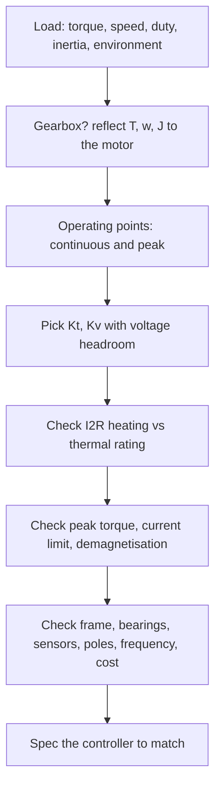

::: testing
Whether you can turn an application into a **motor specification** by working from the load backwards. The interviewer wants a method, not a catalogue of terms:

1. Start from the load: torque, speed, duty cycle, inertia, environment.
2. Convert to motor parameters: $K_t$, $K_v$, winding resistance, supply voltage and current.
3. Separate continuous from peak ratings and check them against heating.
4. Include the practical items: sensors, size, bearings, thermal, cost and how the motor will be driven.
5. Check the result with a worked number.
:::

::: why
A motor that is wrong by a factor of two is the most expensive kind of mistake in a mechatronic product: undersize it and it overheats or stalls, oversize it and you pay in weight, cost and battery life. The same logic as spec'ing a brushed motor ([[q0354]]) applies, but BLDC specs have extra items: pole count, Hall sensors, the drive electronics and the supply voltage headroom. Interviewers ask this to see whether you design from requirements or pick parts at random.
:::

::: concepts
- **Torque and speed from the load**: mechanical power $P = T\omega$. See [[q0352]].
- **Torque constant $K_t$ and speed constant $K_v$**: $K_t = 60/(2\pi K_v)$ in SI. See [[q0353]].
- **Supply voltage headroom**: $V \ge K_e\omega + IR$. See [[q0363]].
- **Continuous vs peak torque/current**: set by winding temperature and magnet limits.
- **Pole count and electrical frequency**: affects the controller. See [[q0367]].
- **Motor constant $K_m = K_t/\sqrt{R}$**: torque per root-watt of copper loss, the figure of merit for comparing sizes.
:::

::: answer
"I'd work backwards from the load. First I need the operating point: the continuous torque and speed, the peak torque and for how long, the duty cycle, the inertia if it has to accelerate quickly, and the supply voltage and current I have available.

Mechanical power is torque times angular speed. Say I need 0.5 N·m at 3000 rpm, which is about 157 W. From the torque I get the current: $I = T/K_t$. From the speed I get the back-EMF: $K_e\omega$. The supply has to cover back-EMF plus the resistive drop, with margin, so I pick $K_t$ so that at 3000 rpm I'm using perhaps 80 to 85% of the available voltage. That leaves PWM headroom for acceleration and disturbance. With 24 V and $K_t = 0.06$ N·m/A, I need 8.3 A and about 20 V at 3000 rpm, so duty is about 84%.

Then I check the thermal side. The continuous torque rating is set by winding temperature, so I compare $I^2R$ at my continuous current with the datasheet's thermal resistance and the ambient temperature. Peak torque from the spec sheet must cover accelerations and the controller's current limit must cover the peak current.

Finally the practical spec: pole count and Hall sensors or encoder, the size and mounting, shaft and bearing loads, ingress protection, noise, operating temperature, and cost. I'd also confirm the controller can supply the current and handle the electrical frequency."
:::

::: technical
**1. Load requirements.** Continuous torque $T_c$ and speed $\omega_c$; peak torque $T_{pk}$ and duration; duty cycle; load inertia $J_L$ and required acceleration $\alpha$; radial and axial shaft loads; environment (temperature, ingress, vibration); supply $V_{bus}$ and available current.

**2. Power and torque.** $P_{mech} = T\omega$ with $\omega = 2\pi\,\text{rpm}/60$. For acceleration, $T_{peak} = (J_m+J_L)\alpha + T_{load}$ (direct drive). With a gearbox of ratio $N$ and efficiency $\eta_g$: $T_m = T_L/(N\eta_g)$, $\omega_m = N\omega_L$, $J_{refl} = J_L/N^2$.

**3. Constants.** $K_t\;(\text{N·m/A})=K_e\;(\text{V·s/rad}) = \dfrac{60}{2\pi K_v}$ with $K_v$ in rpm/V (line-to-line convention; check the datasheet).

**4. Voltage check.**

$$V_{required}\approx K_e\,\omega + I R_{LL} + \text{margin}$$

Keep $V_{required}\lesssim 0.85\,V_{bus}$ at the continuous point. Back-EMF alone is $K_e\omega$; the no-load speed is $V_{bus}/K_e$.

**5. Thermal.** Copper loss $P_{cu} = I^2R_{LL}$ (six-step, two phases conduct). Winding rise $\Delta T = P_{cu}R_{th}$ (winding to ambient, check whether the datasheet value assumes a heat sink). Continuous current limit: $I_c = \sqrt{\Delta T_{max}/(R_{th}R_{LL})}$. Resistance rises with temperature, about +0.39%/°C for copper.

**6. Peak limits.** Magnet demagnetisation current, controller current limit, saturation of the steel (torque constant falls at high current), winding insulation class.

**7. Electrical and mechanical details.** Pole count ([[q0367]]) and $f_e$ at max rpm; sensors (Hall, encoder); phase inductance (current ripple at the PWM frequency); frame size and mounting; shaft diameter, bearing life at the radial load; weight; connector; IP rating; cogging torque if smooth low-speed motion matters.
:::

::: short
"I work backwards from the load: continuous and peak torque, speed, duty and supply voltage. Power is $T\omega$. I choose $K_t$ so that the current at continuous torque is within the continuous rating and the back-EMF plus $IR$ at top speed is under about 85% of the supply. Then I check heating, $I^2R$ times thermal resistance, and peak torque against the current limit. Finally I check sensors, pole count and frequency, size, bearings, environment and the controller."
:::

::: long
"I'd start from the application, not the motor. What torque and speed do I need continuously, what peak torque and for how long, how often does it run, and what supply voltage and current do I have? If it has to accelerate a load quickly I also need the inertia, since peak torque is $J\alpha$ plus the load.

Let's do a worked example. I need 0.5 N·m at 3000 rpm. Mechanical power is torque times angular speed, so 0.5 times 314 rad/s is 157 W. Supply is 24 V. The motor's torque constant sets the current: with $K_t = 0.06$ N·m/A I need 8.3 A. The back-EMF constant is the same number in SI, so at 3000 rpm the back-EMF is about 19 V, plus 8.3 A across maybe 0.15 ohms line-to-line, 1.25 V, so about 20 V total. That's 84% of the supply, which leaves some voltage headroom to accelerate and reject disturbances. If I'd picked $K_t = 0.07$ I'd be at 23.4 V, too close to the limit.

Then thermal. Copper loss at 8.3 A is about 10 W; with a winding-to-ambient thermal resistance of 2 K/W that's around 21 K rise, comfortable. I'd compare with the datasheet's continuous torque rating and check the peak torque and the controller's current limit cover accelerations.

Then the details that bite: pole count and electrical frequency against what my controller can handle, Hall sensors or encoder, size and mounting, shaft and bearing loads, ingress protection, operating temperature, cogging if I need smooth low-speed motion, noise, and cost. And finally I make sure the controller or ESC is spec'd for the current and voltage, since the motor and drive are really one system."
:::

::: terms
- **Continuous (rated) torque**: torque the motor can sustain indefinitely at rated temperature rise.
- **Peak torque / peak current**: short-duration limit, set by saturation, demagnetisation or the drive.
- **$K_v$**: speed constant, rpm per volt (no-load).
- **$K_t$**: torque constant, N·m per amp.
- **Winding resistance $R_{LL}$**: line-to-line resistance of two phases in series.
- **Motor constant $K_m$**: $K_t/\sqrt{R}$, torque per square-root of copper watts.
- **Thermal resistance $R_{th}$**: °C of winding rise per watt of loss.
- **Stall torque / current**: torque and current at zero speed with full voltage; usually far above the thermal limit.
:::

::: exceptional
An average answer lists "voltage, current, speed, torque, size". An exceptional answer:

- Works backwards from the load and uses mechanical power $T\omega$.
- Chooses $K_t$ / $K_v$ from voltage headroom, with a stated margin, and shows the arithmetic.
- Distinguishes continuous from peak, and checks the continuous point with $I^2R$ and thermal resistance.
- Mentions gearbox reflection ($N^2$ on inertia) when relevant.
- Names the system-level checks: controller current rating, electrical frequency, sensors, bearings and environment.
- Compares candidates using $K_m$ (torque per root-watt) rather than only size.
:::

::: mistakes
- **Spec'ing on stall torque.** The motor can't hold stall for more than seconds; use the continuous torque at the real duty.
- **Ignoring back-EMF.** A motor with the right torque but a $K_v$ too high or too low won't reach the speed or will waste current.
- **Forgetting the controller.** The motor spec is incomplete without the supply voltage, current limit and electrical frequency the drive can deliver.
- **Using the datasheet's rated power at an unrealistic cooling condition.** Rated torque often assumes a heat sink or free air; check the test conditions.
- **Mixing line-to-line and per-phase constants.** $K_t$ and $R$ must be consistent in the same convention.
- **Neglecting load inertia and acceleration.** A motor sized for steady torque may fail during acceleration.
:::

::: deep
## Method: from load to motor


Figure: The spec flows from the application to the motor, and loops back if any check fails. The voltage check and thermal check are the two that most often change the choice.

## Worked example: 0.5 N·m at 3000 rpm from 24 V

Inputs: $T_c = 0.5$ N·m, 3000 rpm ($\omega = 314.2$ rad/s), supply 24 V, ambient 40 °C, duty continuous.

**Mechanical power:** $P = 0.5\cdot314.2 = 157$ W.

**Candidate motor:** $K_t = 0.06$ N·m/A ($K_v = 159$ rpm/V), $R_{LL} = 0.15\;\Omega$, $R_{th}=2$ K/W, rated continuous current 16 A.

- Current: $I = T/K_t = 0.5/0.06 = 8.33$ A.
- Back-EMF: $K_e\omega = 0.06\cdot314.2 = 18.85$ V.
- Resistive drop: $8.33\cdot0.15 = 1.25$ V.
- Required voltage: 20.1 V, i.e. 84% of 24 V, so duty about 84%.
- Copper loss: $8.33^2\cdot0.15 = 10.4$ W, giving about 21 °C winding rise (2 K/W), so about 61 °C at 40 °C ambient.
- Electrical input $\approx 20.1\cdot8.33 = 167$ W, so motor copper-only efficiency is 94% (iron, friction and inverter losses lower it; typically a few more points).

**Compare an alternative**, $K_t=0.07$ N·m/A: $I=7.14$ A, back-EMF 22.0 V, plus $IR$ (if $R=0.2\;\Omega$) 1.4 V, so 23.4 V, 98% of the supply. No margin for acceleration, supply droop or PWM dead-time. Rejected. A higher-$K_v$ (lower $K_t$) motor gives headroom but needs more current for the same torque, so heating grows as $1/K_t^2$.

```plot
{"title":"Torque-speed line at 24 V full duty vs load point","x":{"label":"Speed","unit":"rpm","min":0,"max":3900},"y":{"label":"Torque","unit":"N·m","min":0,"max":10.5},
 "vars":{"kt":0.06,"r":0.15,"v":24,"ke":0.06},
 "series":[{"label":"available (limited by V and R)","fn":"kt*(v-ke*x*2*pi/60)/r"}],
 "hlines":[{"at":0.98,"label":"continuous thermal limit ~0.98 N·m","color":"orange"},{"at":0.5,"label":"","color":"muted"}],
 "points":[{"x":3000,"y":0.5,"label":"load: 0.5 N·m at 3000 rpm"}]}
```
Figure: At full duty the motor's voltage-limited torque at 3000 rpm is 2.06 N·m, far above the 0.5 N·m load, so the voltage headroom is real. The orange line is the thermal limit (about 16.3 A times $K_t$ with the assumed 2 K/W and 80 K rise); the usable region is below it for continuous running, and between it and the line for short bursts. The line meets the torque axis at the 9.6 N·m stall torque, which needs 160 A and is nowhere near achievable continuously.

## Thermal limit in numbers

$I_c = \sqrt{\Delta T_{max}/(R_{th}R_{LL})} = \sqrt{80/(2\cdot0.15)} = 16.3$ A, so $T_c = K_tI_c = 0.98$ N·m. Two caveats: the copper resistance rises with temperature ($+0.39\%$ per °C, so at +80 K it is about 31% higher), reducing the allowable current; and datasheets often quote $R_{th}$ with a specific mounting or heat sink. Also the magnets lose strength when hot (NdFeB roughly −0.1%/°C order, vendor-specific), so $K_t$ drops.

> [!UNCERTAIN]
> Magnet temperature coefficients and the exact copper temperature coefficient used by a manufacturer vary. The 0.39%/°C figure is the standard value for copper near room temperature; check the motor datasheet for rated conditions.

## The motor constant

When comparing motors for the same job, $K_m = K_t/\sqrt{R}$ tells you how many N·m you get per $\sqrt{\text{W}}$ of heat. Here $K_m = 0.06/\sqrt{0.15}=0.155$ N·m/√W. It is independent of the winding turns (changing the turns scales $K_t$ by $n$ and $R$ by $n^2$), so it is the right figure for comparing frame sizes and magnet grades, while $K_v$ is then picked by re-winding to match your supply.

## Acceleration and gearing

If you need 3000 rpm in 50 ms with total inertia $J = 4\times10^{-4}$ kg·m², the angular acceleration is $\alpha=314/0.05=6283$ rad/s², requiring $T = J\alpha = 2.5$ N·m plus load: well above continuous torque, so check peak torque, peak current (here $2.5/0.06=42$ A, far above the 16 A continuous) and that the controller can deliver it. With a gearbox of ratio $N$, motor speed rises by $N$ and required motor torque falls by $N\eta_g$, so a high-speed, low-$K_t$ motor can be paired with a gearbox, and reflected load inertia is $J_L/N^2$.

## Spec-sheet checklist

| Group | Items |
|---|---|
| Electrical | Rated voltage, $K_v$/$K_t$, $R_{LL}$, $L_{LL}$, rated and peak current, no-load current |
| Mechanical | Rated and peak torque, rated and max speed, inertia, cogging torque, shaft and bearing loads, mass, frame |
| Thermal | $R_{th}$, max winding temperature/insulation class, ambient range, cooling assumptions |
| Position and feedback | Pole pairs, Hall angle and open-collector/push-pull type, encoder resolution |
| Environment and life | IP rating, bearing life, vibration, acoustic noise, connector |
| System | Controller and supply: voltage, current, PWM frequency, $f_e$ at max rpm |

```sim
{"id":"dc-motor-lab","view":"curves","v":24,"r":0.15,"l":0.0001,"kt":0.06,"load":0.5}
```
Figure: The BLDC torque-speed line is the brushed-motor line per commutation sector. Try raising the load torque and watch the speed fall, current rise and efficiency peak; the best efficiency is typically at a modest fraction of stall, not at the peak power point.

## Controller and supply

The motor spec isn't complete until the drive is chosen: bus voltage with margin above the maximum back-EMF plus regeneration spikes, continuous and peak current rating, PWM frequency adequate for the winding inductance (ripple), and electrical frequency capability. See [[q0375]] for spec'ing the ESC side.

## Worked example: a duty cycle, not a single operating point

The 0.5 N·m at 3000 rpm point is a steady state. Most real loads accelerate, decelerate and idle, and the winding sees the RMS of the whole cycle, so a motor that passes the steady check can still fail the cyclic one. Take a repeating 2 s cycle on the same candidate motor ($K_t = 0.06$ N·m/A, $R_{LL} = 0.15\ \Omega$, $R_{th} = 2$ K/W):

| Segment | Duration | Torque |
|---|---|---|
| Accelerate | 0.2 s | 2.0 N·m |
| Run | 1.0 s | 0.5 N·m |
| Decelerate | 0.2 s | -1.0 N·m |
| Dwell | 0.6 s | 0.1 N·m |

The RMS torque is

$$T_{rms} = \sqrt{\frac{2.0^2\times0.2 + 0.5^2\times1.0 + 1.0^2\times0.2 + 0.1^2\times0.6}{2.0}} = \sqrt{\frac{1.256}{2.0}} = 0.792\ \text{N·m}$$

Heating follows the RMS current, not the average torque and not the peak: $I_{rms} = 0.792/0.06 = 13.2$ A, which is 58% above the steady-state 8.33 A (and $2.5\times$ the copper loss). Copper loss is $13.2^2\times0.15 = 26.2$ W, and with 2 K/W the winding rises by 52 K, not the 21 K that the steady-state check promised. Copper resistance also grows as it heats. Solving $\Delta T = 52.3\,[1 + 0.00393\,\Delta T]$ gives $\Delta T = 52.3/(1 - 0.2055) = 65.9$ K, so the resistance rises to $0.15\times(1 + 0.00393\times65.9) = 0.189\ \Omega$ and the true rise is about 66 K. Against an 80 K allowance that is still passing, but with only 14 K of margin before accounting for a hot ambient or hot magnets. The peak current matters separately: 2.0 N·m needs $2.0/0.06 = 33.3$ A, so the controller must be rated for more than double the continuous 16 A, and the peak must stay under the magnet demagnetization limit on the datasheet.

This is the point to make aloud in an interview: size the motor on peak torque (against the drive's current and the demagnetization limit), on RMS torque (against the thermal limit) and on voltage at the top speed, as three separate checks. Fixing one often moves another. A higher-$K_t$ winding cuts peak and RMS current but eats the voltage headroom.

## When the load is not constant torque

If the load is a fan or propeller, torque scales as speed squared and power as speed cubed. The spec point 0.5 N·m at 3000 rpm (157 W) becomes $0.5\times(2400/3000)^2 = 0.32$ N·m and $157\times0.8^3 = 80$ W at 2400 rpm. Running 20% slower halves the power, which is why variable-speed fans save so much energy, and why a motor sized for the top speed is lightly loaded most of the time. The thermal check should use the actual speed profile of the fan, not its rated point, and the voltage check is easy because the top speed is the hard one. For a constant-torque load such as a conveyor or a screw, power scales linearly with speed and the thermal load is constant.

## Hot magnets and hot copper

The torque constant is not constant. Neodymium magnets lose flux as they warm (a coefficient on the order of a tenth of a percent per kelvin, grade- and vendor-dependent, as flagged above). If $K_t$ falls by 6% over a 60 K rise, then 0.5 N·m needs $0.5/(0.06\times0.94) = 8.87$ A instead of 8.33 A, a 6.4% increase in current and 13% in copper loss, on top of the copper-resistance rise. That is the reason motor datasheets give ratings at a stated winding temperature and why a spec that works cold on the bench can drift in the enclosure. When deriving $K_t$ for a margin calculation, use the hot value.

## Verifying the spec on a real motor

Measure what the datasheet cannot tell you. First, the resistance method for winding temperature: measure line-to-line resistance cold, run the cycle until it settles, power down and measure again quickly. A rise from 0.150 to 0.180 Ω implies $\Delta T = (0.18/0.15 - 1)/0.00393 = 50.9$ K, which is the average winding temperature and is more reliable than a thermocouple on the housing. Second, log the controller's phase current during the cycle and compute the RMS value yourself rather than trusting the nominal profile. Third, measure the no-load speed at a known bus voltage to confirm $K_v$, and the open-circuit line-to-line voltage while the shaft is turned at a known speed to confirm $K_e$ in the same convention as the datasheet. A mismatch of more than a few percent usually means the datasheet is quoting a different convention (per-phase, peak or RMS), which is exactly the mistake listed above. Finally, listen and feel: bearing noise, cogging and resonance at certain speeds show up here before they show up in any equation.

:::

::: applications
- **Drone propulsion**: choose $K_v$ and prop so thrust and rpm match the battery voltage; continuous current rating matters more than peak.
- **Robot joints**: high torque, low speed, frameless torque motors with high $K_m$ and an encoder.
- **Power tools and e-bikes**: peak torque for startup, thermal capacity for sustained load.
- **Pumps and fans**: a continuous duty point with efficiency as the main criterion.
- **Gimbals**: low $K_v$ (high resistance), low cogging and a smooth FOC drive.
:::

::: assumptions
- Surface-magnet three-phase BLDC with six-step or FOC drive and line-to-line constants; per-phase datasheets need conversion.
- Linear model (no saturation, constant $K_t$), steady-state operation, constant temperature coefficients ignored in the base calculation.
- Example numbers (24 V, 0.06 N·m/A, 2 K/W) are illustrative; real thermal resistance depends on mounting and airflow.
- The load torque is constant; real loads (fans, propellers) scale with speed (cube law for fans), which changes the operating point.
:::

::: followups
### What's the relationship between $K_v$ and $K_t$?
$K_t = 60/(2\pi K_v)$ in N·m/A with $K_v$ in rpm/V, so $K_v = 1000$ rpm/V gives $K_t = 0.00955$ N·m/A. They are the same physical constant in different units, so a high-$K_v$ motor is fast and weak per amp, a low-$K_v$ motor is slow and strong per amp.

### Continuous vs peak torque: why are they different?
Continuous torque is limited by winding temperature ($I^2R$ heating). Peak torque is limited by the controller current, magnet demagnetisation and steel saturation, and can only last as long as the winding's thermal mass lets it (seconds). A drone motor at full throttle for a short climb exceeds continuous but is OK for a limited time.

### How do you choose the supply voltage?
Pick the highest voltage that the system can safely use, because for the same power a higher voltage means lower current, lower $I^2R$ and thinner wire. The motor's $K_v$ is then chosen so that $V/K_v$ gives the top speed with headroom. Practical limits are safety rules, battery cell count, MOSFET ratings and cost.

### What changes with a gearbox?
Motor speed increases by $N$, torque requirement falls by $N\eta_g$, and reflected inertia is $J_L/N^2$. You can use a smaller, faster motor, but add backlash, noise, efficiency loss and a bearing load. Direct-drive high-pole motors avoid the gearbox at the expense of motor size.

### Scenario: your motor meets torque and speed on paper but overheats in the product. What went wrong?
Likely causes: the datasheet's rated torque assumed a heat sink or open air while the product has the motor enclosed; duty cycle was underestimated; the real load has a higher RMS torque than the nominal; the winding is hotter, so higher resistance and weaker magnets cost more current; or the PWM frequency is low and ripple current heats the copper. I'd measure winding temperature (resistance method or thermocouple) and RMS current under the real duty.
:::

::: interpretations
"Spec a BLDC motor" is treated here as selecting a motor for an application. Selecting the drive is [[q0375]], and the analogous questions are [[q0354]] (brushed), [[q0381]] (stepper) and [[q0388]] (servo). Pole count is covered in [[q0367]].
:::

::: references
- Hughes & Drury, *Electric Motors and Drives*: motor constants, torque-speed characteristics and thermal rating.
- Hanselman, *Brushless Permanent Magnet Motor Design*: motor constant, torque-speed, thermal modelling.
- Krishnan, *Permanent Magnet Synchronous and Brushless DC Motor Drives*: equivalent circuit and design considerations.
- Motor manufacturer catalogue application notes on motor sizing (for example gearbox and inertia matching guides); treat specific formulas as vendor-specific.
:::

::: rubric
- Starts from load requirements (continuous and peak torque, speed, duty, inertia) :: Specs come from the application, not from catalogues.
- Uses $P=T\omega$ and converts to current via $K_t$ :: The core calculation linking load to electrical requirements.
- Checks voltage headroom: back-EMF plus $IR$ against supply :: A motor that can't reach the speed is the most common mismatch.
- Distinguishes continuous (thermal) from peak torque :: Prevents overheating and demagnetisation.
- Computes $I^2R$ heating and thermal rise :: Shows you can verify the choice quantitatively.
- Lists practical specs: poles, sensors, size, bearings, environment :: Completes the mechanical and system view.
- Considers the controller and supply as part of the spec :: The motor and drive form one system.
:::

::: quiz
```json
[
 {"type":"numeric","level":"fundamental","q":"A load needs 0.5 N·m at 3000 rpm. What is the mechanical power in watts?","answer":157,"tolerance":0.01,"unit":"W","explain":"$\\omega = 2\\pi\\cdot3000/60 = 314.2$ rad/s, $P = T\\omega = 0.5\\cdot314.2 = 157$ W."},
 {"type":"numeric","level":"fundamental","q":"A BLDC motor has $K_v = 1000$ rpm/V. What is $K_t$ in mN·m/A?","answer":9.55,"tolerance":0.02,"unit":"mN·m/A","explain":"$K_t = 60/(2\\pi\\cdot1000) = 0.00955$ N·m/A = 9.55 mN·m/A."},
 {"type":"numeric","level":"intermediate","q":"The motor has $K_t = 0.06$ N·m/A and must deliver 0.5 N·m. What current is needed?","answer":8.33,"tolerance":0.01,"unit":"A","explain":"$I = T/K_t = 0.5/0.06 = 8.33$ A."},
 {"type":"numeric","level":"intermediate","q":"With $K_e = 0.06$ V·s/rad, speed 3000 rpm and $IR = 1.25$ V, what supply voltage is needed (in volts)?","answer":20.1,"tolerance":0.01,"unit":"V","explain":"Back-EMF $= 0.06\\cdot314.16 = 18.85$ V, plus 1.25 V = 20.1 V."},
 {"type":"mcq","level":"intermediate","q":"Why is spec'ing a motor on its stall torque a mistake?","options":["Stall torque is always zero","At stall, current is very high and the winding overheats in seconds, so it is not a continuous rating","Stall torque is lower than rated torque","Stall only happens in brushed motors"],"answer":1,"explain":"Stall current $V/R$ is far above the thermal limit; use the continuous torque rating at the real duty cycle."},
 {"type":"multi","level":"advanced","q":"A motor meets the torque and speed on paper but overheats in your product. Which could explain it?","options":["The datasheet rating assumed a heat sink but the motor is enclosed","The real load's RMS torque is higher than the nominal","The supply voltage is too low to reach the speed","Hot copper has higher resistance and hot magnets give lower $K_t$"],"answer":[0,1,3],"explain":"Thermal assumptions, higher RMS load and temperature effects all raise winding temperature. A low supply voltage would affect speed headroom, not directly the heating mechanism."}
]
```
:::
