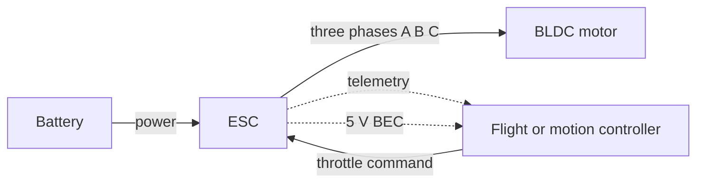

::: testing
Whether you can define an electronic speed controller crisply and **place it in the system**: what goes in (battery power and a throttle command), what comes out (three switched phase voltages), and what it does in between. The interviewer wants to hear:

1. The one-line definition, not "a thing that controls motor speed".
2. That an ESC for a brushless motor is an inverter plus commutation logic, so it knows the rotor position.
3. The interface: power in, signal in, three phases out, optional telemetry.
4. The extras: protection, a BEC, braking, telemetry, firmware.

This page is the "what is it" question. [[q0370]] asks why brushless needs one, [[q0371]] compares it with an H-bridge driver, [[q0372]] opens the box, [[q0373]] covers the interface, [[q0374]] designs one and [[q0375]] specs one.
:::

::: why
ESCs sit in every drone, RC car, e-bike, robot arm and cordless tool. An engineer has to know what the box does and what it exposes, because it is the contract between the battery, the flight or motion controller and the motor. When something goes wrong (a motor stutters, a drone desyncs, a bus pumps up), the first step is knowing which parts of the problem belong to the ESC. It is also a very common entry-level hardware interview question because it covers power stages, firmware and protocols in one object.
:::

::: concepts
- **Brushless motor and commutation**: someone has to switch the phases in step with the rotor. See [[q0363]].
- **Three-phase inverter**: six switches turn a DC bus into three switched phase voltages. See [[q0423]].
- **PWM**: sets the average voltage and so the speed or torque. See [[q0145]].
- **Position sensing**: Hall sensors or back-EMF zero-crossing. See [[q0364]].
- **Control input protocol**: RC pulse, DShot, UART, CAN, covered in [[q0373]].
- **Protection**: overcurrent, undervoltage, over-temperature, desync.
:::

::: answer
"An electronic speed controller is the box that sits between the battery and a motor and turns a throttle command into the right power waveform. For a brushless motor, which is what people usually mean, it contains a three-phase inverter: six MOSFETs in three half-bridges, driven by a small microcontroller.

From the outside it has four connections: battery power in, a control signal in, which in a drone is a throttle value from the flight controller, three motor wires out, and sometimes a telemetry line back. Inside, the microcontroller reads the rotor position, usually from the back-EMF on the unpowered phase because most hobby motors have no Hall sensors, and decides which two phases to energise next. It PWMs those switches so the average voltage, and therefore the speed or thrust, matches the throttle command.

On top of that, an ESC protects itself and the motor: it limits current, shuts down on undervoltage or over-temperature, and often has a BEC, a small regulator that produces 5 V to power the receiver or flight controller. Many also offer braking or regenerative braking, and telemetry like rpm, current and temperature.

So in short: it's an inverter with commutation firmware, a throttle interface and protection, packaged as one board."
:::

::: technical
**Black-box view.**

| Port | Typical content |
|---|---|
| Power in | DC battery or supply, e.g. 2S to 6S Li-ion/LiPo (7.4 to 25.2 V), up to 12S or higher for large systems |
| Signal in | Throttle command: RC PWM (1000 to 2000 µs), Oneshot/Multishot, DShot digital, UART, CAN or I²C |
| Motor out | Three phase wires A, B, C (switched, not a clean DC) |
| Optional | Telemetry (rpm, voltage, current, temperature) back to the controller; BEC 5 V output; programming pad |

**Inside.** Microcontroller, three-phase gate driver, six N-MOSFETs, DC-link capacitors, current sense (shunt or FET $R_{ds(on)}$), voltage divider, back-EMF sensing network, BEC, protection logic. See [[q0372]].

**Control function.** Throttle $\rightarrow$ target duty or speed $\rightarrow$ six-step commutation. Commutation timing is derived from back-EMF zero-crossings; $\omega_{no-load}\approx D\,V_{bus}/K_e$, so throttle is mapped to duty, speed or torque (current) depending on the firmware's mode.

**Protection.** Overcurrent (per-cycle and averaged), undervoltage (to protect Li-ion/LiPo cells from over-discharge), overvoltage on regeneration, over-temperature (thermal foldback), desync/stall detection, and signal-loss failsafe.

**Naming.** In hobby use "ESC" almost always means a BLDC controller; there are also brushed ESCs (essentially one or two half-bridges plus a throttle decoder). In industry the same product is a "BLDC motor driver", "motor controller" or "inverter".
:::

::: short
"An ESC is the electronics that sits between a battery and a motor and converts a throttle command into power for the motor. For a brushless motor it's a three-phase inverter, six MOSFETs plus a microcontroller, that senses rotor position, usually from back-EMF, commutates the phases in sequence and PWMs them to set speed. It also adds protection like current limiting and undervoltage cutoff, often a 5 V BEC, and telemetry. Inputs are battery power and a command signal; outputs are three motor phases."
:::

::: long
"An electronic speed controller, or ESC, is the box between a battery and a motor that turns a command, like 'half throttle', into the right power for the motor. People mostly use the term for brushless motors, like in drones and RC vehicles.

Why you need it: a brushless motor has no brushes, so something else has to switch current between the three windings at the right time. The ESC is that something. Inside there's a microcontroller and a three-phase bridge of six MOSFETs, driven through a gate driver. The microcontroller figures out where the rotor is, most hobby ESCs do this sensorlessly by watching the back-EMF on the floating phase, and energises the right two of the three phases, stepping through six states per electrical revolution. It PWMs those switches so the average voltage tracks the throttle command.

From outside the interface is simple. Battery positive and negative go in. A signal wire carries the throttle from the flight controller or receiver: an analogue-style pulse from 1 to 2 milliseconds, or a digital protocol like DShot. Three wires go out to the motor, and the order only changes direction. Some ESCs add a telemetry wire reporting rpm, current, voltage and temperature.

Beyond commutation, the ESC does protection and housekeeping. It limits current, cuts off at low battery voltage, derates when hot, and handles signal loss safely. Many include a BEC, a small buck regulator that makes 5 V for the receiver or flight controller. Some support braking and regenerative braking, active freewheeling for efficiency, and firmware you can configure.

So I'd summarise it as: inverter plus commutation firmware plus a command interface and protection."
:::

::: terms
- **ESC**: electronic speed controller; the motor driver for a (usually brushless) motor, with commutation firmware and a command interface.
- **BEC**: battery eliminator circuit; a regulator in the ESC that produces 5 V (or similar) from the battery.
- **Throttle signal**: the command from the controller to the ESC; RC PWM, DShot, etc.
- **Sensorless**: position found from back-EMF, no Hall sensors.
- **Desync**: loss of synchronism between commutation and rotor, causing stutter or stall.
- **Telemetry**: data sent back from the ESC (rpm, current, temperature).
- **Active freewheeling / regenerative braking**: using the switches to recirculate or return energy.
- **Arming**: safety sequence in which the ESC must see a low throttle before enabling output.
:::

::: exceptional
An average answer says "it controls the speed of a motor". An exceptional answer:

- Defines it as an inverter plus commutation firmware and gives the four ports.
- Explains that for a BLDC the ESC **is the commutator**, replacing brushes with firmware and sensing.
- Mentions sensorless operation and open-loop startup in a sentence.
- Names the extras (BEC, protection, telemetry, braking) and the protocols (PWM, DShot).
- Notes that "ESC" is the hobby name for a BLDC driver or inverter and that brushed ESCs also exist.
:::

::: mistakes
- **"An ESC just varies the voltage."** For a BLDC it also sequences the three phases; a variable DC voltage alone would not turn the motor.
- **Swapping the motor leads changes the speed.** It only reverses the direction; speed is set by throttle.
- **Treating the BEC as the motor supply.** The BEC is a small regulator (typically 1 to 3 A or less) for electronics, not the motor.
- **"The PWM input signal is the power PWM."** The throttle PWM (50 to 400 Hz pulses) is a *command*; the ESC's own motor PWM runs at tens of kHz.
- **Thinking all ESCs are alike.** Firmware (e.g. timing, braking, protocols) and current ratings differ widely.
- **Calling an ESC "the controller" of the whole vehicle.** The flight or motion controller computes the command; the ESC drives the motor.
:::

::: deep
## The ESC as a black box


Figure: Four ports. Battery power in, a command in, three phases out. The dashed lines are optional: telemetry back and a 5 V supply for the controller.

## What problem it solves

A BLDC motor is a three-phase synchronous machine ([[q0363]]). The rotor magnet has to be dragged round by a rotating stator field, and the stator field must be generated by switching currents in the windings in step with the rotor angle. The ESC does exactly this. Think of three layers inside it:

1. **Power stage**: six switches, so each motor wire can be connected to $+V_{bus}$, ground, or left floating.
2. **Position sensing and commutation**: decide which switches to close next.
3. **Command and protection**: translate the throttle into a duty cycle or current and limit it to safe values.

## How a throttle becomes motion

Suppose the flight controller commands 50% throttle. The ESC's firmware maps this to a duty cycle $D \approx 0.5$ (open-loop "voltage mode") or to a target rpm (closed-loop "governor mode"). Average voltage at the winding is $D\,V_{bus}$, so with a 4S battery at 14.8 V that is about 7.4 V. The motor speeds up until back-EMF $K_e\omega$ plus $IR$ equals that voltage. Throttle thus sets speed (no load) or torque (current, with the propeller load).

## The throttle interface

```timing
{"signals":[
 {"name":"RC PWM, 1 ms","wave":"1.0.........","color":"blue"},
 {"name":"RC PWM, 1.5 ms","wave":"1..0........","color":"green"},
 {"name":"RC PWM, 2 ms","wave":"1...0.......","color":"orange"}
],"hscale":1.2}
```
Figure: Classic hobby RC signal. A pulse of 1 to 2 ms repeated at 50 Hz (every 20 ms) encodes 0 to 100% throttle: 1.5 ms is half. (Here one tick is 0.5 ms.) The ESC measures the pulse width; modern digital protocols such as DShot are covered in [[q0373]].

## Brushed vs brushless ESC

A **brushed ESC** is simple: one or two half-bridges, speed from PWM duty, and a decoder for the throttle pulse. There is no commutation to do. A **brushless ESC** adds the three-phase bridge and the commutation logic, which is why it costs more and why firmware matters. See [[q0371]] for comparing it with a plain motor driver.

## Typical specs on a datasheet

| Spec | Example | Meaning |
|---|---|---|
| Continuous current | 30 A | Sustained output current with specified cooling |
| Burst current | 40 A for 10 s | Short peak capability |
| Input voltage | 2S to 4S | Allowed cell count |
| BEC | 5 V / 2 A | Auxiliary supply |
| Signal | PWM, Oneshot, DShot | Input protocols |
| Firmware | BLHeli_S, BLHeli_32, AM32 and others | Software running on it |

These are examples of the *kinds* of numbers you see; see [[q0375]] for how to choose.

## What goes wrong

- **Desync**: the commutation falls out of step with the rotor during fast throttle changes; the motor stutters or stops and may draw high current.
- **Undervoltage or brownout**: the battery sags under load, the ESC's logic supply drops, and the MCU resets mid-flight.
- **Overheating**: a hot ESC derates or fails; airflow from the propeller matters.
- **Regeneration**: rapid throttle reduction can pump the bus voltage if the battery cannot absorb the energy.

```sim
{"id":"h-bridge-lab","mode":"h"}
```
Figure: The H-bridge is the building block of a brushed ESC; a brushless ESC is the same idea with a third leg and commutation logic. Switch the legs to see current paths, braking and shoot-through.
:::

::: applications
- **Multirotor drones**: four or more ESCs, one per motor, commanded over DShot by the flight controller.
- **RC cars, boats and planes**: ESC with a BEC powering the receiver and servos.
- **E-bikes and scooters**: a larger "controller" that is functionally an ESC with Hall sensors, throttle and display.
- **Robotics**: BLDC joint drives, often with CAN and FOC.
- **Cordless tools and appliances**: integrated ESC-like driver boards.
:::

::: assumptions
- "ESC" here means the brushless type in a hobby, drone or robotics context. In industrial language the same device is a motor driver or inverter; brushed ESCs are simpler.
- Voltage and current numbers are typical examples, not limits; ESCs range from a few amps on small drones to hundreds of amps on large vehicles.
- I assumed sensorless commutation as typical for hobby ESCs; sensored ESCs for cars and robots read Hall sensors instead.
- Firmware names (BLHeli_S, BLHeli_32, AM32) are examples of common open or semi-open projects; features and licensing vary and change.
:::

::: followups
### What does an ESC do that a simple battery switch and PWM wouldn't?
For a brushless motor it performs the commutation: it senses the rotor and switches phases in sequence. A single PWM'd switch would just apply a DC current and lock the rotor. It also adds protection, throttle interface, and braking.

### What is the BEC and why is it in the ESC?
The Battery Eliminator Circuit is a small regulator that produces 5 V (sometimes 7.4 V for servos) from the battery so the receiver or flight controller does not need a separate battery. Linear BECs waste $(V_{in}-V_{out})I$: 5 V at 1 A from a 4S pack (16.8 V) dissipates 11.8 W, so switching BECs are preferred for high input voltages (about 0.6 W at 90% efficiency).

### How is the motor direction reversed?
Swap any two of the three motor wires, or send a reverse command in firmware that reverses the commutation sequence. Swapping reverses the field's rotation direction.

### What is the difference between throttle PWM and motor PWM?
Throttle PWM is a low-frequency command: a 1 to 2 ms pulse every 20 ms (50 Hz) up to 400 Hz. Motor PWM is the ESC's internal switching, typically 8 to 48 kHz or more, which sets the average voltage on the windings. They are unrelated signals.

### Scenario: one ESC on a quadcopter overheats while the others are cool. What do you check?
Check whether that motor/prop is drawing more current (damaged prop, bad bearing, mismatched motor), airflow around that ESC, whether it's covered or near a hot component, a faulty MOSFET with high $R_{ds(on)}$, and whether the firmware PWM or timing settings differ from the others. Log telemetry current and temperature per motor to compare.
:::

::: interpretations
"What is an ESC?" is a definition question; expect the interviewer to follow with [[q0370]] (why it's needed), [[q0371]] (versus a motor driver), or [[q0372]] (its parts). In hobby vocabulary, ESC means brushless; the acronym also applies to brushed speed controllers, noted above.
:::

::: references
- Krishnan, *Permanent Magnet Synchronous and Brushless DC Motor Drives*: inverter-fed BLDC drive structure.
- Texas Instruments and STMicroelectronics BLDC motor-driver application notes on trapezoidal sensorless control (search by topic on the vendor sites).
- Documentation of open-source ESC firmware projects such as BLHeli and AM32 for protocol and feature descriptions; check the project pages for the current state.
:::

::: rubric
- Defines the ESC as the electronics converting a command and battery power into motor drive :: A concise definition is the first thing an interviewer wants.
- For BLDC: three-phase inverter plus commutation/position sensing :: Shows you know it replaces the commutator.
- Lists the interface: power in, throttle in, three phases out, telemetry :: Places it in the system.
- Mentions PWM duty setting average voltage and speed :: Links to control behaviour.
- Mentions protection (current, voltage, temperature) :: Real ESCs are as much about protection as drive.
- Mentions BEC and/or telemetry and braking :: Shows awareness of real products.
- Distinguishes throttle PWM from motor PWM :: A frequent confusion.
:::

::: quiz
```json
[
 {"type":"mcq","level":"fundamental","q":"Which best describes what a brushless ESC contains?","options":["A single MOSFET and a resistor","A three-phase inverter with commutation firmware","A transformer and rectifier","Only a voltage regulator"],"answer":1,"explain":"A brushless ESC is a three-phase inverter (six MOSFETs, gate driver) controlled by a microcontroller that commutates the phases."},
 {"type":"truefalse","level":"fundamental","q":"Swapping two of the three motor wires on a BLDC ESC changes the direction of rotation.","answer":true,"explain":"It reverses the sequence in which the phases are energised, so the field rotates the other way."},
 {"type":"numeric","level":"intermediate","q":"A 1.5 ms RC throttle pulse on a 1.0 to 2.0 ms range corresponds to what percent throttle?","answer":50,"tolerance":0.01,"unit":"%","explain":"$(1.5-1.0)/(2.0-1.0) = 0.5$, i.e. 50%."},
 {"type":"numeric","level":"intermediate","q":"A linear BEC drops a 4S pack at 16.8 V to 5 V and supplies 1 A. How much power does it dissipate?","answer":11.8,"tolerance":0.01,"unit":"W","explain":"$P = (16.8-5)\\cdot1 = 11.8$ W, which is why high-voltage ESCs use switching BECs."},
 {"type":"mcq","level":"intermediate","q":"Why does a sensorless ESC need an open-loop startup?","options":["Hall sensors need warming up","Back-EMF is zero at standstill so rotor position can't be seen","The BEC isn't ready","The flight controller is slow"],"answer":1,"explain":"Back-EMF $K_e\\omega$ is zero at rest, so the ESC aligns and ramps the commutation until it can detect zero-crossings."},
 {"type":"multi","level":"advanced","q":"Select all that are typical ESC protections.","options":["Undervoltage cutoff","Overcurrent limit","Thermal derating","Automatic motor pole detection from the throttle signal"],"answer":[0,1,2],"explain":"ESCs protect battery and hardware with undervoltage, overcurrent and over-temperature actions. Pole count is configured in firmware or irrelevant to six-step control; it isn't derived from throttle."}
]
```
:::
