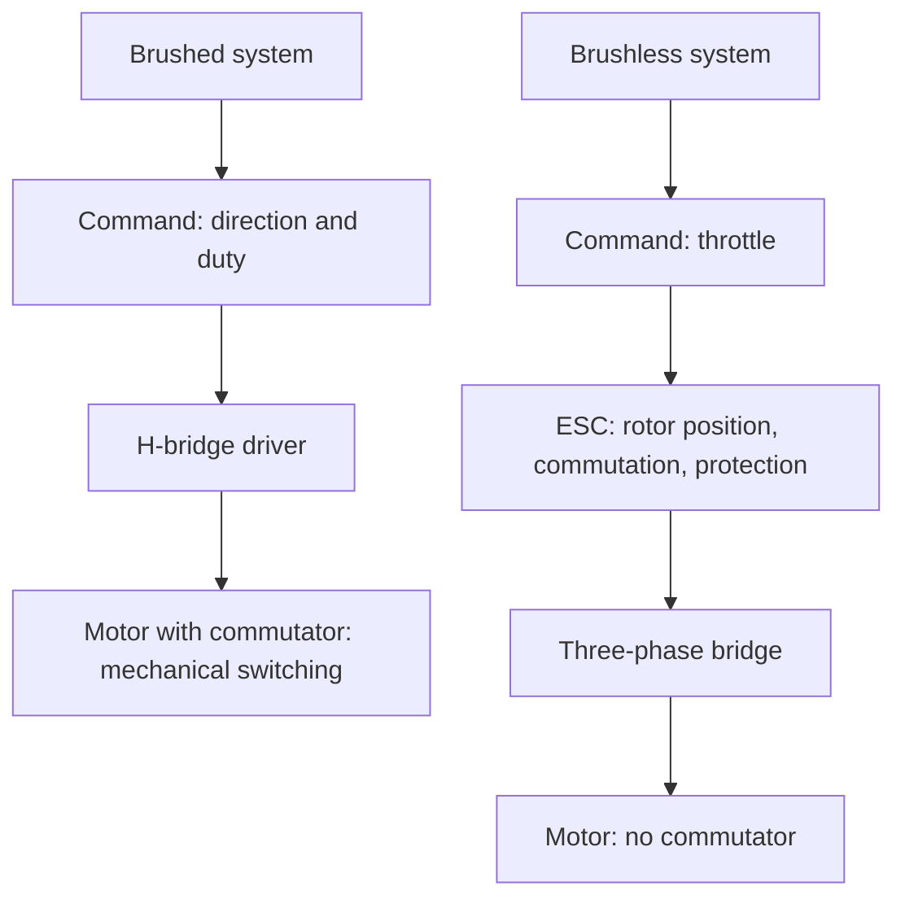

::: testing
Whether you can compare two power stages and explain the **extra layer of intelligence** that a brushless motor demands. The interviewer is looking for:

1. Hardware difference: an H-bridge (two half-bridges) for a brushed motor or single winding versus three half-bridges for three phases.
2. The deeper difference: the H-bridge driver needs no knowledge of the rotor, whereas the ESC must know rotor position and commutate.
3. The list of additional functions an ESC offers: sensorless sensing, startup, throttle protocol, braking and regeneration, telemetry, protection, BEC, configuration.
4. Awareness that the lines blur: many modern single-phase and BLDC drivers share silicon.
:::

::: why
Real products need you to pick between a cheap H-bridge driver IC and a BLDC controller, and a confused choice costs a respin. This question also reveals whether you understand how a brushed motor ([[q0357]]) gets away with a very dumb driver (the commutator does the intelligent part mechanically) and how a brushless motor moves that intelligence into electronics. It connects the H-bridge topic ([[q0423]], [[q0424]]) to the BLDC section.
:::

::: concepts
- **H-bridge**: four switches that apply either polarity of voltage to one winding or a brushed motor. See [[q0423]].
- **Brake and coast modes**: what happens when the bridge shorts or opens the motor. See [[q0424]].
- **Three-phase inverter**: three half-bridges and six states. See [[q0363]].
- **Commutation and position sensing**: the extra function of an ESC. See [[q0370]].
- **Throttle/command protocol**: how the controller talks to the ESC. See [[q0373]].
- **Protection and telemetry**: current limit, thermal, undervoltage, rpm reporting.
:::

::: answer
"The biggest difference is where the commutation happens. A single-phase motor driver, which is basically an H-bridge, drives one winding or a brushed motor. I give it a direction and a PWM duty, and the motor does the rest, because in a brushed motor the commutator switches the coil current mechanically. The driver doesn't need to know anything about the rotor.

An ESC for a brushless motor drives three phases with three half-bridges, six switches, and it has to do the commutation itself. That means it needs to know the rotor position, from Hall sensors or from back-EMF on the floating phase, and use that to choose which two of six states to apply. So the extra pieces are the third leg, the position sensing circuitry and, above all, the firmware.

Beyond that, an ESC usually offers more: an open-loop startup routine for sensorless motors, current limiting and desync detection, a throttle interface like PWM or DShot, braking and regeneration modes, undervoltage cutoff for LiPo batteries, a BEC for powering the flight controller, telemetry such as rpm and current, and configurable timing and PWM frequency.

An H-bridge driver is simple and cheap and it's perfect for a brushed motor, a solenoid, or one winding of a stepper. For a brushless motor you need the three-phase version with commutation intelligence, which is what an ESC is."
:::

::: technical
| Aspect | Single-phase / H-bridge driver | ESC (BLDC) |
|---|---|---|
| Load | Brushed DC motor, solenoid, one coil | Three-phase BLDC/PMSM |
| Power stage | 4 switches (two half-bridges) | 6 switches (three half-bridges) |
| Commutation | None required (done by commutator) | Required, electronic, position-dependent |
| Position sensing | None | Hall sensors or back-EMF sensing |
| Control inputs | Direction + PWM duty (or IN1/IN2) | Throttle command: PWM, Oneshot, DShot, UART, CAN |
| Startup | Apply voltage, back-EMF builds | Alignment and open-loop ramp (sensorless) |
| Firmware | Often none (logic-level inputs) | Substantial (commutation, protection, protocols) |
| Modes | Drive, coast, brake, reverse | Drive, coast, brake, regenerative brake, reverse, active freewheeling |
| Protection | Optional: OCP, thermal, UVLO | Normally all, plus desync and stall detection |
| Extras | Rarely | BEC, telemetry, configuration, LED and beeper |

**Switch states.** An H-bridge has four useful states: forward, reverse, brake (both low-sides on), coast (all off). A three-phase bridge has six active states plus brake and coast; the motor sees a *rotating* field only if the states are sequenced by rotor angle.

**Duty cycle semantics.** In an H-bridge duty maps to average voltage on the motor: $V = D\,V_{bus}$ (sign-magnitude or locked anti-phase modes). In an ESC, duty sets average voltage across the active pair; torque and speed then follow the DC-motor-like equations.

**Cost and integration.** Motor-driver ICs integrate FETs, protection and sometimes current sensing for up to a few amps. ESCs integrate a microcontroller and often sit on a single board with separate FETs for tens of amps.
:::

::: short
"A single-phase driver is an H-bridge: it gives a brushed motor a direction and a PWM duty, and the commutator does the smart part mechanically. An ESC drives three phases with six switches and must do the commutation itself, so it needs rotor position from Hall sensors or back-EMF, and firmware for startup and sequencing. ESCs also add a throttle protocol, braking and regeneration, current and thermal protection, a BEC, and telemetry."
:::

::: long
"The key difference is where the intelligence lives. A single-phase motor driver is really an H-bridge: four switches that let me apply positive or negative voltage to a brushed motor or a coil, usually with direction and PWM inputs. It doesn't need to know where the rotor is, because the motor's own commutator reverses the coil current at the right moment.

A brushless motor has no commutator, so an ESC has to do that job. It drives three phases from three half-bridges, six switches in total, and it picks which two phases conduct based on the rotor position. That means it needs position information: Hall sensor inputs, or back-EMF sensing on the floating phase with comparators or ADC channels. And it needs firmware: the six-step sequence, an open-loop startup for sensorless operation, timing advance, and desync detection.

On top of that an ESC typically offers a lot more. It has a command interface, a 50 hertz RC pulse or DShot or CAN, which the flight controller or microcontroller talks to. It has current limiting and thermal protection, undervoltage cutoff to protect the battery, a BEC to supply 5 V for the electronics, braking and sometimes regenerative braking, active freewheeling to improve efficiency, reversal, and telemetry such as rpm, voltage, current and temperature. Many are configurable, so I can change PWM frequency, timing and braking in firmware.

The simple way to put it: the H-bridge is a power stage; the ESC is a power stage plus a rotor-position-aware controller plus an interface. If I only have a brushed motor, I'd use the H-bridge; for a brushless one, I need the ESC or an equivalent BLDC driver."
:::

::: terms
- **H-bridge**: four-switch circuit that applies either polarity to a load.
- **Half-bridge**: two switches in series, with the load tied to the midpoint.
- **Commutation**: switching current between windings depending on rotor angle.
- **Sign-magnitude PWM**: PWM mode where one side is held and the other is chopped, giving direction by which leg is held.
- **Brake mode**: shorting the motor terminals (both low-sides on) so back-EMF drives a braking current.
- **Regenerative braking**: returning motor energy to the supply.
- **Throttle protocol**: the digital or pulse command language an ESC accepts.
- **Telemetry**: data sent back from the ESC.
:::

::: exceptional
An average answer says "an ESC is for brushless and an H-bridge is for brushed". An exceptional answer:

- Pins the difference on **who does the commutation** (commutator vs electronics).
- Counts the hardware: 4 switches vs 6 and the position sensing path.
- Lists ESC extras that matter (startup routine, desync detection, protocol, regen, telemetry, BEC).
- Notes the exceptions: a single-phase BLDC fan driver, an H-bridge driving one winding of a stepper, and that BLDC driver ICs blur the line.
- Gives a selection rule: brushed/solenoid/stepper winding → H-bridge; three-phase PM motor → ESC or BLDC driver.
:::

::: mistakes
- **"An ESC is just a bigger H-bridge."** It has three legs and, more importantly, position-dependent sequencing and firmware.
- **"The H-bridge needs rotor feedback."** A brushed motor doesn't; the commutator handles it.
- **Using a brushed H-bridge on a BLDC.** Applying DC to two phases locks the rotor; see [[q0370]].
- **Assuming the ESC's throttle PWM is the same as H-bridge PWM input.** The H-bridge PWM input *is* the power duty; the ESC's PWM input is a command.
- **Ignoring braking modes.** H-bridges and ESCs both have brake/coast choices that affect stopping and bus voltage; see [[q0424]].
- **Forgetting current limiting.** Both need it, but an ESC has more failure modes (desync) to handle.
:::

::: deep
## Two power stages side by side

```circuit
{"caption":"H-bridge driving a brushed motor","elements":[
 {"t":"V","a":[2,3],"b":[2,11],"label":"V_{bus}"},
 {"t":"wire","pts":[[2,3],[2,0],[16,0]]},
 {"t":"wire","pts":[[2,11],[2,14],[16,14]]},{"t":"gnd","at":[2,14]},
 {"t":"nmos","at":[6,4],"label":"Q_1","bodyDiode":true},
 {"t":"nmos","at":[6,10],"label":"Q_2","bodyDiode":true},
 {"t":"nmos","at":[14,4],"label":"Q_3","bodyDiode":true},
 {"t":"nmos","at":[14,10],"label":"Q_4","bodyDiode":true},
 {"t":"wire","pts":[[8,0],[8,2]]},{"t":"wire","pts":[[16,0],[16,2]]},
 {"t":"wire","pts":[[8,6],[8,8]]},{"t":"wire","pts":[[16,6],[16,8]]},
 {"t":"wire","pts":[[8,12],[8,14]]},{"t":"wire","pts":[[16,12],[16,14]]},
 {"t":"dot","at":[8,0]},{"t":"dot","at":[8,14]},
 {"t":"dot","at":[8,7]},{"t":"dot","at":[16,7]},
 {"t":"M","a":[8,7],"b":[16,7]}
]}
```
Figure: An H-bridge. Q1 and Q4 on drive the motor one way; Q3 and Q2 on drive it the other way; both low-sides on is brake. Compare with the three-phase bridge in [[q0363]]: it has a third leg and nothing like "one motor between two midpoints".

This stage needs two logic inputs (or direction plus PWM) and no knowledge of the rotor. Everything about commutation is handled mechanically inside the motor.

The brushless ESC replaces the one motor between two midpoints with three windings in a star, one on each leg; at any moment two legs are used and the third floats. The sequencing is a function of rotor angle.

## Intelligence moved from mechanics into firmware


Figure: The same job (turn a command into rotation) is split differently. In the brushed system the motor contains the switching intelligence; in the brushless system the ESC contains it, which is why the ESC is a computer as well as a power stage.

## What an ESC adds, one at a time

**1. Position sensing.** Hall inputs or back-EMF comparators. Cost: an input stage and, for sensorless, divider networks and filtering on all three phases.

**2. Startup.** Sensorless ESCs must align the rotor and ramp open-loop; brushed motors just start.

**3. Command protocol.** An H-bridge takes the PWM duty directly as power. An ESC decodes throttle from RC pulses, DShot or serial, and converts it to duty or speed.

**4. Braking and regeneration.** Brushed H-bridge brake: both low-sides on; the braking current is $E/R$. ESCs offer the same via all-low-side, plus regenerative braking where the switching boosts the motor's back-EMF back into the battery (with bus voltage and battery limits). Active freewheeling turns on the complementary switch during the PWM off-time to avoid body-diode losses.

**5. Protection.** Overcurrent, UVLO, thermal are common to both. The ESC adds desync detection and stall protection.

**6. Auxiliary power.** BEC for the flight controller; an H-bridge module normally has none.

**7. Telemetry and configuration.** rpm, current, voltage and temperature, plus tunable PWM frequency and timing.

## Numbers: why an ESC needs a computer

At 10 000 rpm a 14-pole motor has $f_e = 7\cdot10000/60=1167$ Hz, so six-step needs a commutation decision every $1/(6\cdot1167) = 143\;\mu\text{s}$, with the zero-crossing timing accurate to a few microseconds. This is routine for a small MCU but impossible without a processor and ADC/comparators. A brushed H-bridge driver at the same rpm needs no timing at all.

## Where the line blurs

- **Single-phase BLDC fans**: one winding driven by a tiny H-bridge with one Hall sensor; commutation reduces to "flip polarity when the Hall flips".
- **Stepper drivers**: two H-bridges with current chopping ([[q0380]]); intelligence is in the sequencer.
- **Integrated BLDC driver ICs**: three half-bridges, Hall inputs and commutation logic, no MCU needed, effectively a minimal ESC.
- **Brushed ESCs**: an H-bridge plus a throttle decoder, so "ESC" does not guarantee brushless.

> [!INTERVIEW]
> Lead with "who does the commutation": the answer organises everything else and shows you understand the machine.

```sim
{"id":"h-bridge-lab","mode":"h"}
```
Figure: Try forward, reverse, brake and coast on the H-bridge, and try turning on both switches in one leg (shoot-through). An ESC has to avoid the same fault in three legs, with the added complexity of sequencing.
:::

::: applications
- **H-bridge drivers**: robot-car wheel motors, toy motors, solenoid valves, automotive window/seat motors.
- **ESCs**: drones, RC vehicles, e-skateboards, electric bikes.
- **Integrated BLDC drivers**: fans, small pumps, printers.
- **Single-phase BLDC drivers**: computer fans and appliance blowers.
- **Dual H-bridge**: stepper drivers (a related thing, see [[q0380]]).
:::

::: assumptions
- "Single-phase motor driver" is interpreted as an H-bridge driver for a brushed DC motor or single coil; the question is about the contrast with a three-phase brushless controller.
- Switch counts assume MOSFET bridges; some low-cost drivers use half-bridges with BJTs or only one direction.
- "ESC" means a brushless ESC unless stated; brushed ESCs exist and are essentially H-bridges with a throttle input.
- Feature lists reflect typical hobby and robotics ESCs; industrial drives differ in naming but not in function.
:::

::: followups
### Could you drive a BLDC with three separate H-bridge ICs?
Physically yes: three half-bridges are enough, and an H-bridge chip contains two. But you'd still need the commutation logic and position sensing, and the ICs' shoot-through protection must support three independent legs. Dedicated three-phase drivers integrate this.

### Can an ESC drive a brushed motor?
A brushless ESC is not designed for it. Brushed ESCs exist (an H-bridge with a throttle decoder). A BLDC ESC with only two phases connected would not commutate meaningfully.

### What does braking look like in the two systems?
H-bridge: turn on both low-sides and the motor's back-EMF drives a current $E/R$ through them, braking. ESC: turn on all three low-sides for passive braking, or use regenerative braking where the bridge acts like a boost converter to return energy to the battery. Both stress the motor and the switches with high current.

### What extra firmware does an ESC need compared with an H-bridge?
Commutation tables and timing, rotor detection (zero-crossing), startup routine, current and temperature protection, protocol decoding, and often telemetry. That's why ESC firmware projects exist as open source communities.

### Scenario: a student uses a dual H-bridge board to run a drone BLDC and the rotor just buzzes and heats. What's wrong?
The bridge applies a static or simply PWM'd voltage to two wires with no sequencing, so the rotor locks and the winding overheats. They need a three-phase driver with commutation (an ESC) or at least firmware that steps through the six states using Hall or back-EMF information.
:::

::: interpretations
"Single-phase motor driver" could mean (a) an H-bridge for a brushed motor (this answer), (b) a driver for a single-phase BLDC fan, or (c) one phase of a stepper. In (b) the difference shrinks to one winding and one Hall sensor; in (c) it's a current-chopped H-bridge. Related pages: [[q0369]], [[q0370]], [[q0424]] (braking), [[q0380]] (stepper control).
:::

::: references
- Mohan, Undeland & Robbins, *Power Electronics*: H-bridge and three-phase inverter topologies.
- Krishnan, *Permanent Magnet Synchronous and Brushless DC Motor Drives*: commutation logic and sensing.
- Texas Instruments and Allegro brushed-DC and BLDC motor driver datasheets: compare feature lists (search by topic on the vendor sites).
:::

::: rubric
- Identifies commutation as the key difference (mechanical vs electronic) :: This single idea explains all the other differences.
- Compares hardware: 4 vs 6 switches, position sensing :: Concrete and checkable.
- Notes that the H-bridge needs only direction and PWM, no rotor info :: Shows you understand the brushed motor.
- Lists ESC extras: startup, protocol, protection, BEC, telemetry :: This is exactly what the question asks for.
- Mentions braking/regeneration modes :: Shows practical depth.
- Mentions blurred cases (single-phase BLDC fans, integrated drivers) :: Shows nuance beyond a binary answer.
:::

::: quiz
```json
[
 {"type":"mcq","level":"fundamental","q":"How many switches are in a three-phase ESC power stage versus an H-bridge?","options":["4 vs 6","6 vs 4","2 vs 3","3 vs 6"],"answer":1,"explain":"The three-phase bridge has 6 switches (three half-bridges); an H-bridge has 4 (two half-bridges)."},
 {"type":"truefalse","level":"fundamental","q":"A driver for a brushed DC motor needs to know the rotor position.","answer":false,"explain":"The motor's commutator switches the coil current mechanically, so the driver only sets polarity and PWM."},
 {"type":"numeric","level":"intermediate","q":"A 14-pole BLDC runs at 10 000 rpm in six-step. What is the time between commutations in microseconds?","answer":143,"tolerance":0.02,"unit":"µs","explain":"$f_e = 7\\cdot10000/60 = 1167$ Hz; six commutations per cycle gives $1/(6\\cdot1167)=143$ µs."},
 {"type":"mcq","level":"intermediate","q":"Which is a feature typically found on an ESC but not on a simple H-bridge motor driver?","options":["PWM input","Direction input","Back-EMF zero-crossing detection and commutation firmware","Overcurrent protection"],"answer":2,"explain":"Rotor-position-aware commutation is the defining ESC feature. Direction/PWM inputs and overcurrent protection are common to both."},
 {"type":"truefalse","level":"intermediate","q":"Regenerative braking is possible on both an H-bridge and a three-phase ESC as long as the supply can absorb or the controller can manage the returned energy.","answer":true,"explain":"Either bridge can act as a boost-style converter from motor back-EMF to the bus, but the bus voltage must be controlled."},
 {"type":"multi","level":"advanced","q":"A student wires a BLDC to a dual H-bridge board with PWM on two wires and it buzzes and overheats. Which are plausible causes?","options":["No sequencing, so the field is static and the rotor locks","Winding resistance only limits current at standstill since there's no back-EMF","The BEC voltage is too low","No position sensing to time commutation"],"answer":[0,1,3],"explain":"Without sequencing and position information the rotor locks and the stalled winding draws $V/R$. The BEC is irrelevant to this failure."}
]
```
:::
