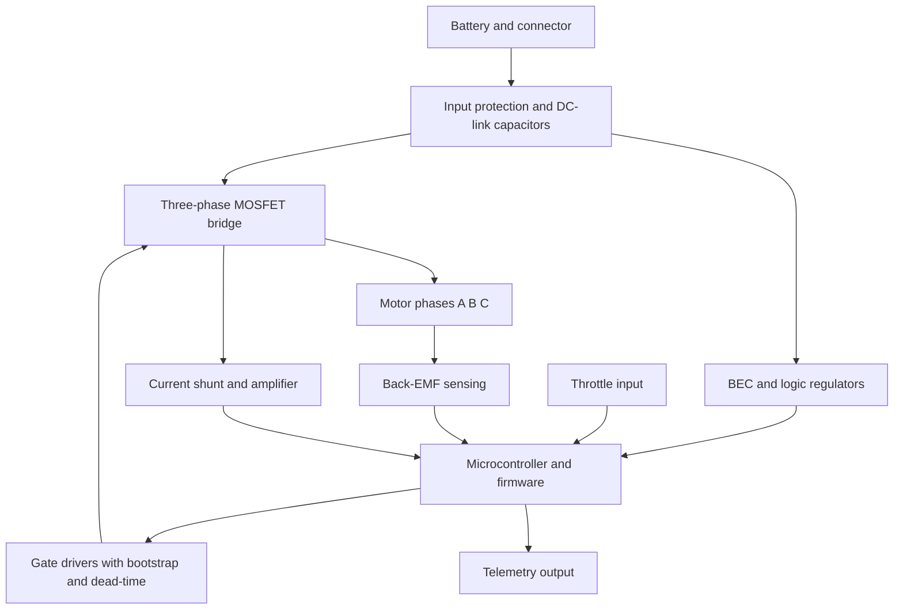

::: basics
### In plain words
An ESC can be split into four groups of parts. The power path carries the battery current to the motor. The control path decides what to switch and when. The sensing parts measure the motor and battery. The support parts make small supply voltages and keep everything safe.

### Picture it
Think of the ESC as a body. The MOSFETs (power switches) are the muscles that do the heavy work. The microcontroller (a small computer chip) is the brain that decides what to do. The sensing circuits are the senses, telling the brain what is happening. The regulators are the digestion, turning the battery's energy into the small supplies the brain needs. The analogy has one gap: the whole thing also needs fast capacitors close to the muscles.

### Words you need
- **DC link capacitors**: charge stores at the battery input that supply the sudden bursts of current.
- **Gate driver**: a chip that switches the MOSFETs quickly and safely. See [[q0365]].
- **Bootstrap**: a small capacitor and diode that give the upper switches the extra voltage they need to turn on.
- **Shunt**: a tiny resistor used to measure current.
- **BEC**: a regulator that makes 5 V for outside electronics.

### The simplest example
Follow one command through. The throttle signal goes into the microcontroller. The microcontroller sends six fast on/off (PWM) signals to the gate driver. The gate driver switches the six MOSFETs, which push current to the motor. A 1 mΩ shunt carrying 30 A produces 30 mV (30 A × 1 mΩ), which a comparator (a circuit that flags when a voltage crosses a limit) watches for overcurrent. Resistor dividers on each motor wire let the firmware see back-EMF. A regulator makes 5 V and 3.3 V for the logic.

That is the whole idea: power, control, sensing and support, all linked by firmware. The rest of this page goes through each group's parts and why they are there.
:::

::: testing
Whether you can open the box and **name every subsystem, what it does and why it's there**, in a sensible order (power path, control, sensing, support). The interviewer is checking:

1. The power path: input protection, DC-link capacitors, six MOSFETs, gate driver with bootstrap.
2. The control path: microcontroller, timers, comparators/ADC, firmware.
3. The sensing: back-EMF network, current sense, voltage and temperature.
4. The support circuits: BEC / regulators, input signal conditioning, telemetry, protection.
5. Whether you understand how they connect, not just a list.
:::

::: why
Debugging or designing an ESC means knowing which block owns which failure. A motor that stutters at low speed is usually the sensing/firmware path; a dead MOSFET is the power or gate-drive path; a brownout in flight is the BEC or bus capacitor. Interviewers also use this as the lead-in to "design an ESC" ([[q0374]]): if you can name and place the blocks, the design follows.
:::

::: concepts
- **Three-phase inverter**: six MOSFETs in three half-bridges. See [[q0363]].
- **Gate driver and bootstrap**: switch the MOSFETs fast and drive the high side. See [[q0365]].
- **Back-EMF sensing**: divider network and comparator/ADC for sensorless position. See [[q0364]].
- **Current sensing**: shunt plus amplifier or $R_{ds(on)}$ sensing. 
- **Bulk and decoupling capacitors**: supply the pulsed current that the battery wiring can't. 
- **BEC**: regulator for logic and external electronics.
:::

::: answer
"I'd split an ESC into the power path, the control path, the sensing and the support circuits.

The power path starts at the battery connector, maybe with reverse-polarity or inrush protection, then a bank of bulk and ceramic capacitors on the DC link, because the battery wires have inductance and can't supply the pulsed current. Then there's the three-phase bridge of six N-MOSFETs, three half-bridges, one per motor wire.

The control path is a microcontroller that decodes the throttle input, runs the commutation state machine and generates the PWM. Between it and the MOSFETs sits a gate driver, which level-shifts and delivers the gate current, with bootstrap diodes and capacitors for the high sides, and dead-time to prevent shoot-through.

For sensing, there's the back-EMF network, resistor dividers from each phase into comparators or ADC channels, so the firmware can detect the zero-crossing of the floating phase. There's current sensing, a low-side shunt with an amplifier or comparator for current limit; a bus-voltage divider for undervoltage and regeneration; and a temperature sensor, an NTC near the FETs.

Support circuits: a BEC, a buck or linear regulator giving 5 V and 3.3 V for the logic and external electronics, a gate-supply rail of around 10 to 12 V, the input signal conditioning for the throttle line, a telemetry output, and status LEDs or a beeper. Everything is tied together by firmware that handles startup, protection and protocols."
:::

::: technical
**Power path.**
- Input: connector, optional reverse-polarity MOSFET or diode, inrush limiter or pre-charge, ferrite/TVS.
- DC link: bulk electrolytic or polymer plus ceramics (low ESR/ESL) placed close to the FETs. Ripple current rating matters: RMS ripple $\approx I_{out}\sqrt{D(1-D)}$ up to about $I_{out}/2$.
- Inverter: six N-MOSFETs (low $R_{ds(on)}$, voltage rating at least 1.5 to 2× the bus), three phase nodes to motor pads.
- Gate-drive: three half-bridge drivers or one three-phase driver, gate resistors (often with a parallel diode for fast turn-off), bootstrap diodes/capacitors, dead-time.

**Control path.** MCU (8-bit or 32-bit Arm core class) with timers, comparators or ADC, and enough speed to run six-step or FOC. Firmware: startup, commutation, protection, protocol decode, telemetry.

**Sensing.**
- Back-EMF: each phase through a divider (e.g. 10 kΩ/3.3 kΩ) to a comparator or ADC referenced to the virtual neutral or half the bus.
- Current: shunt $R_{sh}$ (0.5 to 2 mΩ) in the ground return; amplifier or comparator; $P_{sh}=I^2R_{sh}$.
- Voltage: divider from the bus to ADC.
- Temperature: NTC thermistor near the MOSFETs.

**Support.** BEC (linear or buck, 5 V for external devices); logic regulator (3.3 V); gate supply (about 10 to 12 V); signal input conditioning (series resistor, Schmitt buffer/level shift); telemetry (UART line); LEDs/beeper (the motor itself can beep by pulsing windings); programming pads.

**Mechanical.** PCB copper weight (2 oz or more), thermal vias, a heatsink or shrink-wrap, wire pads.
:::

::: short
"An ESC has four groups of parts. The power path: input connector, DC-link capacitors and a three-phase bridge of six MOSFETs. The control path: a microcontroller running commutation, with a gate driver, bootstrap and dead-time between it and the FETs. The sensing: back-EMF dividers into comparators or ADC, a shunt for current, and voltage and temperature sensors. And the support: a BEC and logic regulators, throttle input conditioning, telemetry and protection firmware."
:::

::: long
"I like to walk the ESC from battery to motor and then add the control and support circuits.

Starting at the battery: a connector, sometimes reverse-polarity or inrush protection, then the DC-link capacitors. These matter more than people think: the battery leads have inductance, so the pulsed switching current has to come from capacitors sitting right next to the MOSFETs, bulk electrolytic or polymer plus ceramics, rated for substantial ripple current.

Then the power stage: six N-channel MOSFETs, three half-bridges, one per motor phase. They're chosen for low on-resistance and a voltage rating well above the battery, with margin for regeneration spikes. Each half-bridge has a gate driver, with gate resistors to control edge speed, bootstrap diodes and capacitors for the high sides, and dead-time so the two FETs in a leg never conduct together.

The brain is a microcontroller. It decodes the throttle input, runs the six-step commutation state machine, generates PWM, runs the protection logic and talks telemetry. To commutate it needs position, so each phase goes through a divider into a comparator or ADC to catch the back-EMF zero-crossing of the floating phase. For protection it has a current shunt, usually in the low-side return, with a comparator or amplifier, a bus-voltage divider for undervoltage, and a thermistor near the FETs.

Finally, the supporting circuits. A BEC: a regulator that outputs 5 V for the flight controller. A logic regulator, 3.3 V, and a gate supply, typically 10 to 12 V. Input conditioning on the signal line, a UART for telemetry, and a beeper or LED. And of course the firmware ties the pieces together: startup, protection, protocol decode.

If something fails I can ask which block: no spin means gate or MCU, stuttering means sensing or timing, resets in flight means BEC or bus capacitors, heat means FET or current."
:::

::: terms
- **DC link**: the DC bus and capacitors feeding the inverter.
- **Half-bridge**: one high-side and one low-side MOSFET with a phase node between them.
- **Gate driver**: IC that provides gate current and level shifting.
- **Bootstrap**: diode and capacitor providing the floating high-side gate supply.
- **Dead-time**: delay between turning one switch off and the other on.
- **Shunt**: low-value resistor for current sensing.
- **BEC**: regulator that provides 5 V to external electronics.
- **Zero-crossing detector**: comparator that flags when a floating phase crosses the neutral voltage.
:::

::: exceptional
An average answer lists "MCU, MOSFETs, gate driver, capacitors, BEC". An exceptional answer:

- Organises the blocks into power, control, sensing and support and explains *how they connect*.
- Explains why the DC-link capacitors exist (battery lead inductance, ripple current) and puts a number on RMS ripple.
- Describes the bootstrap and dead-time inside the gate drive.
- Describes the back-EMF sensing network and the current-sense shunt with an example value.
- Links each block to the typical failure it causes, showing debugging instinct.
- Mentions layout and thermal elements (copper weight, thermal vias, loop area) as part of the "subsystems".
:::

::: mistakes
- **Forgetting the DC-link capacitors.** Without them the battery wires' inductance causes voltage spikes that kill MOSFETs.
- **Putting the bulk capacitor far from the FETs.** Loop inductance of a few tens of nH produces large $L\,di/dt$ spikes.
- **Omitting dead-time/bootstrap from the list.** The gate drive is a subsystem of its own and a main failure source.
- **Using the BEC to power something big.** It is for low-power electronics, with a current and thermal limit.
- **Thinking the MCU measures phase currents directly.** It sees amplified shunt voltage via ADC or a comparator.
- **Ignoring thermal design.** The PCB copper, thermal vias and airflow are part of the ESC's capability.
:::

::: deep
## Block diagram


Figure: The ESC as a set of blocks. Power flows top to bottom through the bridge to the motor; information flows back from the back-EMF network and the shunt to the MCU, which closes the loop through the gate drivers. The regulators hang off the DC link.

## One leg in detail

```circuit
{"caption":"One half-bridge leg with gate driver, shunt and back-EMF divider","elements":[
 {"t":"box","at":[2,2],"w":4,"h":10,"label":"","pins":[{"side":"left","pos":2,"name":"IN_H"},{"side":"left","pos":8,"name":"IN_L"},{"side":"right","pos":2,"name":"HO"},{"side":"right","pos":8,"name":"LO"}]},
 {"t":"text","at":[4,1],"text":"gate driver","anchor":"middle"},
 {"t":"wire","pts":[[6,4],[8,4]]},{"t":"wire","pts":[[6,10],[8,10]]},
 {"t":"rail","at":[10,0],"label":"V_{bus}","dir":"up"},
 {"t":"wire","pts":[[10,0],[10,2]]},
 {"t":"nmos","at":[8,4],"label":"Q_H","bodyDiode":true},
 {"t":"nmos","at":[8,10],"label":"Q_L","bodyDiode":true},
 {"t":"wire","pts":[[10,6],[10,8]]},{"t":"dot","at":[10,7]},
 {"t":"wire","pts":[[10,12],[10,13]]},
 {"t":"R","a":[10,13],"b":[10,17],"label":"R_{sh}"},{"t":"gnd","at":[10,17]},
 {"t":"dot","at":[10,13]},{"t":"wire","pts":[[10,13],[13,13]]},{"t":"term","at":[13,13],"label":"I_{sense}","side":"right"},
 {"t":"wire","pts":[[10,7],[22,7]]},{"t":"term","at":[22,7],"label":"to motor phase","side":"right"},
 {"t":"dot","at":[18,7]},
 {"t":"R","a":[18,7],"b":[18,11],"label":"R_1"},
 {"t":"R","a":[18,11],"b":[18,15],"label":"R_2"},{"t":"gnd","at":[18,15]},
 {"t":"dot","at":[18,11]},{"t":"wire","pts":[[18,11],[22,11]]},{"t":"term","at":[22,11],"label":"to comparator / ADC","side":"right"},
 {"t":"text","at":[2,20],"text":"bootstrap diode + cap on V_{drive} (not drawn)","anchor":"start","muted":true}
]}
```
Figure: A single phase leg. The driver's HO and LO outputs drive the two gates; the phase node (centre) goes to the motor and also, through the divider R1/R2, to a comparator or ADC for back-EMF sensing. The shunt in the ground return gives a voltage proportional to low-side current. A real ESC has three of these legs sharing the rails.

## The subsystems, with reasoning

**DC-link capacitors.** The inverter draws pulsed current, with edges of tens of amps in tens of nanoseconds. The battery wires have inductance of about 10 to 20 nH per 10 mm of wire, so they can't deliver that; capacitors near the FETs do. With a single-leg approximation, bus ripple voltage is $\Delta V\approx\dfrac{I\,D(1-D)}{f_{sw}C}$. For 30 A, $D=0.5$, 24 kHz and 470 µF this is 0.66 V. RMS ripple current is up to about $I/2$, i.e. 15 A for a 30 A ESC, so the capacitors must be rated for it (ESR heating).

**MOSFET bridge.** Voltage rating at least 1.5 to 2× the maximum bus voltage because regeneration and inductive spikes add overshoot (a 4S pack at 16.8 V commonly uses 30 V or 40 V parts). $R_{ds(on)}$ sets conduction loss, $Q_g$ sets switching speed and gate-drive power.

**Gate driver and bootstrap.** Peak gate current $\approx Q_g/t_{sw}$; bootstrap capacitor $\gg Q_g/\Delta V$; dead-time of a few hundred ns. See [[q0365]].

**Back-EMF network.** Each phase to ADC through a divider scaled to the ADC range; the firmware samples at the PWM-on time (or uses a low-pass and virtual neutral) and finds the zero crossing of the floating phase relative to half the bus. Masking after commutation avoids false triggers.

**Current sensing.** Shunt of 1 mΩ at 30 A gives 30 mV and 0.9 W; at 60 A burst 3.6 W. Low values reduce loss but need amplification. Some ESCs sense $V_{ds}$ across the FET instead, avoiding the shunt (less precise).

**BEC and logic supply.** A linear regulator from a 4S pack at 1 A for 5 V dissipates 11.8 W, a switching regulator about 0.6 W, so a buck is normal for high input voltage.

**MCU and firmware.** Timers for PWM, comparators/ADC for sensing, UART or timer-capture for protocols. Firmware modules: startup and alignment, six-step state machine, zero-cross detect and commutation timing, protection, telemetry.

## Layout and thermal

High-current loop (DC-link capacitor to high-side to low-side to ground) must be small: the loop inductance $L_{loop}$ with $di/dt$ of 1 A/ns gives $V=L\,di/dt$; with 10 nH that is 10 V of overshoot. Use thick copper, many thermal vias under MOSFETs, and keep the sensing traces away from the switching node.

```sim
{"id":"bootstrap-driver","vin":16,"vdrv":12,"cboot":1e-6,"d":0.5,"fsw":24000}
```
Figure: The bootstrap capacitor gets charged each time the low side conducts. Drag the duty toward 100% and watch the "Min Vgs" plot: with 1 µF at 24 kHz the high-side gate supply holds up to about 99.9% (the "Max duty" readout), then collapses, because at 100% the low side never turns on to refill $C_{boot}$ and the cap only lasts for the "Hold time" shown. This is why ESCs limit maximum PWM duty or periodically refresh the bootstrap.

## Failure map

| Symptom | Likely block |
|---|---|
| No response, no beeps | MCU, regulator, input signal |
| Beeps but motor won't start | Sensing or startup firmware, gate drive |
| Stutter at low speed | Back-EMF sensing, timing |
| Hot ESC | MOSFET $R_{ds(on)}$, PWM frequency, airflow, current |
| Resets under load | BEC/logic supply, bus capacitors, wiring inductance |
| Blown MOSFET | Shoot-through, voltage spike, no overcurrent trip |

## Worked example: a loss and component budget for a 30 A, 4S ESC

Walking one design end to end shows how the subsystems constrain each other. Take a 4S pack (16.8 V full), 30 A continuous, six-step drive at 24 kHz, with these illustrative component values: MOSFETs at 2 mΩ $R_{ds(on)}$ and 40 nC total gate charge, a 1 mΩ shunt, and 60 ns for the combined voltage rise and fall time at each edge.

**Conduction loss.** In six-step drive two FETs conduct at any instant (one high side, one low side), so the bridge loses $I^2\times2R_{ds(on)} = 900\times0.004 = 3.6$ W, which is 0.6 W per FET averaged over the six states. The shunt in the return path loses $I^2R_{sh} = 0.9$ W.

**Switching loss.** The PWM-ed FET crosses its linear region twice per period, so $P_{sw}\approx\tfrac12VI(t_r+t_f)f = 0.5\times16.8\times30\times60\,\text{ns}\times24\,\text{kHz} = 0.36$ W. That's small beside conduction at 24 kHz and a low-voltage bus, which is why hobby ESCs run low-$R_{ds(on)}$ parts with moderate-speed gate drive. It grows linearly with switching frequency and with voltage, so at 48 V and 48 kHz it is no longer negligible.

**Total and thermal.** About $3.6 + 0.36 + 0.9 = 4.9$ W is dissipated in the power path at full current, plus a little in the capacitors and the BEC. If the board-level thermal resistance to ambient is 10 K/W (illustrative, strongly layout- and airflow-dependent), the hot spot rises about 40 to 50 K, which is acceptable. Halve the copper area or lose the airflow and it is not. Conduction loss scales with $I^2$, so a burst to 60 A costs four times as much: about 14 W in the FETs for the burst duration. The thermistor and firmware limit exist to cut that short.

**Gate drive.** The average gate-drive current per switching FET is $Q_gf = 40\,\text{nC}\times24\,\text{kHz} = 0.96$ mA, which is nothing for the 12 V gate supply. The peak current during an edge, $Q_g/t_{sw}$, is what the driver and the gate resistor are sized for. The bootstrap capacitor must hold the high-side gate charge with a small droop: for 0.5 V droop it needs at least $Q_g/\Delta V = 80$ nF, and the usual rule is ten times that, so about 1 µF.

**Current sense.** At 30 A the shunt gives 30 mV; at a 60 A burst, 60 mV. To use most of a 3.3 V ADC range for 0 to 60 A you need gain $3.3/0.06 = 55$. A 100 µV input offset becomes 5.5 mV at the ADC, which is only 0.1 A of error ($100\ \mu\text{V}/1\ \text{m}\Omega$); a cheap amplifier with 1 to 2 mV of offset, though, reads 1 to 2 A with no current flowing, which is why designs choose an amplifier with low offset, calibrate zero current at startup, or accept a coarser threshold for the overcurrent trip.

**Capacitors.** RMS ripple current is up to about $I/2 = 15$ A. A capacitor bank with 10 mΩ effective ESR dissipates $15^2\times0.01 = 2.25$ W, which is as much as half the FET loss and heats the electrolytics, shortening their life. Splitting it across several low-ESR polymer and ceramic parts at 5 mΩ halves that to about 1.1 W. The ESR and ripple rating, not capacitance, usually sets the part count.

## Limiting cases and where the model breaks

- **Light load.** At very low current the switching loss and the quiescent consumption of the MCU, driver and BEC dominate over conduction; the ESC's standby current matters on battery products that idle most of the time.
- **Very high bus voltage.** The MOSFET voltage rating, bootstrap supply, creepage and isolation all change; above a few tens of volts the hobby architecture gives way to isolated gate drivers and desaturation protection.
- **Fast edges.** The 60 ns assumption sets the overshoot: the loop inductance and the edge rate give $V = L\,di/dt$ spikes, which you reduce with gate resistors and layout, trading against switching loss.
- **Paralleled FETs.** Doubling the FETs halves conduction loss but doubles gate charge, and unequal sharing at turn-on can destroy one before the other.

## Verifying the blocks on a real board

Probe each block separately, as the failure map suggests. With the motor disconnected and a current-limited bench supply, confirm the regulators first: logic, gate-drive and BEC rails with the scope in AC-coupled mode to see ripple. Then scope the gate and phase node of one leg to check dead-time (both gates low for a few hundred ns between transitions) and the bootstrap charge (the high-side gate voltage holding for a full PWM-on period). Inject a known DC through the shunt, or use a precision resistor as a dummy load, and compare the firmware's current reading with a meter. Check the back-EMF network by spinning the motor by hand or with a drill and looking at the divider output at the comparator: the amplitude should match the expected $K_e\omega$ scaled by the divider ratio, and the zero-crossing should align with the real phase voltage. Finally put a thermal camera or thermocouples on a FET, the shunt and a capacitor under load and compare the rises with your budget above.

:::

::: applications
- **Drone 4-in-1 ESC boards**: four of these power stages and MCUs on one PCB.
- **RC car ESCs**: with BEC for receiver and servo, plus braking.
- **E-bike controllers**: larger FET arrays, Hall inputs and display interface.
- **Industrial BLDC drives**: same blocks with isolation, FOC and fieldbus.
- **Robotics**: compact FOC boards with encoder and CAN interface.
:::

::: assumptions
- A typical hobby or small-vehicle sensorless ESC: N-MOSFET bridge, low-side shunt, back-EMF sensing, small MCU. Industrial drives add isolation, EMC filters and different sensors.
- Component values (shunt, divider, capacitors) are illustrative and scale with current and voltage.
- Some ESCs integrate the gate driver and MOSFETs in a single module or use $R_{ds(on)}$ sensing instead of a shunt.
- I assume a battery supply; mains-fed drives add a rectifier and DC-link precharge.
:::

::: followups
### Why does an ESC need so many capacitors on the input?
The inverter's pulsed current at tens of kHz can't be supplied through the battery wires' inductance. Local capacitors provide it, limit the voltage ripple $\Delta V\approx ID(1-D)/(f C)$ and reduce $L\,di/dt$ spikes on the FETs. They also handle the RMS ripple current, up to about half the output current.

### Where is the current measured and why?
Usually in the ground return with a shunt, since it's a ground-referenced measurement that's easy to amplify. Used for current limiting, protection, telemetry and sometimes torque control. High-side or phase sensing is possible but needs more complex amplifiers.

### What is the beeper on some ESCs?
Many ESCs make the motor itself beep by pulsing the windings at audio frequencies with low current, so no buzzer is needed. It's used for arming tones and error codes.

### Why isn't the BEC just a linear regulator?
On a 4S pack, a linear 5 V BEC at 1 A drops 11.8 V at 1 A: 11.8 W of heat in a tiny board. A buck converter gives the same 5 V at about 0.6 W of loss. Linear BECs are fine for low input voltage or very low current.

### Scenario: an ESC works on the bench but resets at full throttle in the aircraft with long battery leads. What do you suspect?
The long leads add inductance, so the bus sags and rings with load changes. Check bus voltage at the board with a scope (undervoltage reset, overshoot), add or move bulk capacitance close to the ESC, shorten the leads, and check the BEC's input range and the MCU's brown-out threshold.
:::

::: interpretations
"Components/subsystems" is answered as blocks and their circuits. For interfaces see [[q0373]], design [[q0374]] and ratings [[q0375]]. The microcontroller-hardware view of the same power stage is in [[q0365]].
:::

::: references
- Texas Instruments three-phase gate-driver datasheets and application notes for bootstrap, dead-time and current-sense implementation (search by topic on ti.com).
- Erickson & Maksimović, *Fundamentals of Power Electronics*: input filter and capacitor ripple-current discussions.
- Open-source ESC firmware documentation (BLHeli, AM32) for a view of subsystems from the firmware side; check the project pages.
:::

::: rubric
- Names the power path: connector, DC-link capacitors, six-MOSFET bridge :: The core of the product.
- Names the gate driver with bootstrap and dead-time :: Often omitted but a leading failure source.
- Names MCU and what firmware does :: Commutation is software.
- Describes back-EMF sensing, current, voltage and temperature sensing :: Position and protection depend on them.
- Names BEC/regulators and input conditioning :: Completes the support circuits.
- Explains why (e.g. capacitors for battery-lead inductance) :: Shows understanding, not recall.
- Mentions layout/thermal :: Real-world capability of an ESC is thermal-limited.
:::

::: quiz
```json
[
 {"type":"mcq","level":"fundamental","q":"Why are capacitors placed right next to the ESC's MOSFETs?","options":["To filter the throttle signal","To supply the pulsed switching current that the battery leads' inductance can't","To measure current","To generate the BEC voltage"],"answer":1,"explain":"Lead inductance prevents fast current delivery, so local capacitors supply the pulses and limit spikes."},
 {"type":"truefalse","level":"fundamental","q":"A sensorless ESC uses the voltage on the floating phase to infer rotor position.","answer":true,"explain":"The floating phase shows the back-EMF; its zero-crossing relative to the neutral marks mid-sector."},
 {"type":"numeric","level":"intermediate","q":"A 30 A ESC uses a 1 mΩ shunt. How much power is dissipated in the shunt at 30 A?","answer":0.9,"tolerance":0.02,"unit":"W","explain":"$P = I^2R = 900\\cdot0.001 = 0.9$ W."},
 {"type":"numeric","level":"intermediate","q":"Estimate bus ripple voltage: $I=30$ A, $D=0.5$, $f_{sw}=24$ kHz, $C=470$ µF, using $\\Delta V = ID(1-D)/(fC)$.","answer":0.665,"tolerance":0.03,"unit":"V","explain":"$30\\cdot0.25/(24000\\cdot470\\times10^{-6}) = 7.5/11.28 = 0.665$ V."},
 {"type":"mcq","level":"intermediate","q":"What does the bootstrap capacitor do?","options":["Filters the BEC output","Provides a floating supply for the high-side gate driver","Limits motor current","Measures back-EMF"],"answer":1,"explain":"It is charged when the low side conducts and then floats above the phase node to supply the high-side driver."},
 {"type":"multi","level":"advanced","q":"The ESC resets whenever you slam the throttle. Which are plausible causes?","options":["Bus voltage sags or rings due to lead inductance and too little capacitance","BEC input drops below its minimum","MCU brown-out threshold crossed","The throttle pulse is too short"],"answer":[0,1,2],"explain":"Bus sag and ringing affect the regulators and MCU supply. A short throttle pulse would be decoded as a command, not cause a reset."}
]
```
:::
