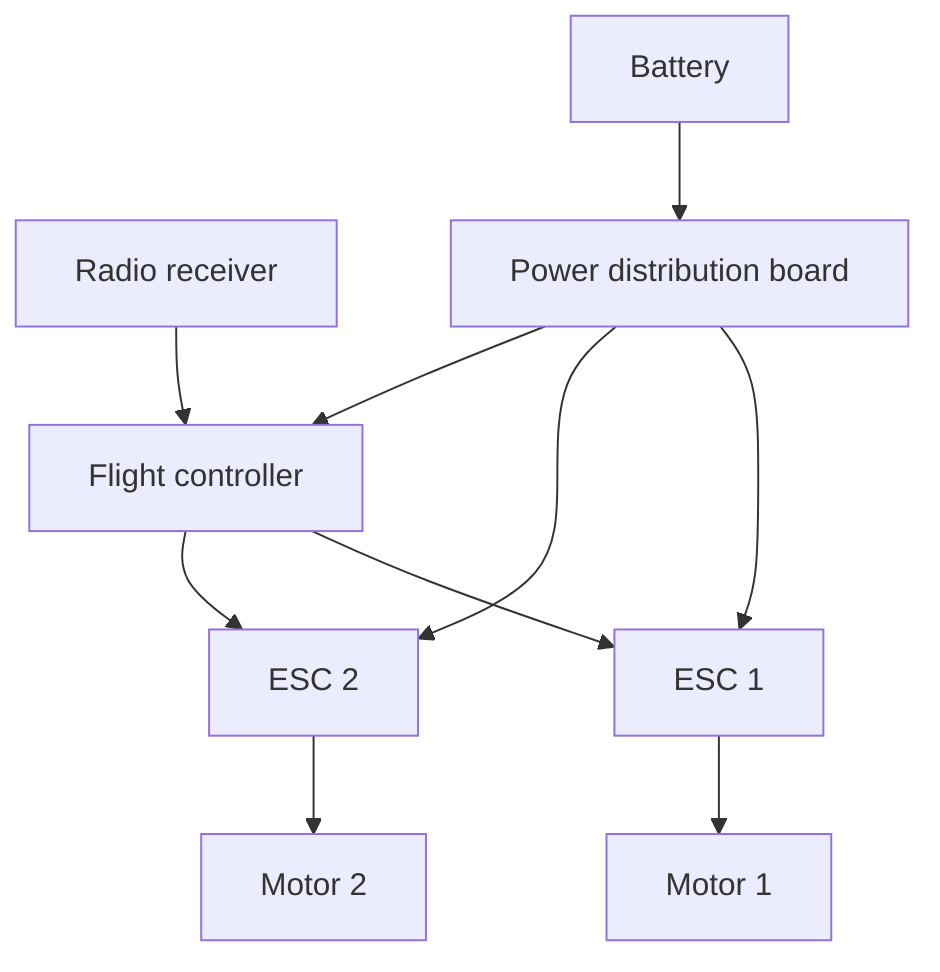
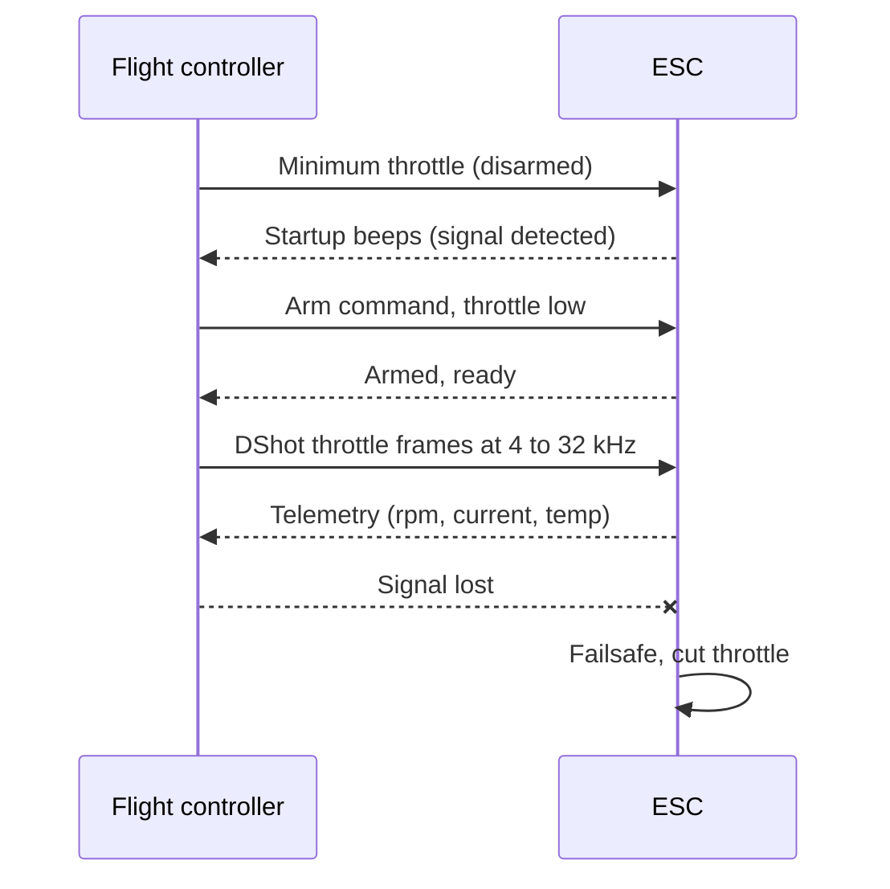

::: testing
Whether you understand the **system around the ESC**: who commands it, over what signal, what else is on the power and data wiring, and what can go wrong at the interface. The interviewer is looking for:

1. The ESC's electrical ports: battery power, signal and ground, telemetry, three motor phases.
2. The command protocols and how they differ: analog RC pulse, Oneshot/Multishot, DShot, serial (UART), CAN.
3. The controller: flight controller or microcontroller with timer/DMA outputs, plus the receiver/radio chain.
4. Practical sequence details: arming, calibration, failsafe, telemetry return, configuration.
5. Signal-integrity basics: common ground, logic level, wire length, noise.
:::

::: why
Most ESC problems that look like "the motor doesn't spin" are interface problems: the wrong protocol, a missing ground, an unarmed ESC, a pulse range that was never calibrated. Knowing the protocols also tells you how fast and how precisely a controller can command a motor, which limits control-loop bandwidth in drones and robots. It is the question that connects the ESC to the microcontroller material in the rest of this list ([[q0145]], timers, UART).
:::

::: concepts
- **PWM as a command**: pulse width encodes throttle, unrelated to motor PWM. See [[q0145]].
- **Timer output compare / DMA**: how an MCU generates precise pulses or bit streams. See [[q0365]].
- **UART and CAN**: serial interfaces for telemetry and commands. 
- **Common ground and logic levels**: signals are referenced to ground; 3.3 V and 5 V thresholds.
- **ESC internals**: what decodes the signal and how it maps to duty. See [[q0372]].
- **System roles**: battery, power distribution, flight controller, receiver, ESC, motor.
:::

::: answer
"The ESC has a simple electrical interface: battery power in, three wires out to the motor, and a signal wire plus ground from a controller, with an optional telemetry wire back. The controller can be a flight controller, a robot's microcontroller, or a receiver.

The command protocols have evolved. The classic one is analog RC PWM: a pulse of 1 to 2 milliseconds, repeated at 50 hertz or up to a few hundred, where the pulse width is the throttle. It's easy for any microcontroller timer to produce, but it needs calibration of the endpoints and is limited in rate. Faster variants like Oneshot125 and Multishot compress the pulse to shorten the period. Modern systems use a digital protocol, DShot, where the controller sends a 16-bit packet: 11 bits of throttle, a telemetry request bit and a 4-bit CRC, at 150 up to 1200 kilobits per second. No calibration, resistant to noise, error-checked, and a flight controller can update at tens of kilohertz. For bigger systems there's UART for telemetry or commands, and CAN bus, for example DroneCAN, where many ESCs share one bus and can report status.

The surrounding components are the battery, a power distribution board, the flight controller or MCU with timer or DMA outputs, and often the receiver. Practicalities: common ground between controller and ESC, 3.3 V logic levels, an arming sequence where the ESC wants to see minimum throttle first, a failsafe if the signal disappears, and telemetry or configuration back through a passthrough to tune settings."
:::

::: technical
**Connections.**

| Wire | Function |
|---|---|
| Battery + / − | Power to the ESC; large gauge, short |
| Signal | Throttle command, logic-level (3.3 V or 5 V tolerant) |
| Signal ground | Return for the signal, must be common with the controller ground |
| Telemetry (optional) | UART from ESC (rpm, voltage, current, temp) |
| BEC 5 V out (optional) | Power for receiver/FC if used |
| Motor A, B, C | Three-phase output |

**Protocols (typical values).**

| Protocol | Frame / pulse | Rate | Notes |
|---|---|---|---|
| Standard RC PWM | 1000 to 2000 µs pulse | 50 Hz (up to 400 to 500 Hz in practice) | Analog, needs endpoint calibration |
| Oneshot125 | 125 to 250 µs | up to ~4 kHz | Faster update, still analog |
| Oneshot42 | ~42 to 84 µs | higher | Analog |
| Multishot | ~5 to 25 µs | up to ~32 kHz | Analog, short pulses |
| DShot150/300/600/1200 | 16-bit digital frame | 150/300/600/1200 kbit/s | Digital, CRC, no calibration |
| UART | Serial bytes | e.g. 115 200 baud | Telemetry or commands |
| CAN (e.g. DroneCAN) | CAN frames | bus, shared | Many nodes, long cables |

> [!UNCERTAIN]
> Pulse widths and rates for Oneshot and Multishot, and the maximum supported DShot speed, differ between ESC firmware versions and hardware. The numbers above are the commonly quoted values; check your ESC firmware documentation.

**DShot frame.** 16 bits sent MSB first: 11-bit value, 1-bit telemetry request, 4-bit CRC. Values 0 is disarm, 1 to 47 are special commands (beeps, direction), 48 to 2047 map to throttle (2000 steps). CRC $= (v\oplus(v\gg4)\oplus(v\gg8))\,\&\,0xF$ where $v$ is the 12-bit value with the telemetry bit. Bit timing: a '1' is a longer high pulse (75% of the bit period) and a '0' a shorter one (37.5%). At DShot600 the bit period is 1.67 µs and the frame lasts 26.7 µs.

**Timing in the controller.** Analog PWM: timer output compare. DShot: timer with DMA that changes duty per bit, or bit-banging, which is why high-rate protocols appear on controllers with DMA.
:::

::: short
"The ESC takes battery power, a signal-plus-ground from the controller, and optionally returns telemetry; three wires go to the motor. The command is either an analog RC pulse of 1 to 2 ms, Oneshot or Multishot for faster updates, or digital DShot, which sends a 16-bit packet with 11-bit throttle and a CRC at 150 to 1200 kbit/s. Bigger systems use UART or CAN. The controller is usually a flight controller or MCU with timer and DMA outputs, and the ESC needs a common ground, arming and a failsafe."
:::

::: long
"From the ESC's side there are three groups of wires. Power: battery positive and negative, thick and short. Motor: three phase wires. And signal: a throttle line and a ground, plus sometimes a telemetry wire coming back.

The thing on the other end of the signal wire is a controller: a flight controller on a drone, a microcontroller on a robot, or a receiver on a simple RC car. It generates the command, and what it sends depends on the protocol.

The original is RC PWM: a pulse between 1 and 2 milliseconds, usually every 20 ms, where the width is the throttle. Any timer can produce it, but it's analog, so you have to calibrate the endpoints and it's slow to update. Oneshot and Multishot shrink the pulse so you can update many times faster. The modern choice is DShot, a digital protocol: each command is a 16-bit frame, 11 bits of throttle, one bit to request telemetry and a 4-bit CRC, sent at 150 up to 1200 kilobits per second. Because it's digital with a checksum, it has no calibration and is robust against noise, and you can update at tens of kilohertz, which matters for fast control loops. A flight controller usually generates it with a timer and DMA. For telemetry, ESCs send rpm, voltage, current and temperature back over a UART, or with bidirectional DShot on the same wire. In larger vehicles, CAN bus lets many ESCs share a cable.

In practice a few things matter. The ESC and controller must share a ground, otherwise the signal floats. Signal wires should be short or twisted with ground to avoid noise from the motor wires. The ESC arms only after it sees minimum throttle, so you don't get a surprise start. And it needs a failsafe: if the signal stops, it should cut throttle. Configuration is done through a passthrough from the flight controller or a programmer."
:::

::: terms
- **RC PWM**: pulse-width throttle command, 1 to 2 ms nominal, repeated at tens to hundreds of Hz.
- **Oneshot / Multishot**: faster analog variants with shorter pulses.
- **DShot**: digital throttle protocol with 16-bit frames and a CRC.
- **CRC**: cyclic or checksum bits that let the receiver reject corrupted frames.
- **Arming**: safety sequence that must be satisfied before the motor will run.
- **Failsafe**: defined behaviour (usually cut throttle) on signal loss.
- **Telemetry**: data returned from the ESC.
- **Passthrough**: the flight controller forwards a configuration tool's serial data to the ESC.
:::

::: exceptional
An average answer says "send a PWM signal, or use DShot". An exceptional answer:

- Separates the three connection groups: power, motor, signal/telemetry.
- Explains each protocol's logic and trade-off: analog (calibration, slow), Oneshot/Multishot (faster), DShot (digital, CRC, no calibration), CAN (multi-drop).
- Quantifies one: DShot600 frame is 26.7 µs, so command updates beyond 30 kHz are possible; 1.5 ms is 50% throttle.
- Names the controller-side mechanism (timers, DMA, UART) and the operational issues (arming, failsafe, common ground, noise).
- Mentions telemetry and configuration paths.
:::

::: mistakes
- **Missing the signal ground.** The signal is referenced to ground; without a common ground the ESC sees noise or nothing.
- **Confusing the throttle PWM with the power PWM.** One is a command (a few hundred Hz at most), the other the motor drive (tens of kHz).
- **Skipping calibration with analog PWM.** Endpoints differ between ESCs; the throttle range may not match.
- **Running long, untwisted signal wires beside motor leads.** The motor phase edges couple into the signal and cause glitches or false commands.
- **Using DShot on a timer that can't do DMA at the right rate.** The frame needs accurate bit timing; jitter causes CRC errors.
- **No failsafe.** If the signal dies and the ESC holds the last throttle, the vehicle runs away.
:::

::: deep
## The system around the ESC


Figure: A drone's signal and power topology (two of four motors shown). Power runs battery to distribution board to each ESC, and the flight controller is a low-power consumer. Each ESC also gets its own throttle line from the flight controller (the arrows from the flight controller to each ESC); an optional telemetry wire back is not drawn.

## Analog RC PWM

The throttle pulse: low = 1000 µs (0%), high = 2000 µs (100%), repeated every 20 ms (50 Hz) in classic systems. A timer's output-compare channel generates it with 1 µs resolution; with a 16-bit timer you get 1000 steps or more. The mapping is linear:

$$\text{throttle} = \frac{t_{pulse}-1000\;\mu s}{1000\;\mu s}$$

So 1500 µs is 50%. The ESC *measures* the pulse width, so jitter on the edge gives throttle noise. The ESC's endpoints (what pulse width is "full") are calibrated by sending the full-throttle pulse at power-up and then the minimum, which the ESC stores.

Update rate limits control bandwidth: at 50 Hz a command reaches the motor every 20 ms, far too slow for a quadcopter attitude loop, hence faster variants. With a 400 Hz frame (2.5 ms) the pulse still occupies 1 to 2 ms of that period.

## Oneshot and Multishot

These keep the same analog idea but scale the pulse down (125 to 250 µs, or 5 to 25 µs) and trigger on the rising edge so the frame period is just the pulse plus a little; update rates of several to tens of kHz are possible. They still need endpoint calibration and are sensitive to timing jitter at the microsecond level, since a few µs of error is a large fraction of a 5 to 25 µs pulse.

## DShot

```timing
{"signals":[
 {"name":"DShot bit '1'","wave":"11111100","color":"green"},
 {"name":"DShot bit '0'","wave":"11100000","color":"orange"},
 {"name":"Bits 1 0 1","wave":"111111001110000011111100"}
],"hscale":0.6}
```
Figure: DShot encodes each bit as a pulse inside a fixed bit period. A '1' is high for about 75% of the period and a '0' for about 37.5%, so the receiver only needs to compare the high time to a threshold at the middle of the bit. Each tick here is 1/8 of a bit period; the third row shows three bits (1, 0, 1) back to back.

**Frame:** 11-bit value, 1 telemetry bit, 4-bit CRC, 16 bits in all.

**Worked example (DShot600).** Throttle value 1046 (about $(1046-48)/1999 = 49.9\%$), no telemetry request. The 12-bit word is $1046\ll1 = 2092 = 0\text{x}82\text{C}$; CRC $= 0x82C\oplus0x082\oplus0x008 \;\&\;0xF = 6$; the frame is $0x82C6$ (1000 0010 1100 0110). At 600 kbit/s a bit lasts $1/600000 = 1.67\;\mu s$ and the frame $16\times1.67 = 26.7\;\mu s$. The other speeds scale: DShot150 frame is 106.7 µs, DShot300 is 53.3 µs, DShot1200 is 13.3 µs.

| Property | Analog PWM | DShot |
|---|---|---|
| Calibration | Needed | Not needed |
| Error detection | None | 4-bit CRC |
| Resolution | ~1000 steps (1 µs timer) | 2000 steps |
| Noise sensitivity | Edge jitter becomes throttle error | Digital threshold, CRC |
| Update rate | 50 Hz to a few kHz | Up to tens of kHz |
| Extra features | None | Commands (beep, direction, LEDs), telemetry request |

**Bidirectional DShot** (a variant): the ESC replies on the same wire with the motor's electrical rpm after each frame, so the controller can use rpm for filtering without an extra wire.

## Serial and CAN

- **UART telemetry:** the ESC streams a packet (e.g. voltage, current, rpm, temperature with a CRC) at a few hundred Hz on a separate wire at, say, 115 200 baud. See the UART questions elsewhere in this list for framing.
- **CAN (e.g. DroneCAN):** differential twisted pair, multi-drop, robust over long distances, each ESC has an address and sends status and accepts commands. Used in larger vehicles where a dozen wires per ESC would be impractical.
- **I²C and others:** appear on some older or integrated drivers.

## Practical sequence: arming and failsafe


Figure: The life of an ESC link. The ESC will not drive the motor until it has seen a valid minimum-throttle signal for a period, which prevents a surprise start. If valid frames stop, the ESC should cut throttle rather than hold the last value.

## Electrical interface details

- **Logic level**: 3.3 V MCU outputs usually work with ESC inputs that threshold at about 2 V, but check; 5 V inputs may not trigger reliably on 3.3 V outputs in marginal designs.
- **Grounding**: the signal ground should go to the ESC's logic ground at the connector, which is close to the battery negative. Large motor currents in the same ground path induce ground shifts of $I\cdot R$ (tens of mV for 30 A through 1 mΩ), which matters for analog pulses.
- **Noise**: keep signal wires short, twisted with their ground, and away from motor phase wires; add a small series resistor or ferrite if there is ringing.
- **Configuration**: the flight controller passes serial data through to the ESC's signal pin (passthrough) so a PC tool can set motor direction, timing, PWM frequency, braking and protocol.

```sim
{"id":"timer-lab","fclk":16000000,"psc":15,"arr":19999,"ccr":1500}
```
Figure: A timer counting at 1 MHz (16 MHz clock, prescaler 16) with ARR = 19999 gives a 20 ms period; CCR sets the pulse width in µs. Set CCR to 1000, 1500 and 2000 to see the 0%, 50% and 100% throttle pulses of an analog ESC command.

## Choosing a protocol

| Situation | Choice |
|---|---|
| Simple RC car or fixed-wing | Analog PWM from the receiver |
| Multirotor with a modern flight controller | DShot (300 or 600 typical) |
| Need rpm for filtering | Bidirectional DShot or telemetry UART |
| Many ESCs, long cables, large vehicle | CAN |
| Legacy ESC | PWM, Oneshot |
:::

::: applications
- **Quadcopters and multirotors**: DShot from the flight controller to four ESCs, with telemetry for rpm filtering.
- **RC cars, boats and planes**: analog PWM from the receiver to a single ESC.
- **Large UAVs and robots**: CAN-connected ESCs with status reporting.
- **Robot joints**: UART or CAN to FOC drivers.
- **Test benches**: an MCU timer generating analog PWM to characterise motor and ESC behaviour.
:::

::: assumptions
- I assume a hobby/UAV-style ESC; industrial drives use fieldbuses (CAN, EtherCAT, Modbus) and have their own command sets.
- Protocol specifics (pulse widths, rates, bit timings) are the commonly used values in the multirotor community and may vary slightly by firmware.
- A flight controller or microcontroller with suitable timers is assumed; low-end controllers may only support analog PWM.
- Telemetry rates and formats differ by ESC firmware; check documentation for your device.
:::

::: followups
### Why does DShot not need calibration?
The value is a digital number, not a pulse width measured against a calibrated range. Value 48 is always minimum throttle and 2047 always maximum, so there is nothing to learn or store.

### How does the ESC know it received a valid DShot frame?
The 4-bit CRC. The sender computes it from the 12 data bits; the ESC recomputes and discards the frame if it mismatches, so a noise glitch won't command full throttle.

### What is the maximum command update rate and why does it matter?
For DShot600 a frame is 26.7 µs, so in principle tens of kHz; in practice controllers run motor outputs at 4 to 32 kHz. Faster commands reduce latency in the control loop, which matters for a drone's attitude controller, where a few ms of delay reduces phase margin.

### How would you add rpm feedback from the ESC without an encoder?
Back-EMF commutation timing gives rpm directly: the ESC reports electrical rpm via telemetry (UART or bidirectional DShot). Divide by the pole pairs to get mechanical rpm. That's used for rpm filtering of gyro noise on drones.

### Scenario: the ESC beeps but the motor doesn't spin when you command throttle from a new flight controller. What do you check?
Protocol mismatch (controller sending DShot while the ESC expects analog, or a different DShot speed); no common ground; arming requirement not met (throttle not at minimum for the required time); the signal pin wired to the wrong timer output or pad; motor direction/disarm commands. I'd probe the signal pin with a scope to check pulse or bit timing and level.
:::

::: interpretations
"How do you interface with ESCs? What other components/controllers are needed? How do they communicate?" is answered as electrical wiring plus protocols plus the supporting system. For the MCU-to-bridge hardware view without an ESC see [[q0365]]; for what's inside the ESC see [[q0372]].
:::

::: references
- Documentation of open-source flight-control and ESC firmware projects (for example Betaflight, BLHeli, AM32 and ArduPilot) for protocol definitions and wiring practice; check each project's current docs.
- DroneCAN specification documentation (the community successor to UAVCAN) for CAN-based ESC interfaces.
- Microcontroller reference manuals for timer output-compare and DMA features (e.g. STMicroelectronics timer chapters).
- Horowitz & Hill, *The Art of Electronics*, 3rd ed.: grounding and interconnect noise discussions.
:::

::: rubric
- Describes the ESC ports: power, signal+ground, motor phases, telemetry :: A clear picture of the interface.
- Explains analog RC PWM: 1 to 2 ms pulse, calibration, update rate :: The baseline protocol everyone knows.
- Explains DShot: 16-bit frame, CRC, speeds, no calibration :: The modern standard in multirotors.
- Mentions UART/CAN for telemetry and large systems :: Shows range beyond hobby PWM.
- Names the controller side: flight controller or MCU timers/DMA :: Answers "what other components are needed".
- Mentions arming, failsafe and common ground :: Practical issues that cause real faults.
- Notes configuration/telemetry paths :: Completes the communication story.
:::

::: quiz
```json
[
 {"type":"numeric","level":"fundamental","q":"With a 1000 to 2000 µs analog throttle, what pulse width commands 25% throttle?","answer":1250,"tolerance":0.01,"unit":"µs","explain":"$1000 + 0.25\\cdot1000 = 1250$ µs."},
 {"type":"mcq","level":"fundamental","q":"Why must the controller and ESC share a ground?","options":["To power the motor","The signal is referenced to ground; without it the ESC can't interpret the logic levels","To charge the battery","To avoid dead-time"],"answer":1,"explain":"The throttle signal is a voltage relative to ground. Without a common reference the signal is undefined or noisy."},
 {"type":"numeric","level":"intermediate","q":"At DShot600, how long does one 16-bit frame take in microseconds?","answer":26.7,"tolerance":0.01,"unit":"µs","explain":"Bit time $=1/600000=1.667$ µs; $16\\times1.667 = 26.7$ µs."},
 {"type":"mcq","level":"intermediate","q":"Which is an advantage of DShot over analog PWM?","options":["Needs less wiring","No calibration and CRC error detection","Works with no ground","Lower frequency"],"answer":1,"explain":"DShot sends digital values with a CRC, so no endpoint calibration is needed and corrupted frames are rejected."},
 {"type":"truefalse","level":"intermediate","q":"The 50 Hz RC throttle pulse and the ESC's motor PWM (e.g. 24 kHz) are the same signal.","answer":false,"explain":"The RC pulse is a command interpreted by the ESC; the motor PWM is generated internally by the ESC to drive the windings."},
 {"type":"multi","level":"advanced","q":"The ESC beeps but won't spin the motor. Which are plausible causes?","options":["Protocol mismatch between controller and ESC","Arming throttle sequence not satisfied","No common signal ground","Motor has too many poles to be detected"],"answer":[0,1,2],"explain":"Wrong protocol, unmet arming conditions and missing ground are all interface problems. Pole count doesn't affect whether the ESC accepts the command."}
]
```
:::
