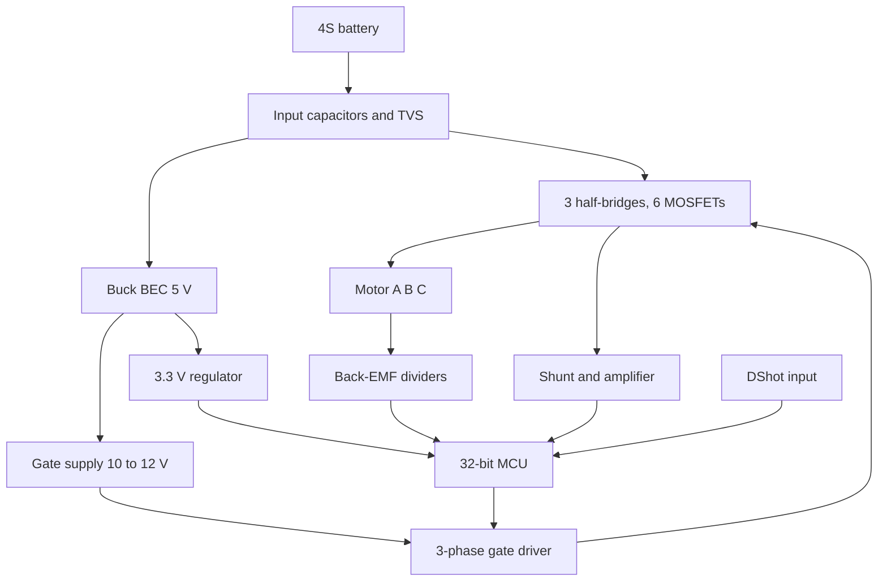

::: testing
Whether you can run an **open-ended hardware design conversation** without being led by the nose. The interviewer is watching the process more than the final answer:

1. Do you ask clarifying questions first (voltage, current, motor, interface, size, cost)?
2. Do you pick an architecture and justify it (sensorless six-step vs FOC, discrete vs integrated driver)?
3. Do you do the key calculations (FET losses, capacitors, gate drive, shunt, BEC, thermals) with real numbers?
4. Do you know the failure modes (shoot-through, spikes, desync, brown-out) and how you'd verify?
5. Do you organise the answer: requirements, block diagram, sizing, protection, firmware, test plan?
:::

::: why
"Design X" questions are how interviewers judge whether you can own a subsystem. An ESC is a good choice because it touches power electronics, gate drive, analog sensing, firmware and thermal design in one small board, and every decision trades against another. A candidate who clarifies, sizes and checks is one you could give a project to. The same structure applies to any design question in this list (see [[q0150]], [[q0263]] for other open-ended designs).
:::

::: concepts
- **ESC subsystems**: power stage, gate drive, MCU, sensing, support. See [[q0372]].
- **Gate drive and bootstrap**: sizing and dead-time. See [[q0365]].
- **Conduction and switching loss**: $I^2R_{ds(on)}$, $\tfrac12VI(t_r+t_f)f$.
- **Interface**: protocols the ESC must accept. See [[q0373]].
- **Motor matching**: $K_v$, current and electrical frequency. See [[q0368]].
- **Protection and verification**: OCP, UVLO, thermal, desync, test plan.
:::

::: answer
"I'd start by asking what it has to do. Which motor and battery: say a 4S LiPo, 16.8 V max, driving a drone motor, 30 A continuous with 60 A bursts. What command interface: DShot from a flight controller, plus telemetry? Does it need a 5 V BEC? Size and weight limits, cost, and whether regen braking matters.

Then I'd pick the architecture. For a drone, sensorless six-step with a small 32-bit microcontroller is the standard: three half-bridges of N-MOSFETs, a three-phase gate driver with bootstrap, back-EMF sensing through resistor dividers, a low-side shunt for current, and a buck for 5 V.

Then the sizing. MOSFETs rated 40 V for a 16.8 V bus, with 2 to 3 milliohms $R_{ds(on)}$ hot: at 30 A with two FETs in the path that's about 5 W conduction loss, plus roughly half a watt switching at 24 kHz. A 1 milliohm shunt gives 30 mV at 30 A and 0.9 W, with a comparator trip at 60 A. Bus capacitors sized for about half the output current in ripple, 15 A RMS, and under a volt of ripple, so several hundred microfarads of low-ESR capacitance near the FETs. Gate driver with 1 µF bootstrap, dead-time around 100 ns. A buck BEC, since a linear one would burn 12 W.

Finally the firmware: alignment, open-loop ramp, back-EMF zero-crossing commutation, DShot decode, protections and failsafe. And I'd verify with a double-pulse test for switching, current-limited bring-up, a thermal run at full current, and a desync stress test. That's what I'd walk through."
:::

::: technical
**Assumed spec (confirm with the interviewer).** 2S to 4S (max 16.8 V), 30 A continuous, 60 A for 10 s, 24 kHz PWM, DShot300/600 input, UART telemetry, 5 V/1 A BEC, 30 × 15 mm board, sensorless six-step.

**Power stage.**
- MOSFET: 30 to 40 V, $R_{ds(on)}\le 2$ to 3 mΩ at 4.5 to 10 V gate, hot value about 1.5× datasheet typical; $Q_g\approx 20$ to 40 nC.
- Conduction loss (two FETs in path): $P_c = I^2\cdot 2R_{hot}$; $I=30$ A, $R_{hot}=3$ mΩ gives 5.4 W.
- Switching: $P_{sw}\approx \tfrac12 V I (t_r+t_f) f_{sw}$ per switching FET: $0.5\cdot16.8\cdot30\cdot40\,\text{ns}\cdot24\,\text{kHz} = 0.24$ W each, about 0.5 W for the pair.
- Dead-time diode loss: $V_fI\cdot 2t_{dt}f\approx0.7\cdot30\cdot2\cdot100\,\text{ns}\cdot24\text{ kHz}=0.1$ W.

**DC link.** Ripple current RMS $\lesssim I/2 = 15$ A; $\Delta V\approx ID(1-D)/(fC)$: $C=470\;\mu$F gives 0.66 V at 30 A. Use polymer/electrolytic bulk plus ceramics (remember DC-bias derating, often 50% or more at 16 V on X5R/X7R).

**Gate drive.** $I_g\approx Q_g/t_{sw}=40\text{ nC}/50\text{ ns}=0.8$ A; bootstrap $C_{boot}\ge 10Q_g/\Delta V$, e.g. $\ge0.8\;\mu F$, so 1 µF; gate resistor 2 to 10 Ω tuned for edge rate/ringing.

**Sensing.**
- Shunt 1 mΩ: 30 mV at 30 A, 60 mV at 60 A; $P=0.9$ W at 30 A. Amplifier gain 20 gives 0.6 V and 1.2 V.
- Back-EMF: dividers 10 kΩ/3.3 kΩ per phase; sampling in PWM-on.
- Bus voltage divider; NTC next to the FETs.

**BEC.** Buck, $\eta\approx90\%$: about 0.56 W loss at 5 V/1 A, versus 11.8 W for a linear regulator from 16.8 V.

**Total loss at 30 A** about 6.9 W, at 60 A about 26 W, so efficiency is about 98.7% at 30 A and 97.5% at 60 A (model in deep dive). Thermal design must handle 7 W continuous.

**Firmware.** Startup (align, ramp), zero-crossing commutation, timing advance, DShot decode (timer capture/DMA), current limit (cycle-by-cycle and averaged), UVLO, over-temperature foldback, failsafe, telemetry, reverse/braking options.

**Verification.** Double-pulse test for switching waveforms; current-limited power-up; short-circuit test; desync/step-throttle test; thermal run with airflow; brown-out and regeneration; EMC pre-scan.
:::

::: short
"I'd clarify the spec first: say 4S, 30 A continuous, 60 A burst, DShot input, 5 V BEC. Architecture: sensorless six-step on a small MCU, three half-bridges of 40 V low-$R_{ds(on)}$ MOSFETs, a three-phase gate driver with bootstrap and dead-time, back-EMF dividers, a low-side shunt and a buck BEC. Sizing: about 7 W total loss at 30 A, bus capacitors for 15 A ripple, 1 µF bootstrap. Then firmware for startup and protections, and a test plan: double-pulse, thermal, desync, regen."
:::

::: long
"First I'd ask what it needs to do, because everything flows from the spec. Which battery and motor? Let me assume a 4S pack, 16.8 V maximum, a drone motor at 30 A continuous with 60 A bursts for ten seconds. Command from a flight controller over DShot, with UART telemetry, a 5 V BEC, small and light, low cost, sensorless.

Architecture: sensorless six-step on a small 32-bit microcontroller. The power stage is three half-bridges of N-MOSFETs driven by a three-phase gate driver with bootstrap. For sensing, resistor dividers on each phase into the MCU's comparators or ADC for back-EMF, a low-side shunt with an amplifier for current, a bus divider, and a thermistor. A buck regulator makes 5 V and 3.3 V.

Now the numbers. MOSFETs: 40 V rating for a 16.8 V bus gives room for spikes, with about 2 to 3 milliohms hot. At 30 A, with two FETs in the current path, conduction loss is about 5.4 W. Switching at 24 kHz with 40 ns edges is roughly half a watt. So I'm near 7 W total at 30 A, 98.7% efficient, and about 26 W at the 60 A burst, which means I need copper area, thermal vias and prop airflow, and the burst is limited by thermal mass. Gate drive: 40 nC in 50 ns is 0.8 A peak, so a proper driver with a 1 µF bootstrap and about 100 ns of dead-time. DC link: ripple current up to half the output, so 15 A RMS, and a few hundred microfarads of low-ESR capacitance right next to the FETs gives under a volt of ripple. Shunt: 1 milliohm gives 30 mV at 30 A, only 0.9 W, with an amp and a comparator tripping at 60 A. BEC: a buck at 90% loses half a watt; a linear would burn 12 W.

Firmware: align, open-loop ramp, hand over to zero-crossing, DShot decode, current limiting, undervoltage, thermal foldback, failsafe, telemetry.

Verification: a double-pulse test on one leg to see the switching waveform and spikes, current-limited bring-up, a short-circuit test, thermal soak at full current, step-throttle tests for desync, and a regen test. Finally I'd mention the trade-offs: a higher PWM frequency or FOC for smoother torque costs switching loss and MCU speed."
:::

::: terms
- **Continuous / burst current**: sustained rating vs short-duration rating, set by thermals.
- **Conduction loss**: $I^2R_{ds(on)}$ in the on-state MOSFET.
- **Switching loss**: energy lost in the overlap of voltage and current during transitions.
- **Double-pulse test**: two-pulse test of one leg to measure switching behaviour at a chosen current.
- **Bootstrap capacitor**: floating supply for the high-side driver.
- **Dead-time**: blanking time to prevent shoot-through.
- **Thermal foldback**: reducing current limit as temperature rises.
- **Desync**: loss of synchronism between commutation and rotor.
:::

::: exceptional
An average answer lists the blocks. An exceptional answer:

- Starts by clarifying and states assumptions on voltage, current, interface, size and cost.
- Chooses an architecture and defends it (sensorless six-step vs FOC; discrete vs integrated).
- Does a loss budget with numbers (conduction, switching, shunt, BEC) and turns it into a thermal requirement.
- Sizes gate drive, bootstrap, DC-link and shunt, not just names them.
- Discusses protections, firmware states, layout (power loop) and verification.
- Flags trade-offs and what would change with different requirements (higher voltage, FOC, regen).
:::

::: mistakes
- **Starting to draw before asking requirements.** Every number depends on voltage, current, motor and interface.
- **Using $R_{ds(on)}$ at 25 °C.** Hot resistance is typically 1.4 to 1.6× larger; the loss budget must use the hot value.
- **Ignoring the shunt's loss.** 1 mΩ at 30 A is 0.9 W, a meaningful part of a 7 W budget.
- **Choosing a linear BEC from a high-voltage pack.** The dissipation can exceed the entire power stage loss.
- **Bulk capacitors far from the FETs.** The power loop inductance dominates spikes, not the capacitor value.
- **No test plan.** Design isn't finished until you say how to verify switching, thermals and failure behaviour.
:::

::: deep
## Step 1: clarify the problem

Questions I'd ask, in roughly this order:

| Question | Why it matters |
|---|---|
| Battery chemistry and cell count (max/min voltage) | FET voltage rating, UVLO, BEC type |
| Motor: $K_v$, $R$, poles, max rpm | Electrical frequency, voltage headroom, PWM rate |
| Continuous and peak current, duty | Conduction loss, thermal design, shunt |
| Command interface and update rate | MCU peripherals, protocol firmware |
| Sensors available? | Sensorless vs Hall |
| Size/weight, airflow, cost | Packaging and thermal strategy |
| Regeneration, braking, reversal | Bus protection, firmware |
| Certification/EMC | Filtering, layout |

I'll state assumptions explicitly: 4S, 30 A continuous, 60 A for 10 s, DShot, telemetry, 5 V BEC, sensorless, 30 × 15 mm, airflow from the propeller.

## Step 2: architecture


Figure: The architecture I would draw. Power flows from the battery down through the bridge; BEC and gate supplies hang off the input rail; the MCU gets position (back-EMF) and current feedback and commands the gate driver.

Alternatives I'd mention: **FOC** (smoother, quieter, needs two or three current sensors and more MCU power, good for gimbals and efficiency at low speed); **sensored** (Halls give reliable low-speed startup, as in e-skateboards); **integrated driver or smart power module** for lower part count at a cost in flexibility.

Power-stage schematic I would draw on the whiteboard:

```circuit
{"caption":"ESC power stage: bus capacitor, three half-bridges, low-side shunt","elements":[
 {"t":"V","a":[2,3],"b":[2,11],"label":"4S","labelSide":"other"},
 {"t":"wire","pts":[[2,3],[2,0],[24,0]]},
 {"t":"wire","pts":[[2,11],[2,18],[27,18]]},{"t":"gnd","at":[14,18]},
 {"t":"Cpol","a":[4,3],"b":[4,11],"label":"C_{bus}"},{"t":"dot","at":[4,0]},
 {"t":"wire","pts":[[4,11],[4,14],[27,14]]},
 {"t":"nmos","at":[8,4],"label":"Q_{AH}","bodyDiode":true},
 {"t":"nmos","at":[8,10],"label":"Q_{AL}","bodyDiode":true},
 {"t":"nmos","at":[16,4],"label":"Q_{BH}","bodyDiode":true},
 {"t":"nmos","at":[16,10],"label":"Q_{BL}","bodyDiode":true},
 {"t":"nmos","at":[22,4],"label":"Q_{CH}","bodyDiode":true},
 {"t":"nmos","at":[22,10],"label":"Q_{CL}","bodyDiode":true},
 {"t":"wire","pts":[[10,0],[10,2]]},{"t":"wire","pts":[[18,0],[18,2]]},{"t":"wire","pts":[[24,0],[24,2]]},
 {"t":"wire","pts":[[10,6],[10,8]]},{"t":"wire","pts":[[18,6],[18,8]]},{"t":"wire","pts":[[24,6],[24,8]]},
 {"t":"wire","pts":[[10,12],[10,14]]},{"t":"wire","pts":[[18,12],[18,14]]},{"t":"wire","pts":[[24,12],[24,14]]},
 {"t":"dot","at":[10,0]},{"t":"dot","at":[18,0]},{"t":"dot","at":[10,14]},{"t":"dot","at":[18,14]},{"t":"dot","at":[4,14]},
 {"t":"wire","pts":[[10,7],[13,7]]},{"t":"term","at":[13,7],"label":"A","side":"right"},{"t":"dot","at":[10,7]},
 {"t":"wire","pts":[[18,7],[20,7]]},{"t":"dot","at":[18,7]},
 {"t":"term","at":[20,7],"label":"B","side":"right"},
 {"t":"wire","pts":[[24,7],[27,7]]},{"t":"term","at":[27,7],"label":"C","side":"right"},{"t":"dot","at":[24,7]},
 {"t":"R","a":[27,14],"b":[27,18],"label":"R_{sh}"},{"t":"dot","at":[27,14]},{"t":"dot","at":[27,18]}
]}
```
Figure: The bus capacitor sits across the rails right at the bridge. The shunt is in the return path of all three legs, so it sees the sum of the low-side currents (the battery return current); battery negative joins after the shunt. Gate drivers, sensing and the MCU are omitted for clarity; see [[q0372]].

## Step 3: loss budget and thermal

A loss model for the 30 A design: $R_{hot}=3$ mΩ per FET, 1 mΩ shunt, $t_r+t_f=40$ ns, 16.8 V, 24 kHz.

$$P_{loss}(I) = I^2(2R_{hot}+R_{sh}) + 2\cdot\tfrac12VI(t_r+t_f)f_{sw} + P_{quiescent}$$

```plot
{"title":"ESC loss budget vs output current (4S, 24 kHz)","x":{"label":"Output current","unit":"A","min":0,"max":60},"y":{"label":"Power loss","unit":"W","min":0,"max":30},
 "vars":{"rh":0.003,"rsh":0.001,"v":16.8,"tsw":40e-9,"f":24000,"pq":0.1},
 "series":[{"label":"conduction (FETs + shunt)","fn":"x*x*(2*rh+rsh)","color":"red"},{"label":"switching (2 FETs)","fn":"2*0.5*v*x*tsw*f","color":"blue"},{"label":"total","fn":"x*x*(2*rh+rsh)+2*0.5*v*x*tsw*f+pq"}],
 "points":[{"x":30,"y":6.9,"label":"30 A: 6.9 W"},{"x":60,"y":26.3,"label":"60 A: 26 W"}]}
```
Figure: Conduction loss grows as $I^2$ and dominates at high current; switching loss is linear in current and small here. Doubling the current quadruples the heat, which is why the 60 A burst must be limited in time, not just by FET ratings. Efficiency stays above 97% at all points, so the design problem is heat, not battery life.

**Thermal check.** At 30 A continuous, about 6.9 W spread over six FETs, shunt and traces. With a thermal resistance board-to-air of 8 K/W (with prop wash, assumed, vendor/layout dependent) the rise is about 55 K, acceptable. At 60 A for 10 s, 26 W into an effective thermal mass of roughly 5 J/K (assumed: a few grams of copper and silicon) gives about 50 K rise in 10 s, so the burst is thermally limited at about 10 s. Add copper pour, thermal vias, 2 oz copper, or lower $R_{ds(on)}$.

> [!UNCERTAIN]
> The thermal resistance and heat capacity numbers are order-of-magnitude assumptions. Real values depend on layout, copper weight, airflow and packaging and must be measured on a prototype.

## Step 4: gate drive, capacitors, protection

**Gate drive.** Choose a three-phase driver with at least 1 A source/sink, integrated bootstrap diodes and programmable dead-time. Gate resistors: $R_g$ 2 to 10 Ω with a diode for fast turn-off. Verify with a double-pulse test that the phase node overshoot stays under about 80% of FET $V_{ds,max}$ (e.g. below 32 V for 40 V parts).

```sim
{"id":"gate-drive","vdrive":10,"rg":4,"qg":40e-9,"lg":5e-9,"vth":2}
```
Figure: Raise $R_g$ and watch the Miller plateau lengthen (more switching loss, less ringing); lower it and the edges speed up but the gate loop rings. This is the trade-off you tune in the double-pulse test.

**Power loop.** Place ceramics immediately next to each half-bridge so the loop inductance is a few nH. A 20 nH loop with $di/dt=60\text{ A}/50\text{ ns}$ produces $L\,di/dt = 24$ V of spike, which is why layout matters as much as FET choice.

**Current limiting.** Shunt 1 mΩ with gain-20 amplifier: 60 A gives 1.2 V at the ADC/comparator; a hardware comparator trips at 60 A within a few µs, and the MCU also limits the average current in firmware. A 12-bit ADC with 3.3 V reference resolves about 40 mA per LSB at this scaling.

**Other protections.** Undervoltage lockout (e.g. 3.0 V per cell), overvoltage clamp (TVS) for regeneration, thermal foldback at the NTC, input TVS, signal-loss failsafe.

## Step 5: BEC and supply

A 5 V/1 A buck from 16.8 V: loss $\approx 5/0.9-5=0.56$ W. LDO chain to 3.3 V for the MCU. Gate supply 10 to 12 V from the buck input (or small boost). Check the BEC input range against the maximum pack voltage with spikes.

```sim
{"id":"regulator-compare","mode":"compare","vin":16.8,"vout":5,"iout":1}
```
Figure: Compare an LDO with a buck for 16.8 V to 5 V at 1 A. The LDO loses about 11.8 W, the buck about half a watt. At this ratio the linear option is not viable.

## Step 6: firmware plan

1. **Init and arming:** wait for valid minimum throttle for a time.
2. **Startup:** align (DC pulse), open-loop ramp with fixed current limit.
3. **Closed loop:** detect zero-crossing of the floating phase, commutate after a delay of $T_{60}/2$ with advance angle; mask time after each commutation.
4. **Throttle to duty/torque:** with slew limits to avoid desync.
5. **Protection:** cycle-by-cycle current limit, UVLO, thermal foldback, stall detect.
6. **Interface:** DShot decode with CRC check, telemetry transmit, failsafe.
7. **Config:** non-volatile storage for direction, timing, PWM frequency, braking.

## Step 7: verification

| Test | What it proves |
|---|---|
| Double-pulse test on one leg | Switching speed, spikes, dead-time, gate ringing |
| Current-limited bring-up (bench supply 1 A, then more) | No shoot-through, gate drive correct |
| Short-circuit/overcurrent trip | Protection reaction time and safety |
| Full-load thermal soak with airflow | Temperature rise, derating |
| Step-throttle/desync test | Commutation robustness |
| Regen/brake test | Bus overshoot behaviour |
| Brown-out/long-lead test | Input capacitance and BEC margin |
| EMC pre-scan | Edge rate, filtering |

## What changes if...

- **6S (25.2 V):** use 40 to 60 V FETs, higher UVLO levels, BEC input range check; lower current for the same power.
- **100 A:** parallel FETs or lower $R_{ds(on)}$, thicker copper, larger bus caps, likely a heatsink.
- **Smooth, quiet (gimbal):** FOC, 3 current sensors, 40 to 100 kHz PWM, encoder.
- **Cost-down:** integrated driver+FET modules, MCU with built-in gate driver.
:::

::: applications
- **Drone ESCs** (30 A class): exactly this design; 4-in-1 boards share a PCB and bus capacitors.
- **E-skateboard and e-bike controllers**: bigger, Hall-sensored, with throttle ramp.
- **Robot and gimbal drivers**: FOC variants with current sensing and encoder.
- **RC car/boat ESCs**: with braking, reverse and BEC.
- **Educational ESC boards**: open-source designs showing these blocks.
:::

::: assumptions
- The spec (4S, 30 A, 60 A burst, DShot, 5 V BEC) is assumed; an interviewer may give different numbers and the same method applies.
- MOSFET and gate-driver numbers are typical for modern 30 to 40 V trench parts; verify with the actual datasheet, especially hot $R_{ds(on)}$ and $Q_g$.
- Sensorless six-step is assumed; FOC and sensored alternatives change the sensing and MCU requirements.
- Thermal estimates are rough and need prototype measurement; they depend heavily on airflow.
- Part numbers are deliberately omitted since lineups change; select from current manufacturer catalogs.
:::

::: followups
### How would you choose the PWM frequency?
Trade switching loss (linear in $f$) against current ripple and audible noise. For a motor with $L_{LL}=50\;\mu$H on 16.8 V, ripple is $\approx V D(1-D)/(Lf)=16.8\cdot0.25/(50\mu\cdot24k)=3.5$ A p-p at 24 kHz, 1.75 A at 48 kHz. 24 to 48 kHz is typical: above audio, and switching loss is only a small fraction of the budget here.

### What happens at the motor's top speed in terms of control?
A 7-pole-pair motor at 30 000 rpm is at 3.5 kHz electrical, so commutation every 47.6 µs. With 24 kHz PWM that is under 7 PWM cycles per electrical period, so zero-crossing timing resolution and sampling become the limit; higher PWM frequency or more MCU speed helps.

### How do you stop regenerative energy killing the bus?
When the throttle drops quickly, the spinning motor and prop push current back. A battery absorbs it, but a 4S pack with a high internal resistance or a disconnected battery lets the bus rise. Limit the deceleration rate, use active freewheeling/braking in a controlled way, size a TVS/clamp, and choose FETs with margin above the worst spike.

### Why 40 V FETs for a 16.8 V bus?
The bus ringing and inductive spikes add overshoot (tens of percent), and regeneration can raise the bus. A good rule is at least about 1.5× to 2× the maximum bus voltage as the part rating, then confirm the actual overshoot in the double-pulse test.

### Scenario: prototypes pass the bench but desync in flight when the throttle is punched. What do you change?
Check the commutation timing and zero-cross blanking during rapid acceleration; add a throttle slew limit or startup assist; make sure the current limit isn't distorting the floating-phase measurement; examine bus droop at the punch (sampling noise); and test with the real prop. If it's marginal, raise PWM frequency, advance timing, or consider an observer-based approach.
:::

::: interpretations
"Design an ESC" is open-ended, so I treat it like other design questions: requirements first, then architecture, sizing and verification. The component-level view is [[q0372]]; spec'ing someone else's ESC is [[q0375]]; the interface is [[q0373]].
:::

::: references
- Texas Instruments and other vendors' three-phase gate-driver datasheets and reference designs for BLDC drives (search by topic on the vendor sites).
- Erickson & Maksimović, *Fundamentals of Power Electronics*: switching loss, capacitor ripple current and thermal discussions.
- Krishnan, *Permanent Magnet Synchronous and Brushless DC Motor Drives*: inverter design and sensorless commutation.
- Open-source ESC firmware and hardware projects (such as AM32 or BLHeli) for real examples of the blocks; check each project's current documentation.
:::

::: rubric
- Asks clarifying questions and states assumptions :: Shows engineering process; numbers need a spec.
- Chooses architecture (sensorless six-step, MCU, three-phase bridge) with reasons :: Demonstrates decision-making and awareness of alternatives.
- Sizes MOSFETs with a conduction and switching loss estimate :: Core power-stage competence.
- Specifies gate drive with bootstrap and dead-time, with a number :: Common failure area.
- Sizes DC-link capacitors and addresses loop inductance :: Prevents spikes and brown-outs.
- Includes current sensing, protections and BEC choice :: Complete product requirements.
- Outlines firmware states and a verification plan :: Shows you can deliver and test, not just draw.
:::

::: quiz
```json
[
 {"type":"mcq","level":"fundamental","q":"Why would you choose a 40 V MOSFET for a 4S (16.8 V max) ESC?","options":["It is cheaper than 20 V parts always","It provides margin for switching spikes and regeneration","It reduces the shunt value","It removes the need for dead-time"],"answer":1,"explain":"Inductive spikes and regeneration push $V_{ds}$ above the bus voltage, so parts are rated about 1.5 to 2× the bus."},
 {"type":"numeric","level":"intermediate","q":"Two MOSFETs each with $R_{ds(on)}=3$ mΩ (hot) carry 30 A in series in the current path. Conduction loss in watts?","answer":5.4,"tolerance":0.02,"unit":"W","explain":"$P = I^2\\cdot 2R = 900\\cdot0.006 = 5.4$ W."},
 {"type":"numeric","level":"intermediate","q":"Switching loss of one FET: $V=16.8$ V, $I=30$ A, $t_r+t_f=40$ ns, $f=24$ kHz. Use $P=\\tfrac12 VI(t_r+t_f)f$.","answer":0.242,"tolerance":0.03,"unit":"W","explain":"$0.5\\cdot16.8\\cdot30\\cdot40\\times10^{-9}\\cdot24000 = 0.242$ W."},
 {"type":"numeric","level":"intermediate","q":"A 1 mΩ shunt with an amplifier of gain 20 sees 60 A. What is the amplifier output in volts?","answer":1.2,"tolerance":0.02,"unit":"V","explain":"$60\\cdot0.001=60$ mV; times 20 = 1.2 V."},
 {"type":"mcq","level":"advanced","q":"Doubling the output current of an ESC from 30 A to 60 A changes conduction loss by roughly what factor?","options":["2×","4×","8×","No change"],"answer":1,"explain":"Conduction loss is $I^2R$, so doubling the current multiplies it by four. That is why burst current is limited in time by heating."},
 {"type":"multi","level":"advanced","q":"Which are valid parts of a verification plan for a new ESC?","options":["Double-pulse test to check switching waveforms and spikes","Step-throttle test for desync","Regeneration/brake test","Increasing the BEC output to 12 V to see if the motor runs"],"answer":[0,1,2],"explain":"Switching, commutation robustness and regeneration are core tests. Changing the BEC output voltage is not a test of the ESC's motor drive."}
]
```
:::
