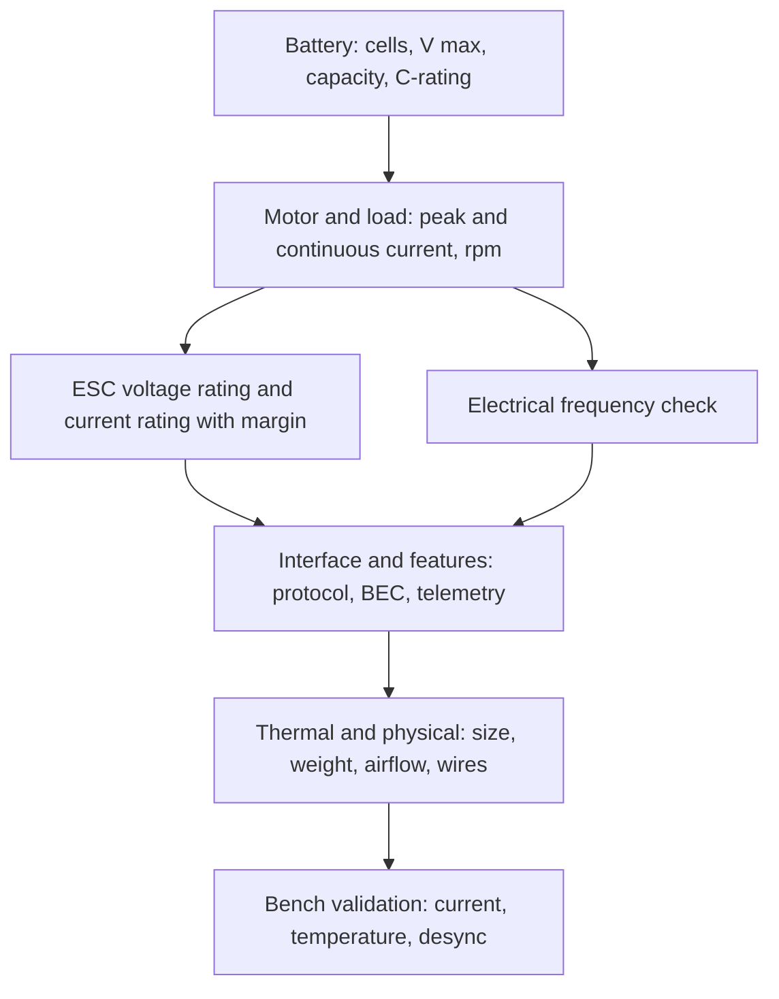

::: basics
### In plain words
Specifying an ESC means matching it to the motor and the battery. Check that its voltage rating covers the battery, that its current rating covers what the motor really draws (plus margin), and that it speaks the right command protocol. Then check the extras: electrical rpm, the BEC, size, cooling and protections.

### Picture it
It is like buying an extension cord or power strip. You add up what will be plugged in, then choose one rated well above that. A cord rated just at the limit will overheat. The same goes for an ESC: rate it above the measured load, not the nameplate. The analogy has a gap: an ESC can also be destroyed by too much voltage, not just too much current.

### Words you need
- **Cell count (S)**: the number of battery cells in series. A 4S LiPo is 4 × 4.2 V = 16.8 V fully charged.
- **Continuous current rating**: the current the ESC can carry without overheating.
- **Burst rating**: a short-term current limit, only meaningful with stated test conditions.
- **Protocol**: the throttle language, such as DShot. See [[q0373]].
- **BEC**: the built-in 5 V supply for outside electronics.

### The simplest example
A 4S pack is 4 × 4.2 = 16.8 V, so the ESC must be rated for at least 4S. Suppose you measure 38 A at full throttle. Add 25 to 50% margin: 38 × 1.25 ≈ 48 A and 38 × 1.5 = 57 A. So pick an ESC in the **50 A class** or above. Then check speed: a motor with 34,000 rpm no-load and 7 pole pairs runs at 34,000 × 7 / 60 ≈ 4 kHz electrical, which the ESC must handle.

That is the whole idea: voltage, current, protocol and speed must all match. The rest of this page covers burst ratings, the BEC, cooling and protection features, and why you bench-test before use.
:::

::: testing
Whether you can **choose an ESC for a given motor and battery** by working from the motor's real current and voltage, then checking margins, interfaces and thermal conditions. The interviewer is looking for:

1. Voltage: cell count and the maximum battery voltage, with margin for spikes and regen.
2. Current: continuous and burst, based on the motor's *measured* peak current, with derating margin.
3. Compatibility: protocol, firmware, electrical-frequency limit, telemetry, BEC.
4. Practical factors: thermal environment, weight, size, connector and wire gauge, protections.
5. The mindset: the ESC and motor are a matched pair, and datasheet "burst" numbers are marketing unless the conditions are stated.
:::

::: why
An undersized ESC is the usual reason a drone falls out of the sky: it overheats or desyncs at full throttle. An oversized one costs weight and money. Knowing how to spec one means you can move from the motor spec ([[q0368]]) to the drive, and you'll catch mismatches (a 6S pack on a 4S ESC) before they smoke. It is also the "buy-side" counterpart of designing one ([[q0374]]).
:::

::: concepts
- **Motor operating point**: voltage, current, rpm and power from the motor/prop combination. See [[q0368]].
- **Continuous vs burst current**: thermal ratings; burst is time-limited.
- **Voltage rating and cell count**: LiPo 4.2 V/cell fully charged, 3.7 V nominal.
- **Electrical frequency limit**: ESC firmware and MCU speed limit maximum erpm. See [[q0367]].
- **Protocols and features**: DShot, telemetry, BEC, braking. See [[q0373]].
- **Thermal derating**: losses and cooling set real capability. See [[q0374]].
:::

::: answer
"I spec an ESC starting from the motor and the battery. First, voltage: how many cells will I run? A 4S LiPo is 16.8 V fully charged, so the ESC must be rated at least for 4S, and I want margin for regen spikes. Using a 6S pack on a 4S-rated ESC is a classic way to destroy it.

Second, current. I don't use the motor's nameplate; I take the maximum current I measure or compute for the motor and prop at full throttle on the actual battery, say 38 A, and pick an ESC with continuous current rating at least 25 to 50% above that, so 50 A class here. I also check the burst rating and for how long, and I'm sceptical of burst numbers with no stated test conditions.

Third, compatibility: it needs the protocol my flight controller sends, like DShot, and optionally telemetry. The firmware must support the motor's electrical rpm: with a 2300 Kv motor on 4S at about 34 000 rpm no-load and 7 pole pairs, that's about 4 kHz electrical, and not every ESC handles that. I'd check the BEC if I want it to power the flight controller, noting current and whether it's linear.

Then the practical bits: weight and size, airflow and cooling, wire gauge and connectors, protection features like undervoltage, overcurrent, thermal, and braking and regen support. I'd always test: measure current and ESC temperature on a bench at full throttle with representative airflow before flying."
:::

::: technical
**Procedure.**
1. **Battery:** cell count $N$; $V_{max}=4.2N$ (LiPo), $V_{nom}=3.7N$. ESC rated voltage $\ge V_{max}$ with margin; regen and ringing add spikes.
2. **Motor operating point:** peak current $I_{pk}$ at full throttle with the intended propeller/load (measured with a power meter, or from the motor/prop data), and continuous current $I_c$ at cruise.
3. **ESC rating:** continuous rating $\ge 1.25$ to $1.5\times I_{pk}$ (conservative practice, not a standard). Check burst current and its duration against your peaks.
4. **Electrical frequency:** $f_e = p\cdot\text{rpm}/60$ at the highest speed ($\text{rpm}_{max}\approx K_vV_{max}$ no-load). The ESC's firmware/MCU must support the corresponding erpm; vendors specify this in various ways.
5. **Interface:** protocol (DShot150/300/600, Oneshot, PWM), telemetry, bidirectional support.
6. **Supply features:** BEC voltage, current (typical 5 V at 0.5 to 3 A), linear vs switching; or opto/no-BEC ESCs for large systems.
7. **Protection and behaviour:** undervoltage cutoff, overcurrent, thermal limit, desync protection, failsafe, braking/regen.
8. **Physical:** size, weight, wire gauge (current density), connector type, cooling (airflow, heatsink), conformal coating, mounting.
9. **Firmware:** open vs proprietary, configurability, update path.

**Loss and heat.** $P_{loss}\approx I^2(2R_{ds,hot}+R_{sh}) + P_{sw}$; temperature rise $\Delta T = P_{loss}R_{th}$ with $R_{th}$ dependent on cooling. A rated "30 A" ESC with $R=7$ mΩ total path dissipates about 6.3 W at 30 A.

**Wire gauge.** Resistive loss in leads $I^2R_{wire}$; a 30 cm pair of 14 AWG (about 8.4 mΩ/m, so about 5 mΩ for 0.6 m round trip) at 40 A wastes $1600\cdot0.005=8$ W and drops 0.2 V.

> [!UNCERTAIN]
> Manufacturer "continuous" and "burst" ratings are not standardised: test temperature, airflow, duration and heatsinking differ. The 1.25 to 1.5× margin is a common practice, not a rule; always verify thermally.
:::

::: short
"I start from the battery and motor. Voltage: the ESC must be rated for the pack's maximum, 16.8 V for 4S, with margin. Current: take the motor's measured full-throttle current on the real prop, and choose an ESC with continuous rating 25 to 50% above it, checking burst duration. Then compatibility: protocol like DShot, firmware that supports the motor's electrical rpm, BEC if needed, protections, telemetry. Finally the practical side, size, cooling, wires and I'd verify temperature on a bench test."
:::

::: long
"I'd treat the ESC and motor as a pair and spec the ESC from the motor's real operating point.

Voltage first, since it's the hard limit. I figure out the pack: a 4S LiPo is 16.8 V when fully charged. The ESC has to be rated for at least that, and I want some margin because regen and ringing add spikes. A 6S pack is 25.2 V, so a 4S ESC would fail instantly.

Next, current. The motor's nameplate isn't enough; I want the maximum current the motor will draw with my propeller at full throttle on this battery. Say I measure 38 A. I'd pick an ESC with a continuous rating at least 25 to 50% above that, around 50 A, so the FETs and board aren't at their thermal limit at full throttle. I'd also look at the burst rating and for how long, but I treat burst numbers sceptically, because manufacturers don't test them the same way.

Then compatibility. The ESC has to speak the protocol my flight controller sends, DShot at the speed I'll use. Its firmware has to support the motor's maximum electrical frequency: a 2300 Kv motor on 4S spins around 34 000 rpm unloaded, and with 7 pole pairs that's about 4 kHz electrical. I'd check the BEC: if I need it to power the flight controller, how many amps, and is it linear or switching? And do I want telemetry for current and rpm.

Finally the practical things: weight and size, cooling, since many ESCs rely on prop wash, wire gauge and connectors, and protections like undervoltage cutoff, thermal limit and desync handling.

Then I validate: run it at full throttle on a bench with airflow, log current and ESC temperature, and make sure there's headroom. If it's too hot, I go up a size or improve cooling."
:::

::: terms
- **Continuous current rating**: current the ESC can carry indefinitely under stated cooling.
- **Burst current rating**: higher current allowed for a short time.
- **Cell count (nS)**: number of series cells; sets voltage.
- **BEC**: onboard regulator for external electronics, rated in volts and amps.
- **eRPM (electrical rpm)**: mechanical rpm × pole pairs.
- **Derating**: using a component below its rating for margin.
- **Desync protection**: firmware features to recover from loss of commutation sync.
- **Telemetry**: ESC reporting current, voltage, rpm and temperature.
:::

::: exceptional
An average answer says "match voltage and current". An exceptional answer:

- Uses measured peak current on the real prop and battery, not nameplate values.
- Quantifies margin (1.25 to 1.5×) and explains it as thermal/transient headroom.
- Checks electrical-frequency capability from $K_v$, voltage and pole pairs, which most people forget.
- Treats continuous vs burst ratings sceptically and asks for test conditions.
- Covers interface, BEC, protections, firmware and physical aspects.
- Ends with validation on the bench (temperature and current logging).
:::

::: mistakes
- **Choosing by the largest advertised number.** Burst current and "peak" ratings are marketing without conditions.
- **Spec'ing to the motor's rated current instead of its actual peak with the prop.** A prop that loads the motor harder draws more.
- **Forgetting battery voltage sag/charged voltage.** The ESC sees 4.2 V per cell fresh off the charger.
- **Ignoring electrical frequency.** A fast, high-pole-count setup can exceed what the ESC firmware can commutate.
- **Powering too much from the BEC.** Servos or cameras can exceed the BEC rating and brown-out the controller.
- **No thermal validation.** Ratings assume airflow; in an enclosure the same ESC may derate or fail.
:::

::: deep
## The spec flow


Figure: Spec an ESC from the application inward: battery and motor determine the electrical needs; features and packaging follow; bench validation closes the loop. Any failure at the end sends you back to a larger rating or better cooling.

## Worked example: 5-inch quad, 4S, 2300 Kv motors

Assumed facts (illustrative): 4S LiPo (16.8 V full, 14.8 V nominal), motor $K_v = 2300$ rpm/V, 7 pole pairs, power-meter test shows 38 A peak per motor at full throttle with the intended propeller.

| Step | Calculation | Result |
|---|---|---|
| Max voltage | $4\times4.2$ | 16.8 V, so ESC rated at least 4S |
| No-load rpm at nominal | $2300\times14.8$ | 34 040 rpm |
| Electrical frequency | $7\times34\,040/60$ | about 3.97 kHz |
| Peak input power | $14.8\times38$ | about 562 W per motor |
| ESC current (×1.25) | $38\times1.25$ | 47.5 A |
| ESC current (×1.5) | $38\times1.5$ | 57 A |
| Choice | next standard rating | 50 to 60 A class |

Loaded rpm is lower than no-load (typically 70 to 85% depending on the prop), so the real $f_e$ is under 3.5 kHz, but the ESC firmware should still be comfortably capable of the no-load figure, since unloaded spin-ups during the arming test reach it.

**Heat check with the loss model.** With a total path resistance of about 7 mΩ (two hot MOSFETs at 3 mΩ plus a 1 mΩ shunt), 38 A dissipates $38^2\cdot0.007=10.1$ W conduction plus roughly 0.5 W switching and 0.1 W housekeeping, about 10.7 W. For a 50 A ESC, which presumably has more copper and lower resistance, the thermal margin is bigger; for a 40 A ESC with 7 mΩ this is about 11 W, likely too hot without airflow.

```plot
{"title":"ESC temperature rise vs current (R_path = 7 mΩ, 8 K/W with prop wash)","x":{"label":"Output current","unit":"A","min":0,"max":60},"y":{"label":"Rise above ambient","unit":"K","min":0,"max":260},
 "vars":{"rp":0.007,"rth":8,"v":14.8,"tsw":40e-9,"f":24000},
 "series":[{"label":"with airflow, 8 K/W","fn":"rth*(x*x*rp+2*0.5*v*x*tsw*f+0.1)"},{"label":"enclosed, 20 K/W","fn":"20*(x*x*rp+2*0.5*v*x*tsw*f+0.1)","color":"red","dashed":true}],
 "hlines":[{"at":80,"label":"~80 K comfort limit","color":"orange"}],
 "points":[{"x":38,"y":86,"label":"38 A: 86 K"}]}
```
Figure: The same electronics at the same current run much hotter when airflow is removed. At 38 A with a 7 mΩ path the airflow case is already just over the 80 K comfort line (about 86 K), so a 40 A ESC would be marginal and a 50 to 60 A part with lower path resistance gives real headroom. The thermal resistances are assumed values, not measurements.

> [!NOTE]
> The 80 K figure is a rule-of-thumb comfort level for ambient 25 °C leading to about 105 °C, below typical FET and board limits. Real limits come from the FET junction rating and PCB material; consult datasheets.

## Voltage margin

LiPo cells hold 4.2 V fresh, sag under load, and recover; regeneration and ringing add spikes. Rules of thumb:
- ESC rated cell count $\ge$ pack cell count.
- FET voltage rating at least 1.5× pack maximum.
- If the ESC's input capacitors are rated close to the pack voltage, spikes cause failures; ESCs with higher-voltage caps and TVS survive abuse better.

## Interface and firmware checks

| Item | Check |
|---|---|
| Protocol | DShot speed supported by the controller and ESC |
| Telemetry | UART/bidirectional DShot, which values |
| Max erpm | From firmware/MCU; compare with $p\cdot K_vV_{max}/60$ |
| PWM frequency | Adjustable? Higher for low-inductance motors |
| Braking/regen | Required by the application? Settings available? |
| Firmware | Updatable, configurable, open vs closed |
| Reverse/3D mode | If bidirectional thrust needed |

## BEC

A 5 V/1 A load from a 4S pack: a linear BEC loses $(16.8-5)\cdot1=11.8$ W, which is unacceptable at 1 A and would trigger thermal shutdown. A switching BEC loses about $5/0.9-5 = 0.56$ W. Check: voltage (5 V or 12 V), continuous current and whether servo loads cause spikes. For multi-ESC systems, only one BEC is typically used to avoid tying outputs together.

```sim
{"id":"regulator-compare","mode":"compare","vin":16.8,"vout":5,"iout":1}
```
Figure: See why a linear BEC from a high-voltage pack is a thermal problem and a switching BEC is not. Increase the load current and watch the linear loss climb.

## Wires and connectors

Current density: for hobby wire, 14 AWG is commonly used up to about 30 to 40 A short runs, 12 AWG for 50 to 60 A. Connector ratings (an XT60 is quoted anywhere from about 30 A continuous to 60 A depending on the source and test conditions, so read the actual manufacturer rating) and contact resistance matter; a bad connector adds heat and voltage drop. Keep leads short; long battery leads add inductance and require extra capacitance at the ESC.

## Validation

1. Bench with a power meter and thrust stand or realistic load.
2. Full throttle for at least a minute with prop airflow; log current, voltage, ESC temperature (telemetry or thermocouple).
3. Step throttle to test desync; test brownout under load.
4. Inspect for hot spots with a thermal camera.
5. Compare against the next ESC size if temperature or margin is inadequate.

## What changes for other applications

- **E-bikes/scooters**: higher voltage (24 to 72 V), Hall-sensored controllers, phase current and battery current limits separate, regen options.
- **Robotics/FOC**: current-sensing quality, CAN/UART interface, encoder support, continuous torque over speed range.
- **Fixed-wing**: steady cruise current, long duration thermals, BEC for servos.
- **Underwater or sealed**: no airflow; potting and heat spreading; derate heavily.
:::

::: applications
- **Racing drones**: 4-in-1 ESC boards at 35 to 60 A per motor with DShot and telemetry.
- **Camera drones**: moderate current with emphasis on quiet, efficient operation.
- **RC cars/boats**: ESC with reverse, brake and BEC; sealed units for water.
- **Large multirotor/VTOL**: high-voltage (12S to 14S) CAN-connected ESCs.
- **Robot actuators**: FOC controllers with defined continuous and peak torque rating.
:::

::: assumptions
- Hobby/UAV-style sensorless ESCs on LiPo packs; other chemistries and industrial drives have different voltage and protection conventions.
- Example motor/battery numbers are illustrative; always use measured data for your own motor and propeller.
- The 1.25 to 1.5× current margin and 80 K rise figures are practical rules of thumb, not standards.
- Thermal resistances are assumed; actual values depend on layout, airflow and enclosure.
- I do not endorse specific products or firmware; features and part lineups change.
:::

::: followups
### How much margin do you leave on current rating and why?
About 25 to 50% above the motor's measured peak current. Margin covers transients (throttle punches, prop strikes), ambient temperature, ageing of connectors and thermal paste, and the fact that continuous ratings assume ideal cooling.

### Why does cell count matter so much to the ESC?
Voltage is a hard limit: FETs, capacitors and the BEC all have maximum voltage ratings. A 6S pack at 25.2 V on a 4S-only ESC exceeds capacitor and FET ratings, and the first spike destroys it. Check both nominal and fully-charged voltage.

### Do you need a motor with higher or lower $K_v$ for a given ESC?
Higher $K_v$ means higher rpm and higher electrical frequency for the same voltage, and typically higher current for the same torque. The ESC needs to support the erpm, and its current rating must cover the larger current. A lower-$K_v$ motor on a higher-voltage pack makes the same power at lower current, which is easier on the ESC.

### What is the point of telemetry on an ESC?
Current and voltage monitoring for battery management and diagnostics, temperature for protection, and rpm for control. In drones, ESC rpm feeds notch filters that remove motor-frequency noise from the gyro, improving flight performance.

### Scenario: your 30 A ESC survives bench tests but burns out in a sealed enclosure on a robot at 20 A. Why, and what do you do?
Ratings assume airflow. Enclosed, the thermal resistance is perhaps 2 to 3× higher, so at 20 A the temperature rise exceeds limits ($P\approx I^2R$ with $R\approx7$ mΩ gives 2.8 W, and at 20 K/W that's 56 K rise plus ambient and neighbouring heat). Fix: derate (use a larger ESC), add a heatsink or thermal path to the chassis, reduce current via firmware limit, or use a controller designed for conduction cooling.
:::

::: interpretations
"How do you spec an ESC?" is the counterpart of [[q0368]] (spec a BLDC motor). If the interviewer means a *custom* ESC's own specification, the requirements-gathering version is in [[q0374]]. The servo and stepper analogues are [[q0388]] and [[q0381]].
:::

::: references
- Manufacturer ESC and motor documentation for current ratings, firmware and protocol details; read the stated test conditions and treat headline numbers sceptically.
- Documentation of open-source ESC firmware (BLHeli, AM32) and flight-controller software for protocol and telemetry options; check current project pages.
- Erickson & Maksimović, *Fundamentals of Power Electronics*: losses and thermal considerations.
- Battery datasheets and LiPo safety guidance from cell manufacturers for voltage limits per cell.
:::

::: rubric
- Selects voltage rating from cell count and fully-charged voltage :: Voltage is the hard limit.
- Sizes current from the motor's measured peak with a stated margin :: Prevents thermal failure.
- Distinguishes continuous from burst and questions conditions :: Marketing ratings are not comparable.
- Checks electrical-frequency/erpm capability :: Frequently missed but real constraint.
- Checks protocol, telemetry, BEC and firmware :: Interface compatibility.
- Considers cooling, size, weight, wire and connectors :: Real-world capability depends on thermal environment.
- Validates on the bench :: Specs don't replace measurement.
:::

::: quiz
```json
[
 {"type":"numeric","level":"fundamental","q":"What is the fully charged voltage of a 4S LiPo pack (4.2 V per cell)?","answer":16.8,"tolerance":0.01,"unit":"V","explain":"$4\\times4.2 = 16.8$ V."},
 {"type":"numeric","level":"intermediate","q":"A motor draws a measured 38 A peak. What ESC continuous rating results from a 1.5× margin?","answer":57,"tolerance":0.01,"unit":"A","explain":"$38\\times1.5 = 57$ A, so you would pick the next standard size (about 60 A)."},
 {"type":"numeric","level":"intermediate","q":"A 2300 Kv motor on a 14.8 V (nominal 4S) pack with 7 pole pairs: what is the no-load electrical frequency in kHz?","answer":3.97,"tolerance":0.02,"unit":"kHz","explain":"rpm $=2300\\cdot14.8=34040$; $f_e = 7\\cdot34040/60 = 3971$ Hz $=3.97$ kHz."},
 {"type":"mcq","level":"intermediate","q":"Why is a linear 5 V BEC a poor choice on a 4S pack at 1 A?","options":["It outputs the wrong voltage","It dissipates about 11.8 W as heat","It needs a heatsink to the motor","It cannot supply 1 A by design"],"answer":1,"explain":"Linear regulators dissipate $(V_{in}-V_{out})I = 11.8$ W. A switching BEC loses about 0.6 W."},
 {"type":"truefalse","level":"advanced","q":"An ESC's burst current rating can be compared directly between manufacturers because the rating is standardised.","answer":false,"explain":"Burst and continuous ratings are not standardised; test duration, temperature, cooling and heatsinking differ. Verify with the datasheet conditions and bench tests."},
 {"type":"multi","level":"advanced","q":"A '30 A' ESC runs fine on the bench but overheats in a sealed robot at 20 A. Which are plausible contributors?","options":["Much higher thermal resistance without airflow","Heat from neighbouring components in the enclosure","The ESC's continuous rating assumed airflow","Back-EMF being too low to commutate"],"answer":[0,1,2],"explain":"Ratings assume cooling, and enclosures raise thermal resistance and ambient. Back-EMF level does not explain overheating."}
]
```
:::
