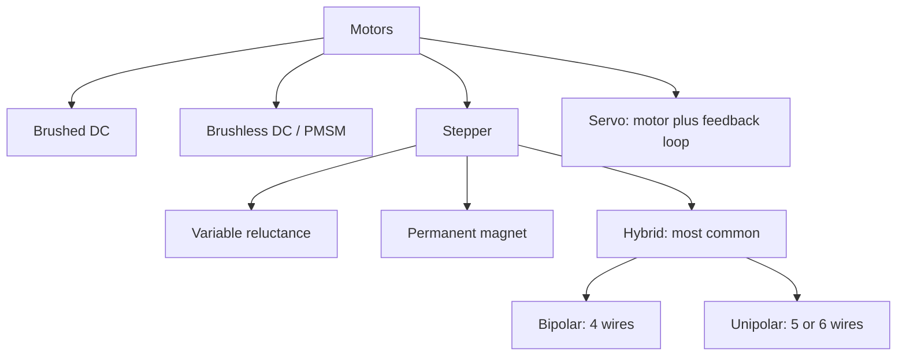

::: basics
### In plain words
A stepper motor moves in small, fixed steps. Each pulse sent to its driver (the electronics that power its coils) turns the shaft by one step. By counting pulses, you know how far it has turned, usually without any position sensor. It can also hold its position firmly when stopped.

### Picture it
Think of the second hand on a ticking clock. It does not sweep smoothly. It jumps a fixed amount on each tick, and counting ticks tells you the time passed. A stepper works the same way, with each pulse as a tick. The analogy breaks down at one point: a clock cannot be overloaded, but a stepper pushed too hard silently skips a step and loses count.

### Words you need
- **Step**: one fixed angular move of the shaft, caused by one pulse.
- **Phase**: one of the motor's coil groups. Most steppers have two.
- **Holding torque**: the turning force that keeps the shaft in place when the coils are powered but the motor is still.
- **Open loop**: control by counting pulses, with no sensor to check the result.
- **Missed step**: a step the motor fails to make, so the position count is wrong.

### The simplest example
A common stepper turns 1.8° per step. A full turn is 360° / 1.8° = **200 steps**. To rotate a quarter turn, send 200 / 4 = **50 pulses**. To rotate half a turn, send 100. If you then stop sending pulses but leave the coils powered, the shaft stays put against a push, up to the holding torque.

That is the whole idea: one pulse, one step, and the count tells the position. The rest of this page covers the stepper types, the winding types, and the trade-offs, such as falling torque at speed and full current when idle.
:::

::: testing
Whether you can define a stepper motor precisely and place it among the other motor types. A weak answer is "a motor that moves in steps". A strong answer shows:

1. The defining property: it converts a train of electrical pulses into **fixed angular increments**, so position is set by counting pulses, usually without feedback (open loop).
2. The structure: a multi-phase stator and a toothed or magnetised rotor with many poles, giving 1.8° (200 steps/rev) as the common figure.
3. The main types (variable reluctance, permanent magnet, hybrid) and winding types (bipolar, unipolar).
4. The key specs and limits: holding torque, step angle, current, missed steps, torque falling with speed.
:::

::: why
Steppers are everywhere that precise, repeatable positioning is needed without the cost of an encoder and a tuned servo loop: 3D printers, CNC machines, camera and lens mechanisms, scanners, valves and small robots. Interviewers ask the basic question to see if you can define it, and then probe how it works ([[q0377]]), where it is used ([[q0378]]), and how it compares ([[q0379]]). Being crisp here earns trust for the harder follow-ups.
:::

::: concepts
- **Electromagnet and rotor field**: coil currents create a field that the rotor aligns with. See [[q0334]].
- **Poles and teeth**: more rotor teeth gives smaller steps. See [[q0367]].
- **Open-loop control**: command and trust; no position sensor.
- **H-bridge and current chopping**: how each winding is driven. See [[q0371]].
- **Types of motors**: how steppers sit beside brushed, BLDC and servo. See [[q0349]].
- **Torque-speed curve**: steppers lose torque as speed rises ([[q0352]] for the DC analogue).
:::

::: answer
"A stepper motor is a brushless motor that moves in discrete, fixed angular steps. Each electrical pulse to the driver advances the shaft by one step, so by counting pulses I know how far it has turned, typically without needing any position sensor. The most common one is 1.8 degrees per step, which is 200 steps per revolution.

Inside, there's a stator with two windings, called phases, and a rotor with a lot of teeth, often 50, and permanent magnets in the hybrid type. When I energise the windings in a sequence, the rotor teeth align to the stator field one step at a time. If I stop the sequence and leave the coils energised in their last state, the rotor holds its position with a strong holding torque, even at zero speed.

There are three main types: variable reluctance, with a toothed iron rotor and no magnet, permanent magnet, and hybrid, which combines both and is what almost every 'NEMA 17' motor is. Windings can be bipolar, which needs an H-bridge per phase and reverses current, or unipolar with center taps, which is simpler to drive but gives less torque.

The trade-offs: it's cheap, accurate, and easy to control open loop, but torque drops with speed, it can resonate, it draws full current even when stationary, and if it's overloaded it silently loses steps. For high speed or high efficiency, you'd use a BLDC or servo instead."
:::

::: technical
**Definition.** A synchronous, brushless electric motor whose rotor advances by a fixed **step angle** $\theta_s$ on each commutation of the phase currents. $\theta_s = 360^\circ/(N_r\cdot m)$ where $N_r$ is the number of rotor teeth and $m$ the number of full steps per electrical cycle (4 for a 2-phase motor). For a typical hybrid motor $N_r = 50$: $\theta_s = 360/(50\cdot4) = 1.8^\circ$, i.e. 200 steps/rev.

**Types.**

| Type | Rotor | Typical step angle | Notes |
|---|---|---|---|
| Variable reluctance (VR) | Soft iron, toothed, no magnet | 15° and below (varies) | No detent torque, low holding torque, lower cost; uncommon today |
| Permanent magnet (PM, "can-stack") | Multi-pole magnet | 7.5° to 15° (typical) | Cheap, coarse, low torque |
| Hybrid | Toothed rotor with axial magnet | 1.8° or 0.9° | Common in industry, best torque and resolution |

**Windings.**
- **Bipolar**: two coils, 4 wires; each coil needs current reversal (H-bridge). Uses full copper → highest torque.
- **Unipolar**: center-tapped coils (5 or 6 wires); only half of each coil is energised at a time; simple drive (one switch per half-coil) but about 30% less torque for the same frame.
- Many unipolar motors can be wired as bipolar by ignoring the center tap.

**Key specs.** Step angle and accuracy (typically ±5% of a step, non-cumulative), holding torque (N·m at rated current), detent torque (unpowered), rated current per phase, winding resistance and inductance (rated voltage $= IR$), rotor inertia, max pull-out torque vs speed, frame size (NEMA 17 is 42 mm square).

**Operating principle in one line.** Torque arises from the interaction of the stator field with the rotor teeth/magnet, $T \approx -T_h\sin(N_r\,\Delta\theta)$ around each stable position (see [[q0382]]), so each current state defines an equilibrium and moving the state moves the equilibrium by one step.
:::

::: short
"A stepper is a brushless motor that moves in fixed angular steps, one per pulse to the driver, so you can position it by counting pulses, usually open loop. The common hybrid type has two phases and 50 rotor teeth, giving 1.8 degrees per step, 200 per revolution. It has high holding torque at standstill, but torque falls with speed and it can lose steps if overloaded. Windings are bipolar or unipolar."
:::

::: long
"A stepper motor is a brushless motor designed to move in discrete angular steps. Rather than spinning freely at a speed set by voltage, it advances by a fixed angle each time its windings are switched to the next state in a sequence. That means I can control position simply by counting the steps I command, and I can control speed by the pulse rate, usually without any position feedback. That's what 'open loop' means here.

The usual hybrid stepper has two phases on the stator and a rotor with about 50 teeth plus a permanent magnet. One electrical cycle of the two-phase currents is four full steps, so each step is 360 over 50 times 4, which is 1.8 degrees, or 200 steps per revolution. With half-stepping or microstepping I can subdivide that further. When I energise a pair of coils and hold, the rotor locks into a stable equilibrium and resists being turned, which is the holding torque; that's useful because I can hold a position at zero speed with no mechanical brake.

In terms of types: variable reluctance has no magnet and a toothed iron rotor; permanent magnet types are cheap and coarse; hybrid is the standard industrial and 3D-printer motor. Windings are either bipolar, four wires, which need an H-bridge to reverse current and give the best torque, or unipolar, with center taps and easier drive but lower torque.

The trade-offs are that torque falls quickly with speed because of inductance and back-EMF, it resonates around certain speeds, it draws full current even at standstill so it gets warm, and if the load exceeds the available torque it skips steps without any indication. So for high speed or high efficiency, I'd choose a BLDC or servo, and for simple, accurate positioning at low-to-moderate speed, a stepper is hard to beat."
:::

::: terms
- **Step angle**: angle moved per step, e.g. 1.8°.
- **Phase**: an independent winding group; hybrid steppers typically have 2.
- **Bipolar / unipolar**: current reverses in each coil / center-tapped coil with unidirectional current.
- **Holding torque**: maximum torque the motor can resist at rest with rated current.
- **Detent torque**: torque with no current from the permanent magnet.
- **Open-loop**: no position feedback; the controller assumes every step was executed.
- **Missed step**: a commanded step that did not result in rotor movement.
- **Microstepping**: driving intermediate current ratios to place the rotor between full steps.
:::

::: exceptional
An average answer says "it moves in steps". An exceptional answer:

- Defines it by its function: pulse-in, fixed-angle-out, position by counting, open loop.
- Computes the step angle from teeth and phases ($360/(50\cdot4) = 1.8^\circ$).
- Names the types and winding styles and what each trades off.
- States the limits upfront: torque falls with speed, resonance, full-current heating, missed steps with no warning.
- Notes that accuracy is non-cumulative (about ±5% per step) because the position is defined by the geometry, not by integration.
:::

::: mistakes
- **"Steppers always know their position."** Only as long as no step is missed; there is no feedback to detect a loss.
- **"1.8° steps means the accuracy is 1.8°."** Resolution is 1.8°, accuracy is about ±0.09° (5% of a step), non-cumulative.
- **Confusing stepper and servo.** A servo has a feedback sensor and closed-loop control; a stepper normally has neither.
- **Applying the rated voltage directly.** The rated voltage ($IR$) is a *current* spec; you need a current-controlled driver with a higher supply.
- **Thinking steppers are efficient.** They draw full current at standstill and dissipate $I^2R$ even when doing no work.
- **"Unipolar is better because it's simpler."** It is simpler to drive but gives less torque than bipolar in the same frame.
:::

::: deep
## What it is, physically

A stepper's rotor wants to line up with the stator's magnetic field. In an ordinary motor you keep the field rotating faster than the rotor can follow and let a controller or commutator keep it ahead ([[q0363]]). In a stepper you instead move the field in discrete jumps, and the rotor jumps to the new equilibrium. Every current pattern in the windings defines a set of stable rotor positions, and switching to the next pattern moves the target by one step.


Figure: Where steppers sit in the motor family, and the subdivision inside steppers. The hybrid, bipolar stepper (NEMA 17 and similar) is the one you will meet in practice.

## Step angle arithmetic

For a two-phase hybrid motor:

$$\theta_s = \frac{360^\circ}{N_r\cdot 4} = \frac{360^\circ}{50\cdot4}=1.8^\circ \quad\Rightarrow\quad 200\ \text{steps/rev}$$

One electrical cycle of the phase currents (a full cycle of A and B) moves the rotor by one tooth pitch, $360^\circ/N_r = 7.2^\circ$ for 50 teeth, and contains 4 full steps. A 0.9° motor uses a rotor and stator tooth arrangement that gives 400 steps/rev.

The relationship with BLDC: a stepper is a high-pole-count, two-phase synchronous motor ([[q0367]] has the same electrical vs mechanical relation, with $p=50$ here). A 50-pole-pair machine has to be switched at 50 electrical cycles per revolution, which explains the torque loss at speed.

## Windings

```circuit
{"caption":"Bipolar (left) and unipolar (right) windings","elements":[
 {"t":"L","a":[2,2],"b":[2,8],"label":"coil A"},
 {"t":"term","at":[2,2],"label":"A+","side":"top"},{"t":"term","at":[2,8],"label":"A-","side":"bottom"},
 {"t":"L","a":[9,2],"b":[9,8],"label":"coil B"},
 {"t":"term","at":[9,2],"label":"B+","side":"top"},{"t":"term","at":[9,8],"label":"B-","side":"bottom"},
 {"t":"text","at":[5.5,11],"text":"bipolar: 4 wires, current reverses","anchor":"middle","muted":true},
 {"t":"L","a":[20,2],"b":[20,6],"label":"A1"},
 {"t":"L","a":[20,6],"b":[20,10],"label":"A2"},
 {"t":"dot","at":[20,6]},{"t":"wire","pts":[[20,6],[23,6]]},{"t":"term","at":[23,6],"label":"COM A","side":"right"},
 {"t":"term","at":[20,2],"label":"A+","side":"top"},{"t":"term","at":[20,10],"label":"A-","side":"bottom"},
 {"t":"text","at":[22,13],"text":"unipolar: center tap, one polarity","anchor":"middle","muted":true}
]}
```
Figure: A bipolar winding is one coil per phase, so full copper is used but each end must be driven both high and low (an H-bridge). A unipolar winding has a center tap; each half is energised in turn from a single switch, so only half the copper carries current at once. Only phase A is shown for the unipolar motor; phase B is identical.

## Types in a bit more detail

**Variable reluctance.** A soft-iron toothed rotor, no magnet. The rotor teeth align with whichever stator teeth are energised (minimum reluctance). No detent torque (shaft spins freely when unpowered), but lower torque per size and coarser resolution.

**Permanent magnet (can-stack).** A multi-pole magnetic rotor, two stacks of claw-pole stators. Cheap, 7.5° to 15° steps, used in cheap appliances and instrumentation.

**Hybrid.** A rotor made of two toothed discs on either side of an axial magnet, so one disc is all N and the other all S, offset by half a tooth. The stator has 8 poles with small teeth. This combines the fine teeth of VR with the magnet's flux of PM: high torque, 1.8° or 0.9° steps, detent torque present.

## The numbers people quote

| Spec | Typical NEMA 17 value |
|---|---|
| Step angle | 1.8° (200 steps/rev) |
| Holding torque | 0.3 to 0.6 N·m (frame length dependent) |
| Rated current | 1 to 2 A per phase |
| Winding resistance | 1 to 4 Ω |
| Inductance | 2 to 10 mH |
| Rated voltage | $IR \approx 2$ to 4 V |
| Detent torque | tens of mN·m |
| Rotor inertia | tens of g·cm² |

These are typical ranges from catalogue-style motors, not specific products.

## Why open-loop works (and where it doesn't)

The driver commands a position target; the rotor follows as long as the torque needed to follow does not exceed the motor's available torque at that speed. If it does, the rotor slips by one or more full electrical cycles (4 steps, 7.2°) and the commanded count no longer matches reality. Because the slip is a whole number of electrical cycles, it looks like a clean offset, which is why a 3D printer layer shift looks like a clean jump, not a slow drift. Closed-loop steppers add an encoder and detect or correct this.

```sim
{"id":"stepper-lab","mode":"full","microsteps":8}
```
Figure: The coil currents, rotor angle and step table for full-step drive. Switch to half-step and micro modes to see how the same motor gives 400 or more positions per revolution.

## Worked example: the stepper as a stiff, nonlinear spring

The equation $T \approx -T_h\sin(N_r\Delta\theta)$ from the technical section hides a lot of useful engineering. Take a NEMA 17 hybrid with holding torque $T_h = 0.45$ N·m, 50 teeth, rotor inertia 57 g·cm² ($5.7\times10^{-6}$ kg·m², all illustrative figures within the catalogue range above).

**Deflection under load.** With rated current in the phases, apply a 0.2 N·m external torque. The rotor shifts until the restoring torque matches: $\sin(N_r\Delta\theta) = 0.2/0.45$, so $N_r\Delta\theta = 26.4^\circ$ in electrical terms, which is $\Delta\theta = 26.4/50 = 0.53^\circ$ of actual shaft rotation, about 0.29 of a full step. The maximum possible displacement before the rotor is pushed past the peak is a quarter electrical cycle (90 electrical degrees), which is exactly one full step (1.8°). Push harder than $T_h$ and the rotor slips over the top into a neighboring equilibrium, a whole tooth pitch away (7.2°), which is a lost-step event. So the holding torque is the real ceiling on the load a stepper can position, and the "safe" working load is a fraction of it, usually well under half, so that dynamic loads and torque ripple don't tip it over.

**Stiffness and resonance.** Around an equilibrium the sine is nearly linear, so the rotor behaves like a torsional spring with stiffness $k = T_hN_r = 0.45\times50 = 22.5$ N·m/rad. A rotor of inertia $J$ on that spring has a natural frequency $f_n = \frac{1}{2\pi}\sqrt{k/J} = \frac{1}{2\pi}\sqrt{22.5/5.7\times10^{-6}} = 316$ Hz. Adding a load inertia equal to the rotor's lowers it to about 224 Hz. Stepping at a rate near that frequency (316 steps/s is about 95 rpm for a 200-step motor) pumps energy into the rotor each step and produces the well-known mid-speed resonance, where torque dips and steps can be lost. Real motors damp it with friction and the drive, so the observed resonance is typically somewhat different, but the order of magnitude explains why resonance bands sit around tens to a couple of hundred rpm and why microstepping and damping help.

**Speed from pulse rate.** The step rate sets the speed directly: $\text{rpm} = 60\times\text{steps/s}/200$. A shaft speed of 300 rpm needs $300\times200/60 = 1{,}000$ full steps per second, or 16 kHz of step pulses at 1/16 microstepping.

**Accuracy.** The ±5% of a step accuracy is ±0.09°. Through a 2 mm-lead screw, $0.09/360\times2\ \text{mm} = 0.5\ \mu\text{m}$ of error, non-cumulative, since each step lands on a position defined by the rotor and stator teeth. That is excellent for an open-loop device, but it applies at the full-step positions at rated current and light load. Between them the accuracy depends on friction.

## How good is a microstep, really?

At 1/16 microstepping one microstep is 0.1125° of shaft rotation, and in electrical terms $90^\circ/16 = 5.6^\circ$. The torque change available to move the rotor by one microstep is only $T_h\sin(5.6^\circ) = 0.045$ N·m, about 10% of holding torque. If the shaft has 0.02 N·m of static friction (a modest figure, illustrative), the rotor stops anywhere within $\arcsin(0.02/0.45) = 2.6^\circ$ electrical of its target, which is $\pm0.05^\circ$ mechanical, about ±45% of a microstep. So at 1/16 and finer the commanded position is not the actual position: microstepping smooths the motion and reduces resonance, but friction sets a dead zone, and the current-ratio accuracy and the tooth-to-tooth geometry set the rest. Don't claim a stepper resolves 1/256 of a step because the driver can output that many current levels.

> [!UNCERTAIN]
> The holding torque, rotor inertia and friction above are representative of a mid-size NEMA 17 but vary by manufacturer and stack length. Check the actual datasheet; the method, not the specific numbers, is the point.

## Where the simple definition breaks

- **Speed.** The coil inductance limits how fast the current can build in each step, so the available torque falls as the step rate rises; above a certain rate the motor can no longer follow at all and must be ramped up.
- **Acceleration limits.** Pulses must be ramped; jumping straight to a high step rate stalls the rotor because it cannot accelerate fast enough to keep up with the field.
- **Temperature.** At standstill the motor dissipates $I^2R$ in both phases continuously. A 1.5 A, 2 Ω winding wastes 9 W for two phases, and the case can reach 80 °C or more in a closed enclosure; many drivers offer idle current reduction.
- **Step count versus sensor.** A step counter is only a position estimate. If the process cannot tolerate a lost step (a safety actuator), add a home switch or an encoder.

## Bench checks

Measure the phase resistance with a DMM and compare with the datasheet; check inductance with an LCR meter. Identify the phases by shorting wire pairs and feeling for drag when turning by hand. Drive one phase with a small DC current from a current-limited supply and observe the detent: push on the shaft and note the angle where it snaps. With a torque arm or a small weight on a pulley, deflect the shaft until it slips and compare with the datasheet holding torque; the slip happens near the peak of the sine, about one full step from equilibrium. Then use a scope on the winding current and a tachometer or step counter to see torque collapse as step rate rises. A lost-step test, such as a marked wheel returned to the same position after many moves, confirms there is no drift under the intended load.

:::

::: applications
- **3D printers and CNC machines**: axis motion with step/dir drivers.
- **Camera and lens mechanisms**: focus and zoom positioning.
- **Printers and scanners**: paper feed and carriage movement.
- **Medical and lab equipment**: syringe pumps, sample handling.
- **Valves and dampers**: HVAC and automotive actuators.
- **Telescope mounts, robotics and hobby projects**: low-cost positioning.
:::

::: assumptions
- The default meaning is the **hybrid, two-phase, bipolar** stepper because it dominates practice; other types are mentioned for completeness.
- Typical numbers (1.8°, 50 teeth, NEMA 17 values) are representative, not universal; five-phase and 0.9° motors exist.
- "Open loop" is the classic mode; closed-loop and hybrid-servo steppers are an extension.
- Torque statements assume rated current and a suitable driver.
:::

::: followups
### How do you get 200 steps per revolution?
A hybrid rotor has 50 teeth, and a two-phase motor makes 4 full steps per electrical cycle. $50\cdot4 = 200$ steps, each $360^\circ/200 = 1.8^\circ$.

### Is a stepper a DC motor?
It runs from a DC supply through a driver, but it is a synchronous AC-field machine: the driver reverses currents in each winding in sequence. In that sense it's a brushless motor with a very high pole count.

### What does 'holding torque' mean and does the motor hold when unpowered?
Holding torque is the maximum torque the shaft can resist at rated current without slipping. Unpowered, only the much smaller detent torque from the permanent magnet resists rotation (VR types have none), so steppers don't hold a load when power is off.

### Why don't steppers need feedback?
Because position is set by the discrete step geometry. The driver commands step N, and the rotor goes to the Nth equilibrium. As long as torque suffices, the position is right, and errors don't accumulate. The cost is that failures (stall, skipped steps) go unnoticed.

### Scenario: a 3D printer's layers are suddenly shifted sideways. What happened?
The X or Y stepper missed steps: it was asked to accelerate or move faster than its torque allowed, or the load jammed, or the driver current was too low or overheated. Since open-loop control keeps counting, all later moves are offset. Check driver current setting, acceleration limits, belt tension, supply voltage and temperature.
:::

::: interpretations
"What is a stepper motor?" is the definition question. [[q0377]] is "How does it work?" (the sequence and the physics), [[q0378]] the applications, [[q0379]] the advantages, [[q0380]] the microcontroller interface, [[q0381]] spec'ing and [[q0382]] how it holds position. This page keeps to definition, types and specs.
:::

::: references
- Hughes & Drury, *Electric Motors and Drives*: chapter on stepping motors (types, step angle, torque).
- Kenjo & Sugawara, *Stepping Motors and Their Microprocessor Controls*: classic treatment of stepper types and driving.
- Acarnley, *Stepping Motors: A Guide to Theory and Practice*: theory, characteristics and drives.
- Manufacturer application notes on stepper basics (for example from stepper-driver IC vendors); consult current documentation.
:::

::: rubric
- Defines a stepper as a motor that moves in fixed angular increments per pulse :: The core definition.
- States open-loop positioning by counting steps :: Distinguishes it from servos.
- Computes or states 1.8° / 200 steps from teeth and phases :: Shows understanding of the geometry.
- Names types (VR, PM, hybrid) and windings (bipolar, unipolar) :: Shows breadth.
- Mentions holding torque :: A defining feature.
- States limits: torque falls with speed, missed steps, heating :: Honest, practical understanding.
- Mentions typical specs or an application :: Grounds the answer.
:::

::: quiz
```json
[
 {"type":"mcq","level":"fundamental","q":"What does a stepper motor do on each pulse from the driver?","options":["Spins continuously at fixed speed","Advances by a fixed angle","Reverses direction","Stops"],"answer":1,"explain":"A stepper converts each commutation step into a fixed angular increment, e.g. 1.8°."},
 {"type":"numeric","level":"fundamental","q":"A hybrid stepper has 50 rotor teeth and 2 phases (4 full steps per electrical cycle). What is the step angle in degrees?","answer":1.8,"tolerance":0.01,"unit":"°","explain":"$360/(50\\cdot4) = 1.8^\\circ$."},
 {"type":"truefalse","level":"fundamental","q":"A standard open-loop stepper motor can detect if it has missed a step.","answer":false,"explain":"Without a position sensor the controller has no way to know, so missed steps go unnoticed."},
 {"type":"numeric","level":"intermediate","q":"How many degrees does the rotor of a 50-tooth hybrid stepper turn per full electrical cycle?","answer":7.2,"tolerance":0.01,"unit":"°","explain":"One electrical cycle moves one tooth pitch: $360/50 = 7.2^\\circ$ (4 full steps of 1.8°)."},
 {"type":"mcq","level":"intermediate","q":"Which winding style gives higher torque in the same frame, and why?","options":["Unipolar, because it has more wires","Bipolar, because all the copper is used at once","Both identical","Unipolar, because the center tap boosts flux"],"answer":1,"explain":"Bipolar windings energise the whole coil at once; unipolar uses half at a time, so roughly 30% less torque."},
 {"type":"multi","level":"advanced","q":"Select all true statements about hybrid stepper motors.","options":["They typically have both a magnet and toothed rotor","They have zero detent torque","Position error is largely non-cumulative","Torque falls as step rate rises"],"answer":[0,2,3],"explain":"Hybrid motors combine magnet and teeth, have some detent torque, have non-cumulative step error, and lose torque with speed because of winding inductance and back-EMF."}
]
```
:::
