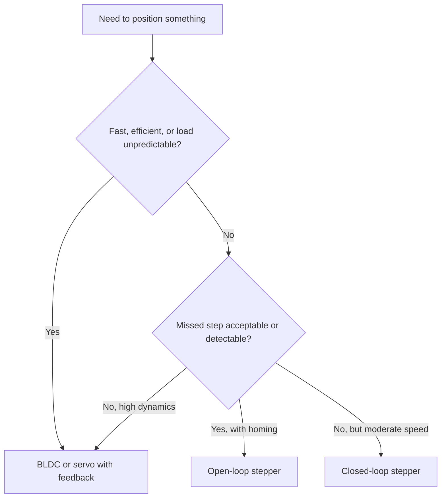

::: testing
Whether you can connect a stepper's **properties** (open-loop position by step counting, high holding torque at zero speed, high low-speed torque, low cost, torque falling with speed) to **real products**, and say why a stepper was chosen over a DC motor or servo. The interviewer is looking for:

1. A list that is more than names: each application tied to a property that makes the stepper a good fit.
2. At least one worked number (steps per mm, resolution, force from a lead screw).
3. Awareness of where steppers are a poor choice (high speed, high efficiency, large dynamic loads).
4. A mention of closed-loop variants or when a servo is better ([[q0386]]).
:::

::: why
Choosing a motor is often the first design decision in a mechatronic product, and "stepper or not" is one of the most common choices at the low-cost, low-power end. A candidate who says "3D printers" and stops sounds like a hobbyist; one who explains that a stepper lets a printer do open-loop positioning on a belt with 12.5 µm per microstep and no encoder, and then states what can go wrong, sounds like an engineer. The same reasoning answers advantage questions ([[q0379]]) and spec questions ([[q0381]]).
:::

::: concepts
- **Open-loop positioning**: position by counting steps. See [[q0377]].
- **Holding torque at zero speed**: hold position without a brake. See [[q0382]].
- **Torque vs speed**: high at low speed, falling with speed. See [[q0377]].
- **Transmission and resolution**: steps per revolution times mechanics (belt, screw, gear) sets resolution.
- **Cost and simplicity**: no sensor, simple driver, no tuning.
- **Alternatives**: brushed DC, BLDC, servo. See [[q0349]].
:::

::: answer
"Steppers show up wherever you want accurate, repeatable positioning at low to moderate speed without paying for feedback.

The classic example is a 3D printer or CNC machine: each axis is a stepper moving a belt or a lead screw. Because one step is a known angle, I can compute exactly how far the carriage moves per step. With a 20-tooth, 2 mm pitch pulley and 16 microsteps, that's 80 steps per millimetre, or 12.5 microns per step, with no encoder. Similar logic applies in printers and scanners for paper feed and carriage positioning, in camera systems for focus and zoom, in medical syringe pumps where steps map to volume, in valves and HVAC dampers, in telescope mounts, and in car dashboards for the gauge needles.

The properties that make them fit are: open-loop position control by counting pulses, full torque at standstill so they hold a position without brakes, high torque at low speed so they can often drive a load directly without a gearbox, no brushes, and low cost with simple drivers.

Where I wouldn't use them: high-speed or high-efficiency drives, because torque falls with speed and they draw full current when idle; and applications with unpredictable loads or where a missed step is unacceptable, like a surgical robot, without feedback. There I'd choose a servo, or a closed-loop stepper that adds an encoder to catch lost steps."
:::

::: technical
**Fit criteria.** A stepper is a good choice when most of these hold:
- Required speed is low to moderate (hundreds to a couple of thousand rpm at most, usually under about 1000 rpm).
- Load torque is predictable and below the pull-out torque with margin (≥ 30 to 50%).
- Position by counting is acceptable (no feedback), or a cheap encoder can be added.
- Holding torque at standstill is needed.
- Cost and simplicity matter; power efficiency is not critical.

**Resolution arithmetic.**
- Belt: $\text{steps/mm} = \dfrac{200\cdot n_{\mu}}{N_{teeth}\cdot p}$. 20 teeth, 2 mm pitch, $n_\mu=16$: $3200/40 = 80$ steps/mm = 12.5 µm.
- Lead screw: $\text{steps/mm} = \dfrac{200\cdot n_\mu}{L}$. 8 mm lead, 16 microsteps: 400 steps/mm = 2.5 µm.
- Gear train: angle per microstep divided by the ratio; $1.8^\circ/16/100 = 4.05$ arcsec with a 100:1 reducer (theoretical; backlash and tooth error dominate).

**Force from a lead screw.** $F = \dfrac{2\pi\eta T}{L}$. With $T=0.4$ N·m, $L=8$ mm, $\eta=0.4$: $F=126$ N (typical for a trapezoidal screw; ball screws have $\eta\approx0.9$).

**Speed check.** A belt axis at 300 mm/s with 80 steps/mm needs 24 000 microsteps/s; that is 450 rpm or 1500 full-steps/s, i.e. an electrical frequency of 375 Hz, well within a NEMA 17's useful range with a 24 V driver (see [[q0377]]).

**Limits.** Open-loop systems lose steps if torque is exceeded; efficiency is low (hold current heats the motor); resonance and noise at certain speeds; torque falls roughly with $1/f$ at speed.
:::

::: short
"Steppers are used where I want accurate positioning at low to moderate speed without feedback: 3D printers and CNC axes, printers and scanners, camera focus mechanisms, syringe pumps, valves and dampers, telescope mounts and gauge needles. They fit because position equals step count, they hold torque at standstill, they give high low-speed torque without a gearbox, and they're cheap with simple drivers. They're a poor fit for high speed, high efficiency or applications where a missed step is unacceptable without an encoder."
:::

::: long
"A stepper is the right tool when I need repeatable positioning at low to moderate speed and I'd rather not pay for feedback and loop tuning. The properties that matter are: position is set by counting steps, so there's no encoder or tuning; it produces its full torque at zero speed, so it can hold a position without a brake; it makes high torque at low speed, so I can usually drive the load directly; and it's inexpensive with simple drivers.

The best-known example is a 3D printer or a CNC router. Each axis has a stepper driving a belt or a lead screw. With a 20-tooth, 2 mm pitch pulley and 16 microsteps, I get 80 steps per millimetre, 12.5 microns per step, and the controller just counts. A lead screw with an 8 mm lead gives 400 steps per mm. Other uses: paper feed and carriage in printers and scanners, camera focus and zoom, syringe pumps where one step is a known volume, HVAC dampers and valves, telescope and antenna mounts, and instrument-cluster needles in cars.

The reason they're attractive is that the accuracy comes from geometry. Each step error is about five percent of a step and doesn't accumulate, so the position after a thousand steps is just as accurate as after one.

But I'd be clear about the limits. Torque falls with speed, so they're for low to moderate rpm. They draw full current even when stationary, so efficiency is poor and they run warm. They can resonate. And if the load exceeds the available torque they silently miss steps, so for safety-critical or variable loads I'd add an encoder, a closed-loop stepper, or use a servo. For example, a medical robot or a high-speed pick-and-place machine wouldn't use an open-loop stepper."
:::

::: terms
- **Open-loop positioning**: commanding position without measuring it.
- **Steps per mm**: resolution of a linear axis, from steps, microsteps and transmission.
- **Lead screw / belt drive**: mechanisms converting rotation to linear motion.
- **Holding torque**: ability to resist movement at standstill with current applied.
- **Closed-loop stepper**: stepper with an encoder and a control loop to detect or correct lost steps.
- **Microstepping**: sub-step resolution through sine-cosine currents.
- **Missed step**: a commanded step that did not occur.
- **Backlash**: free play in a mechanical transmission.
:::

::: exceptional
An average answer lists "3D printers, CNC, printers". An exceptional answer:

- Ties each application to the stepper property that makes it viable (open-loop counting, holding torque, low-speed torque, cost).
- Gives a resolution or force calculation (80 steps/mm, 126 N from a screw).
- Points out that accuracy is non-cumulative and set by geometry.
- States where steppers don't fit and what to use instead, naming closed-loop steppers or servos.
- Mentions the failure mode (missed steps) and how products mitigate it (current margin, homing switches, encoders).
:::

::: mistakes
- **"Steppers are for high precision."** Resolution is high; accuracy is limited by about ±5% of a step plus the mechanics (backlash, belt stretch).
- **Using steppers for fast, dynamic loads.** Torque falls with speed, and high acceleration causes missed steps.
- **Forgetting homing.** Open-loop systems need a reference (limit switch) at startup to know where they are.
- **Ignoring heat.** A stepper at rated current stationary dissipates $2I^2R$, around 9 W for a NEMA 17, in an enclosure that may not cool it.
- **Sizing for holding torque only.** Dynamic torque at the required speed is what counts; use the torque-speed curve.
- **Assuming microsteps increase force resolution.** The restoring torque per microstep is small, so friction can leave the rotor between positions.
:::

::: deep
## Why these applications


Figure: A rough decision tree. Steppers sit in the low-cost, low-to-moderate speed corner where open-loop counting is enough, with closed-loop steppers extending that corner when a missed step is not acceptable.

## Application by application

| Application | Stepper property used | Notes |
|---|---|---|
| 3D printer axes | Open-loop counting, low-speed torque, cost | Belt or screw; homing switches; microstepping for smoothness and quiet |
| CNC routers/laser cutters | Same, with larger frames | Larger NEMA 23 motors; risk of lost steps under cutting load |
| Printers, scanners, copiers | Positioning, cost | Paper feed and carriage, often with gearing |
| Camera lens focus/zoom, pan-tilt | Small, quiet, positionable | Microstepping for smooth video |
| Syringe and peristaltic pumps | Step count equals volume | Open loop, accuracy via geometry |
| Valves, dampers, HVAC | Holding torque, simple control | Often small PM steppers with gearbox |
| Telescope and antenna mounts | Fine resolution with gearing | Arcsecond-scale steps via reduction |
| Automotive gauges | Tiny steppers drive needles | Miniature micro-stepped motors |
| Robotics (small, hobby) | Low cost, easy drivers | Wheel odometry from steps, but slip is unaccounted |
| Medical and lab automation | Repeatable motion | Often with encoders for assurance |

## Worked example: a 3D-printer X axis

**Mechanics:** GT2 belt (2 mm pitch), 20-tooth pulley, so 40 mm per revolution. NEMA 17, 200 steps/rev, driver at 16 microsteps: 3200 microsteps/rev.

$$\text{steps/mm}=\frac{3200}{40}=80,\qquad \text{resolution}=12.5\;\mu\text{m}$$

**Speed:** 300 mm/s needs $300\cdot80 = 24{,}000$ microsteps/s = 7.5 rev/s = 450 rpm; in full steps, 1500 per second, so the electrical frequency is $1500/4 = 375$ Hz. That is well within the motor's capability with a 24 V supply (the current can rise within a step period; see [[q0377]]).

**Torque margin:** moving a ~0.5 kg carriage at 5 m/s² needs $F=2.5$ N; at the 20-tooth pulley's pitch radius ($40/2\pi = 6.4$ mm), torque $\approx2.5\cdot0.0064 = 16$ mN·m, a small fraction of a NEMA 17's roughly 400 mN·m holding torque. Large margin, so no lost steps; the real limiting factors are belt stretch and frame stiffness, not motor resolution.

## Worked example: Z axis with a lead screw

8 mm lead, trapezoidal screw with $\eta = 0.4$, motor torque 0.4 N·m (at the working speed): $F=\dfrac{2\pi\eta T}{L}=\dfrac{2\pi\cdot0.4\cdot0.4}{0.008}=126$ N. Resolution at 16 microsteps: $8\,\text{mm}/3200 = 2.5\;\mu$m. A screw with low enough efficiency (fine lead, high friction) is self-locking, so the axis holds position even with power off, which is why vertical axes use screws, not belts. Check this for your screw: a coarse multi-start 8 mm-lead screw is close to the limit and can back-drive under a heavy load, while a 2 mm-lead screw reliably self-locks.

```plot
{"title":"Illustrative torque-speed curve for a NEMA 17 on 24 V (shape, not a specific motor)","x":{"label":"Speed","unit":"rpm","min":0,"max":1500},"y":{"label":"Torque (N·m)","min":0,"max":0.6},
 "vars":{"th":0.45,"rpmc":400},
 "series":[{"label":"pull-out torque (illustrative)","fn":"th/(1+pow(x/rpmc,2))"}],
 "xspans":[{"from":0,"to":300,"label":"sweet spot: low-speed, high torque"}],
 "points":[{"x":450,"y":0.199,"label":"printer axis at 450 rpm: still far above need"}]}
```
Figure: Typical shape of a stepper's pull-out torque curve (the exact curve comes from the motor datasheet and driver voltage). Applications that live in the first few hundred rpm get most of the holding torque; at 450 rpm the available torque has fallen to about 0.2 N·m in this model, but a lightly loaded printer axis needs only tens of mN·m. High-speed, high-torque drives would sit off the right side of this curve.

*The numbers on this plot are an illustrative model, not catalogue data.*

> [!UNCERTAIN]
> The torque-speed curve shape depends strongly on winding inductance, supply voltage and driver decay mode. The simple $1/(1+(f/f_c)^2)$ form is only a visual guide.

## Missed steps in the real world

Steppers lose steps if the dynamic torque exceeds what's available or resonance builds. Mitigations used in products:
1. Current margin: choose a motor with at least 50% torque margin at the working speed.
2. Acceleration ramps and speed limits.
3. Homing switches or stall detection at start-up.
4. Driver features such as microstepping and anti-resonance.
5. Encoders on critical axes (closed-loop steppers) to detect or correct.

```sim
{"id":"encoder-lab","cpr":1600,"rpm":300}
```
Figure: A quadrature encoder on a stepper shaft provides the position feedback that detects lost steps. Here it has 1600 lines per rev; with 4× decoding the "Counts / rev" readout shows 6400, i.e. 32 counts per 1.8° full step and 2 per 1/16 microstep. In a closed-loop stepper the firmware compares the commanded position with this count; a difference of about 4 full steps (one electrical cycle) is the signature of a slip.

## When not to use a stepper

| Situation | Better choice |
|---|---|
| Continuous high speed (thousands of rpm) | BLDC |
| Efficiency-critical (battery) | BLDC or servo |
| Rapid, variable dynamic loads | Servo ([[q0386]]) |
| Quiet at high torque | Servo or FOC BLDC |
| Safety-critical position | Servo or closed-loop stepper |
:::

::: applications
- **FDM 3D printers**: X, Y, Z and extruder axes, typically NEMA 17 with microstepping drivers.
- **Desktop CNC and laser engravers**: stepper axes with limit switches for homing.
- **Camera auto-focus and gimbal-style mounts**: small steppers with gearing.
- **Syringe and dosing pumps**: step count to volume.
- **Automotive instrument clusters**: micro-stepper needle gauges.
- **Telescope mounts**: geared steppers with microstepping and tracking.
:::

::: assumptions
- Applications are described for typical hybrid stepper motors and open-loop use; closed-loop systems blur the line with servos.
- Example resolutions assume 16 microsteps and 200 steps/rev; the actual accuracy is limited by mechanics.
- Torque and speed figures are illustrative; check the motor datasheet and driver voltage.
- Not every listed application always uses a stepper (e.g., some printers use DC motors with encoders); the list shows where steppers are common.
:::

::: followups
### Why do vertical axes often use lead screws with steppers?
A trapezoidal lead screw has low efficiency and is self-locking, so it holds the load when the motor is off or after a power loss. The screw also gives high force per torque ($F=2\pi\eta T/L$) and fine resolution (2.5 µm per microstep at 8 mm lead and 16 microsteps).

### What does a closed-loop stepper add?
An encoder and a control loop: the drive checks the position, and if a step is lost it corrects, or at least raises a fault. It keeps the stepper's smooth low-speed torque and simple command interface while fixing the missed-step risk, and it can reduce current when lightly loaded for better efficiency.

### How do you home an open-loop stepper axis?
Move toward a limit switch (or hard stop with stall detection) until it triggers, set that as position zero, then move a known number of steps. The switch gives an absolute reference that the open-loop system otherwise lacks.

### Why do 3D printers use microstepping if accuracy is not 1/16 of a step?
For smoothness and quiet: microstepping reduces resonance and vibration and makes motion smoother. Positional accuracy still depends on the geometry, but surface quality improves.

### Scenario: a laser engraver loses position slightly after long jobs. Stepper problem or something else?
Possibly both. Check for missed steps at high acceleration (reduce acceleration or raise current), belt slip or loose pulley set screw, stalls at corners, overheating driver current-foldback, or resonance. Because the drift is a clean offset rather than gradual, I'd test by adding an encoder or a home-switch return test after the job to compare commanded vs actual position.
:::

::: interpretations
"What are its applications?" is a short question, but the best answer links applications to properties, as above. Related pages: [[q0376]] (what it is), [[q0379]] (advantages versus other motors), [[q0381]] (how to spec one for an application), [[q0386]] (servo advantages for comparison).
:::

::: references
- Kenjo & Sugawara, *Stepping Motors and Their Microprocessor Controls*: applications and drive systems.
- Hughes & Drury, *Electric Motors and Drives*: stepper characteristics and use cases.
- Open-source 3D-printer firmware documentation (for example Marlin or Klipper) for steps-per-mm configuration and acceleration limits; check current documentation.
- Stepper-driver IC manufacturers' application notes on microstepping and system design.
:::

::: rubric
- Lists several applications and ties each to a stepper property :: Shows you know why, not just where.
- Mentions open-loop counting, holding torque and low-speed torque :: The core properties.
- Gives a resolution or force calculation :: Shows engineering ability.
- States accuracy is non-cumulative and geometry-based :: A subtle, correct point.
- Names limits: speed, efficiency, missed steps :: Honest evaluation.
- Mentions homing or encoder/closed-loop mitigation :: Practical awareness.
- Contrasts with servo/BLDC for demanding cases :: Shows trade-off judgment.
:::

::: quiz
```json
[
 {"type":"numeric","level":"fundamental","q":"A 200 step/rev stepper with 16 microsteps drives a belt pulley with 20 teeth and 2 mm pitch. How many microsteps per millimetre?","answer":80,"tolerance":0.01,"unit":"steps/mm","explain":"One revolution moves $20\\cdot2 = 40$ mm and takes $200\\cdot16 = 3200$ microsteps, so $3200/40 = 80$ per mm."},
 {"type":"numeric","level":"fundamental","q":"What is the movement per microstep in the previous question, in µm?","answer":12.5,"tolerance":0.01,"unit":"µm","explain":"$1/80\\text{ mm} = 12.5$ µm."},
 {"type":"mcq","level":"intermediate","q":"Why might a vertical axis use a lead screw with a stepper?","options":["Screws are faster than belts","A low-efficiency screw is self-locking and holds the load when power is off","Screws need no lubrication","Steppers cannot drive belts"],"answer":1,"explain":"A trapezoidal screw with low efficiency doesn't back-drive, so the axis holds position without power, and it provides high force and fine resolution."},
 {"type":"numeric","level":"intermediate","q":"Lead screw force $F=2\\pi\\eta T/L$ with $T=0.4$ N·m, $\\eta=0.4$, $L=8$ mm. Force in N?","answer":126,"tolerance":0.02,"unit":"N","explain":"$2\\pi\\cdot0.4\\cdot0.4/0.008 = 125.7$ N."},
 {"type":"truefalse","level":"intermediate","q":"The accuracy of a stepper positioning system accumulates error with each step, so after many steps it drifts significantly even when no step is lost.","answer":false,"explain":"Step error is set by the motor geometry (about ±5% of a step) and does not accumulate. Drift comes from missed steps or mechanics, not from the stepping itself."},
 {"type":"multi","level":"advanced","q":"Which are good reasons NOT to choose an open-loop stepper?","options":["Continuous operation at several thousand rpm","Highly variable, unpredictable load torque in a safety-critical position task","Battery-powered, efficiency-critical continuous drive","Low-speed positioning of a light, predictable load"],"answer":[0,1,2],"explain":"Steppers lose torque at high speed, can't detect lost steps, and burn current at standstill. A light predictable low-speed load is the ideal use."}
]
```
:::
