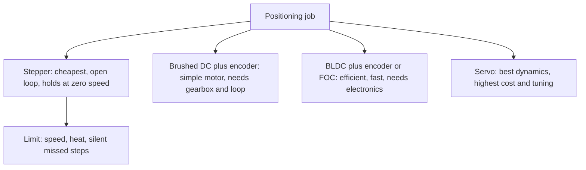

::: testing
Whether you can compare a stepper with **each** alternative (brushed DC, BLDC, servo) and give honest trade-offs rather than a sales pitch. The interviewer is looking for:

1. The real advantages: open-loop positioning without sensors, holding torque at standstill, high torque at low speed, no brushes, low cost, simple interface, non-cumulative error.
2. The corresponding disadvantages: torque falls with speed, missed steps with no warning, low efficiency, heat at standstill, resonance, noise.
3. A decision rule: when a stepper beats a DC/servo and when it doesn't.
4. At least one number to back a claim (holding power, resolution, torque at speed).
:::

::: why
"Why a stepper?" is a design review question you will be asked on any motion project. A good answer saves money (no encoder, no tuning) or avoids a failure (a stepper used where a servo was needed). Because the stepper's strengths and weaknesses are the mirror image of a servo's, this question reveals whether you understand both. It pairs with [[q0386]] for servos and [[q0366]] for brushless motors.
:::

::: concepts
- **Open-loop positioning**: command steps, no feedback. See [[q0377]].
- **Holding torque**: torque at zero speed with current applied. See [[q0382]].
- **Torque-speed behaviour**: steppers high at low speed, DC and BLDC flat to base speed. See [[q0352]].
- **Closed-loop control**: the servo approach; position sensor and tuned loop.
- **Efficiency and heat**: stepper winding current is largely independent of load.
- **Cost and complexity**: sensors, drivers, tuning.
:::

::: answer
"The main advantage of a stepper is that it gives accurate, repeatable positioning without feedback. Compared with a brushed or BLDC motor, which spins at a speed set by voltage and needs an encoder and a control loop to hit a position, a stepper moves a fixed angle per pulse. So I get a position-controlled actuator with just a driver and a microcontroller, no encoder, no tuning, and low cost.

Second, holding torque: a stepper holds position at zero speed with full torque, and the error doesn't accumulate; a DC motor has to be held by a feedback loop or a brake. Third, high torque at low speed, so I can often drive a load directly, a lead screw or a belt, without a gearbox. Fourth, no brushes, so long life and little maintenance, and it's rugged and simple to control with step and direction signals.

The honest downsides: torque falls with speed, so they're for low to moderate speed; they draw full current when idle, so they run warm and are inefficient; they can resonate, they're noisy at some speeds, and if overloaded they miss steps silently because there's no feedback. A servo or BLDC with an encoder wins on speed, efficiency, dynamic response and knowing where it is; a stepper wins on cost and simplicity for low-speed positioning."
:::

::: technical
| Aspect | Stepper (open loop) | Brushed DC + encoder | BLDC/servo with feedback |
|---|---|---|---|
| Positioning | Count steps; no sensor | Needs encoder + control loop | Needs encoder/resolver + loop |
| Torque at zero speed | Full holding torque | Needs loop; stalls draw high current | Holding torque via loop |
| Low-speed torque | High, direct drive | Needs gearbox | High, smooth with FOC |
| High-speed torque | Falls steeply ($\approx1/f$) | Roughly flat to base speed (linear line) | Flat to base speed, then field weakening |
| Efficiency | Low; current is load-independent | Moderate | High |
| Heat at standstill | Full $2I^2R$ (reduceable) | Low if not holding | Low (current proportional to load) |
| Missed positions | Possible, undetected | Detected by encoder | Detected and corrected |
| Cost (motor + drive + feedback) | Lowest | Moderate | Highest |
| Tuning | None | PID tuning | PID/FOC tuning |
| Noise/vibration | Resonance, audible whine | Brush noise | Quiet |
| Maintenance | None (brushless) | Brush wear | None |

**Quantities.**
- Holding power example: a NEMA 17 at 1.7 A, 1.5 Ω per phase: $P = 2\cdot1.7^2\cdot1.5=8.7$ W with zero mechanical output. A servo holding no load draws near zero.
- Resolution: 200 steps/rev natively (1.8°), 3200 with 16 microsteps; an equivalent servo would need a ≥3200 count/rev encoder.
- Accuracy: ±5% of a full step (±0.09°) non-cumulative, typical datasheet value.
- Torque vs speed: roughly $T\propto 1/f$ beyond the corner speed because of winding inductance and back-EMF ([[q0377]]).
- Efficiency: typically well under 50% for steppers at their working point in a chopper drive, versus 70 to 90% for BLDC servos (rule of thumb, load dependent).

> [!UNCERTAIN]
> The efficiency numbers depend strongly on load point, drive mode and motor; treat them as order-of-magnitude guidance and measure input power versus mechanical output for a real design.
:::

::: short
"A stepper's big advantages are open-loop positioning without an encoder or tuning, full holding torque at standstill, high torque at low speed so it can drive loads directly, no brushes, and low cost with a simple step/dir interface; error also doesn't accumulate. The downsides are torque falling with speed, low efficiency and heat because it always draws full current, resonance, and silent missed steps. So steppers win on cost and simplicity at low speed, and servos or BLDCs win on speed, efficiency and knowing their position."
:::

::: long
"I'd compare it to the three alternatives. Versus a brushed or brushless DC motor, the main advantage is positioning. A DC motor spins at a speed set by its voltage, so to put it at a position I need an encoder and a control loop that I have to tune. A stepper moves a fixed angle per pulse, so I can count steps and get a known position with just a driver and a microcontroller. That saves the sensor, the tuning and the cost.

Second is holding torque. A stepper with its coils energised holds position at zero speed, without a brake, and without a loop hunting around the target. Third, high torque at low speed, so I can usually connect a lead screw or belt directly, without a gearbox. Fourth, no brushes, so no wear, and error doesn't accumulate: each step has a few percent error, but they don't add up.

Versus a servo, a stepper is cheaper and simpler, since there's no feedback hardware, and it's stiff at standstill. But a servo wins on dynamics and efficiency. A stepper's torque falls rapidly with speed, so it's limited to low or moderate rpm, and it always draws about full current whether the load is heavy or nothing, so it's hot and inefficient, maybe 9 watts holding a NEMA 17 doing no work. It can resonate, it can be noisy, and when the load exceeds the available torque it loses steps without knowing.

So my rule: stepper for low-speed, predictable load, cost-sensitive positioning, with homing; BLDC or servo when I need speed, efficiency, dynamic response, or guaranteed position. And closed-loop steppers are a middle ground."
:::

::: terms
- **Open-loop control**: no position feedback; commanded motion is assumed to occur.
- **Holding torque**: torque to resist movement at standstill with winding current.
- **Corner speed**: speed above which stepper torque starts falling.
- **Non-cumulative error**: each step's error is independent and doesn't add.
- **Closed-loop stepper**: stepper with encoder feedback.
- **Servo**: motor plus sensor plus controller regulating position or velocity.
- **Resonance**: speed range where the rotor oscillates and torque drops.
- **Backdrive**: ability of an external load to turn the motor.
:::

::: exceptional
An average answer lists "cheap, accurate, no feedback needed". An exceptional answer:

- Compares against each alternative separately, not as a generic motor.
- Quantifies one advantage and one disadvantage (e.g. 12.5 µm resolution vs 8.7 W holding power).
- Explains the physical reason torque falls with speed ($L/R$, back-EMF) and why heat is load-independent.
- Mentions non-cumulative error and what *is* cumulative (missed steps, mechanics).
- Gives a decision rule and names closed-loop steppers as the middle ground.
:::

::: mistakes
- **"Steppers are more accurate than servos."** Resolution can be high, but a servo with a good encoder is more accurate and can correct errors; stepper accuracy is about ±5% of a step plus mechanics.
- **"No feedback means no errors."** It means no *detection* of errors.
- **Calling holding torque 'free'.** It costs $2I^2R$ continuously, so steppers get hot sitting still unless current is reduced.
- **Claiming steppers are high-torque motors.** They have high torque at low speed for their size; at speed a BLDC of the same size delivers far more power.
- **Ignoring noise and resonance.** Steppers can whine and have bad speeds; microstepping helps but doesn't eliminate it.
- **Comparing only motor price.** A servo's encoder and drive add cost, but a stepper may need a bigger motor and gearbox for the same dynamic job, and heat management.
:::

::: deep
## Four things a stepper does well

**1. Position without a sensor.** Position control normally needs three ingredients: an actuator, a sensor and a controller. A stepper folds the sensor and controller's job into the motor's geometry: each current pattern defines a rotor position ([[q0377]]), so commanding patterns commands positions. The savings are an encoder (some tens of dollars for a decent one), cabling, tuning time and a control loop that can go unstable.

**2. Torque at zero speed.** A brushed or BLDC motor's torque is $K_tI$. To hold a position, a servo loop must draw current in proportion to the disturbance; with no sensor there's no way to detect displacement, so no holding. A stepper's energised coils create a restoring torque directly proportional to displacement (a magnetic spring, $T\approx-T_h\sin N_r\Delta\theta$), with no loop at all ([[q0382]]).

**3. High torque at low speed.** Many teeth means many electrical cycles per revolution and a large torque per ampere at standstill. A NEMA 17 can have 0.4 to 0.5 N·m of holding torque at a few amps; a similar-size brushed DC motor delivers a fraction of that without a gearbox. That's why steppers drive screws and belts directly.

**4. Cost and simplicity.** A stepper plus a step/dir driver IC plus a microcontroller timer is among the cheapest ways to position something. No PID tuning, no sensor, no commutation algorithm.

## Four things it does badly

**1. Torque vs speed.**

```plot
{"title":"Illustrative torque-speed shapes (normalised)","x":{"label":"Speed","unit":"rpm","min":0,"max":3000},"y":{"label":"Torque / peak","min":0,"max":1.1},
 "series":[{"label":"stepper (pull-out)","fn":"1/(1+pow(x/400,2))","color":"red"},{"label":"brushed DC (linear line)","fn":"max(0,1-x/3000)","color":"blue"},{"label":"BLDC with field control (flat to base speed)","fn":"min(1,max(0,1-(x-2500)/500))","color":"green","dashed":true}]}
```
Figure: Shapes, not data. A stepper's usable torque collapses with speed because winding inductance slows the current and back-EMF eats the voltage; DC and BLDC motors keep their torque up to near no-load speed. If your operating point is to the right of about 600 to 1000 rpm, the stepper is usually the wrong motor.

**2. Efficiency and heat.** The driver holds the rated current regardless of load, so power in is approximately constant: $P_{in}\approx2I^2R$ plus switching and drive loss. For a NEMA 17 at 1.7 A, 1.5 Ω: 8.7 W at idle. With a 1 W mechanical output the efficiency is ~10%. DC and BLDC motors draw current in proportion to load. Drivers with automatic current reduction (idle current 30 to 50%) reduce heat, but hold torque falls accordingly.

**3. Missed steps without notice.** Overload, resonance, a bad acceleration profile or a bad supply sag makes the rotor slip a whole electrical cycle (7.2° for 50 teeth). The controller continues counting and the position is wrong from then on.

**4. Resonance and noise.** The rotor-load system behaves as a spring-mass; stepping excites it. Full-step drive at low speed is especially rough. Microstepping and damping help.

## Versus each alternative


Figure: Four ways to do the same positioning job. The stepper's route is the shortest and cheapest, and its limits are the price.

| Compared with | Stepper wins | Stepper loses |
|---|---|---|
| Brushed DC + encoder | No encoder, no loop tuning, no brush wear, holds position | Speed, efficiency, quietness |
| BLDC with Hall/encoder | Simple drive, position by counting, holding torque at rest | Efficiency, speed range, power density, smooth quiet running |
| Servo (with encoder) | Cost, simplicity, stiffness at standstill without a loop | Dynamics, accuracy under load disturbance, torque at speed, efficiency |
| Closed-loop stepper | Slightly cheaper, same interface | Detection/correction of lost steps; heat |

**Closed-loop steppers.** Adding an encoder to a stepper and running a feedback loop keeps the step/dir interface but gives error detection and reduced current when lightly loaded. They occupy the middle ground between a stepper and a servo.

## A worked comparison: hold a 0.3 N·m load for an hour

- **Stepper:** holding 0.3 N·m of a 0.45 N·m motor needs about $0.3/0.45=67\%$ of rated current (torque is roughly proportional to current), so $P\approx8.67\cdot0.67^2=3.9$ W. At 0 N·m load a good driver can drop to idle current (say 30%): about 0.8 W.
- **BLDC servo (assumed $K_t=0.05$ N·m/A, $R_{LL}=0.1\ \Omega$):** $I=0.3/0.05=6$ A, so $I^2R=3.6$ W. At 0 N·m load it draws almost nothing.

So the "holding" advantage is about stiffness and simplicity, not power: with a large static load both motors dissipate similar heat; with a small or no load the servo is far cooler.

> [!NOTE]
> The servo constants are assumed, only to show scale: a servo's holding loss scales with the load squared, while a stepper's is set by the current you choose, regardless of the load.

```sim
{"id":"dc-motor-lab","view":"curves","v":12,"r":1,"l":0.001,"kt":0.02,"load":0.01}
```
Figure: The brushed DC torque-speed line is straight: torque declines gently from stall to no-load speed. Overlay this in your mind with the stepper's steeply falling curve above and see why DC and BLDC motors dominate at speed and steppers at near-standstill.

## When I'd pick a stepper

1. Speed below about 600 to 1000 rpm at the motor.
2. Load torque predictable and 30 to 50% below the pull-out curve.
3. Position by counting is acceptable, with homing.
4. Cost, simplicity, or a quick prototype matter.
5. Holding position without extra hardware is useful.

If any of these fail, move to a servo (or a closed-loop stepper if only the third fails).
:::

::: applications
- **Low-cost motion platforms**: 3D printers, laser engravers, desktop CNC.
- **Instrumentation**: pumps, auto-samplers, filter wheels.
- **Consumer products**: printers, scanners, camera lens drives.
- **Building systems**: valve and damper actuators.
- **Prototyping**: first-pass positioning before committing to servos.
:::

::: assumptions
- Compared at similar frame sizes and typical hybrid steppers with chopper drivers; exotic servos and large drives alter the cost balance.
- The torque-speed plot is a qualitative model; real curves come from datasheets at a stated supply voltage.
- Efficiency statements are order-of-magnitude and depend on load and drive mode.
- "Servo" here means a closed-loop motor system (BLDC or DC with encoder) rather than only the hobby RC servo; the hobby servo is discussed in [[q0386]].
:::

::: followups
### Why do steppers not accumulate error?
Because the rotor position is set by the geometry of the energised poles, each step lands within about ±5% of the nominal position independent of the previous one. Errors reset at each step. What does accumulate is missed steps or mechanical effects like belt stretch.

### Can a stepper be more efficient than a servo?
Rarely. In steady-state with a light load, a servo draws current proportional to load, a stepper draws near-rated current regardless. With current reduction at idle, the gap narrows, and for very short, low-duty positioning the stepper's lower hardware cost can dominate, but energy efficiency favours the servo.

### What is the cost advantage, really?
No encoder, no tuning, and a simple driver IC. For small systems that can be tens of dollars per axis. At larger sizes the stepper's extra size and heat may erase it.

### Does microstepping improve torque?
No. It improves smoothness and resolution; actual holding torque at a microstep position is about the same magnitude, but the incremental torque to move one microstep is small ($T_h\sin(90^\circ/n)$), so friction can limit effective accuracy.

### Scenario: a client wants a stepper to drive a fan at 3000 rpm. What do you say?
That's the wrong motor. At 3000 rpm (10 000 full steps/s) torque has collapsed, it would be inefficient and noisy, and positioning isn't needed. A BLDC motor with a simple driver fits: efficient, quiet, flat torque to high speed. A stepper is for position at low speed.
:::

::: interpretations
"Compared to other types of motors" is interpreted as brushed DC, BLDC and servo. For servo advantages see [[q0386]]; for brushless vs brushed see [[q0366]]; for applications see [[q0378]].
:::

::: references
- Kenjo & Sugawara, *Stepping Motors and Their Microprocessor Controls*: comparison of stepper and other drives.
- Hughes & Drury, *Electric Motors and Drives*: stepper vs DC and brushless characteristics.
- Stepper driver and motor manufacturer application notes (open vs closed-loop discussion); consult current vendor documentation.
- Texas Instruments and other vendors' technical articles on stepper vs servo selection.
:::

::: rubric
- Names open-loop positioning without sensors as the key advantage :: The single biggest reason to choose a stepper.
- Mentions holding torque at standstill :: Distinguishes from DC/BLDC without a loop.
- Mentions high low-speed torque and direct drive :: Explains why gearboxes can be omitted.
- Mentions cost/simplicity and non-cumulative error :: Completes the advantage set.
- States the downsides: torque falls with speed, heat, missed steps, resonance :: Balanced comparison.
- Compares against specific alternatives (DC, BLDC, servo) :: Shows structure.
- Gives a decision rule or a number :: Shows engineering judgment.
:::

::: quiz
```json
[
 {"type":"mcq","level":"fundamental","q":"What is the main reason to choose a stepper over a DC motor for positioning?","options":["Higher efficiency","Position can be set by counting steps without feedback","Higher top speed","Lower back-EMF"],"answer":1,"explain":"A stepper moves a fixed angle per pulse, so open-loop counting gives position, avoiding an encoder and a tuned loop."},
 {"type":"truefalse","level":"fundamental","q":"A stepper motor's torque stays roughly constant up to several thousand rpm.","answer":false,"explain":"Stepper torque falls steeply with speed because of winding inductance and back-EMF."},
 {"type":"numeric","level":"intermediate","q":"A stepper has two phases at 1.7 A and 1.5 Ω each. Holding power in watts?","answer":8.67,"tolerance":0.02,"unit":"W","explain":"$2\\cdot1.7^2\\cdot1.5 = 8.67$ W of $I^2R$ heating with zero mechanical output."},
 {"type":"numeric","level":"intermediate","q":"If idle current is reduced to 50%, what is the approximate holding power as a percentage of full-current holding power?","answer":25,"tolerance":0.02,"unit":"%","explain":"Power scales with $I^2$, so $0.5^2 = 0.25$, i.e. 25%."},
 {"type":"mcq","level":"intermediate","q":"Which statement about stepper accuracy is correct?","options":["Errors accumulate over many steps even without lost steps","Per-step error is about ±5% of a step and does not accumulate","Microstepping eliminates all error","Accuracy is set by the encoder"],"answer":1,"explain":"Position is set by geometry; the small per-step error resets each step. Missed steps and mechanics cause drift."},
 {"type":"multi","level":"advanced","q":"Which situations favour a servo (or BLDC with feedback) over an open-loop stepper?","options":["Continuous operation at 3000 rpm","Variable, unpredictable load with a position requirement","Battery-powered where idle current matters","A cheap, low-speed positioning of a light load"],"answer":[0,1,2],"explain":"Speed, unpredictable loads and efficiency all favour servos or BLDCs. The last case is the stepper's sweet spot."}
]
```
:::
